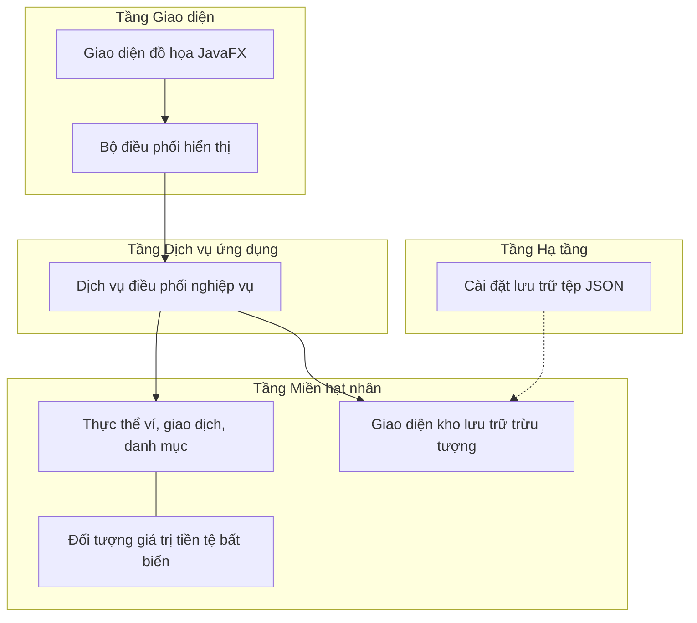

# Personal Finance Management System

Ứng dụng quản lý tài chính cá nhân độc lập trên máy tính, tập trung vào thiết kế hướng đối tượng thuần túy, tính toán tiền tệ chính xác tuyệt đối và lưu trữ dữ liệu cục bộ an toàn.

## Thông số nhanh

| Tiêu chí | Thông số kỹ thuật |
| :--- | :--- |
| Nền tảng thực thi | Java 17 LTS |
| Thư viện đồ họa | OpenJFX 17 |
| Quản lý dự án | Apache Maven với Maven Wrapper |
| Cơ chế lưu trữ | Tệp JSON cục bộ, xử lý qua Google Gson |
| Kiểm thử tự động | 2.267 ca kiểm thử với JUnit 5 và Mockito |
| Ranh giới dữ liệu | Hoạt động ngoại tuyến hoàn toàn trên máy tính cá nhân |

## Kiến trúc và thiết kế hướng đối tượng

Hệ thống áp dụng kiến trúc phân tầng hướng tâm nhằm phân định ranh giới trách nhiệm rõ ràng, bảo đảm nguyên lý phụ thuộc một chiều hướng về tầng miền nghiệp vụ.



### Điểm nhấn thiết kế hướng đối tượng

- Bốn tính chất hướng đối tượng: Đóng gói chặt chẽ trạng thái số dư bên trong thực thể ví; kế thừa lớp trừu tượng giao dịch để chia sẻ cấu trúc dòng tiền chung; đa hình trong quy tắc tác động và hoàn tác số dư; trừu tượng hóa các thao tác dữ liệu qua giao diện kho lưu trữ chuyên biệt.
- Nguyên lý SOLID: Tách biệt đơn trách nhiệm cho từng lớp xử lý; mở rộng thêm giao dịch mới không cần sửa lớp giao dịch cơ sở; bảo đảm lớp con thay thế hoàn hảo cho lớp cha; chia nhỏ giao diện dịch vụ theo từng phân hệ; đảo ngược phụ thuộc qua hợp đồng trừu tượng tại tầng miền.
- Mẫu thiết kế GoF: Vận dụng Factory kiểm soát tính hợp lệ khi tạo lập giao dịch; Strategy linh hoạt thuật toán tổng hợp báo cáo; Observer kết hợp mô hình MVP đồng bộ trạng thái giao diện; State quản lý vòng đời ví tiền; Singleton duy trì cấu hình và dịch vụ đối soát hệ thống.

## Quy tắc nghiệp vụ bất biến

- Độ chính xác số học tuyệt đối: Mọi phép tính tiền tệ sử dụng BigDecimal với thang đo 4 chữ số thập phân và làm tròn nửa chẵn theo chuẩn ngân hàng, loại bỏ hoàn toàn sai số làm tròn của số thực dấu phẩy động.
- Bảo toàn số dư theo dòng tiền: Số dư ví tại mọi thời điểm luôn khớp đúng với tổng lịch sử các giao dịch phát sinh, không cho phép cập nhật số dư trực tiếp ngoài quy trình kiểm kê đối soát.
- Giao dịch hai pha nguyên tử: Giao dịch chuyển tiền giữa hai ví và phí phát sinh đi kèm được xử lý nguyên tử đồng thời trên cả ví nguồn và ví đích, hỗ trợ hoàn tác đồng bộ khi bị hủy.

## Các phân hệ chức năng

| Phân hệ | Nghiệp vụ trọng tâm |
| :--- | :--- |
| Quản lý ví | Tạo ví, giám sát số dư tức thời, kiểm kê thực tế và quản lý trạng thái hoạt động. |
| Ghi nhận thu chi | Lưu vết biến động dòng tiền, gắn danh mục mục đích, tra cứu và lọc đa tiêu chí. |
| Chuyển tiền nội bộ | Điều chuyển vốn hai chiều giữa các ví kèm ghi nhận và phân bổ phí giao dịch. |
| Cây danh mục 3 cấp | Chuẩn hóa phân loại thu chi, đổi tên linh hoạt và xóa mềm bảo vệ dữ liệu cũ. |
| Báo cáo thống kê | Biểu đồ dòng tiền thuần 12 tháng, cơ cấu chi tiêu và tỷ lệ tiết kiệm ròng. |
| Quản trị dữ liệu | Sao lưu và phục hồi qua tệp JSON nguyên tử, quét đối soát kiểm tra sai lệch số dư. |

## Hướng dẫn khởi chạy

Dự án tích hợp sẵn Maven Wrapper trong thư mục gốc, sẵn sàng thực thi mà không cần cài đặt thêm phần mềm quản lý dự án.

### Chạy ứng dụng giao diện

```bash
# Windows
.\mvnw.cmd javafx:run

# Linux / macOS
./mvnw javafx:run
```

### Chạy kiểm thử tự động

```bash
# Windows
.\mvnw.cmd test

# Linux / macOS
./mvnw test
```

### Đóng gói và chạy tệp thực thi

```bash
# Windows
.\mvnw.cmd clean package

# Linux / macOS
./mvnw clean package

# Chạy tệp thực thi sau đóng gói
java -jar target/pfms-core-1.0.0-SNAPSHOT.jar
```

## Cấu trúc thư mục

```text
main/
├── data/       # Tệp dữ liệu JSON lưu trữ cục bộ mặc định
├── docs/       # Toàn bộ tài liệu đặc tả, phân tích và thiết kế
├── src/
│   ├── main/   # Mã nguồn ứng dụng theo các tầng kiến trúc
│   └── test/   # Bộ 2.267 ca kiểm thử tự động với JUnit 5
├── tools/      # Bộ công cụ kiểm tra định dạng và chất lượng kỹ thuật
├── pom.xml     # Cấu hình dự án và quản lý phụ thuộc Maven
├── mvnw        # Script thực thi Maven Wrapper cho Linux và macOS
└── mvnw.cmd    # Script thực thi Maven Wrapper cho Windows
```

## Tài liệu kỹ thuật chi tiết

Chi tiết đầy đủ về từng khía cạnh kỹ thuật được lưu trữ trong thư mục `docs`:

- Đặc tả yêu cầu phần mềm: [docs/software-requirement-specification/srs-tong-hop.md](docs/software-requirement-specification/srs-tong-hop.md)
- Phân tích hướng đối tượng: [docs/object-oriented-analysis/](docs/object-oriented-analysis/)
- Thiết kế hướng đối tượng: [docs/object-oriented-design/](docs/object-oriented-design/)
- Báo cáo cài đặt hệ thống: [docs/core-implementation/bao-cao-cai-dat-he-thong.md](docs/core-implementation/bao-cao-cai-dat-he-thong.md)
- Báo cáo tổng kết đồ án: [docs/final-report/edition/bao-cao-tong-ket.md](docs/final-report/edition/bao-cao-tong-ket.md)
