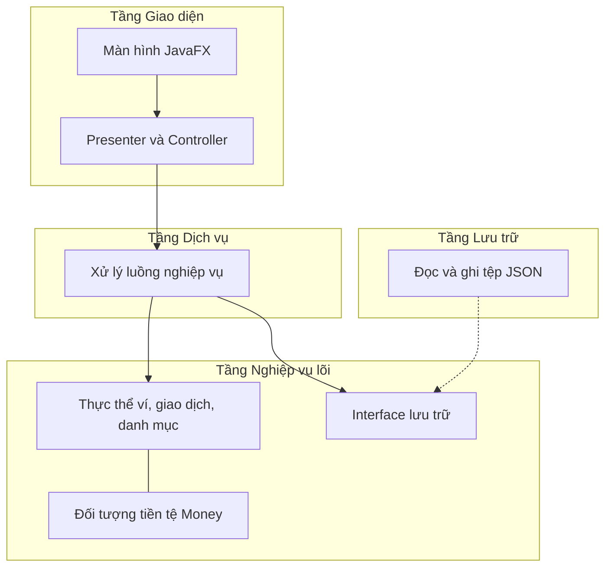

# Personal Finance Management System

Ứng dụng quản lý tài chính cá nhân chạy trên máy tính, lưu dữ liệu cục bộ bằng tệp JSON và không cần kết nối mạng.

## Công nghệ sử dụng

| Thành phần | Chi tiết |
| --- | --- |
| Ngôn ngữ | Java 17 |
| Giao diện | JavaFX 17 |
| Công cụ build | Maven và Maven Wrapper |
| Lưu trữ | Tệp JSON cục bộ bằng Gson |
| Kiểm thử | 2.267 bài kiểm thử tự động với JUnit 5 và Mockito |

## Kiến trúc hệ thống

Mã nguồn chia thành 4 tầng tách biệt. Các tầng bên ngoài gọi vào tầng nghiệp vụ lõi, còn tầng lõi không phụ thuộc vào giao diện hay cách lưu trữ.



### Áp dụng hướng đối tượng và mẫu thiết kế

- Tính chất hướng đối tượng: Lớp `Wallet` đóng gói số dư và không cho sửa trực tiếp từ bên ngoài. Các loại giao dịch kế thừa từ lớp trừu tượng `Transaction` và dùng đa hình khi cộng, trừ hoặc hoàn tác số dư. Thao tác đọc ghi dữ liệu được tách riêng qua các interface lưu trữ.
- Nguyên lý SOLID: Mỗi lớp đảm nhiệm một việc riêng. Khi thêm loại giao dịch mới, không cần sửa lớp `Transaction` gốc. Tầng dịch vụ chia nhỏ theo từng chức năng và chỉ phụ thuộc vào interface lưu trữ thay vì lớp đọc ghi JSON cụ thể.
- Mẫu thiết kế: Dùng Factory Method để kiểm tra dữ liệu và tạo giao dịch, Strategy để chọn định dạng xuất báo cáo JSON hoặc bảng văn bản, State để kiểm soát hành vi của ví theo từng trạng thái hoạt động, lưu trữ hoặc đã xóa, kết hợp mô hình MVP để tách giao diện khỏi logic hiển thị.

## Quy tắc nghiệp vụ chính

- Tính toán tiền tệ chính xác: Hệ thống dùng `BigDecimal` thay cho `float` và `double` để tránh sai số làm tròn. Phép tính tiền tệ dùng 2 chữ số thập phân và hiển thị VNĐ dưới dạng số nguyên. Các tỷ lệ phần trăm trung gian dùng tối thiểu 4 chữ số thập phân và làm tròn bằng `RoundingMode.HALF_EVEN`.
- Số dư ví khớp với lịch sử giao dịch: Số dư ví luôn được tính từ các giao dịch đã ghi nhận. Khi cần đối chiếu với tiền thực tế, người dùng tạo bản ghi kiểm kê thay vì sửa trực tiếp số dư.
- Chuyển tiền đồng bộ giữa hai ví: Khi chuyển tiền, hệ thống trừ tiền kèm phí giao dịch ở ví nguồn và cộng tiền vào ví đích trong cùng một thao tác. Nếu hủy giao dịch hoặc xảy ra lỗi, cả hai ví đều quay về số dư ban đầu.

## Chức năng chính

| Chức năng | Mô tả |
| --- | --- |
| Quản lý ví | Tạo ví, xem số dư, kiểm kê điều chỉnh số dư và đổi trạng thái ví. |
| Thu chi | Ghi nhận khoản thu và chi, gắn danh mục, tìm kiếm và lọc theo nhiều điều kiện. |
| Chuyển tiền | Chuyển tiền giữa các ví và ghi nhận phí giao dịch đi kèm. |
| Danh mục 3 cấp | Phân loại thu chi theo nhóm nhu cầu và danh mục con, hỗ trợ đổi tên và xóa mềm để giữ lại lịch sử cũ. |
| Báo cáo | Xem biểu đồ dòng tiền 12 tháng, cơ cấu chi tiêu, tỷ lệ tiết kiệm và xuất báo cáo. |
| Quản lý dữ liệu | Sao lưu và khôi phục dữ liệu qua tệp JSON, đồng thời kiểm tra sai lệch số dư ví. |

## Cách chạy dự án

Chỉ cần cài sẵn Java 17. Dự án đã có sẵn Maven Wrapper nên không cần cài thêm Maven.

### Chạy ứng dụng

```bash
# Windows
.\mvnw.cmd javafx:run

# Linux / macOS
./mvnw javafx:run
```

### Chạy kiểm thử

```bash
# Windows
.\mvnw.cmd test

# Linux / macOS
./mvnw test
```

### Đóng gói và chạy tệp JAR

```bash
# Windows
.\mvnw.cmd clean package

# Linux / macOS
./mvnw clean package

# Chạy tệp JAR sau khi đóng gói
java -jar target/pfms-oop-1.0.0.jar
```

## Cấu trúc thư mục

```text
main/
├── data/                                   # Tệp dữ liệu JSON của ứng dụng
├── docs/                                   # Tài liệu dự án
│   ├── software-requirement-specification/ # Đặc tả yêu cầu phần mềm
│   ├── object-oriented-analysis/           # Phân tích hướng đối tượng
│   ├── object-oriented-design/             # Thiết kế hướng đối tượng
│   ├── core-implementation/                # Báo cáo cài đặt mã nguồn
│   └── final-report/                       # Báo cáo tổng kết đồ án
├── src/
│   ├── main/                               # Mã nguồn ứng dụng và tài nguyên giao diện
│   └── test/                               # 2.267 bài kiểm thử JUnit 5
├── tools/                                  # Script kiểm tra định dạng tài liệu
├── pom.xml                                 # Cấu hình dự án và thư viện Maven
├── mvnw                                    # Script chạy Maven trên Linux và macOS
└── mvnw.cmd                                # Script chạy Maven trên Windows
```
