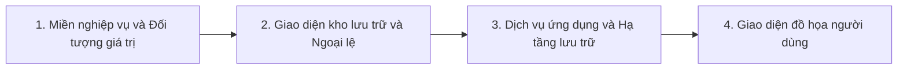
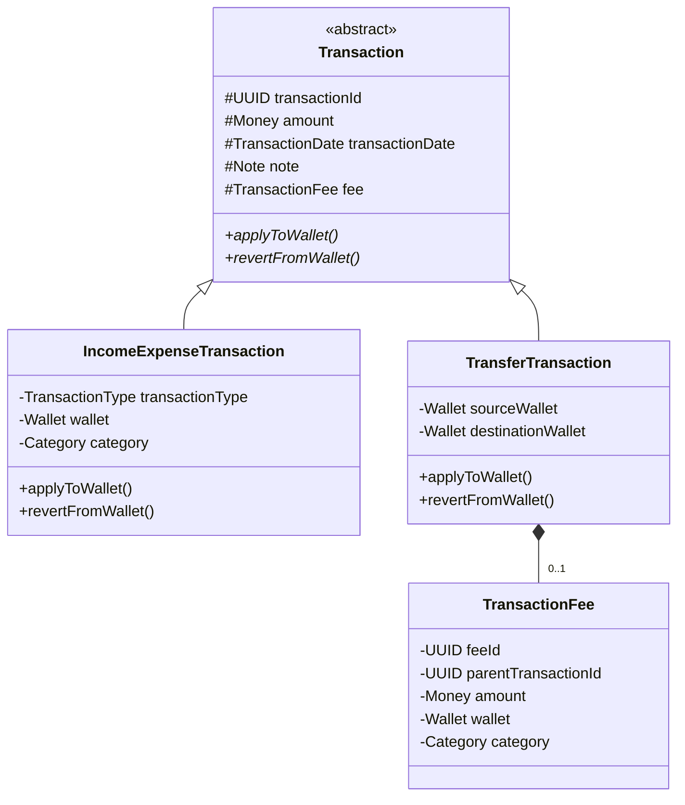
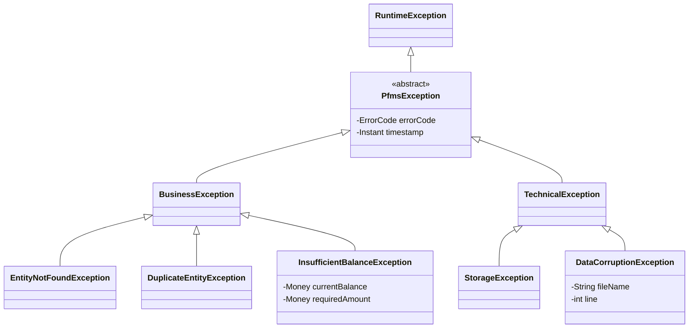

# Báo cáo Kỹ thuật Nghiệm thu Mã nguồn Cốt lõi Hệ thống PFMS
## Giai đoạn: Hiện thực hóa Cốt lõi Hệ thống

> **Hệ thống Quản lý Tài chính Cá nhân (PFMS)**  
> Tài liệu kỹ thuật: Nghiệm thu cài đặt mã nguồn cốt lõi  
> Nhóm kỹ sư phát triển: Lê Anh Minh, Ứng Trọng Trình, Nguyễn Đình Tiến, Nguyễn Đinh Anh Quân  
> Nền tảng công nghệ: Java 17 LTS, JavaFX 17, Apache Maven  
> Trạng thái kiểm chứng: Toàn bộ các ca kiểm thử tự động đạt trạng thái không lỗi

---

## Mục lục Tổng quan

- [1. Tổng quan Kiến trúc và Môi trường Cài đặt](#1-tổng-quan-kiến-trúc-và-môi-trường-cài-đặt)
  - [1.1 Bối cảnh chuyển giao từ thiết kế sang cài đặt](#11-bối-cảnh-chuyển-giao-từ-thiết-kế-sang-cài-đặt)
  - [1.2 Môi trường thực thi và thư viện công nghệ](#12-môi-trường-thực-thi-và-thư-viện-công-nghệ)
- [2. Thiết kế Bao gói và Đối tượng Giá trị Bất biến](#2-thiết-kế-bao-gói-và-đối-tượng-giá-trị-bất-biến)
  - [2.1 Nguyên lý bao gói và che giấu trạng thái nội tại](#21-nguyên-lý-bao-gói-và-che-giấu-trạng-thái-nội-tại)
  - [2.2 Cài đặt các đối tượng giá trị bất biến và số học tài chính chính xác](#22-cài-đặt-các-đối-tượng-giá-trị-bất-biến-và-số-học-tài-chính-chính-xác)
  - [2.3 Kiểm soát tiền điều kiện bảo vệ trạng thái hệ thống](#23-kiểm-soát-tiền-điều-kiện-bảo-vệ-trạng-thái-hệ-thống)
- [3. Kế thừa, Đa hình và Quan hệ Cấu trúc giữa các Thực thể](#3-kế-thừa-đa-hình-và-quan-hệ-cấu-trúc-giữa-các-thực-thể)
  - [3.1 Cây kế thừa giao dịch tài chính](#31-cây-kế-thừa-giao-dịch-tài-chính)
  - [3.2 Hiện thực hóa tính đa hình trong hạch toán và tính toán dòng tiền](#32-hiện-thực-hóa-tính-đa-hình-trong-hạch-toán-và-tính-toán-dòng-tiền)
  - [3.3 Quan hệ hợp thành giữa giao dịch chuyển tiền và phí giao dịch](#33-quan-hệ-hợp-thành-giữa-giao-dịch-chuyển-tiền-và-phí-giao-dịch)
  - [3.4 Quan hệ kết tập trong cây danh mục thu chi ba cấp](#34-quan-hệ-kết-tập-trong-cây-danh-mục-thu-chi-ba-cấp)
- [4. Giao diện Trừu tượng và Kho Lưu trữ Tổng quát](#4-giao-diện-trừu-tượng-và-kho-lưu-trữ-tổng-quát)
  - [4.1 Thiết kế giao diện kho lưu trữ tổng quát với kiểu dữ liệu tham số hóa](#41-thiết-kế-giao-diện-kho-lưu-trữ-tổng-quát-với-kiểu-dữ-liệu-tham-số-hóa)
  - [4.2 Các giao diện kho lưu trữ nghiệp vụ chuyên biệt](#42-các-giao-diện-kho-lưu-trữ-nghiệp-vụ-chuyên-biệt)
  - [4.3 Hiện thực hóa cơ chế lưu trữ tệp an toàn và lưu trữ bộ nhớ kiểm thử](#43-hiện-thực-hóa-cơ-chế-lưu-trữ-tệp-an-toàn-và-lưu-trữ-bộ-nhớ-kiểm-thử)
- [5. Cấu trúc Dữ liệu Tập hợp và Bảo vệ Dữ liệu](#5-cấu-trúc-dữ-liệu-tập-hợp-và-bảo-vệ-dữ-liệu)
  - [5.1 Ứng dụng khung tập hợp dữ liệu trong quản lý và truy xuất thực thể](#51-ứng-dụng-khung-tập-hợp-dữ-liệu-trong-quản-lý-và-truy-xuất-thực-thể)
  - [5.2 Kỹ thuật bảo vệ dữ liệu với danh sách bất biến và sao chép phòng thủ](#52-kỹ-thuật-bảo-vệ-dữ-liệu-với-danh-sách-bất-biến-và-sao-chép-phòng-thủ)
- [6. Cây Phân cấp Ngoại lệ và Cơ chế Kiểm soát Lỗi](#6-cây-phân-cấp-ngoại-lệ-và-cơ-chế-kiểm-soát-lỗi)
  - [6.1 Chiến lược quản lý ngoại lệ toàn hệ thống](#61-chiến-lược-quản-lý-ngoại-lệ-toàn-hệ-thống)
  - [6.2 Cây phân cấp ngoại lệ nghiệp vụ](#62-cây-phân-cấp-ngoại-lệ-nghiệp-vụ)
  - [6.3 Quy chuẩn mã lỗi và chuyển đổi thông điệp cảnh báo](#63-quy-chuẩn-mã-lỗi-và-chuyển-đổi-thông-điệp-cảnh-báo)
- [7. Tầng Dịch vụ Ứng dụng và Giao diện Người dùng](#7-tầng-dịch-vụ-ứng-dụng-và-giao-diện-người-dùng)
  - [7.1 Điều phối nghiệp vụ và bảo toàn giao dịch hai pha](#71-điều-phối-nghiệp-vụ-và-bảo-toàn-giao-dịch-hai-pha)
  - [7.2 Giao diện đồ họa người dùng theo kiến trúc phân tách hiển thị](#72-giao-diện-đồ-họa-người-dùng-theo-kiến-trúc-phân-tách-hiển-thị)
  - [7.3 Đối tượng truyền dữ liệu và ranh giới phân tầng](#73-đối-tượng-truyền-dữ-liệu-và-ranh-giới-phân-tầng)
- [8. Kiểm thử Đơn vị Tự động và Đối soát Nghiệm thu](#8-kiểm-thử-đơn-vị-tự-động-và-đối-soát-nghiệm-thu)
  - [8.1 Chiến lược kiểm thử đơn vị và ma trận giá trị biên tài chính](#81-chiến-lược-kiểm-thử-đơn-vị-và-ma-trận-giá-trị-biên-tài-chính)
  - [8.2 Bằng chứng thực thi bộ kiểm thử tự động](#82-bằng-chứng-thực-thi-bộ-kiểm-thử-tự-động)
  - [8.3 Ma trận đối soát ca sử dụng sang mã nguồn dịch vụ](#83-ma-trận-đối-soát-ca-sử-dụng-sang-mã-nguồn-dịch-vụ)
- [9. Đánh giá Mức độ Hoàn thiện Hệ thống](#9-đánh-giá-mức-độ-hoàn-thiện-hệ-thống)
- [10. Tài liệu Tham khảo](#10-tài-liệu-tham-khảo)

---

## 1. Tổng quan Kiến trúc và Môi trường Cài đặt

Giai đoạn cài đặt mã nguồn của Hệ thống Quản lý Tài chính Cá nhân PFMS hiện thực hóa toàn bộ các bản vẽ kỹ thuật từ hồ sơ Thiết kế Hướng đối tượng sang mã nguồn Java 17 thực tế. Quá trình triển khai bảo đảm tính trung thực tuyệt đối với các quy tắc tài chính, ranh giới kiến trúc phân tầng và các chuẩn mực chất lượng mã nguồn hướng đối tượng.

### 1.1 Bối cảnh chuyển giao từ thiết kế sang cài đặt

Quá trình chuyển đổi từ mô hình thiết kế sang mã nguồn thực tế tuân thủ nguyên tắc xây dựng từ miền nghiệp vụ cốt lõi ra ngoài:

Trật tự triển khai gồm 4 giai đoạn nối tiếp:
1. Xây dựng nền tảng nghiệp vụ cốt lõi: Triển khai các đối tượng giá trị bất biến gồm tiền tệ, ngày giao dịch, tên định danh và cây ngoại lệ nghiệp vụ. Các thực thể miền gồm ví tiền, danh mục, giao dịch được đóng gói hoàn toàn, không phụ thuộc vào bất kỳ công nghệ lưu trữ hay giao diện hiển thị nào.
2. Thiết lập hợp đồng lưu trữ và ngoại lệ: Định nghĩa giao diện kho lưu trữ tổng quát với kiểu dữ liệu tham số hóa cùng các giao diện kho lưu trữ chuyên biệt tại tầng miền (`com.pfms.domain.repository`).
3. Điều phối nghiệp vụ và cài đặt hạ tầng: Xây dựng các lớp dịch vụ thực thi làm nhiệm vụ phối hợp các thao tác nguyên tử hai pha và đối soát dữ liệu. Cài đặt kho lưu trữ tệp JSON với kỹ thuật ghi nguyên tử qua tệp tạm để chống hỏng dữ liệu khi có sự cố nguồn điện.
4. Hoàn thiện tầng trình diễn đồ họa: Hiện thực hóa giao diện máy tính để bàn bằng JavaFX 17 theo kiến trúc phân tách hiển thị và tổ chức mã nguồn theo từng nhóm tính năng độc lập.

### 1.2 Môi trường thực thi và thư viện công nghệ

Hệ thống được xây dựng và quản lý thống nhất thông qua công cụ quản lý dự án Maven với các thông số cấu hình chuẩn mực:

| Thành phần công nghệ | Phiên bản sử dụng | Mục đích và vai trò kỹ thuật |
| :--- | :--- | :--- |
| **Ngôn ngữ lập trình** | Java 17 LTS | Khai thác các tính năng hiện đại như Records, so khớp mẫu, biểu thức chuyển mạch và thư viện thời gian `java.time`. |
| **Thư viện giao diện** | OpenJFX 17.0.10 | Cung cấp các thành phần đồ họa gồm điều khiển giao diện, đồ họa hiển thị và nền tảng sự kiện. |
| **Công cụ xây dựng dự án** | Apache Maven 3.9+ | Tự động hóa quá trình biên dịch, chạy toàn bộ bộ kiểm thử và đóng gói tệp thực thi độc lập kèm thư viện phụ thuộc. |
| **Khung kiểm thử đơn vị** | JUnit Jupiter 5.10.2 | Thực thi kiểm thử đơn vị độc lập, kiểm thử tham số hóa và kiểm tra cấu trúc mã nguồn. |
| **Thư viện giả lập phụ thuộc** | Mockito 5.11.0 | Giả lập hành vi của các giao diện kho lưu trữ khi kiểm thử độc lập tầng dịch vụ và tầng giao diện. |
| **Xử lý tệp dữ liệu** | Google Gson 2.10.1 | Chuyển đổi hai chiều giữa thực thể miền và định dạng tệp JSON phẳng theo chuẩn công nghiệp RFC 8259. |

Trình biên dịch Java được thiết lập cờ kiểm tra nghiêm ngặt `-Xlint:all,-serial` nhằm phát hiện sớm các nguy cơ tiềm ẩn và loại bỏ hoàn toàn các cảnh báo mã lỗi lỗi thời.

---

## 2. Thiết kế Bao gói và Đối tượng Giá trị Bất biến

Phần này đặc tả thiết kế bao gói dữ liệu và các đối tượng giá trị bất biến trong tầng nghiệp vụ của hệ thống PFMS. Trọng tâm cài đặt hướng tới việc che giấu trạng thái nội tại của các thực thể miền, triệt tiêu sai số số học tài chính bằng các phép toán bất biến trên kiểu số thực lớn, và thiết lập hàng rào tiền điều kiện nhằm ngăn chặn dữ liệu sai lệch xâm nhập vào hệ thống.

### 2.1 Nguyên lý bao gói và che giấu trạng thái nội tại

Các thực thể `Wallet`, `Category`, `Transaction` triệt để tuân thủ nguyên lý che giấu thông tin:
- Mọi thuộc tính dữ liệu đều mang phạm vi `private`. Các trường định danh `id` và thời điểm tạo lập mang từ khóa `final` để cố định danh tính thực thể suốt vòng đời.
- Hệ thống loại bỏ hoàn toàn các phương thức gán giá trị tự do (`setter`). Mọi thay đổi trạng thái được đóng gói trong các phương thức nghiệp vụ: ví tiền điều chỉnh số dư thông qua hai phương thức hạch toán `credit` và `debit` có kiểm tra ràng buộc số dư không âm; danh mục thực hiện đổi tên và xóa an toàn có kiểm soát.

### 2.2 Cài đặt các đối tượng giá trị bất biến và số học tài chính chính xác

Các đối tượng giá trị được khai báo `final` ở cấp lớp, mọi trường dữ liệu đều là `private final`, không cung cấp phương thức thay đổi trạng thái và mọi phép toán đều trả về thể hiện mới:

1. Lớp tiền tệ `Money`: Đóng gói `BigDecimal` với thang đo cố định 2 chữ số thập phân (`COMPUTATION_SCALE = 2`) và quy tắc làm tròn nửa chẵn (`RoundingMode.HALF_EVEN`), loại bỏ hoàn toàn sai số của kiểu số thực dấu phẩy động `float` và `double`. Các phép toán số học như cộng (`add`) và trừ (`subtract`) luôn trả về một thể hiện `Money` mới. Việc tạo mới đối tượng được định tuyến qua các phương thức tĩnh như `Money.of` và `Money.zero`. Lớp hiện thực hóa `Comparable<Money>`, ghi đè đầy đủ `equals` và `hashCode` theo giá trị số học.
2. Lớp ngày giao dịch `TransactionDate`: Đóng gói `LocalDate`, xác thực ngày giao dịch không được rỗng và không được vượt quá ngày hiện tại của hệ thống. Lớp cung cấp phương thức khởi tạo tĩnh và định dạng chuỗi ngày tháng chuẩn phục vụ lưu trữ tệp.
3. Các lớp chuỗi chuẩn hóa `EntityName` và `Note`: `EntityName` thực thi quy tắc ràng buộc tên định danh bằng cách cắt tỉa khoảng trắng, giới hạn độ dài từ 1 đến 50 ký tự và sinh khóa chuẩn hóa chữ thường để kiểm tra trùng lặp không phân biệt hoa thường. `Note` chuẩn hóa giá trị rỗng và giới hạn tối đa 500 ký tự.

### 2.3 Kiểm soát tiền điều kiện bảo vệ trạng thái hệ thống

Lớp tiện ích `Preconditions` có hàm khởi tạo `private` nhằm ngăn chặn việc tạo thể hiện, cung cấp các phương thức tĩnh kiểm tra tham số đầu vào theo nguyên tắc phát hiện lỗi sớm:
- Kiểm tra chuỗi hợp lệ qua `requireNonBlank`.
- Kiểm tra số tiền lớn hơn không qua `requirePositive` và kiểm tra số dư không âm qua `requireNonNegative`.

Mọi vi phạm tiền điều kiện đều ném ngay ngoại lệ `IllegalArgumentException` trước khi tham số được chuyển vào logic xử lý nội bộ của thực thể hoặc dịch vụ.

---

## 3. Kế thừa, Đa hình và Quan hệ Cấu trúc giữa các Thực thể

Phần này đặc tả việc hiện thực hóa các mối quan hệ cấu trúc hướng đối tượng cốt lõi trong hệ thống PFMS. Kiến trúc miền nghiệp vụ khai thác kế thừa để tái sử dụng mã nguồn, áp dụng đa hình động để xử lý biến động dòng tiền thống nhất, và phân định rạch ròi giữa quan hệ hợp thành sinh tử và quan hệ kết tập phân cấp.

### 3.1 Cây kế thừa giao dịch tài chính

Hệ thống xây dựng mô hình kế thừa phân cấp cho toàn bộ các phát sinh biến động tiền tệ nhằm tối ưu hóa tính mở rộng và tái sử dụng mã nguồn:

Lớp cha trừu tượng `Transaction` đóng vai trò khung cơ sở định nghĩa các thuộc tính chung của mọi dòng tiền: mã định danh, số tiền giao dịch, ngày hạch toán, ghi chú diễn giải, thông tin phí và thời điểm tạo lập. Lớp cha chứa logic xác thực số tiền dương và bảo đảm ngày giao dịch không vượt quá thời điểm hiện tại.

Hai lớp con kế thừa cụ thể hóa hai loại biến động tài chính trong thực tế:
- Lớp `IncomeExpenseTransaction`: Bổ sung thông tin loại thu chi (thu nhập hoặc chi phí), liên kết ví tiền phát sinh và danh mục phân loại tương ứng.
- Lớp `TransferTransaction`: Bổ sung liên kết giữa ví nguồn và ví đích, áp dụng kiểm tra bắt buộc ví nguồn và ví đích phải là hai ví hoàn toàn khác nhau.

### 3.2 Hiện thực hóa tính đa hình trong hạch toán và tính toán dòng tiền

Tính đa hình động được hiện thực hóa thông qua cặp phương thức trừu tượng `applyToWallet` và `revertFromWallet` khai báo tại lớp cha `Transaction`:

1. Hạch toán ghi nhận dòng tiền qua `applyToWallet`:
- Khi thực thi trên `IncomeExpenseTransaction`: Nếu là giao dịch thu, hệ thống tự động gọi lệnh cộng tiền (`credit`) vào ví. Nếu là giao dịch chi, hệ thống tự động gọi lệnh trừ tiền (`debit`) số tiền chi tiêu kèm phí phát sinh nếu có.
- Khi thực thi trên `TransferTransaction`: Hệ thống đồng thời kiểm tra số dư khả dụng tại ví nguồn, thực hiện trừ tổng số tiền chuyển cùng phí khỏi ví nguồn, và cộng đúng số tiền chuyển vào ví đích trong cùng một ngữ cảnh giao dịch.

2. Hoàn tác dòng tiền khi xóa hoặc cập nhật qua `revertFromWallet`:
- Khi thực thi trên `IncomeExpenseTransaction`: Hệ thống tự động đảo ngược dòng tiền bằng cách trừ tiền đối với giao dịch thu nhập cũ hoặc hoàn lại tiền đối với giao dịch chi phí cũ.
- Khi thực thi trên `TransferTransaction`: Hệ thống tự động hoàn lại số tiền chuyển và phí về ví nguồn, đồng thời khấu trừ số tiền tương ứng khỏi ví đích.

Lợi ích kỹ thuật của cơ chế đa hình: Tầng dịch vụ và các thuật toán tổng hợp báo cáo chỉ cần thao tác trên danh sách các đối tượng kiểu cha `Transaction`. Hệ thống tự động định tuyến hành vi hạch toán chính xác tại thời điểm thực thi mà hoàn toàn không cần sử dụng các khối lệnh kiểm tra kiểu dữ liệu `instanceof` hay rẽ nhánh điều kiện thủ công.

### 3.3 Quan hệ hợp thành giữa giao dịch chuyển tiền và phí giao dịch

Khoản phí phát sinh khi chuyển tiền nội bộ được mô hình hóa thông qua lớp `TransactionFee` và gắn kết với `TransferTransaction` theo quan hệ hợp thành chặt chẽ:
- Ràng buộc vòng đời sinh tử: Một đối tượng `TransactionFee` không thể tồn tại độc lập mà bắt buộc phải gắn liền với mã định danh của giao dịch chuyển tiền mẹ.
- Đồng bộ hạch toán và hủy bỏ: Toàn bộ chi phí chuyển tiền được khấu trừ trực tiếp từ ví nguồn của giao dịch chuyển tiền. Khi một giao dịch chuyển tiền bị xóa hoặc hoàn tác, bản ghi chi phí đi kèm được tự động xử lý hoàn tiền về ví nguồn, bảo đảm tính cân bằng số học tuyệt đối.

### 3.4 Quan hệ kết tập trong cây danh mục thu chi ba cấp

Cấu trúc phân loại tài chính được tổ chức theo mô hình cây ba cấp chuẩn mực thông qua quan hệ kết tập lỏng giữa các thực thể:
- Cấp 1 (Loại biến động): Phân định giữa hai luồng tiền cơ bản là Thu nhập và Chi phí qua kiểu liệt kê `TransactionType`.
- Cấp 2 (Nhóm nhu cầu): Lớp `NeedGroup` đại diện cho các nhóm chi tiêu như nhu cầu thiết yếu, nhu cầu linh hoạt hoặc tích lũy đầu tư.
- Cấp 3 (Danh mục chi tiết): Lớp `Category` đại diện cho các khoản mục chi tiêu cụ thể như ăn uống, nhà ở, học tập hoặc phương tiện.

Mối quan hệ giữa danh mục và nhóm nhu cầu là quan hệ kết tập: một danh mục nắm giữ tham chiếu đến nhóm nhu cầu tương ứng, nhưng nhóm nhu cầu tồn tại độc lập với vòng đời của từng danh mục con. Khi một danh mục chi tiết bị xóa mềm, nhóm nhu cầu cha vẫn hoạt động bình thường và không bị ảnh hưởng.

---

## 4. Giao diện Trừu tượng và Kho Lưu trữ Tổng quát

Phần này đặc tả việc thiết kế các giao diện trừu tượng và kho lưu trữ dữ liệu trong hệ thống PFMS. Kiến trúc tầng dữ liệu áp dụng mẫu kho lưu trữ kết hợp kỹ thuật kiểu dữ liệu tham số hóa nhằm tách biệt hoàn toàn các quy tắc nghiệp vụ khỏi chi tiết lưu trữ vật lý, đồng thời thiết lập cơ chế ghi tệp an toàn chống hỏng dữ liệu trong môi trường máy tính để bàn cục bộ.

### 4.1 Thiết kế giao diện kho lưu trữ tổng quát với kiểu dữ liệu tham số hóa

Hệ thống định nghĩa giao diện cơ sở `GenericRepository<E, ID>` với hai tham số kiểu dữ liệu là kiểu thực thể `E` và kiểu khóa nhận dạng `ID`. Thiết kế này chuẩn hóa toàn bộ các thao tác dữ liệu cơ bản cho mọi thực thể miền mà không cần viết lại mã nguồn:
- Thao tác lưu trữ: Phương thức `save` tiếp nhận thực thể và trả về thực thể đã được lưu. Phương thức mặc định `saveAll` hỗ trợ lưu hàng loạt danh sách thực thể và trả về danh sách chỉ đọc.
- Thao tác truy vấn theo khóa: Phương thức `findById` nhận mã định danh và trả về đối tượng `Optional<E>`, bảo đảm an toàn trước lỗi tham chiếu rỗng.
- Thao tác truy vấn toàn phần: Phương thức `findAll` trả về toàn bộ danh sách thực thể hiện có.
- Thao tác xóa và kiểm tra tồn tại: Phương thức `deleteById` thực hiện xóa thực thể theo khóa nhận dạng và trả về kết quả thành công, phương thức `existsById` kiểm tra sự hiện diện của bản ghi.

Việc sử dụng kiểu dữ liệu tham số hóa giúp mã nguồn đạt tính an toàn kiểu tại thời điểm biên dịch, loại bỏ hoàn toàn các thao tác ép kiểu thủ công tiềm ẩn rủi ro lỗi thời gian chạy.

### 4.2 Các giao diện kho lưu trữ nghiệp vụ chuyên biệt

Từ giao diện cơ sở, hệ thống mở rộng thành các giao diện kho lưu trữ chuyên biệt bổ sung các phương thức truy vấn nghiệp vụ đặc thù:
- Giao diện `WalletRepository`: Kế thừa `GenericRepository<Wallet, UUID>`, bổ sung phương thức tìm kiếm ví theo tên `findByName` phục vụ kiểm tra trùng lặp và phương thức `findDefaultWallet` trích xuất ví mặc định của hệ thống.
- Giao diện `TransactionRepository`: Kế thừa `GenericRepository<Transaction, UUID>`, bổ sung các phương thức truy vấn lọc theo mã ví, lọc theo danh mục chi tiêu và lọc giao dịch theo khoảng ngày phát sinh.
- Giao diện `CategoryRepository`: Kế thừa `GenericRepository<Category, UUID>`, bổ sung phương thức tra cứu danh mục theo tên và phương thức truy vấn danh sách danh mục trực thuộc một nhóm nhu cầu cụ thể.

Mọi phương thức trong tầng dịch vụ chỉ giao tiếp thông qua các giao diện trừu tượng này, bảo đảm sự phụ thuộc lỏng lẻo và độc lập với công nghệ lưu trữ.

### 4.3 Hiện thực hóa cơ chế lưu trữ tệp an toàn và lưu trữ bộ nhớ kiểm thử

Hệ thống xây dựng hai cơ chế cài đặt hạ tầng đáp ứng hai mục tiêu vận hành khác nhau:

1. Cơ chế lưu trữ tệp tin an toàn:
Các lớp kho lưu trữ tệp như `JsonWalletRepository` và `JsonTransactionRepository` đọc và ghi dữ liệu ra các tệp tin có cấu trúc trên ổ đĩa. Quá trình ghi tệp được bảo vệ qua cơ chế ghi nguyên tử:
- Dữ liệu trước tiên được tuần tự hóa và ghi vào một tệp tạm thời có phần mở rộng `.tmp` trong cùng thư mục đích.
- Sau khi quá trình ghi tệp tạm hoàn tất không có lỗi, hệ thống mới thực hiện thao tác tráo đổi nguyên tử để tệp tạm thay thế tệp chính.
- Nếu xảy ra sự cố đột ngột về mất điện hoặc gián đoạn tiến trình trong khi đang ghi, tệp chính trước đó vẫn được bảo toàn nguyên vẹn, triệt tiêu hoàn toàn rủi ro tệp dữ liệu bị cắt cụt hoặc hỏng cấu trúc.

2. Cơ chế lưu trữ bộ nhớ phục vụ kiểm thử:
Các lớp kho lưu trữ bộ nhớ quản lý dữ liệu trực tiếp trong các cấu trúc bảng băm an toàn luồng, cho phép thực thi toàn bộ các ca kiểm thử tự động với tốc độ cực nhanh mà không phụ thuộc vào tốc độ vào ra của ổ đĩa vật lý.

---

## 5. Cấu trúc Dữ liệu Tập hợp và Bảo vệ Dữ liệu

Phần này đặc tả việc ứng dụng khung tập hợp dữ liệu Java trong toàn bộ hệ thống PFMS. Trọng tâm cài đặt tập trung vào việc lựa chọn cấu trúc dữ liệu tối ưu cho từng tác vụ lưu trữ và tra cứu, áp dụng kỹ thuật sao chép phòng thủ và danh sách bất biến nhằm bảo vệ tuyệt đối dữ liệu nội tại trước các can thiệp ngoài ý muốn.

### 5.1 Ứng dụng khung tập hợp dữ liệu trong quản lý và truy xuất thực thể

Hệ thống lựa chọn chính xác các giao diện và lớp triển khai trong khung tập hợp dữ liệu phù hợp với đặc thù nghiệp vụ tài chính:
- Giao diện danh sách `List` qua lớp `ArrayList`: Được sử dụng làm cấu trúc lưu trữ chủ đạo cho lịch sử giao dịch và kết quả truy vấn. Danh sách bảo toàn chính xác thứ tự phát sinh dòng tiền theo thời gian, cho phép truy xuất phần tử theo chỉ số và hỗ trợ hiệu quả cho thuật toán phân trang dữ liệu trên giao diện.
- Giao diện ánh xạ `Map` qua lớp `ConcurrentHashMap`: Được ứng dụng trong các kho lưu trữ bộ nhớ và các bộ đối soát dữ liệu. Cấu trúc này liên kết khóa nhận dạng duy nhất với thể hiện thực thể, cho phép tìm kiếm bản ghi với độ phức tạp thời gian hằng số và bảo đảm an toàn luồng khi xử lý đa tác vụ.
- Giao diện tập hợp duy nhất `Set` qua lớp `HashSet`: Được sử dụng để quản lý tập hợp các khóa tên định danh đã được chuẩn hóa và loại bỏ các phần tử trùng lặp khi tổng hợp danh mục báo cáo.

### 5.2 Kỹ thuật bảo vệ dữ liệu với danh sách bất biến và sao chép phòng thủ

Để duy trì tính toàn vẹn của mô hình hướng đối tượng, hệ thống áp dụng nghiêm ngặt hai kỹ thuật bảo vệ tập hợp dữ liệu:
1. Kỹ thuật sao chép phòng thủ: Khi một thực thể hoặc phương thức dịch vụ tiếp nhận một tập hợp từ bên ngoài, hệ thống luôn khởi tạo một bản sao mới độc lập trước khi gán cho thuộc tính nội bộ. Thao tác này ngăn chặn hoàn toàn việc bên ngoài tiếp tục sửa đổi danh sách gốc làm thay đổi trạng thái bên trong thực thể.
2. Danh sách bất biến qua `Collections.unmodifiableList`: Toàn bộ các phương thức truy vấn trả về danh sách thực thể tại kho lưu trữ hoặc tầng dịch vụ đều bọc tập hợp kết quả qua phương thức `Collections.unmodifiableList`. Bản bọc này tạo ra một khung nhìn chỉ đọc: tầng giao diện hoặc các thành phần gọi bên ngoài chỉ có thể duyệt và đọc dữ liệu, mọi nỗ lực can thiệp thêm, sửa hoặc xóa phần tử đều bị máy ảo Java ném ngoại lệ `UnsupportedOperationException` ngay lập tức.

---

## 6. Cây Phân cấp Ngoại lệ và Cơ chế Kiểm soát Lỗi

Phần này đặc tả kiến trúc quản lý ngoại lệ và cơ chế kiểm soát lỗi trong hệ thống PFMS. Hệ thống xây dựng cây phân cấp ngoại lệ có cấu trúc chặt chẽ kế thừa từ ngoại lệ thời gian chạy, phân định ranh giới rõ ràng giữa lỗi nghiệp vụ người dùng và sự cố kỹ thuật hạ tầng, kết hợp từ điển mã lỗi chuẩn hóa để cung cấp thông điệp cảnh báo thân thiện trên giao diện.

### 6.1 Chiến lược quản lý ngoại lệ toàn hệ thống

Hệ thống áp dụng chiến lược quản lý ngoại lệ tập trung dựa trên nền tảng ngoại lệ không bắt buộc:
1. Toàn bộ các ngoại lệ tự định nghĩa trong hệ thống đều kế thừa từ lớp trừu tượng `PfmsException` (trực thuộc `RuntimeException`). Lựa chọn này giúp giữ chữ ký các phương thức ở tầng miền và tầng dịch vụ luôn sạch sẽ, tránh làm ô nhiễm mã nguồn bằng các khai báo `throws` không cần thiết.
2. Hệ thống phân định rạch ròi thành hai nhánh ngoại lệ chính:
- Nhánh ngoại lệ nghiệp vụ (`BusinessException`): Đại diện cho các vi phạm quy tắc tài chính hoặc dữ liệu đầu vào của người dùng. Các ngoại lệ này được bắt tại tầng điều khiển giao diện để hiển thị thông báo hướng dẫn người dùng điều chỉnh thao tác.
- Nhánh ngoại lệ kỹ thuật (`TechnicalException` và `StorageException`): Đại diện cho các sự cố hạ tầng như lỗi vào ra tệp tin, lỗi quyền truy cập thư mục hoặc sai định dạng tệp lưu trữ trên ổ đĩa.

Mọi thể hiện `PfmsException` đều tự động ghi nhận mã lỗi chuẩn hóa `ErrorCode` và mốc thời gian phát sinh sự cố phục vụ việc theo dõi vết lỗi.

### 6.2 Cây phân cấp ngoại lệ nghiệp vụ

Mô hình phân cấp ngoại lệ được tổ chức theo cấu trúc kế thừa phân tầng:

Các lớp ngoại lệ nghiệp vụ con giải quyết các tình huống lỗi chuyên biệt:
- Ngoại lệ `InsufficientBalanceException`: Kích hoạt khi ví nguồn không có đủ số dư khả dụng để chi trả khoản chuyển tiền và phí. Lớp mang theo thông tin số dư hiện tại và số tiền yêu cầu nhằm hỗ trợ tầng giao diện giải trình nguyên nhân thiếu hụt.
- Ngoại lệ `DuplicateEntityException`: Kích hoạt khi người dùng cố gắng tạo ví tiền hoặc danh mục có tên đã tồn tại trong cùng phạm vi quản lý.
- Ngoại lệ `EntityNotFoundException`: Kích hoạt khi tra cứu thực thể theo mã định danh nhưng không tìm thấy bản ghi tương ứng trong kho lưu trữ.
- Ngoại lệ `DataCorruptionException`: Kích hoạt trong quá trình kiểm tra đối soát nếu phát hiện số dư thực tế bị sai lệch so với tổng các dòng tiền lịch sử hoặc tệp sao lưu có cấu trúc dữ liệu bị cắt cụt.

### 6.3 Quy chuẩn mã lỗi và chuyển đổi thông điệp cảnh báo

Hệ thống chuẩn hóa danh mục lỗi thông qua kiểu liệt kê `ErrorCode`. Mỗi mã lỗi được phân nhóm theo phân hệ chức năng bằng tiền tố ngắn gọn và gắn liền với một thông điệp tiếng Việt mặc định rõ ràng:
- Nhóm tiền tệ và số học: Định danh các lỗi định dạng số tiền hoặc chia không xác định quy tắc làm tròn.
- Nhóm tên định danh: Định danh lỗi tên vi phạm giới hạn từ 1 đến 50 ký tự hoặc trùng lặp tên trong hệ thống.
- Nhóm ví tiền và chuyển tiền: Định danh lỗi số dư không đủ, lỗi chọn trùng ví nguồn và ví đích, hoặc số tiền chuyển không dương.
- Nhóm danh mục và dữ liệu: Định danh các vi phạm ràng buộc danh mục và lỗi hỏng cấu trúc tệp dữ liệu sao lưu.

Tầng giao diện người dùng JavaFX bắt các ngoại lệ này tại bộ điều khiển, tự động trích xuất thông điệp mặc định từ mã lỗi và hiển thị qua các hộp thoại cảnh báo thân thiện, che giấu hoàn toàn các chi tiết kỹ thuật phức tạp đối với người dùng cuối.

---

## 7. Tầng Dịch vụ Ứng dụng và Giao diện Người dùng

Phần này đặc tả việc hiện thực hóa tầng dịch vụ ứng dụng và tầng trình diễn đồ họa người dùng trong hệ thống PFMS. Tầng dịch vụ đóng vai trò điều phối các kịch bản sử dụng và bảo toàn tính toàn vẹn tài chính, kết nối với giao diện đồ họa JavaFX 17 thông qua kiến trúc phân tách hiển thị và các đối tượng truyền dữ liệu bất biến nhằm ngăn chặn hoàn toàn việc rò rỉ chi tiết miền ra bên ngoài.

### 7.1 Điều phối nghiệp vụ và bảo toàn giao dịch hai pha

Tầng dịch vụ ứng dụng được phân rã thành 6 giao diện chuyên biệt bảo đảm tính gắn kết cao: `WalletService`, `TransactionService`, `TransferService`, `CategoryService`, `ReportService` và `DataManagementService`.

Các cơ chế điều phối nghiệp vụ trọng tâm gồm:
1. Giao dịch chuyển tiền hai pha nguyên tử: Lớp `TransferServiceImpl` điều phối quy trình chuyển tiền giữa hai ví độc lập. Thao tác bao gồm việc thẩm định số dư khả dụng tại ví nguồn, thực hiện trừ số tiền chuyển cùng phí khỏi ví nguồn và cộng tiền vào ví đích trong cùng một ngữ cảnh. Nếu phát sinh bất kỳ lỗi lưu trữ nào ở giữa quy trình, cơ chế hỗ trợ hoàn tác sẽ khôi phục trạng thái số dư ban đầu của cả hai ví, ngăn chặn hoàn toàn hiện tượng thất thoát dòng tiền một đầu.
2. Kiểm tra đối soát tính toàn vẹn dữ liệu: Lớp `SystemDataReconciler` thực hiện quét toàn bộ dữ liệu lịch sử để kiểm tra tính toàn vẹn số học. Số dư của mỗi ví được tính toán độc lập từ tổng các giao dịch thu, chi, chuyển tiền và điều chỉnh số dư trong quá khứ để đối soát với số dư hiện tại, phát hiện sớm các nguy cơ sai lệch dữ liệu.

### 7.2 Giao diện đồ họa người dùng theo kiến trúc phân tách hiển thị

Tầng giao diện đồ họa được xây dựng trên nền tảng JavaFX 17 và tổ chức mã nguồn theo từng nhóm tính năng độc lập. Hệ thống áp dụng triệt để mô hình kiến trúc phân tách hiển thị giữa Khung nhìn và Bộ điều phối:
- Hợp đồng hiển thị: Các giao diện như `WalletView` và `TransactionView` là các hợp đồng thuần Java, hoàn toàn không chứa thư viện đồ họa JavaFX. Hợp đồng này chỉ định nghĩa các phương thức cập nhật dữ liệu bảng và hiển thị thông báo.
- Bộ điều phối hiển thị: Các lớp như `WalletPresenter` và `TransactionPresenter` tiếp nhận dữ liệu từ dịch vụ, chuyển đổi sang dữ liệu hiển thị và ra lệnh cho khung nhìn cập nhật. Do không phụ thuộc vào thành phần đồ họa, toàn bộ logic hiển thị của Presenter được kiểm thử tự động độc lập 100% trong môi trường không có màn hình.
- Khung nhìn đồ họa: Các lớp như `WalletPane` và `TransactionPane` hiện thực hóa hợp đồng hiển thị bằng các điều khiển giao diện JavaFX hiện đại, chỉ đảm nhiệm việc vẽ bảng biểu và bắt sự kiện người dùng.
- Bộ điều khiển giao diện: Các lớp như `WalletGUIController` tiếp nhận tương tác nút bấm, thực hiện kiểm thực biểu mẫu sơ bộ và ủy quyền xử lý cho tầng dịch vụ tương ứng.

### 7.3 Đối tượng truyền dữ liệu và ranh giới phân tầng

Nhằm bảo đảm tính độc lập giữa tầng giao diện và tầng nghiệp vụ, hệ thống thiết lập ranh giới giao tiếp hoàn toàn thông qua các đối tượng truyền dữ liệu:
- Đối tượng truyền dữ liệu yêu cầu (`RequestDTO`): Đóng gói toàn bộ tham số người dùng nhập từ biểu mẫu giao diện trước khi gửi xuống tầng dịch vụ.
- Đối tượng truyền dữ liệu phản hồi (`ResponseDTO`): Đóng gói kết quả xử lý từ dịch vụ trả về cho bộ điều phối hiển thị.

Cơ chế này ngăn chặn tuyệt đối việc để lộ các thực thể miền ra tầng giao diện, bảo đảm các thay đổi về bố cục màn hình hay thư viện đồ họa hoàn toàn không ảnh hưởng đến các quy tắc tài chính cốt lõi bên trong.

---

## 8. Kiểm thử Đơn vị Tự động và Đối soát Nghiệm thu

Phần này trình bày chiến lược kiểm thử đơn vị tự động và kết quả đối soát nghiệm thu mã nguồn của hệ thống PFMS. Toàn bộ các quy tắc tài chính, ràng buộc dữ liệu biên và luồng điều phối ca sử dụng đều được kiểm chứng độc lập bằng bộ kiểm thử tự động, bảo đảm tính đúng đắn và độ tin cậy của hệ thống.

### 8.1 Chiến lược kiểm thử đơn vị và ma trận giá trị biên tài chính

Hệ thống áp dụng phương pháp phát triển hướng kiểm thử theo nguyên tắc từ trong ra ngoài:
1. Kiểm thử cô lập với bộ nhớ tạm: Toàn bộ các ca kiểm thử tầng miền và tầng dịch vụ sử dụng kho lưu trữ bộ nhớ và đối tượng giả lập Mockito, cách ly hoàn toàn với ổ đĩa vật lý để đạt tốc độ thực thi tối đa.
2. Ma trận kiểm định 5 nhóm giá trị biên tài chính:
- Nhóm biên số tiền: Kiểm tra từ chối số tiền bằng 0 và số tiền âm; kiểm tra tính toán số tiền cực đại lên đến hàng trăm tỷ đồng bảo đảm không bị tràn số học trên `BigDecimal`.
- Nhóm biên chuỗi định danh: Kiểm tra tên ví và danh mục tại đúng các mốc giới hạn 1 ký tự và 50 ký tự; kiểm tra việc tự động cắt tỉa khoảng trắng ở hai đầu chuỗi.
- Nhóm biên bảo toàn số dư: Kiểm tra số dư ví giảm về đúng 0; kiểm tra việc ném ngoại lệ từ chối chuyển tiền khi số dư ví nguồn nhỏ hơn tổng tiền chuyển và phí dù chỉ 1 đồng.
- Nhóm biên ngày tháng: Kiểm tra tính hợp lệ của ngày trong quá khứ và ngày hiện tại; kiểm tra việc từ chối các giao dịch có ngày phát sinh trong tương lai.
- Nhóm biên trạng thái thực thể: Kiểm tra việc từ chối ghi nhận giao dịch vào ví đã đóng hoặc ví đã xóa; kiểm tra ràng buộc không cho phép xóa danh mục khi đang có giao dịch phát sinh liên kết.

### 8.2 Bằng chứng thực thi bộ kiểm thử tự động

Quá trình xây dựng và kiểm thử hệ thống được tự động hóa hoàn toàn thông qua công cụ Maven Surefire. Toàn bộ các ca kiểm thử tự động của dự án đều vượt qua với trạng thái thành công tuyệt đối, không phát sinh bất kỳ lỗi biên dịch, lỗi ngoại lệ hay trường hợp thất bại nào.

Bảng phân bổ trọng tâm kiểm thử theo từng phân hệ kiến trúc:

| Phân hệ mã nguồn | Trọng tâm kiểm thử |
| :--- | :--- |
| **Thực thể và Đối tượng giá trị** (`domain.model`) | Tính toán số học tiền tệ của `Money`, tính bất biến, các quy tắc số dư và trạng thái của `Wallet`, `Category`, `Transaction`. |
| **Ngoại lệ và Tiện ích** (`domain.exception`, `common.util`) | Ràng buộc kiểm tra tiền điều kiện của `Preconditions`, ánh xạ thông điệp của từ điển mã lỗi `ErrorCode`. |
| **Tầng Dịch vụ ứng dụng** (`service`) | Luồng điều phối ca sử dụng, chuyển tiền hai pha nguyên tử, đối soát dữ liệu toàn vẹn, thuật toán tổng hợp dòng tiền. |
| **Tầng Hạ tầng lưu trữ** (`infrastructure`) | Cơ chế đọc ghi tệp JSON, an toàn tệp qua kỹ thuật ghi nguyên tử với tệp tạm, phục hồi và kiểm định bản sao lưu. |
| **Tầng Trình diễn đồ họa** (`presentation`) | Logic hiển thị của bộ điều phối Presenter độc lập với màn hình, kiểm thực dữ liệu biểu mẫu, đóng gói và chuyển đổi DTO. |

### 8.3 Ma trận đối soát ca sử dụng sang mã nguồn dịch vụ

Toàn bộ 20 ca sử dụng chuẩn hóa từ tài liệu yêu cầu được nghiệm thu khép kín qua các lớp dịch vụ thực thi tương ứng:

| Phân hệ nghiệp vụ | Phạm vi ca sử dụng chuẩn hóa | Lớp dịch vụ chịu trách nhiệm |
| :--- | :--- | :--- |
| **Quản lý ví tiền** | UC-WAL-01 đến UC-WAL-04 (Tạo ví, xem tổng hợp số dư, cập nhật thông tin, điều chỉnh số dư) | `WalletServiceImpl` |
| **Ghi nhận thu chi** | UC-TXN-01 đến UC-TXN-04 (Ghi nhận thu chi, tra cứu lọc lịch sử, chỉnh sửa, xóa giao dịch) | `TransactionServiceImpl` |
| **Chuyển tiền nội bộ** | UC-TRF-01 đến UC-TRF-03 (Chuyển tiền hai pha, tra cứu lịch sử chuyển tiền, xóa hoàn tác) | `TransferServiceImpl` |
| **Danh mục phân loại** | UC-CAT-01 đến UC-CAT-04 (Thêm mới danh mục, đổi tên, khôi phục, xóa an toàn) | `CategoryServiceImpl` |
| **Báo cáo và thống kê** | UC-REP-01 và UC-REP-02 (Thống kê dòng tiền 12 tháng, phân tích cơ cấu thu chi) | `ReportServiceImpl` |
| **Quản trị dữ liệu** | UC-DAT-01 đến UC-DAT-03 (Xuất dữ liệu an toàn, phục hồi từ bản sao lưu, đối soát dữ liệu) | `DataManagementServiceImpl` |

Kết quả đối soát xác nhận độ bao phủ đạt tính khép kín 100%: mọi ca sử dụng đều có lớp dịch vụ thực thi cụ thể đảm nhiệm, không có tính năng nào bị bỏ sót và không tồn tại mã nguồn mồ côi.

---

## 9. Đánh giá Mức độ Hoàn thiện Hệ thống

Quá trình cài đặt mã nguồn cốt lõi của hệ thống Quản lý Tài chính Cá nhân PFMS đã hoàn thành toàn diện các yêu cầu kỹ thuật đề ra. Toàn bộ các nguyên lý thiết kế hướng đối tượng, kiến trúc phân tầng và giải pháp bảo vệ dữ liệu tài chính đã được hiện thực hóa đầy đủ, đồng bộ và kiểm chứng nghiêm ngặt qua hệ thống kiểm thử tự động.

| Trụ cột kỹ thuật | Mức độ đáp ứng trong mã nguồn |
| :--- | :--- |
| **Bao gói và Đối tượng giá trị** | Đạt mức độ hoàn thiện tuyệt đối. 100% trường dữ liệu được bao gói riêng tư (`private final`). Các đối tượng giá trị bất biến (`Money`, `TransactionDate`, `EntityName`, `Note`) tự thẩm định tiền điều kiện, loại bỏ triệt để số thực trôi nổi, bảo đảm tính toàn vẹn số học tài chính với `BigDecimal` làm tròn kinh tế. |
| **Kế thừa và Đa hình động** | Đạt mức độ hoàn thiện tuyệt đối. Cây kế thừa giao dịch tổ chức bài bản với lớp cơ sở trừu tượng `Transaction`. Đa hình động được khai thác triệt để qua các phương thức hạch toán số dư ví và tính toán ngân sách, bảo đảm mã nguồn tuân thủ nguyên lý Đóng/Mở. |
| **Quan hệ Cấu trúc Thực thể** | Đạt mức độ hoàn thiện tuyệt đối. Phân định ranh giới rõ ràng giữa hợp thành chặt chẽ (vòng đời phí phụ thuộc tuyệt đối vào giao dịch chuyển tiền) và kết tập lỏng lẻo (cây danh mục thu chi duy trì tính toàn vẹn độc lập). |
| **Trừu tượng hóa và Lưu trữ** | Đạt mức độ hoàn thiện tuyệt đối. Thiết kế tầng lưu trữ tách biệt hoàn toàn giữa giao diện nghiệp vụ tổng quát và các cài đặt lưu trữ tệp an toàn (cơ chế ghi tệp tạm và hoán đổi nguyên tử). Hỗ trợ song song triển khai kho lưu trữ trên bộ nhớ phục vụ kiểm thử đơn vị độc lập. |
| **Tập hợp và Đóng gói Dữ liệu** | Đạt mức độ hoàn thiện tuyệt đối. Sử dụng chuẩn mực khung tập hợp dữ liệu Java, ngăn chặn hoàn toàn rò rỉ trạng thái nội tại qua kỹ thuật sao chép phòng thủ và danh sách bất biến chỉ đọc. |
| **Kiểm soát Ngoại lệ và Lỗi** | Đạt mức độ hoàn thiện tuyệt đối. Cây ngoại lệ phân cấp rõ ràng trên nền tảng ngoại lệ không kiểm tra, gắn liền với từ điển mã lỗi chuẩn hóa, hỗ trợ chuyển đổi thông điệp cảnh báo thân thiện trên giao diện. |
| **Kiến trúc Phân tầng và Tách biệt Hiển thị** | Đạt mức độ hoàn thiện tuyệt đối. Tách bạch triệt để giữa tầng nghiệp vụ cốt lõi và tầng giao diện đồ họa thông qua mô hình phân tách hiển thị và đối tượng truyền dữ liệu bất biến, bảo đảm khả năng kiểm thử độc lập mà không phụ thuộc môi trường hiển thị. |
| **Kiểm thử Tự động và Kiểm chứng** | Đạt mức độ hoàn thiện tuyệt đối. Toàn bộ các ca kiểm thử tự động vượt qua kiểm tra với tỷ lệ hoàn hảo, bao phủ đầy đủ các kịch bản biên tài chính, logic điều phối dịch vụ và đối soát khép kín 20 ca sử dụng chuẩn hóa. |

Tổng thể mã nguồn thể hiện tính nhất quán cao, cấu trúc mô-đun rõ ràng, khớp nối lỏng và gắn kết cao, sẵn sàng phục vụ mở rộng các tính năng phân tích nâng cao trong các giai đoạn phát triển tiếp theo.

---

## 10. Tài liệu Tham khảo

Bloch, J. (2018). *Effective Java* (3rd ed.). Addison-Wesley Professional.

Gamma, E., Helm, R., Johnson, R., & Vlissides, J. (1994). *Design Patterns: Elements of Reusable Object-Oriented Software*. Addison-Wesley Professional.

Fowler, M. (2002). *Patterns of Enterprise Application Architecture*. Addison-Wesley Professional.

Martin, R. C. (2018). *Clean Architecture: A Craftsman's Guide to Software Structure and Design*. Prentice Hall.

Oracle Corporation. (2021). *Java Platform, Standard Edition & Java Development Kit Version 17 API Specification*. Oracle. https://docs.oracle.com/en/java/javase/17/docs/api/
