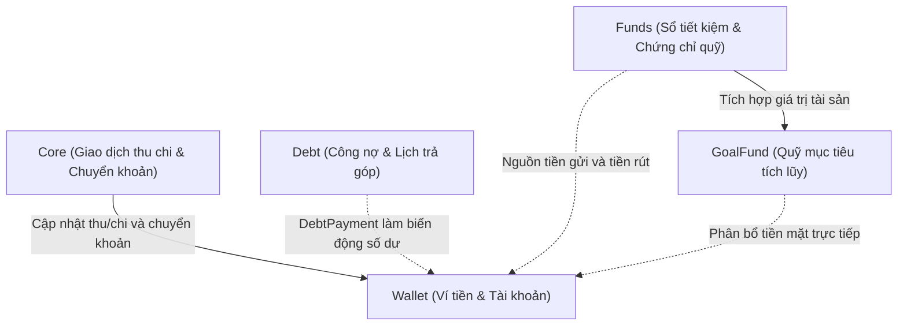
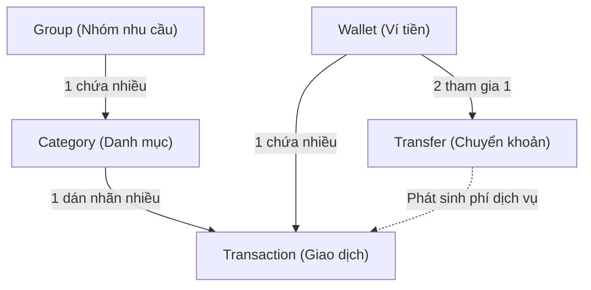
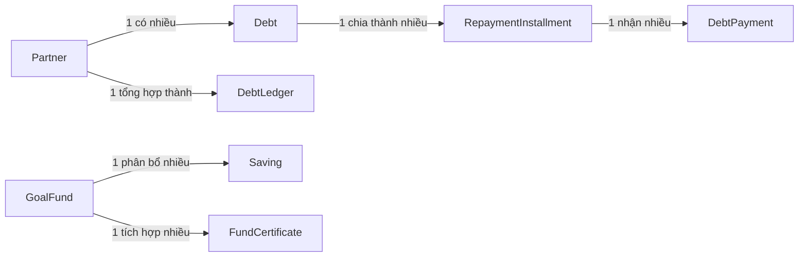

# Báo cáo Phân tích Hướng đối tượng (OOA)

Tài liệu này tổng hợp kết quả phân tích hướng đối tượng cho Hệ thống Quản lý Tài chính Cá nhân (PFMS), bao gồm đầy đủ phân hệ Cốt lõi (Core) và phân hệ Mở rộng (Deferred).

---

## 1. Mục tiêu và phạm vi phân tích

### 1.1 Bối cảnh và mục tiêu
Mục tiêu của tài liệu là nhận diện chính xác các thực thể đời thực trong bài toán quản lý tài chính cá nhân, xác định thông tin nội tại, ranh giới dữ liệu và trách nhiệm nghiệp vụ của từng đối tượng trước khi bước vào pha thiết kế chi tiết (OOD).

### 1.2 Phân định phạm vi nghiệp vụ
Phạm vi phân tích bao phủ toàn bộ 11 ca sử dụng trong tài liệu đặc tả yêu cầu, chia thành hai phân hệ:
- Phân hệ Cốt lõi (Core): Quản lý nơi cất giữ tiền tệ (Ví tiền, Tài khoản), ghi nhận biến động dòng tiền (Giao dịch thu chi), luân chuyển tiền nội bộ bảo toàn tổng tài sản (Chuyển khoản nội bộ), và phân loại giao dịch 3 cấp (Loại luồng tiền, Nhóm nhu cầu, Danh mục chi tiết).
- Phân hệ Mở rộng (Deferred): Quản lý thỏa thuận vay và cho vay với lịch trả góp nhiều kỳ (Giao dịch nợ, Đối tác, Sổ nợ), và Phân bổ tích lũy tài sản (Sổ tiết kiệm, Chứng chỉ quỹ đầu tư, Quỹ mục tiêu).

### 1.3 Ranh giới phân tích OOA
Tài liệu phân định ranh giới nghiêm ngặt theo các nguyên tắc sau:
- Ranh giới công nghệ và giao diện: Không đưa vào tài liệu các khái niệm về giao diện người dùng (cửa sổ JavaFX, biểu mẫu, nút bấm) hoặc cơ chế lưu trữ kỹ thuật (bảng cơ sở dữ liệu quan hệ, câu lệnh SQL, khóa ngoại cơ sở dữ liệu, tập tin lưu trữ).
- Ranh giới thiết kế kiến trúc: Không đưa vào các lớp kỹ thuật của pha thiết kế phần mềm như Controller, Service, Repository, DAO, hay DTO.
- Ranh giới điểm chạm liên phân hệ: Khi các nghiệp vụ nợ hoặc đầu tư làm thay đổi số dư ví, điểm chạm được mô tả ở mức khái quát là ví tiền nhận biến động số dư thông qua sự kiện giao dịch tài chính chung. Các lớp thuộc phân hệ cốt lõi không lưu trữ các trường dữ liệu mang tính dự phòng cho phân hệ mở rộng như mã khoản nợ, kỳ hạn sổ tiết kiệm, hay mã chứng chỉ quỹ.

---

## 2. Cách trích xuất đối tượng từ ca sử dụng

### 2.1 Tiêu chí nhận diện và phân loại danh từ
Toàn bộ danh từ và cụm danh từ xuất hiện trong kịch bản ca sử dụng được phân tích và phân loại thành 4 nhóm:
- Đối tượng nghiệp vụ (Entity): Thực thể có định danh độc lập, nắm giữ dữ liệu và hành vi nghiệp vụ riêng, tồn tại và biến đổi theo thời gian.
- Đối tượng giá trị (Value Object): Kết quả tính toán tổng hợp tại một thời điểm cụ thể, không cần định danh độc lập để quản lý vòng đời.
- Thuộc tính của đối tượng (Attribute): Giá trị đo lường, trạng thái hoặc thông tin mô tả chi tiết trực thuộc một đối tượng khác.
- Yếu tố loại bỏ (Out of Scope): Thao tác giao diện, cách hiển thị đồ họa hoặc khái niệm kỹ thuật nằm ngoài bài toán phân tích nghiệp vụ.

### 2.2 Bảng tổng hợp trích xuất danh từ từ kịch bản ca sử dụng

| Từ ngữ trong ca sử dụng | Xuất hiện ở ca sử dụng | Kết luận | Lý do |
|---|---|---|---|
| Ví tiền (Tài khoản, Tiền mặt, Ví nguồn, Ví đích, Ví thanh toán) | WAL-01, TXN-01, TXN-02, TRF-01, DSH-01 | Đối tượng nghiệp vụ | Nơi cất giữ tiền thực tế, có số dư biến động qua các giao dịch và chuyển khoản. Đóng vai trò nguồn, đích, thanh toán tùy ngữ cảnh. |
| Giao dịch (Khoản thu, Khoản chi) | TXN-01, TXN-02, TXN-03, CAT-01, DSH-01 | Đối tượng nghiệp vụ | Sự kiện dòng tiền đi vào hoặc đi ra khỏi ví cụ thể, có dữ liệu thời gian và số tiền cần lưu vết độc lập. |
| Chuyển khoản (Chuyển tiền nội bộ) | TRF-01 | Đối tượng nghiệp vụ | Sự kiện luân chuyển tiền tệ giữa hai ví của cùng một chủ sở hữu, bảo toàn tổng giá trị tài sản. |
| Nhóm nhu cầu (`Group`) | TXN-01, TXN-03, CAT-01, CAT-02, DSH-01 | Đối tượng nghiệp vụ | Cấp phân loại thứ hai, dùng để gom nhóm các danh mục chi tiết phục vụ thống kê và định hướng ngân sách. |
| Danh mục phân loại (`Category`, Danh mục chi tiết) | TXN-01, TXN-03, CAT-01, CAT-02 | Đối tượng nghiệp vụ | Cấp phân loại thứ ba, nhãn dán cụ thể gắn vào từng giao dịch thu chi. |
| Khoản nợ (`Debt`, Khoản vay, Khoản cho vay) | DBT-01 | Đối tượng nghiệp vụ | Thỏa thuận vay hoặc cho vay có định danh, có gốc và lãi suất, tồn tại và biến đổi theo lịch trả nợ. |
| Đối tác (`Partner`, Người vay, Người cho vay) | DBT-01, FR-DBT-03 | Đối tượng nghiệp vụ | Cá nhân hoặc tổ chức có quan hệ vay mượn với chủ tài khoản, cần định danh độc lập để tổng hợp sổ nợ theo từng người. |
| Kỳ trả nợ (`RepaymentInstallment`) | DBT-01 (Mở rộng theo lịch trả góp) | Đối tượng nghiệp vụ | Một kỳ thanh toán cụ thể trong lịch trả góp, quy định số tiền dự kiến và hạn chót thanh toán. |
| Giao dịch trả hoặc thu nợ (`DebtPayment`) | DBT-01 | Đối tượng nghiệp vụ | Sự kiện phát sinh dòng tiền thực tế để trả hoặc thu cho một kỳ nợ cụ thể, bao gồm trả nợ, thu nợ và xóa nợ. |
| Sổ nợ theo đối tác (`DebtLedger`, Phải thu, Phải trả) | DBT-01, FR-DBT-02, FR-DBT-03 | Đối tượng giá trị | Bảng tổng hợp dư nợ hiện tại giữa chủ tài khoản và một đối tác tại thời điểm đối soát, suy ra từ toàn bộ các khoản nợ của đối tác đó. |
| Sổ tiết kiệm (`Saving`) | SAV-01, GFD-01 | Đối tượng nghiệp vụ | Khoản tiền gửi tiết kiệm có kỳ hạn hoặc không kỳ hạn, sinh lãi theo thời gian và có thể liên kết vào quỹ mục tiêu. |
| Chứng chỉ quỹ (`FundCertificate`) | FCT-01, GFD-01 | Đối tượng nghiệp vụ | Khoản đầu tư vào chứng chỉ quỹ hoặc cổ phiếu, có giá trị biến động theo thị trường và liên kết vào quỹ mục tiêu. |
| Quỹ mục tiêu (`GoalFund`) | SAV-01, FCT-01, GFD-01 | Đối tượng nghiệp vụ | Mục tiêu tài chính cụ thể mà chủ sở hữu phân bổ tài sản (tiền mặt, sổ tiết kiệm, chứng chỉ quỹ) để theo dõi tiến độ hoàn thành. |
| Số dư (Ban đầu, Khả dụng, Hiện tại) | WAL-01, TXN-01, TXN-02, TRF-01, DSH-01 | Thuộc tính | Giá trị tiền tệ đo lường lượng tiền cất giữ, thuộc về cấu trúc dữ liệu của đối tượng Ví tiền. |
| Thông tin mô tả ví (Tên ví, Loại ví, Trạng thái) | WAL-01, CAT-02 | Thuộc tính | Dữ liệu cơ sở mô tả tính chất và trạng thái hoạt động của đối tượng Ví tiền. |
| Chi tiết giao dịch (Ngày giao dịch, Số tiền, Ghi chú) | TXN-01, TXN-02, TXN-03, TRF-01 | Thuộc tính | Các giá trị đo lường thời gian, tiền tệ và ghi chú cấu thành nên một Giao dịch hoặc Chuyển khoản. |
| Loại luồng tiền (`Type`: Thu, Chi) | TXN-01, CAT-01, CAT-02 | Thuộc tính | Thuộc tính định nghĩa phân loại gốc (Income hoặc Expense), gắn liền với Nhóm nhu cầu và Danh mục. |
| Mã đợt vay (`Batch`) | DBT-01 | Thuộc tính | Mã nhóm các giao dịch nợ phát sinh cùng đợt, trực thuộc đối tượng Khoản nợ. |
| Lãi suất | SAV-01, FCT-01, DBT-01 | Thuộc tính | Tỷ lệ phần trăm tính lãi trên vốn gốc, thuộc về Khoản nợ, Sổ tiết kiệm hoặc Chứng chỉ quỹ. |
| Mã định danh (`Id`) | Toàn bộ Use Case | Thuộc tính | Khóa định danh độc nhất của từng đối tượng thực thể trong hệ thống. |
| Chủ sở hữu tài chính (`Owner`, Người dùng) | Toàn bộ Use Case | Loại bỏ | Tác nhân sử dụng hệ thống. Do hệ thống thiết kế cho một người dùng cá nhân (Single-user), tác nhân không cần lưu thành đối tượng nghiệp vụ. |
| Giao diện người dùng (Màn hình, Biểu mẫu, Nút bấm, Hộp thoại) | Toàn bộ Use Case | Loại bỏ | Thuộc về tầng hiển thị giao diện, không phải là đối tượng miền nghiệp vụ. |
| Báo cáo động (Cơ cấu tài sản, Biểu đồ thu chi) | WAL-01, TXN-03, DSH-01 | Loại bỏ | Kết quả truy vấn và tổng hợp dữ liệu động từ các thực thể gốc phục vụ hiển thị màn hình, không lưu trữ độc lập. |
| Khái niệm kỹ thuật (Cơ sở dữ liệu, Bảng dữ liệu, Ghi sổ kép) | Toàn bộ Use Case | Loại bỏ | Quy tắc logic nghiệp vụ hoặc công nghệ lưu trữ, không phải là thực thể tĩnh trong mô hình phân tích. |

---

## 3. Từ điển khái niệm miền

Hệ thống tài chính cá nhân được mô hình hóa qua 13 đối tượng nghiệp vụ, gồm 12 thực thể (Entity) và 1 đối tượng giá trị (Value Object). Mọi giá trị liên quan đến tiền tệ, số dư và lãi suất bắt buộc sử dụng kiểu số thập phân chính xác (`BigDecimal`).

| Thuật ngữ | Tên tiếng Việt | Bản chất đời thực | Thông tin đối tượng nắm giữ | Phân loại | Ranh giới dữ liệu |
|---|---|---|---|---|---|
| `Wallet` | Ví tiền, Tài khoản | Nơi cất giữ tiền thực tế như tiền mặt, tài khoản ngân hàng, ví điện tử. | Mã ví, tên ví, loại ví, trạng thái hoạt động, số dư ban đầu (`BigDecimal`), số dư hiện tại (`BigDecimal`). | Entity | Quản lý số dư tự thân. Nhận biến động tiền tệ qua sự kiện giao dịch, không lưu thông tin chi tiết về nợ hay khoản đầu tư. |
| `Transaction` | Giao dịch thu chi | Sự kiện tiền tệ biến động làm tăng hoặc giảm số dư của một ví cụ thể. | Mã giao dịch, ngày giao dịch, số tiền (`BigDecimal`), loại luồng tiền (Income hoặc Expense), ghi chú, mã ví, mã danh mục. | Entity | Chỉ lưu vết lịch sử giao dịch. Không tự động sửa số dư ví mà cung cấp thông tin để Ví cập nhật. |
| `Transfer` | Chuyển khoản nội bộ | Sự kiện luân chuyển tiền tệ giữa hai ví của cùng một chủ tài khoản, bảo toàn tổng tài sản. | Mã chuyển khoản, ngày chuyển, số tiền (`BigDecimal`), mức phí chuyển (`BigDecimal`), ghi chú, mã ví nguồn, mã ví đích. | Entity | Chỉ theo dõi luồng chuyển tiền giữa hai ví. Phí phát sinh (nếu có) được tách thành một giao dịch chi tiêu riêng. |
| `Group` | Nhóm nhu cầu | Cấp phân loại thu chi nhóm 2 (Nhu cầu thiết yếu, Đầu tư, Tiết kiệm, Hưởng thụ). | Mã nhóm, tên nhóm, loại luồng tiền gốc (Income hoặc Expense). | Entity | Quản lý cây phân loại cấp 2, không lưu trữ tổng tiền giao dịch. |
| `Category` | Danh mục phân loại | Nhãn phân loại chi tiết cấp 3 gắn trực tiếp vào từng giao dịch thu chi. | Mã danh mục, tên danh mục, biểu tượng, màu sắc, trạng thái hiển thị, mã nhóm nhu cầu cha. | Entity | Quản lý nhãn phân loại phục vụ thống kê, hoàn toàn độc lập với dữ liệu số dư tiền tệ. |
| `Debt` | Khoản nợ | Thỏa thuận vay hoặc cho vay cụ thể với một đối tác, có gốc và lãi suất cố định. | Mã khoản nợ, loại nghiệp vụ (Lend hoặc Borrow), mã đối tác, số tiền gốc (`BigDecimal`), lãi suất năm (`BigDecimal`), ngày tạo, tổng số kỳ trả góp, trạng thái khoản nợ. | Entity | Quản lý thông tin thỏa thuận nợ và các kỳ trả góp trực thuộc, không lưu trữ mã ví thực hiện thanh toán. |
| `RepaymentInstallment` | Kỳ trả nợ | Một kỳ hạn cụ thể trong lịch trả góp của khoản nợ. | Số thứ tự kỳ, hạn thanh toán, số tiền dự kiến phải trả gồm gốc và lãi đơn (`BigDecimal`), trạng thái thanh toán của kỳ. | Entity | Theo dõi tiến độ thanh toán của từng kỳ, không trực tiếp quản lý dòng tiền tổng của toàn bộ khoản nợ. |
| `DebtPayment` | Giao dịch trả hoặc thu nợ | Sự kiện thanh toán tiền thực tế phát sinh cho một kỳ trả nợ cụ thể. | Mã giao dịch nợ, ngày thanh toán, số tiền thực trả (`BigDecimal`), loại thao tác (Collect, Repay, Write-off), mã kỳ trả nợ, ghi chú. | Entity | Lưu vết sự kiện thanh toán nợ, là điểm chạm kích hoạt thay đổi số dư ví tương ứng. |
| `Partner` | Đối tác công nợ | Cá nhân hoặc tổ chức có quan hệ vay mượn với chủ tài khoản. | Mã đối tác, tên đối tác, loại mối quan hệ (Gia đình, Bạn bè, Công việc, Khác), thông tin liên hệ. | Entity | Quản lý danh mục đối tác, không lưu trữ số dư nợ trực tiếp trên bản ghi đối tác. |
| `DebtLedger` | Sổ nợ theo đối tác | Bảng tổng hợp số dư công nợ giữa chủ tài khoản và một đối tác tại thời điểm đối soát. | Đối tác, tổng số tiền phải thu (`BigDecimal`), tổng số tiền phải trả (`BigDecimal`), dư nợ ròng (`BigDecimal`). | Value Object | Tính toán động từ toàn bộ các khoản nợ của đối tác, không tự lưu trữ trạng thái độc lập. |
| `Saving` | Sổ tiết kiệm | Khoản tiền gửi tiết kiệm tại tổ chức tín dụng có hoặc không có kỳ hạn, sinh lãi theo thời gian. | Mã sổ, mã quỹ mục tiêu liên kết, số tiền gửi ban đầu (`BigDecimal`), kỳ hạn gửi, lãi suất năm (`BigDecimal`), ngày gửi, trạng thái sổ. | Entity | Quản lý thông tin khoản tiền gửi tiết kiệm tự thân, không lưu thông tin chi tiết của ví nguồn. |
| `FundCertificate` | Chứng chỉ quỹ đầu tư | Khoản đầu tư vào chứng chỉ quỹ mở hoặc cổ phiếu, có giá trị thị trường biến động liên tục. | Mã chứng chỉ, mã quỹ mục tiêu liên kết, mã giao dịch chứng chỉ, loại tài sản (Cổ phiếu, Trái phiếu, Cân bằng), vốn gốc (`BigDecimal`), ngày mua, giá trị thị trường hiện tại (`BigDecimal`). | Entity | Quản lý danh mục đầu tư và giá trị thị trường, không lưu lịch sử giao dịch của ví thanh toán. |
| `GoalFund` | Quỹ mục tiêu | Quỹ tài chính do chủ tài khoản thiết lập để tích lũy tài sản cho mục tiêu cụ thể. | Mã quỹ, tên quỹ, số tiền mục tiêu (`BigDecimal`), số tiền mặt phân bổ trực tiếp (`BigDecimal`), ngày bắt đầu, ngày dự kiến hoàn thành. | Entity | Tổng hợp giá trị tài sản từ tiền mặt phân bổ, các sổ tiết kiệm và các chứng chỉ quỹ liên kết, không lưu trùng lặp số dư của tài sản thành phần. |

---

## 4. Mối quan hệ nghiệp vụ giữa các đối tượng

### 4.1 Bảng tổng hợp quan hệ nghiệp vụ

| Đối tượng A | Quan hệ | Đối tượng B | Số lượng (Bản số) | Ý nghĩa nghiệp vụ |
|---|---|---|---|---|
| `Wallet` | chứa | `Transaction` | 1 `Wallet` chứa 0 hoặc nhiều `Transaction` | Mỗi khoản thu hoặc chi bắt buộc phải gắn với một ví cụ thể để xác định nguồn tiền biến động. |
| `Transaction` | thuộc | `Category` | 1 `Transaction` thuộc đúng 1 `Category` | Mọi giao dịch thu chi đều cần nhãn phân loại phục vụ thống kê chi tiêu và lập ngân sách. |
| `Category` | thuộc | `Group` | 1 `Category` thuộc đúng 1 `Group` | Các danh mục chi tiết được gom nhóm vào nhóm nhu cầu lớn tương ứng với luồng tiền gốc. |
| `Transfer` | luân chuyển giữa | `Wallet` | 1 `Transfer` liên kết đúng 2 `Wallet` | Chuyển tiền nội bộ làm giảm số dư ví nguồn và tăng số dư ví đích của cùng một người dùng. |
| `Transfer` | phát sinh phí qua | `Transaction` | 1 `Transfer` kích hoạt 0 hoặc 1 `Transaction` | Trường hợp chuyển khoản có tính phí dịch vụ, phí chuyển được ghi nhận thành một giao dịch chi độc lập trừ vào ví nguồn. |
| `Partner` | tham gia | `Debt` | 1 `Partner` có 0 hoặc nhiều `Debt` | Một đối tác có thể có nhiều thỏa thuận vay hoặc cho vay với chủ tài khoản theo thời gian. |
| `Debt` | chia thành | `RepaymentInstallment` | 1 `Debt` có 1 hoặc nhiều `RepaymentInstallment` | Khoản nợ được chia thành nhiều kỳ thanh toán theo lịch trả góp đã thỏa thuận. |
| `RepaymentInstallment` | nhận thanh toán từ | `DebtPayment` | 1 `RepaymentInstallment` có 0 hoặc nhiều `DebtPayment` | Một kỳ hạn có thể được thanh toán một lần, nhiều lần, hoặc xử lý xóa nợ khi không đòi được. |
| `Partner` | tổng hợp đối soát | `DebtLedger` | 1 `Partner` tương ứng đúng 1 `DebtLedger` | Sổ nợ được tính toán tức thời từ toàn bộ các khoản nợ của đối tác đó để xác định dư nợ ròng. |
| `GoalFund` | phân bổ vào | `Saving` | 1 `GoalFund` chứa 0 hoặc nhiều `Saving` | Quỹ mục tiêu gom nhóm các sổ tiết kiệm phục vụ cùng một mục tiêu tài chính. |
| `GoalFund` | phân bổ vào | `FundCertificate` | 1 `GoalFund` chứa 0 hoặc nhiều `FundCertificate` | Quỹ mục tiêu tích hợp các khoản đầu tư chứng chỉ quỹ để theo dõi tiến độ tổng thể. |
| `DebtPayment` | tác động số dư | `Wallet` | Nhiều `DebtPayment` tác động đến 1 `Wallet` | Điểm chạm liên phân hệ: Mỗi giao dịch trả nợ hoặc thu nợ làm biến động số dư của chiếc ví được chọn thanh toán. |

### 4.2 Điểm chạm liên phân hệ (Inter-subsystem Touchpoints)
Các phân hệ trong hệ thống tương tác với nhau qua ba điểm chạm dữ liệu chính:
- Điểm chạm thanh toán nợ: Khi phát sinh một sự kiện trả nợ (giảm tiền) hoặc thu nợ (tăng tiền) trong `DebtPayment`, số dư của `Wallet` được điều chỉnh thông qua một biến động dòng tiền tương ứng.
- Điểm chạm phân bổ quỹ mục tiêu: Khi chủ tài khoản trích tiền mặt từ `Wallet` để đưa vào `GoalFund` (khoản mục `funds_cash`), số dư ví thanh toán giảm tương ứng với số tiền phân bổ.
- Điểm chạm gửi tiết kiệm và mua chứng chỉ quỹ: Khi khởi tạo một `Saving` hoặc `FundCertificate`, dòng tiền xuất phát từ một `Wallet` xác định. Khi sổ tiết kiệm đáo hạn hoặc chứng chỉ quỹ được bán, dòng tiền quay trở lại ví đích được chỉ định.

### 4.3 Mô hình trực quan hai tầng (Tiered Visual Modeling)

Nhằm đảm bảo tính trực quan và tuân thủ giới hạn nhận thức tối đa 9 node trong một biểu đồ, kiến trúc quan hệ được phân rã thành hai tầng mô hình hóa:

#### Sơ đồ Tầng 1: Tổng quan tương tác giữa các phân hệ nghiệp vụ

Biểu đồ mô tả luồng tương tác cấp cao giữa nơi giữ tiền trung tâm và các phân hệ chức năng:

#### Sơ đồ Tầng 2a: Chi tiết cấu trúc phân hệ Cốt lõi

Biểu đồ mô tả cấu trúc quan hệ nội tại của 5 đối tượng cốt lõi:

#### Sơ đồ Tầng 2b: Chi tiết cấu trúc phân hệ Mở rộng

Biểu đồ mô tả cấu trúc quan hệ của 8 đối tượng thuộc phân hệ Công nợ và Quỹ tài chính:

