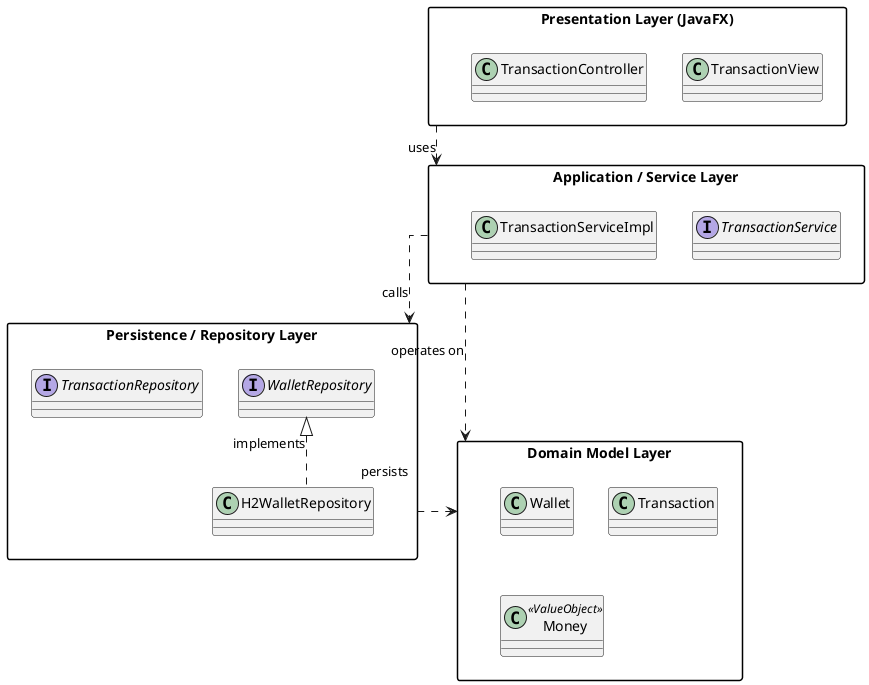
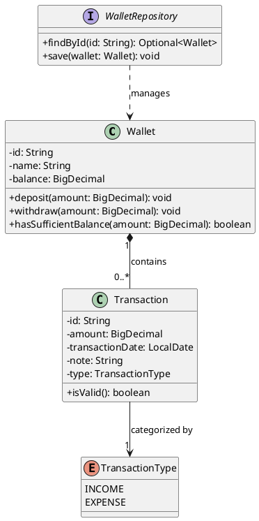
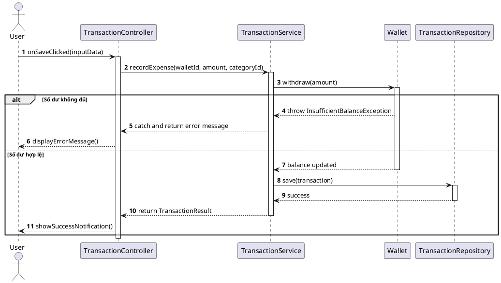
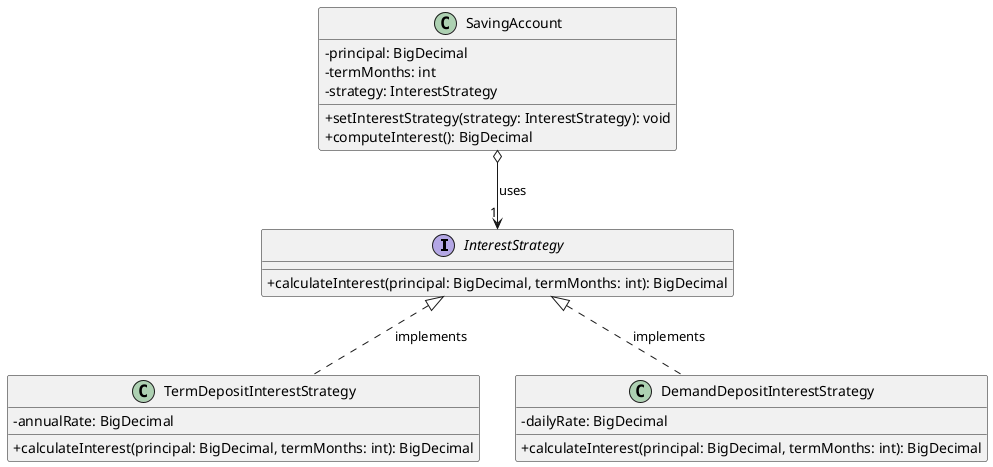
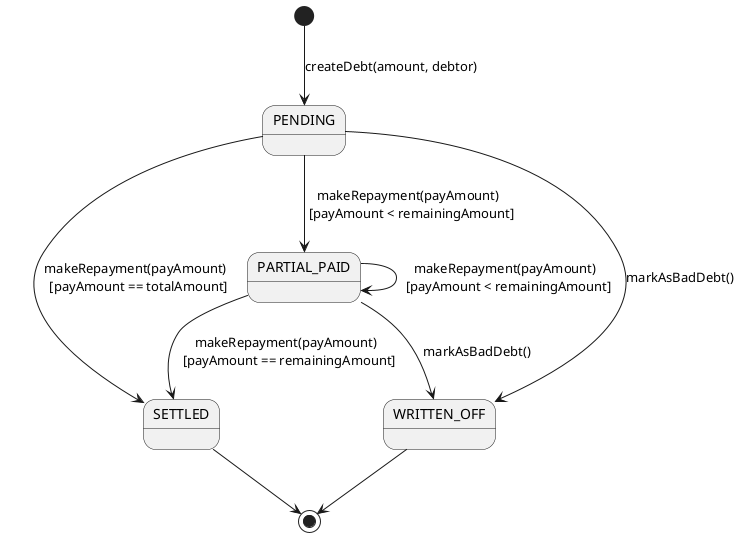

# Khung nội dung tài liệu thiết kế hướng đối tượng (OOD) và quy chuẩn UML

Tài liệu này quy định khung cấu trúc chuẩn, phương pháp thiết kế hướng đối tượng (OOD) và quy chuẩn vẽ sơ đồ UML bằng PlantUML cho đồ án Quản lý Tài chính Cá nhân (PFMS).

Tài liệu phục vụ trực tiếp cho việc lập báo cáo Milestone 3 (UML Design) và Milestone 5 (Design Improvement, SOLID và Design Patterns). Đây là giai đoạn chuyển tiếp từ không gian bài toán nghiệp vụ trong OOA sang không gian giải pháp kỹ thuật cụ thể bằng Java 17 và JavaFX.

---

## Mục lục báo cáo OOD chuẩn

Báo cáo thiết kế OOD của đồ án được tổ chức theo 10 phần sau:

1. [Mục tiêu và phạm vi thiết kế](#1-mục-tiêu-và-phạm-vi-thiết-kế)
2. [Ba nguyên tắc xây dựng sơ đồ UML](#2-ba-nguyên-tắc-xây-dựng-sơ-đồ-uml)
3. [Kiến trúc phân tầng và sơ đồ gói](#3-kiến-trúc-phân-tầng-và-sơ-đồ-gói)
4. [Quy chuẩn sơ đồ lớp thiết kế (DCD)](#4-quy-chuẩn-sơ-đồ-lớp-thiết-kế-dcd)
5. [Quy chuẩn sơ đồ tuần tự thiết kế](#5-quy-chuẩn-sơ-đồ-tuần-tự-thiết-kế)
6. [Phân bổ trách nhiệm theo nguyên tắc GRASP](#6-phân-bổ-trách-nhiệm-theo-nguyên-tắc-grasp)
7. [Áp dụng nguyên lý SOLID và mẫu thiết kế GoF](#7-áp-dụng-nguyên-lý-solid-và-mẫu-thiết-kế-gof)
8. [Quy chuẩn sơ đồ máy trạng thái thiết kế](#8-quy-chuẩn-sơ-đồ-máy-trạng-thái-thiết-kế)
9. [Quy ước kỹ thuật Java và dữ liệu tài chính](#9-quy-ước-kỹ-thuật-java-và-dữ-liệu-tài-chính)
10. [Bảng tự kiểm tra chất lượng và barem đánh giá](#10-bảng-tự-kiểm-tra-chất-lượng-và-barem-đánh-giá)

---

## 1. Mục tiêu và phạm vi thiết kế

### Mục đích cần đạt
Xác định giải pháp kiến trúc phần mềm và cấu trúc mã nguồn để đáp ứng toàn bộ các yêu cầu từ tài liệu ca sử dụng [req-uc.md](../requirements/req-uc.md) và các lớp khái niệm từ tài liệu phân tích [framework.md](../analysis/framework.md).

### Hướng dẫn cách viết
* Xác định rõ không gian giải pháp: Đây là nơi đưa vào các quyết định kỹ thuật cụ thể, gồm ngôn ngữ Java 17, giao diện đồ họa JavaFX (FXML, SceneBuilder), cơ chế lưu trữ cục bộ, và kiến trúc phân tầng.
* Phân định ranh giới giữa các module khi làm việc nhóm:
  * Khi thành viên được giao thiết kế một module cụ thể (ví dụ nhóm cốt lõi: Wallet, Transaction, Transfer, Category), thành viên đó chỉ tập trung thiết kế các lớp và sơ đồ nội bộ của module đó.
  * Tương tác với module khác được thực hiện thông qua Service Interface hoặc Domain Event công khai. Tuyệt đối không can thiệp vào cấu trúc nội bộ của module ngoài phạm vi (như Nợ hay Đầu tư).

---

## 2. Ba nguyên tắc xây dựng sơ đồ UML

Để tài liệu kỹ thuật rõ ràng, dễ đọc và tránh biến thành những bản vẽ rối rắm, toàn bộ sơ đồ UML trong dự án phải tuân thủ nghiêm ngặt 3 nguyên tắc sau:

### Nguyên tắc 1: Chia nhỏ sơ đồ theo module
Tuyệt đối không gom toàn bộ 10 ca sử dụng, hàng chục lớp và toàn bộ giao diện vào một sơ đồ duy nhất. Một sơ đồ ôm đồm toàn bộ hệ thống sẽ trở thành bản vẽ mạng nhện không thể đọc được.
* Với sơ đồ lớp: Mỗi module nghiệp vụ vẽ một sơ đồ lớp chi tiết riêng (sơ đồ lớp cho Ví và Giao dịch, sơ đồ lớp cho Công nợ, sơ đồ lớp cho Sổ tiết kiệm). Chỉ dùng một sơ đồ tổng quan mức gói để thể hiện mối liên hệ giữa các tầng.
* Với sơ đồ tuần tự: Mỗi sơ đồ tuần tự chỉ mô tả đúng một ca sử dụng hoặc một kịch bản luồng chính quan trọng.

### Nguyên tắc 2: Một sơ đồ, một mục đích (1 diagram = 1 purpose)
Mỗi sơ đồ khi đưa vào báo cáo phải trả lời được một câu hỏi kỹ thuật cụ thể:
* Sơ đồ này mô tả cấu trúc tĩnh của module nào?
* Sơ đồ này mô tả luồng tương tác thực thi phương thức của Use Case nào?
* Sơ đồ này minh họa việc áp dụng mẫu thiết kế (Design Pattern) nào?

Nếu một sơ đồ cố gắng vừa thể hiện cấu trúc lớp toàn hệ thống, vừa muốn chỉ ra chi tiết mẫu thiết kế GoF và vừa muốn mô tả luồng lưu trữ cơ sở dữ liệu, sơ đồ đó vi phạm nguyên tắc và bắt buộc phải tách ra.

### Nguyên tắc 3: Tối giản, tập trung nhưng không cực đoan
Sơ đồ thiết kế cần có bố cục thị giác gọn gàng, định hướng rõ ràng từ trên xuống dưới hoặc từ trái sang phải, hạn chế tối đa các đường liên kết cắt chéo nhau.

* Không cực đoan theo hướng thừa thãi: Không liệt kê hàng loạt các hàm getter, setter tầm thường, các hàm mặc định như `equals()`, `hashCode()`, `toString()` vào sơ đồ lớp. Những hàm này làm rác sơ đồ và che lấp các phương thức nghiệp vụ quan trọng.
* Không cực đoan theo hướng thiếu sót: Không được lược bỏ kiểu dữ liệu của thuộc tính, tầm vực truy cập, hoặc tham số và kiểu trả về của các phương thức nghiệp vụ cốt lõi. Một sơ đồ lớp chỉ có tên lớp mà không có kiểu dữ liệu hay phương thức thì không đủ giá trị của pha thiết kế OOD.

---

## 3. Kiến trúc phân tầng và sơ đồ gói

### Mục đích cần đạt
Xác lập ranh giới trách nhiệm giữa các tầng của phần mềm, bảo đảm nguyên lý phụ thuộc một chiều và tính độc lập của logic nghiệp vụ với công nghệ giao diện và cơ sở dữ liệu.

### Mô hình 4 tầng chuẩn mực
Đồ án áp dụng kiến trúc phân tầng chuẩn gồm:
* Tầng giao diện (Presentation Layer): Chứa các màn hình JavaFX (file FXML) và các lớp Controller điều khiển giao diện (ví dụ: `TransactionViewController`). Tầng này chỉ nhận thao tác người dùng, hiển thị dữ liệu và gọi xuống tầng dịch vụ.
* Tầng dịch vụ (Service / Application Layer): Chứa các lớp Service (ví dụ: `WalletService`, `TransactionService`). Tầng này điều phối luồng nghiệp vụ, kiểm tra ràng buộc đầu vào và quản lý giao dịch.
* Tầng miền nghiệp vụ (Domain Model Layer): Chứa các thực thể hạt nhân (Entity như `Wallet`, `Transaction`), các đối tượng giá trị (Value Object như `Money`, `DateRange`), các bảng liệt kê (Enum) và ngoại lệ nghiệp vụ. Tầng này hoàn toàn độc lập, không phụ thuộc vào bất kỳ tầng nào khác.
* Tầng lưu trữ (Repository / Persistence Layer): Chứa các giao diện (Interface) và lớp cài đặt lưu trữ dữ liệu (ví dụ: `WalletRepository`, `H2WalletRepository`). Tầng dịch vụ phụ thuộc vào Interface của Repository, không phụ thuộc vào cơ chế lưu trữ cụ thể.

### Khung mã nguồn PlantUML mẫu cho sơ đồ gói

---

## 4. Quy chuẩn sơ đồ lớp thiết kế (DCD)

### Mục đích cần đạt
Mô hình hóa chi tiết cấu trúc các lớp phần mềm trong không gian giải pháp Java, thể hiện rõ tính đóng gói, kiểu dữ liệu, các phương thức nghiệp vụ và bản chất quan hệ giữa các lớp.

### Hướng dẫn cách viết và quy ước ký hiệu
Khi vẽ sơ đồ lớp thiết kế bằng PlantUML, thành viên cần tuân thủ các quy chuẩn sau:

1. Tính đóng gói (Encapsulation): Phải ghi rõ ký hiệu tầm vực trước mỗi thuộc tính và phương thức:
   * `-` : private (áp dụng cho hầu hết thuộc tính dữ liệu).
   * `+` : public (áp dụng cho các phương thức nghiệp vụ công khai, constructor).
   * `#` : protected (áp dụng khi có kế thừa trong cùng gói hoặc lớp con).
   * `~` : package-private (mặc định trong cùng gói).

2. Kiểu dữ liệu và phương thức:
   * Thuộc tính phải có kiểu dữ liệu Java rõ ràng: `BigDecimal` cho tiền tệ, `LocalDate` cho thời gian, `String`, enum tự định nghĩa, hoặc `List<Transaction>`.
   * Phương thức phải có danh sách tham số kèm kiểu dữ liệu và kiểu trả về (ví dụ: `+ addTransaction(tx: Transaction): void`).
   * Không đưa vào các hàm getter/setter mặc định trừ khi getter/setter đó có chứa logic kiểm tra hợp lệ đặc biệt.

3. Ký hiệu các mối quan hệ UML trong PlantUML:
   * Quan hệ kết hợp có điều hướng (Directed Association): Dùng `-->` thể hiện lớp A biết và giữ tham chiếu tới lớp B.
   * Quan hệ thu nạp (Aggregation): Dùng `o--` thể hiện quan hệ một phần và toàn thể dạng lỏng lẻo (đối tượng con tồn tại độc lập).
   * Quan hệ hợp thành (Composition): Dùng `*--` thể hiện quan hệ sở hữu chặt chẽ (đối tượng con gắn liền với vòng đời đối tượng cha).
   * Quan hệ kế thừa (Generalization): Dùng `--|>` nối từ lớp con lên lớp cha.
   * Quan hệ hiện thực hóa giao diện (Realization): Dùng `..|>` nối từ lớp cài đặt lên interface.
   * Quan hệ phụ thuộc (Dependency): Dùng `..>` thể hiện việc lớp A sử dụng lớp B làm tham số hàm tạm thời mà không giữ làm thuộc tính.

### Khung mã nguồn PlantUML mẫu cho sơ đồ lớp

---

## 5. Quy chuẩn sơ đồ tuần tự thiết kế

### Mục đích cần đạt
Mô tả luồng tương tác hộp trắng bên trong phần mềm khi thực hiện một ca sử dụng, chỉ rõ lời gọi phương thức giữa Controller, Service, Domain Model và Repository.

### Hướng dẫn cách viết
* Mỗi sơ đồ tuần tự gắn với một Use Case cụ thể (ví dụ: UC01 Ghi nhận giao dịch thu chi, UC03 Chuyển tiền nội bộ).
* Tên thông điệp gửi đi phải là tên phương thức thực tế trong mã nguồn Java, kèm tham số truyền vào.
* Phản hồi trả về biểu diễn bằng mũi tên nét đứt (`-->`).
* Rẽ nhánh điều kiện (thành công vs xảy ra ngoại lệ như thiếu số dư) phải sử dụng khung `alt ... else ... end`.
* Thể hiện rõ việc bắt và ném ngoại lệ nghiệp vụ (Custom Exceptions).

### Khung mã nguồn PlantUML mẫu cho sơ đồ tuần tự

---

## 6. Phân bổ trách nhiệm theo nguyên tắc GRASP

### Mục đích cần đạt
Giải trình cơ sở lý thuyết hướng đối tượng đằng sau việc gán phương thức cho từng lớp, chứng minh thiết kế đạt độ kết dính cao (High Cohesion) và độ phụ thuộc thấp (Low Coupling).

### Hướng dẫn cách viết
Trong báo cáo, nhóm cần có một mục riêng giải thích việc áp dụng 9 nguyên tắc GRASP cho các lớp chính:

1. Information Expert: Gán trách nhiệm cho lớp nắm giữ thông tin cần thiết. Ví dụ: Lớp `Wallet` giữ số dư nên phương thức kiểm tra số dư `hasSufficientBalance()` và trừ tiền `withdraw()` phải nằm trong `Wallet`, không để ở tầng ngoài tính hộ.
2. Creator: Lớp nào tạo ra đối tượng khác? Ví dụ: `TransactionService` chịu trách nhiệm tạo mới thể hiện `Transaction` khi nhận yêu cầu ghi chép thu chi.
3. Controller: Đối tượng đầu tiên tiếp nhận thông điệp từ giao diện. Lớp `TransactionController` đón sự kiện từ nút bấm FXML và điều hướng xuống `TransactionService`.
4. Low Coupling: Các lớp nghiệp vụ hạt nhân như `Transaction` không được phụ thuộc trực tiếp vào tầng giao diện hoặc cơ sở dữ liệu.
5. High Cohesion: Mỗi lớp chỉ làm đúng một nhiệm vụ rõ ràng. `Wallet` chỉ quản lý số dư của chính nó; việc lưu trữ vào đĩa để cho `WalletRepository` thực hiện.
6. Polymorphism: Xử lý các hành vi biến thể bằng đa hình thay vì viết chuỗi `if-else` dài. Ví dụ: Tính lãi suất tiết kiệm cho từng loại kỳ hạn được đa hình hóa qua giao diện `InterestCalculationStrategy`.
7. Pure Fabrication: Tạo ra các lớp không có trong thế giới thực nhưng cần thiết cho phần mềm sạch, như các lớp Service, Repository, DTO.
8. Indirection: Tạo lớp trung gian để giảm phụ thuộc. Tầng dịch vụ giao tiếp với cơ sở dữ liệu qua giao diện `Repository` trung gian.
9. Protected Variations: Dùng Interface che chắn các phần hay thay đổi, bảo đảm việc đổi cơ chế lưu trữ từ file CSV sang H2 Database không làm sửa đổi tầng Domain Model.

---

## 7. Áp dụng nguyên lý SOLID và mẫu thiết kế GoF

### Mục đích cần đạt
Chứng minh thiết kế đáp ứng các tiêu chuẩn công nghiệp về khả năng mở rộng, dễ bảo trì và tái sử dụng mã nguồn. Đây là nội dung cốt lõi của Milestone 5.

### Hướng dẫn trình bày nguyên lý SOLID
Với mỗi nguyên lý trong 5 nguyên lý SOLID, chỉ rõ một minh chứng cụ thể trong thiết kế:
* Single Responsibility Principle (SRP): Lớp thực thể `Wallet` chỉ chịu trách nhiệm logic số dư; việc lưu trữ do `WalletRepository` phụ trách; việc hiển thị do `WalletView` phụ trách.
* Open/Closed Principle (OCP): Khi thêm loại tài sản mới (như Bất động sản), hệ thống chỉ cần thêm lớp mới hiện thực hóa giao diện `Asset` mà không cần sửa mã nguồn của lớp tính tổng tài sản hiện có.
* Liskov Substitution Principle (LSP): Mọi lớp con của tài khoản tài chính đều có thể thay thế cho lớp cha mà không làm hỏng tính đúng đắn của các phép toán kiểm tra số dư.
* Interface Segregation Principle (ISP): Chia nhỏ các giao diện. Không gom toàn bộ hàm đọc, ghi, xuất báo cáo vào một giao diện khổng lồ.
* Dependency Inversion Principle (DIP): Các lớp Service phụ thuộc vào Interface `Repository`, không phụ thuộc vào lớp triển khai cơ sở dữ liệu cụ thể.

### Hướng dẫn áp dụng các mẫu thiết kế GoF
Mỗi mẫu thiết kế khi đưa vào tài liệu phải có một sơ đồ PlantUML riêng (tuân thủ nguyên tắc 1 diagram = 1 purpose) kèm phần thuyết minh 3 ý: Bối cảnh bài toán, giải pháp thiết kế, và lợi ích mang lại.

Ba mẫu thiết kế khuyến nghị cho đồ án:
1. Strategy Pattern: Áp dụng cho bài toán tính toán có nhiều thuật toán khác nhau, như tính lãi suất sổ tiết kiệm (không kỳ hạn, có kỳ hạn, bậc thang) hoặc định giá tài sản đầu tư.
2. Factory Method Pattern: Áp dụng khi khởi tạo các loại giao dịch hoặc tài khoản có cấu trúc dữ liệu và điều kiện hợp lệ khác nhau.
3. Observer Pattern: Áp dụng khi số dư một ví thay đổi, các thành phần hiển thị trên Dashboard hoặc tổng tài sản tự động nhận thông báo để cập nhật lại mà không cần liên kết cứng.

### Khung PlantUML mẫu cho Strategy Pattern

---

## 8. Quy chuẩn sơ đồ máy trạng thái thiết kế

### Mục đích cần đạt
Mô tả chi tiết các trạng thái nội bộ của những đối tượng có vòng đời phức tạp, chỉ rõ các phương thức được gọi khi chuyển trạng thái (State Pattern hoặc Enum State Machine).

### Hướng dẫn cách viết
* Áp dụng cho các thực thể có trạng thái thay đổi theo thời gian như Khoản nợ (`Debt`: `PENDING`, `PARTIAL_PAID`, `SETTLED`, `WRITTEN_OFF`) hoặc Sổ tiết kiệm (`Saving`: `ACTIVE`, `MATURED`, `SETTLED`).
* Thể hiện rõ tên sự kiện gọi hàm kích hoạt chuyển trạng thái, điều kiện bảo vệ (Guard Condition) và hành động cập nhật kèm theo.
* Quy định về việc ghi Không áp dụng (N/A): Với các module chỉ chứa dữ liệu bất biến (như giao dịch thu chi sau khi lưu), ghi rõ "Không áp dụng (N/A) do các thực thể trong module này là sự kiện bất biến, không có chuyển đổi trạng thái".

### Khung mã nguồn PlantUML mẫu cho máy trạng thái

---

## 9. Quy ước kỹ thuật Java và dữ liệu tài chính

### Mục đích cần đạt
Thiết lập các tiêu chuẩn mã nguồn sạch (Clean Code) để bước lập trình ở Milestone 4 không bị xung đột phong cách mã hóa và tránh lỗi tính toán tiền bạc.

### Quy chuẩn định danh và tổ chức mã nguồn
* Đặt tên gói (Package): Viết thường toàn bộ, phân cấp theo kiến trúc phân tầng (ví dụ: `com.pfms.domain.wallet`, `com.pfms.service`, `com.pfms.repository`).
* Đặt tên lớp và giao diện: Dùng danh từ theo kiểu PascalCase (ví dụ: `WalletService`, `TransactionValidator`).
* Đặt tên phương thức và biến: Dùng động từ hoặc cụm động từ theo kiểu camelCase (ví dụ: `calculateBalance()`, `isExpenseValid()`).
* Đặt tên hằng số và Enum: Viết hoa toàn bộ, cách nhau bằng dấu gạch dưới (ví dụ: `TRANSACTION_TYPE`, `EXPENSE`).

### Quy tắc bất biến trong tính toán tài chính
* Toàn bộ các thuộc tính tiền tệ, số dư, lãi suất bắt buộc dùng kiểu `BigDecimal`. Tuyệt đối không dùng `double` hoặc `float` để tránh lỗi sai số dấu chấm động.
* Mọi phép chia hoặc tính lãi suất phải chỉ định rõ số chữ số thập phân (scale) và chế độ làm tròn chuẩn ngân hàng: `RoundingMode.HALF_UP`.
* Đối tượng giá trị tiền tệ (`Money`) nên được thiết kế dưới dạng đối tượng bất biến (Immutable Object), mọi thao tác cộng trừ đều trả về một thể hiện `Money` mới.

### Cơ chế xử lý ngoại lệ nghiệp vụ
Không dùng các ngoại lệ chung chung như `RuntimeException` hay `Exception`. Nhóm phải định nghĩa các lớp ngoại lệ nghiệp vụ riêng kế thừa từ một lớp ngoại lệ cơ sở:
* `InsufficientBalanceException`: Khi số dư ví không đủ để chi tiêu hoặc chuyển tiền.
* `InvalidTransactionAmountException`: Khi số tiền giao dịch nhỏ hơn hoặc bằng 0.
* `AccountNotFoundException`: Khi truy vấn ví hoặc tài khoản không tồn tại.

---

## 10. Bảng tự kiểm tra chất lượng và barem đánh giá

### Mục đích cần đạt
Cung cấp bảng kiểm định kỹ thuật để các thành viên tự rà soát tài liệu thiết kế trước khi nộp báo cáo Milestone 3 và Milestone 5, bảo đảm bám sát thang điểm 100 của đồ án.

### Bảng kiểm định chất lượng (Self-Audit Checklist)

| STT | Tiêu chí kỹ thuật kiểm tra | Kết quả mong đợi | Đánh giá |
|---|---|---|---|
| 1 | Tính phân mảnh của sơ đồ | Không có sơ đồ nào nhồi nhét toàn bộ hệ thống; mỗi module có sơ đồ lớp riêng | Đạt / Chưa |
| 2 | Nguyên tắc 1 diagram = 1 purpose | Mỗi sơ đồ chỉ giải quyết đúng một mục tiêu kỹ thuật rõ ràng | Đạt / Chưa |
| 3 | Mức độ chi tiết của sơ đồ lớp | Có đầy đủ tầm vực (+, -, #), kiểu dữ liệu Java chuẩn, bỏ qua getter/setter vụn vặt | Đạt / Chưa |
| 4 | Ranh giới kiến trúc 4 tầng | Tầng giao diện không gọi trực tiếp Repository, Domain Model không phụ thuộc tầng ngoài | Đạt / Chưa |
| 5 | Sơ đồ tuần tự thiết kế | Thể hiện luồng gọi phương thức thực tế, có khung rẽ nhánh alt và xử lý ngoại lệ | Đạt / Chưa |
| 6 | Minh chứng 9 nguyên tắc GRASP | Có phần giải trình cụ thể cách áp dụng Information Expert, Creator, Low Coupling... | Đạt / Chưa |
| 7 | Minh chứng 5 nguyên lý SOLID | Có ví dụ lớp cụ thể chứng minh việc tuân thủ từng nguyên lý trong 5 nguyên lý | Đạt / Chưa |
| 8 | Mô hình hóa mẫu thiết kế GoF | Các mẫu thiết kế (Strategy, Factory, Observer) có sơ đồ PlantUML minh họa riêng | Đạt / Chưa |
| 9 | Chuẩn kiểu dữ liệu tài chính | Toàn bộ tiền tệ, lãi suất trong thiết kế đều ghi chú dùng BigDecimal | Đạt / Chưa |
| 10 | Ranh giới phân công module | Thành viên không thiết kế lấn sân sang cấu trúc nội bộ của module ngoài phạm vi | Đạt / Chưa |

---

## Bước tiếp theo sau OOD

Khi báo cáo thiết kế OOD được hoàn thiện và thông qua ở Milestone 3, nhóm sẽ chuyển sang Milestone 4 (Core Implementation). Trong Milestone 4, các thành viên sẽ trực tiếp lập trình các lớp Java theo đúng sơ đồ lớp và kiến trúc phân tầng đã định nghĩa trong tài liệu này, kèm theo các bài kiểm thử đơn vị JUnit 5 để bảo đảm chất lượng phần mềm.
