# Báo cáo Tổng hợp Thiết kế Hướng đối tượng (OOD) - Hệ thống Quản lý Tài chính Cá nhân (PFMS)

Tài liệu này hợp nhất toàn bộ kết quả thiết kế kiến trúc và mô hình hóa UML của ba phân hệ thuộc hệ thống Quản lý Tài chính Cá nhân: phân hệ Core (Wallet, Transaction, Transfer, Category/Group), phân hệ Debt (Partner, Debt, DebtTransaction) và phân hệ GoalFund (GoalFund, Saving, FundCertificate). Nền tảng triển khai thống nhất cho cả ba phân hệ là ứng dụng desktop JavaFX với lưu trữ H2.

---

## 1. Mục tiêu và Phạm vi

### 1.1. Bảng use case tổng

| Mã UC | Tên ca sử dụng | Đối tượng tham gia | Phân hệ | Vai trò trong phân hệ |
|:---:|---|---|:---:|---|
| `WAL-01` | Xem số dư các ví | `Wallet`, `CashWallet`, `BankAccountWallet`, `EWallet` | Core | Quản lý nơi cất giữ tiền, trạng thái và biến động số dư |
| `TXN-01` | Ghi chép thu/chi | `Wallet`, `Transaction`, `IncomeTransaction`, `ExpenseTransaction` | Core | Ghi nhận biến động dòng tiền, tự động cập nhật số dư ví |
| `TXN-02` | Sửa / Xóa giao dịch | `Wallet`, `Transaction` | Core | Hoàn tác và cân chỉnh lại số dư ví tương ứng |
| `TXN-03` | Xem lịch sử thu/chi | `Transaction`, `TransactionFilter` | Core | Lọc động theo tiêu chí kết hợp |
| `TRF-01` | Chuyển tiền nội bộ | `Transfer`, `Wallet` | Core | Điều phối luân chuyển tiền giữa hai ví |
| `CAT-01` | Phân loại danh mục | `Group`, `Category`, `Transaction` | Core | Cung cấp cây phân cấp ba cấp để gắn nhãn giao dịch |
| `CAT-02` | Quản lý danh mục | `Group`, `Category` | Core | CRUD danh mục và nhóm nhu cầu |
| `DSH-01` | Dashboard tổng quan | `WalletService`, `TransactionService` | Core | Cung cấp số liệu tổng hợp cho màn hình chính |
| `DEBT-01` | Thêm khoản nợ mới | `Partner`, `Debt` | Debt | Khởi tạo khoản nợ mới gắn với một đối tác |
| `DEBT-02` | Ghi nhận giao dịch trả/thu nợ | `Debt`, `DebtTransaction` | Debt | Thực thi thanh toán từng phần, cập nhật dư nợ và trạng thái |
| `DEBT-03` | Xem tổng dư nợ và cảnh báo quá hạn theo đối tác | `Partner`, `Debt` | Debt | Tổng hợp dư nợ ròng và kiểm tra khoản nợ quá hạn |
| `FUND-01` | Bổ sung khoản tiết kiệm vào Quỹ | `GoalFund`, `Saving` | GoalFund | Phân bổ một khoản tiết kiệm có kỳ hạn vào Quỹ |
| `FUND-02` | Truy vấn tổng tài sản và tiến độ Quỹ | `GoalFund`, `Saving`, `FundCertificate` | GoalFund | Tổng hợp giá trị tài sản và tính phần trăm hoàn thành mục tiêu |
| `FUND-03` | Bổ sung chứng chỉ quỹ đầu tư vào Quỹ | `GoalFund`, `FundCertificate` | GoalFund | Phân bổ một lô chứng chỉ quỹ vào Quỹ |

### 1.2. Sơ đồ quan hệ use case, phân tầng hai cấp

Tầng 1, sơ đồ bối cảnh tổng:

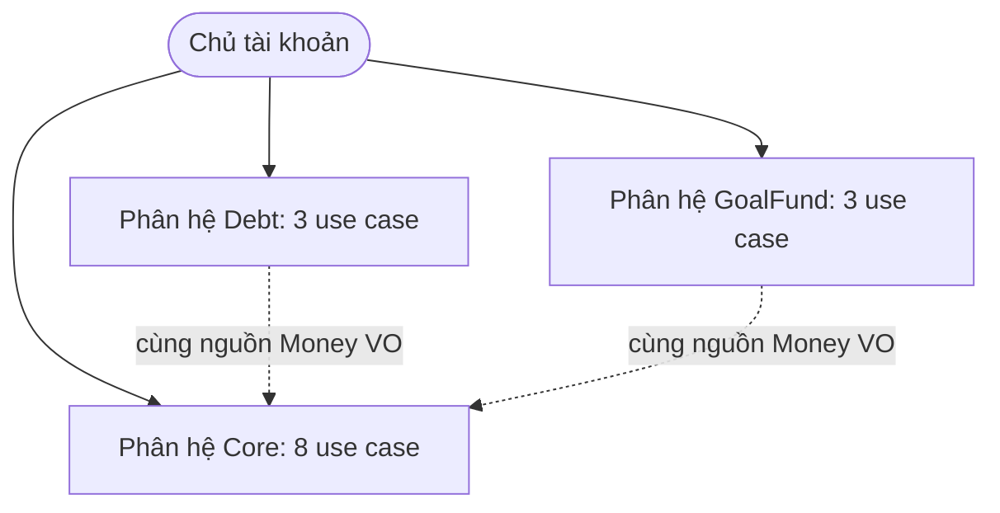

Tầng 2, sơ đồ chi tiết Core:

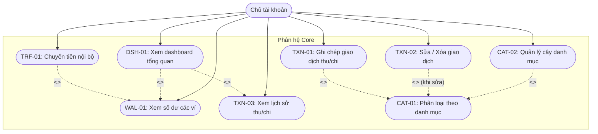

Tầng 2, sơ đồ chi tiết Debt:

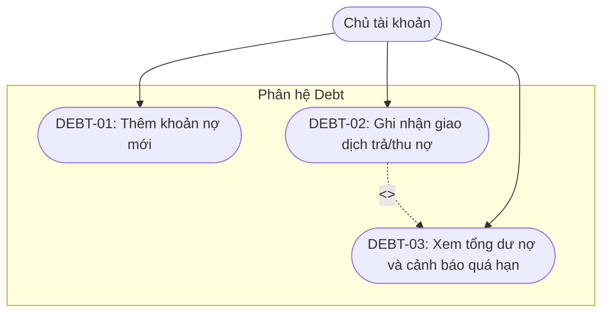

Tầng 2, sơ đồ chi tiết GoalFund:

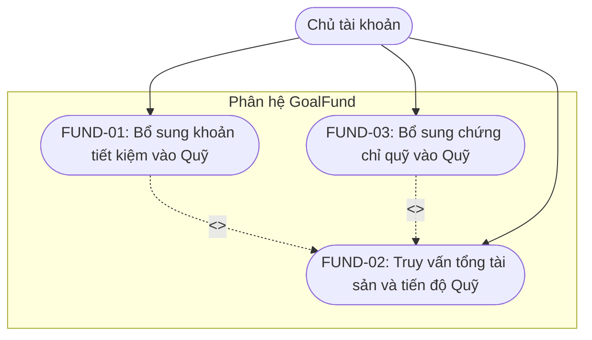

Quan hệ `<<updates>>` giữa `DEBT-02` và `DEBT-03`, cũng như giữa `FUND-01`, `FUND-03` và `FUND-02`, phản ánh việc các phương thức ghi nhận giao dịch làm thay đổi kết quả các phương thức truy vấn tổng hợp tương ứng.

---

## 2. Kiến trúc phân tầng hệ thống

### 2.1. Sơ đồ Tầng 1, bối cảnh kiến trúc tổng

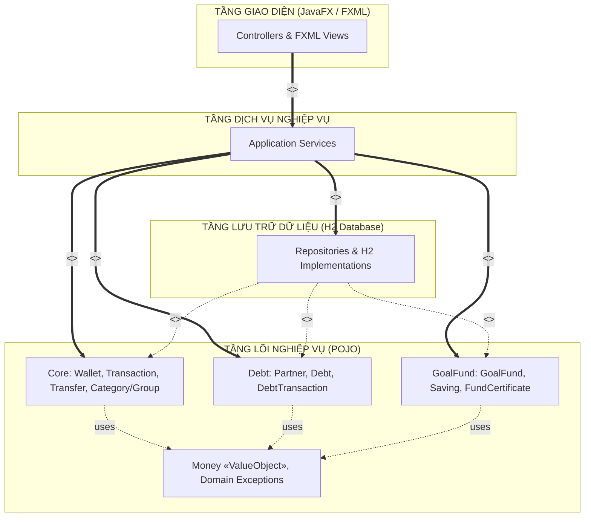

### 2.2. Nguyên lý Phụ thuộc Một chiều

Tầng Domain giữ vị trí trung tâm, không phụ thuộc JavaFX hay H2. Tầng Presentation gọi Tầng Service qua tham số nguyên thủy hoặc DTO. Tầng Service điều phối các thực thể Domain và gọi Tầng Persistence thông qua interface repository, tuân thủ Dependency Inversion. Tầng Persistence triển khai các interface đó bằng H2 và không được Domain biết đến ngược lại. Sự thay đổi về giao diện JavaFX hoặc cấu trúc bảng H2 không làm ảnh hưởng đến các quy tắc tính toán nghiệp vụ tài chính đóng gói bên trong Tầng Domain.

---

## 3. Danh mục sơ đồ

| STT | Tên bản vẽ thiết kế | Loại sơ đồ | Phân hệ |
|:---:|---|:---:|:---:|
| 1 | Kiến trúc phân tầng tổng | Package Diagram | Toàn hệ thống |
| 2 | Cụm Ví tiền và Giao dịch | DCD | Core |
| 3 | Cụm Chuyển tiền nội bộ | DCD | Core |
| 4 | Cụm Danh mục ba cấp | DCD | Core |
| 5 | Giao diện Dịch vụ và Lưu trữ Core | DCD | Core |
| 6 | Cụm Nợ (Partner, Debt, DebtTransaction) | DCD | Debt |
| 7 | Giao diện Dịch vụ và Lưu trữ Debt | DCD | Debt |
| 8 | Cụm Quỹ mục tiêu (GoalFund, Saving, FundCertificate) | DCD | GoalFund |
| 9 | Giao diện Dịch vụ và Lưu trữ GoalFund | DCD | GoalFund |
| 10-15 | Sáu DSD ca sử dụng Core | DSD | Core |
| 16-18 | Ba DSD ca sử dụng Debt | DSD | Debt |
| 19-21 | Ba DSD ca sử dụng GoalFund | DSD | GoalFund |

---

## 4. Sơ đồ lớp thiết kế Core (DCD)

### 4.1. Ví tiền và Giao dịch

Kế thừa `Wallet`: `CashWallet` (tiền mặt), `BankAccountWallet` (ngân hàng, ghi đè kiểm tra `minimumBalance`), `EWallet` (ví điện tử). Kế thừa và đa hình `Transaction`: `IncomeTransaction` ghi đè `applyToWallet()` gọi `wallet.deposit()` và `revertFromWallet()` gọi `wallet.withdraw()`; `ExpenseTransaction` ghi đè ngược lại.

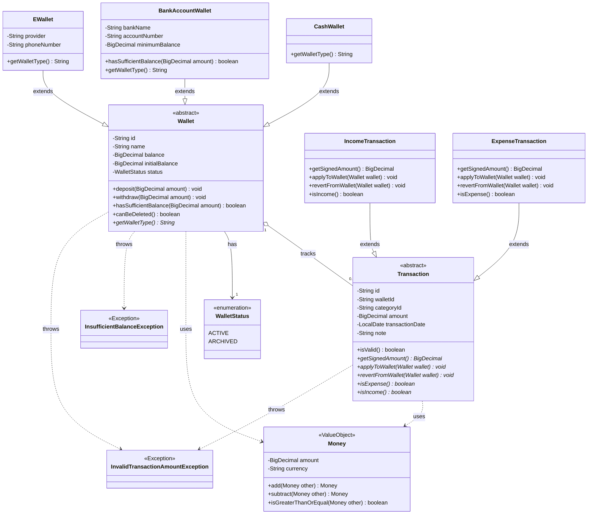

### 4.2. Chuyển tiền nội bộ (`Transfer` và `Wallet`)

Giao dịch chuyển khoản bảo toàn tổng tài sản, gắn với đúng hai thể hiện `Wallet` khác nhau. Tổng tiền trừ bằng số tiền chuyển cộng phí chuyển.

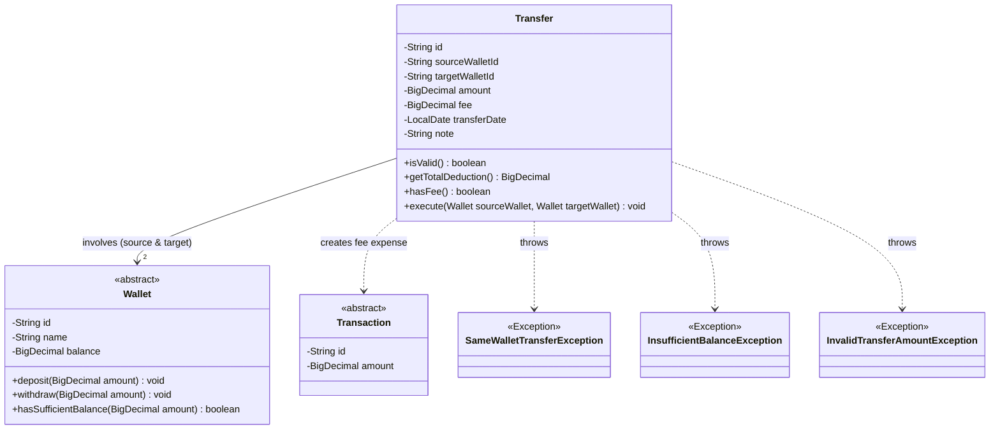

### 4.3. Danh mục ba cấp (`Group`, `Category` và `Transaction`)

Cấu trúc hình cây cố định: `TransactionType` (Thu/Chi) dẫn tới `Group` (Nhóm nhu cầu) dẫn tới `Category` (Danh mục chi tiết). Áp dụng quan hệ Hợp thành: xóa nhóm cha thì toàn bộ danh mục con trực thuộc bị giải phóng.

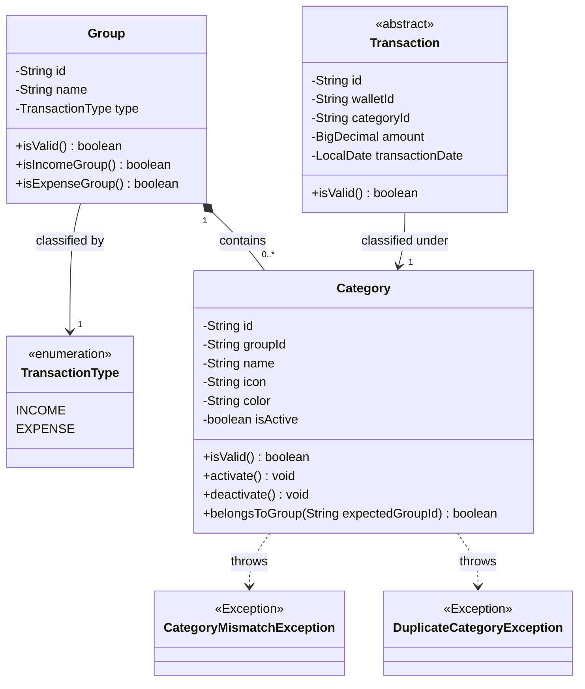

### 4.4. Giao diện Dịch vụ và Lưu trữ Core

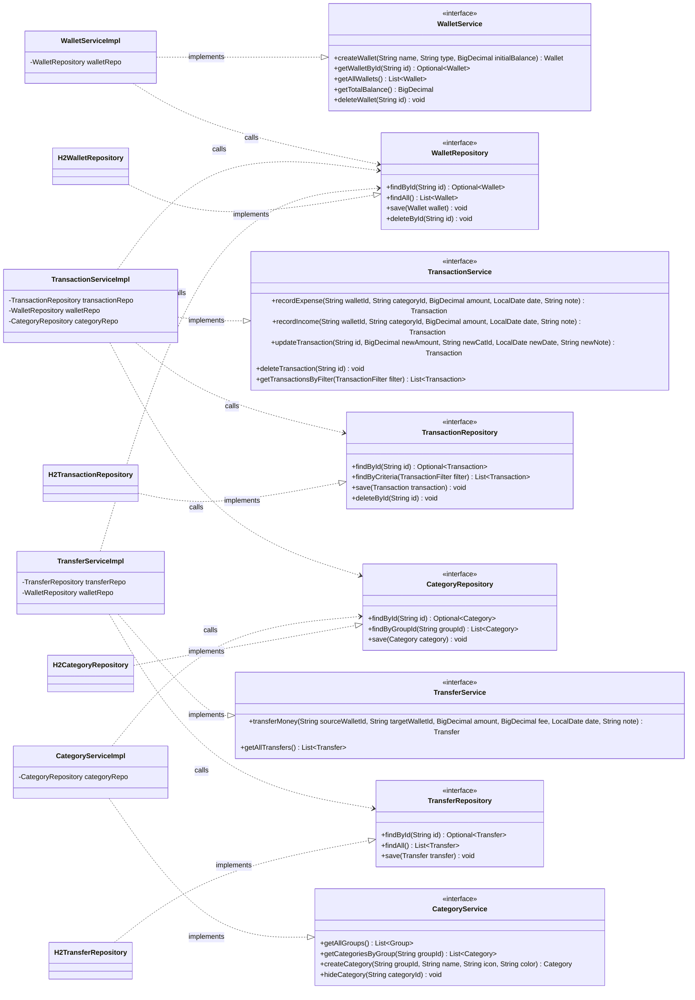

---

## 5. Sơ đồ lớp thiết kế Debt (DCD)

### 5.1. Cụm Partner, Debt, DebtTransaction

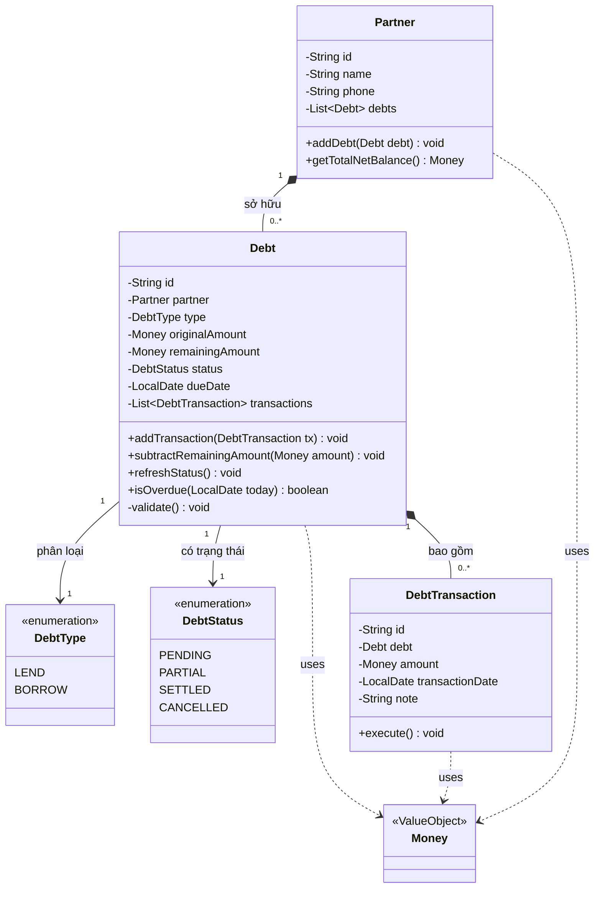

### 5.2. Bảng chi tiết `Debt`

| Tên thành phần | Loại | Kiểu dữ liệu / Chữ ký hàm | Tác dụng và nghiệp vụ chi tiết |
|---|:---:|---|---|
| `id` | Attribute | `String` | Định danh duy nhất cho khoản nợ trong hệ thống |
| `partner` | Attribute | `Partner` | Tham chiếu tới đối tác vay hoặc cho vay |
| `type` | Attribute | `DebtType` | Phân loại bản chất khoản nợ (`LEND`: cho vay, `BORROW`: đi vay) |
| `originalAmount` | Attribute | `Money` | Số tiền gốc ban đầu của khoản nợ khi khởi tạo |
| `remainingAmount` | Attribute | `Money` | Số tiền dư nợ còn lại chưa thanh toán tại thời điểm hiện tại |
| `dueDate` | Attribute | `LocalDate` | Ngày hạn chót phải hoàn tất thanh toán khoản nợ |
| `status` | Attribute | `DebtStatus` | Trạng thái vòng đời khoản nợ |
| `transactions` | Attribute | `List<DebtTransaction>` | Danh sách các giao dịch thanh toán từng phần |
| `addTransaction(tx)` | Method | `void` | Ghi nhận một giao dịch mới và cập nhật lại dư nợ |
| `subtractRemainingAmount(amount)` | Method | `void` | Giảm trừ trực tiếp `remainingAmount` theo số tiền vừa giao dịch |
| `refreshStatus()` | Method | `void` | Tự động cập nhật `status` dựa trên `remainingAmount` |
| `isOverdue(asOfDate)` | Method | `boolean` | Kiểm tra khoản nợ đã quá hạn thanh toán so với ngày chỉ định |

### 5.3. Bảng chi tiết `DebtTransaction`

| Tên thành phần | Loại | Kiểu dữ liệu / Chữ ký hàm | Tác dụng và nghiệp vụ chi tiết |
|---|:---:|---|---|
| `id` | Attribute | `String` | Mã định danh duy nhất của giao dịch thanh toán |
| `debt` | Attribute | `Debt` | Khoản nợ gốc mà giao dịch này tác động đến |
| `amount` | Attribute | `Money` | Số tiền được trả hoặc thu trong lần giao dịch này |
| `transactionDate` | Attribute | `LocalDate` | Thời điểm thực hiện giao dịch |
| `note` | Attribute | `String` | Ghi chú thêm thông tin chi tiết về giao dịch |
| `execute()` | Method | `void` | Kích hoạt chuỗi tác động: yêu cầu `Debt` ghi nhận giao dịch, giảm dư nợ và cập nhật trạng thái |

### 5.4. Giao diện Dịch vụ và Lưu trữ Debt

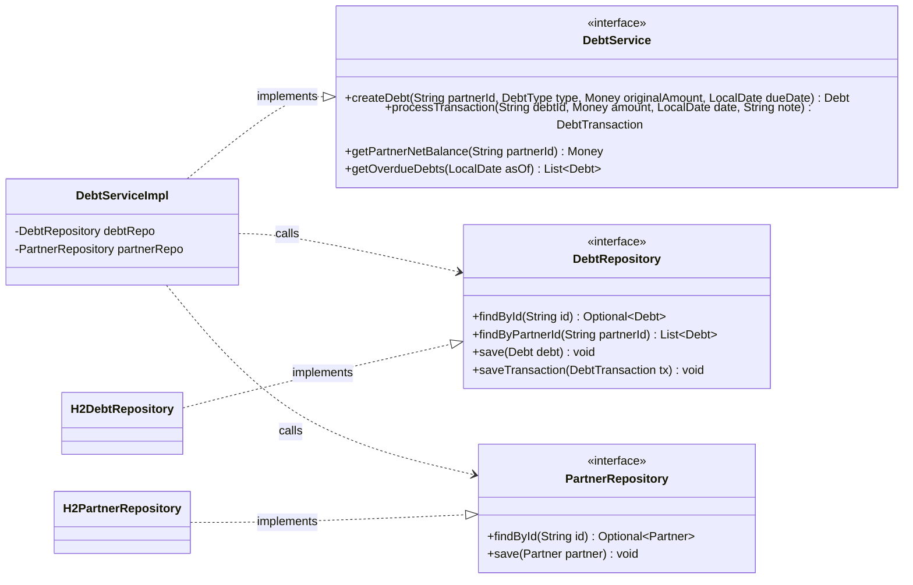

---

## 6. Sơ đồ lớp thiết kế GoalFund (DCD)

### 6.1. Cụm GoalFund, Saving, FundCertificate

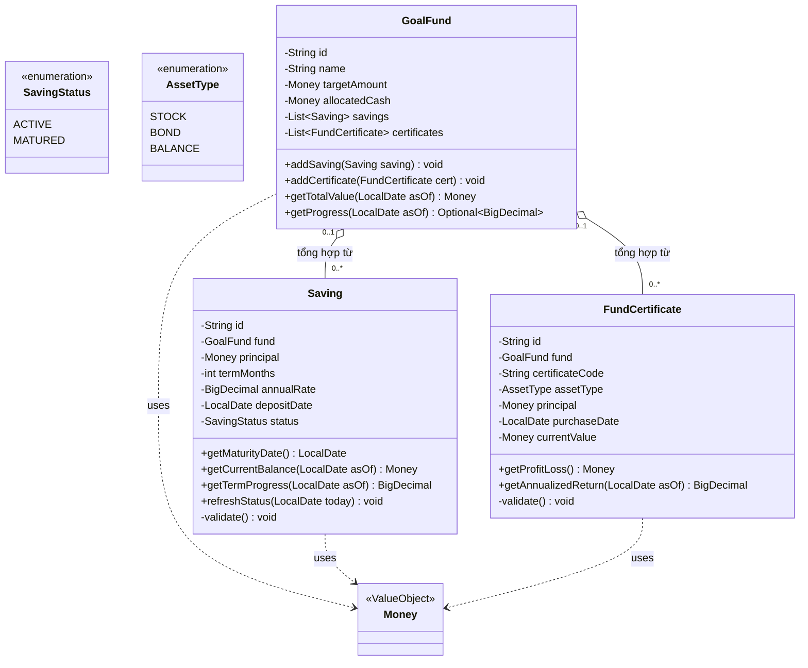

Các thuộc tính có bản chất tỷ lệ phần trăm (`annualRate`, kết quả của `getProgress`, `getAnnualizedReturn`, `getTermProgress`) giữ nguyên kiểu `BigDecimal`, không chuyển sang `Money`, vì không phải giá trị tiền tệ.

### 6.2. Bảng chi tiết `GoalFund` (Aggregate Root)

| Tên thành phần | Loại | Kiểu dữ liệu / Chữ ký hàm | Tác dụng và nghiệp vụ chi tiết |
|---|:---:|---|---|
| `id` | Attribute | `String` | Định danh duy nhất của Quỹ mục tiêu |
| `name` | Attribute | `String` | Tên của Quỹ |
| `targetAmount` | Attribute | `Money` | Mục tiêu tổng số tiền cần tích lũy cho Quỹ |
| `allocatedCash` | Attribute | `Money` | Số tiền mặt được phân bổ trực tiếp cho Quỹ |
| `savings` | Attribute | `List<Saving>` | Danh sách khoản tiết kiệm có kỳ hạn thuộc Quỹ |
| `certificates` | Attribute | `List<FundCertificate>` | Danh sách chứng chỉ quỹ đầu tư thuộc sở hữu của Quỹ |
| `addSaving(saving)` | Method | `void` | Bổ sung một hợp đồng tiết kiệm mới vào cấu trúc tài sản của Quỹ |
| `addCertificate(cert)` | Method | `void` | Bổ sung chứng chỉ quỹ đầu tư vào danh sách tài sản của Quỹ |
| `getTotalValue(asOfDate)` | Method | `Money` | Tính tổng giá trị ròng của Quỹ, gồm tiền mặt cộng tổng giá trị Saving và FundCertificate |
| `getProgress(asOfDate)` | Method | `Optional<BigDecimal>` | Tính tỷ lệ phần trăm tiến độ hoàn thành mục tiêu |

### 6.3. Bảng chi tiết `Saving`

| Tên thành phần | Loại | Kiểu dữ liệu / Chữ ký hàm | Tác dụng và nghiệp vụ chi tiết |
|---|:---:|---|---|
| `id` | Attribute | `String` | Định danh hợp đồng gửi tiết kiệm |
| `principal` | Attribute | `Money` | Số tiền gốc gửi ban đầu |
| `annualRate` | Attribute | `BigDecimal` | Lãi suất gửi tiết kiệm theo năm |
| `termMonths` | Attribute | `int` | Kỳ hạn gửi tiết kiệm tính theo tháng |
| `depositDate` | Attribute | `LocalDate` | Ngày bắt đầu gửi tiết kiệm |
| `getCurrentBalance(asOfDate)` | Method | `Money` | Tính tổng số dư hiện tại gồm tiền gốc và tiền lãi dự thu tích lũy |

### 6.4. Bảng chi tiết `FundCertificate`

| Tên thành phần | Loại | Kiểu dữ liệu / Chữ ký hàm | Tác dụng và nghiệp vụ chi tiết |
|---|:---:|---|---|
| `id` | Attribute | `String` | Định danh lô chứng chỉ quỹ mua vào |
| `certificateCode` | Attribute | `String` | Mã chứng chỉ quỹ |
| `assetType` | Attribute | `AssetType` | Phân loại tài sản của chứng chỉ quỹ |
| `principal` | Attribute | `Money` | Số vốn gốc đầu tư vào lô chứng chỉ |
| `currentValue` | Attribute | `Money` | Giá trị thị trường hiện tại của lô chứng chỉ |
| `getProfitLoss()` | Method | `Money` | Tính số tiền lãi hoặc lỗ chênh lệch giữa vốn gốc và giá trị hiện tại |
| `getAnnualizedReturn(asOfDate)` | Method | `BigDecimal` | Tính tỷ suất sinh lời quy đổi theo năm |

### 6.5. Giao diện Dịch vụ và Lưu trữ GoalFund

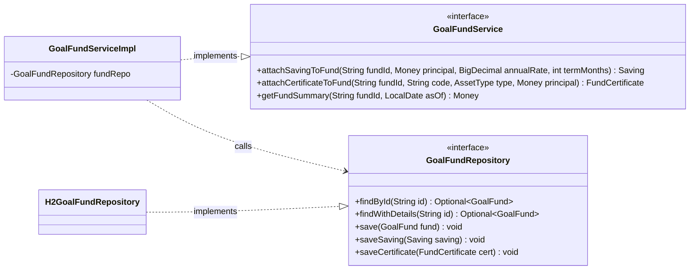

---

## 7. Sơ đồ tuần tự thiết kế (DSD)

### 7.1. `TXN-01`: Ghi nhận khoản chi tiêu (`recordExpense`)

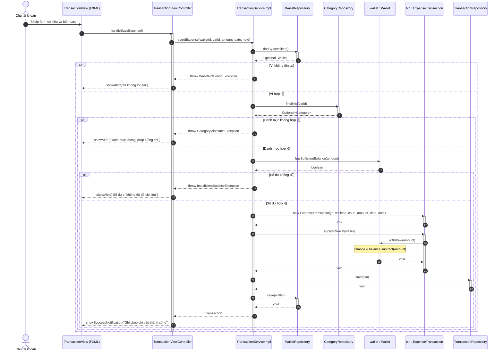

### 7.2. `TXN-01`: Ghi nhận khoản thu nhập (`recordIncome`)

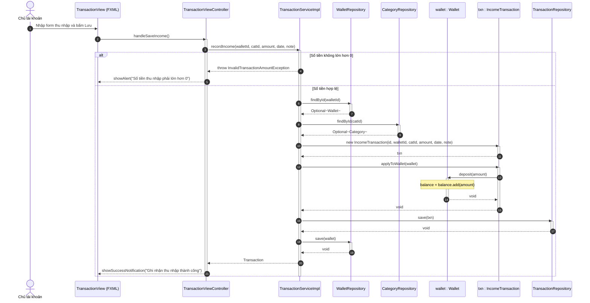

### 7.3. `TRF-01`: Chuyển tiền nội bộ (`transferMoney`)

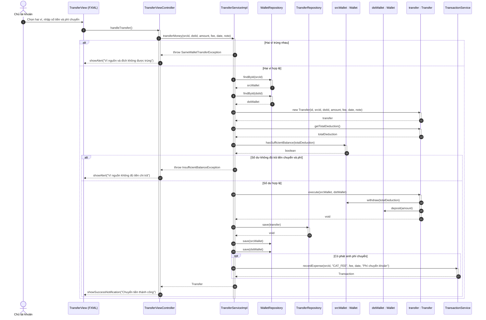

### 7.4. `TXN-02`: Chỉnh sửa giao dịch (`updateTransaction`)

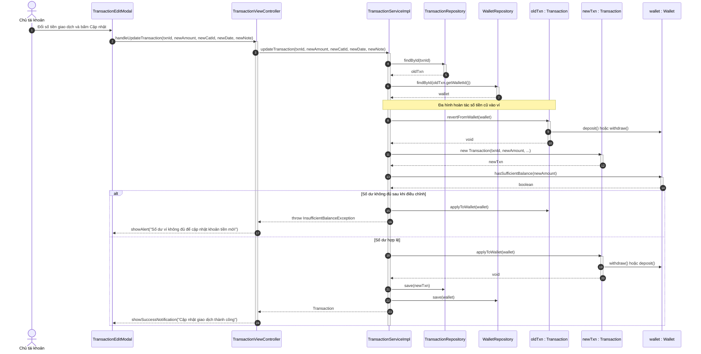

### 7.5. `TXN-02`: Xóa giao dịch (`deleteTransaction`)

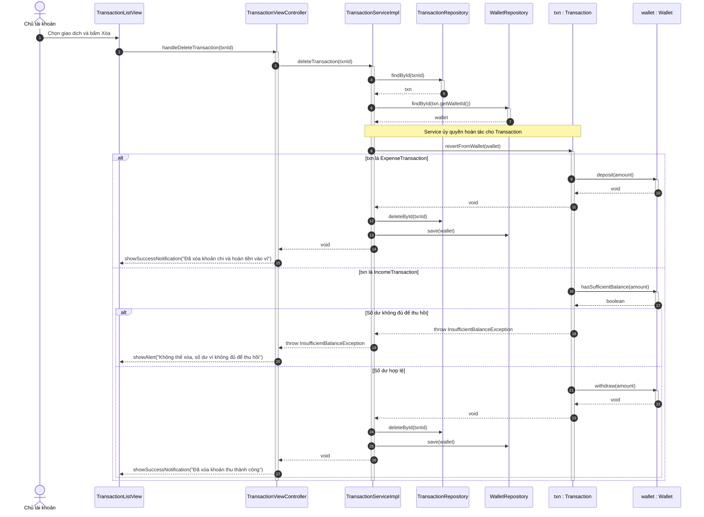

### 7.6. `TXN-03`: Lọc và truy vấn lịch sử thu/chi (`getTransactionsByFilter`)

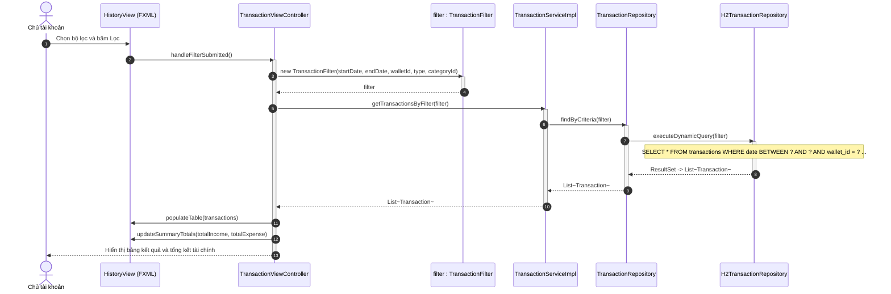

### 7.7. `DEBT-01`: Thêm khoản nợ mới

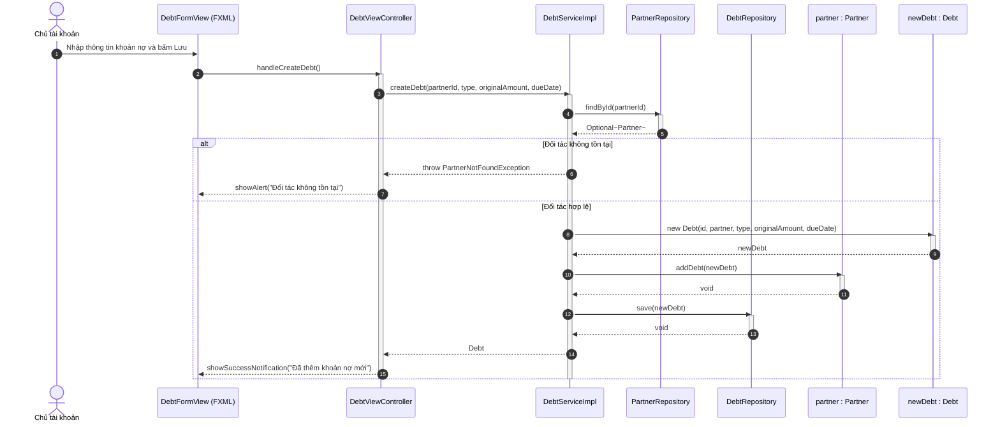

### 7.8. `DEBT-02`: Ghi nhận giao dịch trả/thu nợ

```mermaid
sequenceDiagram
    autonumber
    actor User as Chủ tài khoản
    participant View as DebtTransactionModal
    participant Ctrl as DebtViewController
    participant Svc as DebtServiceImpl
    participant DebtRepo as DebtRepository
    participant D as debt : Debt
    participant Tx as tx : DebtTransaction

    User ->> View: Nhập số tiền trả hoặc thu và bấm Xác nhận
    View ->> Ctrl: handleProcessTransaction(debtId, amount, date, note)
    activate Ctrl

    Ctrl ->> Svc: processTransaction(debtId, amount, date, note)
    activate Svc

    Svc ->> DebtRepo: findById(debtId)
    activate DebtRepo
    DebtRepo -->> Svc: debt
    deactivate DebtRepo

    Svc ->> Tx: new DebtTransaction(id, debt, amount, date, note)
    activate Tx
    Tx -->> Svc: tx
    deactivate Tx

    Svc ->> Tx: execute()
    activate Tx
    Tx ->> D: addTransaction(tx)
    activate D
    D ->> D: subtractRemainingAmount(amount)
    D ->> D: refreshStatus()
    D -->> Tx: void
    deactivate D
    Tx -->> Svc: void
    deactivate Tx

    Svc ->> DebtRepo: saveTransaction(tx)
    activate DebtRepo
    DebtRepo -->> Svc: void
    deactivate DebtRepo

    Svc ->> DebtRepo: save(debt)
    Svc -->> Ctrl: DebtTransaction
    Ctrl -->> View: showSuccessNotification("Đã ghi nhận giao dịch")

    deactivate Svc
    deactivate Ctrl
```

### 7.9. `DEBT-03`: Xem tổng dư nợ và cảnh báo quá hạn theo đối tác

```mermaid
sequenceDiagram
    autonumber
    actor User as Chủ tài khoản
    participant View as PartnerDetailView (FXML)
    participant Ctrl as DebtViewController
    participant Svc as DebtServiceImpl
    participant PartnerRepo as PartnerRepository
    participant DebtRepo as DebtRepository
    participant P as partner : Partner

    User ->> View: Mở chi tiết đối tác
    View ->> Ctrl: handleViewPartnerSummary(partnerId)
    activate Ctrl

    Ctrl ->> Svc: getPartnerNetBalance(partnerId)
    activate Svc
    Svc ->> PartnerRepo: findById(partnerId)
    activate PartnerRepo
    PartnerRepo -->> Svc: partner
    deactivate PartnerRepo

    Svc ->> P: getTotalNetBalance()
    activate P
    P -->> Svc: Money
    deactivate P
    Svc -->> Ctrl: Money
    deactivate Svc

    Ctrl ->> Svc: getOverdueDebts(today)
    activate Svc
    Svc ->> DebtRepo: findByPartnerId(partnerId)
    activate DebtRepo
    DebtRepo -->> Svc: List~Debt~
    deactivate DebtRepo

    loop Duyệt danh sách Debt
        Svc ->> Svc: debt.isOverdue(today)
    end

    Svc -->> Ctrl: List~Debt~ (quá hạn)
    deactivate Svc

    Ctrl -->> View: Hiển thị tổng dư nợ ròng và danh sách khoản nợ quá hạn
    deactivate Ctrl
```

### 7.10. `FUND-01`: Bổ sung khoản tiết kiệm vào Quỹ

```mermaid
sequenceDiagram
    autonumber
    actor User as Chủ tài khoản
    participant View as GoalFundFormView (FXML)
    participant Ctrl as GoalFundViewController
    participant Svc as GoalFundServiceImpl
    participant FundRepo as GoalFundRepository
    participant GF as fund : GoalFund
    participant S as saving : Saving

    User ->> View: Nhập thông số tiết kiệm và bấm Lưu
    View ->> Ctrl: handleAttachSaving(fundId, principal, annualRate, termMonths)
    activate Ctrl

    Ctrl ->> Svc: attachSavingToFund(fundId, principal, annualRate, termMonths)
    activate Svc

    Svc ->> FundRepo: findById(fundId)
    activate FundRepo
    FundRepo -->> Svc: fund
    deactivate FundRepo

    Svc ->> S: new Saving(id, fund, principal, termMonths, annualRate, today)
    activate S
    S -->> Svc: saving
    deactivate S

    Svc ->> GF: addSaving(saving)
    activate GF
    GF -->> Svc: void
    deactivate GF

    Svc ->> FundRepo: saveSaving(saving)
    activate FundRepo
    FundRepo -->> Svc: void
    deactivate FundRepo

    Svc -->> Ctrl: Saving
    Ctrl -->> View: showSuccessNotification("Đã bổ sung khoản tiết kiệm")

    deactivate Svc
    deactivate Ctrl
```

### 7.11. `FUND-02`: Truy vấn tổng tài sản và tiến độ Quỹ

```mermaid
sequenceDiagram
    autonumber
    actor User as Chủ tài khoản
    participant View as GoalFundDashboardView (FXML)
    participant Ctrl as GoalFundViewController
    participant Svc as GoalFundServiceImpl
    participant FundRepo as GoalFundRepository
    participant GF as fund : GoalFund
    participant S as saving : Saving
    participant Cert as cert : FundCertificate

    User ->> View: Mở Dashboard Quỹ
    View ->> Ctrl: handleViewFundDashboard(fundId, asOfDate)
    activate Ctrl

    Ctrl ->> Svc: getFundSummary(fundId, asOfDate)
    activate Svc

    Svc ->> FundRepo: findWithDetails(fundId)
    activate FundRepo
    FundRepo -->> Svc: fund
    deactivate FundRepo

    Svc ->> GF: getTotalValue(asOfDate)
    activate GF
    loop Duyệt danh sách Saving
        GF ->> S: getCurrentBalance(asOfDate)
        activate S
        S -->> GF: balance
        deactivate S
    end
    loop Duyệt danh sách FundCertificate
        GF ->> Cert: getProfitLoss()
        activate Cert
        Cert -->> GF: profitLoss
        deactivate Cert
    end
    GF -->> Svc: totalValue
    deactivate GF

    Svc ->> GF: getProgress(asOfDate)
    activate GF
    GF -->> Svc: progressPercentage
    deactivate GF

    Svc -->> Ctrl: totalValue, progressPercentage
    deactivate Svc
    Ctrl -->> View: Hiển thị biểu đồ tiến độ và chi tiết tài sản

    deactivate Ctrl
```

### 7.12. `FUND-03`: Bổ sung chứng chỉ quỹ đầu tư vào Quỹ

```mermaid
sequenceDiagram
    autonumber
    actor User as Chủ tài khoản
    participant View as GoalFundFormView (FXML)
    participant Ctrl as GoalFundViewController
    participant Svc as GoalFundServiceImpl
    participant FundRepo as GoalFundRepository
    participant GF as fund : GoalFund
    participant Cert as cert : FundCertificate

    User ->> View: Nhập thông số chứng chỉ quỹ và bấm Lưu
    View ->> Ctrl: handleAttachCertificate(fundId, code, assetType, principal)
    activate Ctrl

    Ctrl ->> Svc: attachCertificateToFund(fundId, code, assetType, principal)
    activate Svc

    Svc ->> FundRepo: findById(fundId)
    activate FundRepo
    FundRepo -->> Svc: fund
    deactivate FundRepo

    Svc ->> Cert: new FundCertificate(id, fund, code, assetType, principal, today)
    activate Cert
    Cert -->> Svc: cert
    deactivate Cert

    Svc ->> GF: addCertificate(cert)
    activate GF
    GF -->> Svc: void
    deactivate GF

    Svc ->> FundRepo: saveCertificate(cert)
    activate FundRepo
    FundRepo -->> Svc: void
    deactivate FundRepo

    Svc -->> Ctrl: FundCertificate
    Ctrl -->> View: showSuccessNotification("Đã bổ sung chứng chỉ quỹ")

    deactivate Svc
    deactivate Ctrl
```

---

## 8. Ma trận đối chiếu tổng thể (Traceability Matrix)

| STT | Tên Lớp / Giao diện | Tầng Kiến trúc | Bản chất OOP | Ca sử dụng hiện thực hóa | Ghi chú thiết kế |
|:---:|---|---|---|---|---|
| 1 | `Wallet` | Domain Model | Abstract Entity | `WAL-01`, `TXN-01`, `TXN-02`, `TRF-01`, `DSH-01` | Lớp trừu tượng cha quản lý số dư |
| 2 | `CashWallet` | Domain Model | Concrete Entity | `WAL-01` | Kế thừa `Wallet` |
| 3 | `BankAccountWallet` | Domain Model | Concrete Entity | `WAL-01` | Kế thừa `Wallet`, kiểm tra `minimumBalance` |
| 4 | `EWallet` | Domain Model | Concrete Entity | `WAL-01` | Kế thừa `Wallet` |
| 5 | `Transaction` | Domain Model | Abstract Entity | `TXN-01`, `TXN-02`, `TXN-03`, `DSH-01` | Chứa hàm đa hình `applyToWallet()` |
| 6 | `IncomeTransaction` | Domain Model | Concrete Entity | `TXN-01`, `TXN-02` | Ghi đè nạp tiền |
| 7 | `ExpenseTransaction` | Domain Model | Concrete Entity | `TXN-01`, `TXN-02` | Ghi đè trừ tiền |
| 8 | `Transfer` | Domain Model | Entity | `TRF-01`, `WAL-01` | Quản lý chuyển tiền giữa hai ví |
| 9 | `Group` | Domain Model | Entity | `CAT-01`, `CAT-02`, `TXN-01` | Nhóm nhu cầu |
| 10 | `Category` | Domain Model | Entity | `CAT-01`, `CAT-02`, `TXN-01`, `TXN-02`, `TXN-03` | Danh mục chi tiết |
| 11 | `Money` | Domain Model | Value Object | Dùng chung Core, Debt, GoalFund | Bất biến, bọc `BigDecimal` |
| 12 | `WalletStatus` | Domain Model | Enum | `WAL-01` | `ACTIVE`, `ARCHIVED` |
| 13 | `DomainException` và các lớp con | Domain Model | Custom Exceptions | Toàn hệ thống | Xử lý ngoại lệ nghiệp vụ |
| 14 | `WalletService` / `WalletServiceImpl` | Service Layer | Interface & Impl | `WAL-01`, `DSH-01` | Điều phối nghiệp vụ ví |
| 15 | `TransactionService` / `TransactionServiceImpl` | Service Layer | Interface & Impl | `TXN-01`, `TXN-02`, `TXN-03` | Điều phối nghiệp vụ thu/chi |
| 16 | `TransferService` / `TransferServiceImpl` | Service Layer | Interface & Impl | `TRF-01` | Điều phối chuyển tiền |
| 17 | `CategoryService` / `CategoryServiceImpl` | Service Layer | Interface & Impl | `CAT-01`, `CAT-02` | Quản lý cây danh mục |
| 18 | `WalletRepository` / `H2WalletRepository` | Persistence | Repository / DIP | Lưu trữ H2 | Che giấu SQL lưu trữ ví |
| 19 | `TransactionRepository` / `H2TransactionRepository` | Persistence | Repository / DIP | Lưu trữ H2 | Che giấu SQL lưu trữ giao dịch |
| 20 | `TransactionFilter` | Service / DTO | Data Transfer Object | `TXN-03` | Đóng gói tiêu chí lọc động |
| 21 | `Partner` | Domain Model | Entity (Aggregate Root) | `DEBT-01`, `DEBT-03` | Quản lý danh sách khoản nợ liên quan |
| 22 | `Debt` | Domain Model | Entity | `DEBT-01`, `DEBT-02`, `DEBT-03` | Quản lý dư nợ, trạng thái, hạn thanh toán |
| 23 | `DebtTransaction` | Domain Model | Entity | `DEBT-02` | Ghi nhận từng lần trả hoặc thu nợ |
| 24 | `DebtType` | Domain Model | Enum | `DEBT-01` | `LEND`, `BORROW` |
| 25 | `DebtStatus` | Domain Model | Enum | `DEBT-02`, `DEBT-03` | `PENDING`, `PARTIAL`, `SETTLED`, `CANCELLED` |
| 26 | `DebtService` / `DebtServiceImpl` | Service Layer | Interface & Impl | `DEBT-01`, `DEBT-02`, `DEBT-03` | Điều phối nghiệp vụ Nợ |
| 27 | `PartnerRepository` / `H2PartnerRepository` | Persistence | Repository / DIP | Lưu trữ H2 | Che giấu SQL lưu trữ đối tác |
| 28 | `DebtRepository` / `H2DebtRepository` | Persistence | Repository / DIP | Lưu trữ H2 | Che giấu SQL lưu trữ khoản nợ và giao dịch nợ |
| 29 | `GoalFund` | Domain Model | Entity (Aggregate Root) | `FUND-01`, `FUND-02`, `FUND-03` | Tổng hợp giá trị tài sản, tính tiến độ |
| 30 | `Saving` | Domain Model | Entity | `FUND-01`, `FUND-02` | Tự tính số dư gốc cộng lãi |
| 31 | `FundCertificate` | Domain Model | Entity | `FUND-02`, `FUND-03` | Tự tính lãi hoặc lỗ theo NAV |
| 32 | `SavingStatus` | Domain Model | Enum | `FUND-01` | `ACTIVE`, `MATURED` |
| 33 | `AssetType` | Domain Model | Enum | `FUND-03` | `STOCK`, `BOND`, `BALANCE` |
| 34 | `GoalFundService` / `GoalFundServiceImpl` | Service Layer | Interface & Impl | `FUND-01`, `FUND-02`, `FUND-03` | Điều phối nghiệp vụ Quỹ |
| 35 | `GoalFundRepository` / `H2GoalFundRepository` | Persistence | Repository / DIP | Lưu trữ H2 | Che giấu SQL lưu trữ Quỹ, tiết kiệm, chứng chỉ |
| 36 | `TransferRepository` / `H2TransferRepository` | Persistence | Repository / DIP | `TRF-01` | Bổ sung để khép kín ma trận truy vết |
| 37 | `CategoryRepository` / `H2CategoryRepository` | Persistence | Repository / DIP | `CAT-01`, `CAT-02` | Bổ sung để khép kín ma trận truy vết |

---

## 9. Nguyên tắc GRASP và SOLID

### 9.1. Trách nhiệm GRASP

| Mẫu GRASP | Thực thể áp dụng | Lập luận thiết kế |
|---|---|---|
| Information Expert | `Wallet`, `Transaction`, `Category`, `Debt`, `Saving`, `GoalFund`, `Partner` | Lớp nắm giữ dữ liệu tự tính toán trên dữ liệu đó: `Wallet` tự kiểm tra `hasSufficientBalance()`, `Category` tự kiểm tra `belongsToGroup()`, `Debt` tự thực thi `refreshStatus()` và `isOverdue()`, `Saving` tự tính `getCurrentBalance(asOf)`, `GoalFund` tự tổng hợp `getTotalValue()` và `getProgress()`, `Partner` tự tính `getTotalNetBalance()` |
| Polymorphism | `Transaction` (`IncomeTransaction`, `ExpenseTransaction`) | Hành vi khác nhau theo kiểu con được xử lý qua `applyToWallet()` và `revertFromWallet()` đa hình, triệt tiêu hoàn toàn cấu trúc rẽ nhánh `if/else` trong tầng Service |
| Creator | `Group`, `Partner`, `GoalFund` | Lớp chứa tập hợp con chịu trách nhiệm khởi tạo phần tử con: `Group` khởi tạo `Category` qua quan hệ Composition, `Partner` khởi tạo `Debt` qua `addDebt()`, `GoalFund` khởi tạo `Saving` và `FundCertificate` qua `addSaving()` và `addCertificate()` |
| Low Coupling | `WalletServiceImpl`, `TransactionServiceImpl`, `TransferServiceImpl`, `CategoryServiceImpl`, `DebtServiceImpl`, `GoalFundServiceImpl` | Tầng Service phụ thuộc interface Repository, không phụ thuộc bản triển khai H2 cụ thể |
| High Cohesion | `Money`, `TransactionFilter`, `DebtTransaction`, `FundCertificate` | Mỗi lớp tập trung một tập nhiệm vụ liên quan chặt chẽ, không ôm đồm hiển thị hay lưu trữ |
| Controller | `WalletViewController`, `TransactionViewController`, `TransferViewController`, `CategoryViewController`, `DebtViewController`, `GoalFundViewController` | Tiếp nhận sự kiện UI, giao xử lý nghiệp vụ cho Service tương ứng |

### 9.2. Nguyên tắc SOLID

Nguyên tắc Đơn trách nhiệm. `Wallet` chỉ quản lý số dư và trạng thái ví. `Transaction` chỉ quản lý một lần ghi nhận thu hoặc chi. `Transfer` chỉ quản lý việc luân chuyển giữa hai ví. `Partner` chỉ quản lý thông tin đối tác và tập hợp khoản nợ liên quan. `Debt` chỉ quản lý hạn mức, dư nợ và trạng thái của khoản nợ cụ thể. `DebtTransaction` chỉ ghi nhận thông số của một lần thu hoặc trả nợ. Sự thay đổi trong quy tắc tính lãi suất của `Saving` hay công thức định giá `FundCertificate` không ảnh hưởng đến mã nguồn của `GoalFund`.

Nguyên tắc Mở/Đóng. Thêm một loại giao dịch mới chỉ cần tạo lớp con của `Transaction` cung cấp `applyToWallet()` và `revertFromWallet()`, không cần sửa `TransactionServiceImpl`. Cùng cơ chế, `GoalFund` tổng hợp tài sản thông qua việc truy vấn phương thức tính giá trị của từng lớp cấu thành. Nếu hệ thống cần tích hợp thêm loại tài sản mới, chỉ cần tạo lớp mới cung cấp phương thức trả về giá trị tại thời điểm chỉ định mà không cần chỉnh sửa `GoalFund.getTotalValue()`.

Nguyên tắc Thay thế Liskov. Mọi lớp con của `Wallet` (`CashWallet`, `BankAccountWallet`, `EWallet`) tuân thủ cùng hợp đồng `hasSufficientBalance()`, `BankAccountWallet` chỉ siết chặt thêm điều kiện `minimumBalance`, không phá vỡ hành vi kỳ vọng của lớp cha. Các thành phần tài sản tích lũy trong `GoalFund` (`Saving` và `FundCertificate`) tuân thủ chuẩn giao tiếp tính toán giá trị dựa trên mốc thời gian, cho phép `GoalFund` xử lý đồng nhất mà không cần kiểm tra kiểu dữ liệu thủ công.

Nguyên tắc Phân tách Giao diện. Bốn interface Repository của Core (`WalletRepository`, `TransactionRepository`, `TransferRepository`, `CategoryRepository`) tách biệt theo đúng ranh giới nghiệp vụ, cùng nguyên lý với `PartnerRepository`, `DebtRepository`, `GoalFundRepository`. Không module nào bị ép buộc phụ thuộc vào phương thức repository mà nó không bao giờ sử dụng.

Nguyên tắc Đảo ngược Phụ thuộc. Tầng Service của cả ba phân hệ không phụ thuộc trực tiếp vào các lớp truy xuất cơ sở dữ liệu cụ thể. Tầng Domain định nghĩa các interface repository, Tầng Persistence triển khai các interface đó bằng H2. Logic nghiệp vụ cốt lõi hoàn toàn tách biệt với công nghệ lưu trữ dữ liệu.
