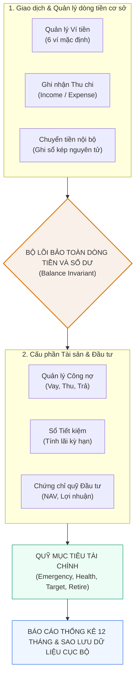
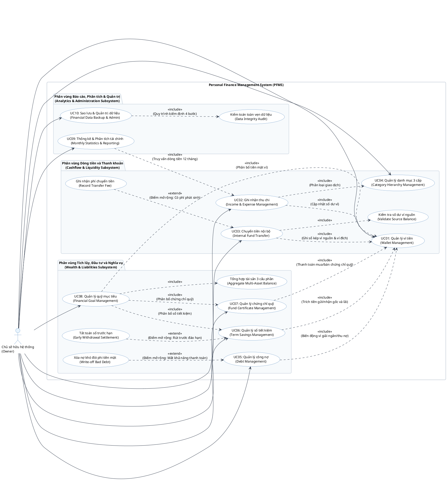
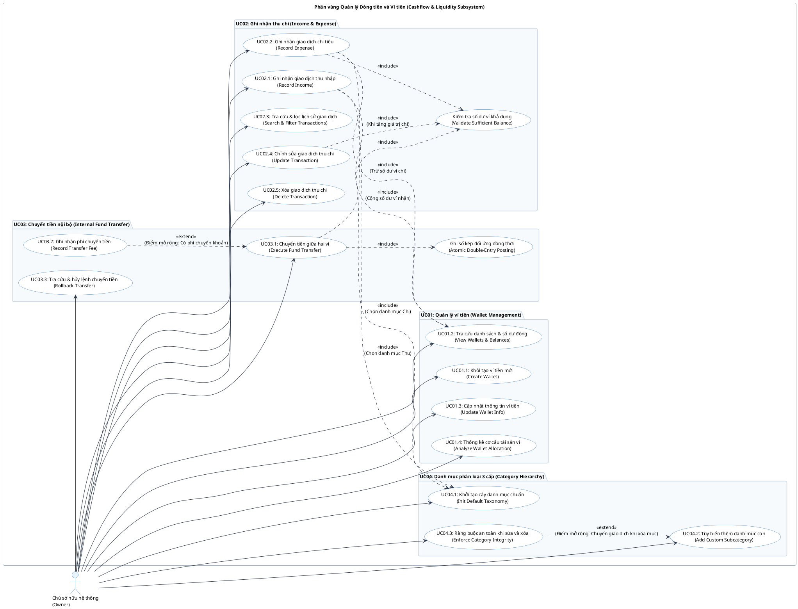
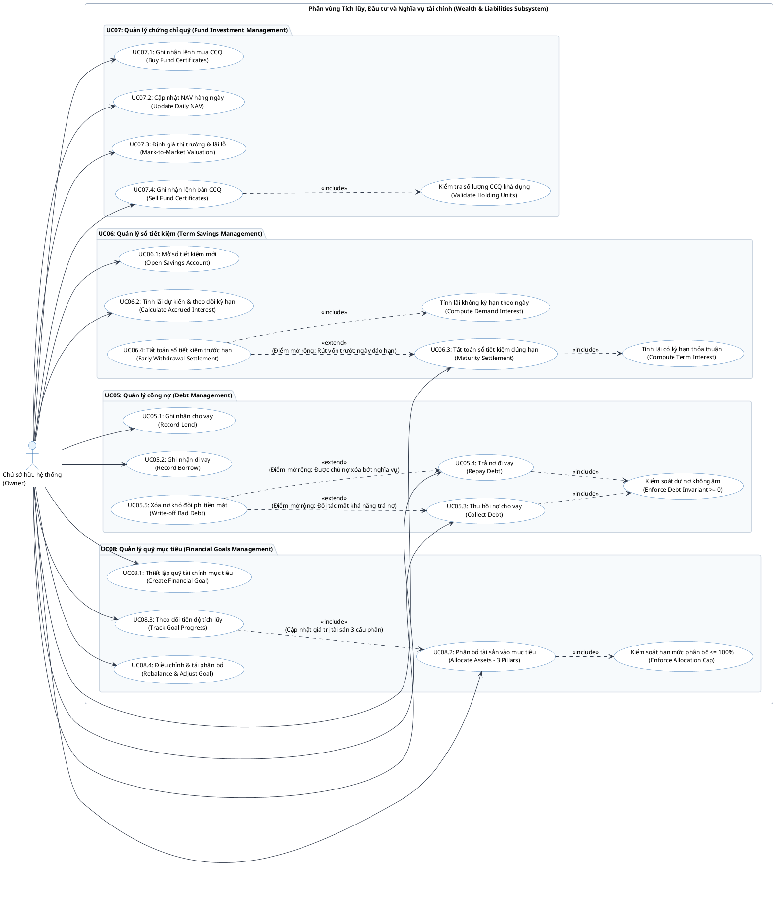
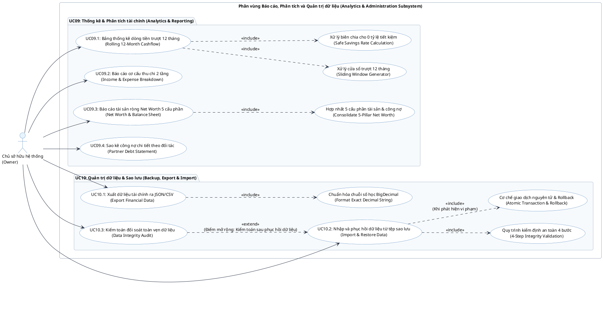

# Tài liệu Đặc tả Yêu cầu Phần mềm và Ca sử dụng Personal Finance Management System (PFMS)

---

## MỤC LỤC TỔNG QUAN

- [1. Giới thiệu tổng quan (Introduction)](#1-giới-thiệu-tổng-quan-introduction)
  - [1.1 Mục đích tài liệu](#11-mục-đích-tài-liệu)
  - [1.2 Phạm vi sản phẩm](#12-phạm-vi-sản-phẩm)
  - [1.3 Đối tượng sử dụng và hướng dẫn đọc tài liệu](#13-đối-tượng-sử-dụng-và-hướng-dẫn-đọc-tài-liệu)
  - [1.4 Tài liệu tham chiếu chuẩn](#14-tài-liệu-tham-chiếu-chuẩn)
  - [1.5 Bảng thuật ngữ và định nghĩa (Glossary)](#15-bảng-thuật-ngữ-và-định-nghĩa-glossary)
- [2. Mô tả tổng quát hệ thống (Overall Description)](#2-mô-tả-tổng-quát-hệ-thống-overall-description)
  - [2.1 Bối cảnh hệ thống](#21-bối-cảnh-hệ-thống)
  - [2.2 Mục tiêu hệ thống (System Goals)](#22-mục-tiêu-hệ-thống-system-goals)
  - [2.3 Đặc điểm tác nhân người dùng](#23-đặc-điểm-tác-nhân-người-dùng)
  - [2.4 Ràng buộc kỹ thuật, giả định và sự phụ thuộc](#24-ràng-buộc-kỹ-thuật-giả-định-và-sự-phụ-thuộc)
  - [2.5 Môi trường vận hành](#25-môi-trường-vận-hành)
- [3. Quy tắc nghiệp vụ và ràng buộc tài chính (Domain Invariants & Business Rules)](#3-quy-tắc-nghiệp-vụ-và-ràng-buộc-tài-chính-domain-invariants--business-rules)
  - [3.1 Ràng buộc chính xác tài chính (BR-FIN-01)](#31-ràng-buộc-chính-xác-tài-chính-br-fin-01)
  - [3.2 Quy tắc bảo toàn số dư ví (BR-FIN-02)](#32-quy-tắc-bảo-toàn-số-dư-ví-br-fin-02)
  - [3.3 Quy tắc ghi sổ kép khi chuyển khoản nội bộ (BR-FIN-03)](#33-quy-tắc-ghi-sổ-kép-khi-chuyển-khoản-nội-bộ-br-fin-03)
  - [3.4 Quy tắc phân cấp danh mục thu chi 3 cấp (BR-FIN-04)](#34-quy-tắc-phân-cấp-danh-mục-thu-chi-3-cấp-br-fin-04)
  - [3.5 Quy tắc tính lãi tiết kiệm có kỳ hạn (BR-FIN-05)](#35-quy-tắc-tính-lãi-tiết-kiệm-có-kỳ-hạn-br-fin-05)
  - [3.6 Quy tắc định giá chứng chỉ quỹ đầu tư (BR-FIN-06)](#36-quy-tắc-định-giá-chứng-chỉ-quỹ-đầu-tư-br-fin-06)
  - [3.7 Quy tắc theo dõi công nợ (BR-FIN-07)](#37-quy-tắc-theo-dõi-công-nợ-br-fin-07)
  - [3.8 Quy tắc phân bổ quỹ mục tiêu (BR-FIN-08)](#38-quy-tắc-phân-bổ-quỹ-mục-tiêu-br-fin-08)
- [4. Yêu cầu chức năng chi tiết (Functional Requirements)](#4-yêu-cầu-chức-năng-chi-tiết-functional-requirements)
  - [4.1 Phân hệ Quản lý ví tiền (FR-WAL)](#41-phân-hệ-quản-lý-ví-tiền-fr-wal)
  - [4.2 Phân hệ Ghi nhận thu chi (FR-TXN)](#42-phân-hệ-ghi-nhận-thu-chi-fr-txn)
  - [4.3 Phân hệ Chuyển tiền nội bộ (FR-TRF)](#43-phân-hệ-chuyển-tiền-nội-bộ-fr-trf)
  - [4.4 Phân hệ Danh mục phân loại (FR-CAT)](#44-phân-hệ-danh-mục-phân-loại-fr-cat)
  - [4.5 Phân hệ Quản lý công nợ (FR-DEBT)](#45-phân-hệ-quản-lý-công-nợ-fr-debt)
  - [4.6 Phân hệ Quản lý sổ tiết kiệm (FR-SAV)](#46-phân-hệ-quản-lý-sổ-tiết-kiệm-fr-sav)
  - [4.7 Phân hệ Chứng chỉ quỹ đầu tư (FR-INV)](#47-phân-hệ-chứng-chỉ-quỹ-đầu-tư-fr-inv)
  - [4.8 Phân hệ Quản lý quỹ mục tiêu (FR-FND)](#48-phân-hệ-quản-lý-quỹ-mục-tiêu-fr-fnd)
  - [4.9 Phân hệ Thống kê và Báo cáo (FR-REP)](#49-phân-hệ-thống-kê-và-báo-cáo-fr-rep)
  - [4.10 Phân hệ Xuất nhập và Sao lưu dữ liệu (FR-DAT)](#410-phân-hệ-xuất-nhập-và-sao-lưu-dữ-liệu-fr-dat)
- [5. Yêu cầu phi chức năng (Non-Functional Requirements)](#5-yêu-cầu-phi-chức-năng-non-functional-requirements)
  - [5.1 NFR-01: Độ chính xác và toàn vẹn dữ liệu tài chính (Financial Precision & Integrity)](#51-nfr-01-độ-chính-xác-và-toàn-vẹn-dữ-liệu-tài-chính-financial-precision--integrity)
  - [5.2 NFR-02: Hiệu năng và độ trễ phản hồi (Performance & Latency)](#52-nfr-02-hiệu-năng-và-độ-trễ-phản-hồi-performance--latency)
  - [5.3 NFR-03: Độ tin cậy và lưu trữ an toàn (Reliability & Persistence)](#53-nfr-03-độ-tin-cậy-và-lưu-trữ-an-toàn-reliability--persistence)
  - [5.4 NFR-04: Khả năng bảo trì và kiến trúc hướng đối tượng (Maintainability & OOP Design)](#54-nfr-04-khả-năng-bảo-trì-và-kiến-trúc-hướng-đối-tượng-maintainability--oop-design)
  - [5.5 NFR-05: Tính khả dụng và công thái học (Usability & User Ergonomics)](#55-nfr-05-tính-khả-dụng-và-công-thái-học-usability--user-ergonomics)
  - [5.6 NFR-06: Tính tương thích và môi trường thực thi (Portability & Compatibility)](#56-nfr-06-tính-tương-thích-và-môi-trường-thực-thi-portability--compatibility)
- [6. Đặc tả 10 Ca sử dụng chi tiết (Fully Dressed Use Cases)](#6-đặc-tả-10-ca-sử-dụng-chi-tiết-fully-dressed-use-cases)
  - [6.1 UC01: Quản lý ví tiền (Wallet Management)](#61-uc01-quản-lý-ví-tiền-wallet-management)
  - [6.2 UC02: Ghi nhận và quản lý giao dịch thu chi (Income & Expense Management)](#62-uc02-ghi-nhận-và-quản-lý-giao-dịch-thu-chi-income--expense-management)
  - [6.3 UC03: Chuyển tiền nội bộ giữa các ví (Internal Fund Transfer)](#63-uc03-chuyển-tiền-nội-bộ-giữa-các-ví-internal-fund-transfer)
  - [6.4 UC04: Thiết lập và quản lý danh mục phân loại thu chi 3 cấp (Category Hierarchy Management)](#64-uc04-thiết-lập-và-quản-lý-danh-mục-phân-loại-thu-chi-3-cấp-category-hierarchy-management)
  - [6.5 UC05: Quản lý công nợ (Debt Management)](#65-uc05-quản-lý-công-nợ-debt-management)
  - [6.6 UC06: Quản lý sổ tiết kiệm có kỳ hạn và tính toán lãi suất (Term Savings Management)](#66-uc06-quản-lý-sổ-tiết-kiệm-có-kỳ-hạn-và-tính-toán-lãi-suất-term-savings-management)
  - [6.7 UC07: Quản lý danh mục chứng chỉ quỹ đầu tư và biến động NAV (Fund Certificate Investment Management)](#67-uc07-quản-lý-danh-mục-chứng-chỉ-quỹ-đầu-tư-và-biến-động-nav-fund-certificate-investment-management)
  - [6.8 UC08: Quản lý quỹ mục tiêu tài chính và phân bổ dòng tiền (Financial Goal & Fund Management)](#68-uc08-quản-lý-quỹ-mục-tiêu-tài-chính-và-phân-bổ-dòng-tiền-financial-goal--fund-management)
  - [6.9 UC09: Tra cứu bảng thống kê dòng tiền trượt 12 tháng và phân tích tỷ lệ tiết kiệm (Monthly Statistics & Cashflow Analysis)](#69-uc09-tra-cứu-bảng-thống-kê-dòng-tiền-trượt-12-tháng-và-phân-tích-tỷ-lệ-tiết-kiệm-monthly-statistics--cashflow-analysis)
  - [6.10 UC10: Sao lưu, xuất và nhập dữ liệu tài chính (Financial Data Backup, Export & Import)](#610-uc10-sao-lưu-xuất-và-nhập-dữ-liệu-tài-chính-financial-data-backup-export--import)
- [7. Sơ đồ Ca sử dụng hệ thống (Use Case Diagrams)](#7-sơ-đồ-ca-sử-dụng-hệ-thống-use-case-diagrams)
  - [7.1 Sơ đồ Ca sử dụng tổng thể toàn hệ thống (Global System Use Case Diagram)](#71-sơ-đồ-ca-sử-dụng-tổng-thể-toàn-hệ-thống-global-system-use-case-diagram)
  - [7.2 Sơ đồ Ca sử dụng phân rã theo 3 phân vùng nghiệp vụ (Subsystem Use Case Diagrams)](#72-sơ-đồ-ca-sử-dụng-phân-rã-theo-3-phân-vùng-nghiệp-vụ-subsystem-use-case-diagrams)
    - [7.2.1 Phân vùng Quản lý Dòng tiền và Ví tiền (Cashflow & Liquidity Subsystem)](#721-phân-vùng-quản-lý-dòng-tiền-và-ví-tiền-cashflow--liquidity-subsystem)
    - [7.2.2 Phân vùng Tích lũy, Đầu tư và Nghĩa vụ tài chính (Wealth & Liabilities Subsystem)](#722-phân-vùng-tích-lũy-đầu-tư-và-nghĩa-vụ-tài-chính-wealth--liabilities-subsystem)
    - [7.2.3 Phân vùng Báo cáo, Phân tích và Quản trị dữ liệu (Analytics & Administration Subsystem)](#723-phân-vùng-báo-cáo-phân-tích-và-quản-trị-dữ-liệu-analytics--administration-subsystem)
- [8. Ma trận kiểm chứng và truy vết yêu cầu (Requirements Traceability Matrix - RTM)](#8-ma-trận-kiểm-chứng-và-truy-vết-yêu-cầu-requirements-traceability-matrix---rtm)
  - [8.1 Ma trận truy vết yêu cầu 4 chiều (Requirements Traceability Matrix)](#81-ma-trận-truy-vết-yêu-cầu-4-chiều-requirements-traceability-matrix)
  - [8.2 Ma trận phương pháp kiểm chứng yêu cầu (Verification Methods Matrix)](#82-ma-trận-phương-pháp-kiểm-chứng-yêu-cầu-verification-methods-matrix)
    - [8.2.1 Ma trận phương pháp kiểm chứng yêu cầu chức năng (39 FRs)](#821-ma-trận-phương-pháp-kiểm-chứng-yêu-cầu-chức-năng-39-frs)
    - [8.2.2 Ma trận phương pháp kiểm chứng yêu cầu phi chức năng (6 NFRs)](#822-ma-trận-phương-pháp-kiểm-chứng-yêu-cầu-phi-chức-năng-6-nfrs)

---

## 1. GIỚI THIỆU TỔNG QUAN (INTRODUCTION)

### 1.1 Mục đích tài liệu

Tài liệu này là bản đặc tả yêu cầu phần mềm (Software Requirements Specification, SRS) xác định phạm vi chức năng, các bất biến nghiệp vụ tài chính và tiêu chí kiểm chứng cho hệ thống Quản lý Tài chính Cá nhân (PFMS). Bản đặc tả thiết lập căn cứ kỹ thuật cho toàn bộ chu trình phát triển:

- Phân tích hướng đối tượng (OOA): Xác định thực thể miền, mô hình hóa ca sử dụng và phân bổ trách nhiệm theo nguyên tắc GRASP.
- Thiết kế hướng đối tượng (OOD): Xây dựng kiến trúc phân tầng, biểu đồ lớp, biểu đồ tuần tự và áp dụng các mẫu thiết kế GoF.
- Cài đặt và kiểm thử: Hiện thực hóa mã nguồn trên nền tảng Java 17 LTS, kiểm thử đơn vị tự động bằng JUnit 5.

Bản tài liệu là hợp đồng kỹ thuật giữa yêu cầu nghiệp vụ thực tế và mô hình phần mềm hướng đối tượng được cài đặt.

### 1.2 Phạm vi sản phẩm

PFMS là ứng dụng máy tính cá nhân (Desktop Application) thực thi trên môi trường máy ảo Java. Hệ thống phục vụ một cá nhân duy nhất (mô hình Single-user / Owner) nhằm theo dõi, phân loại và kiểm soát các nguồn lực tài chính cá nhân.

Ranh giới chức năng của hệ thống được phân định rõ giữa phạm vi xử lý (In-Scope) và phạm vi không hỗ trợ (Out-of-Scope).

Bảng phạm vi xử lý kỹ thuật (In-Scope):

| STT | Phân hệ nghiệp vụ | Mã định danh | Phạm vi xử lý kỹ thuật |
| --- | --- | --- | --- |
| 1 | Quản lý ví tiền | FR-WAL | Khởi tạo và quản trị 6 ví tài khoản mặc định (`cash`, `mb bank`, `timo`, `vietcombank`, `msb`, `shopee pay`), theo dõi số dư khả dụng, tính toán tỷ trọng phân bổ tài sản thanh khoản. |
| 2 | Ghi nhận thu chi | FR-TXN | Ghi nhật ký giao dịch thu nhập và chi phí phát sinh, liên kết trực tiếp với ví thanh toán, cập nhật biến động số dư tức thời. |
| 3 | Chuyển tiền nội bộ | FR-TRF | Điều chuyển giá trị giữa các ví nội bộ theo nguyên tắc ghi sổ kép đối ứng, bảo toàn tổng lượng tiền mặt trong hệ thống. |
| 4 | Danh mục phân loại | FR-CAT | Chuẩn hóa cây phân loại 3 cấp gồm Loại (Type), Nhóm nhu cầu (Group) và Danh mục chi tiết (Category). |
| 5 | Quản lý công nợ | FR-DEBT | Giám sát các khoản phải thu (cho vay) và phải trả (đi vay) theo từng đối tác, ghi nhận hoàn ứng và xử lý xóa nợ. |
| 6 | Quản lý sổ tiết kiệm | FR-SAV | Theo dõi các khoản tiền gửi có kỳ hạn và không kỳ hạn, tính toán tiền lãi theo ngày thực tế, xử lý tất toán đúng hạn và trước hạn. |
| 7 | Chứng chỉ quỹ đầu tư | FR-INV | Định giá danh mục đầu tư theo giá thị trường (Mark-to-Market) dựa trên NAV, theo dõi lãi lỗ chưa thực hiện và tỷ suất sinh lời. |
| 8 | Quản lý quỹ mục tiêu | FR-FND | Quy hoạch tài sản từ tiền mặt, sổ tiết kiệm và chứng chỉ quỹ vào 4 quỹ mục tiêu độc lập, giám sát tỷ lệ hoàn thành mục tiêu. |
| 9 | Thống kê và báo cáo | FR-REP | Tự động hóa chuỗi thống kê 12 tháng trượt theo ngày hệ thống, tổng hợp dòng tiền ròng, tỷ lệ tiết kiệm và cơ cấu chi tiêu. |
| 10 | Quản lý dữ liệu và sao lưu | FR-DAT | Lưu trữ dữ liệu cục bộ trên tệp tin, hỗ trợ xuất và nhập dữ liệu để bảo vệ dữ liệu khi vận hành. |

Ranh giới ngoài phạm vi của hệ thống (Out-of-Scope):

- Không kết nối trực tiếp giao diện lập trình ứng dụng (API) với các ngân hàng thương mại hoặc cổng trung gian thanh toán. Người dùng tự ghi nhận giao dịch vào hệ thống.
- Không hỗ trợ kiến trúc đa người dùng (Multi-tenant) hoặc cơ chế phân quyền truy cập nhiều tầng (Role-Based Access Control). Hệ thống vận hành cục bộ cho một chủ sở hữu duy nhất.
- Không thực hiện các lệnh chuyển tiền hoặc thanh toán điện tử thực tế ngoài đời thực. Hệ thống vận hành như một sổ cái quản lý, tính toán và phân tích thông tin tài chính.

### 1.3 Đối tượng sử dụng và hướng dẫn đọc tài liệu

Tài liệu được biên soạn phục vụ các nhóm đối tượng kỹ thuật với mục đích và phạm vi tham chiếu tương ứng:

| Nhóm đối tượng | Mục đích sử dụng tài liệu | Phạm vi tài liệu trọng tâm |
| --- | --- | --- |
| Kỹ sư phân tích và thiết kế | Xác định ranh giới hệ thống, chuyển hóa yêu cầu thành mô hình OOA và thiết kế chi tiết OOD | Mục 1, Mục 2, Mục 4, Mục 6, Mục 7 |
| Kỹ sư phát triển phần mềm | Cài đặt logic nghiệp vụ, cấu trúc dữ liệu và xử lý ngoại lệ trên nền tảng Java 17 | Mục 3, Mục 4, Mục 6 |
| Kỹ sư kiểm thử phần mềm | Xây dựng ca kiểm thử đơn vị và kiểm thử tích hợp dựa trên luồng sự kiện và điều kiện biên | Mục 3, Mục 6, Mục 8 |
| Cán bộ thẩm định kỹ thuật | Đối soát tính đầy đủ của yêu cầu, kiểm tra mức độ đáp ứng tiêu chuẩn chất lượng | Toàn bộ tài liệu |

Thứ tự tiếp cận tài liệu được khuyến nghị:

1. Tiếp cận tổng quan: Đọc Mục 1 và Mục 2 để nắm rõ bối cảnh, ranh giới phần mềm, các mục tiêu kỹ thuật và ràng buộc môi trường.
2. Nắm bắt logic nghiệp vụ: Đọc Mục 3 để hiểu các bất biến tài chính, quy tắc bảo toàn số dư và công thức tính toán.
3. Hiện thực hóa và kiểm chứng: Đọc song song Mục 4 (Yêu cầu chức năng) và Mục 6 (Ca sử dụng chi tiết), sau đó đối chiếu ma trận truy vết tại Mục 8 để bảo đảm độ bao phủ kiểm thử.

### 1.4 Tài liệu tham chiếu chuẩn

1. ISO/IEC/IEEE 29148:2018: Systems and software engineering — Life cycle processes — Requirements engineering.
2. ISO/IEC 25010:2011: Systems and software engineering — Systems and software Quality Requirements and Evaluation (SQRE) — System and software quality models.
3. ISO/IEC 19505:2012: Information technology — Object Management Group Unified Modeling Language (OMG UML).
4. RFC 2119: Key words for use in RFCs to Indicate Requirement Levels.
5. International Requirements Engineering Board (IREB): CPRE Foundation Level Handbook & Requirements Modeling Handbook.
6. Craig Larman (2004): Applying UML and Patterns: An Introduction to Object-Oriented Analysis and Design and Iterative Development, 3rd Edition, Prentice Hall.
7. Martin Fowler (1997): Accounting Patterns (Mô hình tài khoản, bút toán, giao dịch ghi sổ kép).

### 1.5 Bảng thuật ngữ và định nghĩa (Glossary)

Bảng thuật ngữ định nghĩa thống nhất các khái niệm trong toàn bộ tài liệu:

| Thuật ngữ | Tên tiếng Anh | Định nghĩa kỹ thuật trong hệ thống |
| --- | --- | --- |
| Tác nhân chính | Primary Actor | Người dùng duy nhất tương tác trực tiếp với phần mềm để đạt được mục tiêu cụ thể (vai trò Owner). |
| Kịch bản | Scenario | Một chuỗi các bước tương tác tuần tự giữa tác nhân và hệ thống trong một ngữ cảnh cụ thể. |
| Điều kiện kích hoạt | Trigger | Sự kiện khởi đầu kích thích việc thực thi một ca sử dụng. |
| Tiền điều kiện | Precondition | Trạng thái bắt buộc của hệ thống phải được thỏa mãn trước khi một ca sử dụng có thể bắt đầu. |
| Hậu điều kiện | Postcondition | Trạng thái xác định của hệ thống sau khi ca sử dụng kết thúc, bao gồm cả trường hợp thành công hoặc thất bại. |
| Bất biến miền | Domain Invariant | Quy tắc nghiệp vụ bắt buộc phải luôn luôn đúng tại mọi trạng thái hợp lệ của hệ thống. |
| Ví tiền | Wallet | Một tài khoản thanh khoản thực tế (tiền mặt, thẻ ngân hàng, ví điện tử) lưu giữ số dư tiền khả dụng. Hệ thống hỗ trợ 6 ví mặc định ban đầu: `cash`, `mb bank`, `timo`, `vietcombank`, `msb`, `shopee pay`. |
| Giao dịch thu chi | Transaction | Bản ghi một lần phát sinh tài chính làm tăng hoặc giảm số dư của một ví xác định. |
| Chuyển tiền nội bộ | Internal Transfer | Giao dịch điều chuyển giá trị giữa hai ví nội bộ mà không làm thay đổi tổng tài sản ròng của hệ thống. |
| Cấu trúc danh mục | Category Hierarchy | Mô hình phân loại dạng cây 3 cấp gồm Loại (Type), Nhóm nhu cầu (Group) và Danh mục chi tiết (Category). |
| Công nợ | Debt | Nghĩa vụ tài chính phát sinh giữa Owner và đối tác bên ngoài, phân loại thành khoản phải thu và khoản phải trả. |
| Khoản phải thu | Receivable | Tài sản của Owner đang cho đối tác vay (`lend`), phát sinh quyền yêu cầu hoàn trả trong tương lai. |
| Khoản phải trả | Payable | Nghĩa vụ tài chính mà Owner có trách nhiệm hoàn trả cho chủ nợ thông qua hành vi đi vay (`borrow`). |
| Xóa nợ | Write-off | Thao tác kế toán ghi nhận tổn thất tài sản khi khoản cho vay không thể thu hồi, hoặc ghi nhận giảm nghĩa vụ nợ khi được chủ nợ tha nợ. |
| Sổ tiết kiệm | Saving Account | Khoản tiền gửi tích lũy có kỳ hạn hoặc không kỳ hạn tại tổ chức tín dụng để sinh lời theo lãi suất cam kết. |
| Chứng chỉ quỹ | Fund Certificate | Sản phẩm đầu tư tài chính đại diện cho quyền sở hữu một phần danh mục tài sản ròng của quỹ đầu tư. |
| Giá trị tài sản ròng đơn vị | Net Asset Value (NAV) | Giá trị thị trường của một đơn vị chứng chỉ quỹ tại thời điểm định giá. |
| Quỹ mục tiêu | Financial Goal / Fund | Nhóm tài sản độc lập được quy hoạch từ tiền mặt, sổ tiết kiệm và chứng chỉ quỹ để phục vụ một mục tiêu tài chính cụ thể. |
| Ghi sổ kép | Double-Entry | Nguyên lý kế toán yêu cầu mỗi giao dịch chuyển dịch giá trị phải gồm hai vế đối ứng cân bằng: ghi giảm tài khoản nguồn và ghi tăng tài khoản đích tương ứng. |
| Chủ sở hữu duy nhất | Single-user Owner | Mô hình vận hành của hệ thống, trong đó toàn bộ dữ liệu thuộc quyền kiểm soát của một người dùng duy nhất trên máy trạm cục bộ. |

---

## 2. MÔ TẢ TỔNG QUÁT HỆ THỐNG (OVERALL DESCRIPTION)

### 2.1 Bối cảnh hệ thống

Hệ thống Quản lý Tài chính Cá nhân (PFMS) là phần mềm máy trạm đơn người dùng (Owner) chạy trên nền tảng Java 17. Hệ thống được xây dựng để theo dõi số dư ví, tài sản tích lũy, đầu tư và công nợ dựa trên nguyên lý ghi sổ kép và bảo toàn số dư toán học, thay thế các bảng tính Excel rời rạc.

PFMS giải quyết bài toán quản lý tài chính cá nhân thông qua các định hướng kỹ thuật:

- Áp dụng các mẫu kế toán chuẩn mực (Accounting Patterns), thiết lập tính bất biến số dư ví và áp dụng nguyên lý ghi sổ kép cho các giao dịch chuyển tiền nội bộ.
- Tổng hợp tài sản ròng (Net Worth) từ 5 cấu phần: số dư các ví tiền, số dư các sổ tiết kiệm, giá trị thị trường các chứng chỉ quỹ đầu tư, các khoản phải thu và trừ đi các khoản phải trả.
- Tự động hóa thống kê dòng tiền trượt 12 tháng gần nhất dựa trên thời gian hệ thống, hỗ trợ đánh giá tỷ lệ tiết kiệm và xu hướng thu chi.
- Xây dựng kiến trúc phân tầng độc lập trên nền Java 17, lưu trữ dữ liệu trực tiếp trên tệp tin cục bộ thông qua cơ chế ghi nguyên tử, không phụ thuộc vào phần mềm bảng tính hoặc hệ quản trị cơ sở dữ liệu bên ngoài.

### 2.2 Mục tiêu hệ thống (System Goals)

Hệ thống được thiết kế nhằm đáp ứng 5 mục tiêu kỹ thuật định lượng và có thể đo kiểm:

| Mã mục tiêu | Tên mục tiêu | Định nghĩa kỹ thuật | Tiêu chí đo kiểm (Verification Criteria) |
| --- | --- | --- | --- |
| G1 | Quản lý dòng tiền và danh mục phân loại | Ghi nhận các biến động số dư phát sinh và gán nhãn theo cấu trúc phân loại 3 cấp (Loại, Nhóm, Danh mục) | 100% giao dịch thu chi được định danh đúng ví và đúng danh mục hợp lệ; số dư ví cập nhật tức thời sau khi ghi nhận |
| G2 | Xác định giá trị tài sản ròng và cơ cấu phân bổ | Tổng hợp tài sản ròng tại thời điểm tra cứu từ 5 cấu phần: ví tiền, sổ tiết kiệm, chứng chỉ quỹ, khoản phải thu và khoản phải trả | Giá trị tài sản ròng khớp đúng tổng đại số của 5 cấu phần với sai số bằng 0; tỷ trọng phân bổ từng ví được tính toán chính xác |
| G3 | Giám sát công nợ, tích lũy và danh mục đầu tư | Theo dõi chi tiết từng khoản vay, nợ phải trả, sổ tiết kiệm có kỳ hạn và chứng chỉ quỹ đầu tư | Số liệu công nợ phân tách rõ theo từng đối tác; tiền lãi tiết kiệm được tính đúng theo công thức số ngày thực tế; giá trị chứng chỉ quỹ phản ánh đúng theo NAV cập nhật |
| G4 | Quy hoạch tài chính theo quỹ mục tiêu | Cho phép gom và theo dõi tiến độ tích lũy từ tiền mặt, sổ tiết kiệm và chứng chỉ quỹ vào 4 quỹ mục tiêu độc lập (khẩn cấp, sức khỏe, mục tiêu cụ thể, hưu trí) | Tỷ lệ hoàn thành tiến độ (%) của từng quỹ được tính tự động từ tổng tài sản phân bổ chia cho số tiền mục tiêu |
| G5 | Bảo đảm độ chính xác số học tài chính | Triệt tiêu sai số làm tròn số thực trong các phép tính số dư, tính lãi, định giá và tổng hợp báo cáo | Toàn bộ các phép tính tiền tệ sử dụng `BigDecimal`; không xuất hiện sai số dấu chấm động nhị phân trong bất kỳ kịch bản kiểm thử nào |

### 2.3 Đặc điểm tác nhân người dùng

Hệ thống phục vụ một tác nhân duy nhất là Chủ sở hữu hệ thống (Owner) với các đặc điểm vận hành:

| Thuộc tính tác nhân | Đặc tả kỹ thuật |
| --- | --- |
| Tác nhân (Actor) | Chủ sở hữu hệ thống (Owner) |
| Vai trò trong hệ thống | Tác nhân chính (Primary Actor) duy nhất tương tác trực tiếp với giao diện người dùng |
| Phạm vi quyền hạn | Toàn quyền khởi tạo, sửa đổi, tra cứu và sao lưu dữ liệu trên tất cả 10 phân hệ nghiệp vụ; không áp dụng phân quyền nhiều cấp |
| Yêu cầu kỹ năng | Kỹ năng vận hành ứng dụng máy tính cá nhân cơ bản; hiểu biết các khái niệm tài chính thông dụng gồm thu chi, chuyển tiền, công nợ, tiết kiệm ngân hàng và chứng chỉ quỹ |
| Tần suất tương tác | Tương tác hàng ngày để nhập giao dịch thu chi và chuyển tiền; tương tác định kỳ hàng tuần hoặc hàng tháng để cập nhật NAV, đối soát công nợ, theo dõi tiến độ quỹ mục tiêu và tra cứu báo cáo |

### 2.4 Ràng buộc kỹ thuật, giả định và sự phụ thuộc

Hệ thống tuân thủ các ràng buộc kỹ thuật sau:

Ràng buộc kỹ thuật (Technical Constraints):

| Mã ràng buộc | Nội dung ràng buộc kỹ thuật |
| --- | --- |
| TC-01 | Ứng dụng BẮT BUỘC (MUST) được biên dịch và thực thi trên môi trường Java Development Kit (JDK) phiên bản 17 LTS trở lên. |
| TC-02 | Hệ thống BẮT BUỘC (MUST) sử dụng lớp `java.math.BigDecimal` cho tất cả các trường dữ liệu số tiền, số dư ví, tỷ lệ phần trăm, lãi suất và các biến trung gian. KHÔNG ĐƯỢC PHÉP (MUST NOT) sử dụng kiểu số thực dấu chấm động (`float`, `double`, `java.lang.Float`, `java.lang.Double`) để loại trừ sai số làm tròn số thực nhị phân. |
| TC-03 | Toàn bộ các quy tắc tính toán số dư, tính lãi, ghi sổ kép và định giá BẮT BUỘC (MUST) được kiểm chứng tự động bằng khung kiểm thử JUnit 5. |
| TC-04 | Dữ liệu BẮT BUỘC (MUST) được lưu trữ trên tệp tin cục bộ (định dạng văn bản có cấu trúc như JSON hoặc tệp nhị phân tuần tự hóa), cho phép sao lưu và phục hồi độc lập mà không phụ thuộc vào hệ quản trị cơ sở dữ liệu bên ngoài. |

Giả định của hệ thống (System Assumptions):

| Mã giả định | Nội dung giả định kỹ thuật |
| --- | --- |
| AS-01 | Hệ thống giả định một năm tài chính quy chuẩn có 365 ngày khi tính toán lãi suất tiết kiệm theo quy định ngân hàng. |
| AS-02 | Hệ thống giả định chỉ có một phiên làm việc duy nhất truy cập vào tệp dữ liệu tại một thời điểm trên máy trạm. |
| AS-03 | Giá trị tài sản ròng (NAV) của chứng chỉ quỹ được cập nhật từ người dùng dựa trên công bố thực tế của các đơn vị quản lý quỹ, không yêu cầu tự động crawl dữ liệu trực tuyến. |

Sự phụ thuộc hệ thống (System Dependencies):

| Mã phụ thuộc | Thành phần phụ thuộc | Bản chất phụ thuộc |
| --- | --- | --- |
| DE-01 | Đồng hồ hệ thống (System Clock) | Cung cấp mốc thời gian thực tế để ghi nhận thời điểm giao dịch, tính số ngày thực gửi của sổ tiết kiệm và tự động xác định chuỗi 12 tháng trượt trong báo cáo thống kê. |
| DE-02 | Hệ thống tệp tin cục bộ (Local File System) | Cung cấp quyền đọc, ghi tệp tin trên ổ đĩa để thực hiện lưu trữ bền vững, ghi nguyên tử và sao lưu dữ liệu. |

### 2.5 Môi trường vận hành

Yêu cầu môi trường vận hành của hệ thống:

| Yếu tố môi trường | Yêu cầu kỹ thuật tối thiểu | Ghi chú tương thích |
| --- | --- | --- |
| Hệ điều hành | Microsoft Windows 10/11 (64-bit), macOS 12 trở lên, hoặc các bản phân phối Linux 64-bit (Ubuntu 20.04 LTS, Fedora 36 trở lên) | Độc lập nền tảng nhờ môi trường thực thi máy ảo Java |
| Môi trường thực thi Java | Java Runtime Environment (JRE) 17 hoặc Java Development Kit (JDK) 17 LTS trở lên | Bắt buộc để thực thi mã bytecode và chạy bộ kiểm thử JUnit 5 |
| Bộ vi xử lý (CPU) | Vi xử lý x86-64 hoặc ARM64, tối thiểu 2 nhân, tốc độ xung nhịp từ 2.0 GHz | Đủ năng lực xử lý các phép toán tổng hợp và vẽ biểu đồ |
| Bộ nhớ truy cập ngẫu nhiên (RAM) | Tối thiểu 2 GB RAM khả dụng | Dành riêng cho JVM Heap và bộ nhớ ứng dụng |
| Ổ đĩa lưu trữ | Tối thiểu 200 MB dung lượng trống | Dùng để lưu trữ tệp nhị phân chương trình, các tệp nhật ký và sao lưu |
| Độ phân giải hiển thị | Tối thiểu 1280 x 720 pixels | Hiển thị đầy đủ bảng biểu số liệu và biểu đồ báo cáo |

---

## 3. QUY TẮC NGHIỆP VỤ VÀ RÀNG BUỘC TÀI CHÍNH (DOMAIN INVARIANTS & BUSINESS RULES)

Mục này đặc tả hình thức 8 quy tắc nghiệp vụ và bất biến miền (BR-FIN-01 đến BR-FIN-08). Các quy tắc này thiết lập điều kiện tiên quyết, công thức toán học và hành vi xử lý ngoại lệ bắt buộc trong toàn bộ vòng đời tính toán của hệ thống PFMS.

### 3.1 Ràng buộc chính xác tài chính (BR-FIN-01)

| Thuộc tính | Đặc tả kỹ thuật |
| --- | --- |
| Mã quy tắc | BR-FIN-01 |
| Tên quy tắc | Ràng buộc chính xác tài chính (Financial Precision Invariant) |
| Phạm vi áp dụng | Toàn bộ các thực thể miền, tầng dịch vụ tính toán số học và lưu trữ dữ liệu (`Wallet`, `Transaction`, `Transfer`, `Debt`, `SavingAccount`, `FundCertificate`, `FinancialGoal`) |
| Mục đích nghiệp vụ | Triệt tiêu sai số làm tròn số thực nhị phân, bảo đảm tính toàn vẹn của các phép toán tiền tệ và giá trị tài sản trong sổ cái kế toán |

#### Biểu thức bất biến hình thức

1. Kiểu dữ liệu số học: Với mọi biến số và thuộc tính $x$ biểu diễn số tiền, số lượng chứng chỉ quỹ, lãi suất hoặc tỷ lệ phân bổ:
$$x \in \text{BigDecimal}, \quad x \notin \text{float}, \text{double}, \text{Float}, \text{Double}$$
2. Sai số tích lũy tổng thể: Với mọi phép toán phân rã một giá trị tổng $S$ thành $n$ phần tử $\{s_1, s_2, \dots, s_n\}$:

$$
\left| S - \sum_{i=1}^{n} s_i \right| = 0.00 \text{ VNĐ}
$$

#### Ràng buộc kỹ thuật và xử lý số học

| Tham số | Quy chuẩn kỹ thuật bắt buộc |
| --- | --- |
| Kiểu dữ liệu lưu trữ | `java.math.BigDecimal` cho toàn bộ các trường số tiền, số dư, đơn giá và tỷ lệ. Cấm sử dụng kiểu số thực nguyên thủy hoặc lớp bao bọc (`float`, `double`, `Float`, `Double`). |
| Phương thức khởi tạo | Bắt buộc sử dụng `new BigDecimal(String)` hoặc `BigDecimal.valueOf(long)` / `BigDecimal.valueOf(double)`. Nghiêm cấm sử dụng constructor `new BigDecimal(double)` do giữ nguyên sai số nhị phân của số thực nhị phân. |
| Quy chuẩn Scale tiền tệ | Tiền tệ giao dịch và số dư hiển thị cho VNĐ sử dụng scale = 0 (số nguyên đồng) hoặc scale = 2 (lưu trữ số học nội bộ chuẩn tiền tệ). |
| Quy chuẩn Scale đầu tư | Số lượng đơn vị chứng chỉ quỹ (Units), đơn giá NAV và các tỷ lệ phần trăm trung gian sử dụng scale tối thiểu = 4 (khuyến nghị scale = 6 trong phép tính trung gian). |
| Chế độ làm tròn (RoundingMode) | Các phép chia không hết bắt buộc chỉ định tường minh tham số scale và chế độ làm tròn `RoundingMode.HALF_EVEN` (Banker's rounding) để triệt tiêu độ lệch thống kê tích lũy, hoặc `RoundingMode.HALF_UP` cho các phép tính lãi thương mại. |
| Phép chia số học | Cấm gọi phương thức `divide(BigDecimal divisor)` không kèm tham số scale và `RoundingMode`. |

#### Quy tắc xử lý vi phạm

1. Khi phát hiện dữ liệu đầu vào sử dụng kiểu `float` hoặc `double` trong các API nghiệp vụ: Hệ thống từ chối xử lý và ném ngoại lệ `IllegalArgumentException` kèm thông báo lỗi định dạng kiểu số học.
2. Khi phát hiện phép chia không xác định scale hoặc rounding mode gây số thập phân vô hạn tuần hoàn: Hệ thống ném ngoại lệ `ArithmeticException`, tự động chặn giao dịch và ghi log cảnh báo lỗi thuật toán.
3. Khi tổng các giá trị thành phần sau phân bổ không khớp với giá trị tổng ban đầu: Hệ thống tự động bù sai số lẻ (penny rounding) vào phần tử có giá trị lớn nhất hoặc ném ngoại lệ `FinancialPrecisionException` nếu sai số vượt ngưỡng 0.01 đơn vị tiền tệ.

### 3.2 Quy tắc bảo toàn số dư ví (BR-FIN-02)

| Thuộc tính | Đặc tả kỹ thuật |
| --- | --- |
| Mã quy tắc | BR-FIN-02 |
| Tên quy tắc | Quy tắc bảo toàn số dư ví (Balance Invariant) |
| Phạm vi áp dụng | Thực thể `Wallet` và toàn bộ các dòng tiền phát sinh từ `Transaction`, `Transfer`, `Debt` |
| Mục đích nghiệp vụ | Xác lập số dư khả dụng của từng ví tiền là kết quả tổng hợp động từ lịch sử dòng tiền, ngăn ngừa việc ghi đè số dư tùy tiện và kiểm soát hạn mức thanh khoản |

#### Biểu thức bất biến hình thức

1. Công thức bảo toàn số dư động: Xét ví $w$ tại thời điểm quan sát $T$, số dư khả dụng $Balance_w(T)$ được tính toán theo biểu thức:
$$Balance_w(T) = Balance_w(0) + \sum_{t \le T} Income_w(t) - \sum_{t \le T} Expense_w(t) + \sum_{t \le T} TransferIn_w(t) - \sum_{t \le T} TransferOut_w(t) + \sum_{t \le T} Borrow_w(t) - \sum_{t \le T} Repay_w(t) - \sum_{t \le T} Lend_w(t) + \sum_{t \le T} Collect_w(t)$$

Trong đó:

- $Balance_w(0)$: Số dư khởi tạo ban đầu của ví $w$.
- $Income_w(t)$: Khoản thu nhập phát sinh trực tiếp vào ví $w$ tại thời điểm $t$.
- $Expense_w(t)$: Khoản chi tiêu chi trả trực tiếp từ ví $w$ tại thời điểm $t$.
- $TransferIn_w(t)$: Khoản tiền nhận được do chuyển từ ví khác vào ví $w$.
- $TransferOut_w(t)$: Khoản tiền chuyển từ ví $w$ sang ví khác.
- $Borrow_w(t)$: Khoản tiền nhận về ví $w$ từ hợp đồng đi vay (dòng tiền dương).
- $Repay_w(t)$: Khoản tiền trích xuất từ ví $w$ để trả nợ đã vay (dòng tiền âm).
- $Lend_w(t)$: Khoản tiền trích xuất từ ví $w$ cho đối tác vay (dòng tiền âm).
- $Collect_w(t)$: Khoản tiền thu hồi nợ cho vay chuyển về nhập vào ví $w$ (dòng tiền dương).

2. Ranh giới dòng tiền phi tiền mặt: Các nghiệp vụ xóa nợ (`write-off lend`) và miễn trừ nợ (`write-off borrow`) chỉ tác động lên sổ cái công nợ, không tạo ra dòng tiền vật lý ra hoặc vào ví:
$$\Delta Balance_w(\text{write-off lend}) = 0$$
$$\Delta Balance_w(\text{write-off borrow}) = 0$$
3. Ràng buộc trạng thái số dư khả dụng:
  - Đối với ví tiền mặt, tài khoản ngân hàng và ví điện tử tiêu chuẩn (`type` $\in$ {`CASH`, `BANK`, `E_WALLET`}):
    $$
    Balance_w(T) \ge 0, \quad \forall T
    $$
  - Đối với ví thẻ tín dụng (`type` = `CREDIT`) có hạn mức thấu chi $Limit_w \ge 0$:
    $$
    Balance_w(T) \ge -Limit_w, \quad \forall T
    $$

#### Ràng buộc kỹ thuật và xử lý số học

| Tham số | Quy chuẩn kỹ thuật bắt buộc |
| --- | --- |
| Cơ chế tính toán | Tính toán động theo thời gian thực (On-the-fly aggregation) dựa trên lịch sử giao dịch. Hệ thống cấm lưu trữ trường số dư tĩnh cho phép ghi đè trực tiếp mà không thông qua bút toán dòng tiền. |
| Đồng bộ dữ liệu | Mọi thao tác thêm, sửa hoặc xóa giao dịch liên quan đến ví $w$ phải kích hoạt tính toán lại số dư tức thời. |
| Kiểm tra tiền điều kiện | Trước khi thực hiện bất kỳ giao dịch làm giảm số dư ví (chi tiêu, chuyển đi, trả nợ, cho vay), hệ thống phải kiểm tra điều kiện khả dụng của số dư hiện tại. |

#### Quy tắc xử lý vi phạm

1. Khi một giao dịch khiến số dư khả dụng của ví rơi vào trạng thái âm ($Balance_w < 0$ với ví thông thường hoặc $Balance_w < -Limit_w$ với thẻ tín dụng): Hệ thống từ chối thực thi giao dịch, hoàn nguyên trạng thái bộ nhớ và ném ngoại lệ `InsufficientBalanceException`.
2. Thông báo lỗi phản hồi: `"Giao dịch bị từ chối: Số dư ví không đủ để thực hiện thao tác (Số dư hiện tại: [current], Số tiền yêu cầu: [requested])."`

### 3.3 Quy tắc ghi sổ kép khi chuyển khoản nội bộ (BR-FIN-03)

| Thuộc tính | Đặc tả kỹ thuật |
| --- | --- |
| Mã quy tắc | BR-FIN-03 |
| Tên quy tắc | Quy tắc ghi sổ kép khi chuyển khoản nội bộ (Double-Entry Transfer Invariant) |
| Phạm vi áp dụng | Thực thể `Transfer`, cặp thực thể `Wallet` (ví nguồn $w_{src}$ và ví đích $w_{dst}$), thực thể `Transaction` phụ phát sinh phí |
| Mục đích nghiệp vụ | Bảo đảm tính cân bằng đối ứng và bảo toàn tổng tài sản thanh khoản khi di chuyển tiền tệ giữa các tài khoản nội bộ |

#### Biểu thức bất biến hình thức

1. Cặp bút toán đối ứng: Với một lệnh chuyển tiền từ ví nguồn $w_{src}$ tới ví đích $w_{dst}$ với số tiền chuyển $A > 0$: $$\Delta Balance_{w_{src}} = -A$$ $$\Delta Balance_{w_{dst}} = +A$$
2. Bảo toàn tổng giá trị thanh khoản hệ thống: Trước khi tính phí dịch vụ ngoài, tổng tài sản lưu động trên toàn bộ các ví không đổi:
$$\Delta \sum_{w \in Wallets} Balance_w = \Delta Balance_{w_{src}} + \Delta Balance_{w_{dst}} = (-A) + (+A) = 0$$
3. Hạch toán phí dịch vụ chuyển khoản độc lập: Khi phát sinh phí chuyển tiền $Fee \ge 0$ do bên thứ ba thu:
$$\text{Số tiền trừ ví nguồn: } A_{srctotal} = A + Fee$$
$$\text{Số tiền cộng ví đích: } A_{dstnet} = A$$

Khoản phí $Fee$ được ghi nhận thành một giao dịch chi tiêu (`Expense`) độc lập từ ví nguồn, dẫn đến biến động tổng tài sản:

$$
\Delta \sum_{w \in Wallets} Balance_w = -Fee
$$

#### Ràng buộc kỹ thuật và xử lý số học

| Tham số | Quy chuẩn kỹ thuật bắt buộc |
| --- | --- |
| Tính nguyên tử (Atomicity) | Hai bút toán trừ ví nguồn và cộng ví đích phải được đóng gói trong cùng một khối giao dịch nguyên tử. Nếu một trong hai bút toán thất bại, toàn bộ giao dịch phải được rollback về trạng thái ban đầu. |
| Phân định thực thể | Ví nguồn và ví đích bắt buộc phải khác nhau: $w_{src} \ne w_{dst}$. |
| Ràng buộc giá trị chuyển | Số tiền chuyển $A$ phải lớn hơn 0 ($A > 0$). Phí chuyển tiền $Fee$ phải không âm ($Fee \ge 0$). |
| Ràng buộc thanh khoản nguồn | Ví nguồn phải thỏa mãn điều kiện số dư trước khi trừ: $Balance_{w_{src}} \ge A + Fee$ (hoặc không vượt quá hạn mức thấu chi đối với thẻ tín dụng). |
| Quy tắc hủy chuyển tiền | Khi hủy một lệnh chuyển khoản đã ghi nhận, hệ thống phải thực hiện đảo ngược đồng thời cả hai bút toán (hoàn $A$ về $w_{src}$, trừ $A$ khỏi $w_{dst}$) và hủy bỏ giao dịch chi phí $Fee$ tương ứng. |

#### Quy tắc xử lý vi phạm

1. Khi ví nguồn trùng ví đích ($w_{src} = w_{dst}$): Hệ thống từ chối tạo giao dịch và ném ngoại lệ `SameWalletTransferException`.
2. Khi số tiền chuyển không hợp lệ ($A \le 0$ hoặc $Fee < 0$): Hệ thống từ chối và ném ngoại lệ `InvalidAmountException`.
3. Khi ví nguồn không đủ số dư để chi trả khoản tiền chuyển cùng phí ($Balance_{w_{src}} < A + Fee$): Hệ thống từ chối và ném ngoại lệ `InsufficientBalanceException`.
4. Khi giao dịch nguyên tử gặp sự cố giữa chừng: Hệ thống kích hoạt cơ chế hoàn nguyên trạng thái (Rollback), bảo đảm không làm thất thoát hoặc tạo ra tiền tệ ảo.

### 3.4 Quy tắc phân cấp danh mục thu chi 3 cấp (BR-FIN-04)

| Thuộc tính | Đặc tả kỹ thuật |
| --- | --- |
| Mã quy tắc | BR-FIN-04 |
| Tên quy tắc | Quy tắc phân cấp danh mục thu chi 3 cấp (Category Hierarchy Invariant) |
| Phạm vi áp dụng | Thực thể `Category`, `Group`, `Type` và mối quan hệ tham chiếu từ `Transaction` |
| Mục đích nghiệp vụ | Chuẩn hóa cấu trúc phân loại thu chi theo mô hình cây quan hệ 3 tầng, phục vụ phân tích báo cáo tài chính đa chiều và bảo toàn toàn vẹn dữ liệu lịch sử |

#### Biểu thức bất biến hình thức

1. Cấu trúc cây phân cấp 3 tầng:
$$\text{Type} \xrightarrow{1:N} \text{Group} \xrightarrow{1:N} \text{Category}$$
2. Ràng buộc hàm thuộc duy nhất (Single Parent Invariant):
  - Mỗi danh mục chi tiết $c \in \text{Categories}$ trực thuộc duy nhất một nhóm cha $g \in \text{Groups}$:
    $$
    \forall c \in \text{Categories}, \quad \exists! g \in \text{Groups}: \text{parent}(c) = g
    $$
  - Mỗi nhóm $g \in \text{Groups}$ trực thuộc duy nhất một loại gốc $t \in \text{Types}$:
    $$
    \forall g \in \text{Groups}, \quad \exists! t \in \text{Types}: \text{parent}(g) = t
    $$
  - Cấm tồn tại phần tử mồ côi (Orphan nodes) không có quan hệ cha con hợp lệ.
3. Tập giá trị định danh chuẩn:
  - Tầng 1: $\text{Type} \in \{\text{Income}, \text{Expense}\}$.
  - Tầng 2:
  - Với $\text{Type} = \text{Income}$: $\text{Group} \in \{\text{employment}, \text{assets}, \text{other}\}$.
  - Với $\text{Type} = \text{Expense}$: $\text{Group} \in \{\text{essentials}, \text{personal \& leisure}, \text{obligations \& transfers}, \text{savings \& investing}\}$.
  - Tầng 3: 43 danh mục chi tiết chuẩn được định nghĩa trong danh mục tham chiếu hệ thống.

#### Ràng buộc kỹ thuật và xử lý số học

| Tham số | Quy chuẩn kỹ thuật bắt buộc |
| --- | --- |
| Toàn vẹn tham chiếu xóa | Cấm xóa một `Group` nếu còn tồn tại `Category` trực thuộc. Cấm xóa một `Category` hoặc `Group` nếu đã có ít nhất một bản ghi `Transaction` đang tham chiếu đến danh mục đó. |
| Cơ chế vô hiệu hóa | Khi người dùng muốn ngừng sử dụng một danh mục đã phát sinh giao dịch lịch sử, hệ thống chuyển trạng thái danh mục sang ngưng hoạt động (`Archived` hoặc `Inactive`). Danh mục ngưng hoạt động bị ẩn khỏi giao diện chọn mới nhưng được giữ nguyên trong các báo cáo lịch sử. |
| Bất biến thuộc tính Type | Cấm thay đổi thuộc tính `Type` của một `Group` hoặc `Category` khi đã có giao dịch phát sinh liên kết, nhằm ngăn ngừa sai lệch toàn bộ dữ liệu phân tích thu chi trong quá khứ. |

#### Quy tắc xử lý vi phạm

1. Khi người dùng cố gắng xóa danh mục cha đang chứa danh mục con: Hệ thống từ chối thao tác và ném ngoại lệ `NonEmptyGroupDeletionException`.
2. Khi người dùng cố gắng xóa danh mục đã được gắn vào giao dịch lịch sử: Hệ thống từ chối xóa vật lý, ném ngoại lệ `ReferentialIntegrityException` và gợi ý chuyển sang trạng thái ngưng hoạt động (`Archived`).
3. Khi người dùng cố gắng chuyển đổi thuộc tính `Type` của danh mục đã phát sinh dữ liệu: Hệ thống từ chối và ném ngoại lệ `CategoryTypeImmutableException`.

### 3.5 Quy tắc tính lãi tiết kiệm có kỳ hạn (BR-FIN-05)

| Thuộc tính | Đặc tả kỹ thuật |
| --- | --- |
| Mã quy tắc | BR-FIN-05 |
| Tên quy tắc | Quy tắc tính lãi tiết kiệm có kỳ hạn (Savings Interest Invariant) |
| Phạm vi áp dụng | Thực thể `SavingAccount`, dịch vụ tính toán lãi suất và dòng tiền tất toán |
| Mục đích nghiệp vụ | Phản ánh chính xác giá trị tích lũy của các khoản tiền gửi có kỳ hạn và không kỳ hạn theo chuẩn ngân hàng thương mại, bảo đảm tính minh bạch khi tất toán đúng hạn hoặc tất toán trước hạn hồi tố |

#### Biểu thức bất biến hình thức

1. Quy đổi kỳ hạn và số ngày thực gửi:
  - Bảng quy đổi kỳ hạn chuẩn: `unlimited` = 0 ngày; 1 tháng = 30 ngày; 3 tháng = 90 ngày; 6 tháng = 180 ngày; 12 tháng = 365 ngày; 24 tháng = 730 ngày; 36 tháng = 1095 ngày; 60 tháng = 1825 ngày.
  - Số ngày gửi thực tế tính đến ngày đánh giá hoặc tất toán ($Days$):
    $$
    Days = \max(0, CurrentDate - StartDate)
    $$
2. Khoản gửi không kỳ hạn (`term` = `unlimited`):
  - Lãi suất tích lũy tính theo phương pháp lãi đơn hàng ngày:
    $$
    Interest_{unlimited} = \frac{Principal \times Rate \times Days}{365}
    $$
  - Số dư ghi nhận:
    $$
    Balance = Principal + Interest_{unlimited}
    $$
3. Khoản gửi có kỳ hạn xác định ($TermDays > 0$):
  - Tiến độ hoàn thành kỳ hạn ($Process$):
    $$
    Process = \min\left(1.0, \frac{Days}{TermDays}\right)
    $$
  - Lãi dự kiến toàn kỳ theo hợp đồng:
    $$
    ExpectedInterest = \frac{Principal \times Rate \times TermDays}{365}
    $$
  - Số dư danh nghĩa ghi nhận tại thời điểm quan sát:
    $$
    Balance = Principal + (ExpectedInterest \times Process)
    $$
4. Quy tắc giá trị tất toán (Settlement Value):
  - Tất toán đúng hạn hoặc sau hạn ($Days \ge TermDays$): Nhận toàn bộ gốc và 100% lãi cam kết theo hợp đồng:
    $$
    Payout_{mature} = Principal + ExpectedInterest
    $$
  - Tất toán trước hạn ($Days < TermDays$): Toàn bộ lãi kỳ hạn dự kiến bị hủy bỏ; hệ thống áp dụng hồi tố lãi suất không kỳ hạn ($DemandRate$) theo số ngày thực gửi:
    $$
    Payout_{early} = Principal + \frac{Principal \times DemandRate \times Days}{365}
    $$
  - Số tiền lãi bị mất do tất toán trước hạn (Forfeited Interest):
    $$
    InterestLoss = (ExpectedInterest \times Process) - \frac{Principal \times DemandRate \times Days}{365}
    $$

#### Ràng buộc kỹ thuật và xử lý số học

| Tham số | Quy chuẩn kỹ thuật bắt buộc |
| --- | --- |
| Cơ sở quy ước năm | Cơ sở tính lãi quy ước chuẩn là 365 ngày trong một năm ($BaseDays = 365$). |
| Độ chính xác số học | Số vốn gốc $Principal$, tiền lãi và giá trị nhận về $Payout$ tính toán bằng `BigDecimal` với scale = 2 và `RoundingMode.HALF_EVEN`. Tỷ lệ lãi suất $Rate$ và $DemandRate$ duy trì scale tối thiểu = 4 (ví dụ 0.0650 biểu thị 6.5%/năm). |
| Điều kiện tiền kiểm | $Principal > 0$; $Rate \ge 0$; $DemandRate \ge 0$; $StartDate \le CurrentDate$. |

#### Quy tắc xử lý vi phạm

1. Khi dữ liệu mở sổ vi phạm ràng buộc tiền kiểm ($Principal \le 0$ hoặc $Rate < 0$): Hệ thống từ chối mở sổ và ném ngoại lệ `InvalidSavingsParameterException`.
2. Khi ngày tất toán nhỏ hơn ngày gửi sổ ($SettlementDate < StartDate$): Hệ thống từ chối thao tác và ném ngoại lệ `InvalidSettlementDateException`.

### 3.6 Quy tắc định giá chứng chỉ quỹ đầu tư (BR-FIN-06)

| Thuộc tính | Đặc tả kỹ thuật |
| --- | --- |
| Mã quy tắc | BR-FIN-06 |
| Tên quy tắc | Quy tắc định giá chứng chỉ quỹ đầu tư (Fund Certificate Valuation &amp; Return Invariant) |
| Phạm vi áp dụng | Thực thể `FundCertificate`, lịch sử giao dịch mua bán và biến động giá trị tài sản ròng `NAV` |
| Mục đích nghiệp vụ | Đo lường chính xác giá trị thị trường của danh mục đầu tư theo cơ chế Mark-to-Market, phản ánh đúng lãi lỗ chưa thực hiện và tỷ suất sinh lời quy đổi năm |

#### Biểu thức bất biến hình thức

1. Phân loại danh mục đầu tư:
$$\text{Type} \in \text{stock}, \text{bond}, \text{balance}$$
Trong đó `stock` là quỹ cổ phiếu, `bond` là quỹ trái phiếu, và `balance` là quỹ cân bằng.
2. Khớp lệnh mua chứng chỉ quỹ:
Số lượng đơn vị quỹ ($Units$) nhận được từ vốn gốc đầu tư $Principal$ và giá trị tài sản ròng khớp lệnh ($BuyNAV$):
$$Units = \frac{Principal}{BuyNAV}$$

$Units$ được làm tròn với scale = 4 theo chế độ `RoundingMode.HALF_EVEN`.
3. Định giá theo giá thị trường (Mark-to-Market):
Tại ngày định giá với giá trị tài sản ròng hiện hành $CurrentNAV$, giá trị thị trường của khoản đầu tư ($MarketValue$) là:

$$
MarketValue = Units \times CurrentNAV
$$

4. Xác định lợi nhuận chưa thực hiện (Unrealized Profit/Loss):
$$UnrealizedPL = MarketValue - Principal$$
  - $UnrealizedPL > 0$: Danh mục ghi nhận trạng thái lãi danh nghĩa.
  - $UnrealizedPL < 0$: Danh mục ghi nhận trạng thái lỗ danh nghĩa.
  - $UnrealizedPL = 0$: Danh mục đạt trạng thái hòa vốn.
5. Suất sinh lời quy đổi năm (Annualized Rate of Return):
Số ngày nắm giữ khoản đầu tư: $HoldDays = \max(0, CurrentDate - StartDate)$.
  - Khi $HoldDays < 30$ ngày: Hệ thống tính tỷ suất sinh lời tuyệt đối:
    $$
    Rate_{absolute} = \frac{MarketValue - Principal}{Principal} \times 100\%
    $$
  - Khi $HoldDays \ge 30$ ngày: Hệ thống tính suất sinh lời kép quy đổi năm (CAGR):
    $$
    Rate_{annualized} = \left[ \left(\frac{MarketValue}{Principal}\right)^{\frac{365}{HoldDays}} - 1 \right] \times 100\%
    $$

#### Ràng buộc kỹ thuật và xử lý số học

| Tham số | Quy chuẩn kỹ thuật bắt buộc |
| --- | --- |
| Kiểm tra tiền điều kiện | $Principal > 0$, $BuyNAV > 0$, $CurrentNAV > 0$. |
| Độ chính xác số học | $Units$ duy trì scale = 4. Đơn giá $NAV$ duy trì scale từ 2 đến 4 chữ số thập phân. Giá trị thị trường $MarketValue$ và $UnrealizedPL$ tính toán với scale = 2, chế độ làm tròn `RoundingMode.HALF_EVEN`. |
| Quy chuẩn thời gian nắm giữ | Phép tính số mũ quy đổi năm bắt buộc chỉ áp dụng khi $HoldDays \ge 30$ ngày nhằm ngăn ngừa méo mó số liệu thống kê do hiện tượng khuếch đại số mũ ngắn hạn. |

#### Quy tắc xử lý vi phạm

1. Khi giá trị $BuyNAV \le 0$ hoặc $CurrentNAV \le 0$: Hệ thống từ chối ghi nhận hoặc định giá, ném ngoại lệ `InvalidNAVException`.
2. Khi vốn đầu tư ban đầu $Principal \le 0$: Hệ thống từ chối tạo lô đầu tư và ném ngoại lệ `InvalidInvestmentPrincipalException`.

### 3.7 Quy tắc theo dõi công nợ (BR-FIN-07)

| Thuộc tính | Đặc tả kỹ thuật |
| --- | --- |
| Mã quy tắc | BR-FIN-07 |
| Tên quy tắc | Quy tắc theo dõi công nợ (Debt Management Invariant) |
| Phạm vi áp dụng | Thực thể `Debt`, các đối tác liên quan (`Person`) và các nghiệp vụ thu hồi nợ, thanh toán nợ |
| Mục đích nghiệp vụ | Phân định rạch ròi quyền tài sản và nghĩa vụ nợ phải trả, bảo đảm số dư nợ không âm và kiểm soát ranh giới giữa biến động công nợ kế toán với dòng tiền thực tế |

#### Biểu thức bất biến hình thức

1. Phân loại 2 nhánh công nợ đối ứng:
  - Khoản phải thu (`Receivable`): Quyền đòi tài sản từ người khác khi phát sinh giao dịch cho vay (`lend`), là một cấu phần thuộc tổng tài sản cá nhân.
  - Khoản phải trả (`Payable`): Nghĩa vụ tài chính phải thanh toán cho chủ nợ khi phát sinh giao dịch đi vay (`borrow`), là một khoản mục nợ phải trừ khi tính giá trị tài sản ròng.
2. Phân loại 6 loại giao dịch nghiệp vụ công nợ:
  - `lend` (Cho vay): Trích tiền xuất khỏi ví của Owner chuyển cho đối tác mượn. Hệ quả: Giảm số dư ví xuất tiền, tăng số dư phải thu từ đối tác.
  - `borrow` (Đi vay): Tiền nhận vào ví của Owner từ chủ nợ. Hệ quả: Tăng số dư ví nhận tiền, tăng số dư phải trả cho chủ nợ.
  - `collect` (Thu hồi nợ): Đối tác hoàn trả tiền đã mượn trước đó. Hệ quả: Tăng số dư ví nhận tiền, giảm số dư phải thu tương ứng.
  - `repay` (Trả nợ đã vay): Owner trả tiền cho chủ nợ. Hệ quả: Giảm số dư ví xuất tiền, giảm số dư phải trả tương ứng.
  - `write-off lend` (Xóa nợ cho vay): Owner xác nhận khoản cho vay không thể thu hồi. Hệ quả: Giảm số dư phải thu, ghi nhận tổn thất tài chính, hoàn toàn không làm biến động số dư ví tiền mặt.
  - `write-off borrow` (Được xóa nợ đi vay): Chủ nợ miễn trừ nghĩa vụ trả nợ cho Owner. Hệ quả: Giảm số dư phải trả, ghi nhận thu nhập khác, hoàn toàn không làm biến động số dư ví tiền mặt.
3. Bất biến số dư nợ không âm:
Tại mọi thời điểm quan sát, số dư nợ tổng thể và số dư nợ chi tiết đối với từng cá nhân ($p \in Persons$) phải luôn lớn hơn hoặc bằng 0:
$$Receivable_p = \sum Lend_p - \sum Collect_p - \sum \text{WriteOffLend}*p \ge 0, \quad \forall p \in Persons$$
$$Payable_p = \sum Borrow_p - \sum Repay_p - \sum \text{WriteOffBorrow}p \ge 0, \quad \forall p \in Persons$$
Tổng hợp toàn hệ thống:
$$Receivable{total} = \sum*{p \in Persons} Receivable_p \ge 0$$
$$Payable_{total} = \sum_{p \in Persons} Payable_p \ge 0$$
4. Ràng buộc giới hạn thu hồi và trả nợ:
  - Tổng số tiền thu hồi nợ từ một cá nhân không được vượt quá số dư phải thu còn lại của cá nhân đó:
    $$
    \text{Amount}_{collect} \le Receivable_p
    $$
  - Tổng số tiền trả nợ cho một chủ nợ không được vượt quá số dư phải trả còn lại đối với chủ nợ đó:
    $$
    \text{Amount}_{repay} \le Payable_p
    $$

#### Ràng buộc kỹ thuật và xử lý số học

| Tham số | Quy chuẩn kỹ thuật bắt buộc |
| --- | --- |
| Ranh giới dòng tiền vật lý | Chỉ 4 nghiệp vụ `lend`, `borrow`, `collect`, `repay` mới tạo ra biến động số dư ví tiền mặt. Hai nghiệp vụ `write-off lend` và `write-off borrow` là bút toán kế toán thuần túy, cấm tác động vào số dư ví của bất kỳ tài khoản thanh khoản nào. |
| Tính toàn vẹn số liệu | Mọi khoản tiền trong giao dịch nợ đều tính toán bằng `BigDecimal` với scale = 2 và `RoundingMode.HALF_EVEN`. |
| Đối tượng liên kết | Mọi giao dịch nợ bắt buộc phải gán với một định danh cá nhân hoặc đối tác ($Person$) xác định. Cấm giao dịch công nợ vô danh. |

#### Quy tắc xử lý vi phạm

1. Khi người dùng nhập số tiền thu nợ lớn hơn số dư phải thu hiện tại của đối tác ($\text{Amount}_{collect} > Receivable_p$): Hệ thống từ chối ghi nhận và ném ngoại lệ `DebtOverpaymentException` kèm thông báo dư nợ không đủ.
2. Khi người dùng nhập số tiền trả nợ lớn hơn số dư phải trả hiện tại đối với chủ nợ ($\text{Amount}_{repay} > Payable_p$): Hệ thống từ chối ghi nhận và ném ngoại lệ `DebtOverpaymentException`.
3. Khi giao dịch nợ thiếu thông tin đối tác hoặc số tiền không dương ($\text{Amount} \le 0$): Hệ thống từ chối và ném ngoại lệ `InvalidDebtTransactionException`.

### 3.8 Quy tắc phân bổ quỹ mục tiêu (BR-FIN-08)

| Thuộc tính | Đặc tả kỹ thuật |
| --- | --- |
| Mã quy tắc | BR-FIN-08 |
| Tên quy tắc | Quy tắc phân bổ quỹ mục tiêu (Financial Goal &amp; Fund Invariant) |
| Phạm vi áp dụng | Thực thể `FinancialGoal`, cấu phần phân bổ từ `funds_cash`, các tài sản liên kết `SavingAccount` và `FundCertificate` |
| Mục đích nghiệp vụ | Quy hoạch và tổng hợp các nguồn lực tài sản độc lập vào các mục tiêu tài chính cụ thể, kiểm soát tiến độ hoàn thành và ngăn ngừa gian lận tính trùng giá trị tài sản |

#### Biểu thức bất biến hình thức

1. Danh mục 4 quỹ mục tiêu tiêu chuẩn:
$$\text{Fund} \in \text{emergency}, \text{health}, \text{target}, \text{retirement}$$
  - `emergency`: Quỹ khẩn cấp dự phòng biến cố thu nhập hoặc chi phí bất ngờ.
  - `health`: Quỹ y tế và sức khỏe dự phòng chi phí y tế và bảo hiểm.
  - `target`: Quỹ mục tiêu cụ thể phục vụ mua sắm tài sản hoặc tiêu dùng có kế hoạch.
  - `retirement`: Quỹ hưu trí tích lũy và đầu tư dài hạn.
2. Cấu trúc tổng hợp tài sản quỹ mục tiêu:
Quỹ mục tiêu là thực thể kế toán ảo tổng hợp giá trị từ 3 cấu phần tài sản độc lập:
$$Total_{fund} = Cash_{fund} + \sum_{s \in Savings_{fund}} Balance_s + \sum_{c \in FundCerts_{fund}} MarketValue_c$$
Trong đó:
  - $Cash_{fund}$: Số dư tiền mặt hoặc tiền gửi thanh khoản phân bổ trực tiếp cho quỹ từ bảng phân bổ tiền mặt (`funds_cash`).
  - $Savings_{fund}$: Tập hợp các sổ tiết kiệm đang gán mã tham chiếu trực thuộc quỹ mục tiêu này.
  - $FundCerts_{fund}$: Tập hợp các lô chứng chỉ quỹ đang gán mã tham chiếu trực thuộc quỹ mục tiêu này.
3. Biểu thức tính tiến độ hoàn thành mục tiêu ($Process$):
Với số tiền mục tiêu kỳ vọng $Target \ge 0$:
$$
Process = \begin{cases} \left(\frac{Total_{fund}}{Target}\right) \times 100, &amp; \text{khi } Target &gt; 0  100, &amp; \text{khi } Target = 0 \text{ và } Total_{fund} \ge 0 \end{cases}
$$

Khi $Process \ge 100$, hệ thống ghi nhận quỹ mục tiêu đã hoàn thành chỉ tiêu tài chính.
4. Bất biến chống tính trùng giá trị tài sản (No Double-Counting Invariant):
Mỗi sổ tiết kiệm $s$ và mỗi lô chứng chỉ quỹ $c$ chỉ được phép gán quyền sở hữu vào tối đa một quỹ mục tiêu tại một thời điểm:

$$
\forall s \in \text{Savings}, \quad \sum_{f \in \text{Funds}} \mathbb{I}(s \in Savings_f) \le 1
$$

$$
\forall c \in \text{FundCerts}, \quad \sum_{f \in \text{Funds}} \mathbb{I}(c \in FundCerts_f) \le 1
$$

Trong đó $\mathbb{I}(\cdot)$ là hàm chỉ thị nhận giá trị 1 nếu điều kiện đúng và 0 nếu điều kiện sai.
5. Bất biến bảo toàn tài sản khi tái phân bổ quỹ:
Khi chuyển quyền sở hữu của một tài sản $a$ (sổ tiết kiệm hoặc chứng chỉ quỹ) từ quỹ $f_1$ sang quỹ $f_2$:

$$
\Delta Total_{f_1} = -Balance_a
$$

$$
\Delta Total_{f_2} = +Balance_a
$$

$$
\Delta \sum_{f \in \text{Funds}} Total_f = 0
$$

#### Ràng buộc kỹ thuật và xử lý số học

| Tham số | Quy chuẩn kỹ thuật bắt buộc |
| --- | --- |
| Độ chính xác số học | Giá trị $Target$, $Total_{fund}$ và $Cash_{fund}$ tính bằng `BigDecimal` với scale = 2 và `RoundingMode.HALF_EVEN`. Tỷ lệ hoàn thành $Process$ duy trì scale = 2 (tỷ lệ phần trăm). |
| Tránh chia cho 0 | Khi $Target = 0$, hệ thống không thực hiện phép chia đại số mà áp dụng quy tắc hàm từng nhánh (nếu $Total_{fund} \ge 0$ thì $Process = 100\%$, ngược lại $Process = 0\%$). |
| Điều kiện tiền kiểm | $Target \ge 0$, $Cash_{fund} \ge 0$. |

#### Quy tắc xử lý vi phạm

1. Khi người dùng gán một sổ tiết kiệm hoặc chứng chỉ quỹ đã thuộc quỹ $f_1$ sang quỹ $f_2$ mà không thông qua thao tác chuyển quyền hợp lệ: Hệ thống từ chối và ném ngoại lệ `AssetAlreadyAllocatedException`.
2. Khi người dùng thiết lập số tiền mục tiêu âm ($Target < 0$): Hệ thống từ chối và ném ngoại lệ `InvalidGoalTargetException`.
3. Khi phân bổ số tiền mặt âm vào quỹ ($Cash_{fund} < 0$): Hệ thống từ chối và ném ngoại lệ `InvalidCashAllocationException`.

---

## 4. YÊU CẦU CHỨC NĂNG CHI TIẾT (FUNCTIONAL REQUIREMENTS)

Phần này đặc tả 39 yêu cầu chức năng (Functional Requirements) cho 10 phân hệ nghiệp vụ của Hệ thống Quản lý Tài chính Cá nhân (PFMS), Mỗi yêu cầu chức năng được chuẩn hóa theo cấu trúc 8 trường thông tin: Mã yêu cầu, Tên chức năng, Ca sử dụng tham chiếu, Mô tả kỹ thuật, Dữ liệu đầu vào, Quy tắc xử lý và ràng buộc, Dữ liệu đầu ra, và Tiêu chí nghiệm thu.

### 4.1 Phân hệ Quản lý ví tiền (FR-WAL)

Phân hệ Quản lý ví tiền theo dõi toàn bộ các nguồn tiền thanh khoản của người dùng, bao gồm tiền mặt, tài khoản thanh toán ngân hàng, ví điện tử và thẻ tín dụng. Hệ thống cung cấp sẵn 6 ví tài khoản mặc định ban đầu (`cash`, `mb bank`, `timo`, `vietcombank`, `msb`, `shopee pay`) và cho phép người dùng tùy biến khởi tạo thêm ví mới. Phân hệ duy trì tính bất biến số dư ví theo quy tắc BR-FIN-02 và phản ánh cơ cấu thanh khoản tức thời.

#### 4.1.1 Yêu cầu FR-WAL-01: Khởi tạo ví tiền mới

Bảng thông tin yêu cầu:

| Thuộc tính | Đặc tả kỹ thuật |
| --- | --- |
| Mã yêu cầu | FR-WAL-01 |
| Tên chức năng | Khởi tạo ví tiền mới |
| Phân hệ nghiệp vụ | Quản lý ví tiền (FR-WAL) |
| Ca sử dụng tham chiếu | UC01: Quản lý ví tiền |
| Mô tả kỹ thuật | Hệ thống tạo ví tài chính mới để theo dõi tiền mặt, tài khoản ngân hàng, ví điện tử hoặc thẻ tín dụng với số dư ban đầu xác định. |

Dữ liệu đầu vào:

| Tham số | Kiểu dữ liệu | Ràng buộc giá trị | Bắt buộc / Tùy chọn |
| --- | --- | --- | --- |
| `name` | String | Độ dài từ 1 đến 50 ký tự, không trùng lặp với tên ví hiện có (không phân biệt chữ hoa, chữ thường sau khi cắt khoảng trắng thừa). | Bắt buộc |
| `type` | Enum | Thuộc tập hợp: `CASH` (tiền mặt), `BANK` (tài khoản ngân hàng), `E_WALLET` (ví điện tử), `CREDIT` (thẻ tín dụng). | Bắt buộc |
| `initialBalance` | BigDecimal | Giá trị số học chính xác. Ràng buộc: $initialBalance \ge 0$ đối với ví `CASH`, `BANK`, `E_WALLET`; cho phép $initialBalance \le 0$ đối với thẻ tín dụng `CREDIT` khi ghi nhận dư nợ ban đầu. Mặc định: 0.00. | Bắt buộc |
| `description` | String | Độ dài tối đa 255 ký tự. | Tùy chọn |

Quy tắc xử lý và ràng buộc:

1. Kiểm tra tính duy nhất của tên ví: Hệ thống cắt tỉa khoảng trắng ở hai đầu (trim) và so sánh không phân biệt chữ hoa, chữ thường với danh sách ví hiện có. Nếu trùng lặp, hệ thống từ chối và ném ngoại lệ `DuplicateWalletNameException`.
2. Xác thực số dư ban đầu: Kiểm tra ràng buộc $initialBalance \ge 0$ đối với các loại ví thông thường (`CASH`, `BANK`, `E_WALLET`). Nếu số dư ban đầu âm trên ví không phải thẻ tín dụng, hệ thống ném ngoại lệ `InvalidInitialBalanceException`.
3. Chuẩn hóa số học: Áp dụng quy tắc BR-FIN-01, chuyển đổi số dư ban đầu về kiểu `BigDecimal` với scale chuẩn là 2 chữ số thập phân, chế độ làm tròn `RoundingMode.HALF_EVEN`.
4. Xác lập trạng thái mặc định: Gán trạng thái hoạt động ban đầu của ví là `ACTIVE`. Khi hệ thống được khởi tạo lần đầu, cơ sở dữ liệu được nạp trước 6 ví mặc định: `cash` (loại `CASH`), `mb bank`, `timo`, `vietcombank`, `msb` (loại `BANK`), và `shopee pay` (loại `E_WALLET`) với số dư ban đầu bằng 0.00.
5. Thiết lập số dư gốc sổ cái: Khởi tạo số dư gốc $Balance_w(0) = initialBalance$ theo quy tắc BR-FIN-02. Khoản này đóng vai trò là số dư khởi điểm của sổ cái, không sinh bản ghi thu chi giả mạo trong sổ nhật ký giao dịch.
6. Cấp phát định danh và lưu trữ: Cấp phát mã định danh duy nhất (`walletId`) cho ví mới, lưu bản ghi vào cơ sở dữ liệu và trả về kết quả thành công.

Dữ liệu đầu ra:

| Thành phần | Đặc tả kỹ thuật |
| --- | --- |
| Bản ghi dữ liệu | Đối tượng ví (`Wallet`) mới với mã `walletId`, trạng thái `ACTIVE`, thời gian tạo. |
| Biến động số dư | Số dư khả dụng của ví mới được xác lập bằng $initialBalance$; tổng tiền mặt thanh khoản toàn hệ thống tăng thêm $initialBalance$ nếu $initialBalance > 0$. |
| Thông báo phản hồi | Thông báo khởi tạo ví thành công kèm thông tin chi tiết của ví mới. |

Tiêu chí nghiệm thu:

| Mã kiểm thử | Điều kiện kiểm thử và kích hoạt | Kết quả kỳ vọng |
| --- | --- | --- |
| TC-WAL-01.1 | Người dùng nhập tên "MB Bank", loại `BANK`, số dư ban đầu 5,000,000 VNĐ. | Hệ thống tạo thành công ví mới có trạng thái `ACTIVE`, số dư khả dụng hiển thị đúng 5,000,000.00 VNĐ. |
| TC-WAL-01.2 | Đã tồn tại ví "MB Bank", người dùng tạo ví mới với tên "mb bank" hoặc " MB Bank ". | Hệ thống từ chối tạo bản ghi, ném lỗi `DuplicateWalletNameException`, thông báo tên ví đã tồn tại. |
| TC-WAL-01.3 | Người dùng nhập số dư ban đầu -500,000 VNĐ cho ví loại `CASH` hoặc `BANK`. | Hệ thống từ chối tạo bản ghi, ném lỗi `InvalidInitialBalanceException`, thông báo số dư ban đầu không được nhỏ hơn 0. |
| TC-WAL-01.4 | Người dùng tạo ví loại `CREDIT` với số dư ban đầu -2,000,000 VNĐ phản ánh dư nợ hiện hữu. | Hệ thống chấp nhận tạo ví thẻ tín dụng với số dư âm tương ứng. |

#### 4.1.2 Yêu cầu FR-WAL-02: Xem danh sách và chi tiết số dư động

Bảng thông tin yêu cầu:

| Thuộc tính | Đặc tả kỹ thuật |
| --- | --- |
| Mã yêu cầu | FR-WAL-02 |
| Tên chức năng | Xem danh sách và chi tiết số dư động |
| Phân hệ nghiệp vụ | Quản lý ví tiền (FR-WAL) |
| Ca sử dụng tham chiếu | UC01: Quản lý ví tiền |
| Mô tả kỹ thuật | Hệ thống truy vấn danh sách các ví tiền và tính toán số dư khả dụng động tại thời điểm tra cứu dựa trên toàn bộ lịch sử biến động dòng tiền. |

Dữ liệu đầu vào:

| Tham số | Kiểu dữ liệu | Ràng buộc giá trị | Bắt buộc / Tùy chọn |
| --- | --- | --- | --- |
| `statusFilter` | Enum | Thuộc tập hợp: `ACTIVE` (mặc định), `ARCHIVED` (đã lưu trữ), hoặc `ALL` (toàn bộ trạng thái). | Tùy chọn |

Quy tắc xử lý và ràng buộc:

1. Lọc danh sách ví: Truy xuất các bản ghi ví trong hệ thống thỏa mãn điều kiện `statusFilter`.
2. Tính toán số dư động tức thời: Với mỗi ví $w$, hệ thống tính toán số dư khả dụng $Balance_w(T)$ theo đúng công thức bảo toàn số dư BR-FIN-02:
$Balance_w(T) = Balance_w(0) + \sum Income - \sum Expense + \sum TransferIn - \sum TransferOut + \sum Borrow - \sum Repay - \sum Lend + \sum Collect$$
3. Ràng buộc không lưu trữ số dư tĩnh: Tuyệt đối không lưu trường số dư tĩnh cho phép ghi đè tùy tiện trong cơ sở dữ liệu; mọi giá trị số dư hiển thị đều là kết quả tổng hợp tức thời từ số dư ban đầu và các giao dịch hợp lệ.
4. Tính tổng số dư thanh khoản toàn hệ thống: Tổng hợp số dư của toàn bộ các ví `ACTIVE` bằng phương thức `BigDecimal.add()`, bảo đảm sai số bằng 0.00 VNĐ theo BR-FIN-01.
5. Sắp xếp hiển thị: Danh sách ví được sắp xếp theo tên hoặc theo thứ tự phân loại mặc định (tiền mặt, ngân hàng, ví điện tử, thẻ tín dụng).

Dữ liệu đầu ra:

| Thành phần | Đặc tả kỹ thuật |
| --- | --- |
| Bản ghi dữ liệu | Danh sách đối tượng ví gồm `walletId`, `name`, `type`, `status`, `Balance_w(T)`, ngày phát sinh giao dịch gần nhất. |
| Biến động số dư | Không làm thay đổi số dư trong hệ thống (thao tác đọc). |
| Thông báo phản hồi | Danh sách ví kèm tổng số dư tiền mặt thanh khoản toàn hệ thống hiển thị trên giao diện. |

Tiêu chí nghiệm thu:

| Mã kiểm thử | Điều kiện kiểm thử và kích hoạt | Kết quả kỳ vọng |
| --- | --- | --- |
| TC-WAL-02.1 | Cho ví "Timo" có số dư ban đầu 1,000,000 VNĐ, phát sinh 1 giao dịch thu 500,000 VNĐ và 1 giao dịch chi 200,000 VNĐ. | Khi truy vấn danh sách ví, số dư hiển thị của ví Timo là chính xác 1,300,000.00 VNĐ. |
| TC-WAL-02.2 | Người dùng chọn bộ lọc `ACTIVE`. | Hệ thống chỉ hiển thị các ví đang hoạt động, bỏ qua các ví ở trạng thái `ARCHIVED`. |
| TC-WAL-02.3 | Tổng số dư toàn hệ thống ở chân danh sách hiển thị. | Số liệu khớp chính xác từng đơn vị đồng với tổng số dư của các ví thành phần, không có sai số làm tròn. |

#### 4.1.3 Yêu cầu FR-WAL-03: Cập nhật thông tin ví tiền

Bảng thông tin yêu cầu:

| Thuộc tính | Đặc tả kỹ thuật |
| --- | --- |
| Mã yêu cầu | FR-WAL-03 |
| Tên chức năng | Cập nhật thông tin ví tiền |
| Phân hệ nghiệp vụ | Quản lý ví tiền (FR-WAL) |
| Ca sử dụng tham chiếu | UC01: Quản lý ví tiền |
| Mô tả kỹ thuật | Hệ thống cập nhật các thuộc tính phi tài chính của ví tiền bao gồm tên gọi, mô tả và trạng thái hoạt động; nghiêm cấm chỉnh sửa trực tiếp trường số dư khả dụng. |

Dữ liệu đầu vào:

| Tham số | Kiểu dữ liệu | Ràng buộc giá trị | Bắt buộc / Tùy chọn |
| --- | --- | --- | --- |
| `walletId` | String | Mã định danh ví cần cập nhật, bắt buộc phải tồn tại trong hệ thống. | Bắt buộc |
| `name` | String | Độ dài từ 1 đến 50 ký tự, không trùng lặp với tên các ví khác. | Bắt buộc |
| `status` | Enum | Thuộc tập hợp: `ACTIVE` hoặc `ARCHIVED`. | Bắt buộc |
| `description` | String | Độ dài tối đa 255 ký tự. | Tùy chọn |

Quy tắc xử lý và ràng buộc:

1. Kiểm tra tồn tại: Tìm kiếm ví theo `walletId`. Nếu không tìm thấy, hệ thống ném ngoại lệ `WalletNotFoundException`.
2. Kiểm tra tính duy nhất của tên mới: Nếu tên ví thay đổi, kiểm tra tên mới không trùng với các ví khác trong hệ thống (cắt khoảng trắng thừa, so sánh không phân biệt hoa thường). Nếu trùng lặp, ném ngoại lệ `DuplicateWalletNameException`.
3. Kiểm tra điều kiện chuyển trạng thái `ARCHIVED`:
  - Tính số dư động hiện tại của ví theo BR-FIN-02.
  - Nếu số dư khác 0, hệ thống hiển thị cảnh báo khuyến nghị chuyển hết tiền khỏi ví trước khi lưu trữ, nhưng vẫn cho phép lưu trữ nếu người dùng xác nhận.
  - Ví ở trạng thái `ARCHIVED` bị khóa, không được phép chọn làm ví nguồn hoặc ví đích trong các giao dịch phát sinh mới (thu, chi, chuyển tiền, cho vay, đi vay, thu nợ, trả nợ).
4. Bất biến bất khả sửa đổi số dư: Hệ thống cấm cung cấp giao diện hoặc phương thức cho phép sửa đổi trường `currentBalance` hoặc `initialBalance` sau khi ví đã phát sinh giao dịch lịch sử.
5. Cập nhật và lưu trữ: Ghi nhận các thông tin thay đổi vào cơ sở dữ liệu.

Dữ liệu đầu ra:

| Thành phần | Đặc tả kỹ thuật |
| --- | --- |
| Bản ghi dữ liệu | Bản ghi ví sau khi cập nhật thông tin tên mới, trạng thái mới và mô tả mới. |
| Biến động số dư | Số dư ví không thay đổi. |
| Thông báo phản hồi | Thông báo cập nhật thông tin ví thành công. |

Tiêu chí nghiệm thu:

| Mã kiểm thử | Điều kiện kiểm thử và kích hoạt | Kết quả kỳ vọng |
| --- | --- | --- |
| TC-WAL-03.1 | Người dùng đổi tên ví "Timo Bank" thành "Timo Digital". | Hệ thống lưu tên mới và cập nhật tên trên toàn bộ giao diện mà số dư ví không đổi. |
| TC-WAL-03.2 | Người dùng chuyển một ví có số dư về trạng thái `ARCHIVED`. | Hệ thống cảnh báo số dư khác 0; sau khi xác nhận, ví chuyển sang `ARCHIVED` và không còn xuất hiện trong dropdown lựa chọn ví khi thêm giao dịch mới. |
| TC-WAL-03.3 | Người dùng gửi yêu cầu chỉnh sửa số dư trực tiếp qua API hoặc dịch vụ nội bộ. | Hệ thống từ chối và ném ngoại lệ `DirectBalanceModificationException`. |

#### 4.1.4 Yêu cầu FR-WAL-04: Thống kê cơ cấu tài sản theo ví

Bảng thông tin yêu cầu:

| Thuộc tính | Đặc tả kỹ thuật |
| --- | --- |
| Mã yêu cầu | FR-WAL-04 |
| Tên chức năng | Thống kê cơ cấu tài sản theo ví |
| Phân hệ nghiệp vụ | Quản lý ví tiền (FR-WAL) |
| Ca sử dụng tham chiếu | UC01: Quản lý ví tiền |
| Mô tả kỹ thuật | Hệ thống phân tích và tính toán tỷ trọng phần trăm giá trị lưu trữ tại từng ví so với tổng lượng tiền mặt thanh khoản trong toàn bộ hệ thống. |

Dữ liệu đầu vào:

| Tham số | Kiểu dữ liệu | Ràng buộc giá trị | Bắt buộc / Tùy chọn |
| --- | --- | --- | --- |
| `calculationDate` | LocalDate | Ngày tính toán, mặc định là ngày hiện tại. | Tùy chọn |

Quy tắc xử lý và ràng buộc:

1. Xác định tập ví hoạt động: Lấy danh sách toàn bộ các ví có trạng thái `ACTIVE` tại thời điểm $T$.
2. Tính tổng số dư thanh khoản:
$TotalWallets = \sum_{w \in ActiveWallets} Balance_w(T)$$
3. Tính tỷ trọng từng ví theo công thức:
$$Rate_w = \begin{cases} \frac{Balance_w(T)}{TotalWallets} \times 100, &amp; \text{khi } TotalWallets &gt; 0  0.00, &amp; \text{khi } TotalWallets = 0 \end{cases}$$
4. Chuẩn hóa độ chính xác số học: Thực hiện phép chia bằng phương thức `BigDecimal.divide()` với scale tối thiểu là 4 chữ số thập phân, chỉ định tường minh `RoundingMode.HALF_EVEN` theo BR-FIN-01. Định dạng kết quả hiển thị với 2 chữ số thập phân kèm ký hiệu `%`.
5. Xử lý an toàn khi tổng số dư bằng 0: Khi $TotalWallets = 0$, gán tỷ trọng của mọi ví bằng 0.00%, không để phát sinh lỗi chia cho 0 (`ArithmeticException`).
6. Sắp xếp kết quả: Sắp xếp danh sách ví theo thứ tự tỷ trọng giảm dần để làm rõ các tài khoản nắm giữ phần lớn thanh khoản.

Dữ liệu đầu ra:

| Thành phần | Đặc tả kỹ thuật |
| --- | --- |
| Bản ghi dữ liệu | Bảng cơ cấu phân bổ gồm `name`, `type`, `balance`, `rate`, xếp hạng tỷ trọng. |
| Biến động số dư | Không làm thay đổi số dư trong hệ thống. |
| Thông báo phản hồi | Bảng số liệu phân bổ kèm biểu đồ cơ cấu tài sản theo ví hiển thị trên giao diện. |

Tiêu chí nghiệm thu:

| Mã kiểm thử | Điều kiện kiểm thử và kích hoạt | Kết quả kỳ vọng |
| --- | --- | --- |
| TC-WAL-04.1 | Cho ví "MSB" có số dư 6,000,000 VNĐ và ví "ShopeePay" có số dư 4,000,000 VNĐ (tổng 10,000,000 VNĐ). | Hệ thống tính ra tỷ trọng ví MSB là 60.00% và ví ShopeePay là 40.00%. |
| TC-WAL-04.2 | Khi tổng số dư toàn bộ các ví bằng 0.00 VNĐ. | Tỷ trọng hiển thị của từng ví là 0.00%, hệ thống không phát sinh lỗi chia cho 0. |
| TC-WAL-04.3 | Cho 3 ví có số dư lần lượt 1,000,000 VNĐ, 1,000,000 VNĐ và 1,000,000 VNĐ (tổng 3,000,000 VNĐ). | Tỷ trọng mỗi ví được tính là 33.33%, tổng tỷ trọng xấp xỉ không làm sai lệch số dư thực tế. |

### 4.2 Phân hệ Ghi nhận thu chi (FR-TXN)

Phân hệ Ghi nhận thu chi quản lý sổ nhật ký các luồng tiền phát sinh hàng ngày của người dùng. Phân hệ kết nối biến động số dư với cấu trúc phân loại thu chi 3 cấp và bảo đảm số dư ví phản ánh chính xác theo quy tắc BR-FIN-02.

#### 4.2.1 Yêu cầu FR-TXN-01: Tạo mới giao dịch thu nhập

Bảng thông tin yêu cầu:

| Thuộc tính | Đặc tả kỹ thuật |
| --- | --- |
| Mã yêu cầu | FR-TXN-01 |
| Tên chức năng | Tạo mới giao dịch thu nhập |
| Phân hệ nghiệp vụ | Ghi nhận thu chi (FR-TXN) |
| Ca sử dụng tham chiếu | UC02: Ghi nhận và quản lý giao dịch thu chi |
| Mô tả kỹ thuật | Hệ thống ghi nhận khoản thu nhập thực tế, làm tăng số dư của ví nhận tiền và gán nhãn phân loại vào danh mục thu nhập tương ứng. |

Dữ liệu đầu vào:

| Tham số | Kiểu dữ liệu | Ràng buộc giá trị | Bắt buộc / Tùy chọn |
| --- | --- | --- | --- |
| `date` | LocalDate | Mặc định là ngày hiện tại, không được sau ngày hiện tại quá 1 ngày. | Bắt buộc |
| `amount` | BigDecimal | Giá trị số tiền thu, yêu cầu $amount > 0$. | Bắt buộc |
| `walletId` | String | Mã ví nhận tiền, ví phải tồn tại và ở trạng thái `ACTIVE`. | Bắt buộc |
| `categoryId` | String | Mã danh mục phân loại, danh mục phải thuộc nhánh có `Type = Income`. | Bắt buộc |
| `note` | String | Độ dài tối đa 255 ký tự. | Tùy chọn |

Quy tắc xử lý và ràng buộc:

1. Xác thực số tiền: Kiểm tra điều kiện $amount > 0$. Nếu $amount \le 0$, ném ngoại lệ `InvalidTransactionAmountException`. Chuẩn hóa $amount$ về scale = 2 theo BR-FIN-01.
2. Xác thực ví nhận tiền: Tìm kiếm ví theo `walletId`. Nếu không tồn tại hoặc ví có trạng thái `ARCHIVED`, ném ngoại lệ `WalletInactiveException`.
3. Xác thực danh mục thu nhập: Truy vấn danh mục theo `categoryId`. Kiểm tra thuộc tính phân loại cấp 1: danh mục bắt buộc phải thuộc nhánh `Type = Income` theo BR-FIN-04. Nếu danh mục thuộc `Type = Expense`, hệ thống từ chối và ném ngoại lệ `CategoryTypeMismatchException`.
4. Tạo bản ghi giao dịch: Tạo bản ghi mới trong bảng nhật ký giao dịch (`transactions`) với mã định danh duy nhất (`txnId`), loại giao dịch `Income`, ngày, số tiền, ví nhận, nhóm và danh mục.
5. Cập nhật số dư ví: Áp dụng quy tắc bảo toàn số dư BR-FIN-02, số dư khả dụng của ví nhận tiền tăng thêm đúng bằng số tiền thu nhập: $Balance_w(t) = Balance_w(t-1) + amount$.
6. Đồng bộ thống kê: Kích hoạt cơ chế cập nhật tự động các chỉ số tổng hợp thu nhập tháng và tỷ lệ tiết kiệm liên quan.

Dữ liệu đầu ra:

| Thành phần | Đặc tả kỹ thuật |
| --- | --- |
| Bản ghi dữ liệu | Bản ghi giao dịch thu nhập mới lưu vào bảng `transactions` với mã `txnId`. |
| Biến động số dư | Số dư ví nhận tiền tăng thêm $amount$; tổng tiền mặt thanh khoản toàn hệ thống tăng thêm $amount$. |
| Thông báo phản hồi | Thông báo ghi nhận giao dịch thu nhập thành công kèm thông tin chi tiết. |

Tiêu chí nghiệm thu:

| Mã kiểm thử | Điều kiện kiểm thử và kích hoạt | Kết quả kỳ vọng |
| --- | --- | --- |
| TC-TXN-01.1 | Cho ví "Vietcombank" có số dư 10,000,000 VNĐ. Người dùng ghi nhận thu nhập lương 15,000,000 VNĐ vào ví Vietcombank với danh mục "Lương". | Hệ thống ghi nhận thành công, số dư ví Vietcombank cập nhật thành 25,000,000.00 VNĐ. |
| TC-TXN-01.2 | Người dùng nhập số tiền thu nhập bằng 0 hoặc số âm (-2,000,000 VNĐ). | Hệ thống từ chối giao dịch, ném lỗi `InvalidTransactionAmountException`. |
| TC-TXN-01.3 | Người dùng chọn danh mục "Ăn uống" (thuộc `Type = Expense`) cho giao dịch thu nhập. | Hệ thống từ chối ghi nhận, ném lỗi `CategoryTypeMismatchException`. |
| TC-TXN-01.4 | Người dùng chọn ví đã lưu trữ (`ARCHIVED`) làm ví nhận tiền. | Hệ thống từ chối và ném lỗi `WalletInactiveException`. |

#### 4.2.2 Yêu cầu FR-TXN-02: Tạo mới giao dịch chi tiêu

Bảng thông tin yêu cầu:

| Thuộc tính | Đặc tả kỹ thuật |
| --- | --- |
| Mã yêu cầu | FR-TXN-02 |
| Tên chức năng | Tạo mới giao dịch chi tiêu |
| Phân hệ nghiệp vụ | Ghi nhận thu chi (FR-TXN) |
| Ca sử dụng tham chiếu | UC02: Ghi nhận và quản lý giao dịch thu chi |
| Mô tả kỹ thuật | Hệ thống ghi nhận khoản chi tiêu tiêu dùng hoặc thanh toán sinh hoạt, kiểm tra số dư ví chi tiền, làm giảm số dư của ví và phân loại vào danh mục chi tiêu tương ứng. |

Dữ liệu đầu vào:

| Tham số | Kiểu dữ liệu | Ràng buộc giá trị | Bắt buộc / Tùy chọn |
| --- | --- | --- | --- |
| `date` | LocalDate | Mặc định là ngày hiện tại. | Bắt buộc |
| `amount` | BigDecimal | Giá trị số tiền chi, yêu cầu $amount > 0$. | Bắt buộc |
| `walletId` | String | Mã ví xuất tiền, ví phải tồn tại và ở trạng thái `ACTIVE`. | Bắt buộc |
| `categoryId` | String | Mã danh mục chi tiêu, danh mục phải thuộc nhánh có `Type = Expense`. | Bắt buộc |
| `note` | String | Độ dài tối đa 255 ký tự. | Tùy chọn |

Quy tắc xử lý và ràng buộc:

1. Xác thực số tiền: Kiểm tra điều kiện $amount > 0$. Nếu $amount \le 0$, ném ngoại lệ `InvalidTransactionAmountException`. Chuẩn hóa $amount$ về scale = 2 theo BR-FIN-01.
2. Xác thực ví chi tiền: Tìm kiếm ví theo `walletId`. Nếu không tồn tại hoặc ví có trạng thái `ARCHIVED`, ném ngoại lệ `WalletInactiveException`.
3. Xác thực danh mục chi tiêu: Truy vấn danh mục theo `categoryId`. Kiểm tra danh mục bắt buộc phải thuộc nhánh `Type = Expense` theo BR-FIN-04. Nếu danh mục thuộc `Type = Income`, ném ngoại lệ `CategoryTypeMismatchException`.
4. Kiểm tra khả năng chi trả của ví:
  - Với ví thông thường (`CASH`, `BANK`, `E_WALLET`): Kiểm tra bất biến số dư không âm theo BR-FIN-02:
   $$Balance_{wallet} - amount \ge 0$$

   Nếu $Balance_{wallet} < amount$, hệ thống từ chối giao dịch và ném ngoại lệ `InsufficientBalanceException`.
  - Với thẻ tín dụng (`CREDIT`): Cho phép số dư ví sau chi tiêu mang giá trị âm trong phạm vi hạn mức tín dụng được thiết lập.
5. Tạo bản ghi giao dịch: Lưu bản ghi mới vào bảng `transactions` với mã `txnId`, loại `Expense`, ngày, số tiền, ví chi, nhóm và danh mục.
6. Cập nhật số dư ví: Trừ trực tiếp số tiền chi tiêu khỏi số dư ví: $Balance_w(t) = Balance_w(t-1) - amount$. Tổng thanh khoản toàn hệ thống giảm tương ứng.

Dữ liệu đầu ra:

| Thành phần | Đặc tả kỹ thuật |
| --- | --- |
| Bản ghi dữ liệu | Bản ghi giao dịch chi tiêu mới lưu vào bảng `transactions` kèm mã `txnId`. |
| Biến động số dư | Số dư ví chi tiền giảm $amount$; tổng tiền mặt thanh khoản toàn hệ thống giảm $amount$. |
| Thông báo phản hồi | Thông báo ghi nhận giao dịch chi tiêu thành công. |

Tiêu chí nghiệm thu:

| Mã kiểm thử | Điều kiện kiểm thử và kích hoạt | Kết quả kỳ vọng |
| --- | --- | --- |
| TC-TXN-02.1 | Cho ví "Tiền mặt" có số dư 500,000 VNĐ. Người dùng ghi nhận chi tiêu 120,000 VNĐ cho danh mục "Ăn trưa". | Hệ thống ghi nhận thành công, số dư ví Tiền mặt còn lại 380,000.00 VNĐ. |
| TC-TXN-02.2 | Cho ví "Tiền mặt" có số dư 200,000 VNĐ. Người dùng nhập khoản chi 350,000 VNĐ. | Hệ thống từ chối giao dịch, ném lỗi `InsufficientBalanceException`, thông báo số dư ví không đủ chi trả. |
| TC-TXN-02.3 | Cho ví "Credit Card" loại `CREDIT` có số dư 0.00 VNĐ. Người dùng ghi nhận chi tiêu mua sắm 2,500,000 VNĐ. | Hệ thống chấp nhận giao dịch, số dư ví thẻ tín dụng chuyển thành -2,500,000.00 VNĐ. |
| TC-TXN-02.4 | Người dùng chọn danh mục thuộc nhóm thu nhập (`Type = Income`) cho giao dịch chi tiêu. | Hệ thống từ chối, ném lỗi `CategoryTypeMismatchException`. |

#### 4.2.3 Yêu cầu FR-TXN-03: Tra cứu và lọc lịch sử giao dịch

Bảng thông tin yêu cầu:

| Thuộc tính | Đặc tả kỹ thuật |
| --- | --- |
| Mã yêu cầu | FR-TXN-03 |
| Tên chức năng | Tra cứu và lọc lịch sử giao dịch |
| Phân hệ nghiệp vụ | Ghi nhận thu chi (FR-TXN) |
| Ca sử dụng tham chiếu | UC02: Ghi nhận và quản lý giao dịch thu chi |
| Mô tả kỹ thuật | Hệ thống tìm kiếm, lọc đa tiêu chí và tổng hợp số liệu trên sổ nhật ký giao dịch thu chi để phục vụ đối soát và phân tích tài chính. |

Dữ liệu đầu vào:

| Tham số | Kiểu dữ liệu | Ràng buộc giá trị | Bắt buộc / Tùy chọn |
| --- | --- | --- | --- |
| `fromDate`, `toDate` | LocalDate | Khoảng ngày giao dịch (mặc định từ ngày đầu tháng đến ngày cuối của tháng hiện tại). Ràng buộc: $fromDate \le toDate$. | Tùy chọn |
| `walletIds` | `List<String>` | Danh sách mã ví cần lọc (mặc định toàn bộ ví). | Tùy chọn |
| `type` | Enum | Thuộc tập hợp: `ALL` (mặc định), `INCOME`, `EXPENSE`. | Tùy chọn |
| `groupId` | String | Mã nhóm danh mục. | Tùy chọn |
| `categoryId` | String | Mã danh mục chi tiết. | Tùy chọn |
| `keyword` | String | Từ khóa tìm kiếm trong ghi chú (`note`). | Tùy chọn |
| `pageIndex` | Integer | Số thứ tự trang, bắt buộc $\ge 1$, mặc định 1. | Tùy chọn |
| `pageSize` | Integer | Số bản ghi mỗi trang, trong khoảng [10, 100], mặc định 50. | Tùy chọn |

Quy tắc xử lý và ràng buộc:

1. Kết hợp điều kiện lọc: Áp dụng phép toán logic AND giữa tất cả các tiêu chí lọc được người dùng thiết lập.
2. Tìm kiếm từ khóa: Trường `keyword` được so sánh không phân biệt chữ hoa, chữ thường và hỗ trợ tìm kiếm chuỗi con trong trường ghi chú `note`.
3. Tổng hợp số liệu tài chính: Trên toàn bộ tập kết quả thỏa mãn điều kiện lọc (trước khi phân trang), hệ thống tính toán bằng `BigDecimal`:
  - Tổng thu nhập: $TotalIncome = \sum_{t \in Results, Type=Income} amount_t$
  - Tổng chi tiêu: $TotalExpense = \sum_{t \in Results, Type=Expense} amount_t$
  - Dòng tiền thuần: $NetCashFlow = TotalIncome - TotalExpense$
4. Sắp xếp và phân trang: Sắp xếp danh sách kết quả mặc định theo ngày giao dịch giảm dần (`date DESC`), sau đó theo thời điểm tạo giảm dần. Trích xuất đúng số lượng bản ghi theo `pageIndex` và `pageSize`.

Dữ liệu đầu ra:

| Thành phần | Đặc tả kỹ thuật |
| --- | --- |
| Bản ghi dữ liệu | Danh sách bản ghi giao dịch của trang hiện tại, kèm tổng số bản ghi và tổng số trang. |
| Biến động số dư | Không làm thay đổi số dư trong hệ thống. |
| Thông báo phản hồi | Bộ số liệu thống kê tổng hợp ($TotalIncome$, $TotalExpense$, $NetCashFlow$) kèm danh sách giao dịch hiển thị trên giao diện. |

Tiêu chí nghiệm thu:

| Mã kiểm thử | Điều kiện kiểm thử và kích hoạt | Kết quả kỳ vọng |
| --- | --- | --- |
| TC-TXN-03.1 | Người dùng lọc giao dịch từ ngày 01/08/2026 đến 31/08/2026 với `type = EXPENSE`. | Hệ thống trả về danh sách toàn bộ các giao dịch chi tiêu trong tháng 8/2026; tổng chi tiêu hiển thị khớp chính xác tổng số tiền của các giao dịch đó. |
| TC-TXN-03.2 | Người dùng nhập từ khóa "tiền điện". | Hệ thống trả về toàn bộ các giao dịch có chứa cụm từ "tiền điện" trong phần ghi chú, không phân biệt chữ hoa hay chữ thường. |
| TC-TXN-03.3 | Người dùng nhập khoảng ngày có `fromDate` sau `toDate`. | Hệ thống từ chối truy vấn và ném ngoại lệ `InvalidDateRangeException`. |

#### 4.2.4 Yêu cầu FR-TXN-04: Chỉnh sửa giao dịch thu chi

Bảng thông tin yêu cầu:

| Thuộc tính | Đặc tả kỹ thuật |
| --- | --- |
| Mã yêu cầu | FR-TXN-04 |
| Tên chức năng | Chỉnh sửa giao dịch thu chi |
| Phân hệ nghiệp vụ | Ghi nhận thu chi (FR-TXN) |
| Ca sử dụng tham chiếu | UC02: Ghi nhận và quản lý giao dịch thu chi |
| Mô tả kỹ thuật | Hệ thống cập nhật thông tin của giao dịch đã lưu, thực hiện hoàn nguyên tác động số dư ví cũ và áp dụng số dư ví mới trong một thao tác nguyên tử để bảo toàn tính toàn vẹn của sổ cái. |

Dữ liệu đầu vào:

| Tham số | Kiểu dữ liệu | Ràng buộc giá trị | Bắt buộc / Tùy chọn |
| --- | --- | --- | --- |
| `txnId` | String | Mã giao dịch cần chỉnh sửa, bắt buộc phải tồn tại trong hệ thống. | Bắt buộc |
| `date` | LocalDate | Ngày giao dịch mới. | Bắt buộc |
| `amount` | BigDecimal | Số tiền mới, yêu cầu $amount > 0$. | Bắt buộc |
| `walletId` | String | Mã ví mới, ví phải ở trạng thái `ACTIVE`. | Bắt buộc |
| `categoryId` | String | Mã danh mục mới, phải cùng `Type` với giao dịch gốc. | Bắt buộc |
| `note` | String | Độ dài tối đa 255 ký tự. | Tùy chọn |

Quy tắc xử lý và ràng buộc:

1. Kiểm tra tồn tại giao dịch: Tìm bản ghi theo `txnId`. Nếu không tìm thấy, ném ngoại lệ `TransactionNotFoundException`.
2. Bất biến loại giao dịch: Nghiêm cấm thay đổi loại giao dịch `Type` (không cho phép chuyển giao dịch `Income` thành `Expense` hoặc ngược lại trong thao tác sửa; nếu cần đổi loại, người dùng phải xóa và tạo mới). Danh mục mới `categoryId` bắt buộc phải khớp với `Type` của giao dịch gốc theo BR-FIN-04.
3. Hoàn nguyên số dư ví cũ:
  - Nếu giao dịch cũ là `Income`: Trừ số tiền cũ khỏi ví cũ. Kiểm tra số dư ví cũ sau khi trừ: với ví thông thường, nếu $Balance_{oldWallet} - amount_{old} < 0$, ném ngoại lệ `InsufficientBalanceException` và hủy thao tác.
  - Nếu giao dịch cũ là `Expense`: Cộng số tiền cũ trả lại ví cũ: $Balance_{oldWallet} + amount_{old}$.
4. Áp dụng tác động lên ví mới:
  - Nếu giao dịch mới là `Income`: Cộng số tiền mới vào ví mới: $Balance_{newWallet} + amount_{new}$.
  - Nếu giao dịch mới là `Expense`: Kiểm tra số dư ví mới: với ví thông thường, yêu cầu $Balance_{newWallet} - amount_{new} \ge 0$. Nếu không đủ, ném ngoại lệ `InsufficientBalanceException` và hủy toàn bộ thao tác.
5. Thực thi nguyên tử: Các bước hoàn nguyên ví cũ, áp dụng ví mới và cập nhật bản ghi giao dịch phải được thực hiện trong một khối giao dịch duy nhất. Nếu xảy ra lỗi tại bất kỳ bước nào, toàn bộ trạng thái phải được phục hồi về ban đầu (rollback).

Dữ liệu đầu ra:

| Thành phần | Đặc tả kỹ thuật |
| --- | --- |
| Bản ghi dữ liệu | Bản ghi giao dịch đã cập nhật thông tin ngày, số tiền, ví, danh mục và ghi chú. |
| Biến động số dư | Số dư ví cũ và ví mới được điều chỉnh chính xác theo khoản tiền chênh lệch. |
| Thông báo phản hồi | Thông báo cập nhật giao dịch thành công. |

Tiêu chí nghiệm thu:

| Mã kiểm thử | Điều kiện kiểm thử và kích hoạt | Kết quả kỳ vọng |
| --- | --- | --- |
| TC-TXN-04.1 | Cho giao dịch chi 100,000 VNĐ từ ví A. Người dùng sửa thành chi 150,000 VNĐ từ ví B (ví B có đủ tiền). | Hệ thống hoàn trả 100,000 VNĐ vào ví A và trừ 150,000 VNĐ khỏi ví B, cập nhật thông tin giao dịch thành công. |
| TC-TXN-04.2 | Người dùng sửa giao dịch chi tiêu tăng số tiền từ 200,000 VNĐ lên 800,000 VNĐ trong khi ví chỉ còn số dư khả dụng 300,000 VNĐ. | Hệ thống từ chối cập nhật, ném lỗi `InsufficientBalanceException`, trạng thái giao dịch và số dư ví giữ nguyên vẹn. |
| TC-TXN-04.3 | Người dùng cố gắng thay đổi danh mục sang nhánh `Type` đối lập. | Hệ thống từ chối thao tác, ném lỗi `CategoryTypeMismatchException`. |

#### 4.2.5 Yêu cầu FR-TXN-05: Xóa giao dịch thu chi

Bảng thông tin yêu cầu:

| Thuộc tính | Đặc tả kỹ thuật |
| --- | --- |
| Mã yêu cầu | FR-TXN-05 |
| Tên chức năng | Xóa giao dịch thu chi |
| Phân hệ nghiệp vụ | Ghi nhận thu chi (FR-TXN) |
| Ca sử dụng tham chiếu | UC02: Ghi nhận và quản lý giao dịch thu chi |
| Mô tả kỹ thuật | Hệ thống xóa bản ghi giao dịch khỏi sổ nhật ký và hoàn nguyên số dư của ví tiền liên quan về trạng thái trước khi giao dịch phát sinh. |

Dữ liệu đầu vào:

| Tham số | Kiểu dữ liệu | Ràng buộc giá trị | Bắt buộc / Tùy chọn |
| --- | --- | --- | --- |
| `txnId` | String | Mã giao dịch cần xóa, bắt buộc phải tồn tại trong hệ thống. | Bắt buộc |
| `confirmed` | Boolean | Giá trị phải là `true` để xác nhận xóa. | Bắt buộc |

Quy tắc xử lý và ràng buộc:

1. Kiểm tra tồn tại giao dịch: Tìm kiếm theo `txnId`. Nếu không tồn tại, ném ngoại lệ `TransactionNotFoundException`.
2. Xác thực điều kiện hoàn nguyên số dư theo BR-FIN-02:
  - Nếu giao dịch cần xóa là `Income`: Việc xóa khoản thu nhập yêu cầu phải trừ $amount$ khỏi ví đã nhận. Hệ thống kiểm tra số dư hiện tại của ví: với ví thông thường, nếu $Balance_{wallet} - amount < 0$, việc xóa bị từ chối để bảo vệ bất biến số dư không âm, hệ thống ném ngoại lệ `InsufficientBalanceException`.
  - Nếu giao dịch cần xóa là `Expense`: Hoàn trả $amount$ vào số dư của ví chi tiền: $Balance_{wallet} = Balance_{wallet} + amount$.
3. Xóa bản ghi: Xóa bản ghi giao dịch khỏi bảng `transactions`.
4. Cập nhật thống kê: Kích hoạt đồng bộ hóa lại các chỉ số thống kê thu chi và tỷ lệ tiết kiệm tháng liên quan. Thao tác hoàn nguyên và xóa bản ghi được thực hiện trong một khối giao dịch nguyên tử.

Dữ liệu đầu ra:

| Thành phần | Đặc tả kỹ thuật |
| --- | --- |
| Bản ghi dữ liệu | Bản ghi giao dịch bị xóa khỏi cơ sở dữ liệu. |
| Biến động số dư | Số dư ví liên quan được phục hồi về trạng thái trước khi giao dịch phát sinh. |
| Thông báo phản hồi | Thông báo xóa giao dịch thành công. |

Tiêu chí nghiệm thu:

| Mã kiểm thử | Điều kiện kiểm thử và kích hoạt | Kết quả kỳ vọng |
| --- | --- | --- |
| TC-TXN-05.1 | Cho ví "MB Bank" có số dư 4,500,000 VNĐ sau khi ghi nhận một khoản chi 500,000 VNĐ. Khi người dùng xóa giao dịch chi này. | Số dư ví MB Bank tự động phục hồi về đúng 5,000,000.00 VNĐ. |
| TC-TXN-05.2 | Cho ví có số dư hiện tại 200,000 VNĐ, người dùng yêu cầu xóa một giao dịch thu nhập 1,000,000 VNĐ trước đó của ví này. | Hệ thống từ chối xóa và ném lỗi `InsufficientBalanceException` do việc trừ tiền sẽ làm âm số dư ví. |
| TC-TXN-05.3 | Người dùng gửi yêu cầu xóa nhưng tham số `confirmed = false`. | Hệ thống không thực hiện xóa và giữ nguyên dữ liệu. |

### 4.3 Phân hệ Chuyển tiền nội bộ (FR-TRF)

Phân hệ Chuyển tiền nội bộ thực hiện điều chuyển tiền tệ giữa các ví nội bộ của người dùng theo nguyên tắc ghi sổ kép đối ứng, bảo đảm tính bất biến tổng tài sản thanh khoản theo quy tắc BR-FIN-03.

#### 4.3.1 Yêu cầu FR-TRF-01: Chuyển tiền giữa hai ví nội bộ

Bảng thông tin yêu cầu:

| Thuộc tính | Đặc tả kỹ thuật |
| --- | --- |
| Mã yêu cầu | FR-TRF-01 |
| Tên chức năng | Chuyển tiền giữa hai ví nội bộ |
| Phân hệ nghiệp vụ | Chuyển tiền nội bộ (FR-TRF) |
| Ca sử dụng tham chiếu | UC03: Chuyển tiền nội bộ giữa các ví |
| Mô tả kỹ thuật | Hệ thống điều chuyển lượng tiền tệ chỉ định từ ví nguồn sang ví đích trong cùng hệ thống, ghi nhận đồng thời cặp bút toán đối ứng cân bằng mà không làm thay đổi tổng tài sản ròng. |

Dữ liệu đầu vào:

| Tham số | Kiểu dữ liệu | Ràng buộc giá trị | Bắt buộc / Tùy chọn |
| --- | --- | --- | --- |
| `date` | LocalDate | Mặc định là ngày hiện tại. | Bắt buộc |
| `fromWalletId` | String | Mã ví nguồn, ví phải ở trạng thái `ACTIVE`. | Bắt buộc |
| `toWalletId` | String | Mã ví đích, ví phải ở trạng thái `ACTIVE`. | Bắt buộc |
| `amount` | BigDecimal | Số tiền chuyển, yêu cầu $amount > 0$. | Bắt buộc |
| `note` | String | Độ dài tối đa 255 ký tự. | Tùy chọn |

Quy tắc xử lý và ràng buộc:

1. Xác thực số tiền chuyển: Kiểm tra $amount > 0$. Nếu $amount \le 0$, ném ngoại lệ `InvalidTransferAmountException`. Chuẩn hóa scale = 2 theo BR-FIN-01.
2. Ràng buộc hai ví phân biệt: Kiểm tra $fromWalletId \ne toWalletId$. Nếu ví nguồn trùng ví đích, hệ thống từ chối và ném ngoại lệ `SameWalletTransferException`.
3. Xác thực trạng thái ví: Cả hai ví nguồn và đích bắt buộc phải tồn tại và đang ở trạng thái `ACTIVE`. Nếu một trong hai ví bị `ARCHIVED`, ném ngoại lệ `WalletInactiveException`.
4. Kiểm tra số dư ví nguồn: Theo BR-FIN-02 và BR-FIN-03, với ví nguồn thông thường (`CASH`, `BANK`, `E_WALLET`), số dư khả dụng phải thỏa mãn:
$Balance_{from} - amount \ge 0$$
ếu số dư không đủ, hệ thống ném ngoại lệ `InsufficientBalanceException`.
5. Ghi sổ kép nguyên tử:
  - Trừ đúng $amount$ khỏi số dư ví nguồn: $Balance_{from} = Balance_{from} - amount$.
  - Cộng đúng $amount$ vào số dư ví đích: $Balance_{to} = Balance_{to} + amount$.
  - Hai thao tác cập nhật số dư và việc tạo bản ghi chuyển tiền trong bảng `transfers` phải nằm trong cùng một giao dịch cơ sở dữ liệu duy nhất. Nếu có lỗi, toàn bộ giao dịch bị rollback.
6. Bảo toàn thanh khoản: Giao dịch chuyển tiền nội bộ thuần túy không tính vào thu nhập (`Income`) hoặc chi tiêu (`Expense`) của kỳ báo cáo. Tổng số dư toàn bộ các ví trước và sau giao dịch bảo toàn tuyệt đối: $\Delta \sum Balance = 0$.

Dữ liệu đầu ra:

| Thành phần | Đặc tả kỹ thuật |
| --- | --- |
| Bản ghi dữ liệu | Bản ghi chuyển tiền mới lưu vào bảng `transfers` với mã định danh duy nhất (`transferId`), ngày, ví nguồn, ví đích, số tiền, ghi chú. |
| Biến động số dư | Ví nguồn giảm $amount$, ví đích tăng $amount$; tổng tài sản thanh khoản toàn hệ thống không đổi. |
| Thông báo phản hồi | Thông báo chuyển tiền thành công kèm thông tin chi tiết. |

Tiêu chí nghiệm thu:

| Mã kiểm thử | Điều kiện kiểm thử và kích hoạt | Kết quả kỳ vọng |
| --- | --- | --- |
| TC-TRF-01.1 | Cho ví "MB Bank" có 5,000,000 VNĐ và ví "Tiền mặt" có 1,000,000 VNĐ. Người dùng chuyển 2,000,000 VNĐ từ MB Bank sang Tiền mặt. | Sau giao dịch, số dư MB Bank là 3,000,000.00 VNĐ, Tiền mặt là 3,000,000.00 VNĐ, tổng số dư hai ví giữ nguyên 6,000,000.00 VNĐ. |
| TC-TRF-01.2 | Người dùng chọn ví nguồn trùng với ví đích (`fromWalletId == toWalletId`). | Hệ thống từ chối và ném lỗi `SameWalletTransferException`. |
| TC-TRF-01.3 | Cho ví nguồn có số dư 1,500,000 VNĐ, người dùng thực hiện chuyển 2,000,000 VNĐ. | Hệ thống từ chối và ném lỗi `InsufficientBalanceException`. |
| TC-TRF-01.4 | Người dùng nhập số tiền chuyển bằng 0 hoặc số âm (-500,000 VNĐ). | Hệ thống từ chối và ném lỗi `InvalidTransferAmountException`. |

#### 4.3.2 Yêu cầu FR-TRF-02: Ghi nhận phí chuyển tiền phát sinh

Bảng thông tin yêu cầu:

| Thuộc tính | Đặc tả kỹ thuật |
| --- | --- |
| Mã yêu cầu | FR-TRF-02 |
| Tên chức năng | Ghi nhận phí chuyển tiền phát sinh |
| Phân hệ nghiệp vụ | Chuyển tiền nội bộ (FR-TRF) |
| Ca sử dụng tham chiếu | UC03: Chuyển tiền nội bộ giữa các ví |
| Mô tả kỹ thuật | Hệ thống tự động ghi nhận giao dịch chi tiêu độc lập cho khoản phí dịch vụ chuyển tiền phát sinh từ ví nguồn, liên kết với giao dịch chuyển tiền theo quy tắc BR-FIN-03. |

Dữ liệu đầu vào:

| Tham số | Kiểu dữ liệu | Ràng buộc giá trị | Bắt buộc / Tùy chọn |
| --- | --- | --- | --- |
| `transferId` | String | Mã giao dịch chuyển tiền liên kết. | Bắt buộc |
| `fee` | BigDecimal | Giá trị phí chuyển tiền, yêu cầu $fee \ge 0$, mặc định 0.00. | Bắt buộc khi có phí |
| `feeCategoryId` | String | Mã danh mục chi phí (mặc định trỏ về danh mục "Phí ngân hàng, chuyển tiền" thuộc nhóm `obligations & transfers`). | Tùy chọn |

Quy tắc xử lý và ràng buộc:

1. Kiểm tra năng lực chi trả tổng thể của ví nguồn: Khi $fee > 0$, hệ thống kiểm tra số dư ví nguồn phải thỏa mãn đồng thời cả số tiền chuyển và khoản phí:
$Balance_{from} \ge amount + fee$$

  ếu số dư ví nguồn nhỏ hơn $amount + fee$, hệ thống từ chối toàn bộ giao dịch chuyển tiền và ném ngoại lệ `InsufficientBalanceException`.
2. Phân tách hạch toán độc lập: Khoản phí $fee$ không được trừ gộp vào số tiền chuyển $amount$, mà được hạch toán thành 2 giao dịch phân biệt trong cùng một khối nguyên tử:
  - Giao dịch chuyển tiền nội bộ số tiền $amount$ từ ví nguồn sang ví đích (bảo toàn thanh khoản).
  - Giao dịch chi tiêu (`Expense`) số tiền $fee$ từ ví nguồn, gán danh mục $feeCategoryId$, lưu trường tham chiếu `linkedTransferId = transferId`.
3. Cập nhật số dư thực tế: Số tiền thực trừ khỏi ví nguồn là $amount + fee$; số tiền thực nhận tại ví đích là $amount$. Khoản phí $fee$ được tính vào tổng chi tiêu (`Expense`) của hệ thống trong kỳ báo cáo.

Dữ liệu đầu ra:

| Thành phần | Đặc tả kỹ thuật |
| --- | --- |
| Bản ghi dữ liệu | Bản ghi chuyển tiền trong bảng `transfers` và bản ghi giao dịch chi tiêu phí liên kết trong bảng `transactions`. |
| Biến động số dư | Ví nguồn giảm $amount + fee$, ví đích tăng $amount$; tổng tài sản thanh khoản toàn hệ thống giảm đúng bằng $fee$. |
| Thông báo phản hồi | Thông báo chuyển tiền thành công kèm thông tin chi tiết về số tiền đã chuyển và khoản phí đã trừ. |

Tiêu chí nghiệm thu:

| Mã kiểm thử | Điều kiện kiểm thử và kích hoạt | Kết quả kỳ vọng |
| --- | --- | --- |
| TC-TRF-02.1 | Cho ví nguồn có số dư 2,000,000 VNĐ, chuyển 1,000,000 VNĐ sang ví đích với phí 5,500 VNĐ. | Sau giao dịch, ví nguồn còn lại chính xác 994,500.00 VNĐ, ví đích tăng 1,000,000.00 VNĐ, và hệ thống ghi nhận một giao dịch chi tiêu phí ngân hàng 5,500.00 VNĐ. |
| TC-TRF-02.2 | Cho ví nguồn có đúng 1,000,000 VNĐ, thực hiện chuyển 1,000,000 VNĐ với phí 5,500 VNĐ. | Hệ thống từ chối toàn bộ giao dịch do tổng số tiền cần trừ (1,005,500 VNĐ) vượt quá số dư khả dụng, ném lỗi `InsufficientBalanceException`. |
| TC-TRF-02.3 | Chuyển tiền với phí $fee = 0.00$ VNĐ. | Hệ thống chỉ tạo bản ghi chuyển tiền, không sinh bản ghi chi tiêu phí thừa. |

#### 4.3.3 Yêu cầu FR-TRF-03: Lịch sử và hủy chuyển tiền nội bộ

Bảng thông tin yêu cầu:

| Thuộc tính | Đặc tả kỹ thuật |
| --- | --- |
| Mã yêu cầu | FR-TRF-03 |
| Tên chức năng | Lịch sử và hủy chuyển tiền nội bộ |
| Phân hệ nghiệp vụ | Chuyển tiền nội bộ (FR-TRF) |
| Ca sử dụng tham chiếu | UC03: Chuyển tiền nội bộ giữa các ví |
| Mô tả kỹ thuật | Hệ thống hiển thị lịch sử chuyển tiền nội bộ và cho phép hủy bỏ giao dịch chuyển tiền, tự động hoàn nguyên số dư của cả hai ví đối ứng và khoản phí đi kèm nếu có. |

Dữ liệu đầu vào:

| Tham số | Kiểu dữ liệu | Ràng buộc giá trị | Bắt buộc / Tùy chọn |
| --- | --- | --- | --- |
| `transferId` | String | Mã giao dịch chuyển tiền cần hủy, bắt buộc phải tồn tại trong hệ thống. | Bắt buộc |
| `confirmed` | Boolean | Giá trị phải là `true` để xác nhận hủy. | Bắt buộc |

Quy tắc xử lý và ràng buộc:

1. Kiểm tra tồn tại và trạng thái: Tìm bản ghi chuyển tiền theo `transferId`. Nếu không tìm thấy, ném `TransferNotFoundException`. Nếu giao dịch đã bị hủy trước đó, ném `TransferAlreadyCancelledException`.
2. Kiểm tra điều kiện hoàn nguyên tại ví đích: Ví đích phải có đủ số dư khả dụng để trừ lại số tiền đã nhận từ giao dịch chuyển tiền:
$Balance_{to} - amount \ge 0$$

  ếu ví đích đã chi tiêu dẫn tới số dư hiện tại nhỏ hơn $amount$, hệ thống từ chối hủy và ném ngoại lệ `InsufficientBalanceForReversalException`.
3. Hoàn nguyên đối ứng nguyên tử:
  - Hoàn trả số tiền $amount$ vào số dư của ví nguồn: $Balance_{from} = Balance_{from} + amount$.
  - Thu hồi số tiền $amount$ khỏi số dư của ví đích: $Balance_{to} = Balance_{to} - amount$.
  - Xử lý phí liên kết: Nếu giao dịch có bản ghi chi tiêu phí liên quan (`linkedTransferId`), hệ thống hoàn trả số tiền $fee$ vào ví nguồn và xóa hoặc chuyển trạng thái bản ghi chi tiêu phí sang `CANCELLED`.
4. Cập nhật trạng thái: Đánh dấu trạng thái bản ghi chuyển tiền thành `CANCELLED`. Toàn bộ thao tác hoàn nguyên số dư và cập nhật trạng thái thực thi trong một giao dịch nguyên tử.

Dữ liệu đầu ra:

| Thành phần | Đặc tả kỹ thuật |
| --- | --- |
| Bản ghi dữ liệu | Bản ghi chuyển tiền cập nhật trạng thái `CANCELLED`, bản ghi chi phí liên kết bị hủy hoặc xóa. |
| Biến động số dư | Ví nguồn được cộng lại $amount + fee$, ví đích bị trừ $amount$; tổng tài sản thanh khoản phục hồi nguyên trạng. |
| Thông báo phản hồi | Thông báo hủy giao dịch chuyển tiền thành công. |

Tiêu chí nghiệm thu:

| Mã kiểm thử | Điều kiện kiểm thử và kích hoạt | Kết quả kỳ vọng |
| --- | --- | --- |
| TC-TRF-03.1 | Cho giao dịch chuyển 2,000,000 VNĐ từ ví A sang ví B kèm phí 3,300 VNĐ. Khi người dùng hủy giao dịch thành công. | Ví A được cộng lại 2,003,300.00 VNĐ, ví B bị trừ 2,000,000.00 VNĐ, bản ghi chi tiêu phí bị hủy. |
| TC-TRF-03.2 | Cho ví B sau khi nhận 2,000,000 VNĐ đã chi tiêu hết tiền và chỉ còn lại 500,000 VNĐ. Khi người dùng yêu cầu hủy chuyển tiền. | Hệ thống từ chối và ném lỗi `InsufficientBalanceForReversalException`. |
| TC-TRF-03.3 | Người dùng yêu cầu hủy một giao dịch chuyển tiền đã ở trạng thái `CANCELLED`. | Hệ thống từ chối và ném lỗi `TransferAlreadyCancelledException`. |

### 4.4 Phân hệ Danh mục phân loại (FR-CAT)

Phân hệ Danh mục phân loại quản lý cấu trúc phân cấp cây 3 cấp chuẩn hóa của hệ thống, phục vụ việc phân loại chi tiết các giao dịch thu chi và làm nền tảng cho các báo cáo phân tích tài chính theo quy tắc BR-FIN-04.

#### 4.4.1 Yêu cầu FR-CAT-01: Khởi tạo và quản lý cấu trúc phân loại 3 cấp

Bảng thông tin yêu cầu:

| Thuộc tính | Đặc tả kỹ thuật |
| --- | --- |
| Mã yêu cầu | FR-CAT-01 |
| Tên chức năng | Khởi tạo và quản lý cấu trúc phân loại 3 cấp |
| Phân hệ nghiệp vụ | Danh mục phân loại (FR-CAT) |
| Ca sử dụng tham chiếu | UC04: Thiết lập và quản lý danh mục phân loại thu chi 3 cấp |
| Mô tả kỹ thuật | Hệ thống thiết lập và duy trì cây phân loại tài chính chuẩn 3 cấp gồm Cấp 1: Loại luồng tiền (Type), Cấp 2: Nhóm nhu cầu (Group), Cấp 3: Danh mục cụ thể (Category) theo quy tắc BR-FIN-04. |

Dữ liệu đầu vào:

| Tham số | Kiểu dữ liệu | Ràng buộc giá trị | Bắt buộc / Tùy chọn |
| --- | --- | --- | --- |
| `classificationMasterData` | Structured Data | Dữ liệu khởi tạo chuẩn từ bảng tham chiếu `database.classification`: Type (`Income`, `Expense`), Group (7 nhóm chuẩn), Category (danh mục mặc định gắn với từng nhóm). | Bắt buộc |

Quy tắc xử lý và ràng buộc:

1. Ràng buộc hàm thuộc duy nhất (Single Parent Invariant): Mỗi Category con bắt buộc phải trỏ tới duy nhất 1 Group cha hợp lệ; mỗi Group cha bắt buộc phải trỏ tới duy nhất 1 Type hợp lệ theo mô hình $\text{Type} \xrightarrow{1:N} \text{Group} \xrightarrow{1:N} \text{Category}$.
2. Loại trừ danh mục mồ côi: Nghiêm cấm tồn tại Category không có Group hoặc Group không có Type trong cơ sở dữ liệu.
3. Ràng buộc tên duy nhất: Tên của Group trong cùng một Type và tên của Category trong cùng một Group phải là duy nhất (sau khi cắt khoảng trắng thừa, so sánh không phân biệt chữ hoa, chữ thường).
4. Cung cấp API duyệt cây phân cấp: Cung cấp phương thức truy vấn cây phân cấp theo cấu trúc cha con để giao diện hiển thị dropdown động phụ thuộc (khi chọn Type thì nạp các Group tương ứng, khi chọn Group thì nạp các Category tương ứng).

Dữ liệu đầu ra:

| Thành phần | Đặc tả kỹ thuật |
| --- | --- |
| Bản ghi dữ liệu | Cây danh mục phân cấp 3 tầng hoàn chỉnh được khởi tạo và lưu trữ trong cơ sở dữ liệu. |
| Biến động số dư | Không làm thay đổi số dư trong hệ thống. |
| Thông báo phản hồi | Danh mục phân loại sẵn sàng cho các phân hệ giao dịch, ngân sách và báo cáo tra cứu. |

Tiêu chí nghiệm thu:

| Mã kiểm thử | Điều kiện kiểm thử và kích hoạt | Kết quả kỳ vọng |
| --- | --- | --- |
| TC-CAT-01.1 | Khi hệ thống khởi tạo lần đầu. | Cơ sở dữ liệu được điền đủ 2 Type, 7 Group chuẩn và toàn bộ danh mục chi tiết khớp với bảng `database.classification`. |
| TC-CAT-01.2 | Khi người dùng chọn Type là `Expense`. | Hệ thống chỉ cung cấp danh sách 4 Group chi tiêu tương ứng (`essentials`, `personal & leisure`, `obligations & transfers`, `savings & investing`). |
| TC-CAT-01.3 | Người dùng tra cứu danh mục con bất kỳ. | Hệ thống truy xuất chính xác đường dẫn phân cấp đầy đủ gồm Type, Group và Category. |

#### 4.4.2 Yêu cầu FR-CAT-02: Tùy biến danh mục người dùng

Bảng thông tin yêu cầu:

| Thuộc tính | Đặc tả kỹ thuật |
| --- | --- |
| Mã yêu cầu | FR-CAT-02 |
| Tên chức năng | Tùy biến danh mục người dùng |
| Phân hệ nghiệp vụ | Danh mục phân loại (FR-CAT) |
| Ca sử dụng tham chiếu | UC04: Thiết lập và quản lý danh mục phân loại thu chi 3 cấp |
| Mô tả kỹ thuật | Hệ thống cho phép người dùng bổ sung các danh mục chi tiết mới hoặc ẩn các danh mục không còn nhu cầu sử dụng mà không làm gián đoạn tính toàn vẹn dữ liệu. |

Dữ liệu đầu vào:

| Tham số | Kiểu dữ liệu | Ràng buộc giá trị | Bắt buộc / Tùy chọn |
| --- | --- | --- | --- |
| `name` | String | Độ dài từ 1 đến 50 ký tự, không trùng lặp trong cùng nhóm cha. | Bắt buộc |
| `groupId` | String | Mã nhóm cha, nhóm cha bắt buộc phải tồn tại trong hệ thống. | Bắt buộc |
| `icon` | String | Độ dài tối đa 50 ký tự. | Tùy chọn |
| `color` | String | Độ dài tối đa 10 ký tự (mã màu Hex). | Tùy chọn |
| `isActive` | Boolean | Trạng thái kích hoạt, mặc định `true`. | Bắt buộc |

Quy tắc xử lý và ràng buộc:

1. Xác thực nhóm cha: Kiểm tra sự tồn tại của `groupId`. Nếu không tìm thấy nhóm cha, ném ngoại lệ `CategoryGroupNotFoundException`.
2. Kiểm tra tính duy nhất của tên: Kiểm tra tên danh mục mới không trùng lặp với các danh mục khác trong cùng nhóm cha (cắt khoảng trắng thừa, so sánh không phân biệt chữ hoa, chữ thường). Nếu trùng, ném ngoại lệ `DuplicateCategoryNameException`.
3. Tạo bản ghi danh mục: Gán mã định danh duy nhất (`categoryId`), liên kết với nhóm cha và lưu bản ghi vào bảng danh mục.
4. Xử lý cờ kích hoạt `isActive`:
  - Khi người dùng chuyển `isActive` sang `false`, danh mục được chuyển sang trạng thái ẩn.
  - Danh mục bị ẩn (`isActive = false`) không còn xuất hiện trong dropdown lựa chọn khi tạo giao dịch mới.
  - Danh mục bị ẩn vẫn tiếp tục xuất hiện trong các báo cáo lịch sử và bộ lọc giao dịch để phản ánh đầy đủ dữ liệu quá khứ.

Dữ liệu đầu ra:

| Thành phần | Đặc tả kỹ thuật |
| --- | --- |
| Bản ghi dữ liệu | Bản ghi danh mục mới hoặc bản ghi danh mục đã cập nhật trạng thái `isActive`. |
| Biến động số dư | Không làm thay đổi số dư trong hệ thống. |
| Thông báo phản hồi | Thông báo tạo danh mục hoặc cập nhật trạng thái thành công. |

Tiêu chí nghiệm thu:

| Mã kiểm thử | Điều kiện kiểm thử và kích hoạt | Kết quả kỳ vọng |
| --- | --- | --- |
| TC-CAT-02.1 | Người dùng thêm danh mục "Thú cưng" vào nhóm "personal &amp; leisure". | Danh mục mới được tạo thành công và xuất hiện trong danh sách lựa chọn khi ghi nhận chi tiêu. |
| TC-CAT-02.2 | Người dùng thêm danh mục trùng tên với danh mục đã có trong cùng một nhóm. | Hệ thống từ chối và ném lỗi `DuplicateCategoryNameException`. |
| TC-CAT-02.3 | Người dùng đặt danh mục "Chơi gôn" sang trạng thái ẩn (`isActive = false`). | Danh mục không còn hiển thị trong danh sách lựa chọn khi thêm giao dịch mới, nhưng các giao dịch cũ gắn với "Chơi gôn" vẫn hiển thị đầy đủ tên danh mục. |

#### 4.4.3 Yêu cầu FR-CAT-03: Ràng buộc toàn vẹn khi sửa và xóa danh mục

Bảng thông tin yêu cầu:

| Thuộc tính | Đặc tả kỹ thuật |
| --- | --- |
| Mã yêu cầu | FR-CAT-03 |
| Tên chức năng | Ràng buộc toàn vẹn khi sửa và xóa danh mục |
| Phân hệ nghiệp vụ | Danh mục phân loại (FR-CAT) |
| Ca sử dụng tham chiếu | UC04: Thiết lập và quản lý danh mục phân loại thu chi 3 cấp |
| Mô tả kỹ thuật | Hệ thống kiểm soát việc chỉnh sửa và xóa danh mục phân loại nhằm bảo vệ tính toàn vẹn lịch sử và tính nhất quán của các báo cáo tài chính theo quy tắc BR-FIN-04. |

Dữ liệu đầu vào:

| Tham số | Kiểu dữ liệu | Ràng buộc giá trị | Bắt buộc / Tùy chọn |
| --- | --- | --- | --- |
| `targetType` | Enum | Thuộc tập hợp: `CATEGORY` hoặc `GROUP`. | Bắt buộc |
| `targetId` | String | Mã danh mục hoặc mã nhóm cần thao tác. | Bắt buộc |
| `action` | Enum | Thuộc tập hợp: `RENAME` (đổi tên), `CHANGE_PARENT` (chuyển nhóm cha), hoặc `DELETE` (xóa). | Bắt buộc |
| `newName` | String | Độ dài từ 1 đến 50 ký tự (bắt buộc khi action là `RENAME`). | Tùy chọn |
| `newParentId` | String | Mã nhóm cha mới (áp dụng khi action là `CHANGE_PARENT`). | Tùy chọn |

Quy tắc xử lý và ràng buộc:

1. Kiểm tra tồn tại đối tượng: Tìm bản ghi theo `targetId` và `targetType`. Nếu không tồn tại, ném `CategoryNotFoundException` hoặc `CategoryGroupNotFoundException`.
2. Ràng buộc đối với hành vi XÓA (`DELETE`):
  - Kiểm tra lịch sử giao dịch: Hệ thống quét bảng `transactions` để kiểm tra xem danh mục (hoặc nhóm) đã từng phát sinh bất kỳ giao dịch nào hay chưa.
  - Nếu đã phát sinh giao dịch: Nghiêm cấm xóa vật lý khỏi cơ sở dữ liệu. Hệ thống từ chối xóa, ném ngoại lệ `ReferentialIntegrityException`, và hướng dẫn người dùng chuyển sang trạng thái ẩn (`isActive = false`).
  - Nếu chưa từng phát sinh giao dịch: Cho phép xóa vật lý bản ghi khỏi cơ sở dữ liệu.
  - Với Group: Không cho phép xóa Group nếu nhóm vẫn còn chứa ít nhất một Category con trực thuộc. Hệ thống ném ngoại lệ `NonEmptyGroupDeletionException`.
3. Ràng buộc đối với hành vi SỬA (`RENAME` / `CHANGE_PARENT`):
  - Bất biến loại luồng tiền (Type Invariant): Tuyệt đối cấm thay đổi thuộc tính `Type` (từ Income sang Expense hoặc ngược lại) của một Group hoặc Category nếu đã có giao dịch liên kết. Nếu người dùng cố gắng chuyển nhóm cha sang một Group thuộc Type khác, hệ thống ném ngoại lệ `CategoryTypeImmutableException`.
  - Đổi tên: Cho phép đổi tên danh mục hoặc nhóm nếu tên mới không trùng lặp trong cùng phạm vi cha. Việc đổi tên áp dụng trên các hiển thị mới mà không làm thay đổi mã định danh nội bộ (`categoryId`, `groupId`) và không làm ảnh hưởng các liên kết khóa ngoại lịch sử.

Dữ liệu đầu ra:

| Thành phần | Đặc tả kỹ thuật |
| --- | --- |
| Bản ghi dữ liệu | Bản ghi danh mục hoặc nhóm được cập nhật hoặc xóa bỏ khỏi cơ sở dữ liệu. |
| Biến động số dư | Không làm thay đổi số dư trong hệ thống. |
| Thông báo phản hồi | Thông báo thực hiện thao tác thành công hoặc thông báo từ chối nêu rõ vi phạm ràng buộc dữ liệu. |

Tiêu chí nghiệm thu:

| Mã kiểm thử | Điều kiện kiểm thử và kích hoạt | Kết quả kỳ vọng |
| --- | --- | --- |
| TC-CAT-03.1 | Cho danh mục "Ăn uống" đã liên kết với 50 giao dịch chi tiêu trong quá khứ. Khi người dùng yêu cầu xóa danh mục này. | Hệ thống từ chối thao tác, ném lỗi `ReferentialIntegrityException`, gợi ý chuyển sang ẩn danh mục. |
| TC-CAT-03.2 | Cho danh mục "Học vẽ" vừa được tạo và chưa phát sinh giao dịch nào. Khi người dùng chọn xóa. | Hệ thống xóa hoàn toàn bản ghi khỏi cơ sở dữ liệu. |
| TC-CAT-03.3 | Người dùng yêu cầu xóa nhóm "personal &amp; leisure" trong khi nhóm vẫn còn 5 danh mục con. | Hệ thống từ chối xóa và ném lỗi `NonEmptyGroupDeletionException`. |
| TC-CAT-03.4 | Người dùng cố gắng chuyển danh mục chi tiêu "Xăng xe" sang nhóm thu nhập "employment". | Hệ thống chặn lại và ném lỗi `CategoryTypeImmutableException`. |

### 4.5 Phân hệ Quản lý công nợ (FR-DEBT)

Phân hệ Quản lý công nợ theo dõi các quyền đòi nợ (khoản phải thu) và nghĩa vụ tài chính (khoản phải trả) phát sinh giữa người dùng với các cá nhân, tổ chức bên ngoài theo quy tắc BR-FIN-07.

#### 4.5.1 Yêu cầu FR-DEBT-01: Ghi nhận khoản cho vay (Lend)

Bảng thông tin yêu cầu:

| Thuộc tính | Đặc tả kỹ thuật |
| --- | --- |
| Mã yêu cầu | FR-DEBT-01 |
| Tên chức năng | Ghi nhận khoản cho vay (Lend) |
| Phân hệ nghiệp vụ | Quản lý công nợ (FR-DEBT) |
| Ca sử dụng tham chiếu | UC05: Quản lý công nợ |
| Mô tả kỹ thuật | Hệ thống trích xuất tiền từ ví thanh toán chỉ định để ghi nhận khoản cho đối tác vay, làm giảm số dư ví xuất tiền và tăng giá trị tài sản khoản phải thu (Receivable) của đối tác theo quy tắc BR-FIN-07. |

Dữ liệu đầu vào:

| Tham số | Kiểu dữ liệu | Ràng buộc giá trị | Bắt buộc / Tùy chọn |
| --- | --- | --- | --- |
| `date` | LocalDate | Định dạng YYYY-MM-DD, không vượt quá ngày hiện tại. Mặc định: ngày hiện tại. | Bắt buộc |
| `batch` | String | Độ dài tối đa 50 ký tự, định danh đợt vay hoặc mã thỏa thuận liên kết. | Tùy chọn |
| `person` | String | Độ dài từ 1 đến 100 ký tự sau khi cắt tỉa khoảng trắng, định danh cá nhân hoặc tổ chức vay nợ. | Bắt buộc |
| `amount` | BigDecimal | Giá trị số học $amount > 0$, chuẩn hóa scale 2, chế độ làm tròn `RoundingMode.HALF_EVEN`. | Bắt buộc |
| `walletId` | String | Mã định danh ví xuất tiền, ví phải ở trạng thái `ACTIVE` và không phải ví loại `CREDIT`. | Bắt buộc |
| `note` | String | Độ dài tối đa 255 ký tự, mô tả mục đích hoặc điều khoản vay. | Tùy chọn |

Quy tắc xử lý và ràng buộc:

1. Xác thực tham số đầu vào: Kiểm tra số tiền $amount > 0$, chuỗi định danh người vay `person` không rỗng và ví xuất tiền tồn tại với trạng thái `ACTIVE`. Nếu dữ liệu không hợp lệ, hệ thống ném ngoại lệ `InvalidDebtTransactionException`.
2. Kiểm tra khả năng chi trả của ví theo BR-FIN-02: Hệ thống kiểm tra điều kiện số dư khả dụng $Balance_{wallet} - amount \ge 0$ đối với ví thanh toán thông thường (`CASH`, `BANK`, `E_WALLET`). Nếu số dư không đủ chi trả, hệ thống ném ngoại lệ `InsufficientBalanceException` và từ chối thực thi.
3. Cập nhật số dư ví xuất tiền theo BR-FIN-02:
$Balance_{wallet}(t) = Balance_{wallet}(t-1) - amount$$
4. Cập nhật nợ phải thu của cá nhân `person` theo BR-FIN-07:
$Receivable_{person}(t) = Receivable_{person}(t-1) + amount$$
5. Cập nhật tổng nợ phải thu toàn hệ thống:
$Receivable_{total} = \sum Lend - \sum Collect - \sum \text{WriteOffLend}$$
6. Ràng buộc hạch toán kế toán: Khoản cho vay đại diện cho sự biến chuyển hình thái tài sản từ tiền mặt thanh khoản sang quyền đòi nợ (Receivable), tuyệt đối không được ghi nhận vào chi phí tiêu dùng sinh hoạt (`Expense`) của kỳ báo cáo.
7. Ghi sổ nguyên tử: Thao tác trừ tiền ví và ghi nhận bản ghi công nợ được đóng gói trong một giao dịch dữ liệu nguyên tử.

Dữ liệu đầu ra:

| Thành phần | Đặc tả kỹ thuật |
| --- | --- |
| Bản ghi dữ liệu | Bản ghi công nợ (`DebtRecord`) mới lưu vào bảng `debt` với loại nghiệp vụ `lend`, mã định danh `debtId`, thời gian tạo. |
| Biến động số dư | Số dư khả dụng của ví xuất tiền giảm đúng $amount$; nợ phải thu $Receivable_{person}$ tăng $amount$; tổng tài sản ròng $NetWorth$ giữ nguyên tại thời điểm cho vay. |
| Thông báo phản hồi | Thông báo ghi nhận khoản cho vay thành công kèm số dư nợ phải thu hiện tại của người vay. |

Tiêu chí nghiệm thu:

| Mã kiểm thử | Điều kiện kiểm thử và kích hoạt | Kết quả kỳ vọng |
| --- | --- | --- |
| TC-DEBT-01.1 | Cho ví "MB Bank" có số dư 10,000,000.00 VNĐ. Người dùng ghi nhận cho "Nguyễn Văn A" vay 3,000,000.00 VNĐ từ ví MB Bank. | Hệ thống trừ số dư ví MB Bank còn 7,000,000.00 VNĐ, ghi nhận $Receivable_{A} = 3,000,000.00$ VNĐ, không tăng chỉ số Expense trong báo cáo tháng. |
| TC-DEBT-01.2 | Cho ví có số dư 1,000,000.00 VNĐ. Người dùng ghi nhận cho vay 1,500,000.00 VNĐ. | Hệ thống từ chối giao dịch, ném `InsufficientBalanceException`, số dư ví và công nợ giữ nguyên. |
| TC-DEBT-01.3 | Người dùng nhập số tiền cho vay bằng 0 hoặc số âm. | Hệ thống từ chối và ném lỗi `InvalidDebtTransactionException`. |

#### 4.5.2 Yêu cầu FR-DEBT-02: Ghi nhận khoản đi vay (Borrow)

Bảng thông tin yêu cầu:

| Thuộc tính | Đặc tả kỹ thuật |
| --- | --- |
| Mã yêu cầu | FR-DEBT-02 |
| Tên chức năng | Ghi nhận khoản đi vay (Borrow) |
| Phân hệ nghiệp vụ | Quản lý công nợ (FR-DEBT) |
| Ca sử dụng tham chiếu | UC05: Quản lý công nợ |
| Mô tả kỹ thuật | Hệ thống ghi nhận khoản tiền người dùng đi vay từ chủ nợ, cộng tiền vào ví thanh toán chỉ định và làm tăng nghĩa vụ nợ phải trả (Payable) theo quy tắc BR-FIN-07. |

Dữ liệu đầu vào:

| Tham số | Kiểu dữ liệu | Ràng buộc giá trị | Bắt buộc / Tùy chọn |
| --- | --- | --- | --- |
| `date` | LocalDate | Định dạng YYYY-MM-DD, không vượt quá ngày hiện tại. Mặc định: ngày hiện tại. | Bắt buộc |
| `batch` | String | Độ dài tối đa 50 ký tự, định danh đợt vay hoặc hợp đồng nợ. | Tùy chọn |
| `person` | String | Độ dài từ 1 đến 100 ký tự sau khi cắt tỉa khoảng trắng, định danh chủ nợ. | Bắt buộc |
| `amount` | BigDecimal | Giá trị số học $amount > 0$, chuẩn hóa scale 2, `RoundingMode.HALF_EVEN`. | Bắt buộc |
| `walletId` | String | Mã định danh ví nhận tiền, ví ở trạng thái `ACTIVE`. | Bắt buộc |
| `note` | String | Độ dài tối đa 255 ký tự, mô tả khoản vay hoặc kỳ hạn cam kết. | Tùy chọn |

Quy tắc xử lý và ràng buộc:

1. Xác thực dữ liệu đầu vào: Kiểm tra số tiền $amount > 0$, tên chủ nợ `person` không được để trống và ví nhận tiền tồn tại ở trạng thái `ACTIVE`. Nếu vi phạm, hệ thống ném ngoại lệ `InvalidDebtTransactionException`.
2. Cộng số tiền vay vào ví nhận tiền theo BR-FIN-02:
$Balance_{wallet}(t) = Balance_{wallet}(t-1) + amount$$
3. Tăng nghĩa vụ nợ phải trả đối với chủ nợ `person` theo BR-FIN-07:
$Payable_{person}(t) = Payable_{person}(t-1) + amount$$
4. Cập nhật tổng nợ phải trả toàn hệ thống:
$Payable_{total} = \sum Borrow - \sum Repay - \sum \text{WriteOffBorrow}$$
5. Ràng buộc hạch toán kế toán: Khoản đi vay làm tăng tiền mặt đồng thời làm phát sinh nghĩa vụ nợ tương ứng, tuyệt đối không được ghi nhận vào doanh thu thu nhập (`Income`) sinh hoạt trong kỳ.
6. Ghi sổ nguyên tử: Cập nhật tăng số dư ví và lưu bản ghi công nợ `borrow` trong cùng một giao dịch dữ liệu nguyên tử.

Dữ liệu đầu ra:

| Thành phần | Đặc tả kỹ thuật |
| --- | --- |
| Bản ghi dữ liệu | Bản ghi công nợ mới lưu vào bảng `debt` với loại nghiệp vụ `borrow`, mã `debtId`. |
| Biến động số dư | Số dư ví nhận tiền tăng $amount$; nghĩa vụ nợ $Payable_{person}$ tăng $amount$; tổng tài sản ròng $NetWorth$ giữ nguyên (tài sản tăng bằng nợ tăng). |
| Thông báo phản hồi | Thông báo ghi nhận khoản đi vay thành công kèm tổng nghĩa vụ nợ phải trả đối với chủ nợ. |

Tiêu chí nghiệm thu:

| Mã kiểm thử | Điều kiện kiểm thử và kích hoạt | Kết quả kỳ vọng |
| --- | --- | --- |
| TC-DEBT-02.1 | Cho ví "Tiền mặt" có số dư 1,000,000.00 VNĐ. Người dùng ghi nhận vay của "Trần Thị B" 5,000,000.00 VNĐ nhận vào ví Tiền mặt. | Hệ thống cộng số dư ví Tiền mặt thành 6,000,000.00 VNĐ, tăng nghĩa vụ nợ $Payable_{B} = 5,000,000.00$ VNĐ, không làm tăng thu nhập trong báo cáo tháng. |
| TC-DEBT-02.2 | Người dùng nhập số tiền đi vay bằng 0 hoặc bỏ trống tên chủ nợ. | Hệ thống từ chối thao tác và ném `InvalidDebtTransactionException`. |

#### 4.5.3 Yêu cầu FR-DEBT-03: Thu hồi nợ cho vay (Collect)

Bảng thông tin yêu cầu:

| Thuộc tính | Đặc tả kỹ thuật |
| --- | --- |
| Mã yêu cầu | FR-DEBT-03 |
| Tên chức năng | Thu hồi nợ cho vay (Collect) |
| Phân hệ nghiệp vụ | Quản lý công nợ (FR-DEBT) |
| Ca sử dụng tham chiếu | UC05: Quản lý công nợ |
| Mô tả kỹ thuật | Hệ thống ghi nhận việc đối tác hoàn trả tiền nợ cho người dùng, cộng tiền vào ví thanh toán chỉ định và giảm trừ khoản phải thu đối ứng theo quy tắc BR-FIN-07. |

Dữ liệu đầu vào:

| Tham số | Kiểu dữ liệu | Ràng buộc giá trị | Bắt buộc / Tùy chọn |
| --- | --- | --- | --- |
| `date` | LocalDate | Định dạng YYYY-MM-DD, không vượt quá ngày hiện tại. Mặc định: ngày hiện tại. | Bắt buộc |
| `person` | String | Độ dài từ 1 đến 100 ký tự, định danh đối tác trả nợ. | Bắt buộc |
| `amount` | BigDecimal | Giá trị số học $amount > 0$, chuẩn hóa scale 2, `RoundingMode.HALF_EVEN`. | Bắt buộc |
| `walletId` | String | Mã định danh ví nhận tiền, ví ở trạng thái `ACTIVE`. | Bắt buộc |
| `note` | String | Độ dài tối đa 255 ký tự. | Tùy chọn |

Quy tắc xử lý và ràng buộc:

1. Xác định số dư nợ phải thu hiện tại của cá nhân `person` theo BR-FIN-07:
$Receivable_{person} = \sum Lend_{person} - \sum Collect_{person} - \sum \text{WriteOffLend}_{person}$$
2. Kiểm tra ràng buộc trần thu nợ: Số tiền thu hồi không được vượt quá số dư nợ phải thu hiện tại ($amount \le Receivable_{person}$). Nếu $amount > Receivable_{person}$, hệ thống ném ngoại lệ `DebtOverpaymentException` và từ chối ghi nhận.
3. Cộng số tiền $amount$ vào số dư ví nhận tiền theo BR-FIN-02:
$Balance_{wallet}(t) = Balance_{wallet}(t-1) + amount$$
4. Giảm số dư nợ phải thu của cá nhân `person` theo BR-FIN-07:
$Receivable_{person}(t) = Receivable_{person}(t-1) - amount$$
5. Cập nhật tổng nợ phải thu toàn hệ thống $Receivable_{total}$.
6. Ràng buộc hạch toán kế toán: Nghiệp vụ thu nợ là sự chuyển hóa ngược từ khoản phải thu về tiền mặt thanh khoản, không được tính vào thu nhập (`Income`) trong kỳ.

Dữ liệu đầu ra:

| Thành phần | Đặc tả kỹ thuật |
| --- | --- |
| Bản ghi dữ liệu | Bản ghi công nợ với loại nghiệp vụ `collect` lưu vào bảng `debt`. |
| Biến động số dư | Số dư ví nhận tiền tăng $amount$; khoản phải thu $Receivable_{person}$ giảm $amount$; $NetWorth$ giữ nguyên. |
| Thông báo phản hồi | Thông báo thu hồi nợ thành công kèm số dư nợ còn lại của đối tác. |

Tiêu chí nghiệm thu:

| Mã kiểm thử | Điều kiện kiểm thử và kích hoạt | Kết quả kỳ vọng |
| --- | --- | --- |
| TC-DEBT-03.1 | Cho đối tác A đang nợ 3,000,000.00 VNĐ. Người dùng thu hồi 1,500,000.00 VNĐ vào ví MB Bank. | Số dư ví MB Bank tăng 1,500,000.00 VNĐ, số nợ còn phải thu của A giảm xuống đúng 1,500,000.00 VNĐ. |
| TC-DEBT-03.2 | Cho đối tác A đang nợ 1,000,000.00 VNĐ. Người dùng nhập số tiền thu nợ 1,200,000.00 VNĐ. | Hệ thống chặn giao dịch, ném `DebtOverpaymentException`, hiển thị thông báo thu vượt quá dư nợ gốc. |
| TC-DEBT-03.3 | Thu hồi toàn bộ số nợ còn lại ($amount = Receivable_{person}$). | Hệ thống cập nhật $Receivable_{person} = 0.00$ VNĐ, đánh dấu công nợ với đối tác đã thanh toán đủ. |

#### 4.5.4 Yêu cầu FR-DEBT-04: Trả nợ đi vay (Repay)

Bảng thông tin yêu cầu:

| Thuộc tính | Đặc tả kỹ thuật |
| --- | --- |
| Mã yêu cầu | FR-DEBT-04 |
| Tên chức năng | Trả nợ đi vay (Repay) |
| Phân hệ nghiệp vụ | Quản lý công nợ (FR-DEBT) |
| Ca sử dụng tham chiếu | UC05: Quản lý công nợ |
| Mô tả kỹ thuật | Hệ thống trích xuất tiền từ ví thanh toán để hoàn trả một phần hoặc toàn bộ số nợ đã vay cho chủ nợ, giảm trừ nghĩa vụ nợ phải trả theo quy tắc BR-FIN-07. |

Dữ liệu đầu vào:

| Tham số | Kiểu dữ liệu | Ràng buộc giá trị | Bắt buộc / Tùy chọn |
| --- | --- | --- | --- |
| `date` | LocalDate | Định dạng YYYY-MM-DD, không vượt quá ngày hiện tại. Mặc định: ngày hiện tại. | Bắt buộc |
| `person` | String | Độ dài từ 1 đến 100 ký tự, định danh chủ nợ tiếp nhận tiền trả. | Bắt buộc |
| `amount` | BigDecimal | Giá trị số học $amount > 0$, chuẩn hóa scale 2, `RoundingMode.HALF_EVEN`. | Bắt buộc |
| `walletId` | String | Mã định danh ví trích tiền thanh toán, ví ở trạng thái `ACTIVE`. | Bắt buộc |
| `note` | String | Độ dài tối đa 255 ký tự. | Tùy chọn |

Quy tắc xử lý và ràng buộc:

1. Xác định nghĩa vụ nợ phải trả hiện tại đối với chủ nợ `person` theo BR-FIN-07:
$Payable_{person} = \sum Borrow_{person} - \sum Repay_{person} - \sum \text{WriteOffBorrow}_{person}$$
2. Kiểm tra ràng buộc trần trả nợ: Số tiền trả nợ không được vượt quá nghĩa vụ nợ hiện tại ($amount \le Payable_{person}$). Nếu vượt quá, hệ thống ném ngoại lệ `DebtOverpaymentException` và từ chối giao dịch.
3. Kiểm tra số dư ví trích tiền theo BR-FIN-02: Hệ thống kiểm tra $Balance_{wallet} - amount \ge 0$ đối với ví thông thường. Nếu số dư không đủ chi trả, ném ngoại lệ `InsufficientBalanceException`.
4. Trừ số tiền $amount$ khỏi ví trích tiền theo BR-FIN-02:
$Balance_{wallet}(t) = Balance_{wallet}(t-1) - amount$$
5. Giảm nghĩa vụ nợ phải trả đối với chủ nợ `person` theo BR-FIN-07:
$Payable_{person}(t) = Payable_{person}(t-1) - amount$$
6. Ràng buộc hạch toán kế toán: Giao dịch trả nợ làm giảm tiền mặt và giảm nghĩa vụ nợ phải trả, tuyệt đối không được hạch toán vào chi phí sinh hoạt (`Expense`) của kỳ báo cáo.

Dữ liệu đầu ra:

| Thành phần | Đặc tả kỹ thuật |
| --- | --- |
| Bản ghi dữ liệu | Bản ghi công nợ loại `repay` lưu vào bảng `debt`. |
| Biến động số dư | Số dư ví trích tiền giảm $amount$; nghĩa vụ nợ $Payable_{person}$ giảm $amount$; $NetWorth$ giữ nguyên. |
| Thông báo phản hồi | Thông báo trả nợ thành công kèm số nợ còn lại phải trả đối với chủ nợ. |

Tiêu chí nghiệm thu:

| Mã kiểm thử | Điều kiện kiểm thử và kích hoạt | Kết quả kỳ vọng |
| --- | --- | --- |
| TC-DEBT-04.1 | Cho nợ chủ nợ B là 5,000,000.00 VNĐ và ví Timo có số dư 4,000,000.00 VNĐ. Người dùng trả nợ cho B 2,000,000.00 VNĐ từ ví Timo. | Ví Timo còn lại 2,000,000.00 VNĐ, nợ còn lại đối với B giảm xuống 3,000,000.00 VNĐ. |
| TC-DEBT-04.2 | Người dùng thực hiện trả nợ 6,000,000.00 VNĐ cho chủ nợ B trong khi nợ thực tế chỉ còn 5,000,000.00 VNĐ. | Hệ thống từ chối giao dịch và ném lỗi `DebtOverpaymentException`. |
| TC-DEBT-04.3 | Người dùng trả nợ 3,000,000.00 VNĐ từ ví có số dư chỉ 1,000,000.00 VNĐ. | Hệ thống từ chối và ném lỗi `InsufficientBalanceException`. |

#### 4.5.5 Yêu cầu FR-DEBT-05: Xóa nợ khó đòi và miễn trừ nợ (Write-off)

Bảng thông tin yêu cầu:

| Thuộc tính | Đặc tả kỹ thuật |
| --- | --- |
| Mã yêu cầu | FR-DEBT-05 |
| Tên chức năng | Xóa nợ khó đòi và miễn trừ nợ (Write-off) |
| Phân hệ nghiệp vụ | Quản lý công nợ (FR-DEBT) |
| Ca sử dụng tham chiếu | UC05: Quản lý công nợ |
| Mô tả kỹ thuật | Hệ thống thực hiện bút toán điều chỉnh kế toán đối với các khoản nợ cho vay không thể thu hồi (xóa nợ xấu) hoặc các khoản nợ đi vay được chủ nợ tha thứ (miễn trừ nghĩa vụ), không làm biến động số dư các ví tiền theo quy tắc BR-FIN-07. |

Dữ liệu đầu vào:

| Tham số | Kiểu dữ liệu | Ràng buộc giá trị | Bắt buộc / Tùy chọn |
| --- | --- | --- | --- |
| `date` | LocalDate | Định dạng YYYY-MM-DD, không vượt quá ngày hiện tại. Mặc định: ngày hiện tại. | Bắt buộc |
| `person` | String | Độ dài từ 1 đến 100 ký tự, định danh đối tác hoặc chủ nợ liên quan. | Bắt buộc |
| `type` | Enum | Thuộc tập hợp: `WRITE_OFF_LEND` (xóa nợ cho vay), `WRITE_OFF_BORROW` (được miễn trừ nợ đi vay). | Bắt buộc |
| `amount` | BigDecimal | Giá trị số học $amount > 0$, chuẩn hóa scale 2, `RoundingMode.HALF_EVEN`. | Bắt buộc |
| `note` | String | Độ dài từ 1 đến 255 ký tự sau khi cắt khoảng trắng, bắt buộc nhập lý do xử lý nợ. | Bắt buộc |

Quy tắc xử lý và ràng buộc:

1. Xác thực lý do: Tham số `note` bắt buộc phải chứa nội dung giải trình căn cứ xóa nợ. Nếu để trống, hệ thống ném ngoại lệ `InvalidDebtTransactionException`.
2. Xử lý trường hợp xóa nợ cho vay (`WRITE_OFF_LEND`):
  - Kiểm tra hạn mức xóa nợ: $amount \le Receivable_{person}$. Nếu vượt quá số dư phải thu còn lại, hệ thống từ chối và ném `DebtOverpaymentException`.
  - Giảm số dư phải thu của đối tác: $Receivable_{person}(t) = Receivable_{person}(t-1) - amount$.
  - Giảm tổng nợ phải thu toàn hệ thống $Receivable_{total}$.
  - Ràng buộc phi tiền mặt: Tuyệt đối không thay đổi số dư của bất kỳ ví thanh toán nào theo BR-FIN-02 và BR-FIN-07.
  - Ghi nhận khoản tổn thất tài sản vào báo cáo phân tích tài chính.
3. Xử lý trường hợp được miễn trừ nợ đi vay (`WRITE_OFF_BORROW`):
  - Kiểm tra hạn mức miễn trừ: $amount \le Payable_{person}$. Nếu vượt quá số dư nợ còn lại, hệ thống từ chối và ném `DebtOverpaymentException`.
  - Giảm số dư phải trả đối với chủ nợ: $Payable_{person}(t) = Payable_{person}(t-1) - amount$.
  - Giảm tổng nợ phải trả toàn hệ thống $Payable_{total}$.
  - Ràng buộc phi tiền mặt: Tuyệt đối không thay đổi số dư của bất kỳ ví tiền nào theo BR-FIN-02 và BR-FIN-07.
  - Ghi nhận khoản thu nhập bất thường do miễn trừ nợ vào báo cáo.
4. Tính nguyên tử: Cập nhật sổ công nợ và lưu bản ghi kiểm toán trong giao dịch dữ liệu nguyên tử.

Dữ liệu đầu ra:

| Thành phần | Đặc tả kỹ thuật |
| --- | --- |
| Bản ghi dữ liệu | Bản ghi công nợ với loại `write-off lend` hoặc `write-off borrow` lưu vào bảng `debt`. |
| Biến động số dư | Số dư toàn bộ các ví tiền thanh toán giữ nguyên tuyệt đối; $Receivable$ hoặc $Payable$ giảm tương ứng; $NetWorth$ thay đổi theo biến động quyền tài sản hoặc nghĩa vụ nợ. |
| Thông báo phản hồi | Thông báo xử lý xóa nợ thành công kèm số dư nợ còn lại của đối tác. |

Tiêu chí nghiệm thu:

| Mã kiểm thử | Điều kiện kiểm thử và kích hoạt | Kết quả kỳ vọng |
| --- | --- | --- |
| TC-DEBT-05.1 | Đối tác A còn nợ 1,000,000.00 VNĐ nhưng mất khả năng thanh toán. Người dùng ghi nhận `WRITE_OFF_LEND` 1,000,000.00 VNĐ kèm lý do. | Nợ phải thu của A về 0.00 VNĐ, tổng Receivable giảm 1,000,000.00 VNĐ, số dư mọi ví tiền giữ nguyên tuyệt đối. |
| TC-DEBT-05.2 | Người dùng thực hiện xóa nợ với số tiền lớn hơn số dư nợ còn lại của đối tác. | Hệ thống từ chối và ném lỗi `DebtOverpaymentException`. |
| TC-DEBT-05.3 | Người dùng thực hiện xóa nợ mà để trống trường lý do (`note`). | Hệ thống từ chối và ném lỗi `InvalidDebtTransactionException`. |

### 4.6 Phân hệ Quản lý sổ tiết kiệm (FR-SAV)

Phân hệ Quản lý sổ tiết kiệm theo dõi các khoản tiền gửi tiết kiệm có kỳ hạn và không kỳ hạn tại các ngân hàng thương mại, tự động tính toán tiền lãi dự kiến và xử lý tất toán theo đúng quy chế ngân hàng tại quy tắc BR-FIN-05.

#### 4.6.1 Yêu cầu FR-SAV-01: Mở sổ tiết kiệm mới

Bảng thông tin yêu cầu:

| Thuộc tính | Đặc tả kỹ thuật |
| --- | --- |
| Mã yêu cầu | FR-SAV-01 |
| Tên chức năng | Mở sổ tiết kiệm mới |
| Phân hệ nghiệp vụ | Quản lý sổ tiết kiệm (FR-SAV) |
| Ca sử dụng tham chiếu | UC06: Quản lý sổ tiết kiệm có kỳ hạn và tính toán lãi suất |
| Mô tả kỹ thuật | Hệ thống trích xuất tiền từ ví thanh toán chỉ định để mở sổ tiền gửi tiết kiệm mới, thiết lập vốn gốc, kỳ hạn, lãi suất cam kết và liên kết quỹ mục tiêu theo quy tắc BR-FIN-05 và BR-FIN-08. |

Dữ liệu đầu vào:

| Tham số | Kiểu dữ liệu | Ràng buộc giá trị | Bắt buộc / Tùy chọn |
| --- | --- | --- | --- |
| `bank` | String | Độ dài từ 1 đến 100 ký tự sau khi cắt khoảng trắng, tên ngân hàng hoặc tổ chức tín dụng. | Bắt buộc |
| `principal` | BigDecimal | Số vốn gốc gửi $principal > 0$, chuẩn hóa scale 2, chế độ làm tròn `RoundingMode.HALF_EVEN`. | Bắt buộc |
| `term` | String | Chuỗi kỳ hạn thuộc tập hợp chuẩn hóa: `unlimited`, `1M`, `3M`, `6M`, `12M`, `24M`, `36M`, `60M`. | Bắt buộc |
| `rate` | BigDecimal | Lãi suất cam kết (%/năm), $rate \ge 0$, scale tối thiểu 4 (ví dụ: 6.50% lưu là 6.5000). | Bắt buộc |
| `start` | LocalDate | Ngày bắt đầu gửi tiền, $start \le currentDate$. Mặc định: ngày hiện tại. | Bắt buộc |
| `walletId` | String | Mã định danh ví trích tiền, ví ở trạng thái `ACTIVE`. | Bắt buộc |
| `fund` | String | Mã quỹ mục tiêu liên kết (`emergency`, `health`, `target`, `retirement` hoặc tên quỹ hợp lệ). | Tùy chọn |

Quy tắc xử lý và ràng buộc:

1. Xác thực tham số tiền kiểm: Kiểm tra $principal > 0$ và $rate \ge 0$. Nếu vi phạm, hệ thống ném ngoại lệ `InvalidSavingsParameterException`.
2. Kiểm tra số dư ví trích tiền theo BR-FIN-02: Hệ thống kiểm tra $Balance_{wallet} - principal \ge 0$ đối với ví thông thường. Nếu số dư khả dụng không đủ, hệ thống ném `InsufficientBalanceException` và từ chối mở sổ.
3. Trừ vốn gốc $principal$ khỏi ví trích tiền theo BR-FIN-02:
$Balance_{wallet}(t) = Balance_{wallet}(t-1) - principal$$
4. Quy đổi số ngày kỳ hạn ($TermDays$) theo bảng chuẩn hóa tại BR-FIN-05:
  - `unlimited`: 0 ngày.
  - `1M`: 30 ngày; `3M`: 90 ngày; `6M`: 180 ngày; `12M`: 365 ngày; `24M`: 730 ngày; `36M`: 1095 ngày; `60M`: 1825 ngày.
5. Xác định ngày đáo hạn:
$$MaturityDate = \begin{cases} start + TermDays, &amp; \text{khi } TermDays &gt; 0  \text{null}, &amp; \text{khi } TermDays = 0 \end{cases}$$
6. Khởi tạo bản ghi sổ tiết kiệm: Cấp phát mã định danh duy nhất `savingId`, trạng thái `OPEN`, số dư danh nghĩa ban đầu $Balance = principal$.
7. Thiết lập liên kết quỹ mục tiêu: Nếu tham số `fund` được cung cấp, gán mã quỹ cho sổ tiết kiệm và cập nhật cấu phần tiết kiệm của quỹ theo quy tắc không tính trùng BR-FIN-08.

Dữ liệu đầu ra:

| Thành phần | Đặc tả kỹ thuật |
| --- | --- |
| Bản ghi dữ liệu | Đối tượng sổ tiết kiệm (`SavingAccount`) lưu vào bảng `savings` với mã `savingId`, trạng thái `OPEN`. |
| Biến động số dư | Số dư ví trích tiền giảm $principal$; tổng tài sản sổ tiết kiệm $Savings$ tăng $principal$; tổng tài sản ròng $NetWorth$ giữ nguyên tại thời điểm mở sổ. |
| Thông báo phản hồi | Thông báo mở sổ tiết kiệm thành công kèm thông tin chi tiết về ngân hàng, vốn gốc, kỳ hạn và ngày đáo hạn. |

Tiêu chí nghiệm thu:

| Mã kiểm thử | Điều kiện kiểm thử và kích hoạt | Kết quả kỳ vọng |
| --- | --- | --- |
| TC-SAV-01.1 | Cho ví "Vietcombank" có số dư 50,000,000.00 VNĐ. Người dùng mở sổ 30,000,000.00 VNĐ kỳ hạn `6M` (180 ngày), lãi suất 6.00%/năm tại Vietcombank. | Ví VCB giảm còn 20,000,000.00 VNĐ, sổ tiết kiệm được tạo thành công với vốn gốc 30,000,000.00 VNĐ, ngày đáo hạn bằng $start + 180$ ngày, trạng thái `OPEN`. |
| TC-SAV-01.2 | Người dùng mở sổ với số tiền 25,000,000.00 VNĐ từ ví chỉ có số dư khả dụng 10,000,000.00 VNĐ. | Hệ thống từ chối và ném `InsufficientBalanceException`. |
| TC-SAV-01.3 | Người dùng nhập vốn gốc bằng 0 hoặc số âm. | Hệ thống từ chối và ném `InvalidSavingsParameterException`. |

#### 4.6.2 Yêu cầu FR-SAV-02: Tính toán tiền lãi dự kiến và theo dõi kỳ hạn

Bảng thông tin yêu cầu:

| Thuộc tính | Đặc tả kỹ thuật |
| --- | --- |
| Mã yêu cầu | FR-SAV-02 |
| Tên chức năng | Tính toán tiền lãi dự kiến và theo dõi kỳ hạn |
| Phân hệ nghiệp vụ | Quản lý sổ tiết kiệm (FR-SAV) |
| Ca sử dụng tham chiếu | UC06: Quản lý sổ tiết kiệm có kỳ hạn và tính toán lãi suất |
| Mô tả kỹ thuật | Hệ thống tự động tính toán số ngày đã gửi thực tế, tiến độ thời gian kỳ hạn, tiền lãi dự kiến toàn kỳ và giá trị danh nghĩa của sổ tiết kiệm tại thời điểm quan sát theo quy tắc BR-FIN-05. |

Dữ liệu đầu vào:

| Tham số | Kiểu dữ liệu | Ràng buộc giá trị | Bắt buộc / Tùy chọn |
| --- | --- | --- | --- |
| `savingId` | String | Mã định danh sổ tiết kiệm cần truy vấn. | Bắt buộc |
| `currentDate` | LocalDate | Ngày quan sát tính toán, $currentDate \ge start$. Mặc định: ngày hiện tại. | Tùy chọn |

Quy tắc xử lý và ràng buộc:

1. Xác định số ngày gửi thực tế tính đến ngày quan sát theo BR-FIN-05:
$Days = \max(0, currentDate - start)$$
2. Trường hợp gửi không kỳ hạn (`term = unlimited` hoặc $TermDays = 0$):
  - Tiến độ quy ước: $Process = 1.0$ (100.00%).
  - Tiền lãi tích lũy theo phương pháp lãi đơn hàng ngày:
    $$
    Interest = \frac{Principal \times Rate \times Days}{365}
    $$
  - Giá trị sổ ghi nhận tại thời điểm quan sát: $Balance = Principal + Interest$.
  - Số ngày còn lại: Không áp dụng.
3. Trường hợp gửi có kỳ hạn ($TermDays > 0$):
  - Tiến độ hoàn thành kỳ hạn:
   $$Process = \min\left(1.0, \frac{Days}{TermDays}\right)$$
  - Tiền lãi cam kết toàn kỳ theo hợp đồng:
    $$
    ExpectedInterest = \frac{Principal \times Rate \times TermDays}{365}
    $$
  - Giá trị danh nghĩa của sổ tại thời điểm quan sát:
    $$
    Balance = Principal + (ExpectedInterest \times Process)
    $$
  - Số ngày còn lại đến đáo hạn: $RemainingDays = \max(0, TermDays - Days)$.
  - Phân loại trạng thái kỳ hạn: Đánh dấu `MATURED` nếu $Days \ge TermDays$ (sổ đã đến hạn hoặc quá hạn tất toán), ngược lại duy trì `OPEN`.
4. Quy chuẩn số học: Toàn bộ phép tính sử dụng `BigDecimal` với scale trung gian tối thiểu là 4 chữ số thập phân, chế độ làm tròn `RoundingMode.HALF_EVEN`, kết quả tiền tệ cuối cùng hiển thị với scale 2.

Dữ liệu đầu ra:

| Thành phần | Đặc tả kỹ thuật |
| --- | --- |
| Bản ghi dữ liệu | Cấu trúc thông tin sổ chi tiết gồm: Vốn gốc, Lãi suất cam kết, Ngày gửi, Ngày đáo hạn, Số ngày đã gửi ($Days$), Số ngày còn lại ($RemainingDays$), Tiến độ kỳ hạn ($Process$ %), Lãi dự kiến toàn kỳ, Giá trị sổ ghi nhận hiện tại ($Balance$). |
| Biến động số dư | Thao tác đọc, không làm biến động số dư sổ cái. |
| Thông báo phản hồi | Dữ liệu tính toán chi tiết hiển thị trên giao diện quản lý sổ tiết kiệm. |

Tiêu chí nghiệm thu:

| Mã kiểm thử | Điều kiện kiểm thử và kích hoạt | Kết quả kỳ vọng |
| --- | --- | --- |
| TC-SAV-02.1 | Cho sổ tiết kiệm vốn gốc 100,000,000.00 VNĐ, kỳ hạn `12M` (365 ngày), lãi suất 6.00%/năm; tại thời điểm đã gửi được 180 ngày. | Hệ thống tính lãi dự kiến toàn kỳ là 6,000,000.00 VNĐ, tiến độ kỳ hạn đạt 49.32%, giá trị danh nghĩa ghi nhận là 102,958,904.11 VNĐ, số ngày còn lại là 185 ngày. |
| TC-SAV-02.2 | Cho sổ tiết kiệm gửi đủ hoặc vượt ngày kỳ hạn ($Days \ge TermDays$). | Tiến độ kỳ hạn hiển thị 100.00%, số ngày còn lại bằng 0, giá trị ghi nhận bằng trọn vẹn Gốc cộng Lãi toàn kỳ (106,000,000.00 VNĐ), trạng thái sẵn sàng tất toán đúng hạn. |

#### 4.6.3 Yêu cầu FR-SAV-03: Tất toán sổ tiết kiệm đúng hạn

Bảng thông tin yêu cầu:

| Thuộc tính | Đặc tả kỹ thuật |
| --- | --- |
| Mã yêu cầu | FR-SAV-03 |
| Tên chức năng | Tất toán sổ tiết kiệm đúng hạn |
| Phân hệ nghiệp vụ | Quản lý sổ tiết kiệm (FR-SAV) |
| Ca sử dụng tham chiếu | UC06: Quản lý sổ tiết kiệm có kỳ hạn và tính toán lãi suất |
| Mô tả kỹ thuật | Hệ thống đóng sổ tiết kiệm khi đã đến hoặc quá ngày đáo hạn, nhận trọn vẹn vốn gốc và 100% tiền lãi cam kết chuyển về ví thanh toán chỉ định theo quy tắc BR-FIN-05. |

Dữ liệu đầu vào:

| Tham số | Kiểu dữ liệu | Ràng buộc giá trị | Bắt buộc / Tùy chọn |
| --- | --- | --- | --- |
| `savingId` | String | Mã định danh sổ tiết kiệm cần tất toán. | Bắt buộc |
| `settleDate` | LocalDate | Ngày thực hiện tất toán, $settleDate \ge start$. Mặc định: ngày hiện tại. | Bắt buộc |
| `walletId` | String | Mã định danh ví nhận tiền thanh toán, ví ở trạng thái `ACTIVE`. | Bắt buộc |

Quy tắc xử lý và ràng buộc:

1. Kiểm tra trạng thái sổ: Sổ tiết kiệm phải đang ở trạng thái `OPEN`. Nếu sổ đã đóng trước đó, hệ thống ném ngoại lệ `IllegalStateException`.
2. Xác thực điều kiện tất toán đúng hạn: Ngày tất toán phải lớn hơn hoặc bằng ngày đáo hạn ($settleDate \ge MaturityDate$, tương đương $Days \ge TermDays$). Nếu $settleDate < MaturityDate$, hệ thống từ chối thực hiện và yêu cầu chuyển sang quy trình tất toán trước hạn (FR-SAV-04).
3. Tính tổng số tiền thực nhận (Payout) theo BR-FIN-05:
$Payout = Principal + ExpectedInterest = Principal + \frac{Principal \times Rate \times TermDays}{365}$$
4. Cộng số tiền $Payout$ vào số dư ví nhận tiền theo BR-FIN-02:
$Balance_{wallet}(t) = Balance_{wallet}(t-1) + Payout$$
5. Cập nhật trạng thái sổ tiết kiệm: Chuyển trạng thái sang `SETTLED_MATURED` (đã tất toán đúng hạn), đóng sổ và ngừng theo dõi sinh lãi.
6. Xử lý liên kết quỹ mục tiêu theo BR-FIN-08: Nếu sổ tiết kiệm có liên kết với quỹ mục tiêu, hệ thống tự động gỡ bỏ liên kết tài sản và khấu trừ giá trị sổ khỏi quỹ tương ứng.
7. Ghi sổ nguyên tử: Toàn bộ quá trình cộng tiền ví, cập nhật trạng thái sổ và gỡ liên kết quỹ được thực hiện trong một giao dịch nguyên tử.

Dữ liệu đầu ra:

| Thành phần | Đặc tả kỹ thuật |
| --- | --- |
| Bản ghi dữ liệu | Bản ghi sổ tiết kiệm cập nhật trạng thái `SETTLED_MATURED`, ngày tất toán thực tế `settleDate`. |
| Biến động số dư | Số dư ví nhận tiền tăng $Payout$; tổng tài sản sổ tiết kiệm $Savings$ giảm $Principal$; tổng tài sản ròng $NetWorth$ tăng đúng bằng tiền lãi cam kết $ExpectedInterest$. |
| Thông báo phản hồi | Thông báo tất toán đúng hạn thành công kèm chi tiết số tiền vốn gốc, tiền lãi cam kết và tổng số tiền đã chuyển về ví. |

Tiêu chí nghiệm thu:

| Mã kiểm thử | Điều kiện kiểm thử và kích hoạt | Kết quả kỳ vọng |
| --- | --- | --- |
| TC-SAV-03.1 | Cho sổ tiết kiệm gốc 50,000,000.00 VNĐ, kỳ hạn 6 tháng (180 ngày), lãi suất 6.00%/năm, lãi cam kết 1,479,452.05 VNĐ đã đến ngày đáo hạn. Người dùng tất toán đúng hạn vào ví MB Bank. | Số dư ví MB Bank tăng đúng 51,479,452.05 VNĐ, trạng thái sổ chuyển sang `SETTLED_MATURED`. |
| TC-SAV-03.2 | Người dùng chọn chức năng tất toán đúng hạn vào ngày trước ngày đáo hạn ($settleDate < MaturityDate$). | Hệ thống chặn thao tác, thông báo sổ chưa đến ngày đáo hạn và hướng dẫn chọn tất toán trước hạn. |

#### 4.6.4 Yêu cầu FR-SAV-04: Tất toán sổ tiết kiệm trước hạn

Bảng thông tin yêu cầu:

| Thuộc tính | Đặc tả kỹ thuật |
| --- | --- |
| Mã yêu cầu | FR-SAV-04 |
| Tên chức năng | Tất toán sổ tiết kiệm trước hạn |
| Phân hệ nghiệp vụ | Quản lý sổ tiết kiệm (FR-SAV) |
| Ca sử dụng tham chiếu | UC06: Quản lý sổ tiết kiệm có kỳ hạn và tính toán lãi suất |
| Mô tả kỹ thuật | Hệ thống xử lý tất toán rút tiền trước ngày đáo hạn, áp dụng cơ chế hồi tố lãi suất không kỳ hạn, tính toán số tiền lãi bị thiệt hại và chuyển tiền thực nhận về ví thanh toán theo quy tắc BR-FIN-05. |

Dữ liệu đầu vào:

| Tham số | Kiểu dữ liệu | Ràng buộc giá trị | Bắt buộc / Tùy chọn |
| --- | --- | --- | --- |
| `savingId` | String | Mã định danh sổ tiết kiệm cần tất toán. | Bắt buộc |
| `settleDate` | LocalDate | Ngày tất toán trước hạn, $settleDate < MaturityDate$. | Bắt buộc |
| `demandRate` | BigDecimal | Lãi suất tiền gửi không kỳ hạn áp dụng hồi tố (%/năm), $demandRate \ge 0$, scale tối thiểu 4 (thường từ 0.10% đến 0.50%/năm). | Bắt buộc |
| `walletId` | String | Mã định danh ví nhận tiền thanh toán, ví ở trạng thái `ACTIVE`. | Bắt buộc |
| `confirmed` | Boolean | Cờ xác nhận chấp nhận mất lãi kỳ hạn từ người dùng. Bắt buộc phải là `true`. | Bắt buộc |

Quy tắc xử lý và ràng buộc:

1. Kiểm tra trạng thái sổ: Sổ tiết kiệm phải đang ở trạng thái `OPEN`.
2. Xác thực điều kiện trước hạn: Kiểm tra $Days = settleDate - start < TermDays$. Nếu đã đến hạn hoặc quá hạn, hệ thống hướng dẫn sang quy trình FR-SAV-03.
3. Tính toán phương án tài chính hồi tố theo BR-FIN-05:
  - Số tiền lãi thực tế được nhận theo lãi suất không kỳ hạn:
   $$ActualInterest = \frac{Principal \times demandRate \times Days}{365}$$
  - Số tiền lãi cam kết dự kiến bị mất (Forfeited Interest):
    $$
    InterestLoss = (ExpectedInterest \times Process) - ActualInterest
    $$
  - Tổng số tiền thực nhận chuyển về ví:
    $$
    Payout = Principal + ActualInterest
    $$
4. Xác thực xác nhận người dùng: Nếu tham số `confirmed = false`, hệ thống chỉ trả về bảng dữ liệu so sánh tài chính cảnh báo số tiền lãi bị mất và dừng lại, không thực hiện chuyển tiền.
5. Khi `confirmed = true`:
  - Cộng số tiền $Payout$ vào số dư ví nhận tiền theo BR-FIN-02.
  - Chuyển trạng thái sổ tiết kiệm sang `SETTLED_EARLY` (đã tất toán trước hạn), lưu trữ thông tin về $demandRate$, $ActualInterest$ và $InterestLoss$.
  - Gỡ bỏ liên kết tài sản khỏi quỹ mục tiêu theo BR-FIN-08 nếu có.

Dữ liệu đầu ra:

| Thành phần | Đặc tả kỹ thuật |
| --- | --- |
| Bản ghi dữ liệu | Bản ghi sổ tiết kiệm cập nhật trạng thái `SETTLED_EARLY` kèm thông tin hồi tố lãi suất. |
| Biến động số dư | Số dư ví nhận tiền tăng $Payout$; tổng tài sản sổ tiết kiệm $Savings$ giảm $Principal$; tổng tài sản ròng $NetWorth$ tăng một khoản bằng lãi không kỳ hạn $ActualInterest$. |
| Thông báo phản hồi | Thông báo tất toán trước hạn thành công kèm chi tiết số tiền gốc, tiền lãi thực nhận và số tiền lãi cam kết bị mất. |

Tiêu chí nghiệm thu:

| Mã kiểm thử | Điều kiện kiểm thử và kích hoạt | Kết quả kỳ vọng |
| --- | --- | --- |
| TC-SAV-04.1 | Cho sổ 100,000,000.00 VNĐ kỳ hạn 365 ngày lãi suất 6.00%/năm, gửi được 90 ngày thì tất toán trước hạn với lãi không kỳ hạn 0.20%/năm. | Hệ thống tính lãi thực nhận là $(100,000,000 \times 0.002 \times 90) / 365 = 49,315.07$ VNĐ; ví nhận được cộng 100,049,315.07 VNĐ; cảnh báo lãi dự kiến bị mất là $(6,000,000 \times 90 / 365) - 49,315.07 = 1,430,136.98$ VNĐ. |
| TC-SAV-04.2 | Người dùng yêu cầu tất toán trước hạn nhưng tham số `confirmed` là `false`. | Hệ thống trả về thông số tài chính để người dùng xem xét, không thay đổi số dư ví và giữ nguyên trạng thái sổ tiết kiệm. |

### 4.7 Phân hệ Chứng chỉ quỹ đầu tư (FR-INV)

Phân hệ Chứng chỉ quỹ đầu tư quản lý các tài sản đầu tư tài chính của người dùng, định giá danh mục theo giá thị trường (Mark-to-Market) dựa trên NAV và theo dõi tỷ suất sinh lời thực tế theo quy tắc BR-FIN-06.

#### 4.7.1 Yêu cầu FR-INV-01: Ghi nhận lệnh mua chứng chỉ quỹ

Bảng thông tin yêu cầu:

| Thuộc tính | Đặc tả kỹ thuật |
| --- | --- |
| Mã yêu cầu | FR-INV-01 |
| Tên chức năng | Ghi nhận lệnh mua chứng chỉ quỹ |
| Phân hệ nghiệp vụ | Chứng chỉ quỹ đầu tư (FR-INV) |
| Ca sử dụng tham chiếu | UC07: Quản lý danh mục chứng chỉ quỹ đầu tư và biến động NAV |
| Mô tả kỹ thuật | Hệ thống trích xuất tiền từ ví thanh toán chỉ định để mua chứng chỉ quỹ mở, tính toán số lượng đơn vị quỹ sở hữu theo đơn giá NAV khớp lệnh và ghi nhận vào danh mục đầu tư theo quy tắc BR-FIN-06. |

Dữ liệu đầu vào:

| Tham số | Kiểu dữ liệu | Ràng buộc giá trị | Bắt buộc / Tùy chọn |
| --- | --- | --- | --- |
| `name` | String | Mã chứng chỉ quỹ, độ dài từ 1 đến 50 ký tự (ví dụ: `DCDS`, `SSISCA`, `VESAF`). | Bắt buộc |
| `type` | Enum | Loại quỹ đầu tư: `STOCK` (quỹ cổ phiếu), `BOND` (quỹ trái phiếu), `BALANCE` (quỹ cân bằng). | Bắt buộc |
| `start` | LocalDate | Ngày khớp lệnh mua, $start \le currentDate$. Mặc định: ngày hiện tại. | Bắt buộc |
| `principal` | BigDecimal | Số vốn đầu tư $principal > 0$, scale 2, `RoundingMode.HALF_EVEN`. | Bắt buộc |
| `buyNav` | BigDecimal | Đơn giá NAV khớp lệnh mua, $buyNav > 0$, scale từ 2 đến 4 chữ số thập phân. | Bắt buộc |
| `walletId` | String | Mã ví trích tiền thanh toán, ví ở trạng thái `ACTIVE`. | Bắt buộc |
| `fund` | String | Mã quỹ mục tiêu liên kết theo BR-FIN-08. | Tùy chọn |

Quy tắc xử lý và ràng buộc:

1. Kiểm tra tiền điều kiện: Xác thực $principal > 0$ và $buyNav > 0$. Nếu $buyNav \le 0$, ném `InvalidNAVException`. Nếu $principal \le 0$, ném `InvalidInvestmentPrincipalException`.
2. Kiểm tra số dư ví trích tiền theo BR-FIN-02: Hệ thống kiểm tra $Balance_{wallet} - principal \ge 0$. Nếu không đủ số dư chi trả, ném `InsufficientBalanceException`.
3. Trừ số vốn $principal$ khỏi ví trích tiền theo BR-FIN-02:
$Balance_{wallet}(t) = Balance_{wallet}(t-1) - principal$$
4. Tính toán số lượng đơn vị quỹ ($Units$) sở hữu theo BR-FIN-06:
$Units = \frac{principal}{buyNav}$$

  ố lượng $Units$ được lưu trữ chính xác với scale = 4, áp dụng `RoundingMode.HALF_EVEN`.
5. Khởi tạo bản ghi đầu tư mới trong bảng `fund_certs` với mã định danh `certId`, trạng thái `HOLDING`, giá trị vốn gốc $Principal = principal$, giá trị thị trường khởi tạo $Balance = principal$.
6. Thiết lập liên kết quỹ mục tiêu: Gán mã quỹ `fund` nếu có, bảo đảm không tính trùng tài sản theo BR-FIN-08.

Dữ liệu đầu ra:

| Thành phần | Đặc tả kỹ thuật |
| --- | --- |
| Bản ghi dữ liệu | Bản ghi khoản đầu tư (`FundCertificate`) mới với mã `certId`, mã quỹ, số lượng `Units`, giá vốn `buyNav`, trạng thái `HOLDING`. |
| Biến động số dư | Số dư ví trích tiền giảm $principal$; danh mục đầu tư $Investments$ tăng $principal$; tổng tài sản ròng $NetWorth$ giữ nguyên tại thời điểm mua. |
| Thông báo phản hồi | Thông báo ghi nhận lệnh mua thành công kèm số lượng CCQ sở hữu và đơn giá NAV mua. |

Tiêu chí nghiệm thu:

| Mã kiểm thử | Điều kiện kiểm thử và kích hoạt | Kết quả kỳ vọng |
| --- | --- | --- |
| TC-INV-01.1 | Cho ví "Timo" có số dư 20,000,000.00 VNĐ. Người dùng mua chứng chỉ quỹ DCDS với số tiền 10,000,000.00 VNĐ tại NAV 50,000.00 VNĐ/CCQ. | Ví Timo giảm còn 10,000,000.00 VNĐ, hệ thống ghi nhận sở hữu đúng 200.0000 CCQ DCDS, trạng thái `HOLDING`. |
| TC-INV-01.2 | Người dùng nhập vốn đầu tư lớn hơn số dư khả dụng của ví trích tiền. | Hệ thống từ chối và ném `InsufficientBalanceException`. |
| TC-INV-01.3 | Người dùng nhập đơn giá NAV bằng 0 hoặc số âm. | Hệ thống từ chối và ném `InvalidNAVException`. |

#### 4.7.2 Yêu cầu FR-INV-02: Cập nhật giá trị tài sản ròng (NAV Update)

Bảng thông tin yêu cầu:

| Thuộc tính | Đặc tả kỹ thuật |
| --- | --- |
| Mã yêu cầu | FR-INV-02 |
| Tên chức năng | Cập nhật giá trị tài sản ròng (NAV Update) |
| Phân hệ nghiệp vụ | Chứng chỉ quỹ đầu tư (FR-INV) |
| Ca sử dụng tham chiếu | UC07: Quản lý danh mục chứng chỉ quỹ đầu tư và biến động NAV |
| Mô tả kỹ thuật | Hệ thống cập nhật đơn giá NAV thị trường mới nhất của các mã chứng chỉ quỹ, tự động định giá lại toàn bộ các lô quỹ đang nắm giữ theo cơ chế Mark-to-Market và lưu lịch sử hiệu suất quỹ theo quy tắc BR-FIN-06. |

Dữ liệu đầu vào:

| Tham số | Kiểu dữ liệu | Ràng buộc giá trị | Bắt buộc / Tùy chọn |
| --- | --- | --- | --- |
| `name` | String | Mã chứng chỉ quỹ cần cập nhật đơn giá. | Bắt buộc |
| `updateDate` | LocalDate | Ngày định giá thị trường, không vượt quá ngày hiện tại. Mặc định: ngày hiện tại. | Bắt buộc |
| `latestNav` | BigDecimal | Đơn giá NAV mới nhất, $latestNav > 0$, scale từ 2 đến 4 chữ số thập phân. | Bắt buộc |

Quy tắc xử lý và ràng buộc:

1. Xác thực đơn giá NAV: Kiểm tra $latestNav > 0$. Nếu nhỏ hơn hoặc bằng 0, ném `InvalidNAVException` và từ chối cập nhật.
2. Truy vấn danh mục nắm giữ: Tìm tất cả các bản ghi đầu tư trong bảng `fund_certs` có mã quỹ là `name` và đang ở trạng thái `HOLDING`.
3. Định giá lại theo giá thị trường (Mark-to-Market) theo BR-FIN-06:
$MarketValue = Units \times latestNav$$

  ập nhật trường giá trị danh nghĩa $Balance = MarketValue$ cho từng bản ghi đầu tư, làm tròn scale 2 với `RoundingMode.HALF_EVEN`.
4. Ghi nhận lịch sử biến động NAV: Lưu bản ghi mới vào bảng `fund_performance` gồm: mã quỹ, ngày định giá `updateDate`, đơn giá `latestNav` để phục vụ vẽ biểu đồ tăng trưởng hiệu suất danh mục.
5. Cập nhật tổng giá trị đầu tư toàn hệ thống:
$Investments = \sum_{c \in FundCerts} Balance_c$$

Dữ liệu đầu ra:

| Thành phần | Đặc tả kỹ thuật |
| --- | --- |
| Bản ghi dữ liệu | Đơn giá NAV mới nhất được cập nhật; bảng `fund_performance` có thêm bản ghi lịch sử NAV; giá trị thị trường của các khoản đầu tư tương ứng được điều chỉnh đồng bộ. |
| Biến động số dư | Số dư các ví tiền mặt không đổi; tổng tài sản đầu tư $Investments$ và tổng tài sản ròng $NetWorth$ biến động theo mức chênh lệch định giá thị trường. |
| Thông báo phản hồi | Thông báo cập nhật đơn giá NAV thành công kèm giá trị thị trường mới của mã chứng chỉ quỹ. |

Tiêu chí nghiệm thu:

| Mã kiểm thử | Điều kiện kiểm thử và kích hoạt | Kết quả kỳ vọng |
| --- | --- | --- |
| TC-INV-02.1 | Cho lô chứng chỉ quỹ DCDS sở hữu 200.0000 CCQ với NAV mua 50,000.00 VNĐ (giá trị ban đầu 10,000,000.00 VNĐ). Người dùng cập nhật NAV mới là 55,000.00 VNĐ. | Giá trị thị trường hiện tại của lô quỹ tự động tăng lên 11,000,000.00 VNĐ. |
| TC-INV-02.2 | Người dùng nhập NAV mới bằng 0 hoặc số âm. | Hệ thống từ chối cập nhật và ném `InvalidNAVException`. |

#### 4.7.3 Yêu cầu FR-INV-03: Định giá thị trường và tính lãi lỗ chưa thực hiện

Bảng thông tin yêu cầu:

| Thuộc tính | Đặc tả kỹ thuật |
| --- | --- |
| Mã yêu cầu | FR-INV-03 |
| Tên chức năng | Định giá thị trường và tính lãi lỗ chưa thực hiện |
| Phân hệ nghiệp vụ | Chứng chỉ quỹ đầu tư (FR-INV) |
| Ca sử dụng tham chiếu | UC07: Quản lý danh mục chứng chỉ quỹ đầu tư và biến động NAV |
| Mô tả kỹ thuật | Hệ thống tự động tính toán lãi lỗ chưa thực hiện, tỷ suất lợi nhuận tuyệt đối và suất sinh lời quy đổi năm (CAGR) cho từng khoản đầu tư và toàn bộ danh mục theo quy tắc BR-FIN-06. |

Dữ liệu đầu vào:

| Tham số | Kiểu dữ liệu | Ràng buộc giá trị | Bắt buộc / Tùy chọn |
| --- | --- | --- | --- |
| `certId` | String | Mã khoản đầu tư cần định giá, hoặc để trống nếu yêu cầu tổng hợp toàn bộ danh mục. | Tùy chọn |
| `currentDate` | LocalDate | Ngày định giá quan sát. Mặc định: ngày hiện tại. | Tùy chọn |

Quy tắc xử lý và ràng buộc:

1. Tính lãi lỗ chưa thực hiện (Unrealized Profit/Loss) theo BR-FIN-06:
$UnrealizedPL = MarketValue - Principal = (Units \times CurrentNAV) - Principal$$
  - $UnrealizedPL > 0$: Trạng thái lãi danh nghĩa.
  - $UnrealizedPL < 0$: Trạng thái lỗ danh nghĩa.
  - $UnrealizedPL = 0$: Trạng thái hòa vốn.
2. Tính tỷ suất sinh lời tuyệt đối:
$Rate_{absolute} = \frac{UnrealizedPL}{Principal} \times 100$$
3. Tính số ngày nắm giữ thực tế: $HoldDays = \max(0, currentDate - start)$.
4. Tính suất sinh lời quy đổi năm (Annualized Return / CAGR) theo BR-FIN-06:
  - Trường hợp $HoldDays \ge 30$ ngày và $Principal > 0$:
   $$Rate_{annualized} = \left[ \left(\frac{MarketValue}{Principal}\right)^{\frac{365}{HoldDays}} - 1 \right] \times 100$$
  - Trường hợp $HoldDays < 30$ ngày: Hệ thống chỉ hiển thị tỷ suất tuyệt đối $Rate_{absolute}$ và đánh dấu chưa đủ điều kiện thời gian tối thiểu để quy đổi năm, nhằm ngăn ngừa méo mó số liệu thống kê do hiện tượng khuếch đại số mũ ngắn hạn.
5. Xử lý số học: Sử dụng `BigDecimal` với scale tối thiểu 4 cho các bước tính trung gian và làm tròn `RoundingMode.HALF_EVEN`.

Dữ liệu đầu ra:

| Thành phần | Đặc tả kỹ thuật |
| --- | --- |
| Bản ghi dữ liệu | Báo cáo hiệu suất đầu tư gồm: Vốn gốc ($Principal$), Số lượng CCQ ($Units$), NAV hiện hành, Giá trị thị trường ($MarketValue$), Lãi lỗ chưa thực hiện ($UnrealizedPL$), Tỷ suất tuyệt đối ($Rate_{absolute}$ %), Suất sinh lời quy đổi năm ($Rate_{annualized}$ %). |
| Biến động số dư | Thao tác đọc, không làm biến động số dư sổ cái. |
| Thông báo phản hồi | Dữ liệu hiệu suất danh mục hiển thị trực quan trên giao diện đầu tư. |

Tiêu chí nghiệm thu:

| Mã kiểm thử | Điều kiện kiểm thử và kích hoạt | Kết quả kỳ vọng |
| --- | --- | --- |
| TC-INV-03.1 | Cho khoản đầu tư vốn gốc 10,000,000.00 VNĐ, giá trị thị trường 12,000,000.00 VNĐ sau đúng 365 ngày nắm giữ. | Hệ thống tính lãi chưa thực hiện là +2,000,000.00 VNĐ, tỷ suất tuyệt đối 20.00%, và suất sinh lời quy đổi năm đúng bằng 20.00%/năm. |
| TC-INV-03.2 | Cho khoản đầu tư mới mua được 15 ngày, có lãi 200,000.00 VNĐ trên vốn 10,000,000.00 VNĐ. | Hệ thống hiển thị tỷ suất lợi nhuận tuyệt đối là 2.00% và không áp dụng công thức quy đổi năm (gắn nhãn chưa đủ 30 ngày). |

#### 4.7.4 Yêu cầu FR-INV-04: Ghi nhận bán chứng chỉ quỹ

Bảng thông tin yêu cầu:

| Thuộc tính | Đặc tả kỹ thuật |
| --- | --- |
| Mã yêu cầu | FR-INV-04 |
| Tên chức năng | Ghi nhận bán chứng chỉ quỹ |
| Phân hệ nghiệp vụ | Chứng chỉ quỹ đầu tư (FR-INV) |
| Ca sử dụng tham chiếu | UC07: Quản lý danh mục chứng chỉ quỹ đầu tư và biến động NAV |
| Mô tả kỹ thuật | Hệ thống ghi nhận giao dịch bán một phần hoặc toàn bộ chứng chỉ quỹ đang nắm giữ, kết chuyển tiền ròng về ví thanh toán chỉ định, đóng vị thế và ghi nhận lãi lỗ thực tế đã hiện thực hóa theo quy tắc BR-FIN-06 và BR-FIN-02. |

Dữ liệu đầu vào:

| Tham số | Kiểu dữ liệu | Ràng buộc giá trị | Bắt buộc / Tùy chọn |
| --- | --- | --- | --- |
| `certId` | String | Mã định danh khoản đầu tư cần bán. | Bắt buộc |
| `sellDate` | LocalDate | Ngày thực hiện bán, $sellDate \ge start$. Mặc định: ngày hiện tại. | Bắt buộc |
| `sellUnits` | BigDecimal | Số lượng CCQ bán, $sellUnits > 0$, scale 4, `RoundingMode.HALF_EVEN`. | Bắt buộc |
| `sellNav` | BigDecimal | Đơn giá NAV khớp lệnh bán, $sellNav > 0$, scale từ 2 đến 4 chữ số thập phân. | Bắt buộc |
| `walletId` | String | Mã ví thanh toán nhận tiền, ví ở trạng thái `ACTIVE`. | Bắt buộc |
| `fee` | BigDecimal | Phí giao dịch và thuế bán chứng chỉ quỹ, $fee \ge 0$, scale 2. Mặc định: 0.00. | Tùy chọn |

Quy tắc xử lý và ràng buộc:

1. Kiểm tra số lượng bán hợp lệ: $sellUnits \le Units$ hiện có của lô quỹ. Nếu $sellUnits > Units$, hệ thống ném ngoại lệ `IllegalArgumentException` và từ chối lệnh bán.
2. Tính tổng số tiền thu về gộp từ lệnh bán:
$GrossProceeds = sellUnits \times sellNav$$
3. Tính số tiền ròng thực nhận sau thuế và phí:
$NetProceeds = GrossProceeds - fee$$
4. Tính giá vốn tương ứng của lượng CCQ bán ra theo phương pháp tỷ trọng bình quân:
$CostBasis = \left(\frac{sellUnits}{Units}\right) \times Principal$$
5. Tính lợi nhuận thực tế đã thực hiện (Realized Profit/Loss):
$RealizedPL = NetProceeds - CostBasis$$
6. Cộng số tiền ròng $NetProceeds$ vào số dư ví nhận tiền theo BR-FIN-02:
$Balance_{wallet}(t) = Balance_{wallet}(t-1) + NetProceeds$$
7. Cập nhật khoản đầu tư:
  - Giảm số lượng CCQ nắm giữ: $Units = Units - sellUnits$.
  - Giảm vốn gốc còn lại: $Principal = Principal - CostBasis$.
  - Nếu $Units = 0$, chuyển trạng thái khoản đầu tư sang `CLOSED` (đã đóng vị thế).
8. Gỡ liên kết quỹ mục tiêu nếu lô đầu tư đã bán hết ($Units = 0$) theo BR-FIN-08.
9. Ghi nhận lãi lỗ thực hiện $RealizedPL$ vào báo cáo tài chính trong kỳ.

Dữ liệu đầu ra:

| Thành phần | Đặc tả kỹ thuật |
| --- | --- |
| Bản ghi dữ liệu | Bản ghi giao dịch bán chứng chỉ quỹ lưu vào lịch sử giao dịch đầu tư; trạng thái khoản đầu tư cập nhật `HOLDING` (nếu bán một phần) hoặc `CLOSED` (nếu bán hết). |
| Biến động số dư | Số dư ví nhận tiền tăng $NetProceeds$; tài sản đầu tư $Investments$ giảm $CostBasis$; $NetWorth$ biến động đúng bằng $RealizedPL$. |
| Thông báo phản hồi | Thông báo hoàn tất lệnh bán thành công kèm số tiền thực nhận và lãi lỗ thực hiện. |

Tiêu chí nghiệm thu:

| Mã kiểm thử | Điều kiện kiểm thử và kích hoạt | Kết quả kỳ vọng |
| --- | --- | --- |
| TC-INV-04.1 | Cho khoản đầu tư sở hữu 200.0000 CCQ với tổng giá vốn 10,000,000.00 VNĐ. Người dùng bán 100.0000 CCQ tại giá 60,000.00 VNĐ/CCQ, phí 0.00 VNĐ về ví MB Bank. | Ví MB Bank tăng 6,000,000.00 VNĐ, lợi nhuận thực hiện ghi nhận là +1,000,000.00 VNĐ, lô quỹ còn lại 100.0000 CCQ với giá vốn 5,000,000.00 VNĐ. |
| TC-INV-04.2 | Người dùng nhập số lượng bán lớn hơn số lượng CCQ hiện có trong tài khoản. | Hệ thống từ chối và ném lỗi `IllegalArgumentException`. |

### 4.8 Phân hệ Quản lý quỹ mục tiêu (FR-FND)

Phân hệ Quản lý quỹ mục tiêu thiết lập cơ chế quy hoạch và tổng hợp các nguồn lực tài chính đa dạng (tiền mặt thanh khoản, sổ tiết kiệm và chứng chỉ quỹ đầu tư) để phục vụ các mục tiêu dài hạn của người dùng theo quy tắc BR-FIN-08.

#### 4.8.1 Yêu cầu FR-FND-01: Thiết lập quỹ tài chính mục tiêu

Bảng thông tin yêu cầu:

| Thuộc tính | Đặc tả kỹ thuật |
| --- | --- |
| Mã yêu cầu | FR-FND-01 |
| Tên chức năng | Thiết lập quỹ tài chính mục tiêu |
| Phân hệ nghiệp vụ | Quản lý quỹ mục tiêu (FR-FND) |
| Ca sử dụng tham chiếu | UC08: Quản lý quỹ mục tiêu tài chính và phân bổ dòng tiền |
| Mô tả kỹ thuật | Hệ thống khởi tạo quỹ tài chính mục tiêu mới thuộc 4 nhóm chuẩn hóa hoặc quỹ tùy biến, xác định số tiền đích cần tích lũy và thời hạn hoàn thành theo quy tắc BR-FIN-08. |

Dữ liệu đầu vào:

| Tham số | Kiểu dữ liệu | Ràng buộc giá trị | Bắt buộc / Tùy chọn |
| --- | --- | --- | --- |
| `fundCode` | String | Mã định danh quỹ, độ dài từ 1 đến 30 ký tự, không trùng lặp (ví dụ: `emergency`, `health`, `target`, `retirement` hoặc mã tùy biến). | Bắt buộc |
| `fundName` | String | Tên quỹ mục tiêu, độ dài từ 1 đến 100 ký tự. | Bắt buộc |
| `targetAmount` | BigDecimal | Số tiền mục tiêu cần tích lũy, $targetAmount \ge 0$, chuẩn hóa scale 2, `RoundingMode.HALF_EVEN`. | Bắt buộc |
| `deadline` | LocalDate | Hạn chót hoàn thành mục tiêu. | Tùy chọn |
| `description` | String | Mô tả hoặc định hướng mục tiêu, tối đa 255 ký tự. | Tùy chọn |

Quy tắc xử lý và ràng buộc:

1. Kiểm tra tính duy nhất: Mã `fundCode` không được trùng lặp với các quỹ đã tồn tại trong cơ sở dữ liệu. Nếu trùng lặp, hệ thống ném `DuplicateFundCodeException`.
2. Xác thực số tiền mục tiêu: Ràng buộc $targetAmount \ge 0$. Nếu $targetAmount < 0$, hệ thống ném ngoại lệ `InvalidGoalTargetException`.
3. Xử lý trường hợp đặc biệt $targetAmount = 0$: Hệ thống ghi nhận đây là quỹ theo dõi tích lũy mở (không giới hạn trần tích lũy), tiến độ khởi tạo quy ước là 100.00% khi số dư không âm.
4. Khởi tạo cấu trúc tài sản quỹ: Thiết lập 3 cấu phần tài sản ban đầu đều bằng 0.00 VNĐ:
  - Tiền mặt phân bổ: $Cash_{fund} = 0.00$ VNĐ (lưu trong bảng `funds_cash`).
  - Sổ tiết kiệm liên kết: $Savings_{fund} = \emptyset$.
  - Chứng chỉ quỹ liên kết: $FundCerts_{fund} = \emptyset$.
5. Thiết lập trạng thái quỹ: Gán trạng thái khởi tạo là `IN_PROGRESS`, lưu bản ghi vào bảng `funds`.

Dữ liệu đầu ra:

| Thành phần | Đặc tả kỹ thuật |
| --- | --- |
| Bản ghi dữ liệu | Đối tượng quỹ mục tiêu (`FinancialGoal`) mới với mã `fundCode`, tên `fundName`, trạng thái `IN_PROGRESS`, tiến độ ban đầu 0.00%. |
| Biến động số dư | Thao tác thiết lập kế hoạch, không làm biến động số dư các ví tiền mặt. |
| Thông báo phản hồi | Thông báo thiết lập quỹ mục tiêu thành công. |

Tiêu chí nghiệm thu:

| Mã kiểm thử | Điều kiện kiểm thử và kích hoạt | Kết quả kỳ vọng |
| --- | --- | --- |
| TC-FND-01.1 | Người dùng tạo quỹ "emergency" với tên "Quỹ dự phòng khẩn cấp", mục tiêu 60,000,000.00 VNĐ. | Hệ thống lưu thành công với tổng tài sản ban đầu 0.00 VNĐ và tiến độ hiển thị 0.00%. |
| TC-FND-01.2 | Người dùng nhập số tiền mục tiêu là số âm (-10,000,000.00 VNĐ). | Hệ thống từ chối và ném `InvalidGoalTargetException`. |
| TC-FND-01.3 | Người dùng tạo quỹ có `fundCode` đã tồn tại trong cơ sở dữ liệu. | Hệ thống từ chối và ném `DuplicateFundCodeException`. |

#### 4.8.2 Yêu cầu FR-FND-02: Phân bổ tài sản vào quỹ mục tiêu

Bảng thông tin yêu cầu:

| Thuộc tính | Đặc tả kỹ thuật |
| --- | --- |
| Mã yêu cầu | FR-FND-02 |
| Tên chức năng | Phân bổ tài sản vào quỹ mục tiêu |
| Phân hệ nghiệp vụ | Quản lý quỹ mục tiêu (FR-FND) |
| Ca sử dụng tham chiếu | UC08: Quản lý quỹ mục tiêu tài chính và phân bổ dòng tiền |
| Mô tả kỹ thuật | Hệ thống phân bổ các nguồn tài sản gồm tiền mặt dành riêng, sổ tiết kiệm và chứng chỉ quỹ đầu tư vào từng quỹ mục tiêu, bảo đảm bất biến không tính trùng tài sản theo quy tắc BR-FIN-08. |

Dữ liệu đầu vào:

| Tham số | Kiểu dữ liệu | Ràng buộc giá trị | Bắt buộc / Tùy chọn |
| --- | --- | --- | --- |
| `fundCode` | String | Mã quỹ mục tiêu tiếp nhận phân bổ tài sản. | Bắt buộc |
| `cashAmount` | BigDecimal | Số tiền mặt phân bổ cho quỹ, $cashAmount \ge 0$, scale 2. | Tùy chọn |
| `savingIds` | `List<String>` | Danh sách mã sổ tiết kiệm liên kết vào quỹ. | Tùy chọn |
| `certIds` | `List<String>` | Danh sách mã chứng chỉ quỹ liên kết vào quỹ. | Tùy chọn |

Quy tắc xử lý và ràng buộc:

1. Xác thực tham số tiền mặt: Kiểm tra $cashAmount \ge 0$. Nếu âm, ném `InvalidCashAllocationException`. Kiểm tra tổng tiền mặt phân bổ cho mọi quỹ không vượt quá tổng số dư thanh khoản khả dụng trên toàn bộ các ví:
$\sum_{f \in Funds} Cash_f \le \sum_{w \in Wallets} Balance_w$$
2. Cập nhật tiền mặt phân bổ: Lưu giá trị $cashAmount$ vào bảng `funds_cash` cho quỹ tương ứng.
3. Bất biến chống tính trùng tài sản (No Double-Counting Invariant) theo BR-FIN-08:
  - Mỗi sổ tiết kiệm $s$ và mỗi lô chứng chỉ quỹ $c$ chỉ được phép thuộc về duy nhất một quỹ mục tiêu tại một thời điểm:
   $$\forall s \in Savings, \quad \sum_{f \in Funds} \mathbb{I}(s \in Savings_f) \le 1$$
   $$\forall c \in FundCerts, \quad \sum_{f \in Funds} \mathbb{I}(c \in FundCerts_f) \le 1$$
4. Cơ chế chuyển dịch quyền sở hữu tài sản: Nếu sổ tiết kiệm hoặc chứng chỉ quỹ trước đó đang liên kết với quỹ $f_{old}$, hệ thống tự động gỡ bỏ liên kết khỏi $f_{old}$ và gán vào quỹ mới `fundCode`, bảo đảm tổng tài sản toàn hệ thống được bảo toàn theo BR-FIN-08:
$\Delta Total_{f_{old}} = -Balance_a, \quad \Delta Total_{fundCode} = +Balance_a, \quad \Delta \sum Total = 0$$
5. Tự động tính toán lại tiến độ tích lũy của các quỹ bị ảnh hưởng.

Dữ liệu đầu ra:

| Thành phần | Đặc tả kỹ thuật |
| --- | --- |
| Bản ghi dữ liệu | Bảng `funds_cash` cập nhật số tiền mặt phân bổ; các bản ghi `savings` và `fund_certs` cập nhật trường `fund = fundCode`. |
| Biến động số dư | Số dư thực tế trên các ví tiền mặt không thay đổi; giá trị tích lũy của quỹ mục tiêu được cập nhật. |
| Thông báo phản hồi | Thông báo phân bổ tài sản thành công kèm tổng giá trị tích lũy mới của quỹ. |

Tiêu chí nghiệm thu:

| Mã kiểm thử | Điều kiện kiểm thử và kích hoạt | Kết quả kỳ vọng |
| --- | --- | --- |
| TC-FND-02.1 | Cho quỹ "emergency" được gán 10,000,000.00 VNĐ tiền mặt phân bổ và một sổ tiết kiệm giá trị 30,000,000.00 VNĐ. | Hệ thống hiển thị cấu phần tiền mặt là 10,000,000.00 VNĐ, cấu phần tiết kiệm là 30,000,000.00 VNĐ, tổng giá trị quỹ là 40,000,000.00 VNĐ. |
| TC-FND-02.2 | Cho sổ tiết kiệm S1 đang liên kết với quỹ "emergency". Người dùng gán S1 sang quỹ "target". | Hệ thống tự động loại S1 khỏi "emergency" và gán vào "target", tổng giá trị toàn hệ thống được bảo toàn. |
| TC-FND-02.3 | Người dùng phân bổ số tiền mặt lớn hơn tổng số dư khả dụng của tất cả các ví. | Hệ thống cảnh báo vượt hạn mức tiền mặt thanh khoản hiện hữu. |

#### 4.8.3 Yêu cầu FR-FND-03: Theo dõi tiến độ tích lũy quỹ

Bảng thông tin yêu cầu:

| Thuộc tính | Đặc tả kỹ thuật |
| --- | --- |
| Mã yêu cầu | FR-FND-03 |
| Tên chức năng | Theo dõi tiến độ tích lũy quỹ |
| Phân hệ nghiệp vụ | Quản lý quỹ mục tiêu (FR-FND) |
| Ca sử dụng tham chiếu | UC08: Quản lý quỹ mục tiêu tài chính và phân bổ dòng tiền |
| Mô tả kỹ thuật | Hệ thống tự động tổng hợp giá trị hiện tại của 3 cấu phần tài sản và tính toán tỷ lệ phần trăm hoàn thành mục tiêu, xử lý an toàn điều kiện chia cho 0 theo quy tắc BR-FIN-08. |

Dữ liệu đầu vào:

| Tham số | Kiểu dữ liệu | Ràng buộc giá trị | Bắt buộc / Tùy chọn |
| --- | --- | --- | --- |
| `fundCode` | String | Mã quỹ mục tiêu cần theo dõi, hoặc để trống để tổng hợp toàn bộ danh sách quỹ. | Tùy chọn |

Quy tắc xử lý và ràng buộc:

1. Tổng hợp giá trị 3 cấu phần tài sản thực tế của quỹ mục tiêu ($Total_{fund}$) theo BR-FIN-08:
$Total_{fund} = Cash_{fund} + \sum_{s \in Savings_{fund}} Balance_s + \sum_{c \in FundCerts_{fund}} MarketValue_c$$
rong đó:
  - $Balance_s$: Số dư ghi nhận của sổ tiết kiệm tại thời điểm tính toán theo FR-SAV-02.
  - $MarketValue_c$: Giá trị thị trường hiện tại của chứng chỉ quỹ theo FR-INV-03.
2. Tính toán tỷ lệ tiến độ hoàn thành ($Process$) theo BR-FIN-08:
$$
Process = \begin{cases} \left(\frac{Total_{fund}}{Target}\right) \times 100, &amp; \text{khi } Target &gt; 0  100, &amp; \text{khi } Target = 0 \text{ và } Total_{fund} \ge 0 \end{cases}
$$

Khi $Process \ge 100$, hệ thống ghi nhận quỹ mục tiêu đã hoàn thành chỉ tiêu tài chính.
3. Tính số tiền còn thiếu để đạt mục tiêu:

$$
Remaining = \max(0, Target - Total_{fund})
$$

4. Đánh giá trạng thái mục tiêu:
  - Nếu $Process \ge 100.00\%$: Đánh dấu trạng thái `REACHED` (Đã hoàn thành mục tiêu).
  - Nếu $Process < 100.00\%$: Duy trì trạng thái `IN_PROGRESS` (Đang tích lũy).
5. Quy chuẩn số học: Toàn bộ phép tính sử dụng `BigDecimal` với scale 2, chế độ làm tròn `RoundingMode.HALF_EVEN`.

Dữ liệu đầu ra:

| Thành phần | Đặc tả kỹ thuật |
| --- | --- |
| Bản ghi dữ liệu | Báo cáo tiến độ quỹ gồm: Tổng tài sản tích lũy ($Total_{fund}$), Phân rã 3 cấu phần ($Cash$, $Savings$, $FundCerts$), Số tiền mục tiêu ($Target$), Tỷ lệ tiến độ ($Process$ %), Số tiền còn thiếu ($Remaining$), Trạng thái hoàn thành (`IN_PROGRESS` / `REACHED`). |
| Biến động số dư | Thao tác đọc, không làm biến động số dư. |
| Thông báo phản hồi | Dữ liệu tiến độ quỹ hiển thị trực quan dạng thanh tiến trình (progress bar). |

Tiêu chí nghiệm thu:

| Mã kiểm thử | Điều kiện kiểm thử và kích hoạt | Kết quả kỳ vọng |
| --- | --- | --- |
| TC-FND-03.1 | Cho quỹ có số tiền mục tiêu Target = 100,000,000.00 VNĐ; tổng tài sản tích lũy hiện tại là 65,000,000.00 VNĐ. | Hệ thống tính ra tiến độ đạt đúng 65.00% và số tiền còn thiếu là 35,000,000.00 VNĐ, trạng thái `IN_PROGRESS`. |
| TC-FND-03.2 | Khi tổng tài sản tích lũy đạt 102,000,000.00 VNĐ (vượt mục tiêu 100,000,000.00 VNĐ). | Tiến độ hiển thị là 102.00%, số tiền còn thiếu là 0.00 VNĐ và trạng thái quỹ chuyển sang `REACHED`. |
| TC-FND-03.3 | Cho quỹ mở có Target = 0.00 VNĐ và tổng tích lũy là 15,000,000.00 VNĐ. | Hệ thống hiển thị tiến độ 100.00% mà không phát sinh lỗi chia cho 0. |

#### 4.8.4 Yêu cầu FR-FND-04: Điều chỉnh và tái phân bổ quỹ mục tiêu

Bảng thông tin yêu cầu:

| Thuộc tính | Đặc tả kỹ thuật |
| --- | --- |
| Mã yêu cầu | FR-FND-04 |
| Tên chức năng | Điều chỉnh và tái phân bổ quỹ mục tiêu |
| Phân hệ nghiệp vụ | Quản lý quỹ mục tiêu (FR-FND) |
| Ca sử dụng tham chiếu | UC08: Quản lý quỹ mục tiêu tài chính và phân bổ dòng tiền |
| Mô tả kỹ thuật | Hệ thống cho phép điều chỉnh số tiền mục tiêu, hạn chót hoàn thành hoặc tái điều chuyển tỷ trọng phân bổ tài sản giữa các quỹ, bảo toàn tổng giá trị tài sản theo quy tắc BR-FIN-08. |

Dữ liệu đầu vào:

| Tham số | Kiểu dữ liệu | Ràng buộc giá trị | Bắt buộc / Tùy chọn |
| --- | --- | --- | --- |
| `fundCode` | String | Mã quỹ mục tiêu cần điều chỉnh. | Bắt buộc |
| `newTarget` | BigDecimal | Số tiền mục tiêu điều chỉnh, $newTarget \ge 0$, scale 2. | Bắt buộc |
| `newDeadline` | LocalDate | Hạn chót mới cần cập nhật. | Tùy chọn |
| `newCashAmount` | BigDecimal | Số tiền mặt phân bổ điều chỉnh trong `funds_cash`, $newCashAmount \ge 0$. | Tùy chọn |

Quy tắc xử lý và ràng buộc:

1. Xác thực số tiền mục tiêu mới: Ràng buộc $newTarget \ge 0$. Nếu âm, hệ thống ném `InvalidGoalTargetException`.
2. Cập nhật thông tin quỹ: Ghi nhận $newTarget$ và $newDeadline$ vào bảng `funds`.
3. Cập nhật tiền mặt phân bổ: Nếu có tham số $newCashAmount$, cập nhật giá trị mới vào bảng `funds_cash`, kiểm tra không vượt tổng tiền mặt khả dụng trên các ví.
4. Tính toán lại tức thời: Hệ thống tính toán lại ngay lập tức tỷ lệ tiến độ $Process$ và trạng thái hoàn thành dựa trên $newTarget$.
5. Ràng buộc bảo toàn tài sản: Thao tác điều chỉnh mục tiêu thuần túy là việc thay đổi kế hoạch phân bổ trên sổ theo dõi, tuyệt đối không làm phát sinh giao dịch chi tiêu hoặc làm thay đổi số dư thực tế của các ví tiền và sổ tiết kiệm liên kết.

Dữ liệu đầu ra:

| Thành phần | Đặc tả kỹ thuật |
| --- | --- |
| Bản ghi dữ liệu | Bản ghi quỹ mục tiêu được cập nhật với hạn mức và tiến độ mới. |
| Biến động số dư | Số dư các ví tiền mặt và sổ tiết kiệm giữ nguyên tuyệt đối. |
| Thông báo phản hồi | Thông báo điều chỉnh quỹ mục tiêu thành công. |

Tiêu chí nghiệm thu:

| Mã kiểm thử | Điều kiện kiểm thử và kích hoạt | Kết quả kỳ vọng |
| --- | --- | --- |
| TC-FND-04.1 | Cho quỹ có mục tiêu cũ 50,000,000.00 VNĐ, đã tích lũy 40,000,000.00 VNĐ (đạt 80.00%). Người dùng nâng mục tiêu lên 80,000,000.00 VNĐ. | Hệ thống cập nhật tiến độ mới thành đúng 50.00%, số tiền tích lũy 40,000,000.00 VNĐ giữ nguyên. |
| TC-FND-04.2 | Người dùng nhập hạn chót là một ngày trong quá khứ so với ngày hiện tại. | Hệ thống ghi nhận nhưng hiển thị cảnh báo trạng thái đã quá hạn để người dùng lưu ý. |

### 4.9 Phân hệ Thống kê và Báo cáo (FR-REP)

Phân hệ Thống kê và Báo cáo tự động tổng hợp dữ liệu giao dịch và tài sản để cung cấp chuỗi thời gian dòng tiền trượt 12 tháng, cơ cấu thu chi, báo cáo tài sản ròng và sao kê công nợ đối tác.

#### 4.9.1 Yêu cầu FR-REP-01: Bảng thống kê dòng tiền trượt 12 tháng

Bảng thông tin yêu cầu:

| Thuộc tính | Đặc tả kỹ thuật |
| --- | --- |
| Mã yêu cầu | FR-REP-01 |
| Tên chức năng | Bảng thống kê dòng tiền trượt 12 tháng |
| Phân hệ nghiệp vụ | Thống kê và Báo cáo (FR-REP) |
| Ca sử dụng tham chiếu | UC09: Tra cứu bảng thống kê dòng tiền trượt 12 tháng và phân tích tỷ lệ tiết kiệm |
| Mô tả kỹ thuật | Hệ thống tự động tổng hợp và hiển thị chuỗi thời gian 12 tháng gần nhất tự động trượt theo ngày hệ thống, tính toán tổng thu nhập, tổng chi tiêu, dòng tiền thuần và tỷ lệ tiết kiệm từng tháng theo quy tắc BR-FIN-01. |

Dữ liệu đầu vào:

| Tham số | Kiểu dữ liệu | Ràng buộc giá trị | Bắt buộc / Tùy chọn |
| --- | --- | --- | --- |
| Mốc thời gian hệ thống | YearMonth | Lấy từ đồng hồ hệ thống (System Clock), xác định tháng hiện tại $T = (Year, Month)$. | Bắt buộc (tự động) |

Quy tắc xử lý và ràng buộc:

1. Cơ chế cửa sổ trượt 12 tháng: Tự động sinh danh sách 12 mốc tháng liên tục lùi từ tháng hiện tại ($T, T-1, T-2, \dots, T-11$), neo dòng cuối cùng vào tháng hiện tại. Khi sang tháng mới, bảng dữ liệu tự động dịch chuyển thêm một tháng và loại bỏ tháng cũ nhất mà không cần can thiệp thủ công.
2. Tổng hợp chỉ số cho từng tháng $m$ trong chuỗi 12 tháng:
  - Tổng thu nhập ($Income_m$): Tổng số tiền của các giao dịch `Income` phát sinh trong tháng $m$.
  - Tổng chi tiêu ($Expense_m$): Tổng số tiền của các giao dịch `Expense` phát sinh trong tháng $m$.
  - Dòng tiền thuần ($CashFlow_m$):
    $$
    CashFlow_m = Income_m - Expense_m
    $$
  - Tỷ lệ tiết kiệm ($SavingsRate_m$):
    $$
    SavingsRate_m = \begin{cases} \left(\frac{CashFlow_m}{Income_m}\right) \times 100\%, & \text{khi } Income_m > 0 \\ 0.00\%, & \text{khi } Income_m \le 0 \end{cases}
    $$
3. Xử lý an toàn chống chia cho 0: Khi tháng không phát sinh thu nhập ($Income_m = 0$), hệ thống không thực hiện phép chia đại số mà áp dụng quy tắc hàm từng nhánh, trả về $SavingsRate_m = 0.00\%$.
4. Quy chuẩn số học: Toàn bộ phép tính tổng hợp sử dụng `BigDecimal` với scale 2, `RoundingMode.HALF_EVEN`, sai số cho phép bằng 0.00 VNĐ.

Dữ liệu đầu ra:

| Thành phần | Đặc tả kỹ thuật |
| --- | --- |
| Bản ghi dữ liệu | Bảng thống kê `months_stat` gồm 12 dòng, các cột: Tháng (`month`), Thu nhập (`income`), Chi tiêu (`expense`), Dòng tiền ròng (`cash flow`), Tỷ lệ tiết kiệm (`savings rate`). |
| Biến động số dư | Thao tác đọc, không làm biến động số dư. |
| Thông báo phản hồi | Dữ liệu chuỗi thời gian hiển thị bảng và cung cấp dữ liệu cho biểu đồ xu hướng dòng tiền. |

Tiêu chí nghiệm thu:

| Mã kiểm thử | Điều kiện kiểm thử và kích hoạt | Kết quả kỳ vọng |
| --- | --- | --- |
| TC-REP-01.1 | Khi tháng hệ thống là tháng 09/2026. | Bảng `months_stat` tự động hiển thị đúng 12 tháng từ tháng 10/2025 đến tháng 09/2026. |
| TC-REP-01.2 | Cho tháng 08/2026 có tổng thu nhập 30,000,000.00 VNĐ và tổng chi tiêu 18,000,000.00 VNĐ. | Hệ thống tính ra Cash Flow là +12,000,000.00 VNĐ và Savings Rate là đúng 40.00%. |
| TC-REP-01.3 | Cho tháng không có thu nhập phát sinh ($Income = 0$) nhưng có chi tiêu 5,000,000.00 VNĐ. | Hệ thống hiển thị Cash Flow là -5,000,000.00 VNĐ, Savings Rate là 0.00% và không phát sinh ngoại lệ chia cho 0. |

#### 4.9.2 Yêu cầu FR-REP-02: Báo cáo cơ cấu thu chi theo nhóm và danh mục

Bảng thông tin yêu cầu:

| Thuộc tính | Đặc tả kỹ thuật |
| --- | --- |
| Mã yêu cầu | FR-REP-02 |
| Tên chức năng | Báo cáo cơ cấu thu chi theo nhóm và danh mục |
| Phân hệ nghiệp vụ | Thống kê và Báo cáo (FR-REP) |
| Ca sử dụng tham chiếu | UC09: Tra cứu bảng thống kê dòng tiền trượt 12 tháng và phân tích tỷ lệ tiết kiệm |
| Mô tả kỹ thuật | Hệ thống tổng hợp, phân tích tỷ trọng và so sánh biến động cơ cấu thu nhập hoặc chi tiêu theo 2 tầng phân cấp gồm Nhóm nhu cầu (Group) và Danh mục chi tiết (Category) theo quy tắc BR-FIN-04. |

Dữ liệu đầu vào:

| Tham số | Kiểu dữ liệu | Ràng buộc giá trị | Bắt buộc / Tùy chọn |
| --- | --- | --- | --- |
| `targetMonth` | YearMonth | Tháng cần phân tích báo cáo. Mặc định: tháng hiện tại. | Bắt buộc |
| `flowType` | Enum | Loại luồng tiền: `INCOME` (thu nhập) hoặc `EXPENSE` (chi tiêu). | Bắt buộc |

Quy tắc xử lý và ràng buộc:

1. Lọc dữ liệu giao dịch: Quét toàn bộ các giao dịch hợp lệ phát sinh trong tháng `targetMonth` có `Type = flowType`.
2. Tổng hợp số liệu theo 2 tầng phân cấp:
  - Tầng nhóm nhu cầu (`Group`): Tổng hợp số tiền phát sinh theo từng nhóm cha.
  - Tầng danh mục con (`Category`): Tổng hợp số tiền chi tiết theo từng danh mục thuộc nhóm cha tương ứng.
3. Tính toán tỷ trọng phần trăm:
  - Tỷ trọng của từng nhóm trên tổng thu chi tháng:
   $$Share_{group} = \left(\frac{Amount_{group}}{TotalMonth}\right) \times 100$$
  - Tỷ trọng của từng danh mục trên tổng nhóm cha và trên tổng toàn bộ tháng:
    $$
    Share_{cat/group} = \left(\frac{Amount_{cat}}{Amount_{group}}\right) \times 100\%, \quad Share_{cat/month} = \left(\frac{Amount_{cat}}{TotalMonth}\right) \times 100\%
    $$
4. So sánh biến động với tháng liền trước ($targetMonth - 1$):
  - Chênh lệch giá trị tuyệt đối: $\Delta Amount = Amount_{thisMonth} - Amount_{lastMonth}$.
  - Tỷ lệ phần trăm biến động:
    $$
    \% Change = \begin{cases} \left(\frac{\Delta Amount}{Amount_{lastMonth}}\right) \times 100\%, & \text{khi } Amount_{lastMonth} > 0 \\ 0.00\%, & \text{khi } Amount_{lastMonth} = 0 \end{cases}
    $$
5. Sắp xếp hiển thị: Danh mục được sắp xếp theo số tiền giảm dần để làm nổi bật các khoản mục chiếm tỷ trọng chi phối.

Dữ liệu đầu ra:

| Thành phần | Đặc tả kỹ thuật |
| --- | --- |
| Bản ghi dữ liệu | Bảng tổng hợp Pivot 2 tầng phân cấp (Nhóm -&gt; Danh mục) kèm số tiền, tỷ trọng %, so sánh chênh lệch với tháng trước. |
| Biến động số dư | Thao tác đọc, không làm biến động số dư. |
| Thông báo phản hồi | Dữ liệu phân tích hiển thị bảng và cung cấp dữ liệu cho biểu đồ tròn cơ cấu và biểu đồ cột so sánh. |

Tiêu chí nghiệm thu:

| Mã kiểm thử | Điều kiện kiểm thử và kích hoạt | Kết quả kỳ vọng |
| --- | --- | --- |
| TC-REP-02.1 | Cho tháng 08/2026 có tổng chi tiêu 20,000,000.00 VNĐ, trong đó danh mục "Ăn uống" chi 6,000,000.00 VNĐ. | Báo cáo hiển thị danh mục "Ăn uống" chiếm tỷ trọng chính xác 30.00% tổng chi tiêu tháng. |
| TC-REP-02.2 | Cho chi tiêu danh mục "Ăn uống" tháng 07/2026 là 5,000,000.00 VNĐ. | Báo cáo chỉ ra mức chênh lệch tăng +1,000,000.00 VNĐ (tương ứng biến động tăng +20.00%) so với tháng trước. |

#### 4.9.3 Yêu cầu FR-REP-03: Báo cáo tổng tài sản và giá trị tài sản ròng

Bảng thông tin yêu cầu:

| Thuộc tính | Đặc tả kỹ thuật |
| --- | --- |
| Mã yêu cầu | FR-REP-03 |
| Tên chức năng | Báo cáo tổng tài sản và giá trị tài sản ròng |
| Phân hệ nghiệp vụ | Thống kê và Báo cáo (FR-REP) |
| Ca sử dụng tham chiếu | UC09: Tra cứu bảng thống kê dòng tiền trượt 12 tháng và phân tích tỷ lệ tiết kiệm |
| Mô tả kỹ thuật | Hệ thống tổng hợp 5 cấu phần tài sản tại thời điểm quan sát để xác định Giá trị tài sản ròng (Net Worth) và phân tích cơ cấu phân bổ tài sản tổng thể theo quy tắc kế toán chuẩn mực. |

Dữ liệu đầu vào:

| Tham số | Kiểu dữ liệu | Ràng buộc giá trị | Bắt buộc / Tùy chọn |
| --- | --- | --- | --- |
| Mốc thời gian quan sát | LocalDateTime | Mặc định: thời điểm hiện tại khi người dùng yêu cầu báo cáo. | Tùy chọn |

Quy tắc xử lý và ràng buộc:

1. Hợp nhất giá trị 5 cấu phần tài sản :
  - Cấu phần 1 (Tổng số dư ví tiền thanh khoản):
   $$Wallets = \sum_{w \in Wallets} Balance_w$$
  - Cấu phần 2 (Tổng giá trị sổ tiết kiệm):
    $$
    Savings = \sum_{s \in Savings} Balance_s
    $$
  - Cấu phần 3 (Tổng giá trị thị trường chứng chỉ quỹ đầu tư):
    $$
    Investments = \sum_{c \in FundCerts} MarketValue_c
    $$
  - Cấu phần 4 (Tổng các khoản phải thu cho vay):
    $$
    Receivable = \sum Lend - \sum Collect - \sum \text{WriteOffLend}
    $$
  - Cấu phần 5 (Tổng các khoản phải trả đi vay):
    $$
    Payable = \sum Borrow - \sum Repay - \sum \text{WriteOffBorrow}
    $$
2. Xác định Giá trị tài sản ròng (Net Worth):
$NetWorth = Wallets + Savings + Investments + Receivable - Payable$$
3. Xác định Tổng tài sản gộp (Total Assets):
$TotalAssets = Wallets + Savings + Investments + Receivable$$
4. Tính tỷ trọng phần trăm phân bổ của từng cấu phần trên tổng tài sản gộp:
$Share_i = \left(\frac{Asset_i}{TotalAssets}\right) \times 100$$
5. Quy chuẩn số học: Toàn bộ phép tính sử dụng `BigDecimal` với scale 2, `RoundingMode.HALF_EVEN`.

Dữ liệu đầu ra:

| Thành phần | Đặc tả kỹ thuật |
| --- | --- |
| Bản ghi dữ liệu | Bảng tổng hợp tài sản gồm 5 dòng: Wallets, Savings, Investments, Receivable, Payable. |
| Biến động số dư | Thao tác đọc, không làm biến động số dư. |
| Thông báo phản hồi | Báo cáo tổng tài sản hiển thị giá trị Net Worth và biểu đồ phân bổ cơ cấu tài sản. |

Tiêu chí nghiệm thu:

| Mã kiểm thử | Điều kiện kiểm thử và kích hoạt | Kết quả kỳ vọng |
| --- | --- | --- |
| TC-REP-03.1 | Cho Wallets = 50,000,000.00 VNĐ; Savings = 100,000,000.00 VNĐ; Investments = 50,000,000.00 VNĐ; Receivable = 20,000,000.00 VNĐ; Payable = 10,000,000.00 VNĐ. | Hệ thống tính ra Giá trị tài sản ròng Net Worth đúng bằng 210,000,000.00 VNĐ và Tổng tài sản gộp bằng 220,000,000.00 VNĐ. |
| TC-REP-03.2 | Khi phát sinh giao dịch chi tiêu hoặc trả nợ làm biến động số dư ví. | Báo cáo Net Worth phản ánh sự thay đổi tức thời khi người dùng tra cứu lại màn hình. |

#### 4.9.4 Yêu cầu FR-REP-04: Sao kê công nợ chi tiết theo đối tác

Bảng thông tin yêu cầu:

| Thuộc tính | Đặc tả kỹ thuật |
| --- | --- |
| Mã yêu cầu | FR-REP-04 |
| Tên chức năng | Sao kê công nợ chi tiết theo đối tác |
| Phân hệ nghiệp vụ | Thống kê và Báo cáo (FR-REP) |
| Ca sử dụng tham chiếu | UC09: Tra cứu bảng thống kê dòng tiền trượt 12 tháng và phân tích tỷ lệ tiết kiệm |
| Mô tả kỹ thuật | Hệ thống lập bảng sao kê chi tiết toàn bộ lịch sử phát sinh và số dư công nợ lũy kế đối ứng với từng cá nhân đối tác theo trình tự thời gian theo quy tắc BR-FIN-07. |

Dữ liệu đầu vào:

| Tham số | Kiểu dữ liệu | Ràng buộc giá trị | Bắt buộc / Tùy chọn |
| --- | --- | --- | --- |
| `person` | String | Tên cá nhân đối tác cần sao kê, nếu để trống thì lập danh sách tổng hợp mọi đối tác có dư nợ. | Tùy chọn |
| `debtStatus` | Enum | Bộ lọc trạng thái nợ: `ALL` (tất cả), `OUTSTANDING` (còn dư nợ), `SETTLED` (đã tất toán). Mặc định: `OUTSTANDING`. | Tùy chọn |

Quy tắc xử lý và ràng buộc:

1. Lọc bản ghi giao dịch: Truy xuất toàn bộ các bản ghi trong bảng `debt` thỏa mãn điều kiện lọc `person` và `debtStatus`.
2. Sắp xếp theo trình tự thời gian tăng dần (Chronological Order).
3. Tính toán số dư nợ lũy kế sau từng giao dịch cho đối tác:
  - Giao dịch `lend`: Tăng dư nợ phải thu.
  - Giao dịch `collect` hoặc `write-off lend`: Giảm dư nợ phải thu.
  - Giao dịch `borrow`: Tăng dư nợ phải trả.
  - Giao dịch `repay` hoặc `write-off borrow`: Giảm dư nợ phải trả.
4. Tổng hợp các chỉ số công nợ của đối tác:
  - Nhánh cho vay: Tổng đã cho vay ($\sum Lend$), Tổng đã thu hồi ($\sum Collect$), Tổng đã xóa nợ ($\sum \text{WriteOffLend}$), Dư nợ còn phải thu ($Receivable_p$).
  - Nhánh đi vay: Tổng đã vay ($\sum Borrow$), Tổng đã trả ($\sum Repay$), Tổng được xóa nợ ($\sum \text{WriteOffBorrow}$), Dư nợ còn phải trả ($Payable_p$).
5. Ràng buộc đối soát khớp đúng: Tổng số nợ phải thu và phải trả của tất cả các cá nhân cộng lại phải khớp chính xác với chỉ số $Receivable$ và $Payable$ trên báo cáo Net Worth toàn hệ thống.

Dữ liệu đầu ra:

| Thành phần | Đặc tả kỹ thuật |
| --- | --- |
| Bản ghi dữ liệu | Bảng sao kê công nợ chi tiết gồm: Ngày phát sinh, Loại nghiệp vụ, Số tiền, Ví liên kết, Ghi chú, Dư nợ lũy kế sau giao dịch; Bảng tổng kết số dư nợ hiện tại với đối tác. |
| Biến động số dư | Thao tác đọc, không làm biến động số dư. |
| Thông báo phản hồi | Bảng sao kê công nợ hiển thị chi tiết trên giao diện tra cứu. |

Tiêu chí nghiệm thu:

| Mã kiểm thử | Điều kiện kiểm thử và kích hoạt | Kết quả kỳ vọng |
| --- | --- | --- |
| TC-REP-04.1 | Cho đối tác "Nguyễn Văn A" có 1 lần vay 5,000,000.00 VNĐ và 1 lần trả 2,000,000.00 VNĐ. | Sao kê của A hiển thị chi tiết 2 dòng giao dịch và kết luận nợ phải thu còn lại là đúng 3,000,000.00 VNĐ. |
| TC-REP-04.2 | Người dùng lọc danh sách theo điều kiện `OUTSTANDING`. | Hệ thống chỉ hiển thị những cá nhân có số dư nợ phải thu hoặc nợ phải trả lớn hơn 0.00 VNĐ. |

### 4.10 Phân hệ Xuất nhập và Sao lưu dữ liệu (FR-DAT)

Phân hệ Xuất nhập và Sao lưu dữ liệu bảo đảm tính độc lập, khả năng bảo toàn dữ liệu và phục hồi an toàn của cơ sở dữ liệu hệ thống trên môi trường máy tính cục bộ.

#### 4.10.1 Yêu cầu FR-DAT-01: Xuất dữ liệu tài chính (Export)

Bảng thông tin yêu cầu:

| Thuộc tính | Đặc tả kỹ thuật |
| --- | --- |
| Mã yêu cầu | FR-DAT-01 |
| Tên chức năng | Xuất dữ liệu tài chính (Export) |
| Phân hệ nghiệp vụ | Xuất nhập và Sao lưu dữ liệu (FR-DAT) |
| Ca sử dụng tham chiếu | UC10: Sao lưu, xuất và nhập dữ liệu tài chính |
| Mô tả kỹ thuật | Hệ thống xuất toàn bộ hoặc từng phần dữ liệu sổ cái, danh mục và cấu hình ra các tệp tin cục bộ theo định dạng tiêu chuẩn (JSON hoặc CSV) chuẩn UTF-8 phục vụ lưu trữ hoặc chia sẻ dữ liệu. |

Dữ liệu đầu vào:

| Tham số | Kiểu dữ liệu | Ràng buộc giá trị | Bắt buộc / Tùy chọn |
| --- | --- | --- | --- |
| `scope` | Enum | Phạm vi dữ liệu xuất: `FULL` (toàn bộ hệ thống), `TRANSACTIONS` (sổ thu chi), `DEBTS` (công nợ), `SAVINGS` (sổ tiết kiệm), `INVESTMENTS` (chứng chỉ quỹ). | Bắt buộc |
| `format` | Enum | Định dạng tệp xuất: `JSON` hoặc `CSV`. | Bắt buộc |
| `destinationPath` | String | Đường dẫn thư mục lưu trữ hợp lệ trên máy tính cục bộ. | Bắt buộc |

Quy tắc xử lý và ràng buộc:

1. Trích xuất dữ liệu: Đọc dữ liệu từ bộ nhớ hoặc cơ sở dữ liệu cục bộ theo phạm vi `scope` yêu cầu.
2. Chuyển đổi dữ liệu có cấu trúc:
  - Định dạng JSON: Tuân thủ cấu trúc JSON tiêu chuẩn với định dạng phân tầng các thực thể.
  - Định dạng CSV: Mỗi phân hệ tương ứng một bảng dữ liệu CSV với dòng tiêu đề (header) rõ ràng, phân cách bằng dấu phẩy.
3. Ràng buộc chuẩn hóa số học bắt buộc: Toàn bộ các trường dữ liệu `BigDecimal` khi xuất ra tệp bắt buộc phải được biểu diễn dưới dạng chuỗi số học chính xác (ví dụ: `"15000000.00"`), nghiêm cấm biểu diễn dưới dạng số thực dấu chấm động hoặc ký hiệu khoa học (như `1.5E7`) để ngăn ngừa mất mát độ chính xác khi nhập lại.
4. Quy tắc đặt tên tệp tự động: Tệp xuất được đặt tên theo định dạng chuẩn: `pfms_export_{scope}_{yyyyMMdd_HHmmss}.{ext}`.
5. Mã hóa ký tự: Toàn bộ tệp xuất sử dụng chuẩn mã hóa ký tự UTF-8 không BOM.

Dữ liệu đầu ra:

| Thành phần | Đặc tả kỹ thuật |
| --- | --- |
| Bản ghi dữ liệu | Tệp dữ liệu xuất được tạo thành công tại đường dẫn chỉ định. |
| Biến động số dư | Thao tác xuất dữ liệu, không làm biến động số dư. |
| Thông báo phản hồi | Thông báo xuất dữ liệu thành công kèm đường dẫn tệp, kích thước tệp và số lượng bản ghi đã xuất. |

Tiêu chí nghiệm thu:

| Mã kiểm thử | Điều kiện kiểm thử và kích hoạt | Kết quả kỳ vọng |
| --- | --- | --- |
| TC-DAT-01.1 | Người dùng chọn xuất toàn bộ hệ thống (`FULL`) sang định dạng JSON. | Tệp JSON được tạo ra chứa đầy đủ 10 phân hệ với số lượng bản ghi khớp hoàn toàn với cơ sở dữ liệu hiện tại. |
| TC-DAT-01.2 | Kiểm tra nội dung tệp JSON đã xuất. | Toàn bộ các trường số tiền đều là chuỗi số học đầy đủ chữ số thập phân, không bị làm tròn hoặc chuyển sang ký hiệu khoa học. |

#### 4.10.2 Yêu cầu FR-DAT-02: Nhập dữ liệu và phục hồi (Import &amp; Restore)

Bảng thông tin yêu cầu:

| Thuộc tính | Đặc tả kỹ thuật |
| --- | --- |
| Mã yêu cầu | FR-DAT-02 |
| Tên chức năng | Nhập dữ liệu và phục hồi (Import &amp; Restore) |
| Phân hệ nghiệp vụ | Xuất nhập và Sao lưu dữ liệu (FR-DAT) |
| Ca sử dụng tham chiếu | UC10: Sao lưu, xuất và nhập dữ liệu tài chính |
| Mô tả kỹ thuật | Hệ thống nạp và phục hồi dữ liệu từ tệp sao lưu, thực hiện quy trình kiểm định toàn vẹn 4 bước và cơ chế giao dịch nguyên tử (All-or-Nothing hoặc Rollback) trước khi ghi vào hệ thống. |

Dữ liệu đầu vào:

| Tham số | Kiểu dữ liệu | Ràng buộc giá trị | Bắt buộc / Tùy chọn |
| --- | --- | --- | --- |
| `sourceFilePath` | String | Đường dẫn tệp sao lưu trên máy tính cục bộ. | Bắt buộc |
| `importMode` | Enum | Chế độ nạp dữ liệu: `OVERWRITE` (ghi đè toàn bộ dữ liệu hiện tại) hoặc `MERGE` (hợp nhất bổ sung bản ghi mới). | Bắt buộc |

Quy tắc xử lý và ràng buộc:

1. Kiểm tra cấu trúc tệp: Đọc tệp và phân tích cú pháp (Parse JSON hoặc CSV). Nếu tệp hỏng, sai cấu trúc hoặc không đúng chuẩn UTF-8, hệ thống từ chối nạp và ném `InvalidDataFormatException`.
2. Quy trình kiểm định toàn vẹn 4 bước (Validation Pipeline):
  - Bước 1 (Kiểm tra định dạng): Xác thực các trường bắt buộc, định dạng ngày tháng (YYYY-MM-DD), chuỗi số học hợp lệ.
  - Bước 2 (Toàn vẹn danh mục theo BR-FIN-04): Mọi `categoryId` trong các giao dịch phải tham chiếu tới một danh mục hợp lệ có thuộc tính `Type` tương thích.
  - Bước 3 (Toàn vẹn ví tiền): Mọi giao dịch, chuyển tiền, công nợ, tiết kiệm, đầu tư phải tham chiếu tới ví tồn tại trong danh sách ví.
  - Bước 4 (Kiểm tra bất biến số dư không âm theo BR-FIN-02): Đảm bảo sau khi phục hồi dữ liệu, không có ví thông thường nào bị rơi vào trạng thái số dư âm.
3. Cơ chế giao dịch nguyên tử (All-or-Nothing): Nếu phát hiện bất kỳ lỗi vi phạm nào trong 4 bước kiểm định, hệ thống hủy bỏ toàn bộ quá trình nhập (Rollback), bảo toàn 100% trạng thái dữ liệu hiện hữu và trả về danh sách chi tiết các lỗi dữ liệu.
4. Áp dụng dữ liệu: Khi dữ liệu hợp lệ hoàn toàn, ghi dữ liệu vào hệ thống và tự động kích hoạt tính toán lại toàn bộ số dư động, quỹ mục tiêu và các bảng thống kê trượt 12 tháng.

Dữ liệu đầu ra:

| Thành phần | Đặc tả kỹ thuật |
| --- | --- |
| Bản ghi dữ liệu | Toàn bộ dữ liệu hệ thống được phục hồi hoặc hợp nhất thành công. |
| Biến động số dư | Số dư ví, công nợ, tiết kiệm, đầu tư được tái thiết lập theo đúng dữ liệu tệp sao lưu. |
| Thông báo phản hồi | Báo cáo kết quả nhập gồm: Tổng số bản ghi xử lý, số bản ghi thêm mới, số bản ghi cập nhật và thông báo hoàn tất phục hồi. |

Tiêu chí nghiệm thu:

| Mã kiểm thử | Điều kiện kiểm thử và kích hoạt | Kết quả kỳ vọng |
| --- | --- | --- |
| TC-DAT-02.1 | Cho tệp JSON sao lưu hợp lệ của toàn bộ hệ thống; người dùng thực hiện nhập với chế độ `OVERWRITE`. | Toàn bộ dữ liệu giao dịch và số dư ví được khôi phục nguyên vẹn khớp với thời điểm sao lưu. |
| TC-DAT-02.2 | Cho tệp nhập chứa một giao dịch tham chiếu tới danh mục không tồn tại. | Hệ thống từ chối nạp, dữ liệu hiện tại được bảo toàn 100% và hiển thị cảnh báo lỗi vi phạm khóa ngoại danh mục. |
| TC-DAT-02.3 | Cho tệp nhập có giao dịch làm một ví tiền mặt thông thường bị số dư âm. | Hệ thống từ chối nhập dữ liệu và cảnh báo vi phạm bất biến số dư BR-FIN-02. |

#### 4.10.3 Yêu cầu FR-DAT-03: Kiểm tra tính toàn vẹn dữ liệu (Data Integrity Audit)

Bảng thông tin yêu cầu:

| Thuộc tính | Đặc tả kỹ thuật |
| --- | --- |
| Mã yêu cầu | FR-DAT-03 |
| Tên chức năng | Kiểm tra tính toàn vẹn dữ liệu (Data Integrity Audit) |
| Phân hệ nghiệp vụ | Xuất nhập và Sao lưu dữ liệu (FR-DAT) |
| Ca sử dụng tham chiếu | UC10: Sao lưu, xuất và nhập dữ liệu tài chính |
| Mô tả kỹ thuật | Hệ thống cung cấp công cụ tự động quét, kiểm toán và đối soát toàn bộ 4 bất biến tài chính của hệ thống nhằm phát hiện sớm các sai lệch số dư, bút toán mất cân bằng hoặc mâu thuẫn dữ liệu. |

Dữ liệu đầu vào:

| Tham số | Kiểu dữ liệu | Ràng buộc giá trị | Bắt buộc / Tùy chọn |
| --- | --- | --- | --- |
| Lệnh yêu cầu kiểm toán | Action | Kích hoạt thủ công từ người dùng hoặc tự động kích hoạt định kỳ khi khởi động ứng dụng. | Bắt buộc |

Quy tắc xử lý và ràng buộc:

1. Quét đối soát 4 quy tắc bất biến hệ thống:
  - Bất biến 1 (Số dư ví theo BR-FIN-02): Tính toán lại số dư độc lập từ toàn bộ lịch sử 8 dòng tiền giao dịch và so sánh với số dư ghi nhận của từng ví. Sai số cho phép tuyệt đối bằng 0 ($\Delta = 0.00$ VNĐ).
  - Bất biến 2 (Ghi sổ kép chuyển khoản theo BR-FIN-03): Quét toàn bộ các giao dịch chuyển tiền nội bộ, kiểm tra số tiền trừ tại ví nguồn phải bằng chính xác số tiền cộng tại ví đích.
  - Bất biến 3 (Cây danh mục theo BR-FIN-04): Quét toàn bộ sổ nhật ký giao dịch để đảm bảo không có giao dịch mồ côi (tham chiếu danh mục không tồn tại) hoặc mâu thuẫn về nhánh `Type` (thu nhập gán vào chi tiêu).
  - Bất biến 4 (Công nợ không âm theo BR-FIN-07): Xác thực số dư nợ phải thu và nợ phải trả của từng cá nhân và toàn hệ thống đều thỏa mãn $Receivable \ge 0$ và $Payable \ge 0$.
2. Phân loại mức độ nghiêm trọng: Phân loại kết quả kiểm tra thành 3 mức: `INFO` (thông tin), `WARNING` (cảnh báo bất thường), `ERROR` (lỗi toàn vẹn nghiêm trọng).
3. Đề xuất phương án khắc phục: Đi kèm mỗi phát hiện bất thường là đề xuất hành động cụ thể (như tính toán lại số dư, khôi phục từ tệp sao lưu).

Dữ liệu đầu ra:

| Thành phần | Đặc tả kỹ thuật |
| --- | --- |
| Bản ghi dữ liệu | Báo cáo kiểm toán toàn vẹn dữ liệu (Data Integrity Audit Report) hiển thị trạng thái của từng quy tắc kiểm tra (`PASS` hoặc `FAIL`). |
| Biến động số dư | Thao tác đọc, không làm biến động số dư. |
| Thông báo phản hồi | Danh sách chi tiết các sai lệch phát hiện được kèm hướng dẫn khắc phục cụ thể. |

Tiêu chí nghiệm thu:

| Mã kiểm thử | Điều kiện kiểm thử và kích hoạt | Kết quả kỳ vọng |
| --- | --- | --- |
| TC-DAT-03.1 | Khi cơ sở dữ liệu hoàn toàn nhất quán. | Công cụ kiểm toán trả về kết quả 100% `PASS` cho toàn bộ 4 quy tắc kiểm tra số dư, ghi sổ kép, danh mục và công nợ. |
| TC-DAT-03.2 | Khi có một giao dịch ngoài luồng làm sai lệch số dư ví. | Công cụ kiểm toán phát hiện chính xác ví bị lệch, chỉ rõ số tiền chênh lệch cụ thể và hiển thị trạng thái `FAIL` kèm khuyến nghị phục hồi dữ liệu. |

---

## 5. YÊU CẦU PHI CHỨC NĂNG (NON-FUNCTIONAL REQUIREMENTS)

Mục này đặc tả các yêu cầu phi chức năng (Non-Functional Requirements: NFR) của Hệ thống Quản lý Tài chính Cá nhân (PFMS) nhằm bảo đảm tính tin cậy, hiệu năng và độ chính xác của hệ thống.

Mỗi yêu cầu phi chức năng được chuẩn hóa thống nhất theo 4 thành phần kỹ thuật:

1. Bảng phân loại thuộc tính chất lượng: Xác định đặc tính chất lượng chính, phân nhóm thuộc tính con.
2. Mô tả yêu cầu kỹ thuật: Xác định phạm vi kỹ thuật, nguyên tắc triển khai và giải pháp kiến trúc.
3. Bảng chỉ số đo lường định lượng và ngưỡng nghiệm thu: Xác lập các ngưỡng kỹ thuật có thể đo kiểm khách quan.
4. Bảng phương pháp và công cụ kiểm chứng: Xác định phương thức nghiệm thu (Inspection, Test, Demonstration, Analysis) và công cụ đo lường tương ứng.

---

### 5.1 NFR-01: Độ chính xác và toàn vẹn dữ liệu tài chính (Financial Precision &amp; Integrity)

Bảng phân loại thuộc tính chất lượng:

| Đặc tính chất lượng chính | Phân nhóm thuộc tính con |
| --- | --- |
| Mức độ phù hợp chức năng (Functional Suitability) | Tính chính xác chức năng (Functional Correctness) |
| Độ tin cậy (Reliability) | Tính toàn vẹn dữ liệu (Data Integrity) |

Mô tả yêu cầu kỹ thuật:

1. Chuẩn hóa kiểu dữ liệu số học:
Tất cả các trường dữ liệu số, biến trung gian và phép tính liên quan đến số tiền giao dịch, số dư ví, lãi suất tiết kiệm, số lượng chứng chỉ quỹ, đơn giá NAV và tổng tài sản bắt buộc sử dụng lớp `java.math.BigDecimal`. Cấm hoàn toàn việc khai báo hoặc sử dụng các kiểu dữ liệu số thực dấu chấm động nhị phân nguyên thủy hoặc lớp bao bọc (`float`, `double`, `Float`, `Double`) trong toàn bộ tầng thực thể miền (Domain Model), tầng dịch vụ tính toán và tầng lưu trữ. Yêu cầu này nhằm loại trừ triệt để sai số làm tròn số học cơ số 2 số học nhị phân.
2. Quy chuẩn khởi tạo, số chữ số thập phân (Scale) và chế độ làm tròn (Rounding Mode):
  - Khởi tạo đối tượng: Bắt buộc sử dụng `new BigDecimal(String)` hoặc các phương thức tĩnh `BigDecimal.valueOf(long)` và `BigDecimal.valueOf(double)`. Nghiêm cấm sử dụng hàm khởi tạo `new BigDecimal(double)` do giữ nguyên sai số nhị phân của số thực.
  - Quy chuẩn Scale giao dịch tiền tệ: Đối với các giao dịch tiền tệ nội tệ (VNĐ), giá trị hiển thị sử dụng scale = 0 (số nguyên đồng), giá trị lưu trữ và xử lý số học nội bộ sử dụng scale = 2 (2 chữ số thập phân).
  - Quy chuẩn Scale chứng chỉ quỹ và tỷ lệ: Đối với số lượng chứng chỉ quỹ đầu tư (`FundCertificate`) và đơn giá NAV trên một đơn vị quỹ, bắt buộc sử dụng scale tối thiểu là 4 chữ số thập phân (khuyến nghị scale = 6 cho các phép tính trung gian).
  - Chế độ làm tròn (Rounding Mode): Khi thực hiện phép chia (`divide`), quy đổi lãi suất ngày (`annualRate / 365`), hoặc tính thuế phí, hệ thống bắt buộc chỉ định tường minh tham số scale và chế độ làm tròn `RoundingMode.HALF_EVEN` (làm tròn ngân hàng) để triệt tiêu độ lệch thống kê tích lũy, hoặc `RoundingMode.HALF_UP` cho các phép tính lãi thương mại. Cấm gọi phương thức chia không có scale và rounding mode nhằm tránh ngoại lệ `ArithmeticException` khi kết quả là số thập phân vô hạn tuần hoàn.
3. Kiểm soát sai số tích lũy:
ai số số học phát sinh từ mọi chuỗi phép tính trong từng giao dịch cũng như trên toàn bộ sổ cái tổng hợp phải bằng 0.00 VNĐ. Khi chia một giá trị tổng thành nhiều phần con, nếu phát sinh sai số làm tròn số lẻ (penny rounding), hệ thống tự động bù sai số vào phần tử có giá trị lớn nhất hoặc ném ngoại lệ `FinancialPrecisionException` nếu sai số vượt ngưỡng 0.01 đơn vị tiền tệ.
4. Toàn vẹn dữ liệu và bảo toàn số dư theo BR-FIN-02:
ại mọi thời điểm trạng thái $t$, số dư khả dụng của từng ví tiền luôn thỏa mãn phương trình bảo toàn:
$Balance_{wallet}(t) = Balance_{wallet}(0) + \sum_{k=1}^{n} Income_k - \sum_{j=1}^{m} Expense_j + \sum_{p=1}^{u} TransferIn_p - \sum_{q=1}^{v} TransferOut_q + \sum Borrow - \sum Repay - \sum Lend + \sum Collect$$
5. Cân bằng ghi sổ kép đối ứng theo BR-FIN-03:
ọi thao tác điều chuyển tiền nội bộ giữa hai ví phải thỏa mãn phương trình cân bằng đối ứng ($Debit_{src} = Credit_{dst}$), bảo đảm tổng lượng tiền mặt trong hệ thống không bị thay đổi sau giao dịch chuyển khoản.

Bảng chỉ số đo lường định lượng và ngưỡng nghiệm thu:

| Thuộc tính đo kiểm | Chỉ số định lượng | Ngưỡng nghiệm thu chấp thuận |
| --- | --- | --- |
| Sai số tích lũy số học cho phép ($\lvert \Delta S \rvert$) | $\lvert \Delta S \rvert = \lvert S_{expected} - S_{actual} \rvert$ | $0.00$ VNĐ (tuyệt đối không phát sinh sai lệch) |
| Tỷ lệ xuất hiện kiểu số thực `float` hoặc `double` trong Domain Model | $Count(\text{float}, \text{double}) / Count(\text{Total Numeric Fields})$ | $0.00\%$ |
| Tỷ lệ vi phạm bất biến bảo toàn số dư BR-FIN-02 | $Count(\text{Violations}) / Count(\text{Transactions})$ | $0.00\%$ trên toàn bộ tập dữ liệu kiểm thử |
| Tỷ lệ sai lệch ghi sổ kép chuyển khoản BR-FIN-03 | $\lvert \sum Debit - \sum Credit \rvert$ | $0.00$ VNĐ |
| Độ chính xác Scale giao dịch tiền tệ VNĐ | Số chữ số thập phân lưu trữ và hiển thị | Scale = 0 (hiển thị) / Scale = 2 (lưu trữ nội bộ) |
| Độ chính xác Scale chứng chỉ quỹ và NAV | Số chữ số thập phân đơn vị quỹ và NAV | Scale $\ge 4$ (tối thiểu 4 chữ số thập phân) |
| Tỷ lệ chỉ định tường minh RoundingMode trong phép chia | Số phép chia `BigDecimal.divide()` có tham số làm tròn | $100.00\%$ |

Bảng phương pháp và công cụ kiểm chứng:

| Phương pháp nghiệm thu | Công cụ kỹ thuật đo lường | Quy trình kiểm chứng |
| --- | --- | --- |
| Soát xét kỹ thuật (Inspection) | Checkstyle, ArchUnit, SonarQube | Quét mã nguồn tĩnh đối với toàn bộ các gói `model`, `domain`, `service` nhằm phát hiện khai báo kiểu `float`, `double` hoặc lời gọi hàm `new BigDecimal(double)`; kiểm tra các lệnh chia `divide()` không có `RoundingMode`. |
| Kiểm thử tự động (Test) | JUnit 5 | Thực thi bộ kiểm thử giá trị biên số học (giao dịch giá trị lớn $10^{14}$ VNĐ, chia tỷ lệ lãi suất ngày lẻ, phân bổ chứng chỉ quỹ lô lẻ) và kiểm thử độ bền (stress testing) với chuỗi 100,000 giao dịch liên tiếp để đối chiếu số dư tính toán với số dư thực tế. |

---

### 5.2 NFR-02: Hiệu năng và độ trễ phản hồi (Performance &amp; Latency)

Bảng phân loại thuộc tính chất lượng:

| Đặc tính chất lượng chính | Phân nhóm thuộc tính con |
| --- | --- |
| Hiệu quả vận hành (Performance Efficiency) | Hành vi thời gian (Time Behaviour) |
| Hiệu quả vận hành (Performance Efficiency) | Mức sử dụng tài nguyên (Resource Utilization) |

Mô tả yêu cầu kỹ thuật:

1. Độ trễ ghi nhận giao dịch (Transaction Write Latency):
hời gian tính từ thời điểm người dùng nhấn nút xác nhận ghi sổ một giao dịch (thu chi, chuyển khoản, cập nhật công nợ hoặc mua bán chứng chỉ quỹ) cho đến khi hệ thống hoàn tất cập nhật vào bộ nhớ, đồng bộ số dư các thực thể liên quan và hiển thị thông báo phản hồi thành công trên giao diện không được vượt quá 100 ms tại bách phân vị 95 (95th percentile).
2. Độ trễ truy vấn và lọc dữ liệu lịch sử (Query Latency):
hời gian phản hồi cho thao tác lọc danh sách giao dịch theo khoảng thời gian, theo danh mục hoặc ví, tìm kiếm từ khóa và hiển thị kết quả phân trang trên tập dữ liệu có quy mô $N \ge 2,000$ bản ghi giao dịch không được vượt quá 300 ms.
3. Độ trễ tổng hợp báo cáo và chuỗi thời gian (Report Latency):
uá trình tính toán bảng thống kê dòng tiền trượt 12 tháng (`MonthlyStat`), tổng hợp cơ cấu chi tiêu 2 cấp danh mục và tính toán tổng tài sản ròng trên tập dữ liệu quy mô $N \ge 10,000$ bản ghi giao dịch phải hoàn tất trong thời gian không vượt quá 500 ms.
4. Thời gian khởi động nguội ứng dụng (Cold Startup Time):
hời gian tính từ khi người dùng kích hoạt tệp thực thi của ứng dụng đến khi giao diện điều khiển chính hiển thị đầy đủ, hoàn tất nạp cấu trúc dữ liệu và sẵn sàng tiếp nhận tương tác không được vượt quá 2.0 giây trên cấu hình phần cứng tham chiếu (CPU 2 nhân 2.0 GHz, RAM 4 GB, ổ cứng SSD).
5. Mức chiếm dụng bộ nhớ RAM (Memory Footprint):
ổng dung lượng bộ nhớ Heap và Non-heap của JVM trong trạng thái hoạt động ổn định khi nạp toàn bộ cơ sở dữ liệu sổ cái với 10,000 bản ghi giao dịch và các bảng phân loại danh mục không được vượt quá 256 MB.

Bảng chỉ số đo lường định lượng và ngưỡng nghiệm thu:

| Thuộc tính đo kiểm | Chỉ số định lượng | Ngưỡng nghiệm thu chấp thuận |
| --- | --- | --- |
| Thời gian phản hồi ghi sổ giao dịch ($T_{write}$) | Đo tại bách phân vị 95 (95th percentile) | $\le 100$ ms |
| Thời gian truy vấn và lọc lịch sử ($T_{query}$) | Đo trên tập dữ liệu quy mô $N \ge 2,000$ bản ghi | $\le 300$ ms |
| Thời gian tổng hợp báo cáo dòng tiền 12 tháng ($T_{report}$) | Đo trên tập dữ liệu quy mô $N \ge 10,000$ bản ghi | $\le 500$ ms |
| Thời gian khởi động nguội ứng dụng ($T_{startup}$) | Tính từ khi kích hoạt tiến trình đến khi sẵn sàng nhận lệnh | $\le 2.0$ giây |
| Mức chiếm dụng bộ nhớ RAM tối đa ($Memory_{JVM}$) | Tổng Heap và Non-heap khi nạp 10,000 bản ghi dữ liệu | $\le 256$ MB |

Bảng phương pháp và công cụ kiểm chứng:

| Phương pháp nghiệm thu | Công cụ kỹ thuật đo lường | Quy trình kiểm chứng |
| --- | --- | --- |
| Kiểm thử hiệu năng (Test) | Java Microbenchmark Harness (JMH), JUnit 5 | Xây dựng các ca kiểm thử benchmark vi mô đo thời gian thực thi các phương thức ghi sổ, truy vấn dữ liệu và tổng hợp báo cáo với tập dữ liệu giả lập 2,000 và 10,000 bản ghi giao dịch; thống kê giá trị trung bình và bách phân vị 95. |
| Phân tích tài nguyên (Analysis) | VisualVM, JConsole, Java Flight Recorder (JFR) | Giám sát mức phân bổ Heap, chu kỳ thu gom rác (Garbage Collection) và mức chiếm dụng bộ nhớ trong kịch bản nạp tải liên tục 10,000 bản ghi giao dịch trên môi trường thử nghiệm. |

---

### 5.3 NFR-03: Độ tin cậy và lưu trữ an toàn (Reliability &amp; Persistence)

Bảng phân loại thuộc tính chất lượng:

| Đặc tính chất lượng chính | Phân nhóm thuộc tính con |
| --- | --- |
| Độ tin cậy (Reliability) | Khả năng chịu lỗi (Fault Tolerance) |
| Độ tin cậy (Reliability) | Khả năng phục hồi (Recoverability) |

Mô tả yêu cầu kỹ thuật:

1. Cơ chế ghi tệp an toàn nguyên tử (Atomic File Persistence):
hằm ngăn ngừa triệt để tình trạng tệp dữ liệu lưu trữ bị hỏng hoặc mất mát khi xảy ra sự cố đột ngột của môi trường vận hành (mất nguồn điện, hệ điều hành tắt đột ngột, tiến trình ứng dụng bị cưỡng bức chấm dứt), hệ thống áp dụng quy trình ghi tệp an toàn 3 bước:
  - Bước 1 (Ghi tệp tạm thời): Ghi toàn bộ nội dung dữ liệu JSON cập nhật ra một tệp tạm thời (staging temporary file có phần mở rộng `.tmp`) nằm trong cùng thư mục lưu trữ với tệp đích.
  - Bước 2 (Đồng bộ đĩa vật lý): Đồng bộ cưỡng bức toàn bộ khối dữ liệu từ bộ đệm của hệ điều hành xuống đĩa vật lý thông qua lời gọi hàm `FileChannel.force(true)` hoặc tùy chọn `StandardOpenOption.SYNC`.
  - Bước 3 (Tráo đổi nguyên tử): Thực hiện thao tác tráo đổi nguyên tử (Atomic Move) để thay thế tệp cơ sở dữ liệu chính thức bằng tệp tạm thông qua lệnh `Files.move(tempPath, targetPath, StandardCopyOption.ATOMIC_MOVE, StandardCopyOption.REPLACE_EXISTING)`. Nếu hệ thống tệp không hỗ trợ cờ `ATOMIC_MOVE`, hệ thống thực hiện sao lưu tệp gốc sang tệp `.bak` trước khi thay thế.
2. Cơ chế sao lưu tự động và xoay vòng dữ liệu (Automated Backup Rotation):
ệ thống tự động kích hoạt tạo bản sao lưu dữ liệu có gắn nhãn thời gian theo định dạng `backup_YYYYMMDD_HHMMSS.json` tại thư mục cô lập `backups/` trong các trường hợp:
  - Trước khi thực hiện các tác vụ có nguy cơ ghi đè dữ liệu quy mô lớn (phục hồi dữ liệu từ tệp nhập ngoài theo UC10, thiết lập lại hệ thống).
  - Duy trì tối thiểu 5 bản sao lưu xoay vòng gần nhất, tự động loại bỏ các bản sao lưu cũ vượt quá số lượng quy định nhằm tối ưu không gian lưu trữ.
3. Cơ chế phục hồi nguyên tử (All-or-Nothing Recovery):
hi nạp dữ liệu từ tệp lưu trữ hoặc tệp sao lưu, hệ thống thực hiện quy trình kiểm định toàn vẹn dữ liệu trước khi cập nhật vào bộ nhớ làm việc. Nếu phát hiện tệp hỏng cấu trúc JSON, vi phạm khóa ngoại danh mục hoặc sai lệch bất biến số dư, toàn bộ tiến trình nạp bị hủy bỏ (Rollback All-or-Nothing), giữ nguyên trạng thái dữ liệu trước đó và hiển thị thông báo lỗi chi tiết.
4. Quản lý và xử lý ngoại lệ I/O:
ọi thao tác đọc ghi hệ thống tệp bắt buộc được bao bọc trong các khối xử lý ngoại lệ `IOException`, `SecurityException`. Trong trường hợp ổ đĩa bị đầy hoặc thư mục bị khóa quyền ghi, hệ thống giữ nguyên trạng tệp dữ liệu gốc và thông báo lỗi rõ ràng tới người dùng.

Bảng chỉ số đo lường định lượng và ngưỡng nghiệm thu:

| Thuộc tính đo kiểm | Chỉ số định lượng | Ngưỡng nghiệm thu chấp thuận |
| --- | --- | --- |
| Tỷ lệ tệp dữ liệu chính bị hỏng khi tiến trình ngắt đột ngột | $Count(\text{Corrupted Files}) / Count(\text{Interrupted Writes})$ | $0.00\%$ |
| Tỷ lệ bảo toàn dữ liệu lịch sử đã cam kết | Tỷ lệ bản ghi giao dịch bảo toàn sau sự cố ngắt tiến trình | $100.00\%$ |
| Thời gian thực hiện thao tác tráo đổi tệp nguyên tử ($T_{atomic\_move}$) | Thời gian thực thi lệnh hoán đổi tệp | $\le 50$ ms |
| Số lượng bản sao lưu tự động tối thiểu được duy trì ($N_{backups}$) | Số bản ghi sao lưu gần nhất trong thư mục `backups/` | $\ge 5$ bản sao lưu |
| Thời gian tạo bản sao lưu tự động ($T_{backup}$) | Đo với kích thước tệp dữ liệu lên đến 10 MB | $\le 500$ ms |
| Thời gian phục hồi dữ liệu từ bản sao lưu ($T_{restore}$) | Thời gian nạp và đối soát toàn vẹn khi phục hồi | $\le 3.0$ giây |

Bảng phương pháp và công cụ kiểm chứng:

| Phương pháp nghiệm thu | Công cụ kỹ thuật đo lường | Quy trình kiểm chứng |
| --- | --- | --- |
| Kiểm thử tiêm lỗi (Test) | Fault Injection Test Harness, JUnit 5 | Viết chương trình mô phỏng quá trình ghi tệp dữ liệu dung lượng lớn, đồng thời gửi tín hiệu cưỡng bức ngắt tiến trình (`taskkill /F` trên Windows hoặc `kill -9` trên Linux) ngay tại thời điểm đang ghi tệp tạm; sau đó khởi động lại ứng dụng để xác minh tệp dữ liệu chính vẫn nguyên vẹn và nạp dữ liệu thành công. |
| Soát xét kỹ thuật (Inspection) | ArchUnit, SonarQube | Quét mã nguồn tầng lưu trữ kiểm tra sự hiện diện đầy đủ của cờ `ATOMIC_MOVE`, lời gọi `FileChannel.force(true)` và khối xử lý ngoại lệ an toàn. |

---

### 5.4 NFR-04: Khả năng bảo trì và kiến trúc hướng đối tượng (Maintainability &amp; OOP Design)

Bảng phân loại thuộc tính chất lượng:

| Đặc tính chất lượng chính | Phân nhóm thuộc tính con |
| --- | --- |
| Khả năng bảo trì (Maintainability) | Tính module hóa (Modularity) |
| Khả năng bảo trì (Maintainability) | Tính tái sử dụng (Reusability) |
| Khả năng bảo trì (Maintainability) | Tính phân tích được (Analysability) |
| Khả năng bảo trì (Maintainability) | Tính kiểm thử được (Testability) |

Mô tả yêu cầu kỹ thuật:

1. Kiến trúc phân tầng và phân định trách nhiệm theo SOLID và GRASP:
ệ thống tổ chức theo mô hình kiến trúc phân tầng 4 lớp độc lập: Giao diện người dùng (Presentation Layer) $\rightarrow$ Dịch vụ ứng dụng (Application/Service Layer) $\rightarrow$ Mô hình miền nghiệp vụ (Domain Model Layer) $\rightarrow$ Tầng lưu trữ dữ liệu (Persistence Layer).
  - Ràng buộc phụ thuộc một chiều: Các tầng bên ngoài phụ thuộc vào các tầng bên trong, cấm hoàn toàn sự phụ thuộc ngược chiều hoặc phụ thuộc vòng giữa các gói mã nguồn (Cyclic Dependencies = 0).
  - Nguyên lý đơn trách nhiệm (Single Responsibility Principle): Mỗi lớp chỉ đảm nhiệm một trách nhiệm duy nhất. Các lớp thực thể miền (`Wallet`, `Transaction`, `Debt`, `SavingAccount`, `FundCertificate`, `FinancialGoal`) chỉ quản lý trạng thái nghiệp vụ và bất biến nội tại, tách biệt khỏi logic biểu diễn giao diện và cơ chế lưu trữ tệp.
2. Tính đóng gói và cơ chế sao chép phòng thủ (Defensive Copying):
  - 100% thuộc tính của các lớp thực thể miền phải khai báo với mức truy cập `private`. Dữ liệu chỉ được truy xuất qua các phương thức getter hoặc phương thức nghiệp vụ chuyên biệt. Tuyệt đối không cung cấp phương thức setter công khai cho phép tự do gán đè số dư ví hoặc trạng thái giao dịch mà không thông qua quy trình hạch toán dòng tiền.
  - Đối với các thuộc tính dạng tập hợp dữ liệu biến đổi (`List`, `Map`, `Set`), các phương thức khởi tạo và getter phải trả về bản sao hoặc bọc trong tập hợp bất biến (`Collections.unmodifiableList`, `Collections.unmodifiableMap`) nhằm ngăn chặn việc sửa đổi dữ liệu từ bên ngoài lớp.
3. Kế thừa, đa hình và khả năng mở rộng (OCP &amp; LSP):
  - Thiết lập giao diện trừu tượng `Asset` được cài đặt bởi `Wallet`, `SavingAccount` và `FundCertificate`, cho phép công cụ tổng hợp tài sản ròng và phân bổ tài sản hoạt động đa hình mà không phụ thuộc vào lớp cụ thể.
  - Cấu trúc phân loại danh mục và các lớp thực thể tài sản cho phép mở rộng các danh mục hoặc loại tài sản mới mà không cần chỉnh sửa mã nguồn của công cụ tính toán số dư.
4. Độ bao phủ kiểm thử tự động và kiểm soát độ phức tạp mã nguồn:
  - Toàn bộ quy tắc nghiệp vụ tài chính, thuật toán tính số dư và công thức tính lãi suất bắt buộc phải có kiểm thử đơn vị tự động với JUnit 5.
  - Độ bao phủ mã nguồn theo dòng lệnh (Line Coverage) của tầng Domain Model và Service Layer đạt tối thiểu 80%.
  - Độ bao phủ nhánh điều kiện (Branch Coverage) của tầng Domain Model và Service Layer đạt tối thiểu 75%.
  - Độ phức tạp chu trình cyclomatic của mỗi phương thức nghiệp vụ không được vượt quá 10 ($V(G) \le 10$).

Bảng chỉ số đo lường định lượng và ngưỡng nghiệm thu:

| Thuộc tính đo kiểm | Chỉ số định lượng | Ngưỡng nghiệm thu chấp thuận |
| --- | --- | --- |
| Độ bao phủ dòng lệnh kiểm thử đơn vị (Line Coverage) | Đo trên tầng Domain Model và Service Layer | $\ge 80.00\%$ |
| Độ bao phủ nhánh điều kiện (Branch Coverage) | Đo trên tầng Domain Model và Service Layer | $\ge 75.00\%$ |
| Độ phức tạp chu trình cyclomatic ($V(G)$) | Đo trên từng phương thức nghiệp vụ | $V(G) \le 10$ trên 100% các phương thức |
| Mức độ phụ thuộc vòng giữa các gói (Cyclic Package Dependencies) | Số chu trình phụ thuộc giữa các package | $0$ chu trình phụ thuộc |
| Tỷ lệ thuộc tính thực thể tuân thủ đóng gói | Thuộc tính khai báo `private` và không có setter tùy tiện | $100.00\%$ |
| Tỷ lệ áp dụng sao chép phòng thủ cho tập hợp biến đổi | Trả về tập hợp bất biến hoặc bản sao | $100.00\%$ |

Bảng phương pháp và công cụ kiểm chứng:

| Phương pháp nghiệm thu | Công cụ kỹ thuật đo lường | Quy trình kiểm chứng |
| --- | --- | --- |
| Phân tích độ bao phủ mã nguồn (Analysis) | JaCoCo, Maven Surefire Plugin | Tích hợp công cụ JaCoCo trong tiến trình build Maven để tự động trích xuất báo cáo tỷ lệ bao phủ dòng lệnh và nhánh; thiết lập cổng kiểm soát chất lượng (Quality Gate) chặn build nếu không đạt ngưỡng. |
| Soát xét kỹ thuật kiến trúc tĩnh (Inspection) | ArchUnit, Checkstyle, Metrics Reloaded | Định nghĩa bộ quy tắc kiến trúc trong ArchUnit để kiểm tra: không có phụ thuộc vòng giữa các gói, tầng Domain không phụ thuộc tầng ngoài, các thuộc tính thực thể tuân thủ mức truy cập `private` và độ phức tạp chu trình $V(G) \le 10$. |

---

### 5.5 NFR-05: Tính khả dụng và công thái học (Usability &amp; User Ergonomics)

Bảng phân loại thuộc tính chất lượng:

| Đặc tính chất lượng chính | Phân nhóm thuộc tính con |
| --- | --- |
| Tính khả dụng (Usability) | Tính dễ học (Learnability) |
| Tính khả dụng (Usability) | Tính dễ vận hành (Operability) |
| Tính khả dụng (Usability) | Bảo vệ người dùng khỏi lỗi (User Error Protection) |

Mô tả yêu cầu kỹ thuật:

1. Công thái học và tối ưu hóa thao tác nhập liệu:
  - Tối ưu số bước tương tác: Thao tác ghi nhận một giao dịch chi tiêu hoặc thu nhập thông thường được tối ưu hóa tối đa trong vòng 3 bước tương tác (chọn danh mục, nhập số tiền, nhấn lưu).
  - Tự động điền giá trị mặc định: Trường ngày giao dịch trong các biểu mẫu ghi nhận thu chi, chuyển tiền mặc định điền ngày hiện tại của hệ thống (`LocalDate.now()`). Ví thanh toán mặc định chọn ví chính hoặc ví gần nhất.
  - Tự động định vị con trỏ nhập liệu: Khi người dùng mở hộp thoại ghi nhận giao dịch, con trỏ tự động tập trung vào ô nhập số tiền để sẵn sàng nhận số liệu ngay lập tức.
  - Lọc danh mục theo ngữ cảnh: Hệ thống tự động lọc danh mục thu chi theo phân loại ngữ cảnh (khi chọn giao dịch Thu nhập chỉ hiển thị các danh mục thuộc loại Thu nhập; khi chọn Chi tiêu chỉ hiển thị các danh mục thuộc loại Chi tiêu), loại trừ lỗi phân loại sai.
  - Định dạng số tiền trực quan theo thời gian thực: Khi người dùng gõ các con số vào ô nhập tiền tệ, hệ thống tự động định dạng phân tách hàng nghìn bằng dấu phẩy (ví dụ: gõ `1500000` tự động hiển thị `1,500,000 VNĐ`), hạn chế sai sót nhập thừa hoặc thiếu chữ số 0.
2. Bảo vệ người dùng khỏi lỗi và xác nhận thao tác phá hủy:
  - Cảnh báo xác nhận trước thao tác phá hủy dữ liệu: Đối với các thao tác xóa giao dịch, xóa ví, tất toán sổ tiết kiệm trước hạn gây mất lãi cam kết, hoặc nhập tệp ghi đè dữ liệu, hệ thống bắt buộc hiển thị hộp thoại cảnh báo rủi ro và yêu cầu người dùng xác nhận tường minh trước khi thực thi.
  - Kiểm tra tính hợp lệ tức thời: Hệ thống thực hiện xác thực định dạng số tiền và điều kiện tiên quyết ngay khi nhập liệu, ngăn chặn việc gửi yêu cầu không hợp lệ.
3. Chuẩn hóa thông báo lỗi định hướng khắc phục:
  - Toàn bộ thông báo lỗi xác thực dữ liệu đầu vào và vi phạm quy tắc nghiệp vụ phải được thể hiện bằng ngôn ngữ tiếng Việt tự nhiên, ngắn gọn, chỉ rõ nguyên nhân phát sinh lỗi và đưa ra hướng xử lý khắc phục cụ thể. Ví dụ: khi số dư ví không đủ chi trả khoản chi, thông báo hiển thị: "Số dư ví MB Bank hiện tại là 150,000 VNĐ, không đủ để chi trả khoản chi 200,000 VNĐ. Vui lòng giảm số tiền chi tiêu hoặc chuyển tiền từ ví khác sang".
  - Tuyệt đối không hiển thị thông báo lỗi kỹ thuật thuần túy, vết ngăn xếp ngoại lệ (stack trace) hoặc mã lỗi hệ thống chưa xử lý ra giao diện người dùng. Mọi ngoại lệ kỹ thuật phải được ánh xạ sang thông điệp nằm trong danh mục bảng mã lỗi chuẩn của hệ thống.

Bảng chỉ số đo lường định lượng và ngưỡng nghiệm thu:

| Thuộc tính đo kiểm | Chỉ số định lượng | Ngưỡng nghiệm thu chấp thuận |
| --- | --- | --- |
| Số bước tương tác ghi nhận giao dịch tiêu chuẩn | Số hành động người dùng cần thực hiện | $\le 3$ bước tương tác (chọn danh mục, nhập tiền, lưu) |
| Tỷ lệ thông báo lỗi có định hướng giải pháp khắc phục | Số thông báo lỗi có hướng dẫn cụ thể | $100.00\%$ nằm trong danh mục bảng mã lỗi |
| Tỷ lệ hiển thị lỗi ngoại lệ chưa bắt hoặc stack trace | Tỷ lệ thông báo kỹ thuật rò rỉ ra giao diện | $0.00\%$ |
| Thời gian làm quen hệ thống cho người dùng mới | Thời gian hoàn thành việc tạo ví và ghi giao dịch đầu tiên | $\le 2.0$ phút (không cần tài liệu hướng dẫn) |
| Tỷ lệ thao tác phá hủy dữ liệu có cảnh báo xác nhận | Số thao tác xóa hoặc ghi đè có hộp thoại xác nhận | $100.00\%$ |

Bảng phương pháp và công cụ kiểm chứng:

| Phương pháp nghiệm thu | Công cụ kỹ thuật đo lường | Quy trình kiểm chứng |
| --- | --- | --- |
| Trình diễn thao tác người dùng (Demonstration) | Kịch bản kiểm thử Usability Walkthrough, đồng hồ bấm giờ | Thực hiện kiểm thử quan sát thao tác người dùng trên nhóm thử nghiệm với 3 kịch bản sử dụng cơ bản (tạo ví, ghi chi tiêu, chuyển tiền); bấm giờ đo thời gian hoàn tất tác vụ và ghi nhận số bước tương tác. |
| Soát xét kỹ thuật danh mục thông báo lỗi (Inspection) | Danh mục bảng mã lỗi (Error Catalog / Resource Bundle), Checkstyle | Rà soát toàn bộ bảng thông điệp lỗi trong mã nguồn để kiểm tra tính đầy đủ của ngôn ngữ tiếng Việt và hướng dẫn xử lý khắc phục; quét mã nguồn đảm bảo không có lệnh `e.printStackTrace()` hiển thị ra giao diện. |

---

### 5.6 NFR-06: Tính tương thích và môi trường thực thi (Portability &amp; Compatibility)

Bảng phân loại thuộc tính chất lượng:

| Đặc tính chất lượng chính | Phân nhóm thuộc tính con |
| --- | --- |
| Tính khả chuyển (Portability) | Tính thích ứng (Adaptability) |
| Tính khả chuyển (Portability) | Tính dễ cài đặt (Installability) |

Mô tả yêu cầu kỹ thuật:

1. Môi trường thực thi tiêu chuẩn:
ng dụng vận hành trên nền tảng máy ảo Java Virtual Machine (JVM) tương thích với phiên bản Java Development Kit (JDK) 17 Long-Term Support (LTS) trở lên, sử dụng các cấu trúc ngôn ngữ hiện đại như Record classes, Pattern Matching for switch và thư viện thời gian chuẩn `java.time`.
2. Độc lập nền tảng hệ điều hành (Cross-Platform Compatibility):
ng dụng có thể đóng gói độc lập và thực thi đồng nhất trên cả 3 hệ điều hành máy tính cá nhân phổ biến: Microsoft Windows 10/11 (64-bit), macOS (kiến trúc Intel x86_64 và Apple Silicon ARM64), và các bản phân phối Linux thông dụng (Ubuntu 20.04+, Fedora 36+, Debian 11+) mà không cần thay đổi bất kỳ dòng mã nguồn nào hoặc biên dịch lại theo từng hệ điều hành.
3. Chuẩn hóa thao tác đường dẫn hệ thống tệp:
uyệt đối không viết cố định (hardcode) các ký tự phân cách thư mục đặc thù của hệ điều hành như dấu gạch chéo ngược Windows `\` hoặc dấu gạch chéo Unix `/`. Toàn bộ thao tác định vị tệp và thư mục phải sử dụng lớp trừu tượng `java.nio.file.Path`, phương thức tiện ích `Paths.get()`, hoặc hằng số `File.separator`.
4. Tiêu chuẩn mã hóa ký tự UTF-8 không BOM:
ọi thao tác đọc, ghi tệp dữ liệu cục bộ, tệp xuất dữ liệu JSON và xuất báo cáo đều phải chỉ định tường minh bảng mã UTF-8 không BOM thông qua hằng số `StandardCharsets.UTF_8`. Quy chuẩn này bảo đảm dữ liệu tiếng Việt có dấu luôn được lưu trữ và hiển thị chính xác, không bị lỗi vỡ phông chữ (mojibake) bất kể bảng mã mặc định của hệ điều hành máy trạm là gì.
5. Không phụ thuộc thư viện nhị phân ngoại lai (Zero Native Dependencies):
ng dụng không sử dụng bất kỳ thư viện nhị phân phụ thuộc nền tảng nào (0 thư viện JNI/JNA), bảo đảm việc đóng gói và phân phối phần mềm được thực hiện hoàn toàn dưới dạng tệp Java Archive (`.jar`) hoặc gói ứng dụng độc lập tạo bởi `jpackage`.

Bảng chỉ số đo lường định lượng và ngưỡng nghiệm thu:

| Thuộc tính đo kiểm | Chỉ số định lượng | Ngưỡng nghiệm thu chấp thuận |
| --- | --- | --- |
| Tỷ lệ vượt qua bộ kiểm thử tự động trên 3 hệ điều hành (Windows, macOS, Linux) | Tỷ lệ test case đạt kết quả PASS trên cả 3 nền tảng | $100.00\%$ |
| Tỷ lệ thao tác đọc ghi tệp chỉ định tường minh bảng mã UTF-8 | Tỷ lệ các lời gọi I/O truyền tham số `StandardCharsets.UTF_8` | $100.00\%$ |
| Tỷ lệ lỗi vỡ phông chữ tiếng Việt (mojibake) | Số trường hợp hiển thị sai ký tự có dấu phát hiện được | $0$ lỗi phông chữ |
| Số lượng thư viện liên kết nhị phân nền tảng (Native library dependencies) | Số thư viện JNI hoặc JNA sử dụng | $0$ thư viện |
| Phiên bản Java hỗ trợ tối thiểu | Phiên bản JDK / JRE yêu cầu | Java SE 17 LTS |

Bảng phương pháp và công cụ kiểm chứng:

| Phương pháp nghiệm thu | Công cụ kỹ thuật đo lường | Quy trình kiểm chứng |
| --- | --- | --- |
| Kiểm thử tương thích đa nền tảng (Test) | Ma trận kiểm thử CI (GitHub Actions Matrix: Windows, macOS, Linux), Maven Surefire | Thực thi bộ kiểm thử đơn vị tự động trên cả 3 môi trường hệ điều hành thực tế thông qua quy trình tích hợp liên tục để bảo đảm tính tương đương của kết quả chạy thử. |
| Soát xét mã nguồn I/O tĩnh (Inspection) | ArchUnit, Checkstyle, Script quét UTF-8 | Quét soát xét mã nguồn tĩnh đối với toàn bộ các lời gọi hàm I/O (`Files.newBufferedReader`, `Files.newBufferedWriter`, `FileReader`, `FileWriter`) để bảo đảm luôn truyền tham số `StandardCharsets.UTF_8` và sử dụng trừu tượng `Path`. |

---

## 6. ĐẶC TẢ 10 CA SỬ DỤNG CHI TIẾT (FULLY DRESSED USE CASES)

Phần này đặc tả chi tiết 10 Ca sử dụng (Use Cases) của Hệ thống Quản lý Tài chính Cá nhân (PFMS) theo định dạng ca sử dụng chi tiết (Fully Dressed). Mỗi ca sử dụng bao gồm đầy đủ 10 trường thông tin kỹ thuật:

1. Mã và Tên ca sử dụng
2. Tác nhân chính (Primary Actor: Owner)
3. Mô tả tóm tắt (Brief Description)
4. Điều kiện kích hoạt (Trigger)
5. Tiền điều kiện (Preconditions)
6. Hậu điều kiện thành công (Success Postconditions)
7. Luồng sự kiện chính (Main Success Scenario)
8. Các luồng rẽ nhánh (Alternative Flows)
9. Các luồng ngoại lệ (Exception Flows)
10. Quy tắc nghiệp vụ đặc thù (Special Requirements / Business Invariants)

Toàn bộ các ca sử dụng được thiết kế xoay quanh tác nhân duy nhất là Chủ sở hữu hệ thống (Owner), tuân thủ nghiêm ngặt các bất biến tài chính được xác lập tại Mục 3 và các yêu cầu chức năng tại Mục 4.

### 6.1 UC01: Quản lý ví tiền (Wallet Management)

Bảng thuộc tính ca sử dụng:

| Thuộc tính | Đặc tả chi tiết |
| --- | --- |
| Mã ca sử dụng | UC01 |
| Tên ca sử dụng | Quản lý ví tiền (Wallet Management) |
| Tác nhân chính | Chủ sở hữu hệ thống (Owner) |
| Phạm vi &amp; Cấp độ | Hệ thống PFMS, Cấp độ mục tiêu người dùng (User-goal level) |
| Các bên liên quan và mối quan tâm | Chủ sở hữu (Owner): Quản lý minh bạch, chính xác số dư các nguồn tiền thanh khoản, cơ cấu phân bổ tài sản và lịch sử biến động tiền mặt. |
| Mô tả tóm tắt | Khởi tạo ví tài chính mới, theo dõi số dư khả dụng động tính toán theo thời gian thực từ lịch sử dòng tiền, xem cơ cấu phân bổ tài sản thanh khoản, cập nhật thông tin và lưu trữ ví. |
| Điều kiện kích hoạt (Trigger) | Owner truy cập phân hệ Quản lý ví tiền để thiết lập ví mới hoặc tra cứu, tái cơ cấu nguồn tiền. |

**Tiền điều kiện (Preconditions):**

1. Hệ thống PFMS đã khởi chạy và kết nối thành công với cơ sở dữ liệu cục bộ.
2. Owner đang ở giao diện Quản lý ví tiền.
3. Hệ thống đã nạp sẵn danh mục 6 ví mặc định (`cash`, `mb bank`, `timo`, `vietcombank`, `msb`, `shopee pay`) hoặc các ví hiện hữu.

**Hậu điều kiện thành công (Success Postconditions):**

1. Ví tiền mới được lưu trữ trong cơ sở dữ liệu với trạng thái `ACTIVE` và số dư ban đầu hợp lệ.
2. Bất biến số dư ví theo `BR-FIN-02` được bảo đảm; tổng tài sản thanh khoản toàn hệ thống được cập nhật tức thời.
3. Bảng cơ cấu phân bổ tài sản phản ánh đúng tỷ trọng của từng ví theo `FR-WAL-04`.

#### Luồng sự kiện chính (Main Success Scenario)

1. Người dùng chọn chức năng "Thêm ví mới" trên giao diện quản lý ví.
2. Hệ thống hiển thị biểu mẫu tạo ví gồm các trường: Tên ví, Loại ví (`CASH`, `BANK`, `E_WALLET`, `CREDIT`), Số dư ban đầu, Ghi chú mô tả.
3. Người dùng nhập tên ví, chọn loại ví từ danh sách thả xuống, nhập số dư ban đầu (hoặc giữ giá trị mặc định là 0), và nhập ghi chú mô tả (nếu có).
4. Người dùng nhấn nút "Xác nhận tạo ví".
5. Hệ thống xác thực dữ liệu đầu vào: kiểm tra tên ví không rỗng và không trùng lặp với tên ví đã có trong hệ thống (so sánh không phân biệt chữ hoa, chữ thường sau khi cắt khoảng trắng thừa), kiểm tra số dư ban đầu không âm đối với các ví thuộc loại `CASH`, `BANK`, `E_WALLET`.
6. Hệ thống tạo đối tượng ví mới trong cơ sở dữ liệu với mã định danh duy nhất (`walletId`), gán trạng thái `ACTIVE`, chuẩn hóa số dư ban đầu về kiểu `BigDecimal` có scale là 2 chữ số thập phân theo quy tắc `BR-FIN-01`.
7. Hệ thống tính toán lại số dư động của ví mới và tổng số dư thanh khoản toàn hệ thống theo quy tắc `BR-FIN-02`.
8. Hệ thống cập nhật bảng tỷ trọng cơ cấu tài sản theo từng ví theo quy tắc `FR-WAL-04`.
9. Hệ thống thông báo tạo ví thành công, cập nhật danh sách ví trên màn hình và làm mới bảng cơ cấu tài sản.

#### Các luồng rẽ nhánh (Alternative Flows)

##### Luồng 2a: Xem danh sách ví và chi tiết số dư động

1. Người dùng mở màn hình danh sách ví, tùy chọn áp dụng bộ lọc trạng thái (`ACTIVE`, `ARCHIVED` hoặc `ALL`).
2. Hệ thống quét toàn bộ lịch sử dòng tiền của từng ví thỏa mãn điều kiện lọc, áp dụng công thức `BR-FIN-02` để tính số dư khả dụng thực tế tại thời điểm truy vấn.
3. Hệ thống tổng hợp tổng số dư tiền mặt thanh khoản bằng phương thức `BigDecimal.add()`.
4. Hệ thống hiển thị danh sách ví kèm số dư động, loại ví, trạng thái và tổng số dư khả dụng toàn hệ thống ở chân danh sách.

##### Luồng 2b: Cập nhật thông tin ví tiền

1. Người dùng chọn một ví cụ thể trong danh sách và nhấn nút "Chỉnh sửa".
2. Hệ thống hiển thị biểu mẫu chỉnh sửa cho phép sửa Tên ví, Ghi chú mô tả và Trạng thái hoạt động (`ACTIVE` hoặc `ARCHIVED`). Trường số dư bị khóa hoàn toàn, không cho phép can thiệp trực tiếp.
3. Người dùng sửa đổi thông tin mong muốn và nhấn "Lưu thay đổi".
4. Hệ thống kiểm tra tên ví mới không trùng lặp với các ví khác đang tồn tại.
5. Hệ thống ghi nhận thông tin cập nhật vào cơ sở dữ liệu và hiển thị thông báo thành công.

##### Luồng 2c: Lưu trữ ví không còn sử dụng (Archived)

1. Tại bước 3 của luồng 2b, Người dùng chuyển trạng thái ví từ `ACTIVE` sang `ARCHIVED`.
2. Hệ thống kiểm tra số dư khả dụng hiện tại của ví. Nếu số dư khác 0, hệ thống hiển thị hộp thoại cảnh báo: ví vẫn còn số dư, khuyến nghị điều chuyển hết tiền trước khi lưu trữ, nhưng vẫn cho phép Người dùng lựa chọn tiếp tục hoặc hủy bỏ.
3. Người dùng xác nhận tiếp tục lưu trữ.
4. Hệ thống cập nhật trạng thái ví thành `ARCHIVED`, ẩn ví này khỏi danh sách chọn ví trong các chức năng tạo giao dịch mới, nhưng tiếp tục duy trì dữ liệu trong các báo cáo lịch sử.

##### Luồng 2d: Xem phân tích cơ cấu tài sản thanh khoản

1. Người dùng chọn tab "Cơ cấu phân bổ ví".
2. Hệ thống tính tổng số dư tất cả các ví đang `ACTIVE`: $TotalWallets = \sum Balance_w$.
3. Nếu $TotalWallets > 0$, hệ thống tính tỷ trọng phần trăm từng ví theo công thức: $Rate_w = (Balance_w / TotalWallets) \times 100\%$, sử dụng `BigDecimal.divide()` với `RoundingMode.HALF_EVEN` và scale tối thiểu 4 chữ số thập phân, định dạng 2 chữ số thập phân ra giao diện.
4. Hệ thống sắp xếp các ví theo thứ tự tỷ trọng giảm dần và hiển thị dưới dạng bảng dữ liệu kèm biểu đồ trực quan.

#### Các luồng ngoại lệ (Exception Flows)

##### Luồng ngoại lệ 5a: Trùng tên ví đã tồn tại

1. Tại bước 5 của luồng chính (hoặc bước 4 của luồng 2b), hệ thống phát hiện tên ví đã tồn tại trong cơ sở dữ liệu (so sánh không phân biệt chữ hoa, chữ thường sau khi cắt khoảng trắng thừa).
2. Hệ thống hủy bỏ thao tác ghi dữ liệu, đánh dấu trường tên ví bị lỗi và hiển thị thông báo lỗi: "Tên ví này đã tồn tại trong hệ thống. Vui lòng chọn một tên khác".
3. Người dùng nhập lại tên ví hợp lệ hoặc nhấn nút hủy thao tác.

##### Luồng ngoại lệ 5b: Số dư khởi tạo ban đầu là số âm cho ví thông thường

1. Tại bước 5 của luồng chính, hệ thống phát hiện ví thuộc loại `CASH`, `BANK` hoặc `E_WALLET` nhưng số dư ban đầu nhập vào nhỏ hơn 0 ($initialBalance < 0$).
2. Hệ thống chặn thao tác tạo ví và hiển thị thông báo lỗi: "Số dư khởi tạo của ví tiền mặt, ngân hàng hoặc ví điện tử không được nhỏ hơn 0".
3. Người dùng điều chỉnh lại số dư ban đầu lớn hơn hoặc bằng 0.

##### Luồng ngoại lệ 5c: Cố ý chỉnh sửa trực tiếp số dư ví

1. Nếu hệ thống phát hiện yêu cầu sửa đổi trực tiếp trường số dư khả dụng (`currentBalance` hoặc `initialBalance`) của một ví đã có giao dịch lịch sử.
2. Hệ thống từ chối thực thi, ném ngoại lệ vi phạm bất biến dữ liệu tài chính và ghi nhật ký cảnh báo an toàn.

##### Luồng ngoại lệ 2d3a: Tổng số dư toàn bộ các ví bằng 0 khi tính cơ cấu

1. Tại bước 3 của luồng 2d, hệ thống ghi nhận $TotalWallets = 0$.
2. Hệ thống gán tỷ trọng của toàn bộ các ví bằng đúng 0.00%, tuyệt đối không thực hiện phép chia cho 0 nhằm tránh lỗi `ArithmeticException`.

#### Quy tắc nghiệp vụ đặc thù (Special Requirements / Invariants)

1. Bất biến bảo toàn số dư theo `BR-FIN-02`: Số dư của ví luôn bằng số dư ban đầu cộng tổng thu nhập, chuyển đến, đi vay, thu nợ trừ tổng chi tiêu, chuyển đi, trả nợ, cho vay.
2. Bất biến tính toán tài chính `BR-FIN-01`: Bắt buộc sử dụng `BigDecimal`, cấm tuyệt đối dùng kiểu số thực `double` hoặc `float`.
3. Bất biến toàn vẹn dữ liệu: Không hỗ trợ xóa vật lý (hard delete) ví tiền nếu ví đó đã phát sinh bất kỳ giao dịch nào trong sổ nhật ký giao dịch, sổ chuyển tiền hoặc sổ công nợ. Chỉ hỗ trợ chuyển trạng thái `ARCHIVED`.
4. Phù hợp các yêu cầu chức năng: `FR-WAL-01`, `FR-WAL-02`, `FR-WAL-03`, `FR-WAL-04`.

### 6.2 UC02: Ghi nhận và quản lý giao dịch thu chi (Income &amp; Expense Management)

Bảng thuộc tính ca sử dụng:

| Thuộc tính | Đặc tả chi tiết |
| --- | --- |
| Mã ca sử dụng | UC02 |
| Tên ca sử dụng | Ghi nhận và quản lý giao dịch thu chi (Income &amp; Expense Management) |
| Tác nhân chính | Chủ sở hữu hệ thống (Owner) |
| Phạm vi &amp; Cấp độ | Hệ thống PFMS, Cấp độ mục tiêu người dùng (User-goal level) |
| Các bên liên quan và mối quan tâm | Chủ sở hữu (Owner): Ghi chép chính xác mọi biến động thu chi, phân loại chuẩn mực theo danh mục và tự động đồng bộ hóa số dư ví không để xảy ra sai lệch. |
| Mô tả tóm tắt | Ghi nhận phát sinh thu nhập và chi tiêu, phân loại theo cây danh mục 3 cấp, liên kết với ví thanh toán tương ứng; tra cứu, lọc lịch sử giao dịch đa tiêu chí; chỉnh sửa hoặc xóa giao dịch với cơ chế hoàn nguyên số dư tự động để bảo toàn sổ cái. |
| Điều kiện kích hoạt (Trigger) | Owner phát sinh nhu cầu ghi chép khoản thu chi mới hoặc tra cứu, điều chỉnh giao dịch trong nhật ký tài chính. |

**Tiền điều kiện (Preconditions):**

1. Hệ thống đã có ít nhất một ví tiền ở trạng thái `ACTIVE`.
2. Cây danh mục phân loại 3 cấp đã được thiết lập với các danh mục tương ứng cho Loại thu nhập hoặc chi tiêu.
3. Owner đang ở màn hình Quản lý Giao dịch thu chi.

**Hậu điều kiện thành công (Success Postconditions):**

1. Giao dịch mới được lưu vào bảng `transactions` với mã `txnId` duy nhất.
2. Số dư của ví liên quan được cập nhật tức thời theo quy tắc `BR-FIN-02` (cộng tiền nếu thu nhập, trừ tiền nếu chi tiêu).
3. Số dư của ví thông thường không bị rơi vào trạng thái âm sau giao dịch chi tiêu.
4. Các bảng thống kê dòng tiền tháng và báo cáo cơ cấu thu chi được đồng bộ hóa dữ liệu tức thời.

#### Luồng sự kiện chính (Main Success Scenario)

1. Người dùng chọn chức năng "Thêm giao dịch mới".
2. Hệ thống hiển thị biểu mẫu nhập giao dịch gồm các trường: Ngày giao dịch (mặc định hôm nay), Loại giao dịch (`Income` hoặc `Expense`), Ví thanh toán, Cây danh mục phân loại (Type -&gt; Group -&gt; Category), Số tiền giao dịch, Ghi chú mô tả.
3. Người dùng chọn Loại giao dịch là `Expense` (Chi tiêu).
4. Hệ thống tải động danh sách các Nhóm nhu cầu (`Group`) và Danh mục chi tiết (`Category`) tương ứng thuộc Loại chi tiêu (`Type = Expense`) theo quy tắc `BR-FIN-04`.
5. Người dùng chọn ngày giao dịch, chọn ví thanh toán (đang ở trạng thái `ACTIVE`), chọn danh mục chi tiết, nhập số tiền giao dịch ($amount > 0$) và nhập ghi chú mô tả nội dung chi tiêu.
6. Người dùng nhấn nút "Lưu giao dịch".
7. Hệ thống xác thực dữ liệu:
  - Số tiền giao dịch $amount$ phải lớn hơn 0 và được chuẩn hóa về kiểu `BigDecimal` scale 2 theo quy tắc `BR-FIN-01`.
  - Danh mục được chọn phải đang ở trạng thái hoạt động (`isActive = true`) và thuộc đúng loại `Expense` theo quy tắc `BR-FIN-04`.
  - Kiểm tra số dư ví theo `BR-FIN-02`: Nếu ví không phải loại thẻ tín dụng (`CREDIT`), hệ thống kiểm tra số dư khả dụng bảo đảm điều kiện $Balance_{wallet} - amount \ge 0$.
8. Hệ thống tạo bản ghi giao dịch mới trong bảng `transactions` kèm mã `txnId` duy nhất.
9. Hệ thống cập nhật số dư ví: trừ số tiền $amount$ khỏi số dư khả dụng của ví được chọn theo quy tắc `BR-FIN-02`.
10. Hệ thống kích hoạt làm mới tự động các chỉ số tổng hợp tài chính của tháng quan sát.
11. Hệ thống hiển thị thông báo ghi nhận giao dịch thành công và làm mới bảng nhật ký giao dịch trên màn hình.

#### Các luồng rẽ nhánh (Alternative Flows)

##### Luồng 3a: Ghi nhận giao dịch Thu nhập (Income)

1. Tại bước 3 của luồng chính, Người dùng chọn Loại giao dịch là `Income`.
2. Hệ thống tải động danh sách các Nhóm nhu cầu và Danh mục thuộc `Type = Income` (ví dụ: tiền lương, tiền thưởng, lãi đầu tư).
3. Người dùng chọn ví nhận tiền, chọn danh mục thu nhập, nhập số tiền và ghi chú mô tả.
4. Tại bước 7 của luồng chính, hệ thống kiểm tra danh mục thuộc `Type = Income` và số tiền $amount > 0$ (không cần kiểm tra số dư ví phải đủ để trừ).
5. Tại bước 9 của luồng chính, hệ thống cộng số tiền $amount$ vào số dư khả dụng của ví nhận tiền: $Balance_{wallet}(t) = Balance_{wallet}(t-1) + amount$.

##### Luồng 2a: Tra cứu và lọc lịch sử giao dịch đa tiêu chí

1. Người dùng mở màn hình "Nhật ký giao dịch" và thiết lập bộ lọc: khoảng thời gian (`fromDate`, `toDate`), danh sách ví, loại giao dịch (`ALL`, `INCOME`, `EXPENSE`), nhóm danh mục, danh mục chi tiết, từ khóa tìm kiếm trong ghi chú.
2. Hệ thống áp dụng kết hợp logic AND trên toàn bộ các tiêu chí lọc, thực hiện truy vấn và phân trang kết quả (mặc định 50 bản ghi mỗi trang, sắp xếp ngày giao dịch giảm dần).
3. Hệ thống tính toán tổng số tiền thu nhập, tổng số tiền chi tiêu và dòng tiền thuần (Cash Flow = Tổng thu nhập - Tổng chi tiêu) trên tập kết quả lọc bằng `BigDecimal`.
4. Hệ thống hiển thị bảng danh sách giao dịch kèm tổng số bản ghi và khối tổng hợp tài chính tương ứng.

##### Luồng 2b: Chỉnh sửa giao dịch đã lưu

1. Người dùng chọn một giao dịch trong danh sách và nhấn nút "Chỉnh sửa".
2. Hệ thống nạp thông tin giao dịch hiện tại lên biểu mẫu chỉnh sửa.
3. Người dùng sửa đổi các trường cần thiết (thay đổi số tiền, đổi ví thanh toán hoặc đổi danh mục) và nhấn "Cập nhật".
4. Hệ thống thực hiện hoàn nguyên số dư ví cũ theo quy tắc `BR-FIN-02`: nếu giao dịch cũ là `Income` thì trừ số tiền cũ khỏi ví cũ; nếu giao dịch cũ là `Expense` thì cộng hoàn trả số tiền cũ vào ví cũ.
5. Hệ thống kiểm tra tính hợp lệ của giao dịch mới đối với ví mới: nếu là `Expense`, bảo đảm $Balance_{newWallet} - newAmount \ge 0$.
6. Nếu hợp lệ, hệ thống áp dụng số tiền mới vào ví mới (cộng nếu `Income`, trừ nếu `Expense`), cập nhật bản ghi giao dịch trong cơ sở dữ liệu trong cùng một khối giao dịch nguyên tử.
7. Hệ thống thông báo cập nhật thành công và đồng bộ lại số dư các ví liên quan.

##### Luồng 2c: Xóa giao dịch thu chi

1. Người dùng chọn một giao dịch và nhấn nút "Xóa".
2. Hệ thống hiển thị hộp thoại cảnh báo xác nhận việc xóa giao dịch và nêu rõ tác động hoàn nguyên số dư ví.
3. Người dùng xác nhận đồng ý xóa.
4. Hệ thống kiểm tra điều kiện hoàn nguyên: nếu giao dịch là `Income`, việc trừ lại tiền khỏi ví không được làm cho số dư ví bị âm ($Balance_{wallet} - amount \ge 0$).
5. Hệ thống hoàn nguyên số dư ví (trừ tiền nếu xóa giao dịch thu, cộng trả lại tiền nếu xóa giao dịch chi) theo quy tắc `BR-FIN-02`.
6. Hệ thống xóa bản ghi khỏi bảng `transactions` và cập nhật lại các báo cáo thống kê tháng.
7. Hệ thống hiển thị thông báo xóa giao dịch thành công.

#### Các luồng ngoại lệ (Exception Flows)

##### Luồng ngoại lệ 7a: Số tiền giao dịch nhỏ hơn hoặc bằng 0

1. Tại bước 7 của luồng chính (hoặc bước 5 của luồng 2b), hệ thống phát hiện số tiền nhập vào $\le 0$ hoặc không đúng định dạng số học.
2. Hệ thống từ chối lưu và hiển thị thông báo: "Số tiền giao dịch phải là một số dương lớn hơn 0".
3. Người dùng nhập lại số tiền hợp lệ.

##### Luồng ngoại lệ 7b: Số dư ví không đủ chi trả (Thiếu hụt số dư ví)

1. Tại bước 7 của luồng chính, hệ thống phát hiện ví chi tiền không phải là thẻ tín dụng và số dư khả dụng nhỏ hơn số tiền cần chi trả ($Balance_{wallet} < amount$).
2. Hệ thống từ chối thực hiện giao dịch, hiển thị thông báo: "Số dư khả dụng của ví không đủ để thực hiện khoản chi tiêu này".
3. Người dùng chọn ví thanh toán khác hoặc điều chỉnh giảm số tiền chi tiêu.

##### Luồng ngoại lệ 7c: Danh mục bị vô hiệu hóa hoặc không khớp Loại giao dịch

1. Tại bước 7 của luồng chính, hệ thống phát hiện danh mục đã bị ẩn (`isActive = false`) hoặc có `Type` không khớp với Loại giao dịch đã chọn (ví dụ chọn danh mục Chi tiêu cho giao dịch Thu nhập).
2. Hệ thống chặn thao tác và hiển thị cảnh báo: "Danh mục không hợp lệ hoặc không tương thích với loại luồng tiền đã chọn".
3. Người dùng chọn lại danh mục hợp lệ từ cây danh mục.

##### Luồng ngoại lệ 2c4a: Không thể xóa giao dịch thu nhập do làm âm số dư ví

1. Tại bước 4 của luồng 2c, hệ thống phát hiện việc xóa giao dịch thu nhập sẽ làm số dư ví hiện tại rơi vào số âm (do tiền từ khoản thu này đã được chi tiêu hoặc chuyển đi trong các giao dịch kế tiếp).
2. Hệ thống từ chối thao tác xóa và hiển thị thông báo: "Không thể xóa giao dịch thu nhập này vì sẽ làm số dư ví bị âm. Vui lòng kiểm tra lại các khoản chi tiêu liên quan của ví trước khi thực hiện".

#### Quy tắc nghiệp vụ đặc thù (Special Requirements / Invariants)

1. Bảo toàn số dư ví theo `BR-FIN-02`: Mọi giao dịch thu chi đều phải phản ánh trực tiếp vào số dư ví tương ứng.
2. Bất biến phân cấp danh mục `BR-FIN-04`: Mọi giao dịch phải được phân loại chuẩn xác theo cấu trúc 3 cấp và bảo đảm tính tương thích của `Type`.
3. Độ chính xác tài chính `BR-FIN-01`: Xử lý toàn bộ bằng `BigDecimal`, không phát sinh sai số làm tròn.
4. Tính nguyên tử khi chỉnh sửa và xóa: Thao tác sửa hoặc xóa giao dịch phải bảo đảm đồng bộ hoàn nguyên số dư ví và cập nhật sổ cái trong cùng một khối giao dịch nguyên tử; nếu có lỗi ở bất kỳ bước nào, hệ thống phải tự động rollback toàn bộ.
5. Phù hợp các yêu cầu chức năng: `FR-TXN-01`, `FR-TXN-02`, `FR-TXN-03`, `FR-TXN-04`, `FR-TXN-05`.

### 6.3 UC03: Chuyển tiền nội bộ giữa các ví (Internal Fund Transfer)

Bảng thuộc tính ca sử dụng:

| Thuộc tính | Đặc tả chi tiết |
| --- | --- |
| Mã ca sử dụng | UC03 |
| Tên ca sử dụng | Chuyển tiền nội bộ giữa các ví (Internal Fund Transfer) |
| Tác nhân chính | Chủ sở hữu hệ thống (Owner) |
| Phạm vi &amp; Cấp độ | Hệ thống PFMS, Cấp độ mục tiêu người dùng (User-goal level) |
| Các bên liên quan và mối quan tâm | Chủ sở hữu (Owner): Điều chuyển vốn giữa các ví an toàn, bảo toàn tổng thanh khoản nội bộ và hạch toán minh bạch chi phí dịch vụ phát sinh. |
| Mô tả tóm tắt | Điều chuyển giá trị tiền tệ giữa hai ví thanh khoản nội bộ trong hệ thống (ví dụ rút tiền từ tài khoản ngân hàng về ví tiền mặt, hoặc chuyển khoản giữa hai tài khoản ngân hàng); áp dụng nguyên lý ghi sổ kép đối ứng: tự động trừ ví nguồn, cộng ví đích và tách khoản phí chuyển tiền phát sinh (nếu có) thành khoản chi phí độc lập, bảo toàn tổng tài sản thanh khoản. |
| Điều kiện kích hoạt (Trigger) | Owner có nhu cầu tái cơ cấu số dư tiền mặt giữa các ví hoặc ghi nhận giao dịch chuyển khoản ngân hàng đã phát sinh trong thực tế. |

**Tiền điều kiện (Preconditions):**

1. Hệ thống có ít nhất hai ví tiền ở trạng thái `ACTIVE`.
2. Số dư khả dụng của ví nguồn phải lớn hơn hoặc bằng tổng số tiền chuyển cộng phí chuyển tiền.
3. Owner đang ở giao diện Chuyển tiền nội bộ.

**Hậu điều kiện thành công (Success Postconditions):**

1. Bản ghi chuyển tiền mới được lưu vào bảng `transfers` với mã `transferId` duy nhất.
2. Bút toán kép được ghi nhận nguyên tử: ví nguồn giảm chính xác $amount + fee$, ví đích tăng chính xác $amount$.
3. Nếu có phí chuyển tiền ($fee > 0$), một giao dịch chi tiêu phí độc lập được tự động ghi nhận vào bảng `transactions` liên kết với `transferId`.
4. Tổng tài sản ví thanh khoản toàn hệ thống giảm đúng bằng khoản phí $fee$; nếu không có phí thì tổng tài sản bảo toàn 100% theo `BR-FIN-03`.

#### Luồng sự kiện chính (Main Success Scenario)

1. Người dùng chọn chức năng "Chuyển tiền nội bộ".
2. Hệ thống hiển thị biểu mẫu chuyển tiền gồm các trường: Ngày chuyển tiền (mặc định hôm nay), Ví nguồn (trích tiền), Ví đích (nhận tiền), Số tiền chuyển, Phí chuyển tiền (tùy chọn, mặc định 0), Danh mục phí (mặc định "Phí ngân hàng / chuyển tiền"), Ghi chú mô tả.
3. Người dùng chọn Ví nguồn từ danh sách ví đang `ACTIVE`. Hệ thống hiển thị số dư khả dụng hiện tại của ví nguồn để hỗ trợ quan sát.
4. Người dùng chọn Ví đích từ danh sách ví đang `ACTIVE`.
5. Người dùng nhập số tiền cần chuyển ($amount > 0$).
6. Người dùng nhập số tiền phí chuyển tiền ($fee \ge 0$) nếu giao dịch thực tế có tính phí.
7. Người dùng nhập ghi chú mô tả (nếu có) và nhấn nút "Xác nhận chuyển tiền".
8. Hệ thống xác thực nghiệp vụ:
  - Kiểm tra ví nguồn phải khác ví đích ($fromWalletId \ne toWalletId$).
  - Kiểm tra số tiền chuyển $amount > 0$ và phí chuyển tiền $fee \ge 0$, chuẩn hóa về kiểu `BigDecimal` scale 2 theo quy tắc `BR-FIN-01`.
  - Kiểm tra năng lực thanh toán của ví nguồn theo `BR-FIN-02`: $Balance_{from} \ge amount + fee$.
9. Hệ thống thực hiện khối ghi sổ kép nguyên tử (Atomic Transaction) theo quy tắc `BR-FIN-03`:
  - Trừ số tiền $amount$ khỏi số dư ví nguồn $fromWalletId$.
  - Cộng số tiền $amount$ vào số dư ví đích $toWalletId$.
  - Lưu bản ghi chuyển tiền vào bảng `transfers` với mã định danh `transferId`.
10. Nếu $fee > 0$, hệ thống tự động sinh một bản ghi chi tiêu (`Expense`) độc lập trong bảng `transactions` với số tiền $fee$, trừ tiếp $fee$ khỏi ví nguồn $fromWalletId$, gắn với danh mục chi phí ngân hàng và lưu mã tham chiếu `linkedTransferId = transferId`.
11. Hệ thống đồng bộ hóa dữ liệu cơ sở dữ liệu và xác nhận giao dịch hoàn tất thành công.
12. Hệ thống hiển thị thông báo chuyển tiền thành công kèm thông tin chi tiết: số tiền chuyển, phí đã trừ, số dư mới của ví nguồn và ví đích.

#### Các luồng rẽ nhánh (Alternative Flows)

##### Luồng 6a: Chuyển tiền không mất phí ($fee = 0$)

1. Tại bước 6 của luồng chính, Người dùng giữ nguyên mức phí bằng 0 (hoặc để trống).
2. Hệ thống chỉ thực hiện ghi sổ kép đối ứng trừ $amount$ ở ví nguồn và cộng $amount$ ở ví đích.
3. Hệ thống không sinh bản ghi chi tiêu phí liên kết; tổng số dư toàn bộ các ví trước và sau giao dịch bảo toàn tuyệt đối ($\Delta \sum Balance = 0$).

##### Luồng 2a: Xem lịch sử chuyển tiền nội bộ

1. Người dùng mở tab "Lịch sử chuyển tiền".
2. Hệ thống hiển thị danh sách các lần chuyển tiền nội bộ đã thực hiện, sắp xếp theo thứ tự ngày giảm dần, hiển thị rõ ví nguồn, ví đích, số tiền chuyển, phí dịch vụ và trạng thái.

##### Luồng 2b: Hủy bỏ giao dịch chuyển tiền nội bộ

1. Tại danh sách lịch sử chuyển tiền, Người dùng chọn một giao dịch và nhấn nút "Hủy chuyển tiền".
2. Hệ thống hiển thị hộp thoại xác nhận hủy, liệt kê chi tiết các khoản hoàn nguyên sẽ diễn ra.
3. Người dùng nhấn xác nhận hủy.
4. Hệ thống kiểm tra điều kiện hoàn nguyên tại ví đích theo quy tắc `FR-TRF-03`: số dư khả dụng của ví đích phải lớn hơn hoặc bằng số tiền đã nhận ($Balance_{to} \ge amount$).
5. Hệ thống thực hiện hoàn nguyên đối ứng nguyên tử:
  - Cộng trả lại $amount$ vào số dư ví nguồn.
  - Trừ $amount$ khỏi số dư ví đích.
  - Nếu giao dịch có phí chuyển tiền liên kết, hệ thống hoàn trả $fee$ vào ví nguồn và xóa bản ghi chi tiêu phí trong bảng `transactions`.
6. Hệ thống cập nhật trạng thái của bản ghi chuyển tiền sang `CANCELLED` (hoặc xóa khỏi sổ chuyển tiền).
7. Hệ thống hiển thị thông báo hủy chuyển tiền thành công và cập nhật lại số dư hai ví.

#### Các luồng ngoại lệ (Exception Flows)

##### Luồng ngoại lệ 8a: Ví nguồn trùng ví đích

1. Tại bước 8 của luồng chính, hệ thống phát hiện $fromWalletId = toWalletId$.
2. Hệ thống chặn giao dịch và hiển thị thông báo lỗi: "Ví nguồn và ví đích không được trùng nhau. Vui lòng chọn hai ví khác nhau".
3. Người dùng chọn lại ví đích phù hợp.

##### Luồng ngoại lệ 8b: Số tiền chuyển nhỏ hơn hoặc bằng 0

1. Tại bước 8 của luồng chính, hệ thống phát hiện số tiền chuyển nhập vào $\le 0$.
2. Hệ thống thông báo lỗi: "Số tiền chuyển phải là một số dương lớn hơn 0".
3. Người dùng nhập lại số tiền hợp lệ.

##### Luồng ngoại lệ 8c: Số dư ví nguồn không đủ thanh toán ($Balance_{from} < amount + fee$)

1. Tại bước 8 của luồng chính, hệ thống tính tổng nghĩa vụ cần trừ tại ví nguồn là $amount + fee$ và phát hiện vượt quá số dư khả dụng hiện tại của ví nguồn.
2. Hệ thống từ chối thực hiện và hiển thị thông báo lỗi: "Số dư ví nguồn không đủ để thực hiện chuyển tiền".
3. Người dùng có thể nạp thêm tiền vào ví nguồn, giảm số tiền chuyển hoặc chọn ví nguồn khác.

##### Luồng ngoại lệ 9a: Lỗi một vế trong quá trình ghi sổ kép (Lỗi hệ thống hoặc cơ sở dữ liệu)

1. Trong quá trình thực thi bước 9 hoặc bước 10 của luồng chính, nếu thao tác trừ tiền ở ví nguồn thành công nhưng thao tác cộng tiền ở ví đích bị gián đoạn do lỗi kỹ thuật.
2. Hệ thống tự động kích hoạt cơ chế Rollback toàn bộ transaction, hủy bỏ thao tác trừ tiền ở ví nguồn, khôi phục nguyên vẹn trạng thái trước giao dịch.
3. Hệ thống ghi nhật ký lỗi chi tiết và hiển thị thông báo: "Giao dịch chuyển tiền bị gián đoạn và đã được phục hồi nguyên trạng để bảo đảm toàn vẹn tài sản. Vui lòng thử lại sau".

##### Luồng ngoại lệ 2b4a: Ví đích không đủ số dư để hoàn nguyên khi hủy giao dịch

1. Tại bước 4 của luồng 2b, hệ thống phát hiện số dư khả dụng hiện tại của ví đích nhỏ hơn số tiền đã nhận từ giao dịch chuyển tiền ($Balance_{to} < amount$) do ví đích đã dùng tiền này để chi tiêu trong các giao dịch tiếp theo.
2. Hệ thống từ chối thao tác hủy và hiển thị thông báo: "Không thể hủy giao dịch chuyển tiền này vì ví đích không còn đủ số dư để hoàn trả".

#### Quy tắc nghiệp vụ đặc thù (Special Requirements / Invariants)

1. Bất biến ghi sổ kép theo `BR-FIN-03`: Tổng tài sản trên toàn bộ các ví được bảo toàn đối với giao dịch chuyển tiền thuần túy ($\Delta \sum Balance = 0$).
2. Bất biến tách biệt phí dịch vụ: Khoản phí ngân hàng bắt buộc phải được hạch toán thành một giao dịch chi tiêu (`Expense`) riêng biệt, không được khấu trừ gộp làm sai lệch số tiền chuyển thực nhận của ví đích.
3. Bất biến số học `BR-FIN-01`: Toàn bộ các bước tính toán trừ cộng số dư đều thực hiện qua `BigDecimal`.
4. Phù hợp các yêu cầu chức năng: `FR-TRF-01`, `FR-TRF-02`, `FR-TRF-03`.

### 6.4 UC04: Thiết lập và quản lý danh mục phân loại thu chi 3 cấp (Category Hierarchy Management)

Bảng thuộc tính ca sử dụng:

| Thuộc tính | Đặc tả chi tiết |
| --- | --- |
| Mã ca sử dụng | UC04 |
| Tên ca sử dụng | Thiết lập và quản lý danh mục phân loại thu chi 3 cấp (Category Hierarchy Management) |
| Tác nhân chính | Chủ sở hữu hệ thống (Owner) |
| Phạm vi &amp; Cấp độ | Hệ thống PFMS, Cấp độ mục tiêu người dùng (User-goal level) |
| Các bên liên quan và mối quan tâm | Chủ sở hữu (Owner): Phân nhóm dòng tiền có hệ thống, phản ánh đúng cơ cấu chi tiêu thực tế và bảo vệ tính toàn vẹn dữ liệu lịch sử kế toán. |
| Mô tả tóm tắt | Khởi tạo và duyệt cây phân cấp danh mục 3 cấp (Type -&gt; Group -&gt; Category), bổ sung danh mục chi tiết, đổi tên danh mục và quản lý vòng đời (kích hoạt hoặc ẩn); kiểm soát ràng buộc toàn vẹn lịch sử, cấm xóa vật lý danh mục đã phát sinh dữ liệu giao dịch theo quy tắc `BR-FIN-04`. |
| Điều kiện kích hoạt (Trigger) | Owner truy cập màn hình Cấu hình danh mục để xem xét cấu trúc phân loại hoặc bổ sung danh mục mới phục vụ ghi chép thu chi. |

**Tiền điều kiện (Preconditions):**

1. Hệ thống đã khởi tạo sẵn bộ danh mục chuẩn từ bảng `database.classification` (2 Type, 7 Group chuẩn).
2. Owner đang ở giao diện Quản lý Danh mục.

**Hậu điều kiện thành công (Success Postconditions):**

1. Danh mục mới được thêm vào đúng Group cha và thừa hưởng thuộc tính `Type` tương ứng.
2. Tính toàn vẹn của cây danh mục 3 cấp được bảo toàn: không có danh mục mồ côi, không trùng lặp tên trong cùng một nhóm cha.
3. Các danh mục đã gắn với giao dịch lịch sử được bảo vệ an toàn, không bị biến dạng loại hình hoặc bị xóa mất dấu vết kế toán.

#### Luồng sự kiện chính (Main Success Scenario)

1. Người dùng chọn chức năng "Quản lý danh mục thu chi".
2. Hệ thống hiển thị toàn bộ cây danh mục phân loại 3 cấp: Cấp 1 gồm hai nhánh gốc `Income` và `Expense`; Cấp 2 gồm các Nhóm nhu cầu (`Group`); Cấp 3 gồm các Danh mục chi tiết (`Category`) trực thuộc từng nhóm.
3. Người dùng chọn một Nhóm nhu cầu cụ thể (ví dụ: nhóm `essentials` thuộc `Expense`) và nhấn nút "Thêm danh mục mới".
4. Hệ thống hiển thị biểu mẫu tạo danh mục gồm các trường: Nhóm cha đã chọn, Tên danh mục mới, Biểu tượng và màu sắc nhận diện (tùy chọn), Trạng thái hoạt động (mặc định kích hoạt).
5. Người dùng nhập tên danh mục mới, chọn biểu tượng và nhấn nút "Lưu danh mục".
6. Hệ thống xác thực dữ liệu:
  - Tên danh mục không được để trống (độ dài từ 1 đến 50 ký tự).
  - Kiểm tra tên danh mục không trùng lặp với các danh mục khác đã tồn tại trong cùng Nhóm cha (so sánh không phân biệt hoa thường sau khi cắt khoảng trắng thừa).
  - Kiểm tra tính tồn tại của Nhóm cha (`groupId`).
7. Hệ thống tạo bản ghi mới cho Category trong cơ sở dữ liệu với mã định danh duy nhất (`categoryId`), thiết lập liên kết khóa ngoại với `groupId`, gán cờ `isActive = true`.
8. Hệ thống làm mới cây danh mục hiển thị trên giao diện, mở rộng nhánh nhóm cha vừa thêm để làm nổi bật danh mục mới.
9. Hệ thống cập nhật danh sách chọn động tại biểu mẫu ghi nhận giao dịch để sẵn sàng sử dụng danh mục mới.

#### Các luồng rẽ nhánh (Alternative Flows)

##### Luồng 2a: Đổi tên danh mục chi tiết

1. Người dùng chọn một danh mục cụ thể trên cây phân cấp và nhấn "Đổi tên".
2. Hệ thống hiển thị hộp thoại cho phép chỉnh sửa tên hiển thị.
3. Người dùng nhập tên mới và xác nhận lưu.
4. Hệ thống kiểm tra tên mới không trùng lặp với các danh mục khác trong cùng nhóm.
5. Hệ thống cập nhật tên danh mục trong cơ sở dữ liệu. Toàn bộ các giao dịch trong quá khứ liên kết với `categoryId` này sẽ tự động hiển thị theo tên mới mà không bị phá vỡ liên kết khóa ngoại.
6. Hệ thống hiển thị thông báo đổi tên thành công.

##### Luồng 2b: Ẩn hoặc ngừng sử dụng danh mục (Archived / Inactive)

1. Người dùng chọn một danh mục không còn nhu cầu sử dụng và chọn thao tác "Ngừng sử dụng (Ẩn)".
2. Hệ thống cập nhật trường `isActive = false` của danh mục.
3. Hệ thống loại bỏ danh mục này khỏi danh sách gợi ý khi tạo giao dịch mới, đồng thời hiển thị ký hiệu đánh dấu danh mục đã bị ẩn trên cây quản lý.
4. Mọi báo cáo thống kê lịch sử của các tháng trước có chứa giao dịch thuộc danh mục này vẫn hiển thị dữ liệu bình thường, bảo đảm tính liên tục của số liệu tài chính.

##### Luồng 2c: Kích hoạt lại danh mục đã bị ẩn

1. Người dùng chọn một danh mục đang ở trạng thái ẩn (`isActive = false`) và nhấn "Kích hoạt lại".
2. Hệ thống cập nhật cờ `isActive = true`. Danh mục xuất hiện trở lại trong danh sách lựa chọn khi thêm giao dịch mới.

##### Luồng 2d: Xóa danh mục chưa phát sinh giao dịch

1. Người dùng chọn một danh mục và nhấn nút "Xóa danh mục".
2. Hệ thống quét bảng nhật ký `transactions` để kiểm tra sự tồn tại của các giao dịch tham chiếu tới `categoryId` này.
3. Nếu hoàn toàn chưa có giao dịch nào liên kết, hệ thống hiển thị hộp thoại xác nhận xóa vĩnh viễn.
4. Người dùng xác nhận xóa.
5. Hệ thống thực hiện xóa vật lý bản ghi danh mục khỏi cơ sở dữ liệu và thông báo xóa thành công.

#### Các luồng ngoại lệ (Exception Flows)

##### Luồng ngoại lệ 6a: Trùng tên danh mục trong cùng một nhóm

1. Tại bước 6 của luồng chính (hoặc bước 4 của luồng 2a), hệ thống phát hiện tên danh mục nhập vào trùng với tên của một danh mục đã tồn tại trong cùng Nhóm cha.
2. Hệ thống từ chối lưu và hiển thị thông báo lỗi: "Tên danh mục này đã tồn tại trong nhóm. Vui lòng đặt tên khác để tránh nhầm lẫn".
3. Người dùng điều chỉnh lại tên danh mục.

##### Luồng ngoại lệ 6b: Nhóm cha không tồn tại hoặc bị lỗi tham chiếu

1. Tại bước 6 của luồng chính, hệ thống phát hiện mã nhóm cha `groupId` không tồn tại trong danh mục hệ thống.
2. Hệ thống từ chối tạo và thông báo lỗi cấu trúc: "Không tìm thấy nhóm nhu cầu cha hợp lệ".

##### Luồng ngoại lệ 2d3a: Cố gắng xóa danh mục đã phát sinh giao dịch lịch sử

1. Tại bước 3 của luồng 2d, hệ thống phát hiện đã có ít nhất một bản ghi giao dịch trong bảng `transactions` đang liên kết với danh mục này.
2. Hệ thống từ chối xóa vật lý bản ghi và hiển thị hộp thoại thông báo: "Danh mục này đã có dữ liệu giao dịch phát sinh trong lịch sử và không thể bị xóa để bảo toàn tính toàn vẹn của sổ sách kế toán. Bạn có muốn chuyển danh mục này sang trạng thái ẩn (ngừng sử dụng) hay không?".
3. Nếu Người dùng chọn đồng ý ẩn, hệ thống chuyển hướng thực hiện luồng 2b; nếu Người dùng chọn hủy, hệ thống giữ nguyên trạng thái danh mục.

##### Luồng ngoại lệ 2a3a: Cố ý thay đổi Loại luồng tiền (Type) của danh mục đã có giao dịch

1. Nếu có yêu cầu chuyển đổi một danh mục từ nhóm Chi tiêu sang nhóm Thu nhập (hoặc ngược lại) khi danh mục đó đã có giao dịch trong quá khứ.
2. Hệ thống chặn đứng thao tác, báo lỗi vi phạm bất biến phân loại thu chi theo quy tắc `BR-FIN-04` và từ chối thay đổi.

#### Quy tắc nghiệp vụ đặc thù (Special Requirements / Invariants)

1. Bất biến cấu trúc 3 cấp theo `BR-FIN-04`: Luôn bảo đảm cây phân cấp Type -&gt; Group -&gt; Category nguyên vẹn, không tồn tại nút mồ côi.
2. Bất biến bảo toàn lịch sử giao dịch: Danh mục đã phát sinh dữ liệu trong sổ cái không được phép xóa vật lý (chỉ cho phép ẩn qua cờ `isActive`).
3. Bất biến tính nhất quán của Loại: Không cho phép chuyển đổi nhánh gốc giữa Thu nhập và Chi tiêu đối với danh mục đã có giao dịch nhằm tránh làm xáo trộn báo cáo dòng tiền quá khứ.
4. Phù hợp các yêu cầu chức năng: `FR-CAT-01`, `FR-CAT-02`, `FR-CAT-03`.

### 6.5 UC05: Quản lý công nợ (Debt Management)

Bảng thuộc tính ca sử dụng:

| Thuộc tính | Đặc tả chi tiết |
| --- | --- |
| Mã ca sử dụng | UC05 |
| Tên ca sử dụng | Quản lý công nợ (Debt Management) |
| Tác nhân chính | Chủ sở hữu hệ thống (Owner) |
| Phạm vi &amp; Cấp độ | Hệ thống PFMS, Cấp độ mục tiêu người dùng (User-goal level) |
| Các bên liên quan và mối quan tâm | Chủ sở hữu (Owner): Theo dõi chính xác các nghĩa vụ tài chính hai chiều gồm khoản phải thu và khoản phải trả, kiểm soát số dư công nợ chi tiết theo từng đối tác, ghi nhận hoàn ứng và xử lý xóa nợ mà không làm sai lệch số dư sổ cái hay báo cáo thu chi tiêu dùng. |
| Mô tả tóm tắt | Ghi nhận và quản lý các khoản phải thu (cho vay) và phải trả (đi vay) theo từng đối tác; theo dõi tiến trình hoàn ứng (thu hồi nợ, trả nợ); xử lý xóa nợ khó đòi phi tiền mặt và tra cứu sao kê công nợ chi tiết theo đối tượng theo quy tắc BR-FIN-07. |
| Điều kiện kích hoạt (Trigger) | Owner phát sinh giao dịch cho vay, đi vay, thu hồi nợ, trả nợ bằng tiền mặt hoặc cần đối soát, xóa nợ với một đối tác bên ngoài. |

**Tiền điều kiện (Preconditions):**

1. Hệ thống có ít nhất một ví tiền ở trạng thái `ACTIVE` (đối với các nghiệp vụ phát sinh dòng tiền mặt).
2. Đối với nghiệp vụ thu hồi nợ hoặc trả nợ, đối tác phải đang có số dư nợ tương ứng lớn hơn 0.
3. Owner đang ở giao diện Quản lý Công nợ.

**Hậu điều kiện thành công (Success Postconditions):**

1. Bản ghi công nợ mới được lưu vào bảng `debt` với loại nghiệp vụ chính xác (`lend`, `borrow`, `collect`, `repay`, `write-off lend`, `write-off borrow`).
2. Số dư ví liên quan được đồng bộ hóa tức thời theo quy tắc `BR-FIN-02` (đối với nghiệp vụ tiền mặt); nghiệp vụ xóa nợ không làm thay đổi số dư ví.
3. Số dư nợ chi tiết của đối tác và tổng chỉ số $Receivable$, $Payable$ toàn hệ thống được tính toán lại chính xác theo `BR-FIN-07`.
4. Bất biến số dư nợ không âm luôn được thỏa mãn: không thu nợ vượt quá nợ phải thu, không trả nợ vượt quá nợ phải trả.

#### Luồng sự kiện chính (Main Success Scenario)

1. Người dùng chọn chức năng "Tạo khoản cho vay mới".
2. Hệ thống hiển thị biểu mẫu ghi nhận cho vay gồm các trường: Ngày cho vay (mặc định hôm nay), Mã đợt vay (tùy chọn), Tên người vay (`person`), Số tiền cho vay, Ví xuất tiền, Ghi chú mô tả.
3. Người dùng nhập tên người vay, nhập số tiền cho vay ($amount > 0$), chọn ví trích tiền (đang ở trạng thái `ACTIVE`), nhập mã đợt và ghi chú (nếu có).
4. Người dùng nhấn nút "Xác nhận cho vay".
5. Hệ thống xác thực dữ liệu:
  - Tên người vay không được để trống (độ dài từ 1 đến 100 ký tự).
  - Số tiền cho vay $amount$ phải lớn hơn 0, chuẩn hóa về kiểu `BigDecimal` scale 2 theo quy tắc `BR-FIN-01`.
  - Kiểm tra số dư ví xuất tiền theo `BR-FIN-02`: $Balance_{wallet} - amount \ge 0$.
6. Hệ thống thực hiện ghi sổ nghiệp vụ:
  - Trừ số tiền $amount$ khỏi số dư khả dụng của ví xuất tiền theo quy tắc `BR-FIN-02`.
  - Tăng số dư nợ phải thu của người vay: $Receivable_{person}(t) = Receivable_{person}(t-1) + amount$.
  - Lưu bản ghi mới vào bảng `debt` với loại `lend` kèm mã `debtId` duy nhất.
7. Hệ thống cập nhật tổng tài sản khoản phải thu toàn hệ thống ($Receivable$). Khoản tiền này chuyển từ tài sản thanh khoản sang tài sản quyền đòi nợ, không tính vào chi phí tiêu dùng (`Expense`).
8. Hệ thống thông báo ghi nhận khoản cho vay thành công và cập nhật bảng theo dõi công nợ trên màn hình.

#### Các luồng rẽ nhánh (Alternative Flows)

##### Luồng 2a: Ghi nhận khoản Đi vay (Borrow)

1. Người dùng chọn chức năng "Ghi nhận khoản đi vay".
2. Hệ thống hiển thị biểu mẫu nhập: Ngày vay (mặc định hôm nay), Mã đợt vay (tùy chọn), Tên chủ nợ (`person`), Số tiền vay, Ví nhận tiền, Ghi chú mô tả.
3. Người dùng nhập thông tin hợp lệ ($amount > 0$, ví nhận tiền đang ở trạng thái `ACTIVE`) và nhấn nút xác nhận lưu.
4. Hệ thống xác thực dữ liệu: tên chủ nợ không để trống, số tiền $amount > 0$ chuẩn hóa kiểu `BigDecimal` theo quy tắc `BR-FIN-01`.
5. Hệ thống cộng số tiền $amount$ vào số dư khả dụng của ví nhận tiền theo quy tắc `BR-FIN-02`.
6. Hệ thống tăng nghĩa vụ nợ phải trả đối với chủ nợ: $Payable_{person}(t) = Payable_{person}(t-1) + amount$.
7. Hệ thống lưu bản ghi công nợ loại `borrow` vào bảng `debt` kèm mã `debtId` duy nhất, cập nhật tổng $Payable$ toàn hệ thống. Khoản tiền này không tính vào doanh thu tiêu dùng (`Income`).
8. Hệ thống hiển thị thông báo ghi nhận khoản đi vay thành công và làm mới giao diện theo dõi công nợ.

##### Luồng 2b: Thu hồi nợ cho vay (Collect)

1. Người dùng chọn một người vay trong danh sách nợ phải thu và nhấn "Thu nợ".
2. Hệ thống hiển thị số dư nợ phải thu còn lại của người này và mở biểu mẫu thu nợ: Ngày thu (mặc định hôm nay), Số tiền thu, Ví nhận tiền (danh sách ví `ACTIVE`), Ghi chú.
3. Người dùng nhập số tiền thu hồi ($amount > 0$), chọn ví nhận tiền và nhấn "Xác nhận thu nợ".
4. Hệ thống kiểm tra ràng buộc trần thu nợ theo quy tắc `BR-FIN-07`: $amount \le Receivable_{person}$.
5. Hệ thống cộng số tiền $amount$ vào ví nhận tiền theo quy tắc `BR-FIN-02`.
6. Hệ thống giảm số dư nợ phải thu của người vay: $Receivable_{person}(t) = Receivable_{person}(t-1) - amount$.
7. Nếu $Receivable_{person} = 0$, hệ thống đánh dấu trạng thái công nợ của người này là đã hoàn tất (`PAID`).
8. Hệ thống lưu bản ghi loại `collect` vào bảng `debt` và hiển thị thông báo thành công kèm dư nợ còn lại.

##### Luồng 2c: Trả nợ đi vay (Repay)

1. Người dùng chọn một chủ nợ trong danh sách nợ phải trả và nhấn "Trả nợ".
2. Hệ thống hiển thị dư nợ phải trả hiện tại và biểu mẫu trả nợ: Ngày trả (mặc định hôm nay), Số tiền trả, Ví trích tiền (danh sách ví `ACTIVE`), Ghi chú.
3. Người dùng nhập số tiền hoàn trả ($amount > 0$), chọn ví trích tiền và nhấn "Xác nhận trả nợ".
4. Hệ thống kiểm tra ràng buộc trần trả nợ ($amount \le Payable_{person}$) theo `BR-FIN-07` và kiểm tra số dư ví trích tiền ($Balance_{wallet} - amount \ge 0$) theo `BR-FIN-02`.
5. Hệ thống trừ $amount$ khỏi ví trích tiền theo quy tắc `BR-FIN-02`.
6. Hệ thống giảm nghĩa vụ nợ phải trả đối với chủ nợ: $Payable_{person}(t) = Payable_{person}(t-1) - amount$.
7. Nếu $Payable_{person} = 0$, hệ thống đánh dấu trạng thái đã hoàn tất trả nợ (`PAID`).
8. Hệ thống lưu bản ghi loại `repay` vào bảng `debt` và hiển thị thông báo thành công kèm dư nợ còn lại.

##### Luồng 2d: Xóa nợ khó đòi phi tiền mặt (Write-off Lend / Write-off Borrow)

1. Người dùng chọn một khoản nợ không thể thu hồi hoặc được chủ nợ miễn trừ nghĩa vụ và chọn chức năng "Xóa nợ (Write-off)".
2. Người dùng chọn loại hình xóa nợ (`write-off lend` nếu là khoản cho vay mất khả năng thu hồi, hoặc `write-off borrow` nếu được chủ nợ xóa nợ), nhập số tiền xóa nợ ($amount > 0$), và bắt buộc nhập lý do xóa nợ vào ô ghi chú.
3. Hệ thống kiểm tra số tiền xóa nợ không vượt quá dư nợ hiện tại của đối tác ($amount \le Receivable_{person}$ hoặc $amount \le Payable_{person}$).
4. Hệ thống ghi giảm số dư nợ của đối tác tương ứng theo quy tắc `BR-FIN-07`: nếu cho vay thì trừ $Receivable_{person}$, nếu đi vay thì trừ $Payable_{person}$.
5. Hệ thống giữ nguyên 100% số dư của toàn bộ các ví tiền mặt (nghiệp vụ phi tiền mặt theo quy tắc `BR-FIN-02`).
6. Hệ thống lưu bản ghi công nợ loại `write-off lend` hoặc `write-off borrow` vào bảng `debt` và thông báo hoàn tất xóa nợ.

##### Luồng 2e: Xem danh sách và bảng tổng hợp công nợ

1. Người dùng chọn chức năng "Bảng tổng hợp công nợ" hoặc chọn một cá nhân đối tác cụ thể để xem chi tiết.
2. Hệ thống tổng hợp số liệu toàn hệ thống: tổng nợ phải thu ($Receivable = \sum Receivable_{person}$), tổng nợ phải trả ($Payable = \sum Payable_{person}$).
3. Nếu chọn đối tác cụ thể, hệ thống lọc toàn bộ các bản ghi trong bảng `debt` có trường `person` tương ứng, sắp xếp theo trình tự thời gian tăng dần.
4. Hệ thống tính số dư nợ lũy kế sau từng giao dịch và tổng hợp: Tổng cho vay, Tổng đã thu hồi, Dư nợ phải thu còn lại, Tổng đã vay, Tổng đã trả, Dư nợ phải trả còn lại.
5. Hệ thống hiển thị bảng sao kê chi tiết phục vụ việc đối soát và theo dõi nghĩa vụ tài chính.

#### Các luồng ngoại lệ (Exception Flows)

##### Luồng ngoại lệ 5a: Tên đối tác để trống

1. Tại bước 5 của luồng chính (hoặc bước 4 của luồng 2a), hệ thống phát hiện trường tên đối tác `person` để trống hoặc chỉ chứa khoảng trắng.
2. Hệ thống từ chối lưu và báo lỗi: "Tên đối tác không được để trống. Vui lòng nhập tên người vay hoặc chủ nợ".
3. Người dùng nhập tên đối tác hợp lệ.

##### Luồng ngoại lệ 5b: Số tiền nợ nhỏ hơn hoặc bằng 0

1. Tại bước 5 của luồng chính (hoặc các luồng rẽ nhánh), hệ thống phát hiện $amount \le 0$ hoặc sai định dạng số học.
2. Hệ thống báo lỗi: "Số tiền giao dịch phải là một số dương lớn hơn 0".
3. Người dùng nhập lại số tiền hợp lệ.

##### Luồng ngoại lệ 5c: Số dư ví trích tiền không đủ

1. Tại bước 5 của luồng chính (hoặc bước 4 của luồng 2c), hệ thống phát hiện số dư khả dụng của ví trích tiền nhỏ hơn số tiền giao dịch ($Balance_{wallet} < amount$).
2. Hệ thống từ chối thực thi và hiển thị thông báo: "Số dư ví trích tiền không đủ để thực hiện giao dịch công nợ".
3. Người dùng chọn ví trích tiền khác hoặc điều chỉnh giảm số tiền giao dịch.

##### Luồng ngoại lệ 2b4a: Thu hồi nợ vượt quá dư nợ phải thu

1. Tại bước 4 của luồng 2b, hệ thống phát hiện số tiền thu nợ lớn hơn số dư nợ phải thu còn lại của người vay ($amount > Receivable_{person}$).
2. Hệ thống chặn lại và thông báo lỗi: "Số tiền thu hồi không được vượt quá số dư nợ gốc hiện tại của đối tác".
3. Người dùng điều chỉnh lại số tiền thu nợ chính xác.

##### Luồng ngoại lệ 2c4a: Trả nợ vượt quá dư nợ phải trả

1. Tại bước 4 của luồng 2c, hệ thống phát hiện số tiền trả nợ lớn hơn nghĩa vụ nợ phải trả còn lại đối với chủ nợ ($amount > Payable_{person}$).
2. Hệ thống chặn lại và thông báo lỗi: "Số tiền hoàn trả không được vượt quá nghĩa vụ nợ hiện tại đối với chủ nợ".
3. Người dùng điều chỉnh lại số tiền trả nợ.

##### Luồng ngoại lệ 2d3a: Xóa nợ vượt quá dư nợ hiện tại

1. Tại bước 3 của luồng 2d, số tiền xóa nợ nhập vào vượt quá số dư nợ hiện tại của đối tác ($amount > Receivable_{person}$ hoặc $amount > Payable_{person}$).
2. Hệ thống từ chối và báo lỗi: "Số tiền xóa nợ vượt quá giới hạn dư nợ cho phép của đối tác".
3. Người dùng điều chỉnh lại số tiền xóa nợ.

#### Quy tắc nghiệp vụ đặc thù (Special Requirements / Invariants)

1. Bất biến số dư nợ không âm theo `BR-FIN-07`: $Receivable \ge 0$ và $Payable \ge 0$ tại mọi cấp độ (toàn hệ thống và từng cá nhân).
2. Bất biến dòng tiền ví theo `BR-FIN-02`: Nghiệp vụ `lend`, `borrow`, `collect`, `repay` tác động trực tiếp đến số dư ví; trong khi nghiệp vụ `write-off` không làm thay đổi số dư ví.
3. Bất biến độc lập với thu chi tiêu dùng: Cho vay và thu nợ không phải là chi tiêu hoặc thu nhập; đi vay và trả nợ không phải là thu nhập hoặc chi tiêu. Tuyệt đối không tính gộp vào báo cáo kết quả hoạt động tiêu dùng hàng tháng.
4. Phù hợp các yêu cầu chức năng: `FR-DEBT-01`, `FR-DEBT-02`, `FR-DEBT-03`, `FR-DEBT-04`, `FR-DEBT-05`, `FR-REP-04`.

### 6.6 UC06: Quản lý sổ tiết kiệm có kỳ hạn và tính toán lãi suất (Term Savings Management)

Bảng thuộc tính ca sử dụng:

| Thuộc tính | Đặc tả chi tiết |
| --- | --- |
| Mã ca sử dụng | UC06 |
| Tên ca sử dụng | Quản lý sổ tiết kiệm có kỳ hạn và tính toán lãi suất (Term Savings Management) |
| Tác nhân chính | Chủ sở hữu hệ thống (Owner) |
| Phạm vi &amp; Cấp độ | Hệ thống PFMS, Cấp độ mục tiêu người dùng (User-goal level) |
| Các bên liên quan và mối quan tâm | Chủ sở hữu (Owner): Tối ưu hóa lợi tức từ nguồn tiền nhàn rỗi, theo dõi chính xác tiến độ kỳ hạn và tiền lãi tích lũy của từng sổ tiết kiệm, thực hiện tất toán đúng hạn hoặc trước hạn minh bạch và đồng bộ hóa tài sản với quỹ mục tiêu. |
| Mô tả tóm tắt | Mở sổ tiết kiệm mới trích vốn từ ví thanh khoản; tự động theo dõi tiến độ kỳ hạn, tính toán tiền lãi dự kiến tích lũy và giá trị ghi nhận hiện tại; thực hiện tất toán đúng hạn hoặc tất toán trước hạn với cơ chế hồi tố lãi suất không kỳ hạn theo quy tắc BR-FIN-05; quản lý nạp thêm tích lũy và đồng bộ liên kết quỹ mục tiêu theo BR-FIN-08. |
| Điều kiện kích hoạt (Trigger) | Owner có tiền nhàn rỗi gửi tiết kiệm tại ngân hàng, cần kiểm tra tình trạng sinh lời của các sổ tiết kiệm, hoặc thực hiện đóng sổ (đúng hạn hoặc trước hạn) để thu hồi dòng tiền về ví. |

**Tiền điều kiện (Preconditions):**

1. Hệ thống có ít nhất một ví tiền ở trạng thái `ACTIVE` có số dư khả dụng đủ để trích nợ vốn gốc mở sổ.
2. Bảng chuẩn hóa kỳ hạn (`database.term`) đã nạp đầy đủ các kỳ hạn chuẩn (`unlimited`, `1M`, `3M`, `6M`, `12M`, `24M`, `36M`, `60M`).
3. Owner đang ở giao diện phân hệ Quản lý Sổ tiết kiệm.

**Hậu điều kiện thành công (Success Postconditions):**

1. Khi mở sổ: Sổ tiết kiệm mới được lưu vào bảng `savings` với trạng thái `OPEN`, số dư ví trích tiền giảm đúng bằng số vốn gốc $Principal$ theo `BR-FIN-02`.
2. Khi theo dõi: Hệ thống phản ánh chính xác số ngày gửi thực tế $Days$, tiến độ kỳ hạn $Process$, lãi dự kiến toàn kỳ $ExpectedInterest$ và giá trị hiện tại $Balance$ theo `BR-FIN-05`.
3. Khi tất toán đúng hạn: Sổ tiết kiệm chuyển trạng thái `SETTLED_MATURED`, ví thanh khoản nhận trọn vẹn $Payout = Principal + ExpectedInterest$.
4. Khi tất toán trước hạn: Sổ tiết kiệm chuyển trạng thái `SETTLED_EARLY`, ví thanh khoản nhận $Payout = Principal + ActualInterest$ (theo lãi suất không kỳ hạn), phần chênh lệch lãi kỳ hạn bị hủy bỏ.
5. Liên kết quỹ mục tiêu tài chính (nếu có) được cập nhật đồng bộ theo `BR-FIN-08`.

#### Luồng sự kiện chính (Main Success Scenario)

1. Người dùng chọn chức năng "Mở sổ tiết kiệm mới".
2. Hệ thống hiển thị biểu mẫu mở sổ gồm các trường: Tên ngân hàng hoặc tổ chức tín dụng (`bank`), Số vốn gốc gửi (`principal`), Kỳ hạn gửi (`term`, danh sách chọn từ bảng chuẩn hóa), Lãi suất cam kết (`rate`, %/năm), Ngày bắt đầu gửi (`start`, mặc định hôm nay), Ví trích tiền (`walletId`, danh sách ví `ACTIVE`), Quỹ mục tiêu liên kết (`fund`, tùy chọn), Ghi chú mô tả.
3. Người dùng nhập tên ngân hàng, nhập số tiền vốn gốc ($principal > 0$), chọn kỳ hạn gửi (ví dụ: `6M`), nhập lãi suất năm cam kết (ví dụ: `6.0%`), chọn ngày bắt đầu, chọn ví nguồn trích tiền, và chọn quỹ mục tiêu liên kết (nếu có).
4. Người dùng nhấn nút "Xác nhận mở sổ".
5. Hệ thống xác thực nghiệp vụ:
  - Tên ngân hàng không được để trống (độ dài từ 1 đến 100 ký tự).
  - Số vốn gốc $principal > 0$ và lãi suất $rate > 0$, chuẩn hóa về kiểu `BigDecimal` theo quy tắc `BR-FIN-01`.
  - Kiểm tra kỳ hạn thuộc danh mục hợp lệ và tra cứu số ngày kỳ hạn ($TermDays$) từ bảng `database.term`.
  - Kiểm tra số dư khả dụng của ví trích tiền theo quy tắc `BR-FIN-02`: $Balance_{wallet} - principal \ge 0$.
6. Hệ thống thực hiện bút toán trích tiền: Trừ số vốn gốc $principal$ khỏi số dư khả dụng của ví trích tiền được chọn.
7. Hệ thống xác định ngày đáo hạn: $MaturityDate = start + TermDays$ (đối với kỳ hạn xác định).
8. Hệ thống khởi tạo bản ghi mới trong bảng `savings` với mã `savingId` duy nhất, lưu các thuộc tính: `bank`, `principal`, `term`, `rate`, `start`, `maturityDate`, `walletId`, `fund`, trạng thái `status = OPEN`, số dư ghi nhận ban đầu $Balance = principal$.
9. Nếu người dùng chỉ định quỹ mục tiêu (`fund`), hệ thống ghi nhận liên kết sổ tiết kiệm này vào quỹ mục tiêu tương ứng theo quy tắc `BR-FIN-08`, tự động cộng giá trị sổ vào tài sản quỹ.
10. Hệ thống hiển thị thông báo mở sổ tiết kiệm thành công kèm thông tin chi tiết: mã sổ, ngày đáo hạn dự kiến, lãi dự kiến toàn kỳ và số dư mới của ví nguồn.

#### Các luồng rẽ nhánh (Alternative Flows)

##### Luồng 2a: Tất toán sổ tiết kiệm đúng hạn (Matured Settlement)

1. Tại danh sách sổ tiết kiệm, Người dùng chọn một sổ đang mở có ngày hiện tại đã đến hoặc quá ngày đáo hạn ($currentDate \ge MaturityDate$) và nhấn nút "Tất toán đúng hạn".
2. Hệ thống hiển thị biểu mẫu tất toán đúng hạn gồm: Mã sổ, Ngân hàng, Vốn gốc, Lãi suất, Số ngày gửi thực tế, Tiền lãi cam kết trọn kỳ ($ExpectedInterest$), Tổng số tiền thực nhận ($Payout = Principal + ExpectedInterest$), và danh sách chọn Ví thanh khoản nhận tiền.
3. Người dùng chọn ví nhận tiền (trạng thái `ACTIVE`) và nhấn "Xác nhận tất toán".
4. Hệ thống kiểm tra điều kiện ngày tất toán: bảo đảm $currentDate \ge MaturityDate$.
5. Hệ thống cộng số tiền $Payout$ vào số dư khả dụng của ví nhận tiền theo quy tắc `BR-FIN-02`.
6. Hệ thống cập nhật trạng thái sổ tiết kiệm sang `SETTLED_MATURED`, ghi nhận ngày tất toán thực tế `settledDate = currentDate`, đóng sổ và ngừng tính lãi.
7. Nếu sổ có liên kết với quỹ mục tiêu, hệ thống tự động gỡ liên kết sổ tiết kiệm khỏi quỹ mục tiêu đó theo quy tắc `BR-FIN-08`, trừ giá trị sổ khỏi quỹ tương ứng.
8. Hệ thống hiển thị thông báo tất toán thành công kèm biên lai tóm tắt số tiền vốn gốc và tiền lãi đã nhập ví.

##### Luồng 2b: Tất toán sổ tiết kiệm trước hạn (Early Settlement)

1. Người dùng chọn một sổ tiết kiệm đang mở nhưng chưa đến ngày đáo hạn ($currentDate < MaturityDate$) và nhấn nút "Tất toán trước hạn".
2. Hệ thống hiển thị hộp thoại cảnh báo tất toán trước hạn kèm biểu mẫu nhập: Ngày tất toán (mặc định hôm nay), Lãi suất không kỳ hạn áp dụng hồi tố (`demandRate`, mặc định 0.2%/năm, cho phép chỉnh sửa), Ví nhận tiền, và ô đánh dấu bắt buộc "Tôi hiểu và chấp nhận mất quyền hưởng lãi suất có kỳ hạn".
3. Hệ thống tính toán và hiển thị bảng đối chiếu tài chính minh bạch:
  - Số ngày thực gửi: $Days = currentDate - start$.
  - Lãi cam kết ban đầu bị mất:
    $$
    ExpectedInterest = \frac{Principal \times Rate \times TermDays}{365}
    $$
  - Lãi không kỳ hạn thực nhận:
    $$
    ActualInterest = \frac{Principal \times demandRate \times Days}{365}
    $$
  - Khoản thiệt hại lãi:
    $$
    \Delta Loss = ExpectedInterest - ActualInterest
    $$
  - Tổng tiền thực nhận chuyển về ví:
    $$
    Payout = Principal + ActualInterest
    $$
4. Người dùng kiểm tra số liệu, chọn ví nhận tiền, tích chọn ô cam kết chấp nhận mất lãi và nhấn "Xác nhận tất toán trước hạn".
5. Hệ thống cộng số tiền $Payout$ vào số dư khả dụng của ví nhận tiền theo quy tắc `BR-FIN-02`.
6. Hệ thống cập nhật trạng thái sổ tiết kiệm sang `SETTLED_EARLY`, ghi nhận `settledDate`, `actualInterest`, và khoản lãi bị mất `lostInterest = \Delta Loss`.
7. Hệ thống gỡ liên kết sổ tiết kiệm khỏi quỹ mục tiêu liên quan (nếu có) theo quy tắc `BR-FIN-08`.
8. Hệ thống hiển thị thông báo tất toán trước hạn hoàn tất, ghi nhận vào sổ nhật ký tài chính.

##### Luồng 2c: Nạp thêm tiền vào sổ tích lũy định kỳ

1. Người dùng chọn một sổ tiết kiệm thuộc gói tích lũy mở và chọn chức năng "Nạp thêm tiền tích lũy".
2. Hệ thống hiển thị biểu mẫu nạp tiền: Số tiền nạp thêm ($amount > 0$), Ngày nạp (mặc định hôm nay), Ví trích tiền (danh sách ví `ACTIVE`), Ghi chú.
3. Người dùng nhập số tiền muốn nạp thêm, chọn ví trích tiền và nhấn "Xác nhận nạp tiền".
4. Hệ thống kiểm tra số dư ví trích tiền theo quy tắc `BR-FIN-02`: $Balance_{wallet} - amount \ge 0$.
5. Hệ thống trừ số tiền $amount$ khỏi ví trích tiền, đồng thời tăng vốn gốc của sổ tiết kiệm: $Principal_{mới} = Principal + amount$.
6. Hệ thống lưu vết giao dịch nạp tích lũy và cập nhật lại tiến độ, lãi dự kiến của sổ tiết kiệm theo `BR-FIN-05`.
7. Hệ thống hiển thị thông báo nạp tiền thành công và cập nhật số dư vốn gốc mới của sổ tiết kiệm.

##### Luồng 2d: Xem danh sách sổ tiết kiệm và tính toán giá trị tích lũy theo thời gian thực

1. Người dùng mở màn hình danh sách sổ tiết kiệm, chọn bộ lọc trạng thái (`OPEN`, `SETTLED_MATURED`, `SETTLED_EARLY`, hoặc `ALL`).
2. Với từng sổ tiết kiệm đang ở trạng thái `OPEN`, hệ thống lấy ngày hệ thống hiện tại ($currentDate$) và tự động tính toán theo quy tắc `BR-FIN-05`:
  - Số ngày thực gửi: $Days = \max(0, currentDate - start)$.
  - Nếu là gửi không kỳ hạn (`unlimited` hoặc $TermDays = 0$):
    $$
    Process = 1.0, \quad Interest = \frac{Principal \times Rate \times Days}{365}, \quad Balance = Principal + Interest
    $$
  - Nếu là gửi có kỳ hạn ($TermDays > 0$):
    $$
    Process = \min\left(1.0, \frac{Days}{TermDays}\right)
    $$
    $$
    ExpectedInterest = \frac{Principal \times Rate \times TermDays}{365}
    $$
    $$
    Balance = Principal + (ExpectedInterest \times Process)
    $$
    $$
    RemainingDays = \max(0, TermDays - Days)
    $$
3. Hệ thống tổng hợp tổng vốn gốc đang gửi, tổng lãi dự kiến và tổng giá trị hiện tại của toàn bộ danh mục tiết kiệm bằng phương thức `BigDecimal.add()`.
4. Hệ thống hiển thị bảng danh sách sổ tiết kiệm kèm thanh tiến độ thời gian, số ngày còn lại, lãi tích lũy và các nút chức năng thao tác tương ứng.

#### Các luồng ngoại lệ (Exception Flows)

##### Luồng ngoại lệ 5a: Số vốn gốc hoặc số tiền gửi ban đầu nhỏ hơn hoặc bằng 0

1. Tại bước 5 của luồng chính (hoặc bước 4 của luồng 2c), hệ thống phát hiện $principal \le 0$ hoặc $amount \le 0$.
2. Hệ thống báo lỗi: "Số tiền vốn gốc gửi tiết kiệm phải là số dương lớn hơn 0".
3. Người dùng nhập lại số tiền hợp lệ.

##### Luồng ngoại lệ 5b: Số dư ví trích tiền không đủ

1. Tại bước 5 của luồng chính (hoặc bước 4 của luồng 2c), hệ thống phát hiện số dư khả dụng của ví nguồn nhỏ hơn số vốn gốc gửi tiết kiệm ($Balance_{wallet} < principal$).
2. Hệ thống từ chối mở sổ và hiển thị thông báo lỗi: "Số dư khả dụng của ví nguồn không đủ để trích nợ mở sổ tiết kiệm".
3. Người dùng chọn ví nguồn khác có đủ tiền hoặc điều chỉnh giảm số vốn gốc.

##### Luồng ngoại lệ 5c: Lãi suất hoặc kỳ hạn không hợp lệ

1. Tại bước 5 của luồng chính, hệ thống phát hiện lãi suất $rate \le 0$ hoặc kỳ hạn được chọn không tồn tại trong bảng chuẩn hóa `database.term`.
2. Hệ thống từ chối mở sổ và thông báo lỗi: "Lãi suất cam kết và kỳ hạn gửi không hợp lệ. Vui lòng kiểm tra lại".
3. Người dùng chọn lại kỳ hạn chuẩn và nhập lãi suất hợp lệ.

##### Luồng ngoại lệ 2a2a: Cố ý tất toán sổ tiết kiệm đã đóng

1. Người dùng chọn thao tác tất toán trên một sổ tiết kiệm đã ở trạng thái `SETTLED_MATURED` hoặc `SETTLED_EARLY`.
2. Hệ thống từ chối thực thi và thông báo: "Sổ tiết kiệm này đã được tất toán trước đó và không thể thực hiện lại".

##### Luồng ngoại lệ 2a4a: Tất toán đúng hạn khi sổ chưa đến ngày đáo hạn

1. Tại bước 4 của luồng 2a, nếu có yêu cầu gọi lệnh tất toán đúng hạn nhưng ngày hiện tại vẫn trước ngày đáo hạn ($currentDate < MaturityDate$).
2. Hệ thống chặn thao tác và thông báo: "Sổ tiết kiệm chưa đến ngày đáo hạn cam kết. Vui lòng sử dụng chức năng Tất toán trước hạn nếu có nhu cầu rút vốn ngay".

##### Luồng ngoại lệ 2b4a: Chưa xác nhận chấp nhận mất lãi khi tất toán trước hạn

1. Tại bước 4 của luồng 2b, Người dùng chưa tích chọn ô xác nhận cam kết chấp nhận mất lãi kỳ hạn.
2. Hệ thống vô hiệu hóa nút xác nhận và hiển thị nhắc nhở yêu cầu người dùng xác nhận điều khoản trước khi tiếp tục.

#### Quy tắc nghiệp vụ đặc thù (Special Requirements / Invariants)

1. Bất biến tính toán lãi tiết kiệm `BR-FIN-05`: Lãi suất tính trên cơ sở 365 ngày/năm; làm tròn bằng `BigDecimal` với `RoundingMode.HALF_EVEN`.
2. Bất biến bảo toàn số dư ví `BR-FIN-02`: Mở sổ làm giảm số dư ví nguồn; tất toán làm tăng số dư ví đích đúng bằng số tiền thực nhận $Payout$.
3. Bất biến duy nhất của liên kết quỹ mục tiêu `BR-FIN-08`: Mỗi sổ tiết kiệm chỉ được liên kết với tối đa một quỹ mục tiêu tại một thời điểm nhằm tránh tính trùng tài sản.
4. Bất biến trạng thái vòng đời sổ tiết kiệm: Chuyển dịch trạng thái tuân thủ nghiêm ngặt máy trạng thái từ `OPEN` sang `SETTLED_MATURED` hoặc `OPEN` sang `SETTLED_EARLY`. Tuyệt đối không cho phép tái kích hoạt sổ đã tất toán.
5. Phù hợp các yêu cầu chức năng: `FR-SAV-01`, `FR-SAV-02`, `FR-SAV-03`, `FR-SAV-04`.

### 6.7 UC07: Quản lý danh mục chứng chỉ quỹ đầu tư và biến động NAV (Fund Certificate Investment Management)

Bảng thuộc tính ca sử dụng:

| Thuộc tính | Đặc tả chi tiết |
| --- | --- |
| Mã ca sử dụng | UC07 |
| Tên ca sử dụng | Quản lý danh mục chứng chỉ quỹ đầu tư và biến động NAV (Fund Certificate Investment Management) |
| Tác nhân chính | Chủ sở hữu hệ thống (Owner) |
| Phạm vi &amp; Cấp độ | Hệ thống PFMS, Cấp độ mục tiêu người dùng (User-goal level) |
| Các bên liên quan và mối quan tâm | Chủ sở hữu (Owner): Đa dạng hóa danh mục tài sản, theo dõi biến động NAV theo cơ chế giá thị trường Mark-to-Market, đánh giá chính xác hiệu suất sinh lời danh nghĩa và hiện thực hóa lợi nhuận khi bán chứng chỉ quỹ. |
| Mô tả tóm tắt | Ghi nhận lệnh mua chứng chỉ quỹ mở, trích tiền từ ví thanh khoản và tính toán số lượng đơn vị quỹ sở hữu; cập nhật định kỳ giá trị tài sản ròng (NAV) theo thị trường; tự động định giá danh mục theo nguyên tắc Mark-to-Market, xác định lãi lỗ chưa thực hiện và tỷ suất sinh lời quy đổi năm (CAGR) theo BR-FIN-06; ghi nhận lệnh bán chứng chỉ quỹ và kết chuyển tiền về ví. |
| Điều kiện kích hoạt (Trigger) | Owner thực hiện giao dịch mua bán chứng chỉ quỹ trên thị trường, cần cập nhật NAV mới nhất do công ty quản lý quỹ công bố, hoặc tra cứu hiệu suất sinh lời của danh mục đầu tư. |

**Tiền điều kiện (Preconditions):**

1. Hệ thống có ít nhất một ví tiền ở trạng thái `ACTIVE` có đủ số dư khả dụng khi mua chứng chỉ quỹ.
2. Danh mục loại quỹ đầu tư hỗ trợ đầy đủ 3 loại: `STOCK`, `BOND`, `BALANCE`.
3. Owner đang ở giao diện phân hệ Quản lý Chứng chỉ quỹ đầu tư.

**Hậu điều kiện thành công (Success Postconditions):**

1. Khi mua CCQ: Bản ghi đầu tư mới được lưu vào bảng `fund_certs` với trạng thái `HOLDING`, số lượng đơn vị quỹ $Units = Principal / buyNav$ được tính với độ chính xác tối thiểu 4 chữ số thập phân, số dư ví trích tiền giảm đúng bằng số vốn đầu tư theo `BR-FIN-02`.
2. Khi cập nhật NAV: Giá trị thị trường hiện tại của toàn bộ các lô quỹ cùng mã được tính lại tức thời: $Balance = Units \times latestNav$ theo `BR-FIN-06`, lưu lịch sử vào `fund_performance`.
3. Khi tra cứu: Lãi lỗ chưa thực hiện $UnrealizedPL$, tỷ suất lợi nhuận tuyệt đối và suất sinh lời quy đổi năm $AnnualizedRate$ (nếu $HoldDays \ge 30$) được tính toán chính xác theo `BR-FIN-06`.
4. Khi bán CCQ: Số tiền thu về $Proceeds = sellUnits \times sellNav$ được cộng vào ví nhận tiền; số lượng CCQ nắm giữ và vốn gốc được khấu trừ theo phương pháp tỷ trọng bình quân; lợi nhuận thực tế $RealizedPL$ được ghi nhận; nếu bán hết thì chuyển trạng thái sang `CLOSED`.

#### Luồng sự kiện chính (Main Success Scenario)

1. Người dùng chọn chức năng "Mua chứng chỉ quỹ".
2. Hệ thống hiển thị biểu mẫu mua chứng chỉ quỹ gồm các trường: Mã chứng chỉ quỹ (`name`, ví dụ: `DCDS`, `VESAF`, `SSISCA`), Loại tài sản quỹ (`type`: `STOCK`, `BOND`, `BALANCE`), Ngày giao dịch (`start`, mặc định hôm nay), Số vốn đầu tư (`principal`), Đơn giá NAV mua (`buyNav`), Ví trích tiền (`walletId`, danh sách ví `ACTIVE`), Quỹ mục tiêu liên kết (`fund`, tùy chọn), Ghi chú mô tả.
3. Người dùng nhập mã chứng chỉ quỹ, chọn loại tài sản, chọn ngày giao dịch, nhập số tiền đầu tư ($principal > 0$), nhập đơn giá NAV mua ($buyNav > 0$), chọn ví trích tiền và chọn quỹ mục tiêu (nếu có).
4. Người dùng nhấn nút "Xác nhận mua CCQ".
5. Hệ thống xác thực nghiệp vụ:
  - Mã chứng chỉ quỹ không được để trống (độ dài từ 1 đến 50 ký tự, tự động chuyển thành chữ hoa).
  - Số tiền đầu tư $principal > 0$ và đơn giá NAV $buyNav > 0$, chuẩn hóa về kiểu `BigDecimal` theo quy tắc `BR-FIN-01`.
  - Kiểm tra số dư ví trích tiền theo `BR-FIN-02`: $Balance_{wallet} - principal \ge 0$.
6. Hệ thống trừ số tiền vốn đầu tư $principal$ khỏi số dư khả dụng của ví trích tiền.
7. Hệ thống tính số lượng chứng chỉ quỹ mua được theo quy tắc `BR-FIN-06`:
$Units = \frac{principal}{buyNav}$$
ết quả được lưu trữ với scale tối thiểu là 4 chữ số thập phân, sử dụng `RoundingMode.HALF_EVEN`.
8. Hệ thống tạo bản ghi đầu tư mới trong bảng `fund_certs` với mã `certId` duy nhất, lưu trữ các trường: `name`, `type`, `start`, `principal`, `buyNav`, `units`, `currentNav = buyNav`, `balance = principal`, trạng thái `HOLDING`, và `fund` liên kết.
9. Hệ thống ghi nhận điểm dữ liệu đầu tiên vào bảng lịch sử hiệu suất `fund_performance` (ngày giao dịch, mã quỹ, NAV mua).
10. Nếu có chỉ định quỹ mục tiêu, hệ thống đồng bộ hóa giá trị tài sản đầu tư vào quỹ theo quy tắc `BR-FIN-08`.
11. Hệ thống hiển thị thông báo mua thành công kèm chi tiết: số lượng chứng chỉ quỹ sở hữu, đơn giá mua và số dư mới của ví thanh khoản.

#### Các luồng rẽ nhánh (Alternative Flows)

##### Luồng 2a: Bán chứng chỉ quỹ (Tất toán một phần hoặc toàn bộ)

1. Tại bảng danh mục đầu tư, Người dùng chọn một khoản đầu tư cụ thể và nhấn nút "Bán chứng chỉ quỹ".
2. Hệ thống hiển thị biểu mẫu bán gồm: Mã quỹ, Loại tài sản, Số lượng chứng chỉ quỹ hiện có ($Units$), Vốn gốc ban đầu ($Principal$), Giá vốn bình quân ($BuyNAV$), Ngày bán (mặc định hôm nay), Số lượng chứng chỉ quỹ muốn bán (`sellUnits`), Đơn giá bán NAV (`sellNav`), Ví nhận tiền (`walletId`, danh sách ví `ACTIVE`), Ghi chú.
3. Người dùng nhập số lượng chứng chỉ quỹ cần bán ($0 < sellUnits \le Units$), đơn giá bán NAV ($sellNav > 0$), chọn ví nhận tiền và nhấn "Xác nhận bán".
4. Hệ thống kiểm tra tính hợp lệ của số lượng bán: $sellUnits \le Units$.
5. Hệ thống tính toán các giá trị tài chính theo quy tắc `FR-INV-04`:
  - Số tiền bán thu về:
   $$Proceeds = sellUnits \times sellNav$$
  - Giá vốn tương ứng của lượng chứng chỉ quỹ bán:
    $$
    CostBasis = \frac{sellUnits}{Units} \times Principal
    $$
  - Lợi nhuận thực tế đã hiện thực hóa:
    $$
    RealizedPL = Proceeds - CostBasis
    $$
6. Hệ thống thực hiện các bút toán đồng bộ:
  - Cộng số tiền thu về $Proceeds$ vào số dư khả dụng của ví nhận tiền theo quy tắc `BR-FIN-02`.
  - Giảm số lượng chứng chỉ quỹ nắm giữ của khoản đầu tư: $Units_{mới} = Units - sellUnits$.
  - Giảm vốn gốc của khoản đầu tư: $Principal_{mới} = Principal - CostBasis$.
  - Tính lại giá trị thị trường còn lại: $Balance_{mới} = Units_{mới} \times sellNav$.
  - Nếu $Units_{mới} = 0$, chuyển trạng thái khoản đầu tư sang `CLOSED`.
7. Hệ thống ghi nhận $RealizedPL$ vào báo cáo kết quả hoạt động tài chính trong kỳ.
8. Nếu khoản đầu tư có liên kết quỹ mục tiêu, hệ thống cập nhật lại giá trị quỹ theo quy tắc `BR-FIN-08`.
9. Hệ thống thông báo hoàn tất giao dịch bán, hiển thị biên lai tóm tắt gồm số tiền thu về, lãi hoặc lỗ thực tế và số lượng chứng chỉ quỹ còn lại.

##### Luồng 2b: Cập nhật đơn giá NAV thị trường định kỳ

1. Người dùng chọn chức năng "Cập nhật NAV thị trường".
2. Hệ thống hiển thị biểu mẫu cập nhật: Danh sách chọn Mã chứng chỉ quỹ đang nắm giữ, Ngày cập nhật (`updateDate`, mặc định hôm nay), Đơn giá NAV mới nhất (`latestNav`).
3. Người dùng chọn mã quỹ (ví dụ: `DCDS`), nhập giá trị NAV mới (ví dụ: 58,250 VNĐ/CCQ) và nhấn "Cập nhật".
4. Hệ thống kiểm tra điều kiện $latestNav > 0$.
5. Hệ thống tìm tất cả các khoản đầu tư đang mở (`HOLDING`) thuộc mã quỹ này.
6. Với từng khoản đầu tư, hệ thống định giá lại theo nguyên tắc Mark-to-Market tại quy tắc `BR-FIN-06`:
$Balance = Units \times latestNav$$
ập nhật trường `currentNav = latestNav` và `balance = Balance`.
7. Hệ thống thêm bản ghi biến động giá vào bảng `fund_performance` (mã quỹ, ngày cập nhật, đơn giá NAV mới).
8. Nếu các khoản đầu tư này có liên kết với quỹ mục tiêu, hệ thống cập nhật lại tổng giá trị tích lũy của quỹ mục tiêu tương ứng theo quy tắc `BR-FIN-08`.
9. Hệ thống thông báo cập nhật NAV thành công và làm mới bảng định giá danh mục đầu tư trên màn hình.

##### Luồng 2c: Xem phân tích danh mục đầu tư và hiệu suất sinh lời

1. Người dùng truy cập tab "Danh mục đầu tư &amp; Hiệu suất".
2. Hệ thống nạp danh sách toàn bộ các khoản đầu tư đang nắm giữ (`HOLDING`), lấy ngày hiện tại ($currentDate$) và tính toán các chỉ số cho từng khoản theo quy tắc `BR-FIN-06`:
  - Lãi lỗ chưa thực hiện: $UnrealizedPL = Balance - Principal$.
  - Tỷ suất sinh lời tuyệt đối:
    $$
    AbsoluteReturn = \frac{UnrealizedPL}{Principal} \times 100\%
    $$
  - Số ngày nắm giữ: $HoldDays = \max(1, currentDate - start)$.
  - Suất sinh lời quy đổi năm (Annualized Rate / CAGR):
    - Nếu $HoldDays \ge 30$ ngày và $Principal > 0$:
      $$
      AnnualizedRate = \left[ \left( \frac{Balance}{Principal} \right)^{\frac{365}{HoldDays}} - 1 \right] \times 100\%
      $$
    - Nếu $HoldDays < 30$ ngày: Hiển thị giá trị $AbsoluteReturn$ kèm ghi chú "Chưa đủ 30 ngày để quy đổi năm" để ngăn chặn sai lệch thống kê số mũ.
3. Hệ thống tổng hợp các chỉ tiêu toàn danh mục: Tổng vốn đầu tư ban đầu, Tổng giá trị thị trường hiện tại, Tổng lãi lỗ danh nghĩa toàn danh mục, Tỷ trọng phân bổ theo từng loại quỹ (`STOCK`, `BOND`, `BALANCE`).
4. Hệ thống hiển thị bảng dữ liệu chi tiết kèm các đồ thị phân bổ tỷ trọng và đường cong tăng trưởng NAV theo thời gian.

#### Các luồng ngoại lệ (Exception Flows)

##### Luồng ngoại lệ 5a: Đơn giá NAV hoặc số tiền mua nhỏ hơn hoặc bằng 0

1. Tại bước 5 của luồng chính (hoặc bước 4 của luồng 2b, bước 3 của luồng 2a), hệ thống ghi nhận $principal \le 0$, $buyNav \le 0$, $latestNav \le 0$, hoặc $sellNav \le 0$.
2. Hệ thống báo lỗi: "Đơn giá NAV và số tiền giao dịch phải là các số dương lớn hơn 0".
3. Người dùng nhập lại đơn giá hoặc số tiền hợp lệ.

##### Luồng ngoại lệ 5b: Số dư ví thanh toán không đủ

1. Tại bước 5 của luồng chính, hệ thống phát hiện $Balance_{wallet} < principal$.
2. Hệ thống từ chối lệnh mua và hiển thị thông báo: "Số dư ví nguồn không đủ để mua chứng chỉ quỹ".
3. Người dùng đổi ví khác hoặc giảm số vốn mua.

##### Luồng ngoại lệ 2a2a: Cố ý bán khoản đầu tư đã đóng

1. Người dùng chọn thao tác bán trên khoản đầu tư đã có số lượng bằng 0 và trạng thái `CLOSED`.
2. Hệ thống từ chối thực hiện và thông báo: "Khoản đầu tư này đã được bán hết và tất toán toàn bộ".

##### Luồng ngoại lệ 2a3a: Bán số lượng chứng chỉ quỹ vượt quá số dư nắm giữ

1. Tại bước 4 của luồng 2a, Người dùng nhập số lượng bán lớn hơn số lượng chứng chỉ quỹ đang có trong khoản đầu tư ($sellUnits > Units$).
2. Hệ thống từ chối và thông báo: "Số lượng chứng chỉ quỹ bán vượt quá số lượng hiện đang nắm giữ".
3. Người dùng điều chỉnh số lượng bán nhỏ hơn hoặc bằng số lượng hiện có.

#### Quy tắc nghiệp vụ đặc thù (Special Requirements / Invariants)

1. Bất biến định giá theo thị trường `BR-FIN-06`: Giá trị ghi nhận $Balance$ luôn phản ánh chính xác tích số giữa số lượng đơn vị quỹ và NAV tại ngày định giá gần nhất.
2. Bất biến độ chính xác số học `BR-FIN-01`: Số lượng đơn vị quỹ $Units$ được duy trì scale tối thiểu là 4 chữ số thập phân; số tiền quy đổi và lợi nhuận làm tròn theo `RoundingMode.HALF_EVEN`.
3. Bất biến bảo toàn dòng tiền `BR-FIN-02`: Mua CCQ làm giảm số dư ví nguồn đúng bằng $Principal$; bán CCQ làm tăng số dư ví đích đúng bằng $Proceeds$.
4. Bất biến liên kết tài sản quỹ mục tiêu `BR-FIN-08`: Mỗi khoản đầu tư CCQ chỉ được thuộc về duy nhất một quỹ mục tiêu để bảo đảm không tính trùng tài sản.
5. Phù hợp các yêu cầu chức năng: `FR-INV-01`, `FR-INV-02`, `FR-INV-03`, `FR-INV-04`.

### 6.8 UC08: Quản lý quỹ mục tiêu tài chính và phân bổ dòng tiền (Financial Goal &amp; Fund Management)

Bảng thuộc tính ca sử dụng:

| Thuộc tính | Đặc tả chi tiết |
| --- | --- |
| Mã ca sử dụng | UC08 |
| Tên ca sử dụng | Quản lý quỹ mục tiêu tài chính và phân bổ dòng tiền (Financial Goal &amp; Fund Management) |
| Tác nhân chính | Chủ sở hữu hệ thống (Owner) |
| Phạm vi &amp; Cấp độ | Hệ thống PFMS, Cấp độ mục tiêu người dùng (User-goal level) |
| Các bên liên quan và mối quan tâm | Chủ sở hữu (Owner): Thiết lập kế hoạch tích lũy có kỷ luật, phân bổ nguồn lực tài sản đa kênh vào các mục tiêu cụ thể, theo dõi tiến độ hoàn thành theo thời gian thực mà không làm biến dạng số dư sổ cái thực tế. |
| Mô tả tóm tắt | Thiết lập các quỹ mục tiêu tài chính độc lập (quỹ khẩn cấp, quỹ hưu trí, quỹ mua sắm, quỹ tùy chỉnh); phân bổ tài sản đa kênh gồm 3 cấu phần (tiền mặt phân bổ từ bảng `funds_cash`, sổ tiết kiệm liên kết, chứng chỉ quỹ liên kết) theo quy tắc BR-FIN-08; theo dõi tiến độ tích lũy theo thời gian thực; điều chỉnh hạn mức mục tiêu, tái phân bổ tài sản và đóng quỹ. |
| Điều kiện kích hoạt (Trigger) | Owner xây dựng kế hoạch tài chính cá nhân mới, muốn phân bổ nguồn lực tài sản hiện có vào các mục tiêu cụ thể, hoặc cần theo dõi, tái cân bằng danh mục quỹ mục tiêu. |

**Tiền điều kiện (Preconditions):**

1. Hệ thống đã khởi tạo sẵn cấu trúc 4 quỹ chuẩn (`emergency`, `retirement`, `car`, `travel` hoặc `health`) hoặc cho phép tạo thêm quỹ tùy chỉnh.
2. Owner đang ở giao diện phân hệ Quản lý Quỹ mục tiêu tài chính.

**Hậu điều kiện thành công (Success Postconditions):**

1. Quỹ mục tiêu mới hoặc thông tin cập nhật được lưu vào bảng `funds` với mã định danh `fundCode` duy nhất.
2. Tổng giá trị tích lũy của quỹ $Total_{fund}$ được tính toán tự động từ 3 cấu phần ($Cash_{fund} + \sum Balance_{savings} + \sum Balance_{fundCerts}$) theo quy tắc `BR-FIN-08`.
3. Tiến độ hoàn thành $Process$ được tính toán chính xác; tự động hiển thị trạng thái "ĐÃ HOÀN THÀNH" khi $Process \ge 100\%$.
4. Nguyên tắc không tính trùng tài sản (No Double-Counting) được bảo đảm tuyệt đối: không có sổ tiết kiệm hay khoản CCQ nào bị tính vào hai quỹ cùng lúc.
5. Tổng lượng tiền mặt phân bổ trên toàn bộ các quỹ mục tiêu không vượt quá tổng số dư tiền mặt khả dụng trên tất cả các ví thanh khoản của hệ thống.

#### Luồng sự kiện chính (Main Success Scenario)

1. Người dùng chọn chức năng "Thiết lập quỹ mục tiêu mới".
2. Hệ thống hiển thị biểu mẫu thiết lập quỹ gồm các trường: Mã quỹ (`fundCode`), Tên quỹ mục tiêu (`fundName`), Số tiền mục tiêu cần tích lũy (`targetAmount`), Hạn chót hoàn thành (`deadline`, tùy chọn), Mô tả mục tiêu.
3. Người dùng nhập mã quỹ (ví dụ: `study_abroad`), tên quỹ (ví dụ: "Quỹ du học nâng cao trình độ"), số tiền mục tiêu (ví dụ: 150,000,000 VNĐ), chọn hạn chót trong tương lai và nhập mô tả định hướng.
4. Người dùng nhấn nút "Lưu thiết lập quỹ".
5. Hệ thống xác thực dữ liệu:
  - Mã quỹ `fundCode` không trùng lặp với các quỹ đã có trong hệ thống (chuỗi không khoảng trắng, tự động chuyển chữ thường).
  - Tên quỹ không được để trống (độ dài từ 1 đến 100 ký tự).
  - Số tiền mục tiêu $targetAmount \ge 0$, chuẩn hóa về kiểu `BigDecimal` theo quy tắc `BR-FIN-01`.
6. Hệ thống tạo bản ghi quỹ mới trong bảng `funds` với 3 cấu phần ban đầu bằng 0 ($Cash = 0, Savings = 0, FundCerts = 0$), tiến độ ban đầu $Process = 0.00\%$.
7. Hệ thống chuyển sang màn hình "Phân bổ tài sản vào quỹ" và hiển thị các nguồn lực tài sản khả dụng:
  - Số dư tiền mặt khả dụng chưa phân bổ trong hệ thống:
   $$UnallocatedCash = \sum Balance_{wallets} - \sum Cash_{funds}$$
  - Danh sách các sổ tiết kiệm đang mở chưa liên kết với quỹ nào.
  - Danh sách các khoản chứng chỉ quỹ đang nắm giữ chưa liên kết với quỹ nào.
8. Người dùng nhập số tiền mặt muốn phân bổ từ ví vào quỹ này ($cashAmount$), tích chọn các sổ tiết kiệm muốn gắn vào quỹ, và tích chọn các khoản chứng chỉ quỹ muốn gắn vào quỹ.
9. Người dùng nhấn nút "Xác nhận phân bổ tài sản".
10. Hệ thống xác thực nghiệp vụ phân bổ:
  - Kiểm tra tiền mặt: $cashAmount \le UnallocatedCash$.
    - Kiểm tra tài sản liên kết: Bảo đảm các sổ tiết kiệm và chứng chỉ quỹ được chọn không bị liên kết trùng lặp theo quy tắc `BR-FIN-08`.
11. Hệ thống cập nhật bảng `funds_cash`, lưu trường `cashAmount` cho quỹ tương ứng.
12. Hệ thống cập nhật trường `fund = fundCode` cho các bản ghi sổ tiết kiệm trong bảng `savings` và các bản ghi chứng chỉ quỹ trong bảng `fund_certs`.
13. Hệ thống tính toán lại tổng tài sản tích lũy thực tế $Total_{fund}$ và tỷ lệ tiến độ $Process$ theo quy tắc `BR-FIN-08`:
$$Total_{fund} = Cash_{fund} + \sum_{s \in Savings_{fund}} Balance_s + \sum_{c \in FundCerts_{fund}} Balance_c$$
$$Process = \frac{Total_{fund}}{targetAmount} \times 100$$
14. Hệ thống thông báo phân bổ tài sản thành công, cập nhật giao diện tổng quan các quỹ mục tiêu kèm thanh tiến độ trực quan.

#### Các luồng rẽ nhánh (Alternative Flows)

##### Luồng 2a: Xem danh sách và theo dõi tiến độ các quỹ mục tiêu

1. Người dùng mở màn hình tổng quan "Quỹ mục tiêu tài chính".
2. Hệ thống quét dữ liệu và tính toán động các chỉ số cho toàn bộ danh sách quỹ (4 quỹ chuẩn: `Emergency`, `Retirement`, `Car`, `Travel` hoặc `Health` và các quỹ tùy chỉnh):
  - Cấu phần tiền mặt: Lấy giá trị $Cash_{fund}$ từ bảng `funds_cash`.
  - Cấu phần sổ tiết kiệm: Quét bảng `savings` có `fund = fundCode` và trạng thái `OPEN`, lấy tổng $Balance_s$ tính theo `FR-SAV-02`.
  - Cấu phần đầu tư: Quét bảng `fund_certs` có `fund = fundCode` và trạng thái `HOLDING`, lấy tổng $Balance_c$ định giá theo `FR-INV-03`.
  - Tổng tài sản tích lũy: $Total_{fund} = Cash_{fund} + Savings_{fund} + FundCerts_{fund}$.
  - Tỷ lệ tiến độ: $Process = (Total_{fund} / Target) \times 100\%$. Nếu $Target = 0$, $Process = 100\%$.
  - Số tiền còn thiếu: $Remaining = \max(0, Target - Total_{fund})$.
3. Hệ thống phân loại trạng thái quỹ: Nếu $Process \ge 100\%$, gắn nhãn "ĐÃ ĐẠT MỤC TIÊU"; nếu $Process < 100\%$, gắn nhãn "ĐANG TÍCH LŨY".
4. Hệ thống hiển thị bảng so sánh tổng hợp, biểu đồ tiến độ thanh ngang và phân rã màu sắc cho 3 cấu phần tài sản của từng quỹ.

##### Luồng 2b: Cập nhật cấu hình quỹ mục tiêu (Adjust Goal)

1. Người dùng chọn một quỹ mục tiêu và nhấn nút "Điều chỉnh mục tiêu".
2. Hệ thống hiển thị biểu mẫu cho phép sửa: Tên quỹ (`fundName`), Số tiền mục tiêu mới (`newTarget`), Hạn chót mới (`newDeadline`), Ghi chú định hướng.
3. Người dùng nhập các thông số mới và nhấn "Lưu điều chỉnh".
4. Hệ thống kiểm tra $newTarget \ge 0$.
5. Hệ thống cập nhật bảng `funds` với hạn mức mới, tính toán lại tỷ lệ tiến độ $Process_{mới} = (Total_{fund} / newTarget) \times 100\%$.
6. Thao tác này hoàn toàn không làm biến động số dư thực tế của ví tiền, sổ tiết kiệm hay chứng chỉ quỹ.
7. Hệ thống thông báo điều chỉnh thành công và cập nhật tỷ lệ tiến độ mới.

##### Luồng 2c: Điều chỉnh phân bổ tài sản vào quỹ (Tái phân bổ tài sản)

1. Người dùng chọn chức năng "Tái phân bổ tài sản giữa các quỹ" hoặc điều chỉnh phân bổ của một quỹ.
2. Hệ thống hiển thị bảng chuyển giao tài sản:
  - Thay đổi hạn mức tiền mặt phân bổ: Cho phép giảm tiền mặt ở Quỹ A và tăng tương ứng ở Quỹ B trong bảng `funds_cash`.
  - Chuyển sổ tiết kiệm hoặc chứng chỉ quỹ: Cho phép chọn một sổ tiết kiệm hoặc khoản chứng chỉ quỹ đang thuộc Quỹ A và gán lại sang Quỹ B.
3. Người dùng thực hiện thao tác dịch chuyển tài sản mong muốn và nhấn "Xác nhận tái phân bổ".
4. Hệ thống kiểm tra tính hợp lệ: Số tiền mặt trích khỏi Quỹ A không vượt quá số tiền mặt hiện có của Quỹ A ($amount \le Cash_A$).
5. Hệ thống cập nhật đồng bộ:
  - Nếu chuyển tiền mặt: $Cash_A = Cash_A - amount$; $Cash_B = Cash_B + amount$.
  - Nếu chuyển sổ tiết kiệm hoặc chứng chỉ quỹ: Cập nhật trường `fund = fundCode_B` cho tài sản đó.
6. Hệ thống tính toán lại $Total$ và $Process$ của cả hai Quỹ A và Quỹ B. Tổng tài sản toàn hệ thống được bảo toàn 100%.
7. Hệ thống hiển thị thông báo tái phân bổ hoàn tất kèm bảng so sánh trước và sau khi tái cơ cấu.

##### Luồng 2d: Đóng hoặc xóa quỹ mục tiêu

1. Người dùng chọn một quỹ mục tiêu không còn nhu cầu theo dõi và chọn chức năng "Đóng / Xóa quỹ mục tiêu".
2. Hệ thống hiển thị hộp thoại xác nhận kèm cảnh báo: việc xóa quỹ sẽ gỡ bỏ toàn bộ liên kết tài sản và giải phóng hạn mức tiền mặt phân bổ về trạng thái chưa phân bổ, không làm mất tiền mặt hay tài sản thực tế.
3. Người dùng xác nhận đồng ý đóng hoặc xóa quỹ.
4. Hệ thống thực hiện giải phóng tài sản:
  - Cập nhật số tiền mặt phân bổ của quỹ này về 0 trong bảng `funds_cash`, hoàn trả lại số tiền mặt này vào hạn mức tiền mặt khả dụng chưa phân bổ ($UnallocatedCash$).
  - Cập nhật trường `fund = null` cho toàn bộ các sổ tiết kiệm trong bảng `savings` đang liên kết với quỹ này.
  - Cập nhật trường `fund = null` cho toàn bộ các khoản chứng chỉ quỹ trong bảng `fund_certs` đang liên kết với quỹ này.
5. Hệ thống xóa bản ghi quỹ khỏi bảng `funds` (hoặc chuyển trạng thái `CLOSED`).
6. Hệ thống làm mới giao diện tổng quan các quỹ mục tiêu và thông báo đóng quỹ thành công.

#### Các luồng ngoại lệ (Exception Flows)

##### Luồng ngoại lệ 10a: Phân bổ tiền mặt vượt quá tổng số dư tiền mặt chưa phân bổ

1. Tại bước 10 của luồng chính (hoặc bước 4 của luồng 2c), hệ thống phát hiện số tiền mặt người dùng muốn phân bổ vào quỹ lớn hơn số dư tiền mặt chưa phân bổ ($cashAmount > UnallocatedCash$).
2. Hệ thống từ chối phân bổ và thông báo: "Số tiền mặt phân bổ vượt quá tổng lượng tiền mặt khả dụng hiện có trên tất cả các ví".
3. Người dùng giảm số tiền mặt phân bổ hoặc nạp thêm tiền vào các ví.

##### Luồng ngoại lệ 10b: Liên kết trùng lặp tài sản vào nhiều quỹ khác nhau

1. Tại bước 10 của luồng chính, hệ thống phát hiện một sổ tiết kiệm hoặc khoản chứng chỉ quỹ đang được chọn đã thuộc về một quỹ mục tiêu khác và người dùng chưa xác nhận chuyển quyền sở hữu.
2. Hệ thống hiển thị hộp thoại cảnh báo: "Tài sản này đang thuộc về quỹ khác. Bạn có muốn chuyển tài sản sang quỹ này không? Thao tác này sẽ làm giảm giá trị của quỹ cũ".
3. Nếu Người dùng chọn Đồng ý, hệ thống tự động gỡ khỏi quỹ cũ và gán sang quỹ mới theo quy tắc `BR-FIN-08`; nếu Người dùng chọn Hủy, hệ thống giữ nguyên liên kết cũ.

##### Luồng ngoại lệ 5a: Số tiền mục tiêu nhỏ hơn 0

1. Tại bước 5 của luồng chính (hoặc bước 4 của luồng 2b), Người dùng nhập số tiền mục tiêu là số âm ($targetAmount < 0$).
2. Hệ thống chặn lại và thông báo lỗi: "Số tiền mục tiêu phải là số lớn hơn hoặc bằng 0".
3. Người dùng nhập lại số tiền mục tiêu hợp lệ.

##### Luồng ngoại lệ 5b: Trùng mã quỹ mục tiêu

1. Tại bước 5 của luồng chính, hệ thống phát hiện mã quỹ `fundCode` đã tồn tại trong cơ sở dữ liệu.
2. Hệ thống báo lỗi trùng mã và yêu cầu Người dùng nhập mã định danh khác.
3. Người dùng nhập lại mã quỹ duy nhất.

#### Quy tắc nghiệp vụ đặc thù (Special Requirements / Invariants)

1. Bất biến cấu trúc 3 cấu phần theo `BR-FIN-08`: Giá trị quỹ luôn bằng tổng đại số chính xác của 3 cấu phần ($Cash + Savings + FundCerts$).
2. Bất biến không tính trùng tài sản (No Double-Counting): Mỗi sổ tiết kiệm và khoản CCQ chỉ được thuộc về duy nhất một quỹ mục tiêu tại một thời điểm.
3. Bất biến hạn mức tiền mặt: Tổng tiền mặt phân bổ trên toàn bộ các quỹ không bao giờ được vượt quá tổng số dư tiền mặt trên toàn bộ các ví ($\sum Cash_{funds} \le \sum Balance_{wallets}$).
4. Độc lập kế toán: Quỹ mục tiêu là thực thể quy hoạch kế hoạch, không phải là ví tiền thực tế; việc tạo, sửa, xóa quỹ mục tiêu tuyệt đối không làm thay đổi tổng tài sản ròng hay số dư khả dụng thực tế của ví.
5. Phù hợp các yêu cầu chức năng: `FR-FND-01`, `FR-FND-02`, `FR-FND-03`, `FR-FND-04`.

### 6.9 UC09: Tra cứu bảng thống kê dòng tiền trượt 12 tháng và phân tích tỷ lệ tiết kiệm (Monthly Statistics &amp; Cashflow Analysis)

Bảng thuộc tính ca sử dụng:

| Thuộc tính | Đặc tả chi tiết |
| --- | --- |
| Mã ca sử dụng | UC09 |
| Tên ca sử dụng | Tra cứu bảng thống kê dòng tiền trượt 12 tháng và phân tích tỷ lệ tiết kiệm (Monthly Statistics &amp; Cashflow Analysis) |
| Tác nhân chính | Chủ sở hữu hệ thống (Owner) |
| Phạm vi &amp; Cấp độ | Hệ thống PFMS, Cấp độ mục tiêu người dùng (User-goal level) |
| Các bên liên quan và mối quan tâm | Chủ sở hữu (Owner): Đánh giá sức khỏe tài chính định kỳ qua chuỗi thời gian dòng tiền 12 tháng gần nhất, phân tích tỷ lệ tiết kiệm, nắm bắt cơ cấu thu chi theo phân cấp nhóm nhu cầu và danh mục, kiểm soát giá trị tài sản ròng Net Worth và sao kê công nợ chi tiết với từng đối tác. |
| Mô tả tóm tắt | Tổng hợp chuỗi thời gian dòng tiền 12 tháng trượt tự động từ thời điểm hiện tại tương ứng bảng `months_stat`, tính toán thu nhập, chi tiêu, dòng tiền thuần và tỷ lệ tiết kiệm bằng `BigDecimal` theo quy tắc BR-FIN-01 và FR-REP-01; phân tích cơ cấu thu chi 2 tầng phân cấp theo nhóm và danh mục kèm so sánh biến động với tháng liền trước theo FR-REP-02; hợp nhất báo cáo tổng tài sản và giá trị tài sản ròng (Net Worth) 5 cấu phần theo FR-REP-03; cung cấp sao kê công nợ chi tiết theo đối tác theo FR-REP-04. |
| Điều kiện kích hoạt (Trigger) | Owner truy cập phân hệ Thống kê và Báo cáo tài chính để đánh giá dòng tiền định kỳ, theo dõi biến động thu chi hoặc chuẩn bị kế hoạch phân bổ tài chính. |

**Tiền điều kiện (Preconditions):**

1. Hệ thống đã khởi chạy và kết nối với cơ sở dữ liệu giao dịch.
2. Owner đang ở giao diện phân hệ Thống kê và Báo cáo tài chính.

**Hậu điều kiện thành công (Success Postconditions):**

1. Bảng thống kê `months_stat` gồm đúng 12 dòng liên tục lùi từ tháng hiện tại được tổng hợp đầy đủ, không để trống trường dữ liệu nào.
2. Dòng tiền thuần $CashFlow = Income - Expense$ và Tỷ lệ tiết kiệm $SavingsRate$ được tính toán chính xác bằng `BigDecimal` theo quy tắc `FR-REP-01`.
3. Báo cáo cơ cấu thu chi 2 tầng phân cấp (Nhóm nhu cầu -&gt; Danh mục) phản ánh chính xác tỷ trọng và biến động so với tháng liền kề theo `FR-REP-02`.
4. Báo cáo Giá trị tài sản ròng (Net Worth) hợp nhất chính xác 5 cấu phần (Wallets + Savings + Investments + Receivable - Payable) theo `FR-REP-03`.
5. Sao kê công nợ theo đối tác phản ánh đúng lịch sử lũy kế và số dư nợ còn lại theo `FR-REP-04`.

#### Luồng sự kiện chính (Main Success Scenario)

1. Người dùng chọn chức năng "Bảng thống kê dòng tiền trượt 12 tháng".
2. Hệ thống tự động xác định mốc thời gian hiện tại từ đồng hồ hệ thống (`LocalDate.now()`), trích xuất năm và tháng hiện tại ($YearMonth_{now}$).
3. Hệ thống tạo danh sách 12 mốc tháng liên tục từ $YearMonth_{now} - 11$ đến $YearMonth_{now}$, sắp xếp theo trình tự thời gian tăng dần (neo tháng hiện tại ở dòng cuối cùng).
4. Với từng tháng $m$ trong chuỗi 12 tháng, hệ thống thực hiện truy vấn quét bảng `transactions`:
  - Lọc các giao dịch có ngày nằm trong khoảng từ ngày đầu tháng đến ngày cuối tháng của tháng $m$.
  - Tính tổng thu nhập: $Income_m = \sum Amount$ của các giao dịch có `Type = Income`.
  - Tính tổng chi tiêu: $Expense_m = \sum Amount$ của các giao dịch có `Type = Expense`.
5. Hệ thống tính toán các chỉ số phái sinh cho từng tháng bằng `BigDecimal` theo quy tắc `FR-REP-01`:
  - Dòng tiền thuần:
   $$CashFlow_m = Income_m - Expense_m$$
  - Tỷ lệ tiết kiệm:
    $$
    SavingsRate_m = \begin{cases} \left(\frac{CashFlow_m}{Income_m}\right) \times 100\%, & \text{khi } Income_m > 0 \\ 0.00\%, & \text{khi } Income_m \le 0 \end{cases}
    $$
    Sử dụng `RoundingMode.HALF_EVEN` với scale hiển thị là 2 chữ số thập phân.
6. Hệ thống tính tổng lũy kế và mức bình quân tháng của chuỗi 12 tháng: Tổng thu nhập 12 tháng, Tổng chi tiêu 12 tháng, Dòng tiền thuần tích lũy, và Tỷ lệ tiết kiệm bình quân.
7. Hệ thống hiển thị bảng dữ liệu `months_stat` gồm 12 dòng kèm dòng tổng cộng và bình quân ở chân bảng, đồng thời hiển thị biểu đồ trực quan kết hợp cột thu chi và đường biểu diễn dòng tiền thuần.

#### Các luồng rẽ nhánh (Alternative Flows)

##### Luồng 2a: Xem báo cáo cơ cấu thu chi theo Nhóm và Danh mục

1. Người dùng chọn tab "Cơ cấu thu chi", chọn tháng cần phân tích (mặc định tháng hiện tại) và chọn loại luồng tiền (`EXPENSE` hoặc `INCOME`).
2. Hệ thống quét các giao dịch trong tháng được chọn có loại tương ứng.
3. Hệ thống tổng hợp số liệu theo 2 tầng phân cấp theo quy tắc `FR-REP-02`:
  - Cấp nhóm nhu cầu (`Group`): Tính tổng số tiền và tỷ trọng % trên tổng thu hoặc chi của tháng:
   $$Share_{group} = \left(\frac{Amount_{group}}{TotalMonth}\right) \times 100$$
  - Cấp danh mục chi tiết (`Category`): Tính tổng số tiền, tỷ trọng % trên nhóm cha và tỷ trọng % trên toàn bộ tháng:
    $$
    Share_{cat/group} = \left(\frac{Amount_{cat}}{Amount_{group}}\right) \times 100\%, \quad Share_{cat/month} = \left(\frac{Amount_{cat}}{TotalMonth}\right) \times 100\%
    $$
4. Hệ thống truy vấn số liệu của tháng liền trước ($month - 1$) để tính toán so sánh:
  - Chênh lệch tuyệt đối:
   $$\Delta Amount = Amount_{thángnày} - Amount_{thángtrước}$$
  - Tỷ lệ phần trăm biến động:
    $$
    \% Change = \begin{cases} \left(\frac{\Delta Amount}{Amount_{tháng\_trước}}\right) \times 100\%, & \text{khi } Amount_{tháng\_trước} > 0 \\ 0.00\%, & \text{khi } Amount_{tháng\_trước} = 0 \end{cases}
    $$
5. Hệ thống sắp xếp các danh mục theo số tiền chi tiêu giảm dần để làm nổi bật nhóm chi tiêu lớn nhất.
6. Hệ thống hiển thị bảng Pivot phân cấp kèm biểu đồ tròn cơ cấu chi tiêu.

##### Luồng 2b: Xem báo cáo tổng tài sản và giá trị tài sản ròng (Net Worth)

1. Người dùng chọn tab "Báo cáo tài sản ròng (Net Worth)".
2. Hệ thống truy vấn đồng thời 5 cấu phần tài sản tại thời điểm hiện tại theo quy tắc `FR-REP-03`:
  - Cấu phần 1 (Tiền mặt thanh khoản $Wallets$): Tổng số dư các ví đang ở trạng thái `ACTIVE` theo quy tắc `BR-FIN-02`.
  - Cấu phần 2 (Tiền gửi tiết kiệm $Savings$): Tổng giá trị hiện tại của các sổ tiết kiệm đang ở trạng thái `OPEN` theo quy tắc `BR-FIN-05`.
  - Cấu phần 3 (Danh mục đầu tư $Investments$): Tổng giá trị thị trường các khoản chứng chỉ quỹ đang ở trạng thái `HOLDING` theo quy tắc `BR-FIN-06`.
  - Cấu phần 4 (Khoản phải thu $Receivable$): Tổng dư nợ cho vay chưa thu hồi theo quy tắc `BR-FIN-07`.
  - Cấu phần 5 (Khoản phải trả $Payable$): Tổng dư nợ đi vay chưa thanh toán theo quy tắc `BR-FIN-07`.
3. Hệ thống tính toán:
$NetWorth = Wallets + Savings + Investments + Receivable - Payable$$$TotalAssets = Wallets + Savings + Investments + Receivable$$
4. Hệ thống tính tỷ trọng phần trăm của từng cấu phần trên tổng tài sản gộp $TotalAssets$:
$Share_i = \left(\frac{Asset_i}{TotalAssets}\right) \times 100$$
5. Hệ thống hiển thị bảng cân đối tài sản cá nhân kèm biểu đồ thể hiện tỷ trọng phân bổ tài sản.

##### Luồng 2c: Tra cứu sao kê công nợ chi tiết theo đối tác

1. Người dùng chọn tab "Sao kê công nợ đối tác" và chọn một cá nhân cụ thể từ danh sách đối tác có phát sinh giao dịch nợ (hoặc áp dụng bộ lọc `OUTSTANDING` hoặc `ALL`).
2. Hệ thống trích xuất toàn bộ các bản ghi trong bảng `debt` liên quan đến cá nhân này, sắp xếp theo thứ tự ngày tăng dần theo quy tắc `FR-REP-04`.
3. Với từng giao dịch, hệ thống tính số dư nợ lũy kế:
  - Nghiệp vụ cho vay (`lend`): Tăng dư nợ phải thu.
  - Nghiệp vụ thu hồi nợ (`collect`) hoặc xóa nợ cho vay (`write-off lend`): Giảm dư nợ phải thu.
  - Nghiệp vụ đi vay (`borrow`): Tăng dư nợ phải trả.
  - Nghiệp vụ trả nợ (`repay`) hoặc được xóa nợ đi vay (`write-off borrow`): Giảm dư nợ phải trả.
4. Hệ thống tổng kết: Tổng đã cho vay ($\sum Lend$), Tổng đã thu hồi ($\sum Collect$), Dư nợ phải thu còn lại ($Receivable_p$), Tổng đã vay ($\sum Borrow$), Tổng đã trả ($\sum Repay$), Dư nợ phải trả còn lại ($Payable_p$).
5. Hệ thống hiển thị bảng sao kê chi tiết phục vụ đối soát minh bạch.

#### Các luồng ngoại lệ (Exception Flows)

##### Luồng ngoại lệ 4a: Tháng hoàn toàn không có giao dịch phát sinh

1. Tại bước 4 của luồng chính, hệ thống ghi nhận trong một tháng $m$ nào đó không có bất kỳ giao dịch thu chi nào phát sinh ($Income_m = 0$ và $Expense_m = 0$).
2. Hệ thống hiển thị giá trị số tiền là "0.00 VNĐ", không để trống ô dữ liệu hoặc gán giá trị null.
3. Hệ thống gán $CashFlow_m = 0.00$ và $SavingsRate_m = 0.00\%$, bảo đảm bảng dữ liệu 12 tháng luôn liên tục và không gây lỗi giao diện.

##### Luồng ngoại lệ 5a: Tháng có thu nhập bằng 0 nhưng chi tiêu lớn hơn 0

1. Tại bước 5 của luồng chính, hệ thống phát hiện $Income_m = 0$ nhưng $Expense_m > 0$ (người dùng không có thu nhập phát sinh trong tháng nhưng vẫn có chi tiêu sinh hoạt).
2. Nếu thực hiện phép chia trực tiếp để tính $SavingsRate$, hệ thống sẽ gặp lỗi `ArithmeticException` do chia cho 0.
3. Theo quy tắc xử lý biên `FR-REP-01`, hệ thống áp dụng hàm từng nhánh, gán $SavingsRate_m = 0.00\%$, hiển thị dòng tiền thuần âm ($CashFlow_m = -Expense_m$) và đưa ra chỉ báo thâm hụt ngân sách.

##### Luồng ngoại lệ 2a4a: Tháng trước không có chi tiêu khi so sánh biến động

1. Tại bước 4 của luồng 2a, hệ thống phát hiện tháng trước không có chi tiêu trong danh mục này ($Amount_{tháng\_trước} = 0$) nhưng tháng này có chi tiêu ($Amount_{tháng\_này} > 0$).
2. Hệ thống hiển thị chênh lệch tuyệt đối $\Delta Amount = Amount_{tháng\_này}$ và hiển thị tỷ lệ biến động là "Mới" (hoặc N/A), tránh thực hiện phép chia cho 0.

#### Quy tắc nghiệp vụ đặc thù (Special Requirements / Invariants)

1. Bất biến chuỗi thời gian trượt 12 tháng theo `FR-REP-01`: Bảng thống kê luôn gồm đúng 12 tháng liên tục lùi từ tháng hiện tại, tự động thích ứng với ngày hệ thống mà không cần cập nhật thủ công.
2. Bất biến tính toán tài chính theo `BR-FIN-01`: Toàn bộ các chỉ số thu nhập, chi tiêu, dòng tiền thuần, tài sản ròng đều tính toán qua `BigDecimal`, sử dụng `RoundingMode.HALF_EVEN` với scale 2, không phát sinh sai số làm tròn.
3. Bất biến Giá trị tài sản ròng (Net Worth) theo `FR-REP-03`: Luôn bảo đảm cân bằng kế toán giữa 5 cấu phần, phản ánh trung thực toàn bộ tài sản thanh khoản, tài sản đầu tư, tiền gửi tiết kiệm và nghĩa vụ công nợ.
4. Bất biến nhất quán công nợ theo `FR-REP-04` và `BR-FIN-07`: Tổng số dư nợ phải thu và phải trả trên sao kê của toàn bộ các đối tác phải khớp chính xác với chỉ số $Receivable$ và $Payable$ trên báo cáo Net Worth toàn hệ thống.
5. Phù hợp các yêu cầu chức năng: `FR-REP-01`, `FR-REP-02`, `FR-REP-03`, `FR-REP-04`.

### 6.10 UC10: Sao lưu, xuất và nhập dữ liệu tài chính (Financial Data Backup, Export &amp; Import)

Bảng thuộc tính ca sử dụng:

| Thuộc tính | Đặc tả chi tiết |
| --- | --- |
| Mã ca sử dụng | UC10 |
| Tên ca sử dụng | Sao lưu, xuất và nhập dữ liệu tài chính (Financial Data Backup, Export &amp; Import) |
| Tác nhân chính | Chủ sở hữu hệ thống (Owner) |
| Phạm vi &amp; Cấp độ | Hệ thống PFMS, Cấp độ mục tiêu người dùng (User-goal level) |
| Các bên liên quan và mối quan tâm | Chủ sở hữu (Owner): Bảo đảm an toàn dữ liệu tài chính cá nhân trên máy tính cục bộ, xuất dữ liệu ra định dạng mở để phân tích bên ngoài, phục hồi dữ liệu từ tệp sao lưu nguyên vẹn không sai lệch số dư, và kiểm toán đối soát toàn bộ các bất biến tài chính. |
| Mô tả tóm tắt | Xuất toàn bộ hoặc từng phần sổ cái dữ liệu tài chính của hệ thống ra các tệp lưu trữ định dạng JSON hoặc CSV trên máy tính cá nhân, bảo toàn nguyên vẹn độ chính xác kiểu số học `BigDecimal` theo quy tắc FR-DAT-01; thực hiện nhập và phục hồi dữ liệu từ tệp sao lưu với quy trình kiểm định 4 bước (cú pháp, tính toàn vẹn danh mục theo BR-FIN-04, tính toàn vẹn ví, và bất biến số dư không âm theo BR-FIN-02) kèm cơ chế Rollback tự động theo FR-DAT-02; thực thi công cụ kiểm toán đối soát toàn vẹn dữ liệu (Data Integrity Audit) để phát hiện sớm các sai lệch số dư hoặc bút toán mất cân bằng theo FR-DAT-03. |
| Điều kiện kích hoạt (Trigger) | Owner có nhu cầu sao lưu định kỳ đề phòng sự cố máy tính, muốn xuất dữ liệu sang tệp phân tích định dạng mở phục vụ xử lý bên ngoài, khôi phục dữ liệu từ bản sao lưu trước đó, hoặc chạy kiểm toán tính toàn vẹn hệ thống. |

**Tiền điều kiện (Preconditions):**

1. Hệ thống PFMS đang hoạt động bình thường, có quyền đọc và ghi trên thư mục lưu trữ cục bộ được chỉ định.
2. Owner đang ở giao diện phân hệ Sao lưu và Quản lý dữ liệu.

**Hậu điều kiện thành công (Success Postconditions):**

1. Khi xuất dữ liệu: Tệp sao lưu được tạo thành công với mã hóa UTF-8, các trường số học `BigDecimal` được lưu dưới dạng chuỗi số học đầy đủ chữ số (không bị làm tròn, không dùng ký hiệu khoa học), tệp đặt tên tự động theo cấu trúc `pfms_export_{scope}_{yyyyMMdd_HHmmss}.{ext}` theo quy tắc `FR-DAT-01`.
2. Khi nhập dữ liệu: Dữ liệu từ tệp sao lưu được phục hồi trọn vẹn vào hệ thống theo chế độ đã chọn (`OVERWRITE` hoặc `MERGE`), toàn bộ các bất biến số dư `BR-FIN-02`, ghi sổ kép `BR-FIN-03` và danh mục `BR-FIN-04` được thỏa mãn.
3. Nếu tệp nhập chứa dữ liệu lỗi: Toàn bộ thao tác bị hủy bỏ và rollback nguyên trạng, cơ sở dữ liệu hiện tại không bị thay đổi hoặc làm sai lệch.
4. Khi kiểm toán: Báo cáo kiểm toán toàn vẹn dữ liệu (Data Integrity Audit Report) phản ánh trung thực trạng thái của 4 quy tắc bất biến hệ thống theo `FR-DAT-03`.

#### Luồng sự kiện chính (Main Success Scenario)

1. Người dùng chọn chức năng "Xuất dữ liệu tài chính".
2. Hệ thống hiển thị biểu mẫu xuất dữ liệu gồm các tùy chọn:
  - Phạm vi dữ liệu (`scope`): `FULL` (Toàn bộ hệ thống), `TRANSACTIONS` (Sổ nhật ký thu chi), `DEBTS` (Sổ công nợ), `SAVINGS` (Sổ tiết kiệm), `INVESTMENTS` (Chứng chỉ quỹ đầu tư).
  - Định dạng tệp (`format`): `JSON` (chuẩn cấu trúc dữ liệu phân cấp) hoặc `CSV` (chuẩn dữ liệu dạng bảng phân tách bằng dấu phẩy).
  - Thư mục lưu trữ trên máy tính (`destinationPath`): Người dùng chọn qua hộp thoại duyệt thư mục.
3. Người dùng chọn phạm vi là `FULL`, định dạng `JSON`, và chọn thư mục lưu trữ đích.
4. Người dùng nhấn nút "Bắt đầu xuất dữ liệu".
5. Hệ thống trích xuất toàn bộ dữ liệu hiện tại từ cơ sở dữ liệu: ví tiền, danh mục phân loại, nhật ký thu chi, chuyển tiền nội bộ, công nợ, sổ tiết kiệm, chứng chỉ quỹ, quỹ mục tiêu.
6. Hệ thống chuyển đổi các thực thể miền sang cấu trúc JSON tiêu chuẩn:
  - Chuẩn hóa toàn bộ các trường `BigDecimal` thành chuỗi số học chính xác (ví dụ: `"50000000.00"`), cấm tuyệt đối chuyển đổi sang kiểu `Double` hoặc ký hiệu số mũ khoa học (`5.0E7`) theo quy tắc `FR-DAT-01`.
  - Định dạng các trường ngày tháng theo định dạng `yyyy-MM-dd`.
7. Hệ thống tạo tên tệp theo quy tắc: `pfms_export_full_{yyyyMMdd_HHmmss}.json`.
8. Hệ thống ghi tệp an toàn xuống đĩa cứng với bảng mã UTF-8 không BOM.
9. Hệ thống kiểm tra lại kích thước và tính toàn vẹn của tệp vừa tạo.
10. Hệ thống hiển thị thông báo xuất dữ liệu thành công kèm đường dẫn tệp, kích thước tệp và tổng số lượng bản ghi đã xuất của từng phân hệ.

#### Các luồng rẽ nhánh (Alternative Flows)

##### Luồng 2a: Nhập và phục hồi dữ liệu từ tệp sao lưu (Import &amp; Restore)

1. Người dùng chọn chức năng "Nhập dữ liệu từ tệp sao lưu".
2. Hệ thống hiển thị biểu mẫu nhập dữ liệu: Hộp thoại chọn tệp sao lưu từ máy tính (`.json` hoặc `.csv`), và Tùy chọn chế độ nhập (`OVERWRITE`: ghi đè toàn bộ, hoặc `MERGE`: hợp nhất bổ sung).
3. Người dùng chọn tệp sao lưu JSON hợp lệ, chọn chế độ `OVERWRITE`.
4. Hệ thống hiển thị hộp thoại cảnh báo: "Chế độ ghi đè sẽ thay thế toàn bộ dữ liệu tài chính hiện tại bằng dữ liệu từ tệp sao lưu. Bạn có chắc chắn muốn tiếp tục?".
5. Người dùng nhấn xác nhận tiếp tục.
6. Hệ thống phân tích cú pháp tệp (JSON Parsing) và thực hiện quy trình kiểm định toàn vẹn 4 bước theo quy tắc `FR-DAT-02`:
  - Bước 1 (Kiểm tra định dạng): Xác thực cấu trúc cú pháp tệp và tính hợp lệ của định dạng ngày tháng (YYYY-MM-DD), chuỗi số học.
  - Bước 2 (Toàn vẹn danh mục theo BR-FIN-04): Mọi `categoryId` tham chiếu trong các giao dịch phải thuộc về nhóm hợp lệ và có thuộc tính `Type` tương thích.
  - Bước 3 (Toàn vẹn ví tiền): Mọi giao dịch, chuyển tiền, công nợ, tiết kiệm, đầu tư phải tham chiếu đến một ví tồn tại trong danh sách ví.
  - Bước 4 (Bất biến số dư ví theo BR-FIN-02): Tính toán lại số dư của từng ví từ lịch sử giao dịch trong tệp, bảo đảm không có ví thông thường nào bị rơi vào số dư âm.
7. Nếu toàn bộ 4 bước kiểm định đều ĐẠT:
  - Hệ thống bắt đầu một giao dịch cơ sở dữ liệu nguyên tử (Database Transaction).
  - Xóa dữ liệu cũ (nếu là `OVERWRITE`) và nạp toàn bộ các bản ghi từ tệp vào cơ sở dữ liệu.
  - Hệ thống cam kết giao dịch (Commit).
  - Kích hoạt tính toán lại toàn bộ số dư động, quỹ mục tiêu và các bảng thống kê trượt 12 tháng.
8. Hệ thống hiển thị báo cáo tổng kết nhập dữ liệu thành công: số lượng ví, giao dịch, sổ tiết kiệm, chứng chỉ quỹ đã được phục hồi nguyên vẹn.

##### Luồng 2b: Kiểm toán đối soát toàn vẹn dữ liệu (Data Integrity Audit)

1. Người dùng chọn chức năng "Kiểm toán toàn vẹn dữ liệu (Audit)".
2. Hệ thống tự động kích hoạt tiến trình quét toàn bộ cơ sở dữ liệu, thực hiện kiểm tra tuần tự 4 quy tắc bất biến theo quy tắc `FR-DAT-03`:
  - Bước 1 (Kiểm toán số dư ví theo BR-FIN-02): Quét toàn bộ lịch sử giao dịch của từng ví, tính số dư độc lập theo công thức `BR-FIN-02` và so sánh với số dư ghi nhận của từng ví. Kiểm tra sai số $\Delta = 0.00$ VNĐ.
  - Bước 2 (Kiểm toán ghi sổ kép chuyển tiền theo BR-FIN-03): Quét toàn bộ bảng `transfers`, kiểm tra số tiền trừ tại ví nguồn bằng chính xác số tiền cộng tại ví đích.
  - Bước 3 (Kiểm toán liên kết danh mục theo BR-FIN-04): Quét bảng `transactions`, kiểm tra không có giao dịch nào tham chiếu danh mục mồ côi hoặc không khớp `Type`.
  - Bước 4 (Kiểm toán bất biến công nợ theo BR-FIN-07): Kiểm tra toàn bộ các đối tác có số dư nợ phải thu và nợ phải trả đều $\ge 0$.
3. Hệ thống tổng hợp kết quả thành Báo cáo Kiểm toán Toàn vẹn Dữ liệu (Audit Report), phân loại mức độ nghiêm trọng thành 3 mức: `INFO`, `WARNING`, `ERROR`.
4. Nếu tất cả đều ĐẠT, hệ thống hiển thị dấu tích xanh và thông báo: "Cơ sở dữ liệu hoàn toàn nhất quán và toàn vẹn 100%".
5. Nếu phát hiện sai lệch, hệ thống đánh dấu đỏ, liệt kê chi tiết mã giao dịch, số tiền chênh lệch và hướng dẫn người dùng biện pháp xử lý.

#### Các luồng ngoại lệ (Exception Flows)

##### Luồng ngoại lệ 6a: Tệp sao lưu không đúng định dạng cú pháp hoặc bị hỏng

1. Tại bước 6 của luồng 2a, hệ thống đọc tệp và phát hiện tệp tin bị lỗi định dạng JSON (thiếu dấu ngoặc, tệp rỗng, hoặc sai chuẩn mã hóa ký tự).
2. Hệ thống hủy bỏ tiến trình nạp, ném ngoại lệ `InvalidDataFormatException` và thông báo lỗi: "Tệp sao lưu bị lỗi cấu trúc cú pháp hoặc bị hỏng dữ liệu. Vui lòng kiểm tra lại tệp nguồn".
3. Dữ liệu hiện tại trong hệ thống được bảo toàn 100%.

##### Luồng ngoại lệ 2a6a: Dữ liệu trong tệp vi phạm bất biến kế toán

1. Tại bước 6 của luồng 2a, hệ thống phát hiện ít nhất một lỗi vi phạm: ví dụ giao dịch chi tiêu trỏ tới một ví không tồn tại, hoặc lịch sử giao dịch trong tệp làm cho số dư ví tiền mặt bị âm ($Balance_{wallet} < 0$).
2. Hệ thống lập tức hủy bỏ toàn bộ quá trình nhập, không ghi bất kỳ bản ghi nào vào cơ sở dữ liệu (Rollback).
3. Hệ thống hiển thị bảng thông báo lỗi chi tiết: liệt kê số dòng bị lỗi, loại vi phạm (vi phạm khóa ngoại hoặc vi phạm bất biến số dư `BR-FIN-02`) để người dùng sửa chữa tệp trước khi thử lại.

##### Luồng ngoại lệ 2a5a: Người dùng hủy bỏ thao tác khi được cảnh báo ghi đè

1. Tại bước 4 của luồng 2a, trước cảnh báo ghi đè toàn bộ dữ liệu, Người dùng chọn "Hủy bỏ".
2. Hệ thống dừng thao tác nhập, đóng hộp thoại và giữ nguyên hiện trạng dữ liệu.

##### Luồng ngoại lệ 8a: Lỗi quyền ghi tệp hoặc ổ đĩa đầy khi xuất dữ liệu

1. Tại bước 8 của luồng chính, hệ thống không thể ghi tệp xuống thư mục chỉ định do không đủ quyền truy cập hệ thống tệp hoặc ổ đĩa đã hết dung lượng lưu trữ.
2. Hệ thống bắt ngoại lệ `IOException`, hiển thị thông báo: "Không thể lưu tệp dữ liệu vào thư mục đã chọn do lỗi quyền truy cập hoặc ổ đĩa đầy. Vui lòng chọn thư mục khác".
3. Thao tác xuất bị hủy bỏ và không để lại tệp rác trên đĩa cứng.

#### Quy tắc nghiệp vụ đặc thù (Special Requirements / Invariants)

1. Bất biến bảo toàn độ chính xác số học theo `FR-DAT-01`: Tuyệt đối không làm tròn hoặc sử dụng ký hiệu khoa học đối với trường dữ liệu `BigDecimal` khi xuất và nhập tệp sao lưu.
2. Bất biến giao dịch nguyên tử (Atomicity): Quá trình nhập dữ liệu phải tuân thủ nguyên tắc All-or-Nothing; nếu xuất hiện bất kỳ lỗi nào, toàn bộ quá trình phải được rollback hoàn toàn về trạng thái trước đó.
3. Bất biến kiểm định 4 bước theo `FR-DAT-02`: Nghiêm cấm nạp dữ liệu vào cơ sở dữ liệu nếu chưa vượt qua đầy đủ 4 bước kiểm tra cấu trúc, danh mục theo `BR-FIN-04`, ví và số dư không âm theo `BR-FIN-02`.
4. Bất biến đối soát kiểm toán theo `FR-DAT-03`: Công cụ kiểm toán độc lập bảo đảm kiểm tra tự động 4 bất biến số dư ví, ghi sổ kép chuyển tiền, cây danh mục và số dư công nợ.
5. Phù hợp các yêu cầu chức năng: `FR-DAT-01`, `FR-DAT-02`, `FR-DAT-03`.

---

## 7. SƠ ĐỒ CA SỬ DỤNG HỆ THỐNG (USE CASE DIAGRAMS)

Phần này xây dựng hệ thống sơ đồ ca sử dụng (Use Case Diagrams) cho Hệ thống Quản lý Tài chính Cá nhân (PFMS) theo mô hình UML 2.5.

Mô hình ca sử dụng xác lập ranh giới kỹ thuật kết nối giữa các yêu cầu chức năng (FR) với các thực thể phân tích hướng đối tượng (OOA) trong giai đoạn phân tích OOA. Các sơ đồ tuân thủ các nguyên tắc chuẩn mực sau:

1. Ranh giới hệ thống (System Boundary): Khối hộp chữ nhật biểu diễn ranh giới phần mềm PFMS phân biệt tường minh giữa môi trường bên ngoài và các xử lý nghiệp vụ bên trong hệ thống.
2. Mô hình tác nhân đơn nhất (Single-User Primary Actor): Xác định tác nhân duy nhất là `Chủ sở hữu hệ thống (Owner)`, phản ánh đúng ngữ cảnh ứng dụng cá nhân cục bộ trên máy tính để bàn (Desktop Application). Mọi quyền hạn tạo lập dữ liệu, điều chuyển dòng tiền, thiết lập danh mục và sao lưu hệ thống đều quy tụ về tác nhân này.
3. Phân định ngữ nghĩa quan hệ `<<include>>` và `<<extend>>` chuẩn UML:

| Loại quan hệ | Cú pháp UML | Ngữ nghĩa nghiệp vụ |
| --- | --- | --- |
| Bao hàm (`<<include>>`) | `Base ..> Included : <<include>>` | Hướng mũi tên đứt nét từ ca sử dụng cơ sở đến ca sử dụng được bao hàm. Thể hiện hành vi nghiệp vụ bắt buộc phải thực thi tại một vị trí xác định trong tiến trình của ca sử dụng cơ sở, nhằm tái sử dụng các quy tắc kiểm tra bất biến (kiểm tra số dư ví không âm theo `BR-FIN-02`, ghi sổ kép đối ứng theo `BR-FIN-03`, hoặc kiểm soát tỷ lệ phân bổ quỹ mục tiêu theo `BR-FIN-08`). |
| Mở rộng (`<<extend>>`) | `Extension ..> Base : <<extend>>` | Hướng mũi tên đứt nét từ ca sử dụng mở rộng trỏ ngược về ca sử dụng cơ sở. Thể hiện hành vi chỉ kích hoạt có điều kiện khi thỏa mãn điểm mở rộng (Extension Point) cụ thể, giúp tách biệt các luồng xử lý tùy chọn hoặc ngoại lệ mà không làm phức tạp hóa luồng sự kiện chính (ghi nhận phí chuyển khoản khi có phí phát sinh, tất toán trước hạn khi người dùng có nhu cầu rút vốn trước ngày đáo hạn, hoặc xóa nợ khó đòi khi đối tác mất khả năng hoàn trả). |

4. Kiến trúc mô hình hóa 2 tầng (Two-Tier Modeling):
  - Tầng 1: Sơ đồ Ca sử dụng tổng thể toàn hệ thống (Global System Diagram, Mục 7.1) cung cấp cái nhìn tổng quan về toàn bộ 10 ca sử dụng và các liên kết phụ thuộc liên phân hệ.
  - Tầng 2: Ba sơ đồ Ca sử dụng phân rã theo phân vùng nghiệp vụ (Subsystem Diagrams, Mục 7.2) làm rõ các ca sử dụng con, điểm mở rộng và ràng buộc kiểm định dữ liệu nội bộ từng phân vùng.

---

### 7.1 Sơ đồ Ca sử dụng tổng thể toàn hệ thống (Global System Use Case Diagram)

Sơ đồ tổng thể bao quát toàn bộ 10 ca sử dụng của hệ thống PFMS (`UC01` đến `UC10`), thể hiện mối tương tác giữa tác nhân Owner với ranh giới hệ thống, cũng như các quan hệ phụ thuộc cấu trúc giữa các ca sử dụng.

#### Phân tích kiến trúc và quan hệ ca sử dụng tổng thể

##### Bảng tổng hợp 10 Ca sử dụng hệ thống

| Mã UC | Tên Ca sử dụng | Phân vùng nghiệp vụ | Mục tiêu phục vụ | Bất biến nghiệp vụ gắn liền |
| --- | --- | --- | --- | --- |
| UC01 | Quản lý ví tiền | Dòng tiền và Thanh khoản | G1, G2 | BR-FIN-01, BR-FIN-02 |
| UC02 | Ghi nhận thu chi | Dòng tiền và Thanh khoản | G1, G5 | BR-FIN-01, BR-FIN-02, BR-FIN-04 |
| UC03 | Chuyển tiền nội bộ | Dòng tiền và Thanh khoản | G1, G5 | BR-FIN-01, BR-FIN-02, BR-FIN-03 |
| UC04 | Quản lý danh mục 3 cấp | Dòng tiền và Thanh khoản | G1 | BR-FIN-04 |
| UC05 | Quản lý công nợ | Tích lũy, Đầu tư &amp; Nghĩa vụ | G2, G3 | BR-FIN-01, BR-FIN-02, BR-FIN-07 |
| UC06 | Quản lý sổ tiết kiệm | Tích lũy, Đầu tư &amp; Nghĩa vụ | G2, G3, G5 | BR-FIN-01, BR-FIN-02, BR-FIN-05 |
| UC07 | Quản lý chứng chỉ quỹ | Tích lũy, Đầu tư &amp; Nghĩa vụ | G2, G3, G5 | BR-FIN-01, BR-FIN-02, BR-FIN-06 |
| UC08 | Quản lý quỹ mục tiêu | Tích lũy, Đầu tư &amp; Nghĩa vụ | G2, G4 | BR-FIN-01, BR-FIN-08 |
| UC09 | Thống kê &amp; Phân tích tài chính | Báo cáo, Phân tích &amp; Quản trị | G1, G2, G3, G5 | BR-FIN-01, FR-REP-01 đến FR-REP-04 |
| UC10 | Sao lưu &amp; Quản trị dữ liệu | Báo cáo, Phân tích &amp; Quản trị | G2, G5 | BR-FIN-01, BR-FIN-02, FR-DAT-01 đến FR-DAT-03 |

##### Cơ chế phụ thuộc `<<include>>` (Bao hàm)

1. `UC03 ..> UC_CheckBal`: Mỗi thao tác chuyển khoản bắt buộc bao hàm bước kiểm tra số dư khả dụng của ví nguồn nhằm thực thi bất biến `BR-FIN-02` ($Balance_{source} - Amount - Fee \ge 0$). Nếu không thỏa mãn, tiến trình chuyển khoản lập tức dừng lại.
2. `UC08 ..> UC_AggAssets`: Ca sử dụng quản lý quỹ mục tiêu bắt buộc bao hàm tiến trình tổng hợp giá trị tài sản từ cả 3 cấu phần (Ví tiền mặt UC01, Sổ tiết kiệm UC06, Chứng chỉ quỹ UC07) để xác định tỷ lệ % hoàn thành tiến độ theo thời gian thực (`BR-FIN-08`).
3. `UC10 ..> UC_Audit`: Tiến trình nạp dữ liệu từ tệp sao lưu bắt buộc kích hoạt quy trình kiểm định 4 bước để ngăn chặn nạp dữ liệu hỏng hoặc dữ liệu vi phạm bất biến vào cơ sở dữ liệu (`FR-DAT-02`, `FR-DAT-03`).
4. Các phụ thuộc liên phân hệ: Toàn bộ các ca sử dụng có phát sinh dòng tiền (`UC02`, `UC03`, `UC05`, `UC06`, `UC07`, `UC08`) đều bao hàm mối liên hệ cập nhật hoặc trích xuất số dư từ `UC01: Quản lý ví tiền`. Điều này phản ánh mô hình kế toán: ví tiền mặt là đầu mối thanh khoản trung tâm của hệ thống tài chính cá nhân.

##### Cơ chế phụ thuộc `<<extend>>` (Mở rộng)

1. `UC_Fee ..> UC03`: Điểm mở rộng "Có phí phát sinh" kích hoạt khi người dùng nhập khoản phí ngân hàng $Fee > 0$. Hệ thống mở rộng luồng xử lý để tạo thêm một giao dịch chi phí phát sinh, trừ bổ sung vào ví nguồn mà không làm ảnh hưởng tới luồng chuyển tiền cơ sở.
2. `UC_WriteOff ..> UC05`: Điểm mở rộng "Mất khả năng thanh toán" kích hoạt khi một khoản nợ cho vay hoặc đi vay được xác định không thể thu hồi hoặc được miễn trừ. Hành vi xóa nợ phi tiền mặt này mở rộng ca sử dụng quản lý nợ mà không làm biến động số dư các ví tiền (`FR-DEBT-05`).
3. `UC_EarlyWithdraw ..> UC06`: Điểm mở rộng "Rút trước đáo hạn" kích hoạt khi ngày tất toán nhỏ hơn ngày đáo hạn thỏa thuận trên hợp đồng. Luồng mở rộng áp dụng công thức lãi suất tiền gửi không kỳ hạn thực tế thay cho lãi suất có kỳ hạn (`FR-SAV-04`).

---

### 7.2 Sơ đồ Ca sử dụng phân rã theo 3 phân vùng nghiệp vụ (Subsystem Use Case Diagrams)

Nhằm làm rõ các luồng chức năng chi tiết, các điểm kiểm soát điều kiện và các ca sử dụng con, hệ thống được phân rã thành 3 phân vùng nghiệp vụ:

1. Phân vùng Quản lý Dòng tiền và Ví tiền (Cashflow &amp; Liquidity Subsystem): Quản trị toàn bộ các tài sản thanh khoản tức thời, các luồng tiền thu chi hàng ngày và hệ thống phân loại danh mục thu chi.
2. Phân vùng Tích lũy, Đầu tư và Nghĩa vụ tài chính (Wealth &amp; Liabilities Subsystem): Quản trị các tài sản tài chính trung và dài hạn, các cam kết công nợ cá nhân và các mục tiêu tài chính tương lai.
3. Phân vùng Báo cáo, Phân tích và Quản trị dữ liệu (Analytics &amp; Administration Subsystem): Tổng hợp thông tin quản trị, phân tích xu hướng chi tiêu, đo lường giá trị tài sản ròng và bảo vệ an toàn dữ liệu sổ cái.

---

#### 7.2.1 Phân vùng Quản lý Dòng tiền và Ví tiền (Cashflow &amp; Liquidity Subsystem)

Phân vùng này bao gồm 4 ca sử dụng: `UC01`, `UC02`, `UC03` và `UC04`. Đây là phân vùng có tần suất tương tác cao nhất trong hệ thống, bảo đảm quản trị từng đơn vị tiền tệ thanh khoản và phân loại chi tiêu chính xác.

##### Phân tích chi tiết Phân vùng Dòng tiền và Ví tiền

1. Phân rã chức năng con:
  - `UC01: Quản lý ví tiền`: Bao gồm khởi tạo ví với số dư ban đầu không âm (`UC01.1`), tính toán và hiển thị số dư động theo thời gian thực (`UC01.2`), cập nhật tên hoặc trạng thái lưu trữ (`UC01.3`), và thống kê tỷ trọng tài sản thanh khoản giữa các ví (`UC01.4`).
  - `UC02: Ghi nhận thu chi`: Cung cấp khả năng ghi nhận thu nhập làm tăng số dư (`UC02.1`), ghi nhận chi tiêu làm giảm số dư (`UC02.2`), tra cứu giao dịch đa tiêu chí (`UC02.3`), sửa giao dịch với cơ chế hoàn tác và ghi nhận mới (`UC02.4`), và xóa giao dịch với việc phục hồi số dư ví (`UC02.5`).
  - `UC03: Chuyển tiền nội bộ`: Thực thi điều chuyển vốn giữa hai ví nội bộ (`UC03.1`), hạch toán phí ngân hàng đi kèm (`UC03.2`), và hủy lệnh chuyển khoản phục hồi nguyên trạng cả hai ví (`UC03.3`).
  - `UC04: Danh mục phân loại 3 cấp`: Thiết lập cây danh mục chuẩn (`UC04.1`), mở rộng danh mục con cấp 3 theo nhu cầu người dùng (`UC04.2`), và kiểm soát toàn vẹn khóa ngoại chặn xóa danh mục đang có giao dịch phát sinh (`UC04.3`).
2. Ràng buộc kiểm soát bất biến:
  - Ca sử dụng `Kiểm tra số dư ví khả dụng (UC_ValBal)` được bao hàm bắt buộc (`<<include>>`) trong mọi hành động làm giảm số dư ví (ghi chi tiêu `UC02.2`, chuyển tiền `UC03.1`, chỉnh sửa tăng chi phí `UC02.4`). Việc này bảo đảm bất biến `BR-FIN-02` được thực thi ở mức kiến trúc phần mềm, ngăn chặn hoàn toàn số dư âm.
  - Ca sử dụng `Ghi sổ kép đối ứng đồng thời (UC_DoubleEntry)` được bao hàm trong `UC03.1` để bảo đảm tính nguyên tử (Atomicity): số tiền bị trừ ở ví nguồn bằng chính xác số tiền được cộng vào ví đích, bảo toàn tổng lượng tiền tệ của hệ thống theo `BR-FIN-03`.

---

#### 7.2.2 Phân vùng Tích lũy, Đầu tư và Nghĩa vụ tài chính (Wealth &amp; Liabilities Subsystem)

Phân vùng này bao gồm 4 ca sử dụng: `UC05`, `UC06`, `UC07` và `UC08`. Phân vùng chịu trách nhiệm quản lý cấu trúc tài sản dài hạn, danh mục đầu tư tăng trưởng, các hợp đồng tiền gửi tiết kiệm và nghĩa vụ công nợ cá nhân.

##### Phân tích chi tiết Phân vùng Tích lũy, Đầu tư và Nghĩa vụ tài chính

1. Phân rã chức năng con:
  - `UC05: Quản lý công nợ`: Quản trị 2 sổ nợ độc lập gồm Nợ phải thu (cho vay `UC05.1`, thu nợ `UC05.3`) và Nợ phải trả (đi vay `UC05.2`, trả nợ `UC05.4`). Ca sử dụng `UC05.5` mở rộng kịch bản thu/trả nợ để xử lý xóa nợ khó đòi phi tiền mặt khi phát sinh biến cố đối tác.
  - `UC06: Quản lý sổ tiết kiệm`: Quản lý việc gửi tiền tiết kiệm từ ví thanh toán (`UC06.1`), tính toán lãi tích lũy theo dõi thời gian đáo hạn (`UC06.2`), và xử lý tất toán. Điểm mở rộng `UC06.4` can thiệp vào quy trình tất toán để tính lãi không kỳ hạn khi người dùng rút vốn trước ngày đáo hạn hợp đồng theo `BR-FIN-05`.
  - `UC07: Quản lý chứng chỉ quỹ`: Ghi nhận mua chứng chỉ quỹ theo giá NAV khớp lệnh (`UC07.1`), lưu trữ lịch sử biến động NAV theo ngày (`UC07.2`), định giá lại danh mục theo giá trị thị trường Mark-to-Market (`UC07.3`), và thực hiện bán chứng chỉ quỹ có khấu trừ thuế phí (`UC07.4`) theo `BR-FIN-06`.
  - `UC08: Quản lý quỹ mục tiêu`: Khởi tạo mục tiêu tài chính độc lập (`UC08.1`), phân bổ tài sản từ 3 cấu phần tài chính độc lập (`UC08.2`), tự động đo lường tiến độ phần trăm tích lũy (`UC08.3`), và tái cân bằng cơ cấu phân bổ khi có sự thay đổi kế hoạch (`UC08.4`).
2. Ràng buộc kiểm soát bất biến:
  - Quy tắc công nợ `BR-FIN-07`: `UC_ValDebt` kiểm tra số tiền thu nợ hoặc trả nợ không được vượt quá số dư nợ còn lại, bảo đảm $Balance_{debt} \ge 0$.
  - Quy tắc phân bổ quỹ mục tiêu `BR-FIN-08`: `UC_ValAlloc` kiểm soát tổng tỷ lệ phần trăm phân bổ của một tài sản (ví tiền, sổ tiết kiệm, hoặc chứng chỉ quỹ) vào các quỹ mục tiêu không bao giờ vượt quá 100%.

---

#### 7.2.3 Phân vùng Báo cáo, Phân tích và Quản trị dữ liệu (Analytics &amp; Administration Subsystem)

Phân vùng này bao gồm 2 ca sử dụng: `UC09` và `UC10`. Phân vùng cung cấp thông tin quản trị dòng tiền, đo lường các chỉ số sức khỏe tài chính và thiết lập cơ chế quản trị dữ liệu an toàn cho người dùng.

##### Phân tích chi tiết Phân vùng Báo cáo, Phân tích và Quản trị dữ liệu

1. Phân rã chức năng con:
  - `UC09: Thống kê & Phân tích tài chính`: Cung cấp ma trận dòng tiền trượt 12 tháng (`UC09.1`), phân tích cơ cấu chi tiêu 2 tầng nhóm và danh mục con (`UC09.2`), báo cáo bảng cân đối kế toán cá nhân và giá trị tài sản ròng Net Worth 5 cấu phần (`UC09.3`), và trích xuất sao kê lịch sử công nợ chi tiết theo từng đối tác giao dịch (`UC09.4`).
  - `UC10: Quản trị dữ liệu & Sao lưu`: Kết xuất toàn bộ hoặc từng phần sổ cái ra định dạng JSON/CSV có cấu trúc an toàn (`UC10.1`), nạp và khôi phục dữ liệu từ tệp tin (`UC10.2`), và cung cấp công cụ tự động kiểm toán tính toàn vẹn dữ liệu sổ cái (`UC10.3`).
2. Ràng buộc kiểm soát bất biến:
  - Bảo toàn chuỗi thời gian liên tục `FR-REP-01`: `UC_Sliding` bảo đảm bảng dữ liệu luôn có đủ đúng 12 tháng liên tục lùi từ tháng hiện tại, tự động bù đắp tháng không phát sinh giao dịch bằng số tiền `0.00 VNĐ`.
  - Kiểm soát an toàn phép chia `FR-REP-01`: `UC_SafeDiv` xử lý an toàn phép tính tỷ lệ tiết kiệm $SavingsRate = (CashFlow / Income) \times 100\%$, gán giá trị $0.00\%$ khi $Income = 0$ để loại bỏ hoàn toàn nguy cơ phát sinh ngoại lệ `ArithmeticException`.
  - Cân bằng tài sản ròng `FR-REP-03`: `UC_Consolidate` thực hiện hợp nhất đồng thời 5 cấu phần tài sản:
    $$
    NetWorth = Wallets + Savings + Investments + Receivable - Payable
    $$
  - Quy trình kiểm định 4 bước `FR-DAT-02`: `UC_Val4Step` bắt buộc thực hiện kiểm tra tuần tự: (1) Cú pháp tệp và kiểu dữ liệu; (2) Toàn vẹn khóa ngoại danh mục theo `BR-FIN-04`; (3) Toàn vẹn tham chiếu ví tiền; và (4) Bất biến số dư ví không âm theo `BR-FIN-02`.
  - Giao dịch nguyên tử và bảo toàn số học `FR-DAT-01`, `NFR-03`: `UC_Rollback` bảo đảm nguyên tắc All-or-Nothing khi nạp tệp sao lưu; `UC_ExactDecimal` bảo đảm dữ liệu số học `BigDecimal` được duy trì nguyên bản, loại bỏ hoàn toàn hiện tượng mất chữ số có nghĩa hoặc sai số làm tròn.

---

## 8. MA TRẬN KIỂM CHỨNG VÀ TRUY VẾT YÊU CẦU (REQUIREMENTS TRACEABILITY MATRIX - RTM)

Phần này thiết lập ma trận truy vết và phương pháp kiểm chứng yêu cầu giữa mục tiêu, phân hệ, ca sử dụng và các thực thể miền. Ma trận cung cấp cơ sở kỹ thuật nhằm:

1. Bảo đảm tính đầy đủ: Mọi mục tiêu hệ thống (G1 đến G5) đều được chuyển hóa đầy đủ thành các yêu cầu chức năng (FR-WAL đến FR-DAT) và được hiện thực hóa qua các ca sử dụng (UC01 đến UC10).
2. Định hướng phân tích hướng đối tượng (OOA): Thiết lập mối liên kết trực tiếp giữa các yêu cầu chức năng với các lớp đối tượng thực thể miền (Domain Model Entities) được phân tích chi tiết trong giai đoạn phân tích OOA.
3. Kiểm soát chất lượng nghiệm thu: Xác định phương pháp kiểm chứng cụ thể (Inspection, Test, Demonstration, Analysis) cùng tiêu chí nghiệm thu tương ứng cho toàn bộ 39 yêu cầu chức năng và 6 yêu cầu phi chức năng.

---

### 8.1 Ma trận truy vết yêu cầu 4 chiều (Requirements Traceability Matrix)

Bảng dưới đây đối chiếu 4 chiều kỹ thuật của hệ thống:

1. Mục tiêu hệ thống (Goal ID): 5 mục tiêu từ Mục 2.2 (`G1` đến `G5`).
2. Phân hệ nghiệp vụ và Yêu cầu chức năng (FR ID): 39 yêu cầu chức năng từ Mục 4 (`FR-WAL-01` đến `FR-DAT-03`).
3. Ca sử dụng tham chiếu (UC ID): 10 ca sử dụng chi tiết từ Mục 6 (`UC01` đến `UC10`).
4. Lớp thực thể miền OOA (Domain Model Entities): Các thực thể nghiệp vụ xuất phát từ ngữ cảnh tài chính thực tế theo khung phân tích tại `docs/deliverables/analysis/framework.md` (`Wallet`, `Transaction`, `Transfer`, `Category`, `Debt`, `SavingAccount`, `FundCertificate`, `FinancialGoal`, `MonthlyStat`, `FinancialLedger`).

| Mã mục tiêu | Phân hệ nghiệp vụ | Mã yêu cầu | Tên chức năng | Ca sử dụng tham chiếu | Lớp thực thể miền OOA (Domain Model) |
| --- | --- | --- | --- | --- | --- |
| G2, G1 | Quản lý ví tiền | FR-WAL-01 | Khởi tạo ví tiền mới | UC01 | `Wallet` |
| G2 | Quản lý ví tiền | FR-WAL-02 | Xem danh sách và chi tiết số dư động | UC01 | `Wallet` |
| G2 | Quản lý ví tiền | FR-WAL-03 | Cập nhật thông tin ví tiền | UC01 | `Wallet` |
| G2 | Quản lý ví tiền | FR-WAL-04 | Thống kê cơ cấu tài sản theo ví | UC01 | `Wallet` |
| G1, G5 | Ghi nhận thu chi | FR-TXN-01 | Tạo mới giao dịch thu nhập | UC02 | `Transaction`, `Wallet`, `Category` |
| G1, G5 | Ghi nhận thu chi | FR-TXN-02 | Tạo mới giao dịch chi tiêu | UC02 | `Transaction`, `Wallet`, `Category` |
| G1 | Ghi nhận thu chi | FR-TXN-03 | Tra cứu và lọc lịch sử giao dịch | UC02 | `Transaction`, `Wallet`, `Category` |
| G1, G5 | Ghi nhận thu chi | FR-TXN-04 | Chỉnh sửa giao dịch thu chi | UC02 | `Transaction`, `Wallet`, `Category` |
| G1, G5 | Ghi nhận thu chi | FR-TXN-05 | Xóa giao dịch thu chi | UC02 | `Transaction`, `Wallet` |
| G1, G5 | Chuyển tiền nội bộ | FR-TRF-01 | Chuyển tiền giữa hai ví nội bộ | UC03 | `Transfer`, `Wallet` |
| G1, G5 | Chuyển tiền nội bộ | FR-TRF-02 | Ghi nhận phí chuyển tiền phát sinh | UC03 | `Transfer`, `Transaction`, `Wallet` |
| G1, G5 | Chuyển tiền nội bộ | FR-TRF-03 | Lịch sử và hủy chuyển tiền nội bộ | UC03 | `Transfer`, `Wallet` |
| G1 | Danh mục phân loại | FR-CAT-01 | Khởi tạo và quản lý cấu trúc phân loại 3 cấp | UC04 | `Category` |
| G1 | Danh mục phân loại | FR-CAT-02 | Tùy biến danh mục người dùng | UC04 | `Category` |
| G1 | Danh mục phân loại | FR-CAT-03 | Ràng buộc toàn vẹn khi sửa và xóa danh mục | UC04 | `Category`, `Transaction` |
| G3, G2 | Quản lý công nợ | FR-DEBT-01 | Ghi nhận khoản cho vay (Lend) | UC05 | `Debt`, `Wallet`, `Transaction` |
| G3, G2 | Quản lý công nợ | FR-DEBT-02 | Ghi nhận khoản đi vay (Borrow) | UC05 | `Debt`, `Wallet`, `Transaction` |
| G3, G2 | Quản lý công nợ | FR-DEBT-03 | Thu hồi nợ cho vay (Collect) | UC05 | `Debt`, `Wallet`, `Transaction` |
| G3, G2 | Quản lý công nợ | FR-DEBT-04 | Trả nợ đi vay (Repay) | UC05 | `Debt`, `Wallet`, `Transaction` |
| G3, G2 | Quản lý công nợ | FR-DEBT-05 | Xóa nợ khó đòi và miễn trừ nợ (Write-off) | UC05 | `Debt` |
| G3, G2 | Quản lý sổ tiết kiệm | FR-SAV-01 | Mở sổ tiết kiệm mới | UC06 | `SavingAccount`, `Wallet`, `Transaction` |
| G3, G5 | Quản lý sổ tiết kiệm | FR-SAV-02 | Tính toán tiền lãi dự kiến và theo dõi kỳ hạn | UC06 | `SavingAccount` |
| G3, G2, G5 | Quản lý sổ tiết kiệm | FR-SAV-03 | Tất toán sổ tiết kiệm đúng hạn | UC06 | `SavingAccount`, `Wallet`, `Transaction` |
| G3, G2, G5 | Quản lý sổ tiết kiệm | FR-SAV-04 | Tất toán sổ tiết kiệm trước hạn | UC06 | `SavingAccount`, `Wallet`, `Transaction` |
| G3, G2 | Chứng chỉ quỹ đầu tư | FR-INV-01 | Ghi nhận lệnh mua chứng chỉ quỹ | UC07 | `FundCertificate`, `Wallet`, `Transaction` |
| G3, G2 | Chứng chỉ quỹ đầu tư | FR-INV-02 | Cập nhật giá trị tài sản ròng (NAV Update) | UC07 | `FundCertificate` |
| G3, G2, G5 | Chứng chỉ quỹ đầu tư | FR-INV-03 | Định giá thị trường và tính lãi lỗ chưa thực hiện | UC07 | `FundCertificate` |
| G3, G2, G5 | Chứng chỉ quỹ đầu tư | FR-INV-04 | Ghi nhận bán chứng chỉ quỹ | UC07 | `FundCertificate`, `Wallet`, `Transaction` |
| G4, G2 | Quản lý quỹ mục tiêu | FR-FND-01 | Thiết lập quỹ tài chính mục tiêu | UC08 | `FinancialGoal` |
| G4, G2 | Quản lý quỹ mục tiêu | FR-FND-02 | Phân bổ tài sản vào quỹ mục tiêu | UC08 | `FinancialGoal`, `Wallet`, `SavingAccount`, `FundCertificate` |
| G4, G2 | Quản lý quỹ mục tiêu | FR-FND-03 | Theo dõi tiến độ tích lũy quỹ | UC08 | `FinancialGoal` |
| G4, G2 | Quản lý quỹ mục tiêu | FR-FND-04 | Điều chỉnh và tái phân bổ quỹ mục tiêu | UC08 | `FinancialGoal` |
| G1, G5 | Thống kê và báo cáo | FR-REP-01 | Bảng thống kê dòng tiền trượt 12 tháng | UC09 | `MonthlyStat`, `Transaction` |
| G1 | Thống kê và báo cáo | FR-REP-02 | Báo cáo cơ cấu thu chi theo nhóm và danh mục | UC09 | `MonthlyStat`, `Category`, `Transaction` |
| G2, G5 | Thống kê và báo cáo | FR-REP-03 | Báo cáo tổng tài sản và giá trị tài sản ròng | UC09 | `FinancialLedger`, `Wallet`, `SavingAccount`, `FundCertificate`, `Debt` |
| G3 | Thống kê và báo cáo | FR-REP-04 | Sao kê công nợ chi tiết theo đối tượng | UC09 | `Debt` |
| G2, G5 | Quản lý dữ liệu | FR-DAT-01 | Xuất dữ liệu tài chính (Export) | UC10 | `FinancialLedger` |
| G2, G5 | Quản lý dữ liệu | FR-DAT-02 | Nhập dữ liệu và phục hồi (Import &amp; Restore) | UC10 | `FinancialLedger` |
| G5 | Quản lý dữ liệu | FR-DAT-03 | Kiểm tra tính toàn vẹn dữ liệu (Data Integrity Audit) | UC10 | `FinancialLedger` |

---

### 8.2 Ma trận phương pháp kiểm chứng yêu cầu (Verification Methods Matrix)

Các phương pháp kiểm chứng được phân định thành 4 loại hình chuẩn mực:

| Ký hiệu | Phương pháp kiểm chứng | Tên tiếng Anh | Định nghĩa kỹ thuật |
| --- | --- | --- | --- |
| I | Soát xét kỹ thuật | Inspection | Kiểm tra trực quan mã nguồn, tài liệu thiết kế, rà soát tĩnh (Code Review, Static Code Analysis) mà không thực thi chương trình. |
| T | Kiểm thử tự động | Test | Thực thi chương trình hoặc các module với tập dữ liệu đầu vào xác định, đối chiếu tự động kết quả thực tế với kết quả kỳ vọng (Unit test JUnit 5, Integration test). |
| D | Trình diễn hoạt động | Demonstration | Vận hành chức năng trực tiếp trên giao diện tương tác người dùng để quan sát hành vi, luồng xử lý và kết quả đầu ra theo kịch bản sử dụng thực tế. |
| A | Phân tích định lượng | Analysis | Đánh giá các chỉ số kỹ thuật thông qua công cụ phân tích dữ liệu, tính toán thống kê, profiling hiệu năng và đo lường độ bao phủ mã nguồn (JMH, VisualVM, JaCoCo). |

#### 8.2.1 Ma trận phương pháp kiểm chứng yêu cầu chức năng (39 FRs)

| Mã yêu cầu | Tên chức năng | Phương pháp chính | Môi trường và công cụ kiểm chứng | Tiêu chí nghiệm thu kỹ thuật |
| --- | --- | --- | --- | --- |
| FR-WAL-01 | Khởi tạo ví tiền mới | T, D | JUnit 5 / JavaFX UI | Tạo ví thành công với tên duy nhất, loại ví hợp lệ và số dư ban đầu không âm |
| FR-WAL-02 | Xem danh sách và chi tiết số dư động | T, D | JUnit 5 / JavaFX UI | Hiển thị chính xác danh sách ví và số dư động theo đúng công thức BR-FIN-02 |
| FR-WAL-03 | Cập nhật thông tin ví tiền | T, D | JUnit 5 / JavaFX UI | Cập nhật tên ví và trạng thái; cấm đổi trực tiếp số dư khả dụng |
| FR-WAL-04 | Thống kê cơ cấu tài sản theo ví | T, D | JUnit 5 / JavaFX UI | Tính toán chính xác tỷ trọng phần trăm số dư từng ví trên tổng tài sản thanh khoản |
| FR-TXN-01 | Tạo mới giao dịch thu nhập | T, D | JUnit 5 / JavaFX UI | Số tiền &gt; 0, danh mục Type = Income; số dư ví nhận tăng đúng bằng số tiền thu |
| FR-TXN-02 | Tạo mới giao dịch chi tiêu | T, D | JUnit 5 / JavaFX UI | Số tiền &gt; 0, danh mục Type = Expense, số dư ví chi đủ thanh toán; trừ số dư ví chính xác |
| FR-TXN-03 | Tra cứu và lọc lịch sử giao dịch | T, D | JUnit 5 / JavaFX UI | Lọc chính xác theo khoảng ngày, ví, danh mục, từ khóa; tính đúng tổng thu chi |
| FR-TXN-04 | Chỉnh sửa giao dịch thu chi | T, D | JUnit 5 / JavaFX UI | Hoàn tác số tiền cũ trên ví cũ, áp dụng số tiền mới trên ví mới; số dư ví nhất quán |
| FR-TXN-05 | Xóa giao dịch thu chi | T, D | JUnit 5 / JavaFX UI | Xóa giao dịch thành công và phục hồi số dư ví chính xác theo quy tắc đảo ngược |
| FR-TRF-01 | Chuyển tiền giữa hai ví nội bộ | T, D | JUnit 5 / JavaFX UI | Ghi sổ kép đối ứng: ví nguồn trừ đúng bằng ví đích cộng; bảo toàn tổng tiền |
| FR-TRF-02 | Ghi nhận phí chuyển tiền phát sinh | T, D | JUnit 5 / JavaFX UI | Ví nguồn bị trừ thêm khoản phí; tạo giao dịch chi phí chuyển khoản tự động |
| FR-TRF-03 | Lịch sử và hủy chuyển tiền nội bộ | T, D | JUnit 5 / JavaFX UI | Hủy chuyển tiền hoàn lại tiền cho cả hai ví và xóa phí phát sinh liên quan |
| FR-CAT-01 | Khởi tạo và quản lý cấu trúc phân loại 3 cấp | T, I | JUnit 5 / Inspection | Cây danh mục 3 cấp (Type -&gt; Group -&gt; Category) đúng chuẩn phân cấp |
| FR-CAT-02 | Tùy biến danh mục người dùng | T, D | JUnit 5 / JavaFX UI | Thêm mới danh mục con thành công; tên danh mục không trùng trong cùng một nhóm |
| FR-CAT-03 | Ràng buộc toàn vẹn khi sửa và xóa danh mục | T, D | JUnit 5 / JavaFX UI | Chặn xóa danh mục đang có giao dịch tham chiếu; hỗ trợ gom danh mục an toàn |
| FR-DEBT-01 | Ghi nhận khoản cho vay (Lend) | T, D | JUnit 5 / JavaFX UI | Trừ tiền ví cho vay; ghi nhận dư nợ phải thu của đối tác; cập nhật sổ nợ |
| FR-DEBT-02 | Ghi nhận khoản đi vay (Borrow) | T, D | JUnit 5 / JavaFX UI | Cộng tiền vào ví nhận; ghi nhận nghĩa vụ nợ phải trả của đối tác |
| FR-DEBT-03 | Thu hồi nợ cho vay (Collect) | T, D | JUnit 5 / JavaFX UI | Cộng tiền vào ví; giảm trừ dư nợ phải thu; chuyển trạng thái PAID khi hết nợ |
| FR-DEBT-04 | Trả nợ đi vay (Repay) | T, D | JUnit 5 / JavaFX UI | Trừ tiền ví chi trả; giảm trừ nghĩa vụ nợ phải trả; kiểm tra số tiền trả không vượt nợ |
| FR-DEBT-05 | Xóa nợ khó đòi và miễn trừ nợ | T, D | JUnit 5 / JavaFX UI | Đưa dư nợ về 0 với trạng thái WRITTEN_OFF; số dư các ví tiền giữ nguyên không đổi |
| FR-SAV-01 | Mở sổ tiết kiệm mới | T, D | JUnit 5 / JavaFX UI | Trừ tiền ví nguồn gửi; ghi nhận sổ tiết kiệm với gốc, kỳ hạn, lãi suất và ngày đáo hạn |
| FR-SAV-02 | Tính toán tiền lãi dự kiến và theo dõi kỳ hạn | T, A | JUnit 5 / Analysis | Tính đúng tiền lãi dự kiến theo công thức BR-FIN-05; phân loại trạng thái đáo hạn chuẩn |
| FR-SAV-03 | Tất toán sổ tiết kiệm đúng hạn | T, D | JUnit 5 / JavaFX UI | Cộng cả gốc và đủ lãi có kỳ hạn vào ví nhận; chuyển trạng thái sổ sang CLOSED |
| FR-SAV-04 | Tất toán sổ tiết kiệm trước hạn | T, D | JUnit 5 / JavaFX UI | Cộng gốc và tính lãi không kỳ hạn theo số ngày thực gửi; tất toán an toàn |
| FR-INV-01 | Ghi nhận lệnh mua chứng chỉ quỹ | T, D | JUnit 5 / JavaFX UI | Trừ tiền ví mua; tính chính xác số lượng chứng chỉ quỹ khớp lệnh với scale 4 |
| FR-INV-02 | Cập nhật giá trị tài sản ròng (NAV Update) | T, D | JUnit 5 / JavaFX UI | Lưu lịch sử biến động NAV theo ngày; cập nhật giá trị thị trường của danh mục quỹ |
| FR-INV-03 | Định giá thị trường và tính lãi lỗ chưa thực hiện | T, A | JUnit 5 / Analysis | Tính đúng giá trị hiện tại theo NAV mới nhất, tỷ suất sinh lời và lãi lỗ chưa thực hiện |
| FR-INV-04 | Ghi nhận bán chứng chỉ quỹ | T, D | JUnit 5 / JavaFX UI | Giảm số lượng chứng chỉ quỹ sở hữu; tính tiền thu ròng sau thuế phí và cộng vào ví |
| FR-FND-01 | Thiết lập quỹ tài chính mục tiêu | T, D | JUnit 5 / JavaFX UI | Khởi tạo mục tiêu với số tiền đích và hạn chót; trạng thái IN_PROGRESS |
| FR-FND-02 | Phân bổ tài sản vào quỹ mục tiêu | T, D | JUnit 5 / JavaFX UI | Gán tài sản (tiền mặt, sổ tiết kiệm, quỹ) vào mục tiêu; kiểm soát không phân bổ vượt 100% |
| FR-FND-03 | Theo dõi tiến độ tích lũy quỹ | T, D | JUnit 5 / JavaFX UI | Tính đúng tỷ lệ phần trăm hoàn thành; kích hoạt trạng thái REACHED khi đạt 100% |
| FR-FND-04 | Điều chỉnh và tái phân bổ quỹ mục tiêu | T, D | JUnit 5 / JavaFX UI | Điều chỉnh số tiền mục tiêu hoặc tái cấu trúc danh mục tài sản phân bổ an toàn |
| FR-REP-01 | Bảng thống kê dòng tiền trượt 12 tháng | T, A | JUnit 5 / Analysis | Trượt đúng 12 tháng liên tục; tổng hợp chính xác tổng thu, tổng chi, dòng tiền ròng và tỷ lệ tiết kiệm |
| FR-REP-02 | Báo cáo cơ cấu thu chi theo nhóm và danh mục | T, D | JUnit 5 / JavaFX UI | Tính đúng tổng số tiền và tỷ trọng phần trăm chi tiêu của từng nhóm nhu cầu và danh mục |
| FR-REP-03 | Báo cáo tổng tài sản và giá trị tài sản ròng | T, A | JUnit 5 / Analysis | Tổng hợp chuẩn xác: Tổng tài sản = Tiền mặt + Tiết kiệm + Đầu tư + Nợ phải thu - Nợ phải trả |
| FR-REP-04 | Sao kê công nợ chi tiết theo đối tượng | T, D | JUnit 5 / JavaFX UI | Liệt kê chi tiết toàn bộ lịch sử vay, trả, dư nợ còn lại và trạng thái theo từng đối tác |
| FR-DAT-01 | Xuất dữ liệu tài chính (Export) | T, I | JUnit 5 / Inspection | Xuất toàn bộ dữ liệu ra tệp JSON chuẩn UTF-8; bảo toàn nguyên vẹn kiểu số BigDecimal |
| FR-DAT-02 | Nhập dữ liệu và phục hồi (Import &amp; Restore) | T, D | JUnit 5 / JavaFX UI | Kiểm tra tính hợp lệ dữ liệu 4 bước trước khi nạp; khôi phục hoàn toàn trạng thái hệ thống |
| FR-DAT-03 | Kiểm tra tính toàn vẹn dữ liệu (Data Integrity Audit) | T, A | JUnit 5 / Analysis | Thuật toán kiểm toán quét toàn bộ sổ cái; phát hiện 100% các sai lệch số dư nếu có |

#### 8.2.2 Ma trận phương pháp kiểm chứng yêu cầu phi chức năng (6 NFRs)

| Mã yêu cầu | Tên yêu cầu phi chức năng | Phân loại chất lượng (ISO 25010) | Phương pháp chính | Công cụ và kỹ thuật đo lường | Ngưỡng định lượng nghiệm thu |
| --- | --- | --- | --- | --- | --- |
| NFR-01 | Độ chính xác và toàn vẹn dữ liệu tài chính | Functional Accuracy / Data Integrity | T, I | JUnit 5, Checkstyle, ArchUnit | Sai số tích lũy = 0.00 VNĐ; 0% kiểu float/double; vi phạm BR-FIN-02 = 0.00% |
| NFR-02 | Hiệu năng và độ trễ phản hồi | Performance Efficiency / Time Behaviour | T, A | JMH, VisualVM, System.nanoTime | Ghi sổ &lt; 100ms; lọc dữ liệu &lt; 300ms; báo cáo &lt; 500ms; RAM &lt; 256MB; khởi động &lt; 2s |
| NFR-03 | Độ tin cậy và lưu trữ an toàn | Reliability / Fault Tolerance &amp; Recoverability | T, I | Fault Injection Test, Process Kill | Tỷ lệ hỏng tệp = 0.00%; ghi tệp nguyên tử ATOMIC_MOVE; lưu trữ $\ge 5$ bản sao lưu |
| NFR-04 | Khả năng bảo trì và kiến trúc hướng đối tượng | Maintainability / Modularity &amp; Testability | A, I | JaCoCo, SonarQube, Metrics Reloaded | Test coverage dòng $\ge 80\%$, nhánh $\ge 75\%$; độ phức tạp $V(G) \le 10$; 0 cyclic dependency |
| NFR-05 | Tính khả dụng và công thái học | Usability / Learnability &amp; Error Protection | D, I | Usability Walkthrough, Error Catalog | Ghi nhận chi tiêu $\le 3$ tương tác; 100% thông báo lỗi tiếng Việt rõ ràng có gợi ý xử lý |
| NFR-06 | Tính tương thích và môi trường thực thi | Portability / Adaptability &amp; Installability | T, I | Cross-Platform CI (Win/macOS/Linux) | 100% pass kiểm thử trên cả 3 hệ điều hành; 100% tệp dùng UTF-8; 0 native library |
