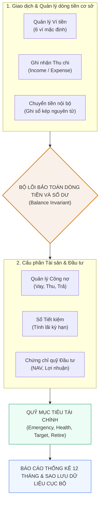
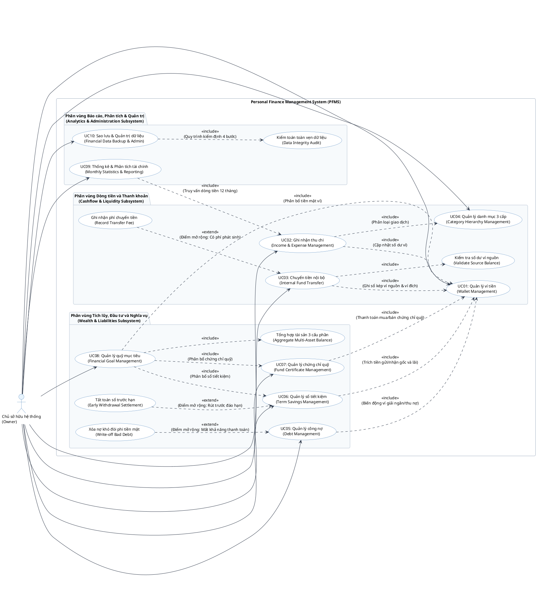
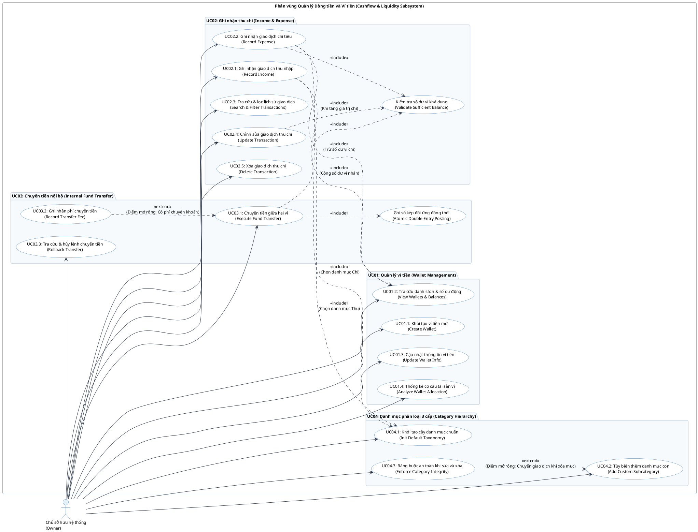
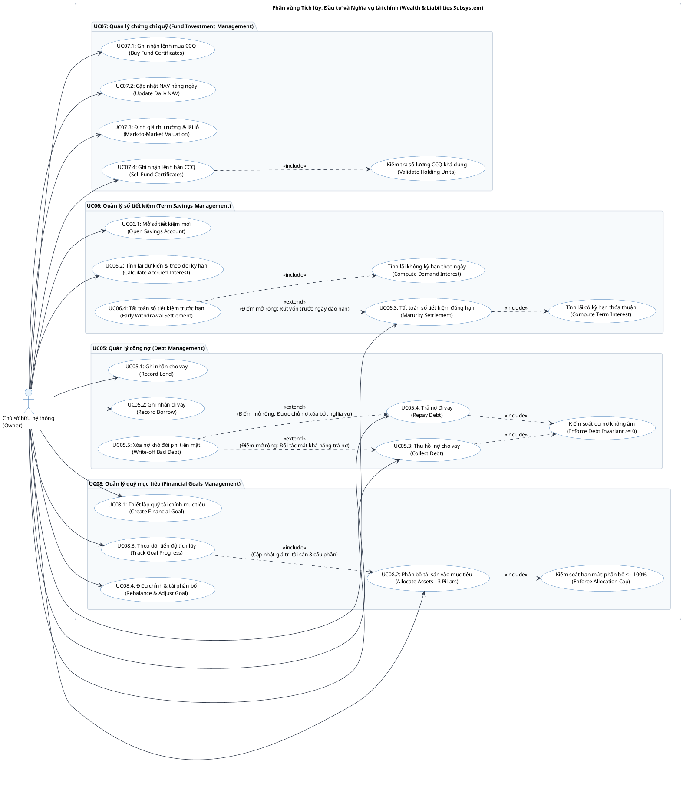
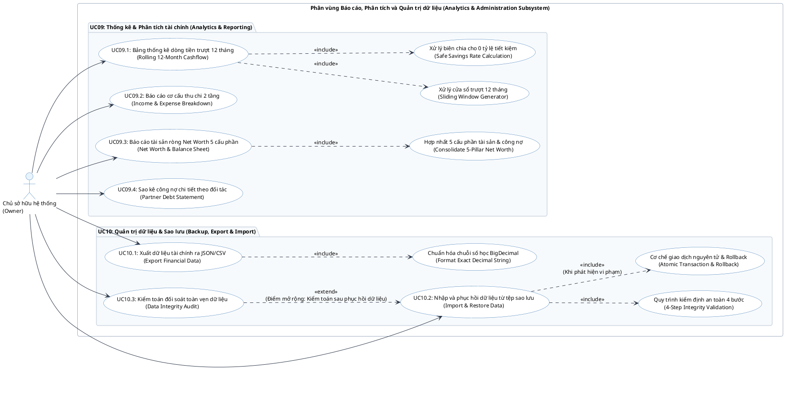

# Tài liệu Đặc tả Yêu cầu Phần mềm và Ca sử dụng
## Personal Finance Management System (PFMS)
**Tiêu chuẩn áp dụng:** ISO/IEC/IEEE 29148:2018, IREB CPRE, Craig Larman Use Case Format, Martin Fowler Accounting Patterns  
**Phiên bản tài liệu:** 1.0  
**Trạng thái:** Bản thảo kỹ thuật (Draft)

---

## MỤC LỤC TỔNG QUAN

- [1. Giới thiệu tổng quan (Introduction)](#1-giới-thiệu-tổng-quan-introduction)
  - [1.1 Mục đích tài liệu](#11-mục-đích-tài-liệu)
  - [1.2 Phạm vi sản phẩm](#12-phạm-vi-sản-phẩm)
  - [1.3 Đối tượng sử dụng và hướng dẫn đọc tài liệu](#13-đối-tượng-sử-dụng-và-hướng-dẫn-đọc-tài-liệu)
  - [1.4 Tài liệu tham chiếu chuẩn](#14-tài-liệu-tham-chiếu-chuẩn)
  - [1.5 Bảng thuật ngữ và định nghĩa (Glossary)](#15-bảng-thuật-ngữ-và-định-nghĩa-glossary)
- [2. Mô tả tổng quát hệ thống (Overall Description)](#2-mô-tả-tổng-quát-hệ-thống-overall-description)
  - [2.1 Bối cảnh hệ thống](#21-bối-cảnh-hệ-thống)
  - [2.2 Mục tiêu hệ thống (System Goals)](#22-mục-tiêu-hệ-thống-system-goals)
  - [2.3 Đặc điểm tác nhân người dùng](#23-đặc-điểm-tác-nhân-người-dùng)
  - [2.4 Ràng buộc kỹ thuật, giả định và sự phụ thuộc](#24-ràng-buộc-kỹ-thuật-giả-định-và-sự-phụ-thuộc)
  - [2.5 Môi trường vận hành](#25-môi-trường-vận-hành)
- [3. Quy tắc nghiệp vụ và ràng buộc tài chính (Domain Invariants & Business Rules)](#3-quy-tắc-nghiệp-vụ-và-ràng-buộc-tài-chính-domain-invariants--business-rules)
  - [3.1 Ràng buộc chính xác tài chính (BR-FIN-01)](#31-ràng-buộc-chính-xác-tài-chính-br-fin-01)
  - [3.2 Quy tắc bảo toàn số dư ví (BR-FIN-02)](#32-quy-tắc-bảo-toàn-số-dư-ví-br-fin-02)
  - [3.3 Quy tắc ghi sổ kép khi chuyển khoản nội bộ (BR-FIN-03)](#33-quy-tắc-ghi-sổ-kép-khi-chuyển-khoản-nội-bộ-br-fin-03)
  - [3.4 Quy tắc phân cấp danh mục thu chi 3 cấp (BR-FIN-04)](#34-quy-tắc-phân-cấp-danh-mục-thu-chi-3-cấp-br-fin-04)
  - [3.5 Quy tắc tính lãi tiết kiệm có kỳ hạn (BR-FIN-05)](#35-quy-tắc-tính-lãi-tiết-kiệm-có-kỳ-hạn-br-fin-05)
  - [3.6 Quy tắc định giá chứng chỉ quỹ đầu tư (BR-FIN-06)](#36-quy-tắc-định-giá-chứng-chỉ-quỹ-đầu-tư-br-fin-06)
  - [3.7 Quy tắc theo dõi công nợ (BR-FIN-07)](#37-quy-tắc-theo-dõi-công-nợ-br-fin-07)
  - [3.8 Quy tắc phân bổ quỹ mục tiêu (BR-FIN-08)](#38-quy-tắc-phân-bổ-quỹ-mục-tiêu-br-fin-08)
- [4. Yêu cầu chức năng chi tiết (Functional Requirements)](#4-yêu-cầu-chức-năng-chi-tiết-functional-requirements)
  - [4.1 Phân hệ Quản lý ví tiền (FR-WAL)](#41-phân-hệ-quản-lý-ví-tiền-fr-wal)
  - [4.2 Phân hệ Ghi nhận thu chi (FR-TXN)](#42-phân-hệ-ghi-nhận-thu-chi-fr-txn)
  - [4.3 Phân hệ Chuyển tiền nội bộ (FR-TRF)](#43-phân-hệ-chuyển-tiền-nội-bộ-fr-trf)
  - [4.4 Phân hệ Danh mục phân loại (FR-CAT)](#44-phân-hệ-danh-mục-phân-loại-fr-cat)
  - [4.5 Phân hệ Quản lý công nợ (FR-DEBT)](#45-phân-hệ-quản-lý-công-nợ-fr-debt)
  - [4.6 Phân hệ Quản lý sổ tiết kiệm (FR-SAV)](#46-phân-hệ-quản-lý-sổ-tiết-kiệm-fr-sav)
  - [4.7 Phân hệ Chứng chỉ quỹ đầu tư (FR-INV)](#47-phân-hệ-chứng-chỉ-quỹ-đầu-tư-fr-inv)
  - [4.8 Phân hệ Quản lý quỹ mục tiêu (FR-FND)](#48-phân-hệ-quản-lý-quỹ-mục-tiêu-fr-fnd)
  - [4.9 Phân hệ Thống kê và Báo cáo (FR-REP)](#49-phân-hệ-thống-kê-và-báo-cáo-fr-rep)
  - [4.10 Phân hệ Xuất nhập và Sao lưu dữ liệu (FR-DAT)](#410-phân-hệ-xuất-nhập-và-sao-lưu-dữ-liệu-fr-dat)
- [5. Yêu cầu phi chức năng (Non-Functional Requirements)](#5-yêu-cầu-phi-chức-năng-non-functional-requirements)
  - [5.1 NFR-01: Độ chính xác và toàn vẹn dữ liệu tài chính (Financial Precision & Integrity)](#51-nfr-01-độ-chính-xác-và-toàn-vẹn-dữ-liệu-tài-chính-financial-precision--integrity)
  - [5.2 NFR-02: Hiệu năng và độ trễ phản hồi (Performance & Latency)](#52-nfr-02-hiệu-năng-và-độ-trễ-phản-hồi-performance--latency)
  - [5.3 NFR-03: Độ tin cậy và lưu trữ an toàn (Reliability & Persistence)](#53-nfr-03-độ-tin-cậy-và-lưu-trữ-an-toàn-reliability--persistence)
  - [5.4 NFR-04: Khả năng bảo trì và kiến trúc hướng đối tượng (Maintainability & OOP Design)](#54-nfr-04-khả-năng-bảo-trì-và-kiến-trúc-hướng-đối-tượng-maintainability--oop-design)
  - [5.5 NFR-05: Tính khả dụng và công thái học (Usability & User Ergonomics)](#55-nfr-05-tính-khả-dụng-và-công-thái-học-usability--user-ergonomics)
  - [5.6 NFR-06: Tính tương thích và môi trường thực thi (Portability & Compatibility)](#56-nfr-06-tính-tương-thích-và-môi-trường-thực-thi-portability--compatibility)
- [6. Đặc tả 10 Ca sử dụng chi tiết (Fully Dressed Use Cases)](#6-đặc-tả-10-ca-sử-dụng-chi-tiết-fully-dressed-use-cases)
  - [6.1 UC01: Quản lý ví tiền (Wallet Management)](#61-uc01-quản-lý-ví-tiền-wallet-management)
  - [6.2 UC02: Ghi nhận và quản lý giao dịch thu chi (Income & Expense Management)](#62-uc02-ghi-nhận-và-quản-lý-giao-dịch-thu-chi-income--expense-management)
  - [6.3 UC03: Chuyển tiền nội bộ giữa các ví (Internal Fund Transfer)](#63-uc03-chuyển-tiền-nội-bộ-giữa-các-ví-internal-fund-transfer)
  - [6.4 UC04: Thiết lập và quản lý danh mục phân loại thu chi 3 cấp (Category Hierarchy Management)](#64-uc04-thiết-lập-và-quản-lý-danh-mục-phân-loại-thu-chi-3-cấp-category-hierarchy-management)
  - [6.5 UC05: Quản lý công nợ (Debt Management)](#65-uc05-quản-lý-công-nợ-debt-management)
  - [6.6 UC06: Quản lý sổ tiết kiệm có kỳ hạn và tính toán lãi suất (Term Savings Management)](#66-uc06-quản-lý-sổ-tiết-kiệm-có-kỳ-hạn-và-tính-toán-lãi-suất-term-savings-management)
  - [6.7 UC07: Quản lý danh mục chứng chỉ quỹ đầu tư và biến động NAV (Fund Certificate Investment Management)](#67-uc07-quản-lý-danh-mục-chứng-chỉ-quỹ-đầu-tư-và-biến-động-nav-fund-certificate-investment-management)
  - [6.8 UC08: Quản lý quỹ mục tiêu tài chính và phân bổ dòng tiền (Financial Goal & Fund Management)](#68-uc08-quản-lý-quỹ-mục-tiêu-tài-chính-và-phân-bổ-dòng-tiền-financial-goal--fund-management)
  - [6.9 UC09: Tra cứu bảng thống kê dòng tiền trượt 12 tháng và phân tích tỷ lệ tiết kiệm (Monthly Statistics & Cashflow Analysis)](#69-uc09-tra-cứu-bảng-thống-kê-dòng-tiền-trượt-12-tháng-và-phân-tích-tỷ-lệ-tiết-kiệm-monthly-statistics--cashflow-analysis)
  - [6.10 UC10: Sao lưu, xuất và nhập dữ liệu tài chính (Financial Data Backup, Export & Import)](#610-uc10-sao-lưu-xuất-và-nhập-dữ-liệu-tài-chính-financial-data-backup-export--import)
- [7. Sơ đồ Ca sử dụng hệ thống (Use Case Diagrams)](#7-sơ-đồ-ca-sử-dụng-hệ-thống-use-case-diagrams)
  - [7.1 Sơ đồ Ca sử dụng tổng thể toàn hệ thống (Global System Use Case Diagram)](#71-sơ-đồ-ca-sử-dụng-tổng-thể-toàn-hệ-thống-global-system-use-case-diagram)
  - [7.2 Sơ đồ Ca sử dụng phân rã theo 3 phân vùng nghiệp vụ (Subsystem Use Case Diagrams)](#72-sơ-đồ-ca-sử-dụng-phân-rã-theo-3-phân-vùng-nghiệp-vụ-subsystem-use-case-diagrams)
    - [7.2.1 Phân vùng Quản lý Dòng tiền và Ví tiền (Cashflow & Liquidity Subsystem)](#721-phân-vùng-quản-lý-dòng-tiền-và-ví-tiền-cashflow--liquidity-subsystem)
    - [7.2.2 Phân vùng Tích lũy, Đầu tư và Nghĩa vụ tài chính (Wealth & Liabilities Subsystem)](#722-phân-vùng-tích-lũy-đầu-tư-và-nghĩa-vụ-tài-chính-wealth--liabilities-subsystem)
    - [7.2.3 Phân vùng Báo cáo, Phân tích và Quản trị dữ liệu (Analytics & Administration Subsystem)](#723-phân-vùng-báo-cáo-phân-tích-và-quản-trị-dữ-liệu-analytics--administration-subsystem)
- [8. Ma trận kiểm chứng và truy vết yêu cầu (Requirements Traceability Matrix - RTM)](#8-ma-trận-kiểm-chứng-và-truy-vết-yêu-cầu-requirements-traceability-matrix---rtm)
  - [8.1 Ma trận truy vết yêu cầu 4 chiều (Requirements Traceability Matrix)](#81-ma-trận-truy-vết-yêu-cầu-4-chiều-requirements-traceability-matrix)
  - [8.2 Ma trận phương pháp kiểm chứng yêu cầu (Verification Methods Matrix)](#82-ma-trận-phương-pháp-kiểm-chứng-yêu-cầu-verification-methods-matrix)
    - [8.2.1 Ma trận phương pháp kiểm chứng yêu cầu chức năng (39 FRs)](#821-ma-trận-phương-pháp-kiểm-chứng-yêu-cầu-chức-năng-39-frs)
    - [8.2.2 Ma trận phương pháp kiểm chứng yêu cầu phi chức năng (6 NFRs)](#822-ma-trận-phương-pháp-kiểm-chứng-yêu-cầu-phi-chức-năng-6-nfrs)

---

## 1. GIỚI THIỆU TỔNG QUAN (INTRODUCTION)

### 1.1 Mục đích tài liệu

Tài liệu này là bản đặc tả yêu cầu phần mềm (SRS) xác lập phạm vi chức năng, quy tắc tài chính và tiêu chí nghiệm thu cho hệ thống Quản lý Tài chính Cá nhân (PFMS). Tài liệu đóng vai trò là căn cứ kỹ thuật cho các giai đoạn tiếp theo:
- Giai đoạn Phân tích Hướng đối tượng (OOA): Trích xuất thực thể miền, xác định ranh giới và phân bổ trách nhiệm theo mô hình GRASP.
- Giai đoạn Thiết kế Kiến trúc và Chi tiết (OOD): Xây dựng sơ đồ lớp (Class Diagram), sơ đồ tuần tự (Sequence Diagram) và áp dụng các mẫu thiết kế GoF.
- Giai đoạn Cài đặt và Kiểm thử: Hiện thực hóa mã nguồn trên nền tảng Java 17 và tự động hóa kiểm thử đơn vị với JUnit 5.

Tài liệu cung cấp một hợp đồng kỹ thuật nhất quán giữa bài toán quản lý tài chính thực tế và mô hình phần mềm hướng đối tượng được cài đặt.

### 1.2 Phạm vi sản phẩm

Sản phẩm PFMS là một ứng dụng máy tính cá nhân (Desktop Application) chạy trên môi trường Java Runtime Environment. Ứng dụng được thiết kế phục vụ một cá nhân duy nhất (mô hình Single-user / Owner) nhằm theo dõi, phân tích và kiểm soát toàn bộ sức khỏe tài chính cá nhân.

Hệ thống triển khai đầy đủ 10 phân hệ nghiệp vụ tài chính, không phân chia giai đoạn cốt lõi hay trì hoãn:
1. Quản lý ví tiền (Wallets): Khởi tạo, theo dõi số dư khả dụng, cơ cấu phân bổ tỷ trọng tài sản thanh khoản giữa các ví tiền mặt và tài khoản ngân hàng.
2. Quản lý thu chi (Transactions): Ghi nhận nhật ký thu nhập và chi tiêu phát sinh theo thời gian thực, liên kết trực tiếp với từng ví cụ thể.
3. Chuyển tiền nội bộ (Transfers): Điều chuyển tiền tệ giữa các ví nội bộ theo nguyên tắc ghi sổ kép đối ứng, bảo toàn tổng lượng tiền mặt trong hệ thống.
4. Danh mục phân loại 3 cấp (Categories): Chuẩn hóa cây phân loại gồm Loại (Type), Nhóm nhu cầu (Group) và Danh mục chi tiết (Category).
5. Quản lý công nợ (Debts): Giám sát các khoản phải thu (cho vay) và các khoản phải trả (đi vay), xử lý hoàn ứng và xóa nợ khó đòi.
6. Quản lý sổ tiết kiệm (Savings): Theo dõi các khoản tiền gửi có kỳ hạn và không kỳ hạn, tính toán lãi suất dự kiến, xử lý tất toán đúng hạn và trước hạn.
7. Quản lý chứng chỉ quỹ đầu tư (Fund Certificates): Định giá danh mục đầu tư theo giá thị trường (Mark-to-Market) dựa trên NAV, theo dõi lợi nhuận chưa thực hiện và tỷ suất sinh lời hàng năm.
8. Quản lý quỹ mục tiêu tài chính (Financial Goals / Funds): Tổng hợp tài sản từ tiền mặt, sổ tiết kiệm và chứng chỉ quỹ để đo lường tiến độ hoàn thành các mục tiêu tài chính độc lập.
9. Thống kê và báo cáo (Monthly Statistics & Reporting): Tự động trượt chuỗi thời gian 12 tháng gần nhất, tổng hợp dòng tiền ròng, tỷ lệ tiết kiệm và phân tích cơ cấu chi tiêu.
10. Quản lý dữ liệu và sao lưu (Data Management & Backup): Lưu trữ cục bộ an toàn, hỗ trợ xuất và nhập dữ liệu để ngăn ngừa mất mát thông tin.

Ranh giới ngoài phạm vi của hệ thống (Out of Scope):
- Không kết nối trực tiếp API với các cổng thanh toán hoặc ngân hàng thương mại.
- Không hỗ trợ cơ chế đa người dùng (Multi-tenant) hoặc phân quyền truy cập nhiều tầng (Role-based access control).
- Không thực hiện các giao dịch chuyển khoản ngân hàng thực tế mà đóng vai trò là sổ cái ghi nhận và phân tích thông tin.

### 1.3 Đối tượng sử dụng và hướng dẫn đọc tài liệu

Tài liệu được biên soạn nhằm phục vụ các nhóm đối tượng sau:
- **Người phụ trách phân tích và thiết kế (Software Analysts / Designers):** Dùng tài liệu để xác định ranh giới hệ thống, chuyển đổi các ca sử dụng thành mô hình phân tích OOA và thiết kế OOD.
- **Kỹ sư lập trình (Developers):** Căn cứ vào các luồng sự kiện, quy tắc nghiệp vụ và ràng buộc dữ liệu để cài đặt mã nguồn Java.
- **Kỹ sư kiểm thử (QA / Testers):** Căn cứ vào các luồng ngoại lệ và tiêu chí nghiệm thu để xây dựng kịch bản kiểm thử (Test Cases).
- **Người đánh giá kỹ thuật (Technical Reviewers / Stakeholders):** Sử dụng tài liệu để đối soát phạm vi tính năng và nghiệm thu kỹ thuật.

Hướng dẫn đọc tài liệu:
- Để nắm tổng quan bài toán và phạm vi: Đọc Mục 1 và Mục 2.
- Để hiểu sâu về các nguyên lý và ràng buộc tài chính: Đọc kỹ Mục 3.
- Để triển khai mã nguồn và thiết kế ca kiểm thử: Đọc tuần tự Mục 4, Mục 6 và tham chiếu chéo với Mục 8.

### 1.4 Tài liệu tham chiếu chuẩn

1. ISO/IEC/IEEE 29148:2018: Systems and software engineering - Life cycle processes - Requirements engineering.
2. International Requirements Engineering Board (IREB): CPRE Foundation Level Handbook & Requirements Modeling Handbook.
3. Craig Larman (2004): Applying UML and Patterns: An Introduction to Object-Oriented Analysis and Design and Iterative Development, 3rd Edition, Prentice Hall.
4. Martin Fowler (1997): Accounting Patterns (Mô hình tài khoản, bút toán, giao dịch ghi sổ kép).
5. Đề bài bài toán gốc và yêu cầu kỹ thuật: `docs/academic/assignment-requirement.pdf`.

### 1.5 Bảng thuật ngữ và định nghĩa (Glossary)

Bảng thuật ngữ được xây dựng theo chuẩn IREB CPRE, định nghĩa thống nhất các khái niệm xuất hiện trong toàn bộ tài liệu:

| Thuật ngữ | Tên tiếng Anh | Định nghĩa kỹ thuật trong hệ thống |
|---|---|---|
| Tác nhân chính | Primary Actor | Người dùng duy nhất tương tác trực tiếp với phần mềm để đạt được mục tiêu cụ thể (vai trò Owner). |
| Kịch bản | Scenario | Một chuỗi các bước tương tác tuần tự giữa tác nhân và hệ thống trong một ngữ cảnh cụ thể. |
| Điều kiện kích hoạt | Trigger | Sự kiện khởi đầu kích thích việc thực thi một ca sử dụng. |
| Tiền điều kiện | Precondition | Trạng thái bắt buộc của hệ thống phải được thỏa mãn trước khi một ca sử dụng có thể bắt đầu. |
| Hậu điều kiện | Postcondition | Trạng thái bảo đảm của hệ thống sau khi ca sử dụng kết thúc (thành công hoặc thất bại). |
| Bất biến miền | Invariant | Quy tắc nghiệp vụ bắt buộc phải luôn luôn đúng tại mọi trạng thái hợp lệ của hệ thống. |
| Ví tiền | Wallet | Một tài khoản thanh khoản thực tế (tiền mặt, thẻ ngân hàng, ví điện tử) lưu giữ số dư tiền khả dụng. |
| Giao dịch thu chi | Transaction | Bản ghi một lần phát sinh tài chính làm tăng hoặc giảm số dư của một ví xác định. |
| Chuyển tiền nội bộ | Internal Transfer | Hành vi dịch chuyển giá trị tiền tệ giữa hai ví nội bộ mà không làm thay đổi tổng tài sản ròng. |
| Cấu trúc danh mục | Category Hierarchy | Mô hình phân loại dạng cây 3 cấp gồm Loại (Type), Nhóm nhu cầu (Group) và Danh mục chi tiết (Category). |
| Công nợ | Debt | Các nghĩa vụ tài chính phát sinh giữa Owner và các đối tượng bên ngoài, chia thành phải thu và phải trả. |
| Khoản phải thu | Receivable | Tài sản của Owner đang bị người khác chiếm dụng tạm thời qua hành vi cho vay (`lend`). |
| Khoản phải trả | Payable | Nghĩa vụ nợ mà Owner có trách nhiệm phải hoàn trả cho người khác qua hành vi đi vay (`borrow`). |
| Xóa nợ | Write-off | Hành động kế toán ghi nhận tổn thất tài sản khi không thể thu hồi khoản cho vay hoặc ghi nhận thu nhập bất thường khi được chủ nợ xóa nợ. |
| Sổ tiết kiệm | Saving Account | Khoản tiền gửi tích lũy có kỳ hạn hoặc không kỳ hạn tại tổ chức tín dụng để sinh lời theo lãi suất cam kết. |
| Chứng chỉ quỹ | Fund Certificate | Sản phẩm đầu tư tài chính được quản lý bởi công ty quản lý quỹ, đại diện cho quyền sở hữu một phần danh mục tài sản ròng. |
| Giá trị tài sản ròng | Net Asset Value (NAV) | Giá trị thị trường của một đơn vị chứng chỉ quỹ tại thời điểm định giá. |
| Quỹ mục tiêu | Financial Goal / Fund | Một nhóm tài sản độc lập được quy hoạch từ tiền mặt, sổ tiết kiệm và chứng chỉ quỹ để phục vụ một mục đích tài chính cụ thể. |
| Ghi sổ kép | Double-Entry | Nguyên lý kế toán yêu cầu mỗi giao dịch chuyển dịch giá trị phải gồm hai vế đối ứng cân bằng: ghi giảm một bên và ghi tăng một bên tương ứng. |
| Chủ sở hữu duy nhất | Single-user Owner | Mô hình vận hành của hệ thống, trong đó toàn bộ dữ liệu thuộc quyền kiểm soát của một người dùng duy nhất trên máy trạm cục bộ. |

---

## 2. MÔ TẢ TỔNG QUÁT HỆ THỐNG (OVERALL DESCRIPTION)

### 2.1 Bối cảnh hệ thống

Hệ thống Quản lý Tài chính Cá nhân (PFMS) được nghiên cứu và phát triển độc lập từ đầu nhằm cung cấp một giải pháp phần mềm quản trị tài chính cá nhân toàn diện, có tính kỷ luật cao và bảo toàn dữ liệu nghiêm ngặt cho người dùng cá nhân (vai trò Chủ sở hữu: Owner). Trong bối cảnh tài chính hiện đại, một cá nhân thường sở hữu nhiều kênh phân bổ tài sản (tiền mặt, tài khoản ngân hàng, sổ tiết kiệm có kỳ hạn, danh mục chứng chỉ quỹ đầu tư) đi kèm các nghĩa vụ công nợ và các mục tiêu tích lũy tài chính dài hạn. Việc quản trị phân tán hoặc sử dụng các công cụ ghi chép rời rạc dễ dẫn tới nguy cơ mất cân đối dòng tiền, sai lệch số dư và thiếu hụt cái nhìn tổng thể về bức tranh tài chính.

PFMS được xây dựng nhằm giải quyết bài toán trên thông qua các định hướng kỹ thuật nền tảng:
- Chuẩn hóa mô hình tài chính kế toán hướng đối tượng: Ứng dụng các mẫu kế toán chuẩn mực (Accounting Patterns của Martin Fowler), thiết lập tính bất biến số dư ví và áp dụng nguyên lý ghi sổ kép cho giao dịch chuyển tiền nhằm bảo đảm tính chính xác tuyệt đối.
- Phân bổ tài sản và tổng hợp tài sản ròng theo thời gian thực: Tự động tổng hợp tài sản ròng (Net Worth) qua 5 cấu phần tài sản và nghĩa vụ nợ, phân tích xu hướng dòng tiền trượt 12 tháng.
- Kiến trúc phần mềm độc lập, an toàn và toàn vẹn: Xây dựng bằng ngôn ngữ Java 17, thiết kế tách biệt 4 phân tầng kiến trúc, lưu trữ dữ liệu an toàn trên máy cục bộ với cơ chế ghi tệp nguyên tử và sao lưu tự động, hoàn toàn độc lập và không phụ thuộc vào bất kỳ phần mềm văn phòng trung gian nào.

### 2.2 Mục tiêu hệ thống (System Goals)

Hệ thống được xây dựng nhằm đáp ứng 5 mục tiêu cốt lõi:

- **G1 - Quản lý dòng tiền và phân loại thu chi minh bạch:**  
  Cung cấp cơ chế ghi nhận tức thời mọi biến động tiền tệ phát sinh trong đời sống hàng ngày; phân loại chính xác từng khoản thu chi vào cây danh mục 3 cấp để người dùng hiểu rõ nguồn thu và cấu trúc chi phí sinh hoạt.

- **G2 - Nắm bắt chính xác giá trị tài sản thực tế và cơ cấu phân bổ:**  
  Cung cấp cái nhìn toàn diện về tài sản ròng tại bất kỳ thời điểm nào thông qua việc tổng hợp số dư ví thanh khoản, giá trị các sổ tiết kiệm, giá trị thị trường của danh mục đầu tư và chênh lệch công nợ.

- **G3 - Quản lý công nợ và các khoản tích lũy, đầu tư có kỳ hạn:**  
  Kiểm soát chặt chẽ các khoản cho vay và đi vay theo từng đối tượng đối tác; tự động tính toán lãi suất tiết kiệm có kỳ hạn và theo dõi biến động lãi lỗ của chứng chỉ quỹ đầu tư theo giá trị tài sản ròng cập nhật.

- **G4 - Hỗ trợ lập kế hoạch tài chính và giám sát tiến độ mục tiêu:**  
  Cho phép người dùng phân bổ các nguồn lực tài chính (tiền mặt, tiết kiệm, quỹ đầu tư) vào các quỹ mục tiêu độc lập (quỹ khẩn cấp, quỹ sức khỏe, mục tiêu mua sắm, quỹ hưu trí) và theo dõi tỷ lệ hoàn thành mục tiêu theo thời gian thực.

- **G5 - Đảm bảo tính toán tài chính chính xác tuyệt đối:**  
  Loại bỏ hoàn toàn các sai số làm tròn số học bằng cách chuẩn hóa toàn bộ các phép tính tiền tệ sang kiểu số học có độ chính xác tùy ý, bảo đảm nguyên tắc bảo toàn giá trị và cân bằng kép kế toán trong mọi tình huống.

### 2.3 Đặc điểm tác nhân người dùng

Hệ thống phục vụ duy nhất một nhóm tác nhân:
- Tác nhân: Chủ sở hữu hệ thống (Owner).
- Quyền hạn: Toàn quyền truy cập và thao tác trên mọi phân hệ dữ liệu. Không tồn tại cơ chế phân quyền nhiều cấp, không yêu cầu xác thực phiên đăng nhập phức tạp.
- Năng lực kỹ thuật: Người dùng có kỹ năng sử dụng máy tính phổ thông, có nhu cầu ghi chép tài chính cá nhân nghiêm túc, có hiểu biết cơ bản về thu chi, tiết kiệm và quản lý nợ.
- Tần suất tương tác: Tương tác hàng ngày để ghi chép các giao dịch phát sinh, tương tác định kỳ hàng tuần hoặc hàng tháng để cập nhật giá trị thị trường chứng chỉ quỹ, kiểm tra tiến độ quỹ mục tiêu và phân tích báo cáo tài chính.

### 2.4 Ràng buộc kỹ thuật, giả định và sự phụ thuộc

Các ràng buộc kỹ thuật:
- Nền tảng thực thi: Ứng dụng chạy trên Java Development Kit (JDK) 17 LTS trở lên.
- Xử lý số học tài chính: Bắt buộc sử dụng lớp `java.math.BigDecimal` cho tất cả các trường dữ liệu biểu diễn số tiền, số dư, tỷ lệ phần trăm và các biến số tính toán trung gian. Nghiêm cấm tuyệt đối việc sử dụng kiểu số thực dấu chấm động (`float`, `double`) để ngăn ngừa triệt để sai số làm tròn theo chuẩn IEEE 754.
- Chuẩn kiểm thử: Sử dụng khung kiểm thử JUnit 5 để xây dựng bộ kiểm thử đơn vị tự động, bảo đảm độ bao phủ mã nguồn của các quy tắc tính toán tài chính đạt mức tối đa.
- Cơ chế lưu trữ: Dữ liệu được lưu trữ an toàn dưới dạng các tệp tin cục bộ có định dạng rõ ràng (JSON hoặc cấu trúc tệp hướng đối tượng), bảo đảm tính khả chuyển khi sao lưu và phục hồi.

Giả định của hệ thống:
- Hệ thống giả định một ngày có 24 giờ và một năm chuẩn trong tính toán tài chính ngân hàng có 365 ngày (hoặc quy đổi tháng chuẩn theo quy định tổ chức tín dụng).
- Hệ thống giả định người dùng chỉ thao tác trên một phiên làm việc tại một thời điểm trên một máy tính cá nhân.
- Các giá trị tỷ giá tiền tệ và giá trị tài sản ròng (NAV) được người dùng cập nhật thủ công dựa trên công bố thực tế của các tổ chức tài chính.

Sự phụ thuộc:
- Hệ thống phụ thuộc vào đồng hồ hệ thống của hệ điều hành (System Clock) để xác định mốc thời gian giao dịch, số ngày tính lãi tiết kiệm và trượt mốc thống kê 12 tháng.
- Hệ thống phụ thuộc vào hệ thống tệp tin cục bộ của hệ điều hành để thực hiện việc đọc, ghi và bảo toàn dữ liệu.

### 2.5 Môi trường vận hành

- Hệ điều hành mục tiêu: Tương thích hoàn toàn với Microsoft Windows 10/11 (64-bit), macOS 12 trở lên, hoặc các bản phân phối Linux phổ biến (Ubuntu 20.04+, Fedora 36+).
- Môi trường phần mềm yêu cầu: Máy trạm đã cài đặt sẵn Java Runtime Environment (JRE) hoặc Java Development Kit (JDK) phiên bản 17 trở lên.
- Yêu cầu phần cứng tối thiểu:
  - Bộ vi xử lý: Dual-core 2.0 GHz hoặc cao hơn.
  - Bộ nhớ RAM: Tối thiểu 2 GB RAM khả dụng.
  - Dung lượng ổ đĩa: Tối thiểu 200 MB dung lượng trống để chứa ứng dụng và tệp dữ liệu giao dịch.
  - Màn hình: Độ phân giải tối thiểu 1280 x 720 pixels để bảo đảm hiển thị đầy đủ các bảng dữ liệu và biểu đồ thống kê.

---

## 3. QUY TẮC NGHIỆP VỤ VÀ RÀNG BUỘC TÀI CHÍNH (DOMAIN INVARIANTS & BUSINESS RULES)

### 3.1 Ràng buộc chính xác tài chính (BR-FIN-01)

Ràng buộc chính xác tài chính là quy tắc bất biến nền tảng chi phối toàn bộ các phép tính số học trong hệ thống PFMS.

1. **Cấm sử dụng số thực dấu chấm động nhị phân:**  
   Nghiêm cấm khai báo và sử dụng các kiểu dữ liệu nguyên thủy `float` và `double`, cũng như các lớp bao bọc `java.lang.Float` và `java.lang.Double` cho bất kỳ trường dữ liệu hoặc biến trung gian nào liên quan đến tiền tệ, số lượng chứng chỉ quỹ, tỷ lệ phần trăm hoặc lãi suất. Bản chất biểu diễn số thực dấu chấm động theo chuẩn IEEE 754 dẫn đến sai số nhị phân không thể kiểm soát (ví dụ phép toán `0.1 + 0.2` trong kiểu `double` cho kết quả `0.30000000000000004`), gây sai lệch cân bằng sổ cái tài chính.

2. **Chuẩn hóa đối tượng số học `BigDecimal`:**  
   Mọi phép tính tiền tệ bắt buộc phải sử dụng `java.math.BigDecimal`. Khi khởi tạo `BigDecimal` từ các giá trị số, bắt buộc sử dụng hàm khởi tạo nhận chuỗi ký tự (`new BigDecimal(String)`) hoặc phương thức tĩnh `BigDecimal.valueOf(double/long)`. Tuyệt đối không sử dụng hàm khởi tạo `new BigDecimal(double)` vì nó giữ nguyên sai số biểu diễn của số thực nguyên thủy.

3. **Quy định về độ chính xác (Scale) và chế độ làm tròn (RoundingMode):**  
   - Đơn vị tiền tệ chính (VNĐ): Dữ liệu lưu trữ và hiển thị cuối cùng có scale bằng 0 (số nguyên đồng) hoặc scale bằng 2 khi lưu trữ nội bộ chuẩn quốc tế.
   - Các phép tính tỷ lệ, lãi suất và NAV: Các biến số trung gian (lãi suất năm, tỷ lệ hoàn thành mục tiêu, đơn giá NAV) phải duy trì scale tối thiểu từ 4 đến 6 chữ số thập phân để bảo đảm độ mịn của phép tính.
   - Chế độ làm tròn: Khi bắt buộc phải làm tròn số trong các phép chia không hết (`BigDecimal.divide`), hệ thống phải chỉ định tường minh chế độ làm tròn `RoundingMode.HALF_EVEN` (Banker's Rounding, ưu tiên làm tròn về số chẵn gần nhất nhằm triệt tiêu độ lệch thống kê tích lũy) hoặc `RoundingMode.HALF_UP` (làm tròn số học truyền thống). Tuyệt đối cấm thực hiện phép chia `BigDecimal` mà không chỉ định scale và `RoundingMode` vì sẽ gây ngoại lệ `ArithmeticException` khi gặp số thập phân vô hạn tuần hoàn.

4. **Tiêu chuẩn sai số tuyệt đối bằng 0:**  
   Tại mọi thời điểm, tổng các thành phần phân rã phải khớp chính xác đến từng đơn vị nhỏ nhất so với giá trị tổng thể. Không chấp nhận bất kỳ độ lệch sai số nào trong các phép toán cộng trừ số dư ví và chuyển khoản.

### 3.2 Quy tắc bảo toàn số dư ví (BR-FIN-02)

Quy tắc bảo toàn số dư ví (Balance Invariant) xác lập rằng số dư hiển thị của bất kỳ ví tiền nào cũng phải phản ánh chính xác kết quả tổng hợp của toàn bộ lịch sử các dòng tiền tác động trực tiếp đến ví đó.

1. **Công thức bất biến số dư ví:**  
   Xét một ví tiền $w$ bất kỳ tại thời điểm quan sát $T$, số dư khả dụng $Balance_w(T)$ được xác định duy nhất thông qua công thức toán học sau:
   $$Balance_w(T) = Balance_w(0) + \sum_{t \le T} Income_w(t) - \sum_{t \le T} Expense_w(t) + \sum_{t \le T} TransferIn_w(t) - \sum_{t \le T} TransferOut_w(t) + \sum_{t \le T} Borrow_w(t) - \sum_{t \le T} Repay_w(t) - \sum_{t \le T} Lend_w(t) + \sum_{t \le T} Collect_w(t)$$
   Trong đó:
   - $Balance_w(0)$: Số dư khởi tạo ban đầu của ví $w$.
   - $Income_w(t)$: Các khoản thu nhập phát sinh trực tiếp vào ví $w$.
   - $Expense_w(t)$: Các khoản chi tiêu chi trả trực tiếp từ ví $w$.
   - $TransferIn_w(t)$: Các khoản tiền chuyển từ ví khác đến ví $w$.
   - $TransferOut_w(t)$: Các khoản tiền chuyển từ ví $w$ sang ví khác.
   - $Borrow_w(t)$: Các khoản tiền đi vay nhận về nhập vào ví $w$ (dòng tiền dương).
   - $Repay_w(t)$: Các khoản tiền trả nợ đã vay trích xuất từ ví $w$ (dòng tiền âm).
   - $Lend_w(t)$: Các khoản tiền cho người khác vay trích xuất từ ví $w$ (dòng tiền âm).
   - $Collect_w(t)$: Các khoản tiền thu hồi nợ cho vay nhận về nhập vào ví $w$ (dòng tiền dương).

2. **Ranh giới dòng tiền của các nghiệp vụ phi tiền mặt:**  
   Hệ thống phân biệt rạch ròi giữa biến động công nợ kế toán và dòng tiền vật lý của ví:
   - Nghiệp vụ xóa nợ cho vay (`write-off lend`): Là thao tác ghi giảm khoản phải thu do xác định đối tác mất khả năng trả nợ. Nghiệp vụ này không làm phát sinh dòng tiền vào ví $w$, do đó không tham gia vào công thức tính số dư ví.
   - Nghiệp vụ được xóa nợ đi vay (`write-off borrow`): Là thao tác ghi giảm khoản phải trả do được chủ nợ tha thứ nghĩa vụ. Nghiệp vụ này không làm phát sinh dòng tiền rời khỏi ví $w$, do đó không làm thay đổi số dư ví.

3. **Ràng buộc số dư không âm:**  
   Mặc định đối với các ví tiền mặt và ví tiền gửi thanh khoản thông thường, số dư khả dụng bắt buộc phải thỏa mãn:
   $$Balance_w(T) \ge 0$$
   Mọi giao dịch chi tiêu, chuyển tiền đi, cho vay hoặc trả nợ khiến số dư của ví rơi vào trạng thái âm ($Balance_w < 0$) đều bị hệ thống chặn lại và báo lỗi thiếu hụt số dư, ngoại trừ trường hợp người dùng cấu hình ví thuộc loại thẻ tín dụng có hạn mức thấu chi được phê duyệt trước.

### 3.3 Quy tắc ghi sổ kép khi chuyển khoản nội bộ (BR-FIN-03)

Quy tắc ghi sổ kép trong chuyển khoản nội bộ tuân thủ mô hình kế toán của Martin Fowler, bảo đảm sự nhất quán và toàn vẹn của tổng tài sản thanh khoản.

1. **Cặp bút toán đối ứng cân bằng:**  
   Mỗi hành vi chuyển tiền từ ví nguồn $w_{src}$ sang ví đích $w_{dst}$ với số tiền chuyển $A > 0$ phải được thực hiện thông qua hai bút toán đối ứng:
   - Bút toán ghi giảm (Debit): Trừ chính xác số tiền $A$ khỏi số dư khả dụng của ví nguồn $w_{src}$.
   - Bút toán ghi tăng (Credit): Cộng chính xác số tiền $A$ vào số dư khả dụng của ví đích $w_{dst}$.

2. **Tính nguyên tử của giao dịch (Atomic Transaction):**  
   Cả hai bút toán trên phải được liên kết chặt chẽ trong một khối giao dịch nguyên tử. Hệ thống bảo đảm rằng một bên không thể được cập nhật nếu bên kia gặp lỗi. Nếu việc trừ tiền ở ví nguồn thành công nhưng việc cộng tiền ở ví đích bị gián đoạn, toàn bộ giao dịch phải được phục hồi trạng thái ban đầu (rollback), ngăn chặn hoàn toàn nguy cơ hao hụt hoặc sinh thêm tiền tệ ảo.

3. **Bảo toàn tổng tài sản ví thanh khoản:**  
   Giao dịch chuyển tiền nội bộ thuần túy chỉ là hành vi tái cơ cấu nơi lưu giữ tiền tệ, không tạo ra thu nhập cũng không tạo ra chi phí của chủ sở hữu. Do đó, tổng giá trị tiền mặt trên toàn bộ các ví trước và sau giao dịch chuyển khoản phải được bảo toàn tuyệt đối:
   $$\Delta \sum_{w \in Wallets} Balance_w = 0$$

4. **Quy tắc xử lý phí chuyển tiền phát sinh:**  
   Nếu giao dịch chuyển tiền phát sinh phí dịch vụ do đơn vị trung gian thu:
   - Khoản phí chuyển tiền $Fee \ge 0$ không được khấu trừ gộp vào số tiền chuyển $A$ của bút toán ghi sổ kép.
   - Khoản phí phải được tách thành một giao dịch chi tiêu (Expense) độc lập phát sinh từ ví nguồn $w_{src}$, gắn với danh mục chi phí thích hợp (ví dụ: "Phí dịch vụ ngân hàng"). Khi đó, số tiền thực trừ khỏi ví nguồn là $A + Fee$, số tiền thực nhận tại ví đích là $A$, và tổng tài sản toàn hệ thống giảm đúng bằng khoản phí $Fee$.

### 3.4 Quy tắc phân cấp danh mục thu chi 3 cấp (BR-FIN-04)

Hệ thống thiết lập mô hình dữ liệu danh mục phân loại thu chi theo cấu trúc phân cấp cây 3 cấp nghiêm ngặt nhằm phục vụ việc phân tích tài chính đa chiều.

1. **Cấu trúc phân cấp 3 cấp:**  
   - Cấp 1: Loại giao dịch (Type). Chỉ nhận một trong hai giá trị định danh bất biến: `Income` (Thu nhập) hoặc `Expense` (Chi tiêu).
   - Cấp 2: Nhóm nhu cầu tài chính (Group). Là tập hợp các nhóm mục đích lớn, trực thuộc duy nhất một `Type`.
     - Với `Type = Income`: Các nhóm chuẩn gồm `employment` (Thu nhập từ tiền lương, việc làm), `assets` (Thu nhập từ tài sản, đầu tư, lãi suất), `other` (Các khoản thu nhập khác).
     - Với `Type = Expense`: Các nhóm chuẩn gồm `essentials` (Chi tiêu thiết yếu cho đời sống), `personal & leisure` (Chi tiêu cá nhân và hưởng thụ), `obligations & transfers` (Nghĩa vụ phụng dưỡng, thuế phí), `savings & investing` (Tích lũy và đầu tư).
   - Cấp 3: Danh mục chi tiết (Category). Là đơn vị phân loại nhỏ nhất, phản ánh cụ thể nội dung phát sinh giao dịch (ví dụ: tiền ăn uống, xăng xe, tiền điện nước, học phí), trực thuộc duy nhất một `Group`.

2. **Tính toàn vẹn quan hệ cha con:**  
   - Mỗi Category bắt buộc phải có đúng một Group cha làm định danh tham chiếu.
   - Mỗi Group bắt buộc phải có đúng một Type làm phân loại gốc.
   - Hệ thống nghiêm cấm sự tồn tại của các danh mục mồ côi (Category không có Group, hoặc Group không có Type).

3. **Ràng buộc khi sửa đổi hoặc xóa danh mục:**  
   - Không được phép xóa một Group nếu vẫn còn Category trực thuộc Group đó.
   - Không được phép xóa một Category hoặc một Group nếu đã có ít nhất một giao dịch trong lịch sử đang tham chiếu tới danh mục đó. Nếu muốn ngừng sử dụng, danh mục phải được chuyển sang trạng thái ngưng hoạt động (Archived/Inactive).
   - Không được phép thay đổi thuộc tính `Type` của một Group hoặc Category khi đã phát sinh dữ liệu giao dịch liên kết, nhằm tránh làm đảo lộn toàn bộ báo cáo thu chi quá khứ.

### 3.5 Quy tắc tính lãi tiết kiệm có kỳ hạn (BR-FIN-05)

Hệ thống chuẩn hóa quy tắc tính toán lãi suất cho các sổ tiết kiệm theo đúng nghiệp vụ thực tế của các ngân hàng thương mại.

1. **Quy đổi kỳ hạn và mốc thời gian:**  
   Kỳ hạn gửi tiền (`term`) được quy đổi thành số ngày thực tế dựa trên bảng tham chiếu chuẩn:
   - Không kỳ hạn (`unlimited`): Kỳ hạn quy ước là 0 ngày.
   - Có kỳ hạn: 1 tháng (30 ngày), 3 tháng (90 ngày), 6 tháng (180 ngày), 12 tháng (365 ngày), 24 tháng (730 ngày), 36 tháng (1095 ngày), 60 tháng (1825 ngày).
   - Số ngày gửi thực tế ($Days$) được tính từ ngày bắt đầu gửi ($Start$) đến ngày quan sát hoặc ngày tất toán ($Current$):
     $$Days = \max(0, Current - Start)$$

2. **Công thức tính lãi cho khoản gửi không kỳ hạn:**  
   Với sổ tiết kiệm không kỳ hạn (`term = unlimited`), lãi suất được tính theo lãi đơn tích lũy hàng ngày:
   $$Interest = \frac{Principal \times Rate \times Days}{365}$$
   Trong đó $Principal$ là số vốn gốc, $Rate$ là lãi suất năm (%/năm).

3. **Công thức tính lãi và giá trị hiện tại của sổ có kỳ hạn:**  
   Với sổ tiết kiệm có kỳ hạn xác định ($TermDays > 0$):
   - Tiến độ thời gian của kỳ hạn ($Process$) được xác định:
     $$Process = \min\left(1.0, \frac{Days}{TermDays}\right)$$
   - Lãi dự kiến toàn kỳ ($ExpectedInterest$):
     $$ExpectedInterest = \frac{Principal \times Rate \times TermDays}{365}$$
   - Giá trị sổ tiết kiệm ghi nhận tại thời điểm quan sát ($Balance$):
     $$Balance = Principal + (ExpectedInterest \times Process)$$

4. **Quy tắc tất toán sổ tiết kiệm:**  
   - Tất toán đúng hạn ($Days \ge TermDays$): Chủ tài khoản được nhận toàn bộ Vốn gốc cùng 100% Lãi dự kiến theo lãi suất cam kết ban đầu:
     $$Payout = Principal + ExpectedInterest$$
   - Tất toán trước hạn ($Days < TermDays$): Theo quy chế ngân hàng, người gửi không được hưởng mức lãi suất có kỳ hạn ban đầu. Toàn bộ tiền lãi sẽ được tính toán lại hồi tố theo mức lãi suất tiền gửi không kỳ hạn ($DemandRate$, thường dao động từ 0.1% đến 0.5%/năm) dựa trên số ngày thực gửi:
     $$Payout = Principal + \frac{Principal \times DemandRate \times Days}{365}$$
     Toàn bộ phần chênh lệch lãi suất kỳ hạn dự kiến trước đó bị hủy bỏ hoàn toàn.

### 3.6 Quy tắc định giá chứng chỉ quỹ đầu tư (BR-FIN-06)

Quy tắc định giá chứng chỉ quỹ đầu tư thiết lập cơ chế phản ánh giá trị tài sản đầu tư theo biến động thị trường thực tế.

1. **Phân loại danh mục chứng chỉ quỹ:**  
   Hệ thống hỗ trợ 3 nhóm tài sản đầu tư:
   - `stock`: Quỹ đầu tư cổ phiếu (mức độ biến động và kỳ vọng sinh lời cao).
   - `bond`: Quỹ đầu tư trái phiếu (thu nhập cố định, độ an toàn cao).
   - `balance`: Quỹ đầu tư cân bằng (kết hợp phân bổ giữa cổ phiếu và trái phiếu).

2. **Nguyên tắc định giá theo giá thị trường (Mark-to-Market):**  
   Giá trị hiện tại của một khoản đầu tư chứng chỉ quỹ ($Balance$) tại ngày định giá được xác định dựa trên số lượng đơn vị quỹ nắm giữ ($Units$) và Giá trị tài sản ròng trên một đơn vị quỹ ($NAV$) do công ty quản lý quỹ công bố:
   $$Balance = Units \times NAV$$
   Trường hợp ghi nhận đơn giản theo giá trị cập nhật từng lô mua: $Balance$ là giá trị thị trường được ghi nhận tại ngày đánh giá gần nhất.

3. **Xác định lợi nhuận chưa thực hiện (Unrealized Profit/Loss):**  
   Chênh lệch giữa giá trị thị trường hiện tại và số vốn gốc đầu tư ban đầu ($Principal$) phản ánh khoản lãi hoặc lỗ chưa thực hiện của danh mục:
   $$UnrealizedPL = Balance - Principal$$
   - Khi $UnrealizedPL > 0$: Khoản đầu tư đang có lãi trên danh nghĩa.
   - Khi $UnrealizedPL < 0$: Khoản đầu tư đang chịu lỗ trên danh nghĩa.

4. **Suất sinh lời quy đổi năm (Annualized Rate of Return):**  
   Để đánh giá hiệu quả đầu tư một cách khách quan không phụ thuộc vào thời gian nắm giữ, hệ thống áp dụng công thức lãi kép hàng năm (tương đương hàm tài chính `RATE` hoặc CAGR):
   $$AnnualizedRate = \left(\frac{Balance}{Principal}\right)^{\frac{365}{HoldDays}} - 1$$
   Quy tắc áp dụng:
   - Công thức chỉ có hiệu lực khi $HoldDays \ge 30$ ngày và $Principal > 0$.
   - Nếu $HoldDays < 30$ ngày, hệ thống chỉ hiển thị tỷ suất sinh lời tuyệt đối chưa quy đổi năm: $\frac{Balance - Principal}{Principal} \times 100\%$, tránh hiện tượng méo mó số liệu thống kê do số mũ quá lớn.

### 3.7 Quy tắc theo dõi công nợ (BR-FIN-07)

Hệ thống quản lý công nợ cá nhân chặt chẽ nhằm phân định rõ quyền sở hữu tài sản và nghĩa vụ nợ đối ứng với từng đối tượng cụ thể.

1. **Phân loại 2 nhánh công nợ:**  
   - Khoản phải thu (`Receivable`): Đại diện cho quyền đòi nợ của Owner đối với người khác khi phát sinh hành vi cho vay tiền. Khoản phải thu được ghi nhận là một bộ phận của tổng tài sản cá nhân.
   - Khoản phải trả (`Payable`): Đại diện cho nghĩa vụ tài chính Owner phải thực hiện đối với chủ nợ khi phát sinh hành vi đi vay tiền. Khoản phải trả được ghi nhận là một khoản nợ phải trừ khi tính tài sản ròng.

2. **Định nghĩa 6 loại giao dịch nghiệp vụ công nợ:**  
   - `lend` (Cho vay): Tiền xuất khỏi ví của Owner để chuyển cho đối tác mượn. Hậu quả: Giảm số dư ví xuất tiền, tăng số dư phải thu từ đối tác.
   - `borrow` (Đi vay): Tiền nhập vào ví của Owner từ chủ nợ. Hậu quả: Tăng số dư ví nhận tiền, tăng số dư phải trả cho chủ nợ.
   - `collect` (Thu hồi nợ): Đối tác hoàn trả tiền đã mượn trước đó. Tiền nhập vào ví của Owner. Hậu quả: Tăng số dư ví nhận tiền, giảm số dư phải thu tương ứng.
   - `repay` (Trả nợ đã vay): Owner hoàn trả tiền đã vay cho chủ nợ. Tiền xuất khỏi ví của Owner. Hậu quả: Giảm số dư ví xuất tiền, giảm số dư phải trả tương ứng.
   - `write-off lend` (Xóa nợ cho vay): Owner chính thức xác nhận khoản nợ cho vay không thể thu hồi được (nợ xấu). Hậu quả: Giảm số dư phải thu, ghi nhận tổn thất tài chính, hoàn toàn không làm biến động số dư ví tiền mặt.
   - `write-off borrow` (Được xóa nợ đi vay): Chủ nợ quyết định miễn trừ nghĩa vụ nợ cho Owner. Hậu quả: Giảm số dư phải trả, ghi nhận một khoản thu nhập bất thường, hoàn toàn không làm biến động số dư ví tiền mặt.

3. **Bất biến số dư nợ hợp lệ:**  
   Tại mọi thời điểm, số dư nợ tổng thể và số dư nợ chi tiết theo từng cá nhân ($person$) phải bảo đảm không âm:
   $$Receivable = \sum Lend - \sum Collect - \sum WriteOffLend \ge 0$$
   $$Payable = \sum Borrow - \sum Repay - \sum WriteOffBorrow \ge 0$$
   Quy tắc kiểm tra biên:
   - Tổng số tiền thu nợ từ một cá nhân không được vượt quá số dư nợ phải thu hiện tại của cá nhân đó ($\sum Collect_{person} \le \sum Lend_{person} - \sum WriteOffLend_{person}$).
   - Tổng số tiền trả nợ cho một chủ nợ không được vượt quá số dư nợ phải trả hiện tại đối với chủ nợ đó ($\sum Repay_{person} \le \sum Borrow_{person} - \sum WriteOffBorrow_{person}$).
   - Mọi thao tác thu nợ hoặc trả nợ vượt quá giá trị nợ gốc còn lại đều bị hệ thống từ chối thực thi.

### 3.8 Quy tắc phân bổ quỹ mục tiêu (BR-FIN-08)

Quỹ mục tiêu tài chính là cơ chế quy hoạch và gắn kết các nguồn lực tài sản rời rạc vào các kế hoạch dài hạn cụ thể của cá nhân.

1. **Các quỹ mục tiêu tiêu chuẩn:**  
   Hệ thống khởi tạo 4 quỹ mục tiêu tiêu chuẩn phục vụ các trụ cột an toàn tài chính:
   - `emergency` (Quỹ khẩn cấp): Dự phòng tài chính cho các biến cố bất ngờ (thất nghiệp, hư hỏng tài sản lớn), yêu cầu tính thanh khoản cao.
   - `health` (Quỹ y tế và sức khỏe): Dự phòng chi phí khám chữa bệnh, bảo hiểm và chăm sóc sức khỏe.
   - `target` (Quỹ mục tiêu cụ thể): Tích lũy mua sắm tài sản lớn ngắn hạn và trung hạn (mua xe, mua sắm thiết bị, du lịch).
   - `retirement` (Quỹ hưu trí): Tích lũy và đầu tư dài hạn phục vụ giai đoạn ngừng lao động.

2. **Cấu trúc tài sản hợp thành quỹ mục tiêu:**  
   Quỹ mục tiêu là thực thể kế toán tổng hợp giá trị từ 3 cấu phần tài sản (không phải tài khoản ngân hàng vật lý riêng biệt):
   - Tiền mặt phân bổ (`Cash`): Số tiền được chỉ định phân bổ từ bảng tiền mặt dành riêng cho quỹ (`funds_cash`).
   - Sổ tiết kiệm liên kết (`Savings`): Tổng số dư hiện tại của tất cả các sổ tiết kiệm có gắn mã tham chiếu tới quỹ đó.
   - Chứng chỉ quỹ liên kết (`FundCerts`): Tổng giá trị thị trường hiện tại của tất cả các khoản chứng chỉ quỹ có gắn mã tham chiếu tới quỹ đó.
   Tổng giá trị tích lũy của một quỹ ($Total_{fund}$) được xác định:
   $$Total_{fund} = Cash_{fund} + \sum_{s \in Savings_{fund}} Balance_s + \sum_{c \in FundCerts_{fund}} Balance_c$$

3. **Tính toán tiến độ hoàn thành mục tiêu:**  
   Mỗi quỹ mục tiêu có một số tiền đích cần đạt ($Target \ge 0$). Tiến độ hoàn thành ($Process$) được xác định theo tỷ lệ phần trăm:
   $$Process = \begin{cases} \frac{Total_{fund}}{Target} \times 100\%, & \text{khi } Target > 0 \\ 100\%, & \text{khi } Target = 0 \text{ và } Total_{fund} \ge 0 \end{cases}$$
   Khi $Process \ge 100\%$, quỹ mục tiêu được hệ thống đánh dấu là đã hoàn thành mục tiêu tài chính.

4. **Tính toàn vẹn của việc phân bổ tài sản:**  
   Nhằm ngăn chặn hiện tượng tính trùng giá trị tài sản (double-counting), mỗi sổ tiết kiệm cụ thể và mỗi lô chứng chỉ quỹ cụ thể chỉ được phép gán vào duy nhất một quỹ mục tiêu tại một thời điểm. Khi một tài sản được chuyển quyền sở hữu sang quỹ mục tiêu khác, giá trị của quỹ cũ sẽ giảm tương ứng và giá trị của quỹ mới sẽ tăng tương ứng, bảo đảm tổng giá trị tài sản toàn hệ thống không thay đổi.

---

## 4. YÊU CẦU CHỨC NĂNG CHI TIẾT (FUNCTIONAL REQUIREMENTS)

Phần này đặc tả toàn bộ 39 yêu cầu chức năng (Functional Requirements) cho 10 phân hệ nghiệp vụ của Hệ thống Quản lý Tài chính Cá nhân (PFMS), tuân thủ tiêu chuẩn ISO/IEC/IEEE 29148:2018. Mỗi yêu cầu được chuẩn hóa theo cấu trúc 8 trường thông tin: Mã yêu cầu, Tên chức năng, Mô tả, Dữ liệu đầu vào, Quy tắc xử lý và ràng buộc, Dữ liệu đầu ra, Ca sử dụng tham chiếu, và Tiêu chí nghiệm thu.

### 4.1 Phân hệ Quản lý ví tiền (FR-WAL)

Phân hệ Quản lý ví tiền chịu trách nhiệm theo dõi toàn bộ các nguồn tiền thanh khoản của người dùng, bao gồm tiền mặt, tài khoản thanh toán ngân hàng và ví điện tử. Phân hệ bảo đảm tính bất biến số dư ví theo quy tắc BR-FIN-02 và phản ánh cơ cấu thanh khoản tức thời.

#### 4.1.1 Yêu cầu FR-WAL-01: Khởi tạo ví tiền mới
- **Mã yêu cầu:** `FR-WAL-01`
- **Tên chức năng:** Khởi tạo ví tiền mới
- **Mô tả:** Cho phép người dùng tạo một ví tài chính mới trong hệ thống để quản lý tiền mặt, tài khoản thanh toán ngân hàng hoặc ví điện tử với số dư khởi tạo xác định.
- **Dữ liệu đầu vào:**
  - Tên ví (`name`): Chuỗi ký tự (String), độ dài từ 1 đến 50 ký tự, bắt buộc, không được trùng lặp với tên ví đã tồn tại (không phân biệt chữ hoa, chữ thường).
  - Loại ví (`type`): Kiểu liệt kê (Enum) gồm `CASH` (tiền mặt), `BANK` (tài khoản ngân hàng), `E_WALLET` (ví điện tử), `CREDIT` (thẻ tín dụng). Bắt buộc.
  - Số dư khởi tạo (`initialBalance`): Số học chính xác `BigDecimal`, mặc định bằng 0, bắt buộc lớn hơn hoặc bằng 0 đối với ví thông thường, cho phép nhỏ hơn 0 nếu loại ví là `CREDIT`.
  - Ghi chú (`description`): Chuỗi ký tự (String), tối đa 255 ký tự, tùy chọn.
- **Quy tắc xử lý và ràng buộc:**
  - Kiểm tra tính duy nhất của tên ví so với danh sách các ví hiện có trong hệ thống (sau khi loại bỏ khoảng trắng thừa ở hai đầu và chuyển về chữ thường).
  - Xác lập trạng thái mặc định của ví là `ACTIVE` (đang hoạt động).
  - Ghi nhận số dư ban đầu $Balance_w(0) = initialBalance$ theo quy tắc `BR-FIN-02`. Khoản số dư ban đầu này không tạo ra bản ghi thu chi giả mạo trong sổ nhật ký giao dịch mà đóng vai trò là số dư gốc của sổ cái ví.
  - Chuẩn hóa số dư khởi tạo về kiểu `BigDecimal` với scale chuẩn là 2 chữ số thập phân theo `BR-FIN-01`.
- **Dữ liệu đầu ra:**
  - Đối tượng ví (`Wallet`) mới được lưu thành công vào cơ sở dữ liệu kèm mã định danh duy nhất (`walletId`).
  - Thông báo tạo ví thành công hiển thị cho người dùng.
- **Ca sử dụng tham chiếu:** `UC01 - Quản lý ví tiền`.
- **Tiêu chí nghiệm thu:**
  - TC-WAL-01.1: Khi người dùng nhập tên ví "MB Bank", loại `BANK`, số dư ban đầu 5,000,000 VNĐ, hệ thống tạo thành công ví mới có số dư khả dụng bằng đúng 5,000,000 VNĐ và trạng thái `ACTIVE`.
  - TC-WAL-01.2: Khi người dùng nhập tên ví trùng lặp với ví đã có (ví dụ nhập "mb bank" khi đã tồn tại "MB Bank"), hệ thống từ chối tạo và hiển thị thông báo lỗi tên ví đã tồn tại.
  - TC-WAL-01.3: Khi người dùng nhập số dư khởi tạo là số âm cho ví loại `CASH` hoặc `BANK`, hệ thống từ chối và thông báo số dư ban đầu không được nhỏ hơn 0.

#### 4.1.2 Yêu cầu FR-WAL-02: Xem danh sách và chi tiết số dư động
- **Mã yêu cầu:** `FR-WAL-02`
- **Tên chức năng:** Xem danh sách và chi tiết số dư động
- **Mô tả:** Cung cấp danh sách toàn bộ các ví tiền đang quản lý cùng số dư khả dụng thực tế được tính toán động tại thời điểm truy vấn dựa trên toàn bộ lịch sử dòng tiền.
- **Dữ liệu đầu vào:**
  - Bộ lọc trạng thái ví (`statusFilter`): Tùy chọn, gồm `ACTIVE` (mặc định), `ARCHIVED` (đã lưu trữ), hoặc `ALL` (toàn bộ).
- **Quy tắc xử lý và ràng buộc:**
  - Tính toán số dư động $Balance_w(T)$ cho từng ví theo đúng công thức bất biến `BR-FIN-02`:
    $$Balance_w(T) = Balance_w(0) + \sum Income - \sum Expense + \sum TransferIn - \sum TransferOut + \sum Borrow - \sum Repay - \sum Lend + \sum Collect$$
  - Tuyệt đối không lưu giá trị số dư tĩnh bị ghi đè trực tiếp trong cơ sở dữ liệu; mọi số dư hiển thị phải là kết quả tổng hợp tức thời từ các giao dịch hợp lệ.
  - Tính tổng số dư khả dụng của toàn bộ các ví đang kích hoạt bằng tổng số học chính xác các số dư thành phần thông qua `BigDecimal.add()`.
  - Hiển thị danh sách ví kèm các thông tin nhận diện (tên, loại, trạng thái, số dư khả dụng, ngày cập nhật giao dịch gần nhất).
- **Dữ liệu đầu ra:**
  - Danh sách các đối tượng ví kèm số dư động tương ứng.
  - Giá trị tổng số dư tiền mặt thanh khoản toàn hệ thống.
- **Ca sử dụng tham chiếu:** `UC01 - Quản lý ví tiền`.
- **Tiêu chí nghiệm thu:**
  - TC-WAL-02.1: Cho ví "Timo" có số dư ban đầu 1,000,000 VNĐ, phát sinh 1 giao dịch thu 500,000 VNĐ và 1 giao dịch chi 200,000 VNĐ; khi người dùng truy vấn danh sách ví, số dư hiển thị của ví Timo phải là chính xác 1,300,000 VNĐ.
  - TC-WAL-02.2: Tổng số dư toàn hệ thống hiển thị ở chân danh sách phải khớp chính xác đến từng đơn vị đồng với tổng số dư của các ví thành phần mà không có sai số làm tròn.

#### 4.1.3 Yêu cầu FR-WAL-03: Cập nhật thông tin ví tiền
- **Mã yêu cầu:** `FR-WAL-03`
- **Tên chức năng:** Cập nhật thông tin ví tiền
- **Mô tả:** Cho phép người dùng chỉnh sửa các thuộc tính phi tài chính của ví tiền (tên ví, mô tả, trạng thái hoạt động); nghiêm cấm chỉnh sửa trực tiếp trường số dư khả dụng.
- **Dữ liệu đầu vào:**
  - Mã định danh ví (`walletId`): Chuỗi ký tự, bắt buộc.
  - Tên ví mới (`name`): Chuỗi ký tự, từ 1 đến 50 ký tự, bắt buộc.
  - Trạng thái mới (`status`): Enum `ACTIVE` hoặc `ARCHIVED`.
  - Ghi chú mới (`description`): Chuỗi ký tự, tối đa 255 ký tự.
- **Quy tắc xử lý và ràng buộc:**
  - Kiểm tra tên ví mới không được trùng lặp với tên của các ví khác hiện có trong hệ thống.
  - Nếu người dùng chuyển trạng thái ví từ `ACTIVE` sang `ARCHIVED`, hệ thống kiểm tra số dư hiện tại của ví:
    - Nếu số dư khác 0, hệ thống đưa ra cảnh báo khuyến nghị điều chuyển hết tiền trước khi lưu trữ, nhưng vẫn cho phép lưu trữ nếu người dùng xác nhận.
    - Ví ở trạng thái `ARCHIVED` sẽ bị khóa không cho phép chọn làm ví nguồn hoặc ví đích trong các giao dịch phát sinh mới.
  - Hệ thống tuyệt đối không cung cấp giao diện hoặc phương thức cho phép sửa đổi trường `currentBalance` hay `initialBalance` sau khi ví đã phát sinh giao dịch lịch sử.
- **Dữ liệu đầu ra:**
  - Thông tin ví được cập nhật thành công trong hệ thống.
  - Thông báo kết quả cập nhật hiển thị cho người dùng.
- **Ca sử dụng tham chiếu:** `UC01 - Quản lý ví tiền`.
- **Tiêu chí nghiệm thu:**
  - TC-WAL-03.1: Khi người dùng đổi tên ví "Timo Bank" thành "Timo Digital", hệ thống lưu tên mới và hiển thị tên mới trên toàn bộ giao diện mà số dư ví không đổi.
  - TC-WAL-03.2: Khi người dùng chuyển một ví có số dư về trạng thái `ARCHIVED`, ví đó không còn xuất hiện trong danh sách lựa chọn ví khi tạo giao dịch mới.
  - TC-WAL-03.3: Mọi yêu cầu cố ý chỉnh sửa số dư trực tiếp qua API hoặc giao diện đều bị chặn và trả về ngoại lệ bảo toàn dữ liệu.

#### 4.1.4 Yêu cầu FR-WAL-04: Thống kê cơ cấu tài sản theo ví
- **Mã yêu cầu:** `FR-WAL-04`
- **Tên chức năng:** Thống kê cơ cấu tài sản theo ví
- **Mô tả:** Phân tích và hiển thị tỷ trọng phần trăm giá trị tiền tệ lưu giữ tại từng ví so với tổng lượng tiền mặt thanh khoản trong toàn bộ hệ thống.
- **Dữ liệu đầu vào:**
  - Thời điểm tính toán ($T$): Mặc định là thời điểm hiện tại.
- **Quy tắc xử lý và ràng buộc:**
  - Tính tổng số dư của toàn bộ các ví đang ở trạng thái `ACTIVE`: $TotalWallets = \sum_{w \in ActiveWallets} Balance_w(T)$.
  - Với từng ví $w$, tính tỷ trọng theo công thức:
    $$Rate_w = \begin{cases} \frac{Balance_w(T)}{TotalWallets} \times 100\%, & \text{khi } TotalWallets > 0 \\ 0\%, & \text{khi } TotalWallets = 0 \end{cases}$$
  - Phép chia tỷ trọng sử dụng `BigDecimal.divide()` với scale tối thiểu là 4 chữ số thập phân và chỉ định tường minh chế độ làm tròn `RoundingMode.HALF_EVEN`.
  - Giá trị hiển thị ra màn hình được định dạng 2 chữ số thập phân (ví dụ: 45.25%).
  - Sắp xếp danh sách ví theo thứ tự tỷ trọng giảm dần để làm nổi bật ví chiếm tỷ trọng thanh khoản cao nhất.
- **Dữ liệu đầu ra:**
  - Bảng cơ cấu phân bổ ví gồm: Tên ví, Loại ví, Số dư khả dụng, Tỷ trọng phần trăm (%), Xếp hạng tỷ trọng.
- **Ca sử dụng tham chiếu:** `UC01 - Quản lý ví tiền`.
- **Tiêu chí nghiệm thu:**
  - TC-WAL-04.1: Cho ví A có số dư 6,000,000 VNĐ và ví B có số dư 4,000,000 VNĐ (tổng 10,000,000 VNĐ); hệ thống tính ra tỷ trọng của ví A là 60.00% và ví B là 40.00%.
  - TC-WAL-04.2: Khi tổng số dư toàn bộ các ví bằng 0, tỷ trọng hiển thị của từng ví là 0.00% và hệ thống không phát sinh lỗi chia cho 0 (`ArithmeticException`).

### 4.2 Phân hệ Ghi nhận thu chi (FR-TXN)

Phân hệ Ghi nhận thu chi đóng vai trò là nhật ký ghi chép các luồng tiền phát sinh hàng ngày của người dùng. Phân hệ kết nối trực tiếp biến động tiền tệ với cấu trúc phân loại thu chi 3 cấp và số dư thực tế của từng ví.

#### 4.2.1 Yêu cầu FR-TXN-01: Tạo mới giao dịch thu nhập
- **Mã yêu cầu:** `FR-TXN-01`
- **Tên chức năng:** Tạo mới giao dịch thu nhập
- **Mô tả:** Ghi nhận một khoản thu nhập thực tế làm tăng số dư của một ví chỉ định và phân loại vào danh mục thu nhập tương ứng.
- **Dữ liệu đầu vào:**
  - Ngày giao dịch (`date`): Kiểu `LocalDate`, bắt buộc, mặc định là ngày hiện tại.
  - Số tiền thu (`amount`): Kiểu `BigDecimal`, bắt buộc, giá trị phải lớn hơn 0.
  - Ví nhận tiền (`walletId`): Chuỗi ký tự, bắt buộc, ví phải ở trạng thái `ACTIVE`.
  - Danh mục thu nhập (`categoryId`): Chuỗi ký tự, bắt buộc, danh mục phải thuộc nhóm có `Type = Income`.
  - Ghi chú (`note`): Chuỗi ký tự, tối đa 255 ký tự, tùy chọn.
- **Quy tắc xử lý và ràng buộc:**
  - Kiểm tra tính hợp lệ của số tiền thu: $amount > 0$, chuẩn hóa về kiểu `BigDecimal` với scale chuẩn là 2 theo `BR-FIN-01`.
  - Kiểm tra tính toàn vẹn của danh mục: `categoryId` bắt buộc phải tồn tại và có thuộc tính cấp 1 `Type = Income` theo `BR-FIN-04`. Nếu người dùng chọn danh mục thuộc `Type = Expense`, hệ thống từ chối ghi nhận.
  - Tạo bản ghi mới trong sổ nhật ký giao dịch (`transactions`) với mã định danh duy nhất (`txnId`).
  - Cập nhật số dư động của ví nhận tiền: $Balance_{wallet}(t) = Balance_{wallet}(t-1) + amount$ theo đúng quy tắc bảo toàn số dư `BR-FIN-02`.
  - Kích hoạt cập nhật tự động các bảng thống kê dòng tiền tháng liên quan.
- **Dữ liệu đầu ra:**
  - Bản ghi giao dịch thu nhập mới được lưu vào cơ sở dữ liệu kèm mã `txnId`.
  - Số dư ví nhận tiền tăng thêm đúng bằng số tiền thu nhập.
  - Thông báo ghi nhận giao dịch thành công.
- **Ca sử dụng tham chiếu:** `UC02 - Ghi nhận giao dịch thu chi`.
- **Tiêu chí nghiệm thu:**
  - TC-TXN-01.1: Cho ví "Vietcombank" có số dư 10,000,000 VNĐ; khi người dùng ghi nhận khoản thu nhập tiền lương 15,000,000 VNĐ vào ví Vietcombank, hệ thống ghi nhận thành công và số dư ví tăng lên đúng 25,000,000 VNĐ.
  - TC-TXN-01.2: Khi người dùng nhập số tiền thu nhập bằng 0 hoặc là số âm, hệ thống chặn lại và thông báo lỗi số tiền phải lớn hơn 0.
  - TC-TXN-01.3: Khi người dùng chọn danh mục "Ăn uống" (thuộc Type Expense) để ghi nhận thu nhập, hệ thống từ chối và yêu cầu chọn danh mục thuộc nhóm thu nhập.

#### 4.2.2 Yêu cầu FR-TXN-02: Tạo mới giao dịch chi tiêu
- **Mã yêu cầu:** `FR-TXN-02`
- **Tên chức năng:** Tạo mới giao dịch chi tiêu
- **Mô tả:** Ghi nhận một khoản chi tiêu tiêu dùng hoặc thanh toán sinh hoạt làm giảm số dư của một ví chỉ định và phân loại vào danh mục chi tiêu tương ứng.
- **Dữ liệu đầu vào:**
  - Ngày giao dịch (`date`): Kiểu `LocalDate`, bắt buộc, mặc định là ngày hiện tại.
  - Số tiền chi (`amount`): Kiểu `BigDecimal`, bắt buộc, giá trị phải lớn hơn 0.
  - Ví chi tiền (`walletId`): Chuỗi ký tự, bắt buộc, ví phải ở trạng thái `ACTIVE`.
  - Danh mục chi tiêu (`categoryId`): Chuỗi ký tự, bắt buộc, danh mục phải thuộc nhóm có `Type = Expense`.
  - Ghi chú (`note`): Chuỗi ký tự, tối đa 255 ký tự, tùy chọn.
- **Quy tắc xử lý và ràng buộc:**
  - Kiểm tra tính hợp lệ của số tiền chi: $amount > 0$.
  - Kiểm tra tính toàn vẹn của danh mục: `categoryId` bắt buộc phải tồn tại và có `Type = Expense` theo `BR-FIN-04`.
  - Kiểm tra ràng buộc số dư không âm theo quy tắc `BR-FIN-02`: Đối với các ví không phải loại thẻ tín dụng (`CREDIT`), số dư khả dụng hiện tại của ví phải thỏa mãn:
    $$Balance_{wallet} - amount \ge 0$$
    Nếu số dư không đủ để chi trả, hệ thống từ chối giao dịch và đưa ra thông báo thiếu hụt số dư.
  - Nếu thỏa mãn mọi điều kiện, lưu bản ghi giao dịch mới vào sổ nhật ký và trừ số dư của ví chi tiền: $Balance_{wallet}(t) = Balance_{wallet}(t-1) - amount$.
- **Dữ liệu đầu ra:**
  - Bản ghi giao dịch chi tiêu mới được lưu thành công kèm mã `txnId`.
  - Số dư của ví chi tiền giảm đúng bằng số tiền chi tiêu.
  - Thông báo ghi nhận giao dịch chi tiêu thành công.
- **Ca sử dụng tham chiếu:** `UC02 - Ghi nhận giao dịch thu chi`.
- **Tiêu chí nghiệm thu:**
  - TC-TXN-02.1: Cho ví "Tiền mặt" có số dư 500,000 VNĐ; khi người dùng tạo giao dịch chi tiêu 120,000 VNĐ cho danh mục "Ăn trưa", hệ thống ghi nhận thành công và số dư ví còn lại là 380,000 VNĐ.
  - TC-TXN-02.2: Cho ví "Tiền mặt" có số dư 200,000 VNĐ; khi người dùng nhập khoản chi 350,000 VNĐ, hệ thống từ chối giao dịch và thông báo số dư ví không đủ để thực hiện chi trả.
  - TC-TXN-02.3: Với ví loại `CREDIT` có hạn mức thấu chi, cho phép ghi nhận chi tiêu khiến số dư trở thành số âm trong phạm vi hạn mức cho phép.

#### 4.2.3 Yêu cầu FR-TXN-03: Tra cứu và lọc lịch sử giao dịch
- **Mã yêu cầu:** `FR-TXN-03`
- **Tên chức năng:** Tra cứu và lọc lịch sử giao dịch
- **Mô tả:** Cung cấp công cụ tìm kiếm, lọc đa tiêu chí và tổng hợp số liệu trên sổ nhật ký giao dịch thu chi nhằm hỗ trợ người dùng phân tích lịch sử tài chính.
- **Dữ liệu đầu vào:**
  - Khoảng thời gian (`fromDate`, `toDate`): Kiểu `LocalDate`, tùy chọn (mặc định là từ ngày đầu tháng đến ngày cuối tháng hiện tại).
  - Danh sách mã ví (`walletIds`): Danh sách chuỗi ký tự, tùy chọn (mặc định lấy tất cả các ví).
  - Phân loại luồng tiền (`type`): Tùy chọn gồm `ALL`, `INCOME`, `EXPENSE`.
  - Nhóm danh mục (`groupId`): Chuỗi ký tự, tùy chọn.
  - Danh mục chi tiết (`categoryId`): Chuỗi ký tự, tùy chọn.
  - Từ khóa tìm kiếm (`keyword`): Chuỗi ký tự, tìm kiếm không phân biệt hoa thường trong trường ghi chú (`note`).
  - Thông số phân trang (`pageIndex`, `pageSize`): Số nguyên, mặc định trang 1, 50 bản ghi trên một trang.
- **Quy tắc xử lý và ràng buộc:**
  - Áp dụng phép toán kết hợp logic AND giữa các tiêu chí lọc được chọn.
  - Tính toán tổng thu nhập, tổng chi tiêu và dòng tiền thuần (Cash Flow = Tổng thu nhập - Tổng chi tiêu) của tập kết quả thỏa mãn điều kiện lọc.
  - Mọi phép tính tổng hợp trên tập kết quả lọc phải sử dụng `BigDecimal` để bảo đảm độ chính xác tuyệt đối theo `BR-FIN-01`.
  - Sắp xếp kết quả mặc định theo ngày giao dịch giảm dần (giao dịch mới nhất hiển thị trước).
- **Dữ liệu đầu ra:**
  - Danh sách các bản ghi giao dịch thỏa mãn điều kiện lọc (kèm thông tin phân trang).
  - Tổng số bản ghi tìm thấy.
  - Thống kê tổng hợp: Tổng thu nhập, Tổng chi tiêu, Chênh lệch dòng tiền thuần của tập kết quả.
- **Ca sử dụng tham chiếu:** `UC02 - Ghi nhận giao dịch thu chi`.
- **Tiêu chí nghiệm thu:**
  - TC-TXN-03.1: Khi người dùng lọc theo khoảng ngày từ 01/08/2026 đến 31/08/2026 và chọn loại giao dịch `EXPENSE`, hệ thống trả về chính xác tất cả các giao dịch chi tiêu trong tháng 8/2026 kèm tổng số tiền chi tiêu khớp với sổ cái.
  - TC-TXN-03.2: Khi người dùng nhập từ khóa "tiền điện", hệ thống trả về toàn bộ các giao dịch có chứa cụm từ "tiền điện" trong phần ghi chú, không phân biệt hoa thường.

#### 4.2.4 Yêu cầu FR-TXN-04: Chỉnh sửa giao dịch thu chi
- **Mã yêu cầu:** `FR-TXN-04`
- **Tên chức năng:** Chỉnh sửa giao dịch thu chi
- **Mô tả:** Cho phép người dùng cập nhật thông tin của một giao dịch đã lưu trong quá khứ, tự động tính toán hoàn nguyên số dư ví cũ và cập nhật số dư ví mới nhằm bảo toàn tính toàn vẹn của sổ cái.
- **Dữ liệu đầu vào:**
  - Mã giao dịch cần sửa (`txnId`): Chuỗi ký tự, bắt buộc.
  - Ngày mới (`date`): Kiểu `LocalDate`, bắt buộc.
  - Số tiền mới (`amount`): Kiểu `BigDecimal`, bắt buộc, lớn hơn 0.
  - Ví mới (`walletId`): Chuỗi ký tự, bắt buộc, ví ở trạng thái `ACTIVE`.
  - Danh mục mới (`categoryId`): Chuỗi ký tự, bắt buộc, phù hợp với `Type` của giao dịch.
  - Ghi chú mới (`note`): Chuỗi ký tự, tối đa 255 ký tự.
- **Quy tắc xử lý và ràng buộc:**
  - Tìm bản ghi giao dịch gốc dựa trên `txnId`. Nếu không tìm thấy, báo lỗi không tồn tại giao dịch.
  - Thực hiện hoàn nguyên (revert) tác động của giao dịch cũ lên ví cũ theo `BR-FIN-02`:
    - Nếu giao dịch cũ là `Income`: Trừ số tiền cũ khỏi ví cũ.
    - Nếu giao dịch cũ là `Expense`: Cộng số tiền cũ trả lại ví cũ.
  - Kiểm tra điều kiện áp dụng cho ví mới:
    - Nếu giao dịch mới là `Expense`: Kiểm tra số dư ví mới sau khi hoàn nguyên có thỏa mãn $Balance_{newWallet} - amount \ge 0$ hay không.
    - Nếu không đủ số dư, hủy bỏ toàn bộ thao tác (rollback) và báo lỗi không đủ số dư tại ví mới.
  - Nếu điều kiện hợp lệ, áp dụng tác động của giao dịch mới:
    - Nếu là `Income`: Cộng số tiền mới vào ví mới.
    - Nếu là `Expense`: Trừ số tiền mới khỏi ví mới.
  - Cập nhật thông tin bản ghi giao dịch trong cơ sở dữ liệu trong cùng một khối giao dịch nguyên tử.
- **Dữ liệu đầu ra:**
  - Bản ghi giao dịch đã cập nhật.
  - Số dư của các ví liên quan được đồng bộ hóa chính xác.
  - Thông báo cập nhật giao dịch thành công.
- **Ca sử dụng tham chiếu:** `UC02 - Ghi nhận giao dịch thu chi`.
- **Tiêu chí nghiệm thu:**
  - TC-TXN-04.1: Cho giao dịch chi 100,000 VNĐ từ ví A; khi người dùng sửa thành chi 150,000 VNĐ từ ví B, hệ thống hoàn lại 100,000 VNĐ cho ví A và trừ 150,000 VNĐ từ ví B (với điều kiện ví B có đủ tiền).
  - TC-TXN-04.2: Khi người dùng sửa số tiền chi tiêu tăng lên vượt quá số dư khả dụng của ví, hệ thống từ chối thao tác, thông báo lỗi số dư và khôi phục trạng thái ban đầu của giao dịch.

#### 4.2.5 Yêu cầu FR-TXN-05: Xóa giao dịch thu chi
- **Mã yêu cầu:** `FR-TXN-05`
- **Tên chức năng:** Xóa giao dịch thu chi
- **Mô tả:** Cho phép xóa bỏ một bản ghi giao dịch thu chi khỏi sổ nhật ký, đồng thời tự động hoàn nguyên số dư của ví tiền liên quan về trạng thái như trước khi giao dịch phát sinh.
- **Dữ liệu đầu vào:**
  - Mã giao dịch cần xóa (`txnId`): Chuỗi ký tự, bắt buộc.
  - Xác nhận xóa từ người dùng (`confirmed`): Kiểu `Boolean`, bắt buộc là `true`.
- **Quy tắc xử lý và ràng buộc:**
  - Kiểm tra sự tồn tại của giao dịch theo `txnId`.
  - Thực hiện hoàn nguyên số dư ví theo quy tắc `BR-FIN-02`:
    - Nếu giao dịch cần xóa là `Income`: Hệ thống kiểm tra số dư hiện tại của ví có lớn hơn hoặc bằng số tiền của giao dịch hay không ($Balance_{wallet} - amount \ge 0$). Nếu việc trừ tiền làm ví bị âm số dư, hệ thống đưa ra cảnh báo chặn và từ chối xóa để tránh vi phạm bất biến số dư không âm.
    - Nếu thỏa mãn, trừ $amount$ khỏi ví tương ứng.
    - Nếu giao dịch cần xóa là `Expense`: Cộng hoàn trả $amount$ vào số dư của ví tương ứng.
  - Xóa bản ghi giao dịch khỏi sổ nhật ký `transactions`.
  - Cập nhật lại các bảng tổng hợp thống kê tháng có liên quan.
- **Dữ liệu đầu ra:**
  - Bản ghi giao dịch bị xóa khỏi hệ thống.
  - Số dư ví liên quan được hoàn nguyên chính xác.
  - Thông báo xóa giao dịch thành công.
- **Ca sử dụng tham chiếu:** `UC02 - Ghi nhận giao dịch thu chi`.
- **Tiêu chí nghiệm thu:**
  - TC-TXN-05.1: Cho ví "MB Bank" có số dư 4,500,000 VNĐ sau khi ghi nhận một khoản chi 500,000 VNĐ; khi người dùng xóa giao dịch chi này, số dư ví MB Bank tự động phục hồi về mức 5,000,000 VNĐ.
  - TC-TXN-05.2: Khi người dùng cố gắng xóa một giao dịch thu nhập nhưng số dư ví hiện tại nhỏ hơn số tiền thu nhập đó (do tiền đã được chi tiêu hết), hệ thống từ chối xóa và thông báo việc xóa sẽ làm âm số dư ví.

### 4.3 Phân hệ Chuyển tiền nội bộ (FR-TRF)

Phân hệ Chuyển tiền nội bộ thực hiện việc điều chuyển tiền tệ giữa các ví nội bộ của người dùng theo nguyên tắc ghi sổ kép đối ứng của Martin Fowler, bảo đảm tính bất biến tổng tài sản thanh khoản theo quy tắc BR-FIN-03.

#### 4.3.1 Yêu cầu FR-TRF-01: Chuyển tiền giữa hai ví nội bộ
- **Mã yêu cầu:** `FR-TRF-01`
- **Tên chức năng:** Chuyển tiền giữa hai ví nội bộ
- **Mô tả:** Thực hiện chuyển dịch một lượng tiền tệ từ ví nguồn sang ví đích trong cùng hệ thống, ghi nhận đồng thời hai bút toán đối ứng cân bằng mà không làm thay đổi tổng tài sản ròng của người dùng.
- **Dữ liệu đầu vào:**
  - Ngày chuyển tiền (`date`): Kiểu `LocalDate`, bắt buộc, mặc định hôm nay.
  - Ví nguồn (`fromWalletId`): Chuỗi ký tự, bắt buộc, ví ở trạng thái `ACTIVE`.
  - Ví đích (`toWalletId`): Chuỗi ký tự, bắt buộc, ví ở trạng thái `ACTIVE`.
  - Số tiền chuyển (`amount`): Kiểu `BigDecimal`, bắt buộc, lớn hơn 0.
  - Ghi chú (`note`): Chuỗi ký tự, tối đa 255 ký tự, tùy chọn.
- **Quy tắc xử lý và ràng buộc:**
  - Kiểm tra ràng buộc ví nguồn phải khác ví đích: $fromWalletId \ne toWalletId$. Nếu trùng lặp, hệ thống từ chối và báo lỗi không thể chuyển tiền cho chính ví đó.
  - Kiểm tra số dư khả dụng của ví nguồn theo quy tắc `BR-FIN-02`: $Balance_{from} - amount \ge 0$. Nếu số dư không đủ, hệ thống từ chối thực hiện.
  - Thực hiện ghi sổ kép nguyên tử (Atomic Double-Entry) theo quy tắc `BR-FIN-03`:
    - Trừ chính xác $amount$ khỏi số dư ví nguồn $fromWalletId$.
    - Cộng chính xác $amount$ vào số dư ví đích $toWalletId$.
  - Cả hai thao tác trừ và cộng phải nằm trong cùng một giao dịch cơ sở dữ liệu duy nhất. Nếu xảy ra sự cố tại bất kỳ bước nào, toàn bộ giao dịch phải được rollback về trạng thái ban đầu.
  - Giao dịch chuyển tiền nội bộ thuần túy không được tính vào tổng thu nhập (Income) cũng như tổng chi tiêu (Expense) của hệ thống; tổng số dư toàn bộ các ví trước và sau giao dịch bảo toàn tuyệt đối: $\Delta \sum Balance = 0$.
- **Dữ liệu đầu ra:**
  - Bản ghi chuyển tiền nội bộ mới được lưu vào bảng `transfers` với mã định danh duy nhất (`transferId`).
  - Số dư của hai ví liên quan được cập nhật đồng thời.
  - Thông báo chuyển tiền thành công.
- **Ca sử dụng tham chiếu:** `UC03 - Chuyển tiền nội bộ giữa các ví`.
- **Tiêu chí nghiệm thu:**
  - TC-TRF-01.1: Cho ví "MB Bank" có 5,000,000 VNĐ và ví "Tiền mặt" có 1,000,000 VNĐ; khi người dùng chuyển 2,000,000 VNĐ từ MB Bank sang Tiền mặt, số dư sau giao dịch của MB Bank là 3,000,000 VNĐ, Tiền mặt là 3,000,000 VNĐ, và tổng số dư hai ví vẫn giữ nguyên là 6,000,000 VNĐ.
  - TC-TRF-01.2: Khi người dùng chọn ví nguồn trùng với ví đích, hệ thống từ chối và thông báo lỗi ví nguồn và ví đích không được trùng nhau.
  - TC-TRF-01.3: Khi số dư ví nguồn nhỏ hơn số tiền muốn chuyển, hệ thống từ chối giao dịch và đưa ra thông báo số dư không đủ.

#### 4.3.2 Yêu cầu FR-TRF-02: Ghi nhận phí chuyển tiền phát sinh
- **Mã yêu cầu:** `FR-TRF-02`
- **Tên chức năng:** Ghi nhận phí chuyển tiền phát sinh
- **Mô tả:** Tự động phát sinh và ghi nhận giao dịch chi tiêu độc lập cho khoản phí chuyển tiền do ngân hàng hoặc đơn vị trung gian thu, gắn liền với ví nguồn theo quy tắc BR-FIN-03.
- **Dữ liệu đầu vào:**
  - Khoản phí chuyển tiền (`fee`): Kiểu `BigDecimal`, tùy chọn, mặc định bằng 0, giá trị phải lớn hơn hoặc bằng 0.
  - Danh mục phí dịch vụ (`feeCategoryId`): Chuỗi ký tự, tùy chọn (nếu có phí, mặc định chọn danh mục "Phí ngân hàng / chuyển tiền" thuộc nhóm `obligations & transfers`).
- **Quy tắc xử lý và ràng buộc:**
  - Nếu $fee > 0$, hệ thống kiểm tra tổng năng lực chi trả của ví nguồn:
    $$Balance_{from} \ge amount + fee$$
    Nếu số dư ví nguồn nhỏ hơn tổng số tiền chuyển cộng phí, giao dịch bị từ chối toàn bộ.
  - Khi điều kiện hợp lệ, hệ thống thực hiện hai bước đồng bộ:
    1. Ghi nhận giao dịch chuyển tiền số tiền $amount$ từ ví nguồn sang ví đích như quy tắc `FR-TRF-01`.
    2. Tự động sinh một bản ghi giao dịch chi tiêu (`Expense`) độc lập với số tiền đúng bằng $fee$, ví chi là ví nguồn $fromWalletId$, danh mục là $feeCategoryId$, và lưu trường tham chiếu `linkedTransferId = transferId`.
  - Số tiền thực trừ khỏi ví nguồn là $amount + fee$; số tiền thực nhận tại ví đích là $amount$. Khoản phí $fee$ được tính vào tổng chi tiêu của hệ thống trong kỳ.
- **Dữ liệu đầu ra:**
  - Bản ghi chuyển tiền nội bộ và bản ghi giao dịch chi tiêu phí liên kết.
  - Số dư ví nguồn giảm $amount + fee$, số dư ví đích tăng $amount$.
  - Thông báo hoàn thành chuyển tiền kèm thông tin chi tiết về khoản phí đã trừ.
- **Ca sử dụng tham chiếu:** `UC03 - Chuyển tiền nội bộ giữa các ví`.
- **Tiêu chí nghiệm thu:**
  - TC-TRF-02.1: Cho ví nguồn có 2,000,000 VNĐ, chuyển 1,000,000 VNĐ sang ví đích với phí chuyển tiền là 5,500 VNĐ; sau khi thực hiện, ví nguồn còn lại chính xác 994,500 VNĐ, ví đích tăng 1,000,000 VNĐ, và hệ thống xuất hiện một giao dịch chi tiêu phí ngân hàng 5,500 VNĐ.
  - TC-TRF-02.2: Cho ví nguồn có đúng 1,000,000 VNĐ, chuyển 1,000,000 VNĐ với phí 5,500 VNĐ; hệ thống từ chối do tổng số tiền cần trừ (1,005,500 VNĐ) vượt quá số dư hiện có.

#### 4.3.3 Yêu cầu FR-TRF-03: Lịch sử và hủy chuyển tiền nội bộ
- **Mã yêu cầu:** `FR-TRF-03`
- **Tên chức năng:** Lịch sử và hủy chuyển tiền nội bộ
- **Mô tả:** Xem lại danh sách các giao dịch chuyển tiền nội bộ đã thực hiện và cho phép hủy bỏ giao dịch, tự động hoàn nguyên đồng thời số dư của cả hai ví đối ứng và khoản phí đi kèm nếu có.
- **Dữ liệu đầu vào:**
  - Mã giao dịch chuyển tiền (`transferId`): Chuỗi ký tự, bắt buộc.
  - Xác nhận hủy (`confirmed`): Kiểu `Boolean`, bắt buộc là `true`.
- **Quy tắc xử lý và ràng buộc:**
  - Tìm kiếm bản ghi chuyển tiền theo `transferId`. Nếu không tìm thấy hoặc giao dịch đã ở trạng thái hủy, báo lỗi.
  - Kiểm tra điều kiện hoàn nguyên tại ví đích: Ví đích phải có số dư khả dụng tối thiểu bằng số tiền đã nhận từ giao dịch chuyển tiền ($Balance_{to} - amount \ge 0$). Nếu ví đích đã chi tiêu hết tiền dẫn đến số dư không đủ để trừ lại, hệ thống từ chối hủy và thông báo lỗi thiếu hụt số dư hoàn nguyên tại ví đích.
  - Thực hiện hoàn nguyên đối ứng nguyên tử:
    - Cộng trả lại số tiền $amount$ vào số dư của ví nguồn.
    - Trừ số tiền $amount$ khỏi số dư của ví đích.
    - Nếu giao dịch có phát sinh phí liên kết, hoàn trả số tiền $fee$ vào ví nguồn và xóa hoặc đánh dấu hủy bản ghi giao dịch chi tiêu phí tương ứng.
  - Chuyển trạng thái bản ghi chuyển tiền sang `CANCELLED` hoặc xóa khỏi sổ nhật ký.
- **Dữ liệu đầu ra:**
  - Trạng thái giao dịch chuyển tiền được cập nhật thành đã hủy.
  - Số dư của hai ví đối ứng được hoàn nguyên chính xác về mức trước khi chuyển tiền.
  - Thông báo hủy chuyển tiền thành công.
- **Ca sử dụng tham chiếu:** `UC03 - Chuyển tiền nội bộ giữa các ví`.
- **Tiêu chí nghiệm thu:**
  - TC-TRF-03.1: Cho giao dịch chuyển 2,000,000 VNĐ từ ví A sang ví B kèm phí 3,300 VNĐ; khi người dùng thực hiện hủy giao dịch thành công, ví A được cộng lại 2,003,300 VNĐ, ví B bị trừ đi 2,000,000 VNĐ, và khoản phí chi tiêu bị xóa bỏ.
  - TC-TRF-03.2: Cho ví B sau khi nhận 2,000,000 VNĐ đã chi tiêu hết tiền và chỉ còn lại 500,000 VNĐ; khi người dùng yêu cầu hủy giao dịch chuyển tiền, hệ thống từ chối thao tác và cảnh báo số dư ví B không đủ để thực hiện hoàn nguyên.

### 4.4 Phân hệ Danh mục phân loại (FR-CAT)

Phân hệ Danh mục phân loại quản lý cấu trúc phân cấp cây 3 cấp chuẩn hóa của hệ thống, phục vụ việc phân loại chi tiết các giao dịch thu chi và làm nền tảng cho các báo cáo phân tích tài chính theo quy tắc BR-FIN-04.

#### 4.4.1 Yêu cầu FR-CAT-01: Khởi tạo và quản lý cấu trúc phân loại 3 cấp
- **Mã yêu cầu:** `FR-CAT-01`
- **Tên chức năng:** Khởi tạo và quản lý cấu trúc phân loại 3 cấp
- **Mô tả:** Thiết lập và duy trì cây phân loại tài chính chuẩn 3 cấp gồm Cấp 1: Loại luồng tiền (Type), Cấp 2: Nhóm nhu cầu (Group), Cấp 3: Danh mục cụ thể (Category) theo quy tắc BR-FIN-04.
- **Dữ liệu đầu vào:**
  - Dữ liệu khởi tạo hệ thống chuẩn từ bảng tham chiếu `database.classification`:
    - Cấp 1 (`Type`): Gồm 2 giá trị cố định `Income` và `Expense`.
    - Cấp 2 (`Group`): 7 nhóm nhu cầu chuẩn gồm `employment`, `assets`, `other` (thuộc Income) và `essentials`, `personal & leisure`, `obligations & transfers`, `savings & investing` (thuộc Expense).
    - Cấp 3 (`Category`): Hơn 20 danh mục chi tiết mặc định gắn với từng nhóm tương ứng.
- **Quy tắc xử lý và ràng buộc:**
  - Duy trì tính toàn vẹn quan hệ cha con: Mỗi Category bắt buộc phải trỏ tới duy nhất một Group cha hợp lệ; mỗi Group bắt buộc phải trỏ tới duy nhất một Type hợp lệ.
  - Nghiêm cấm sự tồn tại của các danh mục mồ côi (Category không có Group hoặc Group không có Type).
  - Tên của Group trong cùng một Type và tên của Category trong cùng một Group phải là duy nhất (không phân biệt hoa thường).
  - Cung cấp phương thức duyệt cây danh mục để hiển thị dưới dạng dropdown phân cấp động khi người dùng thao tác nhập liệu giao dịch.
- **Dữ liệu đầu ra:**
  - Cây danh mục phân cấp 3 tầng hoàn chỉnh được nạp vào bộ nhớ hệ thống.
  - Danh sách danh mục sẵn sàng cho việc lựa chọn và phân tích báo cáo.
- **Ca sử dụng tham chiếu:** `UC04 - Quản lý danh mục phân loại thu chi`.
- **Tiêu chí nghiệm thu:**
  - TC-CAT-01.1: Khi hệ thống khởi tạo lần đầu, cơ sở dữ liệu danh mục được điền đầy đủ 2 Type, 7 Group chuẩn và toàn bộ danh mục chi tiết khớp với bảng `database.classification`.
  - TC-CAT-01.2: Khi người dùng chọn Type là `Expense`, hệ thống chỉ cung cấp danh sách 4 Group chi tiêu tương ứng (`essentials`, `personal & leisure`, `obligations & transfers`, `savings & investing`).

#### 4.4.2 Yêu cầu FR-CAT-02: Tùy biến danh mục người dùng
- **Mã yêu cầu:** `FR-CAT-02`
- **Tên chức năng:** Tùy biến danh mục người dùng
- **Mô tả:** Cho phép người dùng bổ sung các danh mục chi tiết mới theo nhu cầu cá nhân hoặc ẩn (vô hiệu hóa) các danh mục không còn sử dụng mà không làm gián đoạn hệ thống.
- **Dữ liệu đầu vào:**
  - Tên danh mục mới (`name`): Chuỗi ký tự, từ 1 đến 50 ký tự, bắt buộc.
  - Mã nhóm cha (`groupId`): Chuỗi ký tự, bắt buộc, nhóm cha phải tồn tại.
  - Biểu tượng hoặc màu sắc nhận diện (`icon`, `color`): Chuỗi ký tự, tùy chọn.
  - Trạng thái hoạt động (`isActive`): Kiểu `Boolean`, mặc định là `true`.
- **Quy tắc xử lý và ràng buộc:**
  - Kiểm tra tên danh mục mới không được trùng lặp với các danh mục khác trong cùng nhóm cha.
  - Tạo mới bản ghi Category và liên kết chặt chẽ với Group cha đã chỉ định.
  - Cho phép người dùng chuyển cờ `isActive` sang `false` để ẩn danh mục.
  - Danh mục bị ẩn (`isActive = false`) sẽ tự động bị loại khỏi danh sách lựa chọn khi tạo giao dịch mới, nhưng vẫn tiếp tục xuất hiện trong các báo cáo lịch sử chứa giao dịch cũ liên quan đến danh mục đó.
- **Dữ liệu đầu ra:**
  - Danh mục mới được tạo và kích hoạt thành công kèm mã định danh (`categoryId`).
  - Trạng thái hiển thị của danh mục được cập nhật.
  - Thông báo kết quả thao tác hiển thị cho người dùng.
- **Ca sử dụng tham chiếu:** `UC04 - Quản lý danh mục phân loại thu chi`.
- **Tiêu chí nghiệm thu:**
  - TC-CAT-02.1: Khi người dùng thêm danh mục "Thú cưng" vào nhóm "personal & leisure", danh mục mới được tạo thành công và xuất hiện trong danh sách lựa chọn khi nhập chi tiêu.
  - TC-CAT-02.2: Khi người dùng đặt danh mục "Chơi gôn" sang trạng thái ẩn (`isActive = false`), danh mục này không còn hiển thị trong danh sách lựa chọn khi thêm giao dịch mới.

#### 4.4.3 Yêu cầu FR-CAT-03: Ràng buộc toàn vẹn khi sửa và xóa danh mục
- **Mã yêu cầu:** `FR-CAT-03`
- **Tên chức năng:** Ràng buộc toàn vẹn khi sửa và xóa danh mục
- **Mô tả:** Kiểm soát nghiêm ngặt hành vi chỉnh sửa hoặc xóa danh mục phân loại nhằm bảo vệ tính toàn vẹn lịch sử và tính bất biến của các báo cáo tài chính quá khứ theo quy tắc BR-FIN-04.
- **Dữ liệu đầu vào:**
  - Mã danh mục hoặc mã nhóm cần thao tác (`categoryId` hoặc `groupId`): Chuỗi ký tự, bắt buộc.
  - Hành động yêu cầu: Sửa tên, Chuyển nhóm cha, hoặc Xóa.
- **Quy tắc xử lý và ràng buộc:**
  - Ràng buộc đối với hành vi XÓA:
    - Hệ thống kiểm tra xem danh mục (hoặc nhóm) đã từng phát sinh bất kỳ giao dịch nào trong bảng nhật ký `transactions` hay chưa.
    - Nếu ĐÃ PHÁT SINH GIAO DỊCH: Nghiêm cấm xóa vật lý bản ghi khỏi cơ sở dữ liệu. Hệ thống từ chối thao tác và hướng dẫn người dùng chuyển sang trạng thái ngưng hoạt động (`isActive = false`).
    - Nếu CHƯA TỪNG PHÁT SINH GIAO DỊCH: Cho phép xóa vật lý bản ghi khỏi hệ thống.
    - Không cho phép xóa một Group nếu vẫn còn chứa Category con trực thuộc Group đó.
  - Ràng buộc đối với hành vi SỬA:
    - Tuyệt đối cấm thay đổi thuộc tính `Type` (từ Income sang Expense hoặc ngược lại) của một Group hoặc Category nếu đã có giao dịch liên kết, nhằm tránh làm sai lệch toàn bộ cấu trúc báo cáo thu chi quá khứ.
    - Cho phép đổi tên danh mục; việc đổi tên sẽ áp dụng cho các hiển thị mới mà không làm thay đổi mã định danh nội bộ.
- **Dữ liệu đầu ra:**
  - Kết quả thực hiện thao tác xóa hoặc chỉnh sửa thành công.
  - Thông báo từ chối thao tác nêu rõ lý do ràng buộc dữ liệu nếu vi phạm quy tắc toàn vẹn.
- **Ca sử dụng tham chiếu:** `UC04 - Quản lý danh mục phân loại thu chi`.
- **Tiêu chí nghiệm thu:**
  - TC-CAT-03.1: Cho danh mục "Ăn uống" đã gắn với 50 giao dịch chi tiêu trong quá khứ; khi người dùng yêu cầu xóa danh mục này, hệ thống từ chối xóa và hiển thị thông báo danh mục đã có dữ liệu giao dịch, chỉ được phép ẩn.
  - TC-CAT-03.2: Cho danh mục "Học vẽ" vừa được tạo và chưa có giao dịch nào; khi người dùng chọn xóa, hệ thống xóa hoàn toàn bản ghi khỏi cơ sở dữ liệu.
  - TC-CAT-03.3: Khi người dùng cố gắng chuyển một danh mục chi tiêu sang một nhóm thu nhập, hệ thống chặn lại và báo lỗi không tương thích loại luồng tiền (Type mismatch).

### 4.5 Phân hệ Quản lý công nợ (FR-DEBT)

Phân hệ Quản lý công nợ giám sát chặt chẽ các quyền đòi nợ (khoản phải thu) và nghĩa vụ tài chính (khoản phải trả) phát sinh giữa người dùng với các cá nhân, tổ chức bên ngoài theo quy tắc BR-FIN-07.

#### 4.5.1 Yêu cầu FR-DEBT-01: Ghi nhận khoản cho vay (Lend)
- **Mã yêu cầu:** `FR-DEBT-01`
- **Tên chức năng:** Ghi nhận khoản cho vay (Lend)
- **Mô tả:** Ghi nhận một khoản tiền người dùng trích từ ví để cho đối tác hoặc bạn bè vay, làm giảm số dư tiền mặt của ví và làm tăng giá trị tài sản khoản phải thu (Receivable) theo quy tắc BR-FIN-07.
- **Dữ liệu đầu vào:**
  - Ngày cho vay (`date`): Kiểu `LocalDate`, bắt buộc, mặc định hôm nay.
  - Mã đợt vay (`batch`): Chuỗi ký tự, tùy chọn (dùng để gộp các đợt vay liên quan).
  - Tên người vay (`person`): Chuỗi ký tự, từ 1 đến 100 ký tự, bắt buộc.
  - Số tiền cho vay (`amount`): Kiểu `BigDecimal`, bắt buộc, lớn hơn 0.
  - Ví xuất tiền (`walletId`): Chuỗi ký tự, bắt buộc, ví ở trạng thái `ACTIVE`.
  - Ghi chú (`note`): Chuỗi ký tự, tối đa 255 ký tự, tùy chọn.
- **Quy tắc xử lý và ràng buộc:**
  - Kiểm tra số dư khả dụng của ví xuất tiền theo `BR-FIN-02`: $Balance_{wallet} - amount \ge 0$. Nếu số dư không đủ, hệ thống từ chối giao dịch.
  - Trừ số tiền $amount$ khỏi số dư của ví xuất tiền.
  - Tăng số dư nợ phải thu đối với cá nhân `person` thêm $amount$:
    $$Receivable_{person}(t) = Receivable_{person}(t-1) + amount$$
  - Cập nhật tổng tài sản khoản phải thu toàn hệ thống: $Receivable = \sum Lend - \sum Collect - \sum WriteOffLend$.
  - Giao dịch này đại diện cho sự biến chuyển hình thái tài sản (từ tiền mặt thanh khoản sang quyền đòi nợ), không tính vào chi phí tiêu dùng sinh hoạt (`Expense`) của kỳ.
- **Dữ liệu đầu ra:**
  - Bản ghi công nợ mới được lưu vào bảng `debt` với loại nghiệp vụ `lend` kèm mã định danh duy nhất (`debtId`).
  - Số dư ví xuất tiền giảm đúng bằng số tiền cho vay.
  - Số dư phải thu đối với người vay tăng tương ứng.
  - Thông báo ghi nhận khoản cho vay thành công.
- **Ca sử dụng tham chiếu:** `UC05 - Quản lý và theo dõi công nợ`.
- **Tiêu chí nghiệm thu:**
  - TC-DEBT-01.1: Cho ví "MB Bank" có 10,000,000 VNĐ; khi người dùng ghi nhận cho "Nguyễn Văn A" vay 3,000,000 VNĐ từ ví MB Bank, số dư ví MB Bank còn lại 7,000,000 VNĐ và khoản phải thu đối với A là 3,000,000 VNĐ.
  - TC-DEBT-01.2: Cho ví có số dư 1,000,000 VNĐ; khi người dùng cho vay 1,500,000 VNĐ, hệ thống từ chối do không đủ tiền trong ví.

#### 4.5.2 Yêu cầu FR-DEBT-02: Ghi nhận khoản đi vay (Borrow)
- **Mã yêu cầu:** `FR-DEBT-02`
- **Tên chức năng:** Ghi nhận khoản đi vay (Borrow)
- **Mô tả:** Ghi nhận một khoản tiền người dùng đi vay từ chủ nợ, nhận tiền vào một ví chỉ định và làm tăng nghĩa vụ nợ phải trả (Payable) theo quy tắc BR-FIN-07.
- **Dữ liệu đầu vào:**
  - Ngày đi vay (`date`): Kiểu `LocalDate`, bắt buộc, mặc định hôm nay.
  - Mã đợt vay (`batch`): Chuỗi ký tự, tùy chọn.
  - Tên chủ nợ (`person`): Chuỗi ký tự, từ 1 đến 100 ký tự, bắt buộc.
  - Số tiền đi vay (`amount`): Kiểu `BigDecimal`, bắt buộc, lớn hơn 0.
  - Ví nhận tiền (`walletId`): Chuỗi ký tự, bắt buộc, ví ở trạng thái `ACTIVE`.
  - Ghi chú (`note`): Chuỗi ký tự, tối đa 255 ký tự, tùy chọn.
- **Quy tắc xử lý và ràng buộc:**
  - Kiểm tra tính hợp lệ của số tiền đi vay: $amount > 0$.
  - Cộng số tiền $amount$ vào số dư khả dụng của ví nhận tiền theo `BR-FIN-02`.
  - Tăng nghĩa vụ nợ phải trả đối với chủ nợ `person` thêm $amount$:
    $$Payable_{person}(t) = Payable_{person}(t-1) + amount$$
  - Cập nhật tổng nợ phải trả toàn hệ thống: $Payable = \sum Borrow - \sum Repay - \sum WriteOffBorrow$.
  - Giao dịch này đại diện cho sự gia tăng tiền mặt đi kèm với nghĩa vụ nợ tương ứng, không được ghi nhận vào doanh thu thu nhập (`Income`) sinh hoạt trong kỳ.
- **Dữ liệu đầu ra:**
  - Bản ghi công nợ mới với loại nghiệp vụ `borrow` được lưu vào bảng `debt`.
  - Số dư ví nhận tiền tăng thêm $amount$.
  - Khoản phải trả cho chủ nợ tăng tương ứng.
  - Thông báo ghi nhận khoản đi vay thành công.
- **Ca sử dụng tham chiếu:** `UC05 - Quản lý và theo dõi công nợ`.
- **Tiêu chí nghiệm thu:**
  - TC-DEBT-02.1: Cho ví "Tiền mặt" có 1,000,000 VNĐ; khi người dùng ghi nhận vay của "Trần Thị B" 5,000,000 VNĐ nhận vào ví Tiền mặt, số dư ví Tiền mặt tăng lên 6,000,000 VNĐ và khoản phải trả đối với B là 5,000,000 VNĐ.
  - TC-DEBT-02.2: Khi người dùng nhập số tiền đi vay bằng 0 hoặc bỏ trống tên chủ nợ, hệ thống từ chối và báo lỗi dữ liệu đầu vào.

#### 4.5.3 Yêu cầu FR-DEBT-03: Thu hồi nợ cho vay (Collect)
- **Mã yêu cầu:** `FR-DEBT-03`
- **Tên chức năng:** Thu hồi nợ cho vay (Collect)
- **Mô tả:** Ghi nhận việc người vay hoàn trả tiền nợ cho người dùng, làm tăng số dư ví nhận tiền và giảm trừ khoản phải thu đối ứng theo quy tắc BR-FIN-07.
- **Dữ liệu đầu vào:**
  - Ngày thu nợ (`date`): Kiểu `LocalDate`, bắt buộc.
  - Tên người trả nợ (`person`): Chuỗi ký tự, bắt buộc.
  - Số tiền thu hồi (`amount`): Kiểu `BigDecimal`, bắt buộc, lớn hơn 0.
  - Ví nhận tiền (`walletId`): Chuỗi ký tự, bắt buộc, ví ở trạng thái `ACTIVE`.
  - Ghi chú (`note`): Chuỗi ký tự, tối đa 255 ký tự, tùy chọn.
- **Quy tắc xử lý và ràng buộc:**
  - Tính toán số dư nợ phải thu hiện tại của cá nhân `person`:
    $$Receivable_{person} = \sum Lend_{person} - \sum Collect_{person} - \sum WriteOffLend_{person}$$
  - Kiểm tra ràng buộc trần thu nợ theo quy tắc `BR-FIN-07`: Số tiền thu nợ không được vượt quá số dư nợ phải thu hiện tại ($amount \le Receivable_{person}$). Nếu $amount > Receivable_{person}$, hệ thống chặn lại và báo lỗi thu vượt quá dư nợ gốc.
  - Cộng số tiền $amount$ vào số dư khả dụng của ví nhận tiền theo `BR-FIN-02`.
  - Giảm số dư nợ phải thu của người vay: $Receivable_{person}(t) = Receivable_{person}(t-1) - amount$.
- **Dữ liệu đầu ra:**
  - Bản ghi công nợ với loại nghiệp vụ `collect` được lưu vào cơ sở dữ liệu.
  - Số dư ví nhận tiền tăng $amount$.
  - Khoản nợ phải thu của đối tượng giảm tương ứng.
  - Thông báo thu hồi nợ thành công kèm số dư nợ còn lại của đối tượng.
- **Ca sử dụng tham chiếu:** `UC05 - Quản lý và theo dõi công nợ`.
- **Tiêu chí nghiệm thu:**
  - TC-DEBT-03.1: Cho đối tác A đang nợ 3,000,000 VNĐ; khi người dùng thu hồi 1,500,000 VNĐ vào ví MB Bank, số dư ví MB Bank tăng 1,500,000 VNĐ và nợ còn lại của A giảm xuống đúng 1,500,000 VNĐ.
  - TC-DEBT-03.2: Cho đối tác A đang nợ 1,000,000 VNĐ; khi người dùng nhập số tiền thu nợ 1,200,000 VNĐ, hệ thống từ chối thao tác và đưa ra cảnh báo số tiền thu nợ vượt quá số nợ gốc hiện tại.

#### 4.5.4 Yêu cầu FR-DEBT-04: Trả nợ đi vay (Repay)
- **Mã yêu cầu:** `FR-DEBT-04`
- **Tên chức năng:** Trả nợ đi vay (Repay)
- **Mô tả:** Ghi nhận việc người dùng hoàn trả một phần hoặc toàn bộ số nợ đã vay cho chủ nợ, trích tiền từ ví thanh toán và giảm trừ nghĩa vụ nợ phải trả theo quy tắc BR-FIN-07.
- **Dữ liệu đầu vào:**
  - Ngày trả nợ (`date`): Kiểu `LocalDate`, bắt buộc.
  - Tên chủ nợ (`person`): Chuỗi ký tự, bắt buộc.
  - Số tiền hoàn trả (`amount`): Kiểu `BigDecimal`, bắt buộc, lớn hơn 0.
  - Ví trích tiền (`walletId`): Chuỗi ký tự, bắt buộc, ví ở trạng thái `ACTIVE`.
  - Ghi chú (`note`): Chuỗi ký tự, tối đa 255 ký tự, tùy chọn.
- **Quy tắc xử lý và ràng buộc:**
  - Tính toán nghĩa vụ nợ phải trả hiện tại đối với chủ nợ `person`:
    $$Payable_{person} = \sum Borrow_{person} - \sum Repay_{person} - \sum WriteOffBorrow_{person}$$
  - Kiểm tra ràng buộc trần trả nợ theo `BR-FIN-07`: Số tiền trả không được vượt quá nghĩa vụ nợ hiện tại ($amount \le Payable_{person}$).
  - Kiểm tra số dư ví trích tiền theo `BR-FIN-02`: $Balance_{wallet} - amount \ge 0$. Nếu số dư không đủ, từ chối giao dịch.
  - Trừ số tiền $amount$ khỏi ví trích tiền và giảm nghĩa vụ nợ phải trả tương ứng:
    $$Payable_{person}(t) = Payable_{person}(t-1) - amount$$
- **Dữ liệu đầu ra:**
  - Bản ghi công nợ với loại nghiệp vụ `repay` được ghi sổ thành công.
  - Số dư ví trích tiền giảm $amount$.
  - Nghĩa vụ nợ đối với chủ nợ giảm tương ứng.
  - Thông báo trả nợ thành công kèm dư nợ còn lại.
- **Ca sử dụng tham chiếu:** `UC05 - Quản lý và theo dõi công nợ`.
- **Tiêu chí nghiệm thu:**
  - TC-DEBT-04.1: Cho khoản nợ chủ nợ B là 5,000,000 VNĐ và ví Timo có 4,000,000 VNĐ; khi người dùng trả nợ cho B 2,000,000 VNĐ từ ví Timo, ví Timo còn lại 2,000,000 VNĐ và nợ còn lại đối với B là 3,000,000 VNĐ.
  - TC-DEBT-04.2: Khi người dùng trả nợ vượt quá số dư ví thanh toán hoặc vượt quá dư nợ thực tế với chủ nợ B, hệ thống từ chối và hiển thị thông báo lỗi cụ thể.

#### 4.5.5 Yêu cầu FR-DEBT-05: Xóa nợ khó đòi và miễn trừ nợ (Write-off)
- **Mã yêu cầu:** `FR-DEBT-05`
- **Tên chức năng:** Xóa nợ khó đòi và miễn trừ nợ (Write-off)
- **Mô tả:** Thực hiện xử lý kế toán đối với các khoản cho vay không thể thu hồi được (xóa nợ xấu) hoặc các khoản nợ đi vay được chủ nợ tha thứ (miễn trừ nghĩa vụ), hoàn toàn không làm biến động số dư các ví tiền mặt theo quy tắc BR-FIN-07.
- **Dữ liệu đầu vào:**
  - Ngày xóa nợ (`date`): Kiểu `LocalDate`, bắt buộc.
  - Đối tượng nợ (`person`): Chuỗi ký tự, bắt buộc.
  - Loại xóa nợ (`type`): Phải là `write-off lend` (xóa nợ cho vay) hoặc `write-off borrow` (được xóa nợ đi vay).
  - Số tiền xóa nợ (`amount`): Kiểu `BigDecimal`, bắt buộc, lớn hơn 0.
  - Lý do xóa nợ (`note`): Chuỗi ký tự, từ 1 đến 255 ký tự, bắt buộc nhập lý do.
- **Quy tắc xử lý và ràng buộc:**
  - Nếu là `write-off lend`:
    - Kiểm tra số tiền xóa nợ không được vượt quá số dư phải thu còn lại của đối tượng: $amount \le Receivable_{person}$.
    - Giảm khoản phải thu $Receivable_{person}$ và tổng $Receivable$ của hệ thống.
    - Tuyệt đối không thay đổi số dư của bất kỳ ví tiền mặt nào theo `BR-FIN-02` (nghiệp vụ phi tiền mặt).
    - Ghi nhận khoản tổn thất tài sản trong báo cáo tổng quan.
  - Nếu là `write-off borrow`:
    - Kiểm tra số tiền xóa nợ không được vượt quá số dư phải trả còn lại: $amount \le Payable_{person}$.
    - Giảm khoản phải trả $Payable_{person}$ và tổng $Payable$ của hệ thống.
    - Tuyệt đối không xuất tiền từ ví tiền mặt nào (nghiệp vụ phi tiền mặt).
    - Ghi nhận khoản thu nhập bất thường do được xóa nợ.
- **Dữ liệu đầu ra:**
  - Bản ghi công nợ với loại `write-off lend` hoặc `write-off borrow` được lưu trữ.
  - Dư nợ công nợ của đối tượng giảm tương ứng.
  - Số dư toàn bộ các ví tiền giữ nguyên tuyệt đối.
  - Thông báo hoàn tất xử lý xóa nợ.
- **Ca sử dụng tham chiếu:** `UC05 - Quản lý và theo dõi công nợ`.
- **Tiêu chí nghiệm thu:**
  - TC-DEBT-05.1: Cho đối tác A còn nợ 1,000,000 VNĐ nhưng mất khả năng thanh toán; khi người dùng thực hiện `write-off lend` 1,000,000 VNĐ, nợ phải thu của A về 0, tổng Receivable giảm 1,000,000 VNĐ, và số dư toàn bộ các ví tiền không có bất kỳ sự thay đổi nào.
  - TC-DEBT-05.2: Khi người dùng thực hiện xóa nợ với số tiền lớn hơn số dư nợ còn lại của đối tượng, hệ thống từ chối và thông báo số tiền xóa nợ vượt quá dư nợ thực tế.

### 4.6 Phân hệ Quản lý sổ tiết kiệm (FR-SAV)

Phân hệ Quản lý sổ tiết kiệm theo dõi các khoản tiền gửi tiết kiệm có kỳ hạn và không kỳ hạn tại các ngân hàng thương mại, tự động tính toán tiền lãi dự kiến và xử lý tất toán theo đúng quy chế ngân hàng tại quy tắc BR-FIN-05.

#### 4.6.1 Yêu cầu FR-SAV-01: Mở sổ tiết kiệm mới
- **Mã yêu cầu:** `FR-SAV-01`
- **Tên chức năng:** Mở sổ tiết kiệm mới
- **Mô tả:** Khởi tạo một sổ tiền gửi tiết kiệm mới, trích xuất vốn gốc từ một ví tiền thanh khoản chỉ định và liên kết sổ với một quỹ tài chính mục tiêu theo quy tắc BR-FIN-05 và BR-FIN-08.
- **Dữ liệu đầu vào:**
  - Tên ngân hàng hoặc tổ chức tín dụng (`bank`): Chuỗi ký tự, từ 1 đến 100 ký tự, bắt buộc.
  - Số vốn gốc gửi (`principal`): Kiểu `BigDecimal`, bắt buộc, lớn hơn 0.
  - Kỳ hạn gửi (`term`): Chuỗi ký tự chuẩn hóa (ví dụ: `unlimited`, `1M`, `3M`, `6M`, `12M`, `24M`, `36M`, `60M`), bắt buộc.
  - Lãi suất cam kết (`rate`): Kiểu `BigDecimal`, đơn vị %/năm, bắt buộc, lớn hơn 0.
  - Ngày bắt đầu gửi (`start`): Kiểu `LocalDate`, bắt buộc, mặc định hôm nay.
  - Ví trích tiền (`walletId`): Chuỗi ký tự, bắt buộc, ví ở trạng thái `ACTIVE`.
  - Quỹ mục tiêu liên kết (`fund`): Chuỗi ký tự chuẩn hóa (`emergency`, `health`, `target`, `retirement` hoặc tên quỹ hợp lệ), tùy chọn.
- **Quy tắc xử lý và ràng buộc:**
  - Kiểm tra số dư khả dụng của ví trích tiền theo `BR-FIN-02`: $Balance_{wallet} - principal \ge 0$. Nếu không đủ tiền, từ chối mở sổ.
  - Trừ số tiền vốn gốc $principal$ khỏi số dư ví trích tiền.
  - Tra cứu số ngày kỳ hạn ($TermDays$) từ bảng chuẩn hóa `database.term` dựa trên mã `term`:
    - `unlimited`: 0 ngày.
    - `1M`: 30 ngày; `3M`: 90 ngày; `6M`: 180 ngày; `12M`: 365 ngày; `24M`: 730 ngày; `36M`: 1095 ngày; `60M`: 1825 ngày.
  - Xác định ngày đáo hạn: $MaturityDate = start + TermDays$ (nếu có kỳ hạn).
  - Khởi tạo sổ tiết kiệm với trạng thái `OPEN`, ghi nhận số dư ban đầu $Balance = principal$.
  - Nếu có gắn mã quỹ mục tiêu `fund`, ghi nhận liên kết tài sản này vào quỹ theo `BR-FIN-08`.
- **Dữ liệu đầu ra:**
  - Bản ghi sổ tiết kiệm mới được lưu vào bảng `savings` kèm mã định danh duy nhất (`savingId`).
  - Số dư ví trích tiền giảm đúng bằng số vốn gốc.
  - Thông báo mở sổ tiết kiệm thành công.
- **Ca sử dụng tham chiếu:** `UC06 - Quản lý sổ tiết kiệm có kỳ hạn`.
- **Tiêu chí nghiệm thu:**
  - TC-SAV-01.1: Cho ví "Vietcombank" có 50,000,000 VNĐ; khi người dùng mở sổ tiết kiệm 30,000,000 VNĐ kỳ hạn 6 tháng (180 ngày) lãi suất 6.0%/năm tại Vietcombank, số dư ví VCB giảm còn 20,000,000 VNĐ và sổ tiết kiệm mới được tạo với vốn gốc 30,000,000 VNĐ.
  - TC-SAV-01.2: Khi số dư ví trích tiền nhỏ hơn số tiền vốn gốc mở sổ, hệ thống từ chối mở sổ và thông báo số dư không đủ.

#### 4.6.2 Yêu cầu FR-SAV-02: Tính toán tiền lãi dự kiến và theo dõi kỳ hạn
- **Mã yêu cầu:** `FR-SAV-02`
- **Tên chức năng:** Tính toán tiền lãi dự kiến và theo dõi kỳ hạn
- **Mô tả:** Tự động tính toán số ngày đã gửi thực tế, tiến độ thời gian kỳ hạn, tiền lãi dự kiến toàn kỳ và giá trị sổ tích lũy tại thời điểm quan sát theo quy tắc BR-FIN-05.
- **Dữ liệu đầu vào:**
  - Mã sổ tiết kiệm (`savingId`): Chuỗi ký tự, bắt buộc.
  - Ngày quan sát (`currentDate`): Kiểu `LocalDate`, mặc định là ngày hiện tại.
- **Quy tắc xử lý và ràng buộc:**
  - Tính số ngày gửi thực tế: $Days = \max(0, currentDate - start)$.
  - Trường hợp gửi không kỳ hạn (`term = unlimited` hoặc $TermDays = 0$):
    - Tiến độ quy ước: $Process = 1.0$ (100%).
    - Tiền lãi tích lũy: $Interest = \frac{Principal \times Rate \times Days}{365}$.
    - Giá trị sổ hiện tại: $Balance = Principal + Interest$.
  - Trường hợp gửi có kỳ hạn ($TermDays > 0$):
    - Tiến độ kỳ hạn: $Process = \min\left(1.0, \frac{Days}{TermDays}\right)$.
    - Lãi dự kiến toàn kỳ: $ExpectedInterest = \frac{Principal \times Rate \times TermDays}{365}$.
    - Giá trị sổ ghi nhận tại thời điểm quan sát:
      $$Balance = Principal + (ExpectedInterest \times Process)$$
    - Số ngày còn lại đến đáo hạn: $RemainingDays = \max(0, TermDays - Days)$.
  - Sử dụng `BigDecimal` với scale trung gian tối thiểu là 4 chữ số thập phân và chỉ định `RoundingMode.HALF_EVEN` cho các phép chia.
- **Dữ liệu đầu ra:**
  - Thông tin chi tiết sổ tiết kiệm gồm: Vốn gốc, Lãi suất cam kết, Ngày gửi, Ngày đáo hạn, Số ngày đã gửi, Số ngày còn lại, Tiến độ hoàn thành kỳ hạn (%), Lãi dự kiến đến hạn, Giá trị ghi nhận hiện tại.
- **Ca sử dụng tham chiếu:** `UC06 - Quản lý sổ tiết kiệm có kỳ hạn`.
- **Tiêu chí nghiệm thu:**
  - TC-SAV-02.1: Cho sổ tiết kiệm vốn gốc 100,000,000 VNĐ, kỳ hạn 12 tháng (365 ngày), lãi suất 6.0%/năm; tại thời điểm đã gửi được 180 ngày, hệ thống tính lãi dự kiến cả kỳ là đúng 6,000,000 VNĐ, tiến độ kỳ hạn đạt 49.32%, và giá trị ghi nhận là 102,958,904 VNĐ.
  - TC-SAV-02.2: Khi số ngày gửi thực tế lớn hơn hoặc bằng số ngày kỳ hạn ($Days \ge TermDays$), tiến độ kỳ hạn hiển thị 100.00% và giá trị ghi nhận là toàn bộ Gốc + Lãi toàn kỳ (106,000,000 VNĐ).

#### 4.6.3 Yêu cầu FR-SAV-03: Tất toán sổ tiết kiệm đúng hạn
- **Mã yêu cầu:** `FR-SAV-03`
- **Tên chức năng:** Tất toán sổ tiết kiệm đúng hạn
- **Mô tả:** Cho phép người dùng đóng sổ tiết kiệm khi đã đến hoặc quá ngày đáo hạn, nhận trọn vẹn toàn bộ vốn gốc và 100% tiền lãi cam kết chuyển về ví thanh khoản chỉ định theo quy tắc BR-FIN-05.
- **Dữ liệu đầu vào:**
  - Mã sổ tiết kiệm (`savingId`): Chuỗi ký tự, bắt buộc.
  - Ngày tất toán (`settleDate`): Kiểu `LocalDate`, bắt buộc, điều kiện $settleDate \ge MaturityDate$.
  - Ví nhận tiền (`walletId`): Chuỗi ký tự, bắt buộc, ví ở trạng thái `ACTIVE`.
- **Quy tắc xử lý và ràng buộc:**
  - Kiểm tra sổ tiết kiệm đang ở trạng thái `OPEN`.
  - Xác thực điều kiện tất toán đúng hạn: Ngày tất toán phải bằng hoặc sau ngày đáo hạn ($settleDate \ge MaturityDate$). Nếu chưa đến ngày đáo hạn, hệ thống chặn thao tác tất toán đúng hạn và thông báo sổ chưa đến hạn.
  - Tính tổng số tiền thực nhận (Payout):
    $$Payout = Principal + ExpectedInterest = Principal + \frac{Principal \times Rate \times TermDays}{365}$$
  - Cộng số tiền $Payout$ vào số dư của ví nhận tiền theo `BR-FIN-02`.
  - Cập nhật trạng thái sổ tiết kiệm sang `SETTLED_MATURED` (đã tất toán đúng hạn), đóng sổ và ngừng theo dõi tính lãi.
  - Nếu sổ có gắn với quỹ mục tiêu, ngắt liên kết tài sản và khấu trừ giá trị sổ khỏi quỹ mục tiêu đó theo `BR-FIN-08`.
- **Dữ liệu đầu ra:**
  - Số dư ví nhận tiền tăng thêm đúng bằng số tiền Payout (Gốc + Lãi cam kết).
  - Trạng thái sổ tiết kiệm chuyển thành `SETTLED_MATURED`.
  - Thông báo tất toán đúng hạn thành công kèm chi tiết số tiền gốc và lãi đã nhận.
- **Ca sử dụng tham chiếu:** `UC06 - Quản lý sổ tiết kiệm có kỳ hạn`.
- **Tiêu chí nghiệm thu:**
  - TC-SAV-03.1: Cho sổ tiết kiệm gốc 50,000,000 VNĐ, kỳ hạn 6 tháng, lãi cam kết 1,500,000 VNĐ đã đến hạn; khi người dùng tất toán đúng hạn vào ví MB Bank, số dư ví MB Bank tăng thêm đúng 51,500,000 VNĐ và sổ chuyển sang trạng thái đã đóng.
  - TC-SAV-03.2: Khi người dùng cố gắng chọn chức năng tất toán đúng hạn vào ngày trước ngày đáo hạn, hệ thống từ chối và thông báo sổ chưa đến ngày đáo hạn cam kết.

#### 4.6.4 Yêu cầu FR-SAV-04: Tất toán sổ tiết kiệm trước hạn
- **Mã yêu cầu:** `FR-SAV-04`
- **Tên chức năng:** Tất toán sổ tiết kiệm trước hạn
- **Mô tả:** Xử lý tất toán rút tiền trước khi sổ tiết kiệm đến ngày đáo hạn, áp dụng cơ chế hồi tố lãi suất không kỳ hạn theo quy định ngân hàng và chuyển số tiền thực nhận về ví thanh khoản theo quy tắc BR-FIN-05.
- **Dữ liệu đầu vào:**
  - Mã sổ tiết kiệm (`savingId`): Chuỗi ký tự, bắt buộc.
  - Ngày tất toán trước hạn (`settleDate`): Kiểu `LocalDate`, bắt buộc, $settleDate < MaturityDate$.
  - Lãi suất không kỳ hạn hồi tố (`demandRate`): Kiểu `BigDecimal`, đơn vị %/năm, bắt buộc, lớn hơn hoặc bằng 0 (thường từ 0.1% đến 0.5%/năm).
  - Ví nhận tiền (`walletId`): Chuỗi ký tự, bắt buộc, ví ở trạng thái `ACTIVE`.
  - Xác nhận chấp nhận mất lãi kỳ hạn (`confirmed`): Kiểu `Boolean`, bắt buộc là `true`.
- **Quy tắc xử lý và ràng buộc:**
  - Kiểm tra sổ tiết kiệm đang ở trạng thái `OPEN`.
  - Kiểm tra điều kiện trước hạn: $Days = settleDate - start < TermDays$.
  - Hiển thị bảng so sánh tài chính trước khi thực thi:
    - Tiền lãi cam kết dự kiến bị mất: $ExpectedInterest$.
    - Tiền lãi thực tế được nhận theo lãi suất không kỳ hạn:
      $$ActualInterest = \frac{Principal \times demandRate \times Days}{365}$$
    - Chênh lệch thiệt hại lãi do rút trước hạn: $\Delta Loss = ExpectedInterest - ActualInterest$.
  - Khi người dùng bấm xác nhận chấp nhận điều kiện:
    - Tính tổng số tiền thực nhận: $Payout = Principal + ActualInterest$.
    - Cộng $Payout$ vào số dư của ví nhận tiền theo `BR-FIN-02`.
    - Cập nhật trạng thái sổ tiết kiệm sang `SETTLED_EARLY` (tất toán trước hạn), lưu lại thông tin số lãi đã mất.
    - Cập nhật ngắt liên kết tài sản khỏi quỹ mục tiêu theo `BR-FIN-08`.
- **Dữ liệu đầu ra:**
  - Số dư ví nhận tiền tăng thêm số tiền $Payout$.
  - Trạng thái sổ tiết kiệm chuyển thành `SETTLED_EARLY`.
  - Thông báo tất toán trước hạn hoàn tất kèm thống kê chi tiết số tiền gốc, lãi thực nhận và số lãi bị mất.
- **Ca sử dụng tham chiếu:** `UC06 - Quản lý sổ tiết kiệm có kỳ hạn`.
- **Tiêu chí nghiệm thu:**
  - TC-SAV-04.1: Cho sổ 100,000,000 VNĐ kỳ hạn 1 năm lãi 6.0%, gửi được 90 ngày thì tất toán trước hạn với lãi không kỳ hạn 0.2%/năm; hệ thống tính tiền lãi thực nhận là (100,000,000 * 0.002 * 90) / 365 = 49,315 VNĐ, ví nhận được cộng 100,049,315 VNĐ và thông báo đã mất hơn 5.95 triệu VNĐ tiền lãi kỳ hạn.
  - TC-SAV-04.2: Khi người dùng chưa bấm xác nhận cảnh báo mất lãi kỳ hạn, hệ thống không thực hiện lệnh chuyển tiền và giữ nguyên trạng thái sổ tiết kiệm.

### 4.7 Phân hệ Chứng chỉ quỹ đầu tư (FR-INV)

Phân hệ Chứng chỉ quỹ đầu tư quản lý các tài sản đầu tư tài chính của người dùng, định giá danh mục theo giá thị trường (Mark-to-Market) dựa trên NAV và theo dõi tỷ suất sinh lời thực tế theo quy tắc BR-FIN-06.

#### 4.7.1 Yêu cầu FR-INV-01: Ghi nhận lệnh mua chứng chỉ quỹ
- **Mã yêu cầu:** `FR-INV-01`
- **Tên chức năng:** Ghi nhận lệnh mua chứng chỉ quỹ
- **Mô tả:** Ghi nhận việc trích tiền từ ví thanh khoản để mua chứng chỉ quỹ mở (cổ phiếu, trái phiếu, cân bằng), tính toán số lượng đơn vị quỹ sở hữu và ghi nhận vào danh mục đầu tư theo quy tắc BR-FIN-06.
- **Dữ liệu đầu vào:**
  - Mã chứng chỉ quỹ (`name`): Chuỗi ký tự, từ 1 đến 50 ký tự, bắt buộc (ví dụ: `DCDS`, `SSISCA`, `VESAF`).
  - Loại tài sản quỹ (`type`): Kiểu liệt kê (Enum) gồm `STOCK` (quỹ cổ phiếu), `BOND` (quỹ trái phiếu), `BALANCE` (quỹ cân bằng), bắt buộc.
  - Ngày giao dịch (`start`): Kiểu `LocalDate`, bắt buộc, mặc định hôm nay.
  - Số vốn gốc đầu tư (`principal`): Kiểu `BigDecimal`, bắt buộc, lớn hơn 0.
  - Đơn giá mua NAV (`buyNav`): Kiểu `BigDecimal`, bắt buộc, lớn hơn 0.
  - Ví trích tiền (`walletId`): Chuỗi ký tự, bắt buộc, ví ở trạng thái `ACTIVE`.
  - Quỹ mục tiêu liên kết (`fund`): Chuỗi ký tự, tùy chọn theo `BR-FIN-08`.
- **Quy tắc xử lý và ràng buộc:**
  - Kiểm tra số dư ví trích tiền theo `BR-FIN-02`: $Balance_{wallet} - principal \ge 0$. Nếu không đủ số dư, từ chối lệnh mua.
  - Trừ số vốn gốc $principal$ khỏi số dư ví trích tiền.
  - Tính toán số lượng chứng chỉ quỹ mua được ($Units$):
    $$Units = \frac{principal}{buyNav}$$
    Lưu trữ số lượng đơn vị quỹ với scale tối thiểu là 4 chữ số thập phân, sử dụng `RoundingMode.HALF_EVEN`.
  - Khởi tạo bản ghi đầu tư mới trong bảng `fund_certs` với giá trị ban đầu $Balance = principal$, trạng thái `HOLDING`.
  - Gắn liên kết tài sản này vào quỹ mục tiêu chỉ định nếu có.
- **Dữ liệu đầu ra:**
  - Bản ghi chứng chỉ quỹ mới được lưu vào bảng `fund_certs` kèm mã định danh duy nhất (`certId`).
  - Số lượng đơn vị quỹ nắm giữ được xác lập.
  - Số dư ví trích tiền giảm đúng bằng số tiền vốn đầu tư.
  - Thông báo mua chứng chỉ quỹ thành công.
- **Ca sử dụng tham chiếu:** `UC07 - Quản lý và định giá chứng chỉ quỹ đầu tư`.
- **Tiêu chí nghiệm thu:**
  - TC-INV-01.1: Cho ví "Timo" có 20,000,000 VNĐ; khi người dùng mua chứng chỉ quỹ DCDS với số tiền 10,000,000 VNĐ tại NAV 50,000 VNĐ/CCQ, số dư ví Timo giảm còn 10,000,000 VNĐ và hệ thống ghi nhận sở hữu đúng 200.0000 CCQ DCDS.
  - TC-INV-01.2: Khi số tiền đầu tư vượt quá số dư khả dụng của ví trích tiền, hệ thống chặn lại và thông báo số dư không đủ.

#### 4.7.2 Yêu cầu FR-INV-02: Cập nhật giá trị tài sản ròng (NAV Update)
- **Mã yêu cầu:** `FR-INV-02`
- **Tên chức năng:** Cập nhật giá trị tài sản ròng (NAV Update)
- **Mô tả:** Cho phép người dùng cập nhật đơn giá NAV thị trường mới nhất của các chứng chỉ quỹ đang nắm giữ, tự động tính lại giá trị hiện tại của toàn bộ danh mục theo quy tắc Mark-to-Market trong quy tắc BR-FIN-06.
- **Dữ liệu đầu vào:**
  - Mã chứng chỉ quỹ (`name`): Chuỗi ký tự, bắt buộc.
  - Ngày cập nhật (`updateDate`): Kiểu `LocalDate`, bắt buộc, mặc định hôm nay.
  - Đơn giá NAV mới nhất (`latestNav`): Kiểu `BigDecimal`, bắt buộc, lớn hơn 0.
- **Quy tắc xử lý và ràng buộc:**
  - Kiểm tra giá trị NAV mới: $latestNav > 0$. Nếu nhỏ hơn hoặc bằng 0, báo lỗi đơn giá không hợp lệ.
  - Tìm tất cả các bản ghi đầu tư đang mở thuộc mã chứng chỉ quỹ `name`.
  - Với từng bản ghi, tính toán lại giá trị thị trường hiện tại ($Balance$) theo nguyên tắc Mark-to-Market:
    $$Balance = Units \times latestNav$$
  - Hoặc trong trường hợp người dùng cập nhật trực tiếp tổng giá trị thị trường của danh mục ($Balance$), hệ thống cập nhật giá trị trường $balance$ tương ứng.
  - Ghi nhận lịch sử biến động NAV vào bảng chuỗi thời gian hiệu suất quỹ (`fund_performance`) để phục vụ việc vẽ biểu đồ tăng trưởng danh mục.
- **Dữ liệu đầu ra:**
  - Đơn giá NAV mới được cập nhật trong hệ thống.
  - Giá trị thị trường hiện tại của toàn bộ các khoản đầu tư cùng mã quỹ được tính lại đồng bộ.
  - Thông báo cập nhật NAV thành công.
- **Ca sử dụng tham chiếu:** `UC07 - Quản lý và định giá chứng chỉ quỹ đầu tư`.
- **Tiêu chí nghiệm thu:**
  - TC-INV-02.1: Cho lô chứng chỉ quỹ DCDS sở hữu 200 CCQ với NAV mua 50,000 VNĐ (giá trị ban đầu 10,000,000 VNĐ); khi người dùng cập nhật NAV mới là 55,000 VNĐ, giá trị thị trường hiện tại của lô quỹ tự động tăng lên 11,000,000 VNĐ.
  - TC-INV-02.2: Khi người dùng nhập NAV bằng 0 hoặc số âm, hệ thống từ chối cập nhật và báo lỗi đơn giá NAV phải lớn hơn 0.

#### 4.7.3 Yêu cầu FR-INV-03: Định giá thị trường và tính lãi lỗ chưa thực hiện
- **Mã yêu cầu:** `FR-INV-03`
- **Tên chức năng:** Định giá thị trường và tính lãi lỗ chưa thực hiện
- **Mô tả:** Tự động tính toán lãi/lỗ chưa thực hiện (danh nghĩa), tỷ suất lợi nhuận tuyệt đối và suất sinh lời quy đổi năm (Annualized Rate of Return) cho từng khoản đầu tư và toàn bộ danh mục theo quy tắc BR-FIN-06.
- **Dữ liệu đầu vào:**
  - Mã khoản đầu tư (`certId`) hoặc yêu cầu tổng hợp toàn bộ danh mục.
  - Ngày định giá (`currentDate`): Kiểu `LocalDate`, mặc định hôm nay.
- **Quy tắc xử lý và ràng buộc:**
  - Tính lãi/lỗ chưa thực hiện (Unrealized Profit/Loss):
    $$UnrealizedPL = Balance - Principal$$
    - Nếu $UnrealizedPL > 0$: Khoản đầu tư có lãi danh nghĩa.
    - Nếu $UnrealizedPL < 0$: Khoản đầu tư chịu lỗ danh nghĩa.
  - Tính tỷ suất sinh lời tuyệt đối: $AbsoluteReturn = \frac{UnrealizedPL}{Principal} \times 100\%$.
  - Tính số ngày nắm giữ thực tế: $HoldDays = \max(1, currentDate - start)$.
  - Tính suất sinh lời quy đổi năm (Annualized Rate) theo quy tắc `BR-FIN-06`:
    - Nếu $HoldDays \ge 30$ ngày và $Principal > 0$:
      $$AnnualizedRate = \left[ \left( \frac{Balance}{Principal} \right)^{\frac{365}{HoldDays}} - 1 \right] \times 100\%$$
    - Nếu $HoldDays < 30$ ngày: Hệ thống chỉ hiển thị tỷ suất sinh lời tuyệt đối $AbsoluteReturn$ và đánh dấu chưa đủ thời gian tối thiểu để quy đổi năm, nhằm tránh méo mó số liệu thống kê.
  - Sử dụng `BigDecimal` với scale tối thiểu 4 chữ số thập phân cho các phép tính số mũ và làm tròn `RoundingMode.HALF_EVEN`.
- **Dữ liệu đầu ra:**
  - Bảng tổng hợp hiệu suất đầu tư gồm: Vốn gốc, Giá trị thị trường hiện tại, Lãi/lỗ chưa thực hiện, Tỷ suất lợi nhuận tuyệt đối (%), Suất sinh lời quy đổi năm (%/năm).
- **Ca sử dụng tham chiếu:** `UC07 - Quản lý và định giá chứng chỉ quỹ đầu tư`.
- **Tiêu chí nghiệm thu:**
  - TC-INV-03.1: Cho khoản đầu tư vốn gốc 10,000,000 VNĐ, giá trị hiện tại 12,000,000 VNĐ sau đúng 365 ngày nắm giữ; hệ thống tính ra lãi chưa thực hiện là +2,000,000 VNĐ và suất sinh lời quy đổi năm là đúng 20.00%/năm.
  - TC-INV-03.2: Cho khoản đầu tư mới mua được 15 ngày có lãi 200,000 VNĐ trên vốn 10,000,000 VNĐ; hệ thống hiển thị tỷ suất lợi nhuận tuyệt đối là 2.00% và không áp dụng công thức số mũ quy đổi năm.

#### 4.7.4 Yêu cầu FR-INV-04: Ghi nhận bán chứng chỉ quỹ
- **Mã yêu cầu:** `FR-INV-04`
- **Tên chức năng:** Ghi nhận bán chứng chỉ quỹ
- **Mô tả:** Ghi nhận giao dịch bán một phần hoặc toàn bộ số lượng chứng chỉ quỹ nắm giữ, kết chuyển tiền bán về ví thanh khoản chỉ định và ghi nhận lợi nhuận hoặc thua lỗ thực tế đã hiện thực hóa.
- **Dữ liệu đầu vào:**
  - Mã khoản đầu tư (`certId`): Chuỗi ký tự, bắt buộc.
  - Ngày bán (`sellDate`): Kiểu `LocalDate`, bắt buộc, mặc định hôm nay.
  - Số lượng chứng chỉ quỹ bán (`sellUnits`): Kiểu `BigDecimal`, bắt buộc, lớn hơn 0.
  - Đơn giá bán NAV (`sellNav`): Kiểu `BigDecimal`, bắt buộc, lớn hơn 0.
  - Ví nhận tiền (`walletId`): Chuỗi ký tự, bắt buộc, ví ở trạng thái `ACTIVE`.
- **Quy tắc xử lý và ràng buộc:**
  - Kiểm tra số lượng bán hợp lệ: $sellUnits \le Units$ hiện có. Nếu bán vượt quá số lượng sở hữu, từ chối lệnh bán.
  - Tính tổng số tiền thu về từ lệnh bán: $Proceeds = sellUnits \times sellNav$.
  - Tính vốn gốc tương ứng của lượng chứng chỉ quỹ bán ra theo phương pháp tỷ trọng bình quân:
    $$CostBasis = \frac{sellUnits}{Units} \times Principal$$
  - Tính lợi nhuận thực tế đã thực hiện (Realized Profit/Loss):
    $$RealizedPL = Proceeds - CostBasis$$
  - Cộng số tiền $Proceeds$ vào số dư của ví nhận tiền theo `BR-FIN-02`.
  - Cập nhật khoản đầu tư:
    - Giảm số lượng CCQ nắm giữ: $Units = Units - sellUnits$.
    - Giảm vốn gốc còn lại: $Principal = Principal - CostBasis$.
    - Nếu $Units = 0$, chuyển trạng thái khoản đầu tư sang `CLOSED` (đã đóng).
  - Ghi nhận $RealizedPL$ vào báo cáo thu nhập/chi phí tài chính của kỳ.
- **Dữ liệu đầu ra:**
  - Số tiền bán $Proceeds$ được ghi có vào ví nhận tiền.
  - Số lượng CCQ và vốn gốc còn lại của khoản đầu tư được cập nhật.
  - Giá trị lợi nhuận/thua lỗ thực tế được ghi nhận vào sổ cái.
  - Thông báo hoàn tất giao dịch bán chứng chỉ quỹ.
- **Ca sử dụng tham chiếu:** `UC07 - Quản lý và định giá chứng chỉ quỹ đầu tư`.
- **Tiêu chí nghiệm thu:**
  - TC-INV-04.1: Cho khoản đầu tư sở hữu 200 CCQ với tổng giá vốn 10,000,000 VNĐ; khi người dùng bán 100 CCQ tại giá 60,000 VNĐ/CCQ về ví MB Bank, ví MB Bank tăng 6,000,000 VNĐ, lợi nhuận thực hiện ghi nhận là +1,000,000 VNĐ, và còn lại 100 CCQ với giá vốn 5,000,000 VNĐ.
  - TC-INV-04.2: Khi người dùng cố gắng nhập số lượng bán lớn hơn số lượng CCQ hiện có trong tài khoản, hệ thống từ chối thao tác và báo lỗi số lượng bán vượt quá số lượng nắm giữ.

### 4.8 Phân hệ Quản lý quỹ mục tiêu (FR-FND)

Phân hệ Quản lý quỹ mục tiêu thiết lập cơ chế quy hoạch và tổng hợp các nguồn lực tài chính đa dạng (tiền mặt thanh khoản, sổ tiết kiệm và chứng chỉ quỹ đầu tư) để phục vụ các mục tiêu dài hạn của người dùng theo quy tắc BR-FIN-08.

#### 4.8.1 Yêu cầu FR-FND-01: Thiết lập quỹ tài chính mục tiêu
- **Mã yêu cầu:** `FR-FND-01`
- **Tên chức năng:** Thiết lập quỹ tài chính mục tiêu
- **Mô tả:** Khởi tạo một mục tiêu tài chính mới hoặc cấu hình 4 nhóm quỹ chuẩn hóa (emergency, health, target, retirement), xác định số tiền đích cần tích lũy và thời hạn hoàn thành theo quy tắc BR-FIN-08.
- **Dữ liệu đầu vào:**
  - Mã định danh quỹ (`fundCode`): Chuỗi ký tự, độ dài từ 1 đến 30 ký tự, bắt buộc, không trùng lặp (ví dụ: `emergency`, `health`, `target`, `retirement` hoặc mã do người dùng tự tạo).
  - Tên quỹ mục tiêu (`fundName`): Chuỗi ký tự, từ 1 đến 100 ký tự, bắt buộc.
  - Số tiền mục tiêu cần tích lũy (`targetAmount`): Kiểu `BigDecimal`, bắt buộc, lớn hơn hoặc bằng 0.
  - Hạn chót hoàn thành mục tiêu (`deadline`): Kiểu `LocalDate`, tùy chọn.
  - Mô tả hoặc ghi chú định hướng (`description`): Chuỗi ký tự, tối đa 255 ký tự, tùy chọn.
- **Quy tắc xử lý và ràng buộc:**
  - Kiểm tra tính duy nhất của `fundCode` trong cơ sở dữ liệu hệ thống.
  - Khởi tạo cấu trúc dữ liệu quỹ với 3 cấu phần tài sản ban đầu đều bằng 0: Tiền mặt phân bổ ($Cash = 0$), Sổ tiết kiệm ($Savings = 0$), Chứng chỉ quỹ ($FundCerts = 0$).
  - Lưu bản ghi quỹ mới vào bảng `funds` với tiến độ hoàn thành khởi tạo $Process = 0\%$.
  - Nếu người dùng nhập `targetAmount = 0`, hệ thống coi quỹ này là quỹ theo dõi tích lũy mở (không giới hạn trần mục tiêu).
- **Dữ liệu đầu ra:**
  - Đối tượng quỹ mục tiêu mới được lưu thành công kèm mã `fundCode`.
  - Thông báo thiết lập quỹ mục tiêu thành công.
- **Ca sử dụng tham chiếu:** `UC08 - Quản lý quỹ tài chính mục tiêu`.
- **Tiêu chí nghiệm thu:**
  - TC-FND-01.1: Khi người dùng tạo quỹ "emergency" với tên "Quỹ dự phòng khẩn cấp" và mục tiêu 60,000,000 VNĐ, hệ thống lưu thành công với tổng tài sản ban đầu bằng 0 VNĐ và tiến độ hiển thị 0.00%.
  - TC-FND-01.2: Khi người dùng nhập số tiền mục tiêu là số âm, hệ thống từ chối và đưa ra thông báo số tiền mục tiêu phải lớn hơn hoặc bằng 0.

#### 4.8.2 Yêu cầu FR-FND-02: Phân bổ tài sản vào quỹ mục tiêu
- **Mã yêu cầu:** `FR-FND-02`
- **Tên chức năng:** Phân bổ tài sản vào quỹ mục tiêu
- **Mô tả:** Cho phép người dùng quy hoạch và phân bổ các nguồn tài sản cụ thể gồm tiền mặt dành riêng, sổ tiết kiệm và chứng chỉ quỹ đầu tư vào từng quỹ mục tiêu theo quy tắc BR-FIN-08.
- **Dữ liệu đầu vào:**
  - Mã quỹ mục tiêu (`fundCode`): Chuỗi ký tự, bắt buộc.
  - Số tiền mặt phân bổ (`cashAmount`): Kiểu `BigDecimal`, tùy chọn, lớn hơn hoặc bằng 0 (lưu vào bảng `funds_cash`).
  - Danh sách mã sổ tiết kiệm liên kết (`savingIds`): Danh sách chuỗi ký tự, tùy chọn.
  - Danh sách mã chứng chỉ quỹ liên kết (`certIds`): Danh sách chuỗi ký tự, tùy chọn.
- **Quy tắc xử lý và ràng buộc:**
  - Phân bổ tiền mặt: Cập nhật giá trị tiền mặt phân bổ cho quỹ trong bảng `funds_cash`; kiểm tra tổng lượng tiền mặt phân bổ cho mọi quỹ không vượt quá tổng số dư tiền mặt khả dụng trên tất cả các ví của hệ thống.
  - Phân bổ sổ tiết kiệm và chứng chỉ quỹ: Tuân thủ nghiêm ngặt nguyên tắc không tính trùng tài sản (No Double-Counting) tại quy tắc `BR-FIN-08`. Mỗi sổ tiết kiệm cụ thể và mỗi lô chứng chỉ quỹ cụ thể chỉ được phép thuộc về duy nhất một quỹ mục tiêu tại một thời điểm.
  - Nếu tài sản trước đó đang gắn với một quỹ khác, hệ thống tự động gỡ liên kết khỏi quỹ cũ và gán vào quỹ mới, đồng thời cập nhật lại giá trị tích lũy của cả hai quỹ đối ứng.
- **Dữ liệu đầu ra:**
  - Các liên kết tài sản được xác lập thành công.
  - Giá trị các cấu phần của quỹ mục tiêu được tính toán lại.
  - Thông báo phân bổ tài sản thành công.
- **Ca sử dụng tham chiếu:** `UC08 - Quản lý quỹ tài chính mục tiêu`.
- **Tiêu chí nghiệm thu:**
  - TC-FND-02.1: Cho quỹ "emergency" được gán 10,000,000 VNĐ tiền mặt phân bổ và một sổ tiết kiệm giá trị 30,000,000 VNĐ; hệ thống hiển thị cấu phần tiền mặt là 10,000,000 VNĐ, cấu phần tiết kiệm là 30,000,000 VNĐ, và tổng giá trị quỹ là 40,000,000 VNĐ.
  - TC-FND-02.2: Cho sổ tiết kiệm S1 đang liên kết với quỹ "emergency"; khi người dùng gán S1 sang quỹ "target", hệ thống tự động loại S1 khỏi "emergency" và cộng vào "target", bảo đảm tổng tài sản toàn hệ thống không đổi.

#### 4.8.3 Yêu cầu FR-FND-03: Theo dõi tiến độ tích lũy quỹ
- **Mã yêu cầu:** `FR-FND-03`
- **Tên chức năng:** Theo dõi tiến độ tích lũy quỹ
- **Mô tả:** Tự động tổng hợp giá trị hiện tại của 3 cấu phần tài sản và tính toán tỷ lệ phần trăm hoàn thành mục tiêu theo thời gian thực theo quy tắc BR-FIN-08.
- **Dữ liệu đầu vào:**
  - Mã quỹ mục tiêu (`fundCode`) hoặc yêu cầu tổng hợp toàn bộ danh sách quỹ.
- **Quy tắc xử lý và ràng buộc:**
  - Tính tổng tài sản tích lũy thực tế của quỹ mục tiêu ($Total_{fund}$):
    $$Total_{fund} = Cash_{fund} + \sum_{s \in Savings_{fund}} Balance_s + \sum_{c \in FundCerts_{fund}} Balance_c$$
    Trong đó:
    - $Balance_s$: Số dư ghi nhận của sổ tiết kiệm tại thời điểm tính toán theo `FR-SAV-02`.
    - $Balance_c$: Giá trị thị trường hiện tại của chứng chỉ quỹ theo `FR-INV-03`.
  - Tính tỷ lệ tiến độ hoàn thành ($Process$):
    $$Process = \begin{cases} \frac{Total_{fund}}{Target} \times 100\%, & \text{khi } Target > 0 \\ 100\%, & \text{khi } Target = 0 \text{ và } Total_{fund} \ge 0 \end{cases}$$
  - Tính số tiền còn thiếu để đạt mục tiêu: $Remaining = \max(0, Target - Total_{fund})$.
  - Sử dụng `BigDecimal` với scale 2 và `RoundingMode.HALF_EVEN`.
  - Tự động gắn nhãn trạng thái "ĐÃ HOÀN THÀNH" khi $Process \ge 100\%$.
- **Dữ liệu đầu ra:**
  - Báo cáo chi tiết tiến độ quỹ gồm: Tổng tài sản thực tế, Phân rã 3 cấu phần (Tiền mặt, Tiết kiệm, Đầu tư), Số tiền mục tiêu, Tỷ lệ tiến độ (%), Số tiền còn thiếu, Trạng thái hoàn thành.
- **Ca sử dụng tham chiếu:** `UC08 - Quản lý quỹ tài chính mục tiêu`.
- **Tiêu chí nghiệm thu:**
  - TC-FND-03.1: Cho quỹ có số tiền mục tiêu Target = 100,000,000 VNĐ; tổng tài sản thực tế tích lũy hiện tại là 65,000,000 VNĐ; hệ thống tính ra tiến độ đạt chính xác 65.00% và số tiền còn thiếu là 35,000,000 VNĐ.
  - TC-FND-03.2: Khi tổng tài sản tích lũy đạt 102,000,000 VNĐ (vượt mục tiêu 100,000,000 VNĐ), tiến độ hiển thị là 102.00% và trạng thái quỹ chuyển sang "Đã hoàn thành mục tiêu".

#### 4.8.4 Yêu cầu FR-FND-04: Điều chỉnh và tái phân bổ quỹ mục tiêu
- **Mã yêu cầu:** `FR-FND-04`
- **Tên chức năng:** Điều chỉnh và tái phân bổ quỹ mục tiêu
- **Mô tả:** Cho phép người dùng thay đổi số tiền mục tiêu, điều chỉnh hạn chót hoặc tái cơ cấu phân bổ tỷ trọng tài sản giữa các quỹ nhằm phù hợp với thay đổi trong kế hoạch tài chính cá nhân.
- **Dữ liệu đầu vào:**
  - Mã quỹ mục tiêu (`fundCode`): Chuỗi ký tự, bắt buộc.
  - Số tiền mục tiêu mới (`newTarget`): Kiểu `BigDecimal`, bắt buộc, lớn hơn hoặc bằng 0.
  - Hạn chót mới (`newDeadline`): Kiểu `LocalDate`, tùy chọn.
  - Tỷ trọng tiền mặt điều chỉnh trong bảng `funds_cash`: Kiểu `BigDecimal`.
- **Quy tắc xử lý và ràng buộc:**
  - Cập nhật số tiền mục tiêu mới và thời hạn mới vào bảng `funds`.
  - Tính toán lại ngay lập tức tỷ lệ tiến độ $Process$ tương ứng với hạn mức mới.
  - Thao tác điều chỉnh mục tiêu thuần túy là việc thay đổi kế hoạch phân bổ trên sổ theo dõi, tuyệt đối không làm phát sinh giao dịch rút tiền hoặc làm thay đổi số dư thực tế của các ví tiền mặt và sổ tiết kiệm liên kết.
- **Dữ liệu đầu ra:**
  - Thông tin quỹ mục tiêu được cập nhật với hạn mức và tiến độ mới.
  - Thông báo điều chỉnh quỹ mục tiêu thành công.
- **Ca sử dụng tham chiếu:** `UC08 - Quản lý quỹ tài chính mục tiêu`.
- **Tiêu chí nghiệm thu:**
  - TC-FND-04.1: Cho quỹ đang có mục tiêu 50,000,000 VNĐ và đã tích lũy được 40,000,000 VNĐ (đạt 80.00%); khi người dùng nâng mục tiêu lên 80,000,000 VNĐ, hệ thống cập nhật tiến độ mới thành đúng 50.00% mà số tiền tích lũy 40,000,000 VNĐ không bị thay đổi.
  - TC-FND-04.2: Khi người dùng nhập hạn chót là một ngày đã qua trong quá khứ, hệ thống hiển thị cảnh báo hạn chót đã quá hạn để người dùng cân nhắc trước khi lưu.

### 4.9 Phân hệ Thống kê và Báo cáo (FR-REP)

Phân hệ Thống kê và Báo cáo tự động tổng hợp toàn bộ dữ liệu giao dịch và tài sản để cung cấp chuỗi thời gian dòng tiền trượt 12 tháng, cơ cấu thu chi, báo cáo tài sản ròng và sao kê công nợ đối tác.

#### 4.9.1 Yêu cầu FR-REP-01: Bảng thống kê dòng tiền trượt 12 tháng
- **Mã yêu cầu:** `FR-REP-01`
- **Tên chức năng:** Bảng thống kê dòng tiền trượt 12 tháng
- **Mô tả:** Tự động tổng hợp và hiển thị chuỗi thời gian 12 tháng gần nhất (tương ứng bảng `months_stat`) tự động trượt theo ngày hệ thống, tính toán tổng thu nhập, tổng chi tiêu, dòng tiền ròng và tỷ lệ tiết kiệm từng tháng.
- **Dữ liệu đầu vào:**
  - Mốc thời gian quan sát từ đồng hồ hệ thống (System Clock), xác định tháng hiện tại $T = (Year, Month)$.
- **Quy tắc xử lý và ràng buộc:**
  - Tự động sinh danh sách 12 mốc tháng liên tục lùi từ tháng hiện tại ($T, T-1, T-2, ..., T-11$), neo dòng cuối cùng vào tháng hiện tại. Khi sang tháng mới, bảng dữ liệu tự động dịch chuyển thêm một tháng và bỏ tháng cũ nhất mà không cần can thiệp thủ công.
  - Với mỗi tháng $m$ trong chuỗi 12 tháng:
    - Tổng thu nhập ($Income_m$): Tổng số tiền của các giao dịch `Income` trong tháng $m$.
    - Tổng chi tiêu ($Expense_m$): Tổng số tiền của các giao dịch `Expense` trong tháng $m$.
    - Dòng tiền thuần ($CashFlow_m$):
      $$CashFlow_m = Income_m - Expense_m$$
    - Tỷ lệ tiết kiệm ($SavingsRate_m$):
      $$SavingsRate_m = \begin{cases} \frac{CashFlow_m}{Income_m} \times 100\%, & \text{khi } Income_m > 0 \\ 0\%, & \text{khi } Income_m \le 0 \end{cases}$$
  - Toàn bộ phép tính sử dụng `BigDecimal` với `RoundingMode.HALF_EVEN`.
- **Dữ liệu đầu ra:**
  - Bảng thống kê `months_stat` gồm 12 dòng, các cột: Tháng (`month`), Thu nhập (`income`), Chi tiêu (`expense`), Dòng tiền ròng (`cash flow`), Tỷ lệ tiết kiệm (`savings rate`).
  - Dữ liệu chuỗi thời gian sẵn sàng cung cấp cho biểu đồ xu hướng dòng tiền.
- **Ca sử dụng tham chiếu:** `UC09 - Xem thống kê và báo cáo tài chính trượt 12 tháng`.
- **Tiêu chí nghiệm thu:**
  - TC-REP-01.1: Khi tháng hệ thống là tháng 09/2026, bảng `months_stat` tự động hiển thị chuỗi 12 tháng từ tháng 10/2025 đến tháng 09/2026.
  - TC-REP-01.2: Cho tháng 08/2026 có tổng thu nhập 30,000,000 VNĐ và tổng chi tiêu 18,000,000 VNĐ; hệ thống tính ra Cash Flow là +12,000,000 VNĐ và Savings Rate là đúng 40.00%.
  - TC-REP-01.3: Cho tháng không có thu nhập phát sinh ($Income = 0$) nhưng có chi tiêu 5,000,000 VNĐ; hệ thống hiển thị Cash Flow là -5,000,000 VNĐ, Savings Rate là 0.00% và không gây ra ngoại lệ chia cho 0.

#### 4.9.2 Yêu cầu FR-REP-02: Báo cáo cơ cấu thu chi theo nhóm và danh mục
- **Mã yêu cầu:** `FR-REP-02`
- **Tên chức năng:** Báo cáo cơ cấu thu chi theo nhóm và danh mục
- **Mô tả:** Tổng hợp, phân tích tỷ trọng và so sánh cơ cấu thu nhập hoặc chi tiêu theo từng Nhóm nhu cầu (Group) và Danh mục cụ thể (Category) của tháng quan sát so với các tháng trước.
- **Dữ liệu đầu vào:**
  - Tháng phân tích (`targetMonth`): Kiểu `YearMonth`, mặc định tháng hiện tại.
  - Loại phân tích (`flowType`): Enum `INCOME` hoặc `EXPENSE`.
- **Quy tắc xử lý và ràng buộc:**
  - Quét toàn bộ các giao dịch trong tháng `targetMonth` có `Type = flowType`.
  - Tổng hợp số tiền theo 2 cấp độ: Cấp nhóm (`Group`) và Cấp danh mục chi tiết (`Category`).
  - Tính tỷ trọng phần trăm của từng nhóm trên tổng thu/chi của tháng.
  - Tính tỷ trọng phần trăm của từng danh mục trên tổng của nhóm cha và trên tổng toàn bộ thu/chi.
  - Tính mức độ biến động so với tháng liền trước ($targetMonth - 1$):
    - Chênh lệch tuyệt đối: $\Delta Amount = Amount_{thisMonth} - Amount_{lastMonth}$.
    - Tỷ lệ phần trăm tăng/giảm: $\% Change = \frac{\Delta Amount}{Amount_{lastMonth}} \times 100\%$.
  - Sắp xếp các danh mục theo số tiền giảm dần để làm nổi bật các khoản mục chiếm tỷ trọng lớn nhất.
- **Dữ liệu đầu ra:**
  - Bảng tổng hợp Pivot 2 tầng phân cấp (Nhóm -> Danh mục) kèm số tiền, tỷ trọng %, so sánh chênh lệch với tháng trước.
  - Dữ liệu sẵn sàng phục vụ biểu đồ tròn (cơ cấu) và biểu đồ cột (so sánh).
- **Ca sử dụng tham chiếu:** `UC09 - Xem thống kê và báo cáo tài chính trượt 12 tháng`.
- **Tiêu chí nghiệm thu:**
  - TC-REP-02.1: Cho tháng 08/2026 có tổng chi tiêu 20,000,000 VNĐ, trong đó danh mục "Ăn uống" chi 6,000,000 VNĐ; báo cáo hiển thị danh mục "Ăn uống" chiếm tỷ trọng chính xác 30.00% tổng chi tiêu.
  - TC-REP-02.2: Cho chi phí danh mục "Ăn uống" tháng 07/2026 là 5,000,000 VNĐ; báo cáo chỉ ra mức tăng +1,000,000 VNĐ (tương ứng tăng +20.00%) so với tháng trước.

#### 4.9.3 Yêu cầu FR-REP-03: Báo cáo tổng tài sản và giá trị tài sản ròng
- **Mã yêu cầu:** `FR-REP-03`
- **Tên chức năng:** Báo cáo tổng tài sản và giá trị tài sản ròng
- **Mô tả:** Tổng hợp 5 cấu phần tài sản của người dùng tại thời điểm quan sát để xác định Giá trị tài sản ròng (Net Worth) và phân tích cơ cấu phân bổ tài sản tổng thể.
- **Dữ liệu đầu vào:**
  - Thời điểm quan sát: Mặc định là thời điểm hiện tại.
- **Quy tắc xử lý và ràng buộc:**
  - Tổng hợp giá trị 5 cấu phần tài sản theo chuẩn kế toán:
    1. Tổng số dư ví tiền thanh khoản: $Wallets = \sum_{w \in Wallets} Balance_w$.
    2. Tổng giá trị sổ tiết kiệm: $Savings = \sum_{s \in Savings} Balance_s$.
    3. Tổng giá trị thị trường chứng chỉ quỹ: $Investments = \sum_{c \in FundCerts} Balance_c$.
    4. Tổng các khoản phải thu: $Receivable = \sum Lend - \sum Collect - \sum WriteOffLend$.
    5. Tổng các khoản phải trả: $Payable = \sum Borrow - \sum Repay - \sum WriteOffBorrow$.
  - Tính Giá trị tài sản ròng (Net Worth):
    $$NetWorth = Wallets + Savings + Investments + Receivable - Payable$$
  - Tính tổng tài sản gộp: $TotalAssets = Wallets + Savings + Investments + Receivable$.
  - Tính tỷ trọng phân bổ của từng cấu phần trên tổng tài sản gộp.
  - Tất cả các phép tính thực hiện bằng `BigDecimal` bảo đảm sai số bằng 0.
- **Dữ liệu đầu ra:**
  - Bảng tổng hợp tài sản gồm 5 dòng: Wallets, Savings, Investments, Receivable, Payable.
  - Giá trị Net Worth cuối cùng và tỷ trọng phần trăm của từng cấu phần.
- **Ca sử dụng tham chiếu:** `UC09 - Xem thống kê và báo cáo tài chính trượt 12 tháng`.
- **Tiêu chí nghiệm thu:**
  - TC-REP-03.1: Cho Wallets = 50,000,000 VNĐ; Savings = 100,000,000 VNĐ; Investments = 50,000,000 VNĐ; Receivable = 20,000,000 VNĐ; Payable = 10,000,000 VNĐ; hệ thống tính ra Giá trị tài sản ròng Net Worth đúng bằng 210,000,000 VNĐ.
  - TC-REP-03.2: Khi có bất kỳ giao dịch phát sinh nào trong hệ thống (như ghi nhận chi tiêu hoặc trả nợ), báo cáo Net Worth phản ánh sự biến động tức thời khi người dùng làm mới màn hình.

#### 4.9.4 Yêu cầu FR-REP-04: Sao kê công nợ chi tiết theo đối tượng
- **Mã yêu cầu:** `FR-REP-04`
- **Tên chức năng:** Sao kê công nợ chi tiết theo đối tượng
- **Mô tả:** Lập bảng sao kê chi tiết toàn bộ lịch sử phát sinh và số dư công nợ lũy kế đối ứng với từng cá nhân đối tác (Pivot/Statement theo từng cá nhân).
- **Dữ liệu đầu vào:**
  - Tên cá nhân đối tác (`person`): Chuỗi ký tự, tùy chọn (nếu để trống, lập danh sách toàn bộ các đối tác có dư nợ).
  - Bộ lọc trạng thái nợ (`debtStatus`): Tùy chọn gồm `ALL`, `OUTSTANDING` (còn dư nợ), `SETTLED` (đã tất toán xong).
- **Quy tắc xử lý và ràng buộc:**
  - Lọc tất cả các bản ghi trong bảng `debt` có trường `person` tương ứng.
  - Sắp xếp các giao dịch theo trình tự thời gian tăng dần (chronological order).
  - Với từng giao dịch, tính toán số dư nợ lũy kế sau giao dịch:
    - Nếu là `lend`: Tăng dư nợ phải thu.
    - Nếu là `collect` hoặc `write-off lend`: Giảm dư nợ phải thu.
    - Nếu là `borrow`: Tăng dư nợ phải trả.
    - Nếu là `repay` hoặc `write-off borrow`: Giảm dư nợ phải trả.
  - Tính tổng các chỉ số tổng hợp của đối tác: Tổng đã cho vay, Tổng đã thu hồi, Số nợ còn phải thu, Tổng đã vay, Tổng đã hoàn trả, Số nợ còn phải trả.
  - Tổng số nợ phải thu và phải trả của tất cả các cá nhân cộng lại phải khớp chính xác với chỉ số $Receivable$ và $Payable$ trên báo cáo Net Worth toàn hệ thống.
- **Dữ liệu đầu ra:**
  - Bảng sao kê công nợ chi tiết gồm: Ngày phát sinh, Loại nghiệp vụ, Số tiền, Ví liên kết, Ghi chú, Dư nợ lũy kế sau giao dịch.
  - Bảng tổng kết số dư nợ hiện tại với đối tượng.
- **Ca sử dụng tham chiếu:** `UC09 - Xem thống kê và báo cáo tài chính trượt 12 tháng`.
- **Tiêu chí nghiệm thu:**
  - TC-REP-04.1: Cho đối tác "Nguyễn Văn A" có 1 lần vay 5,000,000 VNĐ và 1 lần trả 2,000,000 VNĐ; sao kê của A hiển thị chi tiết 2 dòng giao dịch và kết luận nợ phải thu còn lại là đúng 3,000,000 VNĐ.
  - TC-REP-04.2: Khi người dùng lọc danh sách theo điều kiện `OUTSTANDING`, hệ thống chỉ hiển thị những cá nhân có số dư nợ phải thu hoặc nợ phải trả lớn hơn 0.

### 4.10 Phân hệ Xuất nhập và Sao lưu dữ liệu (FR-DAT)

Phân hệ Xuất nhập và Sao lưu dữ liệu bảo đảm tính độc lập, khả năng bảo toàn dữ liệu và phục hồi an toàn của toàn bộ cơ sở dữ liệu hệ thống trên môi trường máy tính cục bộ.

#### 4.10.1 Yêu cầu FR-DAT-01: Xuất dữ liệu tài chính (Export)
- **Mã yêu cầu:** `FR-DAT-01`
- **Tên chức năng:** Xuất dữ liệu tài chính (Export)
- **Mô tả:** Xuất toàn bộ hoặc từng phần dữ liệu sổ cái giao dịch, danh mục và cấu hình hệ thống ra các tệp tin cục bộ theo định dạng tiêu chuẩn (JSON hoặc CSV) phục vụ lưu trữ an toàn hoặc chia sẻ dữ liệu.
- **Dữ liệu đầu vào:**
  - Phạm vi dữ liệu cần xuất (`scope`): Kiểu liệt kê gồm `FULL` (toàn bộ hệ thống), `TRANSACTIONS` (chỉ sổ thu chi), `DEBTS` (chỉ công nợ), `SAVINGS` (chỉ sổ tiết kiệm), `INVESTMENTS` (chỉ chứng chỉ quỹ).
  - Định dạng tệp xuất (`format`): Enum `JSON` hoặc `CSV`.
  - Thư mục lưu trữ trên máy tính (`destinationPath`): Chuỗi ký tự đường dẫn thư mục hợp lệ.
- **Quy tắc xử lý và ràng buộc:**
  - Đọc dữ liệu hiện tại từ bộ nhớ hoặc cơ sở dữ liệu cục bộ.
  - Chuyển đổi các thực thể miền sang cấu trúc JSON có định dạng chuẩn hoặc các bảng CSV có dòng tiêu đề cột rõ ràng.
  - Ràng buộc xử lý số học: Tất cả các trường dữ liệu `BigDecimal` khi xuất ra tệp phải được biểu diễn dưới dạng chuỗi số học chuẩn xác (ví dụ: `"15000000.00"`), nghiêm cấm biểu diễn dưới dạng số thực dấu chấm động hoặc ký hiệu khoa học (như `1.5E7`) để tránh mất độ chính xác khi nhập lại.
  - Đặt tên tệp tự động theo quy tắc: `pfms_export_{scope}_{yyyyMMdd_HHmmss}.{ext}`.
  - Ghi tệp an toàn vào đĩa cứng với mã hóa UTF-8.
- **Dữ liệu đầu ra:**
  - Tệp dữ liệu được tạo thành công tại đường dẫn chỉ định.
  - Thông báo xuất dữ liệu thành công kèm thông tin về đường dẫn tệp, kích thước tệp và số lượng bản ghi đã xuất.
- **Ca sử dụng tham chiếu:** `UC10 - Xuất nhập và sao lưu dữ liệu hệ thống`.
- **Tiêu chí nghiệm thu:**
  - TC-DAT-01.1: Khi người dùng chọn xuất toàn bộ hệ thống sang định dạng JSON, tệp JSON được tạo ra chứa đầy đủ 10 phân hệ với số lượng bản ghi khớp hoàn toàn với cơ sở dữ liệu hiện tại.
  - TC-DAT-01.2: Khi mở tệp JSON đã xuất, toàn bộ các trường số tiền đều là chuỗi số học đầy đủ chữ số, không bị làm tròn hoặc chuyển sang ký hiệu khoa học.

#### 4.10.2 Yêu cầu FR-DAT-02: Nhập dữ liệu và phục hồi (Import & Restore)
- **Mã yêu cầu:** `FR-DAT-02`
- **Tên chức năng:** Nhập dữ liệu và phục hồi (Import & Restore)
- **Mô tả:** Đọc và phục hồi dữ liệu tài chính từ tệp sao lưu trước đó, thực hiện xác thực cấu trúc và kiểm tra tính toàn vẹn nghiệp vụ trước khi ghi vào hệ thống.
- **Dữ liệu đầu vào:**
  - Đường dẫn tệp sao lưu cần nhập (`sourceFilePath`): Chuỗi đường dẫn tệp tin trên máy tính.
  - Chế độ nhập (`importMode`): Enum gồm `OVERWRITE` (ghi đè toàn bộ dữ liệu hiện tại) hoặc `MERGE` (hợp nhất bổ sung dữ liệu mới).
- **Quy tắc xử lý và ràng buộc:**
  - Đọc tệp và phân tích cú pháp (Parse JSON hoặc CSV). Nếu tệp bị hỏng hoặc sai định dạng cú pháp, hủy bỏ thao tác và thông báo lỗi cấu trúc tệp.
  - Thực hiện quy trình xác thực nghiệp vụ 4 bước:
    1. Kiểm tra các trường bắt buộc và định dạng ngày tháng hợp lệ.
    2. Kiểm tra tính toàn vẹn danh mục: Mọi `categoryId` tham chiếu phải thuộc về một `groupId` hợp lệ.
    3. Kiểm tra tính toàn vẹn ví: Mọi giao dịch phải trỏ tới một ví tồn tại trong danh sách ví.
    4. Kiểm tra bất biến số dư không âm theo `BR-FIN-02`: Đảm bảo sau khi nạp dữ liệu, không có ví thông thường nào bị số dư âm.
  - Nếu phát hiện bất kỳ lỗi vi phạm toàn vẹn nào: Hủy bỏ toàn bộ quá trình nhập (rollback), giữ nguyên trạng thái dữ liệu hiện tại và trả về danh sách chi tiết các dòng dữ liệu bị lỗi.
  - Nếu dữ liệu hợp lệ: Nạp dữ liệu vào cơ sở dữ liệu và kích hoạt tính toán lại toàn bộ số dư ví, quỹ mục tiêu và các bảng thống kê trượt 12 tháng.
- **Dữ liệu đầu ra:**
  - Dữ liệu hệ thống được phục hồi thành công.
  - Báo cáo kết quả nhập gồm: Tổng số bản ghi xử lý, số bản ghi thêm mới, số bản ghi cập nhật.
  - Thông báo hoàn tất quá trình phục hồi dữ liệu.
- **Ca sử dụng tham chiếu:** `UC10 - Xuất nhập và sao lưu dữ liệu hệ thống`.
- **Tiêu chí nghiệm thu:**
  - TC-DAT-02.1: Cho tệp JSON sao lưu hợp lệ của toàn bộ hệ thống; khi người dùng thực hiện nhập với chế độ `OVERWRITE`, toàn bộ dữ liệu giao dịch và số dư ví được khôi phục nguyên vẹn khớp với thời điểm sao lưu.
  - TC-DAT-02.2: Cho tệp nhập chứa một giao dịch tham chiếu tới danh mục không tồn tại; hệ thống từ chối nhập, dữ liệu hiện tại được bảo toàn 100% và hiển thị cảnh báo lỗi vi phạm khóa ngoại danh mục.

#### 4.10.3 Yêu cầu FR-DAT-03: Kiểm tra tính toàn vẹn dữ liệu (Data Integrity Audit)
- **Mã yêu cầu:** `FR-DAT-03`
- **Tên chức năng:** Kiểm tra tính toàn vẹn dữ liệu (Data Integrity Audit)
- **Mô tả:** Cung cấp công cụ tự động quét, kiểm toán và đối soát toàn bộ các bất biến tài chính trong hệ thống nhằm phát hiện sớm các sai lệch số dư, bút toán mất cân bằng hoặc lỗi tham chiếu dữ liệu.
- **Dữ liệu đầu vào:**
  - Lệnh yêu cầu kiểm toán toàn vẹn dữ liệu từ người dùng hoặc tự động kích hoạt định kỳ khi khởi động ứng dụng.
- **Quy tắc xử lý và ràng buộc:**
  - Thực hiện kiểm tra tuần tự 4 quy tắc bất biến cốt lõi của hệ thống:
    1. Kiểm tra đối soát số dư ví theo `BR-FIN-02`: Tính toán lại số dư độc lập từ toàn bộ lịch sử giao dịch và so sánh với số dư ghi nhận của từng ví. Sai số cho phép tuyệt đối bằng 0 ($\Delta = 0$).
    2. Kiểm tra tính cân bằng ghi sổ kép theo `BR-FIN-03`: Với mọi giao dịch chuyển tiền nội bộ, kiểm tra số tiền trừ tại ví nguồn phải bằng chính xác số tiền cộng tại ví đích.
    3. Kiểm tra tính toàn vẹn danh mục theo `BR-FIN-04`: Quét toàn bộ sổ nhật ký giao dịch để đảm bảo không có giao dịch nào tham chiếu tới danh mục không tồn tại hoặc mâu thuẫn về `Type`.
    4. Kiểm tra tính không âm của công nợ theo `BR-FIN-07`: Xác thực số dư nợ phải thu và nợ phải trả của từng cá nhân và toàn hệ thống đều lớn hơn hoặc bằng 0.
  - Tổng hợp kết quả kiểm toán và phân loại mức độ nghiêm trọng (Thông tin, Cảnh báo, Lỗi nghiêm trọng).
- **Dữ liệu đầu ra:**
  - Báo cáo kiểm toán toàn vẹn dữ liệu (Data Integrity Audit Report) hiển thị trạng thái của từng quy tắc kiểm tra (ĐẠT / KHÔNG ĐẠT).
  - Danh sách chi tiết các sai lệch hoặc bất thường phát hiện được kèm hướng dẫn khắc phục.
- **Ca sử dụng tham chiếu:** `UC10 - Xuất nhập và sao lưu dữ liệu hệ thống`.
- **Tiêu chí nghiệm thu:**
  - TC-DAT-03.1: Khi cơ sở dữ liệu hoàn toàn nhất quán, công cụ kiểm toán trả về kết quả 100% PASS cho toàn bộ các quy tắc kiểm tra số dư, ghi sổ kép và danh mục.
  - TC-DAT-03.2: Khi có một giao dịch ngoài luồng làm sai lệch số dư ví, công cụ kiểm toán phát hiện chính xác ví bị lệch, chỉ rõ số tiền chênh lệch cụ thể và cảnh báo người dùng thực hiện phục hồi dữ liệu.

---

## 5. YÊU CẦU PHI CHỨC NĂNG (NON-FUNCTIONAL REQUIREMENTS)

Phần này đặc tả các yêu cầu phi chức năng (Non-Functional Requirements: NFR) của Hệ thống Quản lý Tài chính Cá nhân (PFMS) theo khung tiêu chuẩn chất lượng sản phẩm phần mềm ISO/IEC 25010:2011 và tiêu chuẩn kỹ thuật đặc tả yêu cầu ISO/IEC/IEEE 29148:2018 §4.

Mỗi yêu cầu phi chức năng được cấu trúc thống nhất theo 5 thành phần kỹ thuật:
1. **Mã và Tên NFR:** Định danh duy nhất theo cú pháp `NFR-xx`.
2. **Phân loại thuộc tính chất lượng (Quality Attribute Category):** Chiếu theo tiêu chuẩn ISO/IEC 25010.
3. **Mô tả yêu cầu chi tiết (Detailed Description):** Xác định phạm vi kỹ thuật, nguyên tắc triển khai và bối cảnh áp dụng.
4. **Chỉ số đo lường định lượng (Quantitative Metrics / Threshold):** Xác lập các ngưỡng kỹ thuật có thể đo kiểm khách quan bằng công cụ định lượng cụ thể.
5. **Phương pháp kiểm chứng (Verification Method):** Xác định phương thức nghiệm thu theo ISO/IEC/IEEE 29148 §7 (Inspection, Test, Demonstration, Analysis).

---

### 5.1 NFR-01: Độ chính xác và toàn vẹn dữ liệu tài chính (Financial Precision & Integrity)

- **Mã yêu cầu:** `NFR-01`
- **Tên yêu cầu:** Độ chính xác và toàn vẹn dữ liệu tài chính (Financial Precision & Integrity)
- **Phân loại chất lượng:** Mức độ phù hợp chức năng: Tính chính xác (Functional Suitability: Accuracy) và Độ tin cậy: Tính toàn vẹn dữ liệu (Reliability: Data Integrity) theo ISO/IEC 25010 §4.2.1 và §4.5.
- **Mô tả yêu cầu chi tiết:**
  - Chuẩn hóa kiểu dữ liệu số học: Tất cả các trường dữ liệu số, các biến trung gian và các phép tính số học liên quan đến số tiền giao dịch, số dư khả dụng, lãi suất tiết kiệm, số lượng chứng chỉ quỹ, đơn giá NAV và tổng tài sản bắt buộc phải sử dụng lớp `java.math.BigDecimal`. Nghiêm cấm tuyệt đối việc khai báo hoặc sử dụng các kiểu dữ liệu số thực dấu chấm động nhị phân nguyên thủy hoặc lớp bao bọc (`float`, `double`, `Float`, `Double`) trong toàn bộ tầng thực thể miền (Domain Model), tầng dịch vụ tính toán và tầng lưu trữ. Quy định này nhằm loại trừ hoàn toàn sai số làm tròn biểu diễn nhị phân theo đặc tả IEEE 754.
  - Quy chuẩn số chữ số thập phân (Scale) và chế độ làm tròn:
    - Đối với các giao dịch tiền tệ nội tệ (VND): Giá trị lưu trữ và hiển thị sử dụng scale mặc định là 2 chữ số thập phân (hoặc số nguyên trong các bảng tổng hợp không có phần thập phân).
    - Đối với số lượng chứng chỉ quỹ đầu tư (`FundCertificate`) và đơn giá NAV trên một đơn vị quỹ: Bắt buộc sử dụng scale tối thiểu là 4 chữ số thập phân để xử lý chính xác các lệnh mua bán lô lẻ và phân bổ tài sản.
    - Chế độ làm tròn số học (Rounding Mode): Khi thực hiện các phép toán chia (`divide`), quy đổi lãi suất ngày (`annualRate / 365`), hoặc tính thuế phí, hệ thống bắt buộc phải chỉ định tường minh tham số chế độ làm tròn `RoundingMode.HALF_UP` (làm tròn lên đối với nửa đơn vị) hoặc `RoundingMode.HALF_EVEN` (làm tròn ngân hàng). Nghiêm cấm việc gọi hàm chia không chỉ định scale và chế độ làm tròn để tránh ngoại lệ `ArithmeticException` khi gặp số thập phân vô hạn tuần hoàn.
  - Kiểm soát sai số tích lũy: Sai số số học phát sinh từ mọi chuỗi phép tính số học trong từng giao dịch đơn lẻ cũng như trên toàn bộ sổ cái tổng hợp phải bằng chính xác 0.00 VNĐ.
  - Toàn vẹn dữ liệu và bảo toàn số dư theo `BR-FIN-02`: Tại mọi thời điểm trạng thái $t$, số dư của từng ví tiền phải luôn thỏa mãn công thức bảo toàn bất biến:
    $$Balance_{wallet}(t) = Balance_{wallet}(0) + \sum_{k=1}^{n} Income_k - \sum_{j=1}^{m} Expense_j + \sum_{p=1}^{u} TransferIn_p - \sum_{q=1}^{v} TransferOut_q$$
  - Toàn vẹn chuyển khoản ghi sổ kép theo `BR-FIN-03`: Mọi thao tác điều chuyển tiền nội bộ giữa hai ví phải thỏa mãn phương trình cân bằng ghi sổ kép đối ứng ($Debit_{src} = Credit_{dst}$), bảo đảm tổng lượng tiền mặt trong hệ thống không bị thay đổi sau giao dịch chuyển khoản.
- **Chỉ số đo lường định lượng (Quantitative Metrics / Threshold):**
  - Sai số tích lũy số học cho phép: 0.00 VNĐ (tuyệt đối không sai lệch).
  - Tỷ lệ vi phạm bất biến bảo toàn số dư `BR-FIN-02`: 0.00% trên toàn bộ tập dữ liệu kiểm thử.
  - Tỷ lệ xuất hiện kiểu dữ liệu `float` hoặc `double` trong các lớp thực thể miền (Domain Entities): 0.00%.
  - Độ chính xác số học: Scale = 2 cho số tiền giao dịch; Scale $\ge 4$ cho số lượng chứng chỉ quỹ và giá trị NAV.
- **Phương pháp kiểm chứng:**
  - Phương pháp: Kiểm thử (Test) kết hợp Soát xét kỹ thuật (Inspection).
  - Kỹ thuật:
    - Soát xét kỹ thuật: Sử dụng công cụ phân tích mã nguồn tĩnh (Checkstyle, ArchUnit) để quét toàn bộ mã nguồn trong gói `model` và `domain`, xác nhận không tồn tại bất kỳ khai báo kiểu `float` hoặc `double` nào.
    - Kiểm thử tự động: Xây dựng bộ kiểm thử đơn vị JUnit 5 thực hiện kiểm thử giá trị biên số học (giá trị giao dịch $10^{14}$ VNĐ, giao dịch chia tỷ lệ lãi suất ngày lẻ) và kiểm thử độ bền (stress testing) với chuỗi 100,000 giao dịch liên tiếp để đối chiếu số dư tính toán với số dư thực tế.

---

### 5.2 NFR-02: Hiệu năng và độ trễ phản hồi (Performance & Latency)

- **Mã yêu cầu:** `NFR-02`
- **Tên yêu cầu:** Hiệu năng và độ trễ phản hồi (Performance & Latency)
- **Phân loại chất lượng:** Hiệu quả vận hành: Hành vi thời gian (Performance Efficiency: Time Behaviour) và Mức sử dụng tài nguyên (Resource Utilization) theo ISO/IEC 25010 §4.4.1 và §4.4.2.
- **Mô tả yêu cầu chi tiết:**
  - Độ trễ ghi nhận giao dịch (Transaction Write Latency): Thời gian từ lúc người dùng nhấn nút xác nhận ghi sổ một giao dịch thu chi, chuyển khoản hoặc cập nhật nợ cho đến khi hệ thống cập nhật hoàn tất vào bộ nhớ, đồng bộ số dư ví và hiển thị thông báo thành công trên giao diện phải đạt mức dưới 100 mili-giây (ms).
  - Độ trễ truy vấn và lọc dữ liệu lịch sử (Query Latency): Thời gian phản hồi cho thao tác lọc danh sách giao dịch, tìm kiếm từ khóa và hiển thị kết quả phân trang trên tập dữ liệu có quy mô $\ge 2,000$ bản ghi giao dịch phải đạt mức dưới 300 mili-giây (ms).
  - Độ trễ tổng hợp báo cáo và trượt chuỗi thời gian 12 tháng: Quá trình tính toán bảng thống kê dòng tiền trượt 12 tháng (`MonthlyStat`), tổng hợp cơ cấu chi tiêu theo danh mục 3 cấp và tính toán tổng tài sản ròng trên tập dữ liệu 10,000 giao dịch phải hoàn tất trong thời gian dưới 500 mili-giây (ms).
  - Thời gian khởi động ứng dụng (Cold Startup Time): Thời gian tính từ khi người dùng kích hoạt tệp thực thi của ứng dụng đến khi toàn bộ giao diện chính hiển thị đầy đủ và sẵn sàng nhận tương tác không được vượt quá 2.0 giây trên phần cứng tiêu chuẩn tham chiếu (CPU Dual-core 2.0 GHz, RAM 4GB, ổ cứng SSD).
  - Mức chiếm dụng bộ nhớ RAM (Memory Footprint): Dung lượng bộ nhớ heap và non-heap của JVM trong trạng thái hoạt động ổn định khi nạp toàn bộ cơ sở dữ liệu sổ cái với 10,000 bản ghi giao dịch không được vượt quá 256 MB.
- **Chỉ số đo lường định lượng (Quantitative Metrics / Threshold):**
  - Thời gian phản hồi ghi sổ giao dịch mới ($T_{write}$): $\le 100$ ms (đo tại bách phân vị 95th percentile).
  - Thời gian phản hồi truy vấn và lọc lịch sử ($T_{query}$ với số lượng giao dịch $N \ge 2,000$): $\le 300$ ms.
  - Thời gian tạo báo cáo dòng tiền trượt 12 tháng ($T_{report}$ với $N \ge 10,000$ giao dịch): $\le 500$ ms.
  - Thời gian khởi động nguội ứng dụng ($T_{startup}$): $\le 2.0$ giây.
  - Mức chiếm dụng bộ nhớ RAM tối đa ($Memory_{RAM}$): $\le 256$ MB trong điều kiện làm việc liên tục.
- **Phương pháp kiểm chứng:**
  - Phương pháp: Kiểm thử (Test) kết hợp Phân tích định lượng (Analysis).
  - Kỹ thuật:
    - Sử dụng công cụ đo chuẩn hiệu năng vi mô Java Microbenchmark Harness (JMH) và `System.nanoTime()` để đo thời gian thực thi của các phương thức cốt lõi.
    - Sử dụng công cụ Java VisualVM và JConsole để giám sát chu kỳ thu gom rác (Garbage Collection), phân bổ không gian heap và mức chiếm dụng bộ nhớ trong kịch bản nạp tải 10,000 bản ghi giao dịch giả lập.

---

### 5.3 NFR-03: Độ tin cậy và lưu trữ an toàn (Reliability & Persistence)

- **Mã yêu cầu:** `NFR-03`
- **Tên yêu cầu:** Độ tin cậy và lưu trữ an toàn (Reliability & Persistence)
- **Phân loại chất lượng:** Độ tin cậy: Khả năng chịu lỗi (Reliability: Fault Tolerance) và Khả năng phục hồi (Recoverability) theo ISO/IEC 25010 §4.5.2 và §4.5.3.
- **Mô tả yêu cầu chi tiết:**
  - Cơ chế ghi tệp an toàn nguyên tử (Atomic File Write): Nhằm ngăn ngừa triệt để tình trạng tệp dữ liệu lưu trữ bị hỏng hóc hoặc mất dữ liệu khi xảy ra các sự cố đột ngột của môi trường vận hành (mất nguồn điện, hệ điều hành bị treo, tiến trình bị cưỡng bức chấm dứt), hệ thống bắt buộc phải áp dụng quy trình ghi tệp an toàn 3 bước:
    1. Bước 1: Ghi toàn bộ nội dung dữ liệu cập nhật mới ra một tệp tạm thời (staging temporary file với phần mở rộng `.tmp`) nằm trong cùng thư mục lưu trữ.
    2. Bước 2: Đồng bộ cưỡng bức toàn bộ khối dữ liệu từ bộ đệm của hệ điều hành xuống đĩa vật lý thông qua lời gọi hàm `FileChannel.force(true)` hoặc sử dụng tùy chọn `StandardOpenOption.SYNC`.
    3. Bước 3: Thực hiện thao tác tráo đổi nguyên tử (Atomic Rename / Move) để thay thế tệp cơ sở dữ liệu chính thức bằng tệp tạm thông qua lệnh `Files.move(tempPath, targetPath, StandardCopyOption.ATOMIC_MOVE, StandardCopyOption.REPLACE_EXISTING)`. Nếu hệ điều hành không hỗ trợ cờ `ATOMIC_MOVE`, hệ thống thực hiện sao lưu tệp cũ sang tệp dự phòng trước khi thay thế.
  - Cơ chế tự động sao lưu dữ liệu (Auto-backup): Hệ thống tự động tạo bản sao lưu dữ liệu có gắn nhãn thời gian theo định dạng `backup_YYYYMMDD_HHMMSS.json` tại các thời điểm:
    - Trước khi thực hiện các thao tác có nguy cơ ghi đè lớn như phục hồi dữ liệu từ tệp nhập ngoài (`UC10`) hoặc thiết lập lại hệ thống.
    - Tự động duy trì tối thiểu 5 bản sao lưu cục bộ gần nhất tại thư mục lưu trữ sao lưu được cô lập, cho phép người dùng quay lui về trạng thái an toàn trước đó khi cần thiết.
  - Xử lý ngoại lệ I/O: Mọi thao tác đọc ghi hệ thống tệp bắt buộc phải được bọc trong các khối xử lý ngoại lệ chặt chẽ (`IOException`, `SecurityException`). Trong trường hợp ổ đĩa bị đầy hoặc thư mục bị khóa quyền ghi, hệ thống phải giữ nguyên trạng tệp dữ liệu gốc và thông báo lỗi rõ ràng tới người dùng.
- **Chỉ số đo lường định lượng (Quantitative Metrics / Threshold):**
  - Tỷ lệ hỏng tệp dữ liệu chính khi ngắt tiến trình đột ngột trong lúc ghi: 0.00%.
  - Thời gian thực hiện thao tác tráo đổi tệp nguyên tử: $\le 50$ ms.
  - Số lượng bản sao lưu tự động tối thiểu được duy trì: 5 bản ghi gần nhất.
  - Thời gian tạo bản sao lưu tự động: $\le 500$ ms đối với kích thước tệp dữ liệu lên đến 10 MB.
  - Tỷ lệ thất thoát dữ liệu ngoài giao dịch đang thực thi dở dang: 0.00%.
- **Phương pháp kiểm chứng:**
  - Phương pháp: Kiểm thử (Test) kết hợp Soát xét kỹ thuật (Inspection).
  - Kỹ thuật:
    - Thực hiện kiểm thử tiêm lỗi (Fault Injection Testing): Viết chương trình mô phỏng quá trình ghi tệp dữ liệu quy mô lớn, đồng thời gửi tín hiệu cưỡng bức ngắt tiến trình (lệnh `taskkill /F` trên Windows hoặc `kill -9` trên Linux) tại thời điểm ghi tệp tạm; sau đó khởi động lại ứng dụng để xác minh tệp dữ liệu chính vẫn nguyên vẹn và tải dữ liệu thành công.
    - Soát xét mã nguồn kiểm tra sự hiện diện đầy đủ của cờ `ATOMIC_MOVE` và cơ chế đồng bộ đĩa trong tầng lưu trữ dữ liệu.

---

### 5.4 NFR-04: Khả năng bảo trì và kiến trúc hướng đối tượng (Maintainability & OOP Design)

- **Mã yêu cầu:** `NFR-04`
- **Tên yêu cầu:** Khả năng bảo trì và kiến trúc hướng đối tượng (Maintainability & OOP Design)
- **Phân loại chất lượng:** Khả năng bảo trì: Tính module hóa (Modularity), Tính tái sử dụng (Reusability), Tính kiểm thử được (Testability) và Tính phân tích được (Analysability) theo ISO/IEC 25010 §4.7.
- **Mô tả yêu cầu chi tiết:**
  - Kiến trúc hướng đối tượng đáp ứng tiêu chuẩn kỹ thuật phần mềm:
    - Tính đóng gói cao (Encapsulation): 100% thuộc tính của các thực thể nghiệp vụ tài chính phải được khai báo với mức truy cập `private`. Dữ liệu chỉ được truy xuất qua các phương thức getter hoặc các phương thức thực hiện hành vi nghiệp vụ cụ thể. Tuyệt đối không cung cấp các phương thức setter công khai cho phép tự do gán lại số dư ví mà không thông qua giao dịch thu chi hoặc chuyển khoản.
    - Sao chép phòng thủ (Defensive Copying): Đối với các đối tượng có khả năng biến đổi (mutable objects) như danh sách tập hợp (`List`, `Map`) hoặc đối tượng ngày tháng, các phương thức khởi tạo và getter phải trả về bản sao hoặc danh sách không thể sửa đổi (`Collections.unmodifiableList`) nhằm ngăn chặn việc sửa đổi dữ liệu trái phép từ bên ngoài lớp.
    - Nguyên lý đơn trách nhiệm (Single Responsibility Principle - SRP): Mỗi lớp thực thể chỉ đảm nhiệm một trách nhiệm duy nhất. Các lớp thực thể miền (`Wallet`, `Transaction`, `Debt`, `SavingAccount`, `FundCertificate`, `FinancialGoal`) chỉ quản lý trạng thái nghiệp vụ tự thân, tách biệt hoàn toàn khỏi logic biểu diễn giao diện và cơ chế lưu trữ tệp.
    - Kế thừa và Đa hình hợp lý (Inheritance & Polymorphism): Áp dụng kế thừa và đa hình tại các phân hệ phù hợp (như kế thừa giao dịch, giao diện tài sản tài chính `Asset` cho Ví, Sổ tiết kiệm và Chứng chỉ quỹ), chuẩn bị cho giai đoạn phân tích OOA và thiết kế kiến trúc OOD.
  - Độ bao phủ kiểm thử tự động (Unit Test Coverage): Toàn bộ các quy tắc nghiệp vụ tài chính, thuật toán tính số dư và công thức tính lãi suất bắt buộc phải có kiểm thử đơn vị tự động với khung kiểm thử JUnit 5. Độ bao phủ mã nguồn theo dòng lệnh (Line Coverage) của tầng miền nghiệp vụ phải đạt tối thiểu 80%, và độ bao phủ nhánh điều kiện (Branch Coverage) phải đạt tối thiểu 75%.
  - Độ phức tạp chu trình mã nguồn (Cyclomatic Complexity): Độ phức tạp chu trình của mỗi phương thức nghiệp vụ không được vượt quá 10 ($V(G) \le 10$).
  - Khả năng mở rộng không sửa đổi (Open/Closed Principle): Cấu trúc phân loại danh mục và các lớp thực thể tài sản cho phép mở rộng các danh mục hoặc loại tài sản mới mà không cần chỉnh sửa mã nguồn của công cụ tính toán số dư.
- **Chỉ số đo lường định lượng (Quantitative Metrics / Threshold):**
  - Độ bao phủ dòng lệnh kiểm thử đơn vị (Line Coverage) tầng nghiệp vụ: $\ge 80\%$.
  - Độ bao phủ nhánh điều kiện (Branch Coverage) tầng nghiệp vụ: $\ge 75\%$.
  - Độ phức tạp chu trình của phương thức ($V(G)$): $V(G) \le 10$ trên 100% các phương thức nghiệp vụ.
  - Mức độ phụ thuộc vòng giữa các gói mã nguồn (Cyclic Package Dependencies): 0 vòng phụ thuộc.
  - Tỷ lệ áp dụng sao chép phòng thủ đối với các tập hợp dữ liệu biến đổi: 100%.
- **Phương pháp kiểm chứng:**
  - Phương pháp: Phân tích định lượng (Analysis) kết hợp Soát xét kỹ thuật (Inspection).
  - Kỹ thuật:
    - Sử dụng công cụ đo độ bao phủ mã nguồn JaCoCo tích hợp trong tiến trình build Maven để trích xuất báo cáo tỷ lệ bao phủ dòng lệnh và nhánh.
    - Sử dụng các công cụ phân tích tĩnh (SonarQube, Checkstyle, Metrics Reloaded) để quét mã nguồn kiểm tra độ phức tạp chu trình $V(G)$ và phát hiện các vi phạm quy tắc đóng gói hoặc phụ thuộc vòng.

---

### 5.5 NFR-05: Tính khả dụng và công thái học (Usability & User Ergonomics)

- **Mã yêu cầu:** `NFR-05`
- **Tên yêu cầu:** Tính khả dụng và công thái học (Usability & User Ergonomics)
- **Phân loại chất lượng:** Tính khả dụng: Tính dễ học (Learnability), Tính dễ vận hành (Operability) và Bảo vệ người dùng khỏi lỗi (User Error Protection) theo ISO/IEC 25010 §4.3.
- **Mô tả yêu cầu chi tiết:**
  - Công thái học và tối ưu hóa thao tác nhập liệu:
    - Tự động điền giá trị mặc định: Trường ngày giao dịch trong các biểu mẫu ghi nhận thu chi, chuyển tiền mặc định điền ngày hiện tại của hệ thống (`LocalDate.now()`). Người dùng chỉ cần can thiệp khi ghi nhận giao dịch phát sinh trong quá khứ.
    - Định vị con trỏ tự động: Khi người dùng mở hộp thoại ghi nhận giao dịch, con trỏ chuột tự động focus vào ô nhập số tiền để sẵn sàng nhập số liệu ngay lập tức.
    - Cây danh mục gợi ý theo ngữ cảnh: Hệ thống tự động lọc danh mục thu chi theo phân loại ngữ cảnh (khi chọn giao dịch Thu nhập chỉ hiển thị các danh mục thuộc loại Thu nhập; khi chọn Chi tiêu chỉ hiển thị các danh mục thuộc loại Chi tiêu) giúp loại trừ lỗi phân loại sai.
    - Định dạng số tiền trực quan theo thời gian thực: Khi người dùng gõ các con số vào ô nhập tiền tệ, hệ thống tự động định dạng phân tách hàng nghìn bằng dấu phẩy theo chuẩn Việt Nam (ví dụ: gõ `1500000` tự động hiển thị `1,500,000 VNĐ`) giúp hạn chế sai sót nhập thừa hoặc thiếu chữ số 0.
  - Thông báo lỗi người dùng rõ ràng và có tính định hướng khắc phục:
    - Toàn bộ thông báo lỗi xác thực dữ liệu đầu vào và vi phạm quy tắc nghiệp vụ phải được thể hiện bằng ngôn ngữ tiếng Việt tự nhiên, ngắn gọn, chỉ rõ nguyên nhân phát sinh lỗi và đưa ra hướng xử lý khắc phục cụ thể. Ví dụ: khi số dư ví không đủ chi trả khoản chi, thông báo hiển thị: "Số dư ví MB Bank hiện tại là 150,000 VNĐ, không đủ để chi trả khoản chi 200,000 VNĐ. Vui lòng giảm số tiền chi tiêu hoặc chuyển tiền từ ví khác sang".
    - Tuyệt đối không hiển thị các thông báo lỗi kỹ thuật thuần túy, vết ngăn xếp ngoại lệ (stack trace) hoặc các mã lỗi hệ thống khó hiểu ra giao diện người dùng.
- **Chỉ số đo lường định lượng (Quantitative Metrics / Threshold):**
  - Số lượng tương tác tối thiểu để ghi nhận một giao dịch chi tiêu tiêu chuẩn: $\le 3$ hành động (chọn danh mục, nhập số tiền, nhấn lưu; ngày giao dịch và ví mặc định được tự động điền).
  - Tỷ lệ thông báo lỗi nghiệp vụ hiển thị tiếng Việt rõ ràng kèm hướng dẫn khắc phục: 100%.
  - Tỷ lệ hiển thị lỗi ngoại lệ chưa bắt (Unhandled exceptions/stack traces) trên màn hình: 0.00%.
  - Thời gian làm quen hệ thống: Người dùng mới có thể hoàn thành thao tác tạo ví và ghi nhận giao dịch đầu tiên trong vòng dưới 2 phút mà không cần tài liệu hướng dẫn sử dụng.
- **Phương pháp kiểm chứng:**
  - Phương pháp: Trình diễn (Demonstration) kết hợp Soát xét kỹ thuật (Inspection).
  - Kỹ thuật:
    - Tiến hành thử nghiệm quan sát thao tác người dùng (Usability Testing) với 3 kịch bản sử dụng phổ biến, bấm giờ hoàn thành tác vụ và đo tỷ lệ nhập liệu chính xác.
    - Soát xét toàn bộ bảng thông điệp lỗi (Resource Bundle / Error Catalog) trong mã nguồn để kiểm tra ngôn ngữ và tính đầy đủ của hướng dẫn khắc phục.

---

### 5.6 NFR-06: Tính tương thích và môi trường thực thi (Portability & Compatibility)

- **Mã yêu cầu:** `NFR-06`
- **Tên yêu cầu:** Tính tương thích và môi trường thực thi (Portability & Compatibility)
- **Phân loại chất lượng:** Tính khả chuyển: Tính thích ứng (Portability: Adaptability) và Tính dễ cài đặt (Installability) theo ISO/IEC 25010 §4.8.
- **Mô tả yêu cầu chi tiết:**
  - Môi trường thực thi tiêu chuẩn: Ứng dụng chạy trên nền tảng máy ảo Java Virtual Machine (JVM) tương thích với phiên bản Java Development Kit (JDK) 17 Long-Term Support (LTS) trở lên, tận dụng các cấu trúc ngôn ngữ hiện đại như Record classes, Pattern Matching for switch và thư viện thời gian chuẩn `java.time`.
  - Khả năng độc lập nền tảng hệ điều hành (Cross-Platform Compatibility): Ứng dụng có thể đóng gói độc lập và thực thi thống nhất trên cả 3 hệ điều hành máy tính cá nhân phổ biến: Microsoft Windows 10/11 (64-bit), macOS (kiến trúc Intel x86_64 và Apple Silicon ARM64), và các bản phân phối Linux thông dụng (Ubuntu 20.04+, Fedora 36+, Debian 11+) mà không cần thay đổi bất kỳ dòng mã nguồn nào hoặc biên dịch lại theo từng hệ điều hành.
  - Chuẩn hóa thao tác đường dẫn hệ thống tệp: Tuyệt đối không viết cứng (hardcode) các ký tự phân cách thư mục đặc thù của hệ điều hành như dấu gạch chéo ngược Windows `\` hoặc dấu gạch chéo Unix `/`. Toàn bộ thao tác định vị tệp và thư mục phải sử dụng lớp trừu tượng `java.nio.file.Path` và phương thức `Paths.get()`, hoặc sử dụng hằng số `File.separator`.
  - Tiêu chuẩn mã hóa ký tự (Character Encoding): Mọi thao tác đọc, ghi tệp dữ liệu cục bộ, tệp xuất dữ liệu JSON và xuất báo cáo đều phải chỉ định tường minh bảng mã UTF-8 thông qua `StandardCharsets.UTF_8`. Điều này bảo đảm dữ liệu tiếng Việt có dấu luôn được lưu trữ và hiển thị chính xác, không bị lỗi vỡ phông chữ (mojibake) bất kể bảng mã mặc định của hệ điều hành máy trạm là gì.
  - Không phụ thuộc vào thư viện nhị phân ngoại lai: Ứng dụng không sử dụng bất kỳ thư viện nhị phân phụ thuộc nền tảng nào (0 thư viện JNI/JNA), bảo đảm việc đóng gói và phân phối phần mềm được thực hiện hoàn toàn dưới dạng tệp Java Archive (`.jar`) hoặc gói ứng dụng độc lập jpackage.
- **Chỉ số đo lường định lượng (Quantitative Metrics / Threshold):**
  - Tỷ lệ vượt qua bộ kiểm thử tự động trên cả 3 hệ điều hành (Windows, macOS, Linux): 100% (toàn bộ các ca kiểm thử đạt kết quả tương đương).
  - Tỷ lệ thao tác đọc ghi tệp chỉ định tường minh bảng mã UTF-8: 100%.
  - Số lượng thư viện liên kết nhị phân nền tảng (Native library dependencies): 0 thư viện.
  - Phiên bản Java hỗ trợ tối thiểu: Java SE 17 LTS.
- **Phương pháp kiểm chứng:**
  - Phương pháp: Kiểm thử (Test) kết hợp Soát xét kỹ thuật (Inspection).
  - Kỹ thuật:
    - Thực thi bộ kiểm thử đơn vị tự động trên cả 3 môi trường hệ điều hành thực tế (Windows, macOS, Linux) thông qua quy trình tích hợp liên tục (CI Workflow) để bảo đảm tính tương đương của kết quả chạy thử.
    - Quét soát xét mã nguồn tĩnh đối với toàn bộ các lời gọi hàm I/O (`Files.newBufferedReader`, `Files.newBufferedWriter`, `FileReader`, `FileWriter`) để bảo đảm luôn truyền tham số `StandardCharsets.UTF_8` và sử dụng `Path` chuẩn.

---

## 6. ĐẶC TẢ 10 CA SỬ DỤNG CHI TIẾT (FULLY DRESSED USE CASES)

Phần này đặc tả chi tiết 10 Ca sử dụng (Use Cases) của Hệ thống Quản lý Tài chính Cá nhân (PFMS) theo định dạng Fully Dressed do Craig Larman đề xuất trong tài liệu chuẩn *Applying UML and Patterns*. Mỗi ca sử dụng bao gồm đầy đủ 10 trường thông tin kỹ thuật:
1. Mã và Tên ca sử dụng
2. Tác nhân chính (Primary Actor: Owner)
3. Mô tả tóm tắt (Brief Description)
4. Điều kiện kích hoạt (Trigger)
5. Tiền điều kiện (Preconditions)
6. Hậu điều kiện thành công (Success Postconditions)
7. Luồng sự kiện chính (Main Success Scenario)
8. Các luồng rẽ nhánh (Alternative Flows)
9. Các luồng ngoại lệ (Exception Flows)
10. Quy tắc nghiệp vụ đặc thù (Special Requirements / Business Invariants)

Toàn bộ các ca sử dụng được thiết kế xoay quanh tác nhân duy nhất là Chủ sở hữu hệ thống (Owner), tuân thủ nghiêm ngặt các bất biến tài chính được xác lập tại Mục 3 và các yêu cầu chức năng tại Mục 4.

### 6.1 UC01: Quản lý ví tiền (Wallet Management)

- **Mã và Tên ca sử dụng:** `UC01: Quản lý ví tiền (Wallet Management)`
- **Tác nhân chính:** Chủ sở hữu hệ thống (Owner)
- **Mô tả tóm tắt:** Ca sử dụng này cho phép Owner khởi tạo ví tài chính mới (tiền mặt, tài khoản ngân hàng, ví điện tử, thẻ tín dụng), khai báo số dư ban đầu, theo dõi danh mục số dư động được tính toán tức thời từ toàn bộ lịch sử dòng tiền, xem phân tích cơ cấu tỷ trọng tài sản thanh khoản giữa các ví, và cập nhật thông tin ví (đổi tên, chuyển trạng thái kích hoạt hoặc lưu trữ).
- **Điều kiện kích hoạt:** Owner truy cập phân hệ Quản lý ví tiền trên giao diện ứng dụng để thiết lập nguồn tiền mới hoặc tra cứu, tái cơ cấu danh mục tài sản thanh khoản.
- **Tiền điều kiện:**
  1. Hệ thống PFMS đã khởi chạy và kết nối thành công với cơ sở dữ liệu cục bộ.
  2. Owner đang ở màn hình phân hệ Quản lý ví tiền.
- **Hậu điều kiện thành công:**
  1. Ví tiền mới được lưu trữ trong cơ sở dữ liệu với trạng thái `ACTIVE` và số dư ban đầu hợp lệ.
  2. Bất biến số dư ví theo `BR-FIN-02` được bảo đảm; tổng tài sản thanh khoản toàn hệ thống được cập nhật chính xác.
  3. Bảng cơ cấu phân bổ tài sản phản ánh đúng tỷ trọng của từng ví theo `FR-WAL-04`.
- **Luồng sự kiện chính (Main Success Scenario):**
  1. Người dùng chọn chức năng "Thêm ví mới" trên giao diện quản lý ví.
  2. Hệ thống hiển thị biểu mẫu tạo ví gồm các trường: Tên ví, Loại ví (`CASH`, `BANK`, `E_WALLET`, `CREDIT`), Số dư ban đầu, Ghi chú mô tả.
  3. Người dùng nhập tên ví, chọn loại ví từ danh sách thả xuống, nhập số dư ban đầu (hoặc giữ giá trị mặc định là 0), và nhập ghi chú mô tả (nếu có).
  4. Người dùng nhấn nút "Xác nhận tạo ví".
  5. Hệ thống xác thực dữ liệu đầu vào: kiểm tra tên ví không rỗng và không trùng lặp với tên ví đã có trong hệ thống (không phân biệt chữ hoa, chữ thường sau khi cắt khoảng trắng thừa), kiểm tra số dư ban đầu không âm đối với các ví thuộc loại `CASH`, `BANK`, `E_WALLET`.
  6. Hệ thống tạo đối tượng ví mới trong cơ sở dữ liệu với mã định danh duy nhất (`walletId`), gán trạng thái `ACTIVE`, chuẩn hóa số dư ban đầu về kiểu `BigDecimal` có scale là 2 chữ số thập phân theo quy tắc `BR-FIN-01`.
  7. Hệ thống tính toán lại số dư động của ví mới và tổng số dư thanh khoản toàn hệ thống theo quy tắc `BR-FIN-02`.
  8. Hệ thống cập nhật bảng tỷ trọng cơ cấu tài sản theo từng ví theo quy tắc `FR-WAL-04`.
  9. Hệ thống thông báo tạo ví thành công, cập nhật danh sách ví trên màn hình và làm mới bảng cơ cấu tài sản.
- **Các luồng rẽ nhánh (Alternative Flows):**
  - *2a. Xem danh sách ví và chi tiết số dư động:*
    - 2a1. Người dùng mở màn hình danh sách ví, tùy chọn áp dụng bộ lọc trạng thái (`ACTIVE`, `ARCHIVED`, hoặc `ALL`).
    - 2a2. Hệ thống quét toàn bộ lịch sử dòng tiền của từng ví thỏa mãn điều kiện lọc, áp dụng công thức `BR-FIN-02` để tính số dư khả dụng thực tế tại thời điểm truy vấn.
    - 2a3. Hệ thống tổng hợp tổng số dư tiền mặt thanh khoản bằng phương thức `BigDecimal.add()`.
    - 2a4. Hệ thống hiển thị danh sách ví kèm số dư động, loại ví, trạng thái và tổng số dư khả dụng toàn hệ thống ở chân danh sách.
  - *2b. Cập nhật thông tin ví tiền:*
    - 2b1. Người dùng chọn một ví cụ thể trong danh sách và nhấn nút "Chỉnh sửa".
    - 2b2. Hệ thống hiển thị biểu mẫu chỉnh sửa cho phép sửa Tên ví, Ghi chú mô tả, và Trạng thái hoạt động (`ACTIVE` hoặc `ARCHIVED`). Trường số dư bị khóa hoàn toàn, không cho phép can thiệp trực tiếp.
    - 2b3. Người dùng sửa đổi thông tin mong muốn và nhấn "Lưu thay đổi".
    - 2b4. Hệ thống kiểm tra tên ví mới không trùng lặp với các ví khác đang tồn tại.
    - 2b5. Hệ thống ghi nhận thông tin cập nhật vào cơ sở dữ liệu và hiển thị thông báo thành công.
  - *2c. Lưu trữ ví không còn sử dụng (Archived):*
    - 2c1. Tại bước 2b3, Người dùng chuyển trạng thái ví từ `ACTIVE` sang `ARCHIVED`.
    - 2c2. Hệ thống kiểm tra số dư khả dụng hiện tại của ví. Nếu số dư khác 0, hệ thống hiển thị hộp thoại cảnh báo: ví vẫn còn số dư, khuyến nghị điều chuyển hết tiền trước khi lưu trữ, nhưng vẫn cho phép Người dùng lựa chọn tiếp tục hoặc hủy bỏ.
    - 2c3. Người dùng xác nhận tiếp tục lưu trữ.
    - 2c4. Hệ thống cập nhật trạng thái ví thành `ARCHIVED`, ẩn ví này khỏi danh sách chọn ví trong các chức năng tạo giao dịch mới, nhưng tiếp tục duy trì dữ liệu trong các báo cáo lịch sử.
  - *2d. Xem phân tích cơ cấu tài sản thanh khoản:*
    - 2d1. Người dùng chọn tab "Cơ cấu phân bổ ví".
    - 2d2. Hệ thống tính tổng số dư tất cả các ví đang `ACTIVE`: $TotalWallets = \sum Balance_w$.
    - 2d3. Nếu $TotalWallets > 0$, hệ thống tính tỷ trọng phần trăm từng ví theo công thức: $Rate_w = (Balance_w / TotalWallets) \times 100\%$, sử dụng `BigDecimal.divide()` với `RoundingMode.HALF_EVEN` và scale tối thiểu 4 chữ số thập phân, định dạng 2 chữ số thập phân ra giao diện.
    - 2d4. Hệ thống sắp xếp các ví theo thứ tự tỷ trọng giảm dần và hiển thị dưới dạng bảng dữ liệu kèm biểu đồ trực quan.
- **Các luồng ngoại lệ (Exception Flows):**
  - *5a. Trùng tên ví đã tồn tại:*
    - 5a1. Tại bước 5 (hoặc 2b4), hệ thống phát hiện tên ví đã tồn tại trong cơ sở dữ liệu (so sánh không phân biệt chữ hoa, chữ thường sau khi cắt khoảng trắng thừa).
    - 5a2. Hệ thống hủy bỏ thao tác ghi dữ liệu, đánh dấu trường tên ví bị lỗi và hiển thị thông báo: "Tên ví này đã tồn tại trong hệ thống. Vui lòng chọn một tên khác".
    - 5a3. Người dùng nhập lại tên ví hợp lệ hoặc nhấn nút hủy thao tác.
  - *5b. Số dư khởi tạo ban đầu là số âm cho ví thông thường:*
    - 5b1. Tại bước 5, hệ thống phát hiện ví thuộc loại `CASH`, `BANK` hoặc `E_WALLET` nhưng số dư ban đầu nhập vào nhỏ hơn 0 ($initialBalance < 0$).
    - 5b2. Hệ thống chặn thao tác tạo ví và hiển thị thông báo lỗi: "Số dư khởi tạo của ví tiền mặt, ngân hàng hoặc ví điện tử không được nhỏ hơn 0".
    - 5b3. Người dùng điều chỉnh lại số dư ban đầu lớn hơn hoặc bằng 0.
  - *5c. Cố ý chỉnh sửa trực tiếp số dư ví:*
    - 5c1. Nếu hệ thống phát hiện yêu cầu sửa đổi trực tiếp trường số dư khả dụng (`currentBalance` hoặc `initialBalance`) của một ví đã có giao dịch lịch sử.
    - 5c2. Hệ thống từ chối thực thi, ném ngoại lệ vi phạm bất biến dữ liệu tài chính và ghi nhật ký cảnh báo an toàn.
  - *2d3a. Tổng số dư toàn bộ các ví bằng 0 khi tính cơ cấu:*
    - 2d3a1. Tại bước 2d3, hệ thống ghi nhận $TotalWallets = 0$.
    - 2d3a2. Hệ thống gán tỷ trọng của toàn bộ các ví bằng đúng 0.00%, tuyệt đối không thực hiện phép chia cho 0 nhằm tránh lỗi `ArithmeticException`.
- **Quy tắc nghiệp vụ đặc thù (Special Requirements / Invariants):**
  1. Bất biến bảo toàn số dư theo `BR-FIN-02`: Số dư của ví luôn bằng số dư ban đầu cộng tổng thu nhập, chuyển đến, đi vay, thu nợ trừ tổng chi tiêu, chuyển đi, trả nợ, cho vay.
  2. Bất biến tính toán tài chính `BR-FIN-01`: Bắt buộc sử dụng `BigDecimal`, cấm tuyệt đối dùng kiểu số thực `double` hoặc `float`.
  3. Bất biến toàn vẹn dữ liệu: Không hỗ trợ xóa vật lý (hard delete) ví tiền nếu ví đó đã phát sinh bất kỳ giao dịch nào trong sổ nhật ký giao dịch, sổ chuyển tiền hoặc sổ công nợ. Chỉ hỗ trợ chuyển trạng thái `ARCHIVED`.
  4. Phù hợp các yêu cầu chức năng: `FR-WAL-01`, `FR-WAL-02`, `FR-WAL-03`, `FR-WAL-04`.

### 6.2 UC02: Ghi nhận và quản lý giao dịch thu chi (Income & Expense Management)

- **Mã và Tên ca sử dụng:** `UC02: Ghi nhận và quản lý giao dịch thu chi (Income & Expense Management)`
- **Tác nhân chính:** Chủ sở hữu hệ thống (Owner)
- **Mô tả tóm tắt:** Ca sử dụng này cho phép Owner ghi nhận các phát sinh thu nhập và chi tiêu trong đời sống hàng ngày, phân loại chuẩn hóa theo cấu trúc cây danh mục 3 cấp, liên kết với một ví thanh toán cụ thể; tra cứu, lọc lịch sử giao dịch đa tiêu chí; chỉnh sửa hoặc xóa giao dịch với cơ chế tự động hoàn nguyên số dư ví bảo toàn tính toàn vẹn sổ cái.
- **Điều kiện kích hoạt:** Owner phát sinh nhu cầu ghi chép một khoản thu chi mới hoặc tra cứu, điều chỉnh các giao dịch đã thực hiện trong sổ nhật ký tài chính.
- **Tiền điều kiện:**
  1. Hệ thống đã có ít nhất một ví tiền ở trạng thái `ACTIVE`.
  2. Cây danh mục phân loại 3 cấp đã được thiết lập với các danh mục tương ứng cho Loại thu nhập hoặc chi tiêu.
  3. Owner đang ở màn hình Quản lý Giao dịch thu chi.
- **Hậu điều kiện thành công:**
  1. Giao dịch mới được lưu vào bảng `transactions` với mã `txnId` duy nhất.
  2. Số dư của ví liên quan được cập nhật tức thời theo quy tắc `BR-FIN-02` (cộng tiền nếu thu nhập, trừ tiền nếu chi tiêu).
  3. Số dư của ví thông thường không bị rơi vào trạng thái âm sau giao dịch chi tiêu.
  4. Các bảng thống kê dòng tiền tháng và báo cáo cơ cấu thu chi được đồng bộ hóa dữ liệu tức thời.
- **Luồng sự kiện chính (Main Success Scenario):**
  1. Người dùng chọn chức năng "Thêm giao dịch mới".
  2. Hệ thống hiển thị biểu mẫu nhập giao dịch gồm các trường: Ngày giao dịch (mặc định hôm nay), Loại giao dịch (`Income` / `Expense`), Ví thanh toán, Cây danh mục phân loại (Type -> Group -> Category), Số tiền giao dịch, Ghi chú mô tả.
  3. Người dùng chọn Loại giao dịch là `Expense` (Chi tiêu).
  4. Hệ thống tải động danh sách các Nhóm nhu cầu (`Group`) và Danh mục chi tiết (`Category`) tương ứng thuộc Loại chi tiêu (`Type = Expense`) theo quy tắc `BR-FIN-04`.
  5. Người dùng chọn ngày giao dịch, chọn ví thanh toán (đang ở trạng thái `ACTIVE`), chọn danh mục chi tiết, nhập số tiền giao dịch ($amount > 0$), và nhập ghi chú mô tả nội dung chi tiêu.
  6. Người dùng nhấn nút "Lưu giao dịch".
  7. Hệ thống xác thực dữ liệu:
     - Số tiền giao dịch $amount$ phải lớn hơn 0 và được chuẩn hóa về kiểu `BigDecimal` scale 2 theo quy tắc `BR-FIN-01`.
     - Danh mục được chọn phải đang ở trạng thái hoạt động (`isActive = true`) và thuộc đúng loại `Expense` theo quy tắc `BR-FIN-04`.
     - Kiểm tra số dư ví theo `BR-FIN-02`: Nếu ví không phải loại thẻ tín dụng (`CREDIT`), hệ thống kiểm tra số dư khả dụng bảo đảm điều kiện $Balance_{wallet} - amount \ge 0$.
  8. Hệ thống tạo bản ghi giao dịch mới trong bảng `transactions` kèm mã `txnId` duy nhất.
  9. Hệ thống cập nhật số dư ví: trừ số tiền $amount$ khỏi số dư khả dụng của ví được chọn theo quy tắc `BR-FIN-02`.
  10. Hệ thống kích hoạt làm mới tự động các chỉ số tổng hợp tài chính của tháng quan sát.
  11. Hệ thống hiển thị thông báo ghi nhận giao dịch thành công và làm mới bảng nhật ký giao dịch trên màn hình.
- **Các luồng rẽ nhánh (Alternative Flows):**
  - *3a. Ghi nhận giao dịch Thu nhập (Income):*
    - 3a1. Tại bước 3, Người dùng chọn Loại giao dịch là `Income`.
    - 3a2. Hệ thống tải động danh sách các Nhóm nhu cầu và Danh mục thuộc `Type = Income` (ví dụ: tiền lương, tiền thưởng, lãi đầu tư).
    - 3a3. Người dùng chọn ví nhận tiền, chọn danh mục thu nhập, nhập số tiền và ghi chú mô tả.
    - 3a4. Tại bước 7, hệ thống kiểm tra danh mục thuộc `Type = Income` và số tiền $amount > 0$ (không cần kiểm tra số dư ví phải đủ để trừ).
    - 3a5. Tại bước 9, hệ thống cộng số tiền $amount$ vào số dư khả dụng của ví nhận tiền: $Balance_{wallet}(t) = Balance_{wallet}(t-1) + amount$.
  - *2a. Tra cứu và lọc lịch sử giao dịch đa tiêu chí:*
    - 2a1. Người dùng mở màn hình "Nhật ký giao dịch" và thiết lập bộ lọc: khoảng thời gian (`fromDate`, `toDate`), danh sách ví, loại giao dịch (`ALL`, `INCOME`, `EXPENSE`), nhóm danh mục, danh mục chi tiết, từ khóa tìm kiếm trong ghi chú.
    - 2a2. Hệ thống áp dụng kết hợp logic AND trên toàn bộ các tiêu chí lọc, thực hiện truy vấn và phân trang kết quả (mặc định 50 bản ghi/trang, sắp xếp ngày giao dịch giảm dần).
    - 2a3. Hệ thống tính toán tổng số tiền thu nhập, tổng số tiền chi tiêu và dòng tiền thuần (Cash Flow = Tổng thu nhập - Tổng chi tiêu) trên tập kết quả lọc bằng `BigDecimal`.
    - 2a4. Hệ thống hiển thị bảng danh sách giao dịch kèm tổng số bản ghi và khối tổng hợp tài chính tương ứng.
  - *2b. Chỉnh sửa giao dịch đã lưu:*
    - 2b1. Người dùng chọn một giao dịch trong danh sách và nhấn nút "Chỉnh sửa".
    - 2b2. Hệ thống nạp thông tin giao dịch hiện tại lên biểu mẫu chỉnh sửa.
    - 2b3. Người dùng sửa đổi các trường cần thiết (thay đổi số tiền, đổi ví thanh toán, hoặc đổi danh mục) và nhấn "Cập nhật".
    - 2b4. Hệ thống thực hiện hoàn nguyên số dư ví cũ theo quy tắc `BR-FIN-02`: nếu giao dịch cũ là `Income` thì trừ số tiền cũ khỏi ví cũ; nếu giao dịch cũ là `Expense` thì cộng hoàn trả số tiền cũ vào ví cũ.
    - 2b5. Hệ thống kiểm tra tính hợp lệ của giao dịch mới đối với ví mới: nếu là `Expense`, bảo đảm $Balance_{newWallet} - newAmount \ge 0$.
    - 2b6. Nếu hợp lệ, hệ thống áp dụng số tiền mới vào ví mới (cộng nếu `Income`, trừ nếu `Expense`), cập nhật bản ghi giao dịch trong cơ sở dữ liệu trong cùng một khối giao dịch nguyên tử.
    - 2b7. Hệ thống thông báo cập nhật thành công và đồng bộ lại số dư các ví liên quan.
  - *2c. Xóa giao dịch thu chi:*
    - 2c1. Người dùng chọn một giao dịch và nhấn nút "Xóa".
    - 2c2. Hệ thống hiển thị hộp thoại cảnh báo xác nhận việc xóa giao dịch và nêu rõ tác động hoàn nguyên số dư ví.
    - 2c3. Người dùng xác nhận đồng ý xóa.
    - 2c4. Hệ thống kiểm tra điều kiện hoàn nguyên: nếu giao dịch là `Income`, việc trừ lại tiền khỏi ví không được làm cho số dư ví bị âm ($Balance_{wallet} - amount \ge 0$).
    - 2c5. Hệ thống hoàn nguyên số dư ví (trừ tiền nếu xóa giao dịch thu, cộng trả lại tiền nếu xóa giao dịch chi) theo quy tắc `BR-FIN-02`.
    - 2c6. Hệ thống xóa bản ghi khỏi bảng `transactions` và cập nhật lại các báo cáo thống kê tháng.
    - 2c7. Hệ thống hiển thị thông báo xóa giao dịch thành công.
- **Các luồng ngoại lệ (Exception Flows):**
  - *7a. Số tiền giao dịch nhỏ hơn hoặc bằng 0:*
    - 7a1. Tại bước 7 (hoặc 2b5), hệ thống phát hiện số tiền nhập vào $\le 0$ hoặc không đúng định dạng số học.
    - 7a2. Hệ thống từ chối lưu và hiển thị thông báo: "Số tiền giao dịch phải là một số dương lớn hơn 0".
    - 7a3. Người dùng nhập lại số tiền hợp lệ.
  - *7b. Số dư ví không đủ chi trả (Thiếu hụt số dư ví):*
    - 7b1. Tại bước 7, hệ thống phát hiện ví chi tiền không phải là thẻ tín dụng và số dư khả dụng nhỏ hơn số tiền cần chi trả ($Balance_{wallet} < amount$).
    - 7b2. Hệ thống từ chối thực hiện giao dịch, hiển thị thông báo: "Số dư khả dụng của ví không đủ để thực hiện khoản chi tiêu này".
    - 7b3. Người dùng có thể chọn ví thanh toán khác hoặc điều chỉnh giảm số tiền chi tiêu.
  - *7c. Danh mục bị vô hiệu hóa hoặc không khớp Loại giao dịch:*
    - 7c1. Tại bước 7, hệ thống phát hiện danh mục đã bị ẩn (`isActive = false`) hoặc có `Type` không khớp với Loại giao dịch đã chọn (ví dụ chọn danh mục Chi tiêu cho giao dịch Thu nhập).
    - 7c2. Hệ thống chặn thao tác và hiển thị cảnh báo: "Danh mục không hợp lệ hoặc không tương thích với loại luồng tiền đã chọn".
    - 7c3. Người dùng chọn lại danh mục hợp lệ từ cây danh mục.
  - *2c4a. Không thể xóa giao dịch thu nhập do làm âm số dư ví:*
    - 2c4a1. Tại bước 2c4, hệ thống phát hiện việc xóa giao dịch thu nhập sẽ làm số dư ví hiện tại rơi vào số âm (do tiền từ khoản thu này đã được chi tiêu hoặc chuyển đi trong các giao dịch kế tiếp).
    - 2c4a2. Hệ thống từ chối thao tác xóa và hiển thị thông báo: "Không thể xóa giao dịch thu nhập này vì sẽ làm số dư ví bị âm. Vui lòng kiểm tra lại các khoản chi tiêu liên quan của ví trước khi thực hiện".
- **Quy tắc nghiệp vụ đặc thù (Special Requirements / Invariants):**
  1. Bảo toàn số dư ví theo `BR-FIN-02`: Mọi giao dịch thu chi đều phải phản ánh trực tiếp vào số dư ví tương ứng.
  2. Bất biến phân cấp danh mục `BR-FIN-04`: Mọi giao dịch phải được phân loại chuẩn xác theo cấu trúc 3 cấp và bảo đảm tính tương thích tuyệt đối về `Type`.
  3. Độ chính xác tài chính `BR-FIN-01`: Xử lý toàn bộ bằng `BigDecimal`, không phát sinh sai số làm tròn.
  4. Tính nguyên tử khi chỉnh sửa và xóa: Thao tác sửa hoặc xóa giao dịch phải bảo đảm đồng bộ hoàn nguyên số dư ví và cập nhật sổ cái trong cùng một khối giao dịch nguyên tử; nếu có lỗi ở bất kỳ bước nào, hệ thống phải tự động rollback toàn bộ.
  5. Phù hợp các yêu cầu chức năng: `FR-TXN-01`, `FR-TXN-02`, `FR-TXN-03`, `FR-TXN-04`, `FR-TXN-05`.

### 6.3 UC03: Chuyển tiền nội bộ giữa các ví (Internal Fund Transfer)

- **Mã và Tên ca sử dụng:** `UC03: Chuyển tiền nội bộ giữa các ví (Internal Fund Transfer)`
- **Tác nhân chính:** Chủ sở hữu hệ thống (Owner)
- **Mô tả tóm tắt:** Ca sử dụng này cho phép Owner thực hiện điều chuyển giá trị tiền tệ giữa hai ví thanh khoản nội bộ trong hệ thống (ví dụ rút tiền từ tài khoản ngân hàng về ví tiền mặt, hoặc chuyển khoản giữa hai tài khoản ngân hàng). Hệ thống áp dụng nguyên lý ghi sổ kép đối ứng của Martin Fowler, tự động trừ ví nguồn, cộng ví đích và tách khoản phí chuyển tiền phát sinh (nếu có) thành một khoản chi phí độc lập, bảo toàn tuyệt đối tổng tài sản thanh khoản.
- **Điều kiện kích hoạt:** Owner có nhu cầu tái cơ cấu số dư tiền mặt giữa các ví hoặc ghi nhận giao dịch chuyển khoản ngân hàng đã phát sinh trong thực tế.
- **Tiền điều kiện:**
  1. Hệ thống có ít nhất hai ví tiền ở trạng thái `ACTIVE`.
  2. Số dư khả dụng của ví nguồn phải lớn hơn hoặc bằng tổng số tiền chuyển cộng phí chuyển tiền.
  3. Owner đang ở giao diện Chuyển tiền nội bộ.
- **Hậu điều kiện thành công:**
  1. Bản ghi chuyển tiền mới được lưu vào bảng `transfers` với mã `transferId` duy nhất.
  2. Bút toán kép được ghi nhận nguyên tử: ví nguồn giảm chính xác $amount + fee$, ví đích tăng chính xác $amount$.
  3. Nếu có phí chuyển tiền ($fee > 0$), một giao dịch chi tiêu phí độc lập được tự động ghi nhận vào bảng `transactions` liên kết với `transferId`.
  4. Tổng tài sản ví thanh khoản toàn hệ thống giảm đúng bằng khoản phí $fee$ (nếu không có phí thì tổng tài sản bảo toàn 100% theo `BR-FIN-03`).
- **Luồng sự kiện chính (Main Success Scenario):**
  1. Người dùng chọn chức năng "Chuyển tiền nội bộ".
  2. Hệ thống hiển thị biểu mẫu chuyển tiền gồm các trường: Ngày chuyển tiền (mặc định hôm nay), Ví nguồn (trích tiền), Ví đích (nhận tiền), Số tiền chuyển, Phí chuyển tiền (tùy chọn, mặc định 0), Danh mục phí (mặc định "Phí ngân hàng / chuyển tiền"), Ghi chú mô tả.
  3. Người dùng chọn Ví nguồn từ danh sách ví đang `ACTIVE`. Hệ thống hiển thị số dư khả dụng hiện tại của ví nguồn để hỗ trợ quan sát.
  4. Người dùng chọn Ví đích từ danh sách ví đang `ACTIVE`.
  5. Người dùng nhập số tiền cần chuyển ($amount > 0$).
  6. Người dùng nhập số tiền phí chuyển tiền ($fee \ge 0$) nếu giao dịch thực tế có tính phí.
  7. Người dùng nhập ghi chú mô tả (nếu có) và nhấn nút "Xác nhận chuyển tiền".
  8. Hệ thống tiến hành xác thực nghiệp vụ:
     - Kiểm tra ví nguồn phải khác ví đích ($fromWalletId \ne toWalletId$).
     - Kiểm tra số tiền chuyển $amount > 0$ và phí chuyển tiền $fee \ge 0$, chuẩn hóa về kiểu `BigDecimal` scale 2 theo quy tắc `BR-FIN-01`.
     - Kiểm tra năng lực thanh toán của ví nguồn theo `BR-FIN-02`: $Balance_{from} \ge amount + fee$.
  9. Hệ thống thực hiện khối ghi sổ kép nguyên tử (Atomic Transaction) theo quy tắc `BR-FIN-03`:
     - Trừ số tiền $amount$ khỏi số dư ví nguồn $fromWalletId$.
     - Cộng số tiền $amount$ vào số dư ví đích $toWalletId$.
     - Lưu bản ghi chuyển tiền vào bảng `transfers` với mã định danh `transferId`.
  10. Nếu $fee > 0$, hệ thống tự động sinh một bản ghi chi tiêu (`Expense`) độc lập trong bảng `transactions` với số tiền $fee$, trừ tiếp $fee$ khỏi ví nguồn $fromWalletId$, gắn với danh mục chi phí ngân hàng và lưu mã tham chiếu `linkedTransferId = transferId`.
  11. Hệ thống đồng bộ hóa dữ liệu cơ sở dữ liệu và xác nhận giao dịch hoàn tất thành công.
  12. Hệ thống hiển thị thông báo chuyển tiền thành công kèm thông tin chi tiết: số tiền chuyển, phí đã trừ, số dư mới của ví nguồn và ví đích.
- **Các luồng rẽ nhánh (Alternative Flows):**
  - *6a. Chuyển tiền không mất phí ($fee = 0$):*
    - 6a1. Tại bước 6, Người dùng giữ nguyên mức phí bằng 0 (hoặc để trống).
    - 6a2. Hệ thống chỉ thực hiện ghi sổ kép đối ứng trừ $amount$ ở ví nguồn và cộng $amount$ ở ví đích.
    - 6a3. Hệ thống không sinh bản ghi chi tiêu phí liên kết; tổng số dư toàn bộ các ví trước và sau giao dịch bảo toàn tuyệt đối ($\Delta \sum Balance = 0$).
  - *2a. Xem lịch sử chuyển tiền nội bộ:*
    - 2a1. Người dùng mở tab "Lịch sử chuyển tiền".
    - 2a2. Hệ thống hiển thị danh sách các lần chuyển tiền nội bộ đã thực hiện, sắp xếp theo thứ tự ngày giảm dần, hiển thị rõ ví nguồn, ví đích, số tiền chuyển, phí dịch vụ và trạng thái.
  - *2b. Hủy bỏ giao dịch chuyển tiền nội bộ:*
    - 2b1. Tại danh sách lịch sử chuyển tiền, Người dùng chọn một giao dịch và nhấn nút "Hủy chuyển tiền".
    - 2b2. Hệ thống hiển thị hộp thoại xác nhận hủy, liệt kê chi tiết các khoản hoàn nguyên sẽ diễn ra.
    - 2b3. Người dùng nhấn xác nhận hủy.
    - 2b4. Hệ thống kiểm tra điều kiện hoàn nguyên tại ví đích theo quy tắc `FR-TRF-03`: số dư khả dụng của ví đích phải lớn hơn hoặc bằng số tiền đã nhận ($Balance_{to} \ge amount$).
    - 2b5. Hệ thống thực hiện hoàn nguyên đối ứng nguyên tử:
      - Cộng trả lại $amount$ vào số dư ví nguồn.
      - Trừ $amount$ khỏi số dư ví đích.
      - Nếu giao dịch có phí chuyển tiền liên kết, hệ thống hoàn trả $fee$ vào ví nguồn và xóa bản ghi chi tiêu phí trong bảng `transactions`.
    - 2b6. Hệ thống cập nhật trạng thái của bản ghi chuyển tiền sang `CANCELLED` (hoặc xóa khỏi sổ chuyển tiền).
    - 2b7. Hệ thống hiển thị thông báo hủy chuyển tiền thành công và cập nhật lại số dư hai ví.
- **Các luồng ngoại lệ (Exception Flows):**
  - *8a. Ví nguồn trùng ví đích:*
    - 8a1. Tại bước 8, hệ thống phát hiện $fromWalletId = toWalletId$.
    - 8a2. Hệ thống chặn giao dịch và hiển thị thông báo lỗi: "Ví nguồn và ví đích không được trùng nhau. Vui lòng chọn hai ví khác nhau".
    - 8a3. Người dùng chọn lại ví đích phù hợp.
  - *8b. Số tiền chuyển nhỏ hơn hoặc bằng 0:*
    - 8b1. Tại bước 8, hệ thống phát hiện số tiền chuyển nhập vào $\le 0$.
    - 8b2. Hệ thống thông báo: "Số tiền chuyển phải là một số dương lớn hơn 0".
    - 8b3. Người dùng nhập lại số tiền hợp lệ.
  - *8c. Số dư ví nguồn không đủ thanh toán ($Balance_{from} < amount + fee$):*
    - 8c1. Tại bước 8, hệ thống tính tổng nghĩa vụ cần trừ tại ví nguồn là $amount + fee$ và phát hiện vượt quá số dư khả dụng hiện tại của ví nguồn.
    - 8c2. Hệ thống từ chối thực hiện và hiển thị thông báo: "Số dư ví nguồn không đủ để thực hiện chuyển tiền".
    - 8c3. Người dùng có thể nạp thêm tiền vào ví nguồn, giảm số tiền chuyển hoặc chọn ví nguồn khác.
  - *9a. Lỗi một vế trong quá trình ghi sổ kép (Lỗi hệ thống hoặc cơ sở dữ liệu):*
    - 9a1. Trong quá trình thực thi bước 9 hoặc bước 10, nếu thao tác trừ tiền ở ví nguồn thành công nhưng thao tác cộng tiền ở ví đích bị gián đoạn do lỗi kỹ thuật.
    - 9a2. Hệ thống tự động kích hoạt cơ chế Rollback toàn bộ transaction, hủy bỏ thao tác trừ tiền ở ví nguồn, khôi phục nguyên vẹn trạng thái trước giao dịch.
    - 9a3. Hệ thống ghi nhật ký lỗi chi tiết và hiển thị thông báo: "Giao dịch chuyển tiền bị gián đoạn và đã được phục hồi nguyên trạng để bảo đảm toàn vẹn tài sản. Vui lòng thử lại sau".
  - *2b4a. Ví đích không đủ số dư để hoàn nguyên khi hủy giao dịch:*
    - 2b4a1. Tại bước 2b4, hệ thống phát hiện số dư khả dụng hiện tại của ví đích nhỏ hơn số tiền đã nhận từ giao dịch chuyển tiền ($Balance_{to} < amount$) do ví đích đã dùng tiền này để chi tiêu trong các giao dịch tiếp theo.
    - 2b4a2. Hệ thống từ chối thao tác hủy và hiển thị thông báo: "Không thể hủy giao dịch chuyển tiền này vì ví đích không còn đủ số dư để hoàn trả".
- **Quy tắc nghiệp vụ đặc thù (Special Requirements / Invariants):**
  1. Bất biến ghi sổ kép theo `BR-FIN-03`: Tổng tài sản trên toàn bộ các ví được bảo toàn tuyệt đối đối với giao dịch chuyển tiền thuần túy ($\Delta \sum Balance = 0$).
  2. Bất biến tách biệt phí dịch vụ: Khoản phí ngân hàng bắt buộc phải được hạch toán thành một giao dịch chi tiêu (`Expense`) riêng biệt, không được khấu trừ gộp làm méo mó số tiền chuyển thực nhận của ví đích.
  3. Bất biến số học `BR-FIN-01`: Toàn bộ các bước tính toán trừ cộng số dư đều thực hiện qua `BigDecimal`.
  4. Phù hợp các yêu cầu chức năng: `FR-TRF-01`, `FR-TRF-02`, `FR-TRF-03`.

### 6.4 UC04: Thiết lập và quản lý danh mục phân loại thu chi 3 cấp (Category Hierarchy Management)

- **Mã và Tên ca sử dụng:** `UC04: Thiết lập và quản lý danh mục phân loại thu chi 3 cấp (Category Hierarchy Management)`
- **Tác nhân chính:** Chủ sở hữu hệ thống (Owner)
- **Mô tả tóm tắt:** Ca sử dụng này cho phép Owner khởi tạo, duyệt cây phân cấp danh mục 3 tầng (Type -> Group -> Category), thêm mới các danh mục chi tiết phù hợp với thói quen sinh hoạt cá nhân, đổi tên danh mục, và quản lý vòng đời danh mục (kích hoạt hoặc ẩn). Hệ thống kiểm soát nghiêm ngặt ràng buộc toàn vẹn lịch sử, nghiêm cấm xóa vật lý danh mục đã phát sinh dữ liệu giao dịch theo quy tắc BR-FIN-04.
- **Điều kiện kích hoạt:** Owner truy cập màn hình Cấu hình danh mục để xem xét cấu trúc phân loại hoặc bổ sung danh mục mới phục vụ ghi chép thu chi.
- **Tiền điều kiện:**
  1. Hệ thống đã khởi tạo sẵn bộ danh mục chuẩn từ bảng `database.classification` (2 Type, 7 Group chuẩn).
  2. Owner đang ở giao diện Quản lý Danh mục.
- **Hậu điều kiện thành công:**
  1. Danh mục mới được thêm vào đúng Group cha và thừa hưởng thuộc tính `Type` tương ứng.
  2. Tính toàn vẹn của cây danh mục 3 cấp được bảo toàn: không có danh mục mồ côi, không trùng lặp tên trong cùng một nhóm cha.
  3. Các danh mục đã gắn với giao dịch lịch sử được bảo vệ an toàn, không bị biến dạng loại hình hoặc bị xóa mất dấu vết kế toán.
- **Luồng sự kiện chính (Main Success Scenario):**
  1. Người dùng chọn chức năng "Quản lý danh mục thu chi".
  2. Hệ thống hiển thị toàn bộ cây danh mục phân loại 3 cấp: Cấp 1 gồm hai nhánh gốc `Income` và `Expense`; Cấp 2 gồm các Nhóm nhu cầu (`Group`); Cấp 3 gồm các Danh mục chi tiết (`Category`) trực thuộc từng nhóm.
  3. Người dùng chọn một Nhóm nhu cầu cụ thể (ví dụ: nhóm `essentials` thuộc `Expense`) và nhấn nút "Thêm danh mục mới".
  4. Hệ thống hiển thị biểu mẫu tạo danh mục gồm các trường: Nhóm cha đã chọn, Tên danh mục mới, Biểu tượng và màu sắc nhận diện (tùy chọn), Trạng thái hoạt động (mặc định kích hoạt).
  5. Người dùng nhập tên danh mục mới, chọn biểu tượng và nhấn nút "Lưu danh mục".
  6. Hệ thống xác thực dữ liệu:
     - Tên danh mục không được để trống (độ dài từ 1 đến 50 ký tự).
     - Kiểm tra tên danh mục không trùng lặp với các danh mục khác đã tồn tại trong cùng Nhóm cha (so sánh không phân biệt hoa thường sau khi cắt khoảng trắng thừa).
     - Kiểm tra tính tồn tại của Nhóm cha (`groupId`).
  7. Hệ thống tạo bản ghi mới cho Category trong cơ sở dữ liệu với mã định danh duy nhất (`categoryId`), thiết lập liên kết khóa ngoại với `groupId`, gán cờ `isActive = true`.
  8. Hệ thống làm mới cây danh mục hiển thị trên giao diện, mở rộng nhánh nhóm cha vừa thêm để làm nổi bật danh mục mới.
  9. Hệ thống cập nhật danh sách chọn động tại biểu mẫu ghi nhận giao dịch để sẵn sàng sử dụng danh mục mới.
- **Các luồng rẽ nhánh (Alternative Flows):**
  - *2a. Đổi tên danh mục chi tiết:*
    - 2a1. Người dùng chọn một danh mục cụ thể trên cây phân cấp và nhấn "Đổi tên".
    - 2a2. Hệ thống hiển thị hộp thoại cho phép chỉnh sửa tên hiển thị.
    - 2a3. Người dùng nhập tên mới và xác nhận lưu.
    - 2a4. Hệ thống kiểm tra tên mới không trùng lặp với các danh mục khác trong cùng nhóm.
    - 2a5. Hệ thống cập nhật tên danh mục trong cơ sở dữ liệu. Toàn bộ các giao dịch trong quá khứ liên kết với `categoryId` này sẽ tự động hiển thị theo tên mới mà không bị phá vỡ liên kết khóa ngoại.
    - 2a6. Hệ thống hiển thị thông báo đổi tên thành công.
  - *2b. Ẩn / Ngừng sử dụng danh mục (Archived / Inactive):*
    - 2b1. Người dùng chọn một danh mục không còn nhu cầu sử dụng và chọn thao tác "Ngừng sử dụng (Ẩn)".
    - 2b2. Hệ thống cập nhật trường `isActive = false` của danh mục.
    - 2b3. Hệ thống loại bỏ danh mục này khỏi danh sách gợi ý khi tạo giao dịch mới, đồng thời hiển thị ký hiệu đánh dấu danh mục đã bị ẩn trên cây quản lý.
    - 2b4. Mọi báo cáo thống kê lịch sử của các tháng trước có chứa giao dịch thuộc danh mục này vẫn hiển thị dữ liệu bình thường, bảo đảm tính liên tục của số liệu tài chính.
  - *2c. Kích hoạt lại danh mục đã bị ẩn:*
    - 2c1. Người dùng chọn một danh mục đang ở trạng thái ẩn (`isActive = false`) và nhấn "Kích hoạt lại".
    - 2c2. Hệ thống cập nhật cờ `isActive = true`. Danh mục xuất hiện trở lại trong danh sách lựa chọn khi thêm giao dịch mới.
  - *2d. Xóa danh mục chưa phát sinh giao dịch:*
    - 2d1. Người dùng chọn một danh mục và nhấn nút "Xóa danh mục".
    - 2d2. Hệ thống quét bảng nhật ký `transactions` để kiểm tra sự tồn tại của các giao dịch tham chiếu tới `categoryId` này.
    - 2d3. Nếu hoàn toàn CHƯA CÓ giao dịch nào liên kết, hệ thống hiển thị hộp thoại xác nhận xóa vĩnh viễn.
    - 2d4. Người dùng xác nhận xóa.
    - 2d5. Hệ thống thực hiện xóa vật lý bản ghi danh mục khỏi cơ sở dữ liệu và thông báo xóa thành công.
- **Các luồng ngoại lệ (Exception Flows):**
  - *6a. Trùng tên danh mục trong cùng một nhóm:*
    - 6a1. Tại bước 6 (hoặc 2a4), hệ thống phát hiện tên danh mục nhập vào trùng với tên của một danh mục đã tồn tại trong cùng Nhóm cha.
    - 6a2. Hệ thống từ chối lưu và hiển thị thông báo: "Tên danh mục này đã tồn tại trong nhóm. Vui lòng đặt tên khác để tránh nhầm lẫn".
    - 6a3. Người dùng điều chỉnh lại tên danh mục.
  - *6b. Nhóm cha không tồn tại hoặc bị lỗi tham chiếu:*
    - 6b1. Tại bước 6, hệ thống phát hiện mã nhóm cha `groupId` không tồn tại trong danh mục hệ thống.
    - 6b2. Hệ thống từ chối tạo và thông báo lỗi cấu trúc: "Không tìm thấy nhóm nhu cầu cha hợp lệ".
  - *2d3a. Cố gắng xóa danh mục đã phát sinh giao dịch lịch sử:*
    - 2d3a1. Tại bước 2d3, hệ thống phát hiện đã có ít nhất một bản ghi giao dịch trong bảng `transactions` đang liên kết với danh mục này.
    - 2d3a2. Hệ thống từ chối xóa vật lý bản ghi và hiển thị hộp thoại thông báo: "Danh mục này đã có dữ liệu giao dịch phát sinh trong lịch sử và không thể bị xóa để bảo toàn tính toàn vẹn của sổ sách kế toán. Bạn có muốn chuyển danh mục này sang trạng thái ẩn (ngừng sử dụng) hay không?".
    - 2d3a3. Nếu Người dùng chọn đồng ý ẩn, hệ thống chuyển hướng thực hiện luồng 2b; nếu Người dùng chọn hủy, hệ thống giữ nguyên trạng thái danh mục.
  - *2a3a. Cố ý thay đổi Loại luồng tiền (Type) của danh mục đã có giao dịch:*
    - 2a3a1. Nếu có yêu cầu chuyển đổi một danh mục từ nhóm Chi tiêu sang nhóm Thu nhập (hoặc ngược lại) khi danh mục đó đã có giao dịch trong quá khứ.
    - 2a3a2. Hệ thống chặn đứng thao tác, báo lỗi vi phạm bất biến phân loại thu chi theo quy tắc `BR-FIN-04` và từ chối thay đổi.
- **Quy tắc nghiệp vụ đặc thù (Special Requirements / Invariants):**
  1. Bất biến cấu trúc 3 cấp theo `BR-FIN-04`: Luôn bảo đảm cây phân cấp Type -> Group -> Category nguyên vẹn, không tồn tại nút mồ côi.
  2. Bất biến bảo toàn lịch sử giao dịch: Danh mục đã phát sinh dữ liệu trong sổ cái không được phép xóa vật lý (chỉ cho phép soft-delete qua cờ `isActive`).
  3. Bất biến tính nhất quán của Loại: Không cho phép chuyển đổi nhánh gốc giữa Thu nhập và Chi tiêu đối với danh mục đã có giao dịch nhằm tránh làm xáo trộn báo cáo dòng tiền quá khứ.
  4. Phù hợp các yêu cầu chức năng: `FR-CAT-01`, `FR-CAT-02`, `FR-CAT-03`.

### 6.5 UC05: Quản lý công nợ (Debt Management)

- **Mã và Tên ca sử dụng:** `UC05: Quản lý công nợ (Debt Management)`
- **Tác nhân chính:** Chủ sở hữu hệ thống (Owner)
- **Mô tả tóm tắt:** Ca sử dụng này cho phép Owner theo dõi toàn diện các nghĩa vụ tài chính hai chiều gồm các khoản phải thu (cho vay - `lend`) và các khoản phải trả (đi vay - `borrow`) đối ứng với từng đối tác cụ thể; ghi nhận quá trình hoàn ứng (thu hồi nợ - `collect`, trả nợ - `repay`); xử lý xóa nợ khó đòi phi tiền mặt (`write-off`); và truy xuất sao kê công nợ chi tiết theo đối tượng theo quy tắc BR-FIN-07.
- **Điều kiện kích hoạt:** Owner phát sinh giao dịch cho vay, đi vay, thu hồi nợ, trả nợ tiền mặt hoặc cần đối soát, xử lý xóa nợ với một đối tác bên ngoài.
- **Tiền điều kiện:**
  1. Hệ thống có ít nhất một ví tiền ở trạng thái `ACTIVE` (đối với các nghiệp vụ phát sinh dòng tiền mặt).
  2. Đối với nghiệp vụ thu hồi nợ hoặc trả nợ: đối tác phải đang có số dư nợ tương ứng lớn hơn 0.
  3. Owner đang ở giao diện Quản lý Công nợ.
- **Hậu điều kiện thành công:**
  1. Bản ghi công nợ mới được lưu vào bảng `debt` với loại nghiệp vụ chính xác (`lend`, `borrow`, `collect`, `repay`, `write-off lend`, `write-off borrow`).
  2. Số dư ví liên quan được đồng bộ hóa tức thời (nếu là nghiệp vụ tiền mặt) theo `BR-FIN-02`.
  3. Số dư nợ chi tiết của cá nhân đối tác và tổng chỉ số $Receivable$, $Payable$ của hệ thống được tính toán lại chính xác theo `BR-FIN-07`.
  4. Bất biến số dư nợ không âm luôn được thỏa mãn: không thu nợ vượt quá nợ phải thu, không trả nợ vượt quá nợ phải trả.
- **Luồng sự kiện chính (Main Success Scenario) - Ghi nhận khoản Cho vay (Lend):**
  1. Người dùng chọn chức năng "Tạo khoản cho vay mới".
  2. Hệ thống hiển thị biểu mẫu ghi nhận cho vay gồm các trường: Ngày cho vay (mặc định hôm nay), Mã đợt vay (tùy chọn), Tên người vay (`person`), Số tiền cho vay, Ví xuất tiền, Ghi chú mô tả.
  3. Người dùng nhập tên người vay, nhập số tiền cho vay ($amount > 0$), chọn ví trích tiền (đang `ACTIVE`), nhập mã đợt và ghi chú (nếu có).
  4. Người dùng nhấn nút "Xác nhận cho vay".
  5. Hệ thống xác thực dữ liệu:
     - Tên người vay không được để trống (độ dài từ 1 đến 100 ký tự).
     - Số tiền cho vay $amount$ phải lớn hơn 0, chuẩn hóa về kiểu `BigDecimal` scale 2 theo quy tắc `BR-FIN-01`.
     - Kiểm tra số dư ví xuất tiền theo `BR-FIN-02`: $Balance_{wallet} - amount \ge 0$.
  6. Hệ thống thực hiện ghi sổ nghiệp vụ:
     - Trừ số tiền $amount$ khỏi số dư khả dụng của ví xuất tiền.
     - Tăng số dư nợ phải thu của người vay: $Receivable_{person}(t) = Receivable_{person}(t-1) + amount$.
     - Lưu bản ghi mới vào bảng `debt` với loại `lend` kèm mã `debtId` duy nhất.
  7. Hệ thống cập nhật tổng tài sản khoản phải thu toàn hệ thống ($Receivable$). Khoản tiền này chuyển từ tài sản thanh khoản sang tài sản quyền đòi nợ, không tính vào chi phí tiêu dùng (`Expense`).
  8. Hệ thống thông báo ghi nhận khoản cho vay thành công và cập nhật bảng theo dõi công nợ trên màn hình.
- **Các luồng rẽ nhánh (Alternative Flows):**
  - *2a. Ghi nhận khoản Đi vay (Borrow):*
    - 2a1. Người dùng chọn chức năng "Ghi nhận khoản đi vay".
    - 2a2. Hệ thống hiển thị biểu mẫu nhập: Ngày vay, Tên chủ nợ (`person`), Số tiền vay, Ví nhận tiền, Ghi chú mô tả.
    - 2a3. Người dùng nhập thông tin hợp lệ ($amount > 0$) và nhấn xác nhận lưu.
    - 2a4. Hệ thống cộng số tiền $amount$ vào số dư khả dụng của ví nhận tiền theo quy tắc `BR-FIN-02`.
    - 2a5. Hệ thống tăng nghĩa vụ nợ phải trả đối với chủ nợ: $Payable_{person}(t) = Payable_{person}(t-1) + amount$.
    - 2a6. Hệ thống lưu bản ghi công nợ loại `borrow`, cập nhật tổng $Payable$ toàn hệ thống và hiển thị thông báo thành công.
  - *2b. Thu hồi nợ cho vay (Collect):*
    - 2b1. Người dùng chọn một người vay trong danh sách nợ phải thu và nhấn "Thu nợ".
    - 2b2. Hệ thống hiển thị số dư nợ phải thu còn lại của người này và mở biểu mẫu thu nợ: Ngày thu, Số tiền thu, Ví nhận tiền, Ghi chú.
    - 2b3. Người dùng nhập số tiền thu hồi ($amount > 0$), chọn ví nhận tiền và nhấn "Xác nhận thu nợ".
    - 2b4. Hệ thống kiểm tra ràng buộc trần thu nợ theo quy tắc `BR-FIN-07`: $amount \le Receivable_{person}$.
    - 2b5. Hệ thống cộng số tiền $amount$ vào ví nhận tiền, đồng thời giảm số dư nợ phải thu của người vay: $Receivable_{person}(t) = Receivable_{person}(t-1) - amount$.
    - 2b6. Hệ thống lưu bản ghi loại `collect` vào bảng `debt` và hiển thị thông báo thành công kèm dư nợ còn lại.
  - *2c. Trả nợ đi vay (Repay):*
    - 2c1. Người dùng chọn một chủ nợ trong danh sách nợ phải trả và nhấn "Trả nợ".
    - 2c2. Hệ thống hiển thị dư nợ phải trả hiện tại và biểu mẫu trả nợ: Ngày trả, Số tiền trả, Ví trích tiền, Ghi chú.
    - 2c3. Người dùng nhập số tiền hoàn trả ($amount > 0$), chọn ví trích tiền và xác nhận.
    - 2c4. Hệ thống kiểm tra ràng buộc trần trả nợ ($amount \le Payable_{person}$) và kiểm tra số dư ví trích tiền ($Balance_{wallet} \ge amount$).
    - 2c5. Hệ thống trừ $amount$ khỏi ví trích tiền, giảm nghĩa vụ nợ phải trả đối với chủ nợ: $Payable_{person}(t) = Payable_{person}(t-1) - amount$.
    - 2c6. Hệ thống lưu bản ghi loại `repay` vào bảng `debt` và hiển thị thông báo thành công kèm dư nợ còn lại.
  - *2d. Xóa nợ khó đòi phi tiền mặt (Write-off Lend / Write-off Borrow):*
    - 2d1. Người dùng chọn một khoản nợ không thể thu hồi hoặc được chủ nợ miễn trừ nghĩa vụ và chọn chức năng "Xóa nợ (Write-off)".
    - 2d2. Người dùng chọn loại hình xóa nợ (`write-off lend` nếu là khoản cho vay mất khả năng thu hồi, hoặc `write-off borrow` nếu được chủ nợ xóa nợ), nhập số tiền xóa nợ ($amount > 0$), và bắt buộc nhập lý do xóa nợ vào ô ghi chú.
    - 2d3. Hệ thống kiểm tra số tiền xóa nợ không vượt quá dư nợ hiện tại của đối tác ($amount \le Receivable_{person}$ hoặc $amount \le Payable_{person}$).
    - 2d4. Hệ thống ghi giảm số dư nợ của đối tác tương ứng theo quy tắc `BR-FIN-07`.
    - 2d5. Hệ thống giữ nguyên 100% số dư của toàn bộ các ví tiền mặt (nghiệp vụ phi tiền mặt theo quy tắc `BR-FIN-02`).
    - 2d6. Hệ thống lưu bản ghi công nợ loại `write-off lend` hoặc `write-off borrow` và thông báo hoàn tất xóa nợ.
  - *2e. Xem sao kê công nợ chi tiết theo đối tượng:*
    - 2e1. Người dùng chọn chức năng "Sao kê công nợ theo cá nhân" và chọn một cá nhân đối tác cụ thể.
    - 2e2. Hệ thống lọc toàn bộ các bản ghi trong bảng `debt` có trường `person` tương ứng, sắp xếp theo trình tự thời gian tăng dần.
    - 2e3. Hệ thống tính số dư nợ lũy kế sau từng giao dịch và tổng hợp: Tổng cho vay, Tổng đã thu hồi, Dư nợ phải thu còn lại, Tổng đã vay, Tổng đã trả, Dư nợ phải trả còn lại.
    - 2e4. Hệ thống hiển thị bảng sao kê chi tiết phục vụ việc đối soát và thanh toán.
- **Các luồng ngoại lệ (Exception Flows):**
  - *5a. Số dư ví không đủ để cho vay hoặc trả nợ:*
    - 5a1. Tại bước 5 (khi cho vay) hoặc bước 2c4 (khi trả nợ), hệ thống phát hiện số dư khả dụng của ví trích tiền nhỏ hơn số tiền giao dịch ($Balance_{wallet} < amount$).
    - 5a2. Hệ thống từ chối thực thi và hiển thị thông báo: "Số dư ví trích tiền không đủ để thực hiện giao dịch công nợ".
    - 5a3. Người dùng chọn ví trích tiền khác hoặc giảm số tiền giao dịch.
  - *2b4a. Thu hồi nợ vượt quá dư nợ phải thu ($amount > Receivable_{person}$):*
    - 2b4a1. Tại bước 2b4, hệ thống phát hiện số tiền thu nợ lớn hơn số dư nợ phải thu còn lại của người vay.
    - 2b4a2. Hệ thống chặn lại và thông báo lỗi: "Số tiền thu hồi không được vượt quá số dư nợ gốc hiện tại của đối tác".
    - 2b4a3. Người dùng điều chỉnh lại số tiền thu nợ chính xác.
  - *2c4a. Trả nợ vượt quá dư nợ phải trả ($amount > Payable_{person}$):*
    - 2c4a1. Tại bước 2c4, hệ thống phát hiện số tiền trả nợ lớn hơn nghĩa vụ nợ phải trả còn lại đối với chủ nợ.
    - 2c4a2. Hệ thống chặn lại và thông báo lỗi: "Số tiền hoàn trả không được vượt quá nghĩa vụ nợ hiện tại đối với chủ nợ".
    - 2c4a3. Người dùng điều chỉnh lại số tiền trả nợ.
  - *2d3a. Xóa nợ vượt quá dư nợ thực tế:*
    - 2d3a1. Tại bước 2d3, số tiền xóa nợ nhập vào vượt quá số dư nợ của đối tác.
    - 2d3a2. Hệ thống từ chối và báo lỗi số tiền xóa nợ vượt quá giới hạn dư nợ cho phép.
  - *5b. Nhập số tiền nhỏ hơn hoặc bằng 0 hoặc bỏ trống tên đối tác:*
    - 5b1. Hệ thống phát hiện $amount \le 0$ hoặc trường tên đối tác `person` để trống.
    - 5b2. Hệ thống đánh dấu lỗi tại các trường tương ứng và yêu cầu Người dùng điền đầy đủ dữ liệu hợp lệ.
- **Quy tắc nghiệp vụ đặc thù (Special Requirements / Invariants):**
  1. Bất biến số dư nợ không âm theo `BR-FIN-07`: $Receivable \ge 0$ và $Payable \ge 0$ tại mọi cấp độ (toàn hệ thống và từng cá nhân).
  2. Bất biến dòng tiền ví theo `BR-FIN-02`: Nghiệp vụ `lend`, `borrow`, `collect`, `repay` tác động trực tiếp đến số dư ví; trong khi nghiệp vụ `write-off` tuyệt đối không làm thay đổi số dư ví.
  3. Bất biến độc lập với thu chi tiêu dùng: Cho vay và thu nợ không phải là chi tiêu/thu nhập; đi vay và trả nợ không phải là thu nhập/chi tiêu. Không được tính gộp vào báo cáo kết quả hoạt động tiêu dùng hàng tháng.
  4. Phù hợp các yêu cầu chức năng: `FR-DEBT-01`, `FR-DEBT-02`, `FR-DEBT-03`, `FR-DEBT-04`, `FR-DEBT-05`, `FR-REP-04`.

### 6.6 UC06: Quản lý sổ tiết kiệm có kỳ hạn và tính toán lãi suất (Term Savings Management)

- **Mã và Tên ca sử dụng:** `UC06: Quản lý sổ tiết kiệm có kỳ hạn và tính toán lãi suất (Term Savings Management)`
- **Tác nhân chính:** Chủ sở hữu hệ thống (Owner)
- **Mô tả tóm tắt:** Ca sử dụng này cho phép Owner mở sổ tiết kiệm mới trích vốn từ ví thanh khoản; tự động theo dõi tiến độ kỳ hạn, tính toán tiền lãi dự kiến tích lũy theo ngày và giá trị ghi nhận hiện tại; thực hiện tất toán đúng hạn (thu hồi trọn vẹn vốn gốc cùng 100% lãi cam kết về ví chỉ định); và xử lý tất toán trước hạn với cơ chế hồi tố lãi suất không kỳ hạn theo quy định ngân hàng tại BR-FIN-05, giải phóng hoặc đồng bộ hóa liên kết với quỹ mục tiêu tài chính tại BR-FIN-08.
- **Điều kiện kích hoạt:** Owner có khoản tiền nhàn rỗi cần gửi tiết kiệm tại ngân hàng, cần kiểm tra tình trạng sinh lời của các sổ tiết kiệm hiện có, hoặc thực hiện đóng sổ (đúng hạn hoặc trước hạn) để thu hồi dòng tiền.
- **Tiền điều kiện:**
  1. Hệ thống có ít nhất một ví tiền ở trạng thái `ACTIVE` có số dư khả dụng đủ để trích nợ vốn gốc mở sổ.
  2. Bảng chuẩn hóa kỳ hạn (`database.term`) đã nạp đầy đủ các kỳ hạn chuẩn (`unlimited`, `1M`, `3M`, `6M`, `12M`, `24M`, `36M`, `60M`).
  3. Owner đang ở giao diện phân hệ Quản lý Sổ tiết kiệm.
- **Hậu điều kiện thành công:**
  1. Khi mở sổ: Sổ tiết kiệm mới được lưu vào bảng `savings` với trạng thái `OPEN`, số dư ví trích tiền giảm đúng bằng số vốn gốc $Principal$, bảo toàn bất biến dòng tiền theo `BR-FIN-02`.
  2. Khi tính toán: Hệ thống phản ánh chính xác số ngày gửi thực tế $Days$, tiến độ kỳ hạn $Process$, lãi dự kiến toàn kỳ $ExpectedInterest$, và giá trị hiện tại $Balance$.
  3. Khi tất toán đúng hạn: Sổ tiết kiệm chuyển trạng thái `SETTLED_MATURED`, ví thanh khoản nhận trọn vẹn $Payout = Principal + ExpectedInterest$.
  4. Khi tất toán trước hạn: Sổ tiết kiệm chuyển trạng thái `SETTLED_EARLY`, ví thanh khoản nhận $Payout = Principal + ActualInterest$ (theo lãi suất không kỳ hạn), phần lãi kỳ hạn chênh lệch được hạch toán là khoản lãi bị hủy bỏ.
  5. Liên kết quỹ mục tiêu tài chính (nếu có) được cập nhật đồng bộ theo `BR-FIN-08`.
- **Luồng sự kiện chính (Main Success Scenario) - Mở sổ tiết kiệm mới:**
  1. Người dùng chọn chức năng "Mở sổ tiết kiệm mới".
  2. Hệ thống hiển thị biểu mẫu mở sổ gồm các trường: Tên ngân hàng / Tổ chức tín dụng (`bank`), Số vốn gốc gửi (`principal`), Kỳ hạn gửi (`term` - danh sách chọn từ bảng chuẩn hóa), Lãi suất cam kết (`rate` - %/năm), Ngày bắt đầu gửi (`start` - mặc định hôm nay), Ví trích tiền (`walletId` - danh sách ví `ACTIVE`), Quỹ mục tiêu liên kết (`fund` - tùy chọn), Ghi chú mô tả.
  3. Người dùng nhập tên ngân hàng, nhập số tiền vốn gốc ($principal > 0$), chọn kỳ hạn gửi (ví dụ: `6M`), nhập lãi suất năm cam kết (ví dụ: `6.0%`), chọn ngày bắt đầu, chọn ví nguồn trích tiền, và chọn quỹ mục tiêu liên kết (nếu có).
  4. Người dùng nhấn nút "Xác nhận mở sổ".
  5. Hệ thống xác thực nghiệp vụ:
     - Tên ngân hàng không được để trống (độ dài từ 1 đến 100 ký tự).
     - Số vốn gốc $principal > 0$ và lãi suất $rate > 0$, chuẩn hóa về kiểu `BigDecimal` theo quy tắc `BR-FIN-01`.
     - Kiểm tra kỳ hạn thuộc danh mục hợp lệ và tra cứu số ngày kỳ hạn ($TermDays$) từ bảng `database.term`.
     - Kiểm tra số dư khả dụng của ví trích tiền theo quy tắc `BR-FIN-02`: $Balance_{wallet} - principal \ge 0$.
  6. Hệ thống thực hiện bút toán trích tiền: Trừ số vốn gốc $principal$ khỏi số dư khả dụng của ví trích tiền được chọn.
  7. Hệ thống xác định ngày đáo hạn: $MaturityDate = start + TermDays$ (đối với kỳ hạn xác định).
  8. Hệ thống khởi tạo bản ghi mới trong bảng `savings` với mã `savingId` duy nhất, lưu các thuộc tính: `bank`, `principal`, `term`, `rate`, `start`, `maturityDate`, `walletId`, `fund`, trạng thái `status = OPEN`, số dư ghi nhận ban đầu $Balance = principal$.
  9. Nếu người dùng chỉ định quỹ mục tiêu (`fund`), hệ thống ghi nhận liên kết sổ tiết kiệm này vào quỹ mục tiêu tương ứng theo quy tắc `BR-FIN-08`, tự động cộng giá trị sổ vào tài sản quỹ.
  10. Hệ thống hiển thị thông báo mở sổ tiết kiệm thành công kèm thông tin chi tiết: mã sổ, ngày đáo hạn dự kiến, lãi dự kiến toàn kỳ và số dư mới của ví nguồn.
- **Các luồng rẽ nhánh (Alternative Flows):**
  - *2a. Xem danh sách sổ tiết kiệm và tính toán tiến độ, lãi dự kiến:*
    - 2a1. Người dùng mở màn hình danh sách sổ tiết kiệm, chọn bộ lọc trạng thái (`OPEN`, `SETTLED_MATURED`, `SETTLED_EARLY`, hoặc `ALL`).
    - 2a2. Với từng sổ tiết kiệm đang ở trạng thái `OPEN`, hệ thống lấy ngày hệ thống hiện tại ($currentDate$) và tự động tính toán theo quy tắc `BR-FIN-05`:
      - Số ngày thực gửi: $Days = \max(0, currentDate - start)$.
      - Nếu là gửi không kỳ hạn (`unlimited` hoặc $TermDays = 0$):
        $$Process = 1.0, \quad Interest = \frac{Principal \times Rate \times Days}{365}, \quad Balance = Principal + Interest$$
      - Nếu là gửi có kỳ hạn ($TermDays > 0$):
        $$Process = \min\left(1.0, \frac{Days}{TermDays}\right)$$
        $$ExpectedInterest = \frac{Principal \times Rate \times TermDays}{365}$$
        $$Balance = Principal + (ExpectedInterest \times Process)$$
        $$RemainingDays = \max(0, TermDays - Days)$$
    - 2a3. Hệ thống tổng hợp tổng vốn gốc đang gửi, tổng lãi dự kiến và tổng giá trị hiện tại của toàn bộ danh mục tiết kiệm bằng phương thức `BigDecimal.add()`.
    - 2a4. Hệ thống hiển thị bảng danh sách sổ tiết kiệm kèm thanh tiến độ thời gian, số ngày còn lại, lãi tích lũy và các nút chức năng thao tác tương ứng.
  - *2b. Tất toán sổ tiết kiệm đúng hạn (Matured Settlement):*
    - 2b1. Tại danh sách sổ tiết kiệm, Người dùng chọn một sổ đang mở có ngày hiện tại đã đến hoặc quá ngày đáo hạn ($currentDate \ge MaturityDate$) và nhấn nút "Tất toán đúng hạn".
    - 2b2. Hệ thống hiển thị biểu mẫu tất toán đúng hạn gồm: Mã sổ, Ngân hàng, Vốn gốc, Lãi suất, Số ngày gửi thực tế, Tiền lãi cam kết trọn kỳ ($ExpectedInterest$), Tổng số tiền thực nhận ($Payout = Principal + ExpectedInterest$), và danh sách chọn Ví thanh khoản nhận tiền.
    - 2b3. Người dùng chọn ví nhận tiền (trạng thái `ACTIVE`) và nhấn "Xác nhận tất toán".
    - 2b4. Hệ thống kiểm tra điều kiện ngày tất toán: bảo đảm $currentDate \ge MaturityDate$.
    - 2b5. Hệ thống cộng số tiền $Payout$ vào số dư khả dụng của ví nhận tiền theo quy tắc `BR-FIN-02`.
    - 2b6. Hệ thống cập nhật trạng thái sổ tiết kiệm sang `SETTLED_MATURED`, ghi nhận ngày tất toán thực tế `settledDate = currentDate`, đóng sổ và ngừng tính lãi.
    - 2b7. Nếu sổ có liên kết với quỹ mục tiêu, hệ thống tự động gỡ liên kết sổ tiết kiệm khỏi quỹ mục tiêu đó theo quy tắc `BR-FIN-08`, trừ giá trị sổ khỏi quỹ tương ứng.
    - 2b8. Hệ thống hiển thị thông báo tất toán thành công kèm biên lai tóm tắt số tiền vốn gốc và tiền lãi đã nhập ví.
  - *2c. Tất toán sổ tiết kiệm trước hạn (Early Settlement):*
    - 2c1. Người dùng chọn một sổ tiết kiệm đang mở nhưng chưa đến ngày đáo hạn ($currentDate < MaturityDate$) và nhấn nút "Tất toán trước hạn".
    - 2c2. Hệ thống hiển thị hộp thoại cảnh báo tất toán trước hạn kèm biểu mẫu nhập: Ngày tất toán (mặc định hôm nay), Lãi suất không kỳ hạn áp dụng hồi tố (`demandRate`, mặc định 0.2%/năm, cho phép chỉnh sửa), Ví nhận tiền, và ô đánh dấu bắt buộc "Tôi hiểu và chấp nhận mất quyền hưởng lãi suất có kỳ hạn".
    - 2c3. Hệ thống tính toán và hiển thị bảng đối chiếu tài chính minh bạch:
      - Số ngày thực gửi: $Days = currentDate - start$.
      - Lãi cam kết ban đầu bị mất: $ExpectedInterest = \frac{Principal \times Rate \times TermDays}{365}$.
      - Lãi không kỳ hạn thực nhận: $ActualInterest = \frac{Principal \times demandRate \times Days}{365}$.
      - Khoản thiệt hại lãi: $\Delta Loss = ExpectedInterest - ActualInterest$.
      - Tổng tiền thực nhận chuyển về ví: $Payout = Principal + ActualInterest$.
    - 2c4. Người dùng kiểm tra số liệu, chọn ví nhận tiền, tích chọn ô cam kết chấp nhận mất lãi và nhấn "Xác nhận tất toán trước hạn".
    - 2c5. Hệ thống cộng số tiền $Payout$ vào số dư khả dụng của ví nhận tiền theo quy tắc `BR-FIN-02`.
    - 2c6. Hệ thống cập nhật trạng thái sổ tiết kiệm sang `SETTLED_EARLY`, ghi nhận `settledDate`, `actualInterest`, và khoản lãi bị mất `lostInterest = \Delta Loss`.
    - 2c7. Hệ thống gỡ liên kết sổ tiết kiệm khỏi quỹ mục tiêu liên quan (nếu có) theo quy tắc `BR-FIN-08`.
    - 2c8. Hệ thống hiển thị thông báo tất toán trước hạn hoàn tất, ghi nhận vào sổ nhật ký tài chính.
- **Các luồng ngoại lệ (Exception Flows):**
  - *5a. Số dư ví nguồn không đủ để mở sổ ($Balance_{wallet} < principal$):*
    - 5a1. Tại bước 5, hệ thống phát hiện số dư khả dụng của ví nguồn nhỏ hơn số vốn gốc gửi tiết kiệm.
    - 5a2. Hệ thống từ chối mở sổ và hiển thị thông báo lỗi: "Số dư khả dụng của ví nguồn không đủ để trích nợ mở sổ tiết kiệm".
    - 5a3. Người dùng chọn ví nguồn khác có đủ tiền hoặc điều chỉnh giảm số vốn gốc.
  - *5b. Số vốn gốc hoặc lãi suất nhỏ hơn hoặc bằng 0:*
    - 5b1. Tại bước 5, hệ thống phát hiện $principal \le 0$ hoặc $rate \le 0$.
    - 5b2. Hệ thống báo lỗi: "Vốn gốc và lãi suất gửi tiết kiệm phải là số dương lớn hơn 0".
    - 5b3. Người dùng nhập lại các giá trị hợp lệ.
  - *5c. Ngày bắt đầu gửi nằm quá xa trong tương lai:*
    - 5c1. Tại bước 5, hệ thống phát hiện ngày bắt đầu gửi $start$ lớn hơn ngày hiện tại quá 30 ngày.
    - 5c2. Hệ thống từ chối và cảnh báo: "Ngày bắt đầu gửi không được vượt quá 30 ngày so với thời điểm hiện tại".
  - *2b4a. Tất toán đúng hạn khi sổ chưa đến hạn đáo hạn ($currentDate < MaturityDate$):*
    - 2b4a1. Tại bước 2b4, nếu có yêu cầu gọi lệnh tất toán đúng hạn nhưng ngày hiện tại vẫn trước ngày đáo hạn.
    - 2b4a2. Hệ thống chặn thao tác, thông báo: "Sổ tiết kiệm chưa đến ngày đáo hạn cam kết. Vui lòng sử dụng chức năng Tất toán trước hạn nếu có nhu cầu rút vốn ngay".
  - *2c4a. Người dùng chưa xác nhận chấp nhận mất lãi khi tất toán trước hạn:*
    - 2c4a1. Tại bước 2c4, Người dùng chưa tích chọn ô xác nhận chịu mất lãi kỳ hạn.
    - 2c4a2. Hệ thống vô hiệu hóa nút xác nhận và hiển thị nhắc nhở yêu cầu xác nhận trước khi tiếp tục.
  - *2b1a. Thao tác trên sổ tiết kiệm đã đóng (Status khác OPEN):*
    - 2b1a1. Nếu người dùng cố gắng thực hiện tất toán trên một sổ tiết kiệm đã có trạng thái `SETTLED_MATURED` hoặc `SETTLED_EARLY`.
    - 2b1a2. Hệ thống từ chối thực thi, thông báo sổ tiết kiệm này đã được tất toán trước đó.
- **Quy tắc nghiệp vụ đặc thù (Special Requirements / Invariants):**
  1. Bất biến tính toán lãi tiết kiệm `BR-FIN-05`: Lãi suất tính trên cơ sở 365 ngày/năm; làm tròn bằng `BigDecimal` với `RoundingMode.HALF_EVEN`.
  2. Bất biến bảo toàn số dư ví `BR-FIN-02`: Mở sổ làm giảm số dư ví nguồn; tất toán làm tăng số dư ví đích đúng bằng số tiền thực nhận $Payout$.
  3. Bất biến duy nhất của liên kết quỹ mục tiêu `BR-FIN-08`: Mỗi sổ tiết kiệm chỉ được liên kết với tối đa một quỹ mục tiêu tại một thời điểm.
  4. Bất biến trạng thái vòng đời sổ tiết kiệm: Chuyển dịch trạng thái tuân thủ nghiêm ngặt máy trạng thái: `OPEN` chuyển sang `SETTLED_MATURED` hoặc `OPEN` chuyển sang `SETTLED_EARLY`. Không cho phép tái kích hoạt sổ đã tất toán.
  5. Phù hợp các yêu cầu chức năng: `FR-SAV-01`, `FR-SAV-02`, `FR-SAV-03`, `FR-SAV-04`.

### 6.7 UC07: Quản lý danh mục chứng chỉ quỹ đầu tư và biến động NAV (Fund Certificate Investment Management)

- **Mã và Tên ca sử dụng:** `UC07: Quản lý danh mục chứng chỉ quỹ đầu tư và biến động NAV (Fund Certificate Investment Management)`
- **Tác nhân chính:** Chủ sở hữu hệ thống (Owner)
- **Mô tả tóm tắt:** Ca sử dụng này cho phép Owner ghi nhận lệnh mua chứng chỉ quỹ mở (cổ phiếu, trái phiếu, cân bằng), trích tiền từ ví thanh khoản và tính toán số lượng đơn vị quỹ sở hữu; cập nhật định kỳ giá trị tài sản ròng (NAV) theo thị trường; tự động định giá danh mục theo nguyên tắc Mark-to-Market, xác định lãi lỗ chưa thực hiện và suất sinh lời quy đổi năm (CAGR/RATE) theo BR-FIN-06; và ghi nhận lệnh bán chứng chỉ quỹ (một phần hoặc toàn bộ), kết chuyển tiền bán về ví thanh khoản và hiện thực hóa lợi nhuận đầu tư.
- **Điều kiện kích hoạt:** Owner thực hiện giao dịch mua bán chứng chỉ quỹ trên thị trường, cần cập nhật NAV mới nhất do công ty quản lý quỹ công bố, hoặc tra cứu hiệu suất sinh lời của danh mục đầu tư.
- **Tiền điều kiện:**
  1. Hệ thống có ít nhất một ví tiền ở trạng thái `ACTIVE` có đủ số dư khả dụng khi mua CCQ.
  2. Danh mục loại quỹ đầu tư hỗ trợ đầy đủ 3 loại: `STOCK`, `BOND`, `BALANCE`.
  3. Owner đang ở giao diện phân hệ Quản lý Chứng chỉ quỹ đầu tư.
- **Hậu điều kiện thành công:**
  1. Khi mua CCQ: Bản ghi đầu tư mới được lưu vào bảng `fund_certs` với trạng thái `HOLDING`, số lượng đơn vị quỹ $Units = Principal / NAV_{buy}$ được tính toán với độ chính xác tối thiểu 4 chữ số thập phân, số dư ví trích tiền giảm đúng bằng số vốn đầu tư theo `BR-FIN-02`.
  2. Khi cập nhật NAV: Giá trị thị trường hiện tại của toàn bộ các lô quỹ cùng mã được tính lại tức thời: $Balance = Units \times NAV_{latest}$, lịch sử biến động NAV được lưu vào bảng `fund_performance`.
  3. Khi tra cứu: Lãi lỗ chưa thực hiện ($UnrealizedPL$), tỷ suất lợi nhuận tuyệt đối và suất sinh lời quy đổi năm ($AnnualizedRate$ nếu $HoldDays \ge 30$) được tính toán chính xác theo `BR-FIN-06`.
  4. Khi bán CCQ: Số tiền thu về $Proceeds = sellUnits \times sellNav$ được cộng vào ví nhận tiền; số lượng CCQ nắm giữ và vốn gốc được khấu trừ theo phương pháp tỷ trọng bình quân; lợi nhuận thực tế ($RealizedPL$) được ghi nhận vào sổ kết quả tài chính; nếu bán hết thì chuyển trạng thái sang `CLOSED`.
- **Luồng sự kiện chính (Main Success Scenario) - Mua chứng chỉ quỹ mới:**
  1. Người dùng chọn chức năng "Mua chứng chỉ quỹ".
  2. Hệ thống hiển thị biểu mẫu mua chứng chỉ quỹ gồm các trường: Mã chứng chỉ quỹ (`name`, ví dụ: `DCDS`, `VESAF`, `SSISCA`), Loại tài sản quỹ (`type`: `STOCK`, `BOND`, `BALANCE`), Ngày giao dịch (`start` - mặc định hôm nay), Số vốn đầu tư (`principal`), Đơn giá NAV mua (`buyNav`), Ví trích tiền (`walletId` - danh sách ví `ACTIVE`), Quỹ mục tiêu liên kết (`fund` - tùy chọn), Ghi chú mô tả.
  3. Người dùng nhập mã chứng chỉ quỹ, chọn loại tài sản, chọn ngày giao dịch, nhập số tiền đầu tư ($principal > 0$), nhập đơn giá NAV mua ($buyNav > 0$), chọn ví trích tiền và chọn quỹ mục tiêu (nếu có).
  4. Người dùng nhấn nút "Xác nhận mua CCQ".
  5. Hệ thống xác thực nghiệp vụ:
     - Mã chứng chỉ quỹ không được để trống (độ dài từ 1 đến 50 ký tự, tự động chuyển thành chữ hoa).
     - Số tiền đầu tư $principal > 0$ và đơn giá NAV $buyNav > 0$, chuẩn hóa về kiểu `BigDecimal` theo quy tắc `BR-FIN-01`.
     - Kiểm tra số dư ví trích tiền theo `BR-FIN-02`: $Balance_{wallet} - principal \ge 0$.
  6. Hệ thống trừ số tiền vốn đầu tư $principal$ khỏi số dư khả dụng của ví trích tiền.
  7. Hệ thống tính số lượng chứng chỉ quỹ mua được theo quy tắc `BR-FIN-06`:
     $$Units = \frac{principal}{buyNav}$$
     Kết quả được lưu trữ với scale tối thiểu là 4 chữ số thập phân, sử dụng `RoundingMode.HALF_EVEN`.
  8. Hệ thống tạo bản ghi đầu tư mới trong bảng `fund_certs` với mã `certId` duy nhất, lưu trữ các trường: `name`, `type`, `start`, `principal`, `buyNav`, `units`, `currentNav = buyNav`, `balance = principal`, trạng thái `HOLDING`, và `fund` liên kết.
  9. Hệ thống ghi nhận điểm dữ liệu đầu tiên vào bảng lịch sử hiệu suất `fund_performance` (ngày giao dịch, mã quỹ, NAV mua).
  10. Nếu có chỉ định quỹ mục tiêu, hệ thống đồng bộ hóa giá trị tài sản đầu tư vào quỹ theo quy tắc `BR-FIN-08`.
  11. Hệ thống hiển thị thông báo mua thành công kèm chi tiết: số lượng CCQ sở hữu, đơn giá mua và số dư mới của ví thanh khoản.
- **Các luồng rẽ nhánh (Alternative Flows):**
  - *2a. Cập nhật đơn giá NAV thị trường định kỳ:*
    - 2a1. Người dùng chọn chức năng "Cập nhật NAV thị trường".
    - 2a2. Hệ thống hiển thị biểu mẫu cập nhật: Danh sách chọn Mã chứng chỉ quỹ đang nắm giữ, Ngày cập nhật (`updateDate`, mặc định hôm nay), Đơn giá NAV mới nhất (`latestNav`).
    - 2a3. Người dùng chọn mã quỹ (ví dụ: `DCDS`), nhập giá trị NAV mới (ví dụ: 58,250 VNĐ/CCQ) và nhấn "Cập nhật".
    - 2a4. Hệ thống kiểm tra điều kiện $latestNav > 0$.
    - 2a5. Hệ thống tìm tất cả các khoản đầu tư đang mở (`HOLDING`) thuộc mã quỹ này.
    - 2a6. Với từng khoản đầu tư, hệ thống định giá lại theo nguyên tắc Mark-to-Market tại quy tắc `BR-FIN-06`:
      $$Balance = Units \times latestNav$$
      Cập nhật trường `currentNav = latestNav` và `balance = Balance`.
    - 2a7. Hệ thống thêm bản ghi biến động giá vào bảng `fund_performance` (mã quỹ, ngày cập nhật, đơn giá NAV mới).
    - 2a8. Nếu các khoản đầu tư này có liên kết với quỹ mục tiêu, hệ thống cập nhật lại tổng giá trị tích lũy của quỹ mục tiêu tương ứng theo `BR-FIN-08`.
    - 2a9. Hệ thống thông báo cập nhật NAV thành công và làm mới bảng định giá danh mục đầu tư trên màn hình.
  - *2b. Tra cứu hiệu suất danh mục và lãi lỗ chưa thực hiện:*
    - 2b1. Người dùng truy cập tab "Danh mục đầu tư & Hiệu suất".
    - 2b2. Hệ thống nạp danh sách toàn bộ các khoản đầu tư đang nắm giữ (`HOLDING`), lấy ngày hiện tại ($currentDate$) và tính toán các chỉ số cho từng khoản theo quy tắc `BR-FIN-06`:
      - Lãi lỗ chưa thực hiện: $UnrealizedPL = Balance - Principal$.
      - Tỷ suất sinh lời tuyệt đối: $AbsoluteReturn = \frac{UnrealizedPL}{Principal} \times 100\%$.
      - Số ngày nắm giữ: $HoldDays = \max(1, currentDate - start)$.
      - Suất sinh lời quy đổi năm (Annualized Rate / CAGR):
        - Nếu $HoldDays \ge 30$ ngày và $Principal > 0$:
          $$AnnualizedRate = \left[ \left( \frac{Balance}{Principal} \right)^{\frac{365}{HoldDays}} - 1 \right] \times 100\%$$
        - Nếu $HoldDays < 30$ ngày: Hiển thị giá trị $AbsoluteReturn$ kèm ghi chú "Chưa đủ 30 ngày để quy đổi năm" để ngăn chặn sai lệch thống kê số mũ.
    - 2b3. Hệ thống tổng hợp các chỉ tiêu toàn danh mục: Tổng vốn đầu tư ban đầu, Tổng giá trị thị trường hiện tại, Tổng lãi lỗ danh nghĩa toàn danh mục, Tỷ trọng phân bổ theo từng loại quỹ (`STOCK`, `BOND`, `BALANCE`).
    - 2b4. Hệ thống hiển thị bảng dữ liệu chi tiết kèm các đồ thị phân bổ tỷ trọng và đường cong tăng trưởng NAV theo thời gian.
  - *2c. Ghi nhận bán chứng chỉ quỹ (Tất toán một phần hoặc toàn bộ):*
    - 2c1. Tại bảng danh mục đầu tư, Người dùng chọn một khoản đầu tư cụ thể và nhấn nút "Bán chứng chỉ quỹ".
    - 2c2. Hệ thống hiển thị biểu mẫu bán gồm: Mã quỹ, Loại tài sản, Số lượng CCQ hiện có ($Units$), Vốn gốc ban đầu ($Principal$), Giá vốn bình quân ($BuyNAV$), Ngày bán (mặc định hôm nay), Số lượng CCQ muốn bán (`sellUnits`), Đơn giá bán NAV (`sellNav`), Ví nhận tiền (`walletId`), Ghi chú.
    - 2c3. Người dùng nhập số lượng CCQ cần bán ($0 < sellUnits \le Units$), đơn giá bán NAV ($sellNav > 0$), chọn ví nhận tiền (trạng thái `ACTIVE`) và nhấn "Xác nhận bán".
    - 2c4. Hệ thống kiểm tra tính hợp lệ của số lượng bán: $sellUnits \le Units$.
    - 2c5. Hệ thống tính toán các giá trị kế toán theo quy tắc `FR-INV-04`:
      - Số tiền bán thu về: $Proceeds = sellUnits \times sellNav$.
      - Giá vốn tương ứng của lượng CCQ bán: $CostBasis = \frac{sellUnits}{Units} \times Principal$.
      - Lợi nhuận thực tế đã hiện thực hóa: $RealizedPL = Proceeds - CostBasis$.
    - 2c6. Hệ thống thực hiện các bút toán đồng bộ:
      - Cộng số tiền thu về $Proceeds$ vào số dư khả dụng của ví nhận tiền theo `BR-FIN-02`.
      - Giảm số lượng CCQ nắm giữ của khoản đầu tư: $Units_{mới} = Units - sellUnits$.
      - Giảm vốn gốc của khoản đầu tư: $Principal_{mới} = Principal - CostBasis$.
      - Tính lại giá trị thị trường còn lại: $Balance_{mới} = Units_{mới} \times sellNav$.
      - Nếu $Units_{mới} = 0$, chuyển trạng thái khoản đầu tư sang `CLOSED` (đã đóng).
    - 2c7. Hệ thống ghi nhận $RealizedPL$ vào báo cáo kết quả hoạt động tài chính trong kỳ.
    - 2c8. Nếu khoản đầu tư có liên kết quỹ mục tiêu, hệ thống cập nhật lại giá trị quỹ theo `BR-FIN-08`.
    - 2c9. Hệ thống thông báo hoàn tất giao dịch bán, hiển thị biên lai tóm tắt gồm số tiền thu về, lãi/lỗ thực tế và số lượng CCQ còn lại.
- **Các luồng ngoại lệ (Exception Flows):**
  - *5a. Số dư ví không đủ để thực hiện lệnh mua:*
    - 5a1. Tại bước 5, hệ thống phát hiện $Balance_{wallet} < principal$.
    - 5a2. Hệ thống từ chối lệnh mua và hiển thị thông báo: "Số dư ví nguồn không đủ để mua chứng chỉ quỹ".
    - 5a3. Người dùng đổi ví khác hoặc giảm số vốn mua.
  - *5b. Đơn giá NAV hoặc số tiền đầu tư nhỏ hơn hoặc bằng 0:*
    - 5b1. Tại bước 5 (khi mua), bước 2a4 (khi cập nhật NAV) hoặc bước 2c4 (khi bán), hệ thống ghi nhận $principal \le 0$, $buyNav \le 0$, $latestNav \le 0$, hoặc $sellNav \le 0$.
    - 5b2. Hệ thống báo lỗi: "Đơn giá NAV và số tiền giao dịch phải là các số dương lớn hơn 0".
    - 5b3. Người dùng nhập lại đơn giá hợp lệ.
  - *2c4a. Số lượng bán vượt quá số lượng CCQ sở hữu ($sellUnits > Units$):*
    - 2c4a1. Tại bước 2c4, Người dùng nhập số lượng bán lớn hơn số lượng CCQ đang có trong khoản đầu tư.
    - 2c4a2. Hệ thống từ chối và thông báo: "Số lượng chứng chỉ quỹ bán vượt quá số lượng hiện đang nắm giữ".
    - 2c4a3. Người dùng điều chỉnh số lượng bán nhỏ hơn hoặc bằng số lượng hiện có.
  - *2c1a. Cố gắng bán khoản đầu tư đã đóng (`status = CLOSED`):*
    - 2c1a1. Người dùng chọn thao tác bán trên khoản đầu tư đã có số lượng bằng 0 và trạng thái `CLOSED`.
    - 2c1a2. Hệ thống từ chối thực hiện và thông báo khoản đầu tư đã được tất toán toàn bộ.
- **Quy tắc nghiệp vụ đặc thù (Special Requirements / Invariants):**
  1. Bất biến định giá theo thị trường `BR-FIN-06`: Giá trị ghi nhận $Balance$ luôn phản ánh chính xác tích số giữa số lượng đơn vị quỹ và NAV tại ngày định giá gần nhất.
  2. Bất biến độ chính xác số học `BR-FIN-01`: Số lượng đơn vị quỹ $Units$ được duy trì scale tối thiểu là 4 chữ số thập phân; số tiền quy đổi và lợi nhuận làm tròn theo `RoundingMode.HALF_EVEN`.
  3. Bất biến bảo toàn dòng tiền `BR-FIN-02`: Mua CCQ làm giảm số dư ví nguồn đúng bằng $Principal$; bán CCQ làm tăng số dư ví đích đúng bằng $Proceeds$.
  4. Bất biến liên kết tài sản quỹ mục tiêu `BR-FIN-08`: Mỗi khoản đầu tư CCQ chỉ được thuộc về duy nhất một quỹ mục tiêu để bảo đảm không tính trùng tài sản.
  5. Phù hợp các yêu cầu chức năng: `FR-INV-01`, `FR-INV-02`, `FR-INV-03`, `FR-INV-04`.

### 6.8 UC08: Quản lý quỹ mục tiêu tài chính và phân bổ dòng tiền (Financial Goal & Fund Management)

- **Mã và Tên ca sử dụng:** `UC08: Quản lý quỹ mục tiêu tài chính và phân bổ dòng tiền (Financial Goal & Fund Management)`
- **Tác nhân chính:** Chủ sở hữu hệ thống (Owner)
- **Mô tả tóm tắt:** Ca sử dụng này cho phép Owner thiết lập các quỹ mục tiêu tài chính độc lập (quỹ khẩn cấp, quỹ y tế sức khỏe, quỹ mua sắm mục tiêu, quỹ hưu trí dài hạn); phân bổ tài sản đa kênh gồm 3 cấu phần (tiền mặt phân bổ từ bảng `funds_cash`, sổ tiết kiệm liên kết, chứng chỉ quỹ liên kết) theo quy tắc BR-FIN-08; theo dõi tiến độ tích lũy theo thời gian thực ($Total / Target \times 100\%$); và thực hiện điều chỉnh hạn mức mục tiêu hoặc tái phân bổ tài sản giữa các quỹ nhằm thích ứng với biến động kế hoạch mà không làm biến dạng số dư sổ cái thực tế.
- **Điều kiện kích hoạt:** Owner xây dựng kế hoạch tài chính cá nhân mới, muốn phân bổ nguồn lực tài sản hiện có vào các mục tiêu cụ thể, hoặc cần theo dõi, tái cân bằng danh mục quỹ mục tiêu.
- **Tiền điều kiện:**
  1. Hệ thống đã khởi tạo sẵn cấu trúc 4 quỹ chuẩn (`emergency`, `health`, `target`, `retirement`) hoặc cho phép tạo thêm quỹ tùy chỉnh.
  2. Owner đang ở giao diện phân hệ Quản lý Quỹ mục tiêu tài chính.
- **Hậu điều kiện thành công:**
  1. Quỹ mục tiêu mới hoặc thông tin cập nhật được lưu vào bảng `funds` với mã định danh `fundCode` duy nhất.
  2. Tổng giá trị tích lũy của quỹ $Total_{fund}$ được tính toán tự động từ 3 cấu phần ($Cash_{fund} + \sum Balance_{savings} + \sum Balance_{fundCerts}$) theo quy tắc `BR-FIN-08`.
  3. Tiến độ hoàn thành $Process$ được tính toán chính xác; tự động hiển thị trạng thái "ĐÃ HOÀN THÀNH" khi $Process \ge 100\%$.
  4. Nguyên tắc không tính trùng tài sản (No Double-Counting) được bảo đảm tuyệt đối: không có sổ tiết kiệm hay khoản CCQ nào bị tính vào hai quỹ cùng lúc.
  5. Tổng lượng tiền mặt phân bổ trên toàn bộ các quỹ mục tiêu không vượt quá tổng số dư tiền mặt khả dụng trên tất cả các ví thanh khoản của hệ thống.
- **Luồng sự kiện chính (Main Success Scenario) - Thiết lập và phân bổ quỹ mục tiêu:**
  1. Người dùng chọn chức năng "Thiết lập quỹ mục tiêu mới".
  2. Hệ thống hiển thị biểu mẫu thiết lập quỹ gồm các trường: Mã quỹ (`fundCode`), Tên quỹ mục tiêu (`fundName`), Số tiền mục tiêu cần tích lũy (`targetAmount`), Hạn chót hoàn thành (`deadline` - tùy chọn), Mô tả mục tiêu.
  3. Người dùng nhập mã quỹ (ví dụ: `study_abroad`), tên quỹ (ví dụ: "Quỹ du học nâng cao trình độ"), số tiền mục tiêu (ví dụ: 150,000,000 VNĐ), chọn hạn chót trong tương lai và nhập mô tả định hướng.
  4. Người dùng nhấn nút "Lưu thiết lập quỹ".
  5. Hệ thống xác thực dữ liệu:
     - Mã quỹ `fundCode` không trùng lặp với các quỹ đã có trong hệ thống (chuỗi không khoảng trắng, tự động chuyển chữ thường).
     - Tên quỹ không được để trống (độ dài từ 1 đến 100 ký tự).
     - Số tiền mục tiêu $targetAmount \ge 0$, chuẩn hóa về kiểu `BigDecimal` theo quy tắc `BR-FIN-01`.
  6. Hệ thống tạo bản ghi quỹ mới trong bảng `funds` với 3 cấu phần ban đầu bằng 0 ($Cash = 0, Savings = 0, FundCerts = 0$), tiến độ ban đầu $Process = 0.00\%$.
  7. Hệ thống chuyển sang màn hình "Phân bổ tài sản vào quỹ" và hiển thị các nguồn lực tài sản khả dụng:
     - Số dư tiền mặt khả dụng chưa phân bổ trong hệ thống: $UnallocatedCash = \sum Balance_{wallets} - \sum Cash_{funds}$.
     - Danh sách các sổ tiết kiệm đang mở chưa liên kết với quỹ nào.
     - Danh sách các khoản chứng chỉ quỹ đang nắm giữ chưa liên kết với quỹ nào.
  8. Người dùng nhập số tiền mặt muốn phân bổ từ ví vào quỹ này ($cashAmount$), tích chọn các sổ tiết kiệm muốn gắn vào quỹ, và tích chọn các khoản CCQ muốn gắn vào quỹ.
  9. Người dùng nhấn nút "Xác nhận phân bổ tài sản".
  10. Hệ thống xác thực nghiệp vụ phân bổ:
      - Kiểm tra tiền mặt: $cashAmount \le UnallocatedCash$.
      - Kiểm tra tài sản liên kết: Bảo đảm các sổ tiết kiệm và CCQ được chọn không bị liên kết trùng lặp theo quy tắc `BR-FIN-08`.
  11. Hệ thống cập nhật bảng `funds_cash`, lưu trường `cashAmount` cho quỹ tương ứng.
  12. Hệ thống cập nhật trường `fund = fundCode` cho các bản ghi sổ tiết kiệm trong bảng `savings` và các bản ghi CCQ trong bảng `fund_certs`.
  13. Hệ thống tính toán lại tổng tài sản tích lũy thực tế $Total_{fund}$ và tỷ lệ tiến độ $Process$ theo quy tắc `BR-FIN-08`:
      $$Total_{fund} = Cash_{fund} + \sum_{s \in Savings_{fund}} Balance_s + \sum_{c \in FundCerts_{fund}} Balance_c$$
      $$Process = \frac{Total_{fund}}{targetAmount} \times 100\%$$
  14. Hệ thống thông báo phân bổ tài sản thành công, cập nhật giao diện tổng quan các quỹ mục tiêu kèm thanh tiến độ trực quan.
- **Các luồng rẽ nhánh (Alternative Flows):**
  - *2a. Tra cứu tiến độ hoàn thành và cơ cấu 3 cấu phần tài sản:*
    - 2a1. Người dùng mở màn hình tổng quan "Quỹ mục tiêu tài chính".
    - 2a2. Hệ thống quét dữ liệu và tính toán động các chỉ số cho toàn bộ danh sách quỹ (`emergency`, `health`, `target`, `retirement` và các quỹ tùy chỉnh):
      - Cấu phần tiền mặt: Lấy giá trị $Cash_{fund}$ từ bảng `funds_cash`.
      - Cấu phần sổ tiết kiệm: Quét bảng `savings` có `fund = fundCode` và trạng thái `OPEN`, lấy tổng $Balance_s$ tính theo `FR-SAV-02`.
      - Cấu phần đầu tư: Quét bảng `fund_certs` có `fund = fundCode` và trạng thái `HOLDING`, lấy tổng $Balance_c$ định giá theo `FR-INV-03`.
      - Tổng tài sản tích lũy: $Total_{fund} = Cash_{fund} + Savings_{fund} + FundCerts_{fund}$.
      - Tỷ lệ tiến độ: $Process = (Total_{fund} / Target) \times 100\%$. Nếu $Target = 0$, $Process = 100\%$.
      - Số tiền còn thiếu: $Remaining = \max(0, Target - Total_{fund})$.
    - 2a3. Hệ thống phân loại trạng thái quỹ: Nếu $Process \ge 100\%$, gắn nhãn "ĐÃ ĐẠT MỤC TIÊU"; nếu $Process < 100\%$, gắn nhãn "ĐANG TÍCH LŨY".
    - 2a4. Hệ thống hiển thị bảng so sánh tổng hợp, biểu đồ tiến độ thanh ngang và phân rã màu sắc cho 3 cấu phần tài sản của từng quỹ.
  - *2b. Điều chỉnh hạn mức mục tiêu và thời hạn hoàn thành (Adjust Goal):*
    - 2b1. Người dùng chọn một quỹ mục tiêu và nhấn nút "Điều chỉnh mục tiêu".
    - 2b2. Hệ thống hiển thị biểu mẫu cho phép sửa: Số tiền mục tiêu mới (`newTarget`), Hạn chót mới (`newDeadline`), Ghi chú định hướng.
    - 2b3. Người dùng nhập các thông số mới và nhấn "Lưu điều chỉnh".
    - 2b4. Hệ thống kiểm tra $newTarget \ge 0$.
    - 2b5. Hệ thống cập nhật bảng `funds` với hạn mức mới, tính toán lại tỷ lệ tiến độ $Process_{mới} = (Total_{fund} / newTarget) \times 100\%$.
    - 2b6. Thao tác này hoàn toàn không làm biến động số dư thực tế của ví tiền, sổ tiết kiệm hay CCQ.
    - 2b7. Hệ thống thông báo điều chỉnh thành công và cập nhật tỷ lệ tiến độ mới.
  - *2c. Tái phân bổ tài sản giữa các quỹ mục tiêu (Reallocate Assets):*
    - 2c1. Người dùng chọn chức năng "Tái phân bổ tài sản giữa các quỹ".
    - 2c2. Hệ thống hiển thị bảng chuyển giao tài sản:
      - Chuyển tiền mặt phân bổ: Cho phép giảm tiền mặt ở Quỹ A và tăng tương ứng ở Quỹ B trong bảng `funds_cash`.
      - Chuyển sổ tiết kiệm hoặc CCQ: Cho phép chọn một sổ tiết kiệm hoặc khoản CCQ đang thuộc Quỹ A và gán lại sang Quỹ B.
    - 2c3. Người dùng thực hiện thao tác dịch chuyển tài sản mong muốn và nhấn "Xác nhận tái phân bổ".
    - 2c4. Hệ thống kiểm tra tính hợp lệ: Số tiền mặt trích khỏi Quỹ A không vượt quá số tiền mặt hiện có của Quỹ A ($amount \le Cash_A$).
    - 2c5. Hệ thống cập nhật đồng bộ:
      - Nếu chuyển tiền mặt: $Cash_A = Cash_A - amount$; $Cash_B = Cash_B + amount$.
      - Nếu chuyển sổ tiết kiệm hoặc CCQ: Cập nhật trường `fund = fundCode_B` cho tài sản đó.
    - 2c6. Hệ thống tính toán lại $Total$ và $Process$ của cả hai Quỹ A và Quỹ B. Tổng tài sản toàn hệ thống được bảo toàn 100%.
    - 2c7. Hệ thống hiển thị thông báo tái phân bổ hoàn tất kèm bảng so sánh trước và sau khi tái cơ cấu.
- **Các luồng ngoại lệ (Exception Flows):**
  - *10a. Phân bổ tiền mặt vượt quá tổng số dư tiền mặt khả dụng toàn hệ thống:*
    - 10a1. Tại bước 10 (hoặc 2c4), hệ thống phát hiện số tiền mặt người dùng muốn phân bổ vào quỹ lớn hơn số dư tiền mặt chưa phân bổ ($cashAmount > UnallocatedCash$).
    - 10a2. Hệ thống từ chối phân bổ và thông báo: "Số tiền mặt phân bổ vượt quá tổng lượng tiền mặt khả dụng hiện có trên tất cả các ví".
    - 10a3. Người dùng giảm số tiền mặt phân bổ hoặc nạp thêm tiền vào các ví.
  - *10b. Liên kết trùng lặp tài sản vào nhiều quỹ khác nhau:*
    - 10b1. Tại bước 10, hệ thống phát hiện một sổ tiết kiệm hoặc khoản CCQ đang được chọn đã thuộc về một quỹ mục tiêu khác và người dùng chưa xác nhận chuyển quyền sở hữu.
    - 10b2. Hệ thống hiển thị hộp thoại cảnh báo: "Tài sản này đang thuộc về quỹ khác. Bạn có muốn chuyển tài sản sang quỹ này không? Thao tác này sẽ làm giảm giá trị của quỹ cũ".
    - 10b3. Nếu Người dùng chọn Đồng ý, hệ thống tự động gỡ khỏi quỹ cũ và gán sang quỹ mới theo quy tắc `BR-FIN-08`; nếu Người dùng chọn Hủy, hệ thống giữ nguyên liên kết cũ.
  - *5a. Số tiền mục tiêu nhỏ hơn 0:*
    - 5a1. Tại bước 5 (hoặc 2b4), Người dùng nhập số tiền mục tiêu là số âm ($targetAmount < 0$).
    - 5a2. Hệ thống chặn lại và thông báo lỗi: "Số tiền mục tiêu phải là số lớn hơn hoặc bằng 0".
  - *5b. Trùng mã quỹ mục tiêu:*
    - 5b1. Tại bước 5, hệ thống phát hiện mã quỹ `fundCode` đã tồn tại trong cơ sở dữ liệu.
    - 5b2. Hệ thống báo lỗi trùng mã và yêu cầu Người dùng nhập mã định danh khác.
- **Quy tắc nghiệp vụ đặc thù (Special Requirements / Invariants):**
  1. Bất biến cấu trúc 3 cấu phần theo `BR-FIN-08`: Giá trị quỹ luôn bằng tổng đại số chính xác của 3 cấu phần ($Cash + Savings + FundCerts$).
  2. Bất biến không tính trùng tài sản (No Double-Counting): Mỗi sổ tiết kiệm và khoản CCQ chỉ được thuộc về duy nhất một quỹ mục tiêu tại một thời điểm.
  3. Bất biến hạn mức tiền mặt: Tổng tiền mặt phân bổ trên toàn bộ các quỹ không bao giờ được vượt quá tổng số dư tiền mặt trên toàn bộ các ví ($\sum Cash_{funds} \le \sum Balance_{wallets}$).
  4. Độc lập kế toán: Quỹ mục tiêu là thực thể quy hoạch kế hoạch, không phải là ví tiền thực tế; việc tạo, sửa, xóa quỹ mục tiêu tuyệt đối không làm thay đổi tổng tài sản ròng hay số dư khả dụng thực tế của ví.
  5. Phù hợp các yêu cầu chức năng: `FR-FND-01`, `FR-FND-02`, `FR-FND-03`, `FR-FND-04`.

### 6.9 UC09: Tra cứu bảng thống kê dòng tiền trượt 12 tháng và phân tích tỷ lệ tiết kiệm (Monthly Statistics & Cashflow Analysis)

- **Mã và Tên ca sử dụng:** `UC09: Tra cứu bảng thống kê dòng tiền trượt 12 tháng và phân tích tỷ lệ tiết kiệm (Monthly Statistics & Cashflow Analysis)`
- **Tác nhân chính:** Chủ sở hữu hệ thống (Owner)
- **Mô tả tóm tắt:** Ca sử dụng này cho phép Owner tra cứu bảng thống kê chuỗi thời gian dòng tiền 12 tháng gần nhất (tương ứng bảng `months_stat`) tự động trượt theo ngày hệ thống, phản ánh thu nhập, chi tiêu, dòng tiền thuần và tỷ lệ tiết kiệm từng tháng; xem báo cáo phân tích sâu cơ cấu chi tiêu theo Nhóm nhu cầu và Danh mục của tháng hiện tại so với tháng trước; tra cứu báo cáo tổng tài sản và giá trị tài sản ròng (Net Worth) hợp nhất 5 cấu phần; và tra cứu bảng sao kê công nợ chi tiết theo từng đối tác.
- **Điều kiện kích hoạt:** Owner truy cập phân hệ Báo cáo & Thống kê để đánh giá sức khỏe tài chính định kỳ, theo dõi xu hướng thu chi hoặc chuẩn bị kế hoạch ngân sách cho các tháng tiếp theo.
- **Tiền điều kiện:**
  1. Hệ thống đã khởi chạy và kết nối với cơ sở dữ liệu giao dịch.
  2. Owner đang ở giao diện phân hệ Thống kê và Báo cáo tài chính.
- **Hậu điều kiện thành công:**
  1. Bảng dữ liệu `months_stat` gồm chính xác 12 dòng liên tục lùi từ tháng hiện tại được tổng hợp đầy đủ, không để trống (null) bất kỳ trường dữ liệu nào.
  2. Dòng tiền thuần $CashFlow = Income - Expense$ và Tỷ lệ tiết kiệm $SavingsRate$ được tính toán chính xác bằng `BigDecimal` theo quy tắc `FR-REP-01`.
  3. Báo cáo cơ cấu chi tiêu 2 tầng phân cấp (Group -> Category) phản ánh đúng tỷ trọng và biến động so với tháng liền kề theo `FR-REP-02`.
  4. Báo cáo Giá trị tài sản ròng (Net Worth) hợp nhất chính xác 5 cấu phần (Wallets + Savings + Investments + Receivable - Payable) theo `FR-REP-03`.
  5. Sao kê công nợ theo đối tác phản ánh đúng lịch sử lũy kế và số dư nợ còn lại theo `FR-REP-04`.
- **Luồng sự kiện chính (Main Success Scenario) - Tra cứu bảng thống kê trượt 12 tháng:**
  1. Người dùng chọn chức năng "Bảng thống kê dòng tiền trượt 12 tháng".
  2. Hệ thống tự động xác định mốc thời gian hiện tại từ đồng hồ hệ thống (`LocalDate.now()`), trích xuất năm và tháng hiện tại ($YearMonth_{now}$).
  3. Hệ thống tạo danh sách 12 mốc tháng liên tục từ $YearMonth_{now} - 11$ đến $YearMonth_{now}$, sắp xếp theo trình tự thời gian tăng dần (neo tháng hiện tại ở dòng cuối cùng).
  4. Với từng tháng $m$ trong chuỗi 12 tháng, hệ thống thực hiện truy vấn quét bảng `transactions`:
     - Lọc các giao dịch có ngày nằm trong khoảng từ ngày đầu tháng đến ngày cuối tháng của tháng $m$.
     - Tính tổng thu nhập: $Income_m = \sum Amount$ của các giao dịch có `Type = Income`.
     - Tính tổng chi tiêu: $Expense_m = \sum Amount$ của các giao dịch có `Type = Expense`.
  5. Hệ thống tính toán các chỉ số phái sinh cho từng tháng bằng `BigDecimal` theo quy tắc `FR-REP-01`:
     - Dòng tiền ròng: $CashFlow_m = Income_m - Expense_m$.
     - Tỷ lệ tiết kiệm:
       $$SavingsRate_m = \begin{cases} \frac{CashFlow_m}{Income_m} \times 100\%, & \text{khi } Income_m > 0 \\ 0\%, & \text{khi } Income_m \le 0 \end{cases}$$
       Sử dụng `RoundingMode.HALF_EVEN` với scale hiển thị là 2 chữ số thập phân.
  6. Hệ thống tính tổng lũy kế và mức bình quân tháng của chuỗi 12 tháng: Tổng thu nhập 12 tháng, Tổng chi tiêu 12 tháng, Dòng tiền ròng tích lũy, và Tỷ lệ tiết kiệm bình quân.
  7. Hệ thống hiển thị bảng dữ liệu `months_stat` gồm 12 dòng kèm dòng tổng cộng / bình quân ở chân bảng, đồng thời hiển thị biểu đồ trực quan dạng kết hợp (cột chồng thu chi và đường biểu diễn dòng tiền thuần).
- **Các luồng rẽ nhánh (Alternative Flows):**
  - *2a. Xem báo cáo cơ cấu thu chi theo Nhóm và Danh mục:*
    - 2a1. Người dùng chọn tab "Cơ cấu thu chi", chọn tháng cần phân tích (mặc định tháng hiện tại) và chọn loại luồng tiền (`EXPENSE` hoặc `INCOME`).
    - 2a2. Hệ thống quét các giao dịch trong tháng được chọn có loại tương ứng.
    - 2a3. Hệ thống tổng hợp số liệu theo 2 tầng phân cấp theo quy tắc `FR-REP-02`:
      - Cấp nhóm nhu cầu (`Group`): Tính tổng số tiền và tỷ trọng % trên tổng thu/chi của tháng.
      - Cấp danh mục chi tiết (`Category`): Tính tổng số tiền, tỷ trọng % trên nhóm cha và tỷ trọng % trên toàn bộ tháng.
    - 2a4. Hệ thống truy vấn số liệu của tháng liền trước ($month - 1$) để tính toán so sánh:
      - Chênh lệch tuyệt đối: $\Delta Amount = Amount_{tháng\_này} - Amount_{tháng\_trước}$.
      - Tỷ lệ phần trăm biến động: $\% Change = (\Delta Amount / Amount_{tháng\_trước}) \times 100\%$ (nếu $Amount_{tháng\_trước} > 0$).
    - 2a5. Hệ thống sắp xếp các danh mục theo số tiền chi tiêu giảm dần để làm nổi bật nhóm chi tiêu lớn nhất.
    - 2a6. Hệ thống hiển thị bảng Pivot phân cấp kèm biểu đồ tròn cơ cấu chi tiêu.
  - *2b. Xem báo cáo tổng tài sản và giá trị tài sản ròng (Net Worth):*
    - 2b1. Người dùng chọn tab "Báo cáo tài sản ròng (Net Worth)".
    - 2b2. Hệ thống truy vấn đồng thời 5 cấu phần tài sản tại thời điểm hiện tại theo quy tắc `FR-REP-03`:
      1. Tiền mặt thanh khoản ($Wallets$): Tổng số dư các ví đang `ACTIVE` theo `BR-FIN-02`.
      2. Tiền gửi tiết kiệm ($Savings$): Tổng giá trị hiện tại của các sổ tiết kiệm đang `OPEN` theo `BR-FIN-05`.
      3. Danh mục đầu tư ($Investments$): Tổng giá trị thị trường các khoản CCQ đang `HOLDING` theo `BR-FIN-06`.
      4. Khoản phải thu ($Receivable$): Tổng dư nợ cho vay chưa thu hồi theo `BR-FIN-07`.
      5. Khoản phải trả ($Payable$): Tổng dư nợ đi vay chưa thanh toán theo `BR-FIN-07`.
    - 2b3. Hệ thống tính toán:
      $$NetWorth = Wallets + Savings + Investments + Receivable - Payable$$
      $$TotalAssets = Wallets + Savings + Investments + Receivable$$
    - 2b4. Hệ thống tính tỷ trọng phần trăm của từng cấu phần trên tổng tài sản gộp $TotalAssets$.
    - 2b5. Hệ thống hiển thị bảng cân đối tài sản cá nhân kèm biểu đồ thể hiện tỷ trọng phân bổ tài sản.
  - *2c. Tra cứu sao kê công nợ chi tiết theo đối tác:*
    - 2c1. Người dùng chọn tab "Sao kê công nợ đối tác" và chọn một cá nhân cụ thể từ danh sách đối tác có phát sinh giao dịch nợ.
    - 2c2. Hệ thống trích xuất toàn bộ các bản ghi trong bảng `debt` liên quan đến cá nhân này, sắp xếp theo thứ tự ngày tăng dần theo quy tắc `FR-REP-04`.
    - 2c3. Với từng giao dịch, hệ thống tính số dư nợ lũy kế: tăng phải thu nếu `lend`, giảm phải thu nếu `collect`/`write-off lend`; tăng phải trả nếu `borrow`, giảm phải trả nếu `repay`/`write-off borrow`.
    - 2c4. Hệ thống tổng kết: Tổng đã cho vay, Tổng đã thu hồi, Dư nợ phải thu còn lại, Tổng đã vay, Tổng đã trả, Dư nợ phải trả còn lại.
    - 2c5. Hệ thống hiển thị bảng sao kê chi tiết phục vụ đối soát minh bạch.
- **Các luồng ngoại lệ (Exception Flows):**
  - *4a. Tháng hoàn toàn không có giao dịch phát sinh:*
    - 4a1. Tại bước 4, hệ thống ghi nhận trong một tháng $m$ nào đó không có bất kỳ giao dịch thu chi nào phát sinh ($Income_m = 0$ và $Expense_m = 0$).
    - 4a2. Hệ thống hiển thị giá trị số tiền là "0.00 VNĐ", không để trống ô dữ liệu hoặc gán giá trị null.
    - 4a3. Hệ thống gán $CashFlow_m = 0.00$ và $SavingsRate_m = 0.00\%$, bảo đảm bảng dữ liệu 12 tháng luôn liên tục và không gây lỗi giao diện.
  - *5a. Tháng có thu nhập bằng 0 nhưng chi tiêu lớn hơn 0 ($Income = 0$ và $Expense > 0$):*
    - 5a1. Tại bước 5, hệ thống phát hiện $Income_m = 0$ nhưng $Expense_m > 0$ (ví dụ người dùng không có thu nhập phát sinh trong tháng nhưng vẫn có chi tiêu sinh hoạt).
    - 5a2. Nếu thực hiện phép chia cho 0 để tính $SavingsRate$, hệ thống sẽ gặp lỗi `ArithmeticException`.
    - 5a3. Theo quy tắc xử lý biên `FR-REP-01`, hệ thống gán $SavingsRate_m = 0.00\%$ (hoặc đánh dấu chỉ số âm định danh không áp dụng), hiển thị dòng tiền ròng âm ($CashFlow = -Expense$) và đưa ra chỉ báo thâm hụt ngân sách.
  - *2a4a. Tháng trước không có chi tiêu trong danh mục khi so sánh biến động:*
    - 2a4a1. Tại bước 2a4, hệ thống phát hiện tháng trước không có chi tiêu trong danh mục này ($Amount_{tháng\_trước} = 0$) nhưng tháng này có chi tiêu ($Amount_{tháng\_này} > 0$).
    - 2a4a2. Hệ thống hiển thị chênh lệch tuyệt đối $\Delta Amount = Amount_{tháng\_này}$ và hiển thị tỷ lệ biến động là "Mới" (hoặc N/A), tránh thực hiện phép chia cho 0.
- **Quy tắc nghiệp vụ đặc thù (Special Requirements / Invariants):**
  1. Bất biến chuỗi thời gian trượt 12 tháng `FR-REP-01`: Bảng luôn gồm đúng 12 tháng liên tục lùi từ tháng hiện tại, tự động thích ứng với ngày hệ thống mà không cần cập nhật thủ công.
  2. Bất biến tính toán tài chính `BR-FIN-01`: Toàn bộ các chỉ số thu nhập, chi tiêu, dòng tiền ròng, tài sản ròng đều tính toán qua `BigDecimal`, không phát sinh sai số làm tròn.
  3. Bất biến Giá trị tài sản ròng (Net Worth) `FR-REP-03`: Luôn bảo đảm cân bằng kế toán giữa 5 cấu phần, phản ánh trung thực toàn bộ tài sản thanh khoản, tài sản đầu tư, tiền gửi tiết kiệm và nghĩa vụ công nợ.
  4. Phù hợp các yêu cầu chức năng: `FR-REP-01`, `FR-REP-02`, `FR-REP-03`, `FR-REP-04`.

### 6.10 UC10: Sao lưu, xuất và nhập dữ liệu tài chính (Financial Data Backup, Export & Import)

- **Mã và Tên ca sử dụng:** `UC10: Sao lưu, xuất và nhập dữ liệu tài chính (Financial Data Backup, Export & Import)`
- **Tác nhân chính:** Chủ sở hữu hệ thống (Owner)
- **Mô tả tóm tắt:** Ca sử dụng này cho phép Owner xuất toàn bộ hoặc từng phần sổ cái dữ liệu tài chính của hệ thống ra các tệp lưu trữ an toàn định dạng JSON hoặc CSV trên máy tính cá nhân, bảo toàn nguyên vẹn độ chính xác kiểu số học `BigDecimal`; thực hiện nhập và phục hồi dữ liệu từ tệp sao lưu với quy trình kiểm định 4 bước nghiêm ngặt (cú pháp, tính toàn vẹn khóa ngoại danh mục, tính toàn vẹn ví, và bất biến số dư không âm theo BR-FIN-02) kèm cơ chế Rollback tự động; và thực thi công cụ kiểm toán đối soát toàn vẹn dữ liệu (Data Integrity Audit) để phát hiện sớm các sai lệch số dư hoặc bút toán mất cân bằng.
- **Điều kiện kích hoạt:** Owner có nhu cầu sao lưu định kỳ đề phòng sự cố máy tính, muốn xuất dữ liệu sang tệp phân tích định dạng mở phục vụ xử lý bên ngoài, khôi phục dữ liệu từ bản sao lưu trước đó, hoặc chạy kiểm toán tính toàn vẹn hệ thống.
- **Tiền điều kiện:**
  1. Hệ thống PFMS đang hoạt động bình thường, có quyền đọc/ghi trên thư mục lưu trữ cục bộ được chỉ định.
  2. Owner đang ở giao diện phân hệ Sao lưu và Quản lý dữ liệu.
- **Hậu điều kiện thành công:**
  1. Khi xuất dữ liệu: Tệp sao lưu được tạo thành công với mã hóa UTF-8, các trường số học `BigDecimal` được lưu dưới dạng chuỗi số học đầy đủ chữ số (không bị làm tròn, không dùng ký hiệu khoa học), tệp đặt tên tự động theo chuẩn `pfms_export_{scope}_{yyyyMMdd_HHmmss}.{ext}` theo quy tắc `FR-DAT-01`.
  2. Khi nhập dữ liệu: Dữ liệu từ tệp sao lưu được phục hồi trọn vẹn vào hệ thống theo chế độ đã chọn (`OVERWRITE` hoặc `MERGE`), toàn bộ các bất biến số dư `BR-FIN-02`, ghi sổ kép `BR-FIN-03` và danh mục `BR-FIN-04` được thỏa mãn 100%.
  3. Nếu tệp nhập chứa dữ liệu lỗi: Toàn bộ thao tác bị hủy bỏ và rollback nguyên trạng, cơ sở dữ liệu hiện tại không bị thay đổi hoặc làm sai lệch.
  4. Khi kiểm toán: Báo cáo kiểm toán toàn vẹn dữ liệu (Data Integrity Audit Report) phản ánh trung thực trạng thái của 4 quy tắc bất biến cốt lõi theo `FR-DAT-03`.
- **Luồng sự kiện chính (Main Success Scenario) - Xuất dữ liệu tài chính (Export):**
  1. Người dùng chọn chức năng "Xuất dữ liệu tài chính".
  2. Hệ thống hiển thị biểu mẫu xuất dữ liệu gồm các tùy chọn:
     - Phạm vi dữ liệu (`scope`): `FULL` (Toàn bộ hệ thống), `TRANSACTIONS` (Sổ nhật ký thu chi), `DEBTS` (Sổ công nợ), `SAVINGS` (Sổ tiết kiệm), `INVESTMENTS` (Chứng chỉ quỹ đầu tư).
     - Định dạng tệp (`format`): `JSON` (chuẩn cấu trúc dữ liệu phân cấp) hoặc `CSV` (chuẩn dữ liệu dạng bảng phân tách bằng dấu phẩy).
     - Thư mục lưu trữ trên máy tính (`destinationPath`): Người dùng chọn qua hộp thoại duyệt thư mục.
  3. Người dùng chọn phạm vi là `FULL`, định dạng `JSON`, và chọn thư mục lưu trữ đích.
  4. Người dùng nhấn nút "Bắt đầu xuất dữ liệu".
  5. Hệ thống trích xuất toàn bộ dữ liệu hiện tại từ cơ sở dữ liệu: ví tiền, danh mục phân loại, nhật ký thu chi, chuyển tiền nội bộ, công nợ, sổ tiết kiệm, chứng chỉ quỹ, quỹ mục tiêu.
  6. Hệ thống chuyển đổi các thực thể miền sang cấu trúc JSON tiêu chuẩn:
     - Chuẩn hóa toàn bộ các trường `BigDecimal` thành chuỗi số học chính xác (ví dụ: `"50000000.00"`), cấm tuyệt đối chuyển đổi sang kiểu `Double` hoặc ký hiệu số mũ khoa học (`5.0E7`) theo quy tắc `FR-DAT-01`.
     - Định dạng các trường ngày tháng theo chuẩn ISO-8601 (`yyyy-MM-dd`).
  7. Hệ thống tạo tên tệp theo quy tắc: `pfms_export_full_{timestamp}.json`.
  8. Hệ thống ghi tệp an toàn xuống đĩa cứng với bảng mã UTF-8.
  9. Hệ thống kiểm tra lại kích thước và tính toàn vẹn của tệp vừa tạo.
  10. Hệ thống hiển thị thông báo xuất dữ liệu thành công kèm đường dẫn tệp, kích thước tệp và tổng số lượng bản ghi đã xuất của từng phân hệ.
- **Các luồng rẽ nhánh (Alternative Flows):**
  - *2a. Nhập và phục hồi dữ liệu từ tệp sao lưu (Import & Restore):*
    - 2a1. Người dùng chọn chức năng "Nhập dữ liệu từ tệp sao lưu".
    - 2a2. Hệ thống hiển thị biểu mẫu nhập dữ liệu: Hộp thoại chọn tệp sao lưu từ máy tính (`.json` hoặc `.csv`), và Tùy chọn chế độ nhập (`OVERWRITE` - ghi đè toàn bộ, hoặc `MERGE` - hợp nhất bổ sung).
    - 2a3. Người dùng chọn tệp sao lưu JSON hợp lệ, chọn chế độ `OVERWRITE`.
    - 2a4. Hệ thống hiển thị hộp thoại cảnh báo: "Chế độ ghi đè sẽ thay thế toàn bộ dữ liệu tài chính hiện tại bằng dữ liệu từ tệp sao lưu. Bạn có chắc chắn muốn tiếp tục?".
    - 2a5. Người dùng nhấn xác nhận tiếp tục.
    - 2a6. Hệ thống phân tích cú pháp tệp (JSON Parsing) và thực hiện quy trình kiểm định toàn vẹn 4 bước theo quy tắc `FR-DAT-02`:
      1. Bước 1: Kiểm tra cấu trúc cú pháp tệp và tính hợp lệ của định dạng ngày tháng, số tiền.
      2. Bước 2: Kiểm tra tính toàn vẹn danh mục theo `BR-FIN-04`: Mọi `categoryId` tham chiếu phải thuộc về nhóm hợp lệ.
      3. Bước 3: Kiểm tra tính toàn vẹn ví: Mọi giao dịch phải tham chiếu đến một ví tồn tại trong danh sách ví.
      4. Bước 4: Kiểm tra bất biến số dư ví theo `BR-FIN-02`: Tính toán lại số dư của từng ví từ lịch sử giao dịch trong tệp, bảo đảm không có ví thông thường nào bị rơi vào số dư âm.
    - 2a7. Nếu toàn bộ 4 bước kiểm định đều ĐẠT:
      - Hệ thống bắt đầu một giao dịch cơ sở dữ liệu nguyên tử (Database Transaction).
      - Xóa sạch dữ liệu cũ (nếu là `OVERWRITE`) và nạp toàn bộ các bản ghi từ tệp vào cơ sở dữ liệu.
      - Hệ thống cam kết giao dịch (Commit).
      - Kích hoạt tính toán lại toàn bộ số dư động, quỹ mục tiêu và các bảng thống kê trượt 12 tháng.
    - 2a8. Hệ thống hiển thị báo cáo tổng kết nhập dữ liệu thành công: số lượng ví, giao dịch, sổ tiết kiệm, CCQ đã được phục hồi nguyên vẹn.
  - *2b. Kiểm toán đối soát toàn vẹn dữ liệu (Data Integrity Audit):*
    - 2b1. Người dùng chọn chức năng "Kiểm toán toàn vẹn dữ liệu (Audit)".
    - 2b2. Hệ thống tự động kích hoạt tiến trình quét toàn bộ cơ sở dữ liệu, thực hiện kiểm tra tuần tự 4 quy tắc bất biến cốt lõi theo quy tắc `FR-DAT-03`:
      1. Kiểm toán số dư ví: Quét toàn bộ lịch sử giao dịch của từng ví, tính số dư độc lập theo công thức `BR-FIN-02` và so sánh với số dư ghi nhận của từng ví. Kiểm tra sai số $\Delta = 0$.
      2. Kiểm toán ghi sổ kép chuyển tiền: Quét toàn bộ bảng `transfers`, kiểm tra số tiền trừ tại ví nguồn bằng chính xác số tiền cộng tại ví đích theo `BR-FIN-03`.
      3. Kiểm toán liên kết danh mục: Quét bảng `transactions`, kiểm tra không có giao dịch nào tham chiếu danh mục mồ côi hoặc không khớp `Type` theo `BR-FIN-04`.
      4. Kiểm toán bất biến công nợ: Kiểm tra toàn bộ các đối tác có số dư nợ phải thu và nợ phải trả đều $\ge 0$ theo `BR-FIN-07`.
    - 2b3. Hệ thống tổng hợp kết quả thành Báo cáo Kiểm toán Toàn vẹn Dữ liệu (Audit Report).
    - 2b4. Nếu tất cả đều ĐẠT, hệ thống hiển thị dấu tích xanh và thông báo: "Cơ sở dữ liệu hoàn toàn nhất quán và toàn vẹn 100%".
    - 2b5. Nếu phát hiện sai lệch, hệ thống đánh dấu đỏ, liệt kê chi tiết mã giao dịch, số tiền chênh lệch và hướng dẫn người dùng biện pháp xử lý.
- **Các luồng ngoại lệ (Exception Flows):**
  - *6a. Tệp sao lưu không đúng định dạng cú pháp hoặc bị hỏng (Parse Error):*
    - 6a1. Tại bước 2a6, hệ thống đọc tệp và phát hiện tệp tin bị lỗi định dạng JSON (thiếu dấu ngoặc, tệp rỗng, hoặc mã hóa sai ký tự).
    - 6a2. Hệ thống hủy bỏ tiến trình nạp, thông báo lỗi: "Tệp sao lưu bị lỗi cấu trúc cú pháp hoặc bị hỏng dữ liệu. Vui lòng kiểm tra lại tệp nguồn".
    - 6a3. Dữ liệu hiện tại trong hệ thống được bảo toàn 100%.
  - *2a6a. Dữ liệu trong tệp vi phạm bất biến kế toán (Validation Failure):*
    - 2a6a1. Tại bước 2a6, hệ thống phát hiện ít nhất một lỗi vi phạm: ví dụ giao dịch chi tiêu trỏ tới một ví không tồn tại, hoặc lịch sử giao dịch trong tệp làm cho số dư ví tiền mặt bị âm ($Balance_{wallet} < 0$).
    - 2a6a2. Hệ thống lập tức hủy bỏ toàn bộ quá trình nhập, không ghi bất kỳ bản ghi nào vào cơ sở dữ liệu (Rollback).
    - 2a6a3. Hệ thống hiển thị bảng thông báo lỗi chi tiết: liệt kê số dòng bị lỗi, loại vi phạm (vi phạm khóa ngoại hoặc vi phạm bất biến số dư `BR-FIN-02`) để người dùng sửa chữa tệp trước khi thử lại.
  - *2a5a. Người dùng hủy bỏ thao tác khi được cảnh báo ghi đè:*
    - 2a5a1. Tại bước 2a4, trước cảnh báo ghi đè toàn bộ dữ liệu, Người dùng chọn "Hủy bỏ".
    - 2a5a2. Hệ thống dừng thao tác nhập, đóng hộp thoại và giữ nguyên hiện trạng dữ liệu.
  - *8a. Lỗi quyền ghi tệp hoặc ổ đĩa đầy khi xuất dữ liệu:*
    - 8a1. Tại bước 8, hệ thống không thể ghi tệp xuống thư mục chỉ định do không đủ quyền truy cập hệ thống tệp hoặc ổ đĩa đã hết dung lượng lưu trữ.
    - 8a2. Hệ thống bắt ngoại lệ `IOException`, hiển thị thông báo: "Không thể lưu tệp dữ liệu vào thư mục đã chọn do lỗi quyền truy cập hoặc ổ đĩa đầy. Vui lòng chọn thư mục khác".
- **Quy tắc nghiệp vụ đặc thù (Special Requirements / Invariants):**
  1. Bất biến bảo toàn độ chính xác số học `FR-DAT-01`: Tuyệt đối không làm tròn hoặc sử dụng ký hiệu khoa học đối với trường dữ liệu `BigDecimal` khi xuất và nhập tệp sao lưu.
  2. Bất biến giao dịch nguyên tử (Atomicity): Quá trình nhập dữ liệu phải tuân thủ nguyên tắc All-or-Nothing; nếu xuất hiện bất kỳ lỗi nào, toàn bộ quá trình phải được rollback hoàn toàn về trạng thái trước đó.
  3. Bất biến kiểm định 4 bước `FR-DAT-02`: Nghiêm cấm nạp dữ liệu vào cơ sở dữ liệu nếu chưa vượt qua đầy đủ 4 bước kiểm tra cấu trúc, danh mục, ví và số dư không âm.
  4. Phù hợp các yêu cầu chức năng: `FR-DAT-01`, `FR-DAT-02`, `FR-DAT-03`.

---

## 7. SƠ ĐỒ CA SỬ DỤNG HỆ THỐNG (USE CASE DIAGRAMS)

Phần này xây dựng hệ thống sơ đồ ca sử dụng (Use Case Diagrams) cho Hệ thống Quản lý Tài chính Cá nhân (PFMS) theo chuẩn mực mô hình hóa của Hội đồng Kỹ thuật Yêu cầu Quốc tế (International Requirements Engineering Board - IREB CPRE Modeling Handbook) và đặc tả UML 2.5 (ISO/IEC 19505:2012).

Mô hình ca sử dụng xác lập ranh giới kỹ thuật kết nối giữa các yêu cầu chức năng (FR) với các thực thể phân tích hướng đối tượng (OOA) trong giai đoạn phân tích OOA. Các sơ đồ tuân thủ nghiêm ngặt các nguyên tắc chuẩn mực sau:
1. **Ranh giới hệ thống phân định rõ ràng (System Boundary):** Khối hộp chữ nhật biểu diễn ranh giới phần mềm PFMS phân biệt tường minh giữa môi trường bên ngoài và các xử lý nghiệp vụ tự động bên trong hệ thống.
2. **Mô hình tác nhân đơn nhất (Single-User Primary Actor):** Xác định tác nhân duy nhất là `Chủ sở hữu hệ thống (Owner)`, phản ánh đúng ngữ cảnh ứng dụng cá nhân cục bộ trên máy tính để bàn (Desktop Application). Mọi quyền hạn tạo lập dữ liệu, điều chuyển dòng tiền, thiết lập danh mục và sao lưu hệ thống đều quy tụ về tác nhân này.
3. **Phân định ngữ nghĩa quan hệ <<include>> và <<extend>> chuẩn UML:**
   - **Quan hệ `<<include>>` (Bao hàm):** Hướng mũi tên đứt nét từ ca sử dụng cơ sở đến ca sử dụng được bao hàm (`Base ..> Included : <<include>>`). Thể hiện hành vi nghiệp vụ bắt buộc phải thực thi tại một vị trí xác định trong tiến trình của ca sử dụng cơ sở, nhằm tái sử dụng các quy tắc kiểm tra bất biến cốt lõi (như kiểm tra số dư ví không âm theo `BR-FIN-02`, ghi sổ kép đối ứng theo `BR-FIN-03`, hoặc kiểm soát tỷ lệ phân bổ quỹ mục tiêu theo `BR-FIN-08`).
   - **Quan hệ `<<extend>>` (Mở rộng):** Hướng mũi tên đứt nét từ ca sử dụng mở rộng trỏ ngược về ca sử dụng cơ sở (`Extension ..> Base : <<extend>>`). Thể hiện hành vi chỉ kích hoạt có điều kiện khi thỏa mãn điểm mở rộng (Extension Point) cụ thể, giúp tách biệt các luồng xử lý tùy chọn hoặc ngoại lệ mà không làm phức tạp hóa luồng sự kiện chính (như ghi nhận phí chuyển khoản khi có phí phát sinh, tất toán trước hạn khi người dùng có nhu cầu rút vốn trước ngày đáo hạn, hoặc xóa nợ khó đòi khi đối tác mất khả năng hoàn trả).
4. **Kiến trúc mô hình hóa phân tầng (Two-Tier Modeling):**
   - Tầng 1: Sơ đồ Ca sử dụng tổng thể toàn hệ thống (Global System Diagram - Mục 7.1) cung cấp cái nhìn toàn diện về toàn bộ 10 ca sử dụng và các liên kết phụ thuộc liên phân hệ.
   - Tầng 2: 3 Sơ đồ Ca sử dụng phân rã theo phân vùng nghiệp vụ (Subsystem Diagrams - Mục 7.2) làm rõ các ca sử dụng con, điểm mở rộng và ràng buộc kiểm định dữ liệu nội bộ từng phân vùng.

---

### 7.1 Sơ đồ Ca sử dụng tổng thể toàn hệ thống (Global System Use Case Diagram)

Sơ đồ tổng thể bao quát toàn bộ 10 ca sử dụng cốt lõi của hệ thống PFMS (`UC01` đến `UC10`), thể hiện mối tương tác giữa tác nhân Owner với ranh giới hệ thống, cũng như các quan hệ phụ thuộc cấu trúc giữa các ca sử dụng.

#### Phân tích kiến trúc và quan hệ ca sử dụng tổng thể

1. **Bảng tổng hợp 10 Ca sử dụng hệ thống:**

| Mã UC | Tên Ca sử dụng | Phân vùng nghiệp vụ | Mục tiêu phục vụ | Bất biến nghiệp vụ gắn liền |
|---|---|---|---|---|
| UC01 | Quản lý ví tiền | Dòng tiền và Thanh khoản | G1, G2 | BR-FIN-01, BR-FIN-02 |
| UC02 | Ghi nhận thu chi | Dòng tiền và Thanh khoản | G1, G5 | BR-FIN-01, BR-FIN-02, BR-FIN-04 |
| UC03 | Chuyển tiền nội bộ | Dòng tiền và Thanh khoản | G1, G5 | BR-FIN-01, BR-FIN-02, BR-FIN-03 |
| UC04 | Quản lý danh mục 3 cấp | Dòng tiền và Thanh khoản | G1 | BR-FIN-04 |
| UC05 | Quản lý công nợ | Tích lũy, Đầu tư & Nghĩa vụ | G2, G3 | BR-FIN-01, BR-FIN-02, BR-FIN-07 |
| UC06 | Quản lý sổ tiết kiệm | Tích lũy, Đầu tư & Nghĩa vụ | G2, G3, G5 | BR-FIN-01, BR-FIN-02, BR-FIN-05 |
| UC07 | Quản lý chứng chỉ quỹ | Tích lũy, Đầu tư & Nghĩa vụ | G2, G3, G5 | BR-FIN-01, BR-FIN-02, BR-FIN-06 |
| UC08 | Quản lý quỹ mục tiêu | Tích lũy, Đầu tư & Nghĩa vụ | G2, G4 | BR-FIN-01, BR-FIN-08 |
| UC09 | Thống kê & Phân tích tài chính | Báo cáo, Phân tích & Quản trị | G1, G2, G3, G5 | BR-FIN-01, FR-REP-01 đến FR-REP-04 |
| UC10 | Sao lưu & Quản trị dữ liệu | Báo cáo, Phân tích & Quản trị | G2, G5 | BR-FIN-01, BR-FIN-02, FR-DAT-01 đến FR-DAT-03 |

2. **Cơ chế phụ thuộc `<<include>>` (Bao hàm):**
   - `UC03 ..> UC_CheckBal`: Mỗi thao tác chuyển khoản bắt buộc phải bao hàm bước kiểm tra số dư khả dụng của ví nguồn nhằm thực thi bất biến `BR-FIN-02` ($Balance_{source} - Amount - Fee \ge 0$). Nếu không thỏa mãn, tiến trình chuyển khoản lập tức dừng lại.
   - `UC08 ..> UC_AggAssets`: Ca sử dụng quản lý quỹ mục tiêu bắt buộc phải bao hàm tiến trình tổng hợp giá trị tài sản từ cả 3 cấu phần (Ví tiền mặt UC01, Sổ tiết kiệm UC06, Chứng chỉ quỹ UC07) để xác định tỷ lệ % hoàn thành tiến độ theo thời gian thực (`BR-FIN-08`).
   - `UC10 ..> UC_Audit`: Tiến trình nạp dữ liệu từ tệp sao lưu bắt buộc phải kích hoạt quy trình kiểm định 4 bước để ngăn chặn nạp dữ liệu hỏng hoặc dữ liệu vi phạm bất biến vào cơ sở dữ liệu (`FR-DAT-02`, `FR-DAT-03`).
   - Các phụ thuộc liên phân hệ: Toàn bộ các ca sử dụng có phát sinh dòng tiền (`UC02`, `UC03`, `UC05`, `UC06`, `UC07`, `UC08`) đều bao hàm mối liên hệ cập nhật hoặc trích xuất số dư từ `UC01: Quản lý ví tiền`. Điều này phản ánh đúng kiến trúc kế toán: ví tiền mặt là trung tâm thanh khoản của toàn bộ hệ thống tài chính cá nhân.

3. **Cơ chế phụ thuộc `<<extend>>` (Mở rộng):**
   - `UC_Fee ..> UC03`: Điểm mở rộng "Có phí phát sinh" kích hoạt khi người dùng nhập khoản phí ngân hàng $Fee > 0$. Khi đó hệ thống mở rộng luồng xử lý để tạo thêm một giao dịch chi phí phát sinh, trừ bổ sung vào ví nguồn mà không làm ảnh hưởng tới luồng chuyển tiền cơ sở.
   - `UC_WriteOff ..> UC05`: Điểm mở rộng "Mất khả năng thanh toán" kích hoạt khi một khoản nợ cho vay hoặc đi vay được xác định không thể thu hồi hoặc được miễn trừ. Hành vi xóa nợ phi tiền mặt này mở rộng ca sử dụng quản lý nợ mà không làm biến động số dư các ví tiền (`FR-DEBT-05`).
   - `UC_EarlyWithdraw ..> UC06`: Điểm mở rộng "Rút trước đáo hạn" kích hoạt khi ngày tất toán nhỏ hơn ngày đáo hạn thỏa thuận trên hợp đồng. Luồng mở rộng thay thế công thức lãi suất có kỳ hạn bằng lãi suất tiền gửi không kỳ hạn thực tế (`FR-SAV-04`).

---

### 7.2 Sơ đồ Ca sử dụng phân rã theo 3 phân vùng nghiệp vụ (Subsystem Use Case Diagrams)

Nhằm làm rõ các luồng chức năng chi tiết, các điểm kiểm soát điều kiện và các ca sử dụng con, hệ thống được phân rã thành 3 phân vùng nghiệp vụ độc lập:
1. **Phân vùng Quản lý Dòng tiền và Ví tiền (Cashflow & Liquidity Subsystem):** Phụ trách quản trị toàn bộ các tài sản thanh khoản tức thời, các luồng tiền thu chi hàng ngày và hệ thống phân loại danh mục thu chi.
2. **Phân vùng Tích lũy, Đầu tư và Nghĩa vụ tài chính (Wealth & Liabilities Subsystem):** Phụ trách các tài sản tài chính trung và dài hạn, các cam kết công nợ cá nhân và các mục tiêu tài chính tương lai.
3. **Phân vùng Báo cáo, Phân tích và Quản trị dữ liệu (Analytics & Administration Subsystem):** Phụ trách tổng hợp thông tin quản trị, phân tích xu hướng chi tiêu, đo lường giá trị tài sản ròng và bảo vệ an toàn dữ liệu sổ cái.

---

#### 7.2.1 Phân vùng Quản lý Dòng tiền và Ví tiền (Cashflow & Liquidity Subsystem)

Phân vùng này bao gồm 4 ca sử dụng cốt lõi: `UC01`, `UC02`, `UC03` và `UC04`. Đây là phân vùng có tần suất tương tác cao nhất trong hệ thống, bảo đảm quản trị chặt chẽ từng đơn vị tiền tệ thanh khoản và phân loại chi tiêu chính xác.

##### Phân tích chi tiết Phân vùng Dòng tiền và Ví tiền

1. **Phân rã chức năng con:**
   - `UC01: Quản lý ví tiền`: Bao gồm khởi tạo ví với số dư ban đầu không âm (`UC01.1`), tính toán và hiển thị số dư động theo thời gian thực (`UC01.2`), cập nhật tên hoặc trạng thái lưu trữ (`UC01.3`), và thống kê tỷ trọng tài sản thanh khoản giữa các ví (`UC01.4`).
   - `UC02: Ghi nhận thu chi`: Cung cấp khả năng ghi nhận thu nhập làm tăng số dư (`UC02.1`), ghi nhận chi tiêu làm giảm số dư (`UC02.2`), tra cứu giao dịch đa tiêu chí (`UC02.3`), sửa giao dịch với cơ chế hoàn tác và ghi nhận mới (`UC02.4`), và xóa giao dịch với việc phục hồi số dư ví (`UC02.5`).
   - `UC03: Chuyển tiền nội bộ`: Thực thi điều chuyển vốn giữa hai ví nội bộ (`UC03.1`), hạch toán phí ngân hàng đi kèm (`UC03.2`), và hủy lệnh chuyển khoản phục hồi nguyên trạng cả hai ví (`UC03.3`).
   - `UC04: Danh mục phân loại 3 cấp`: Thiết lập cây danh mục chuẩn ISO (`UC04.1`), mở rộng danh mục con cấp 3 theo nhu cầu người dùng (`UC04.2`), và kiểm soát toàn vẹn khóa ngoại chặn xóa danh mục đang có giao dịch phát sinh (`UC04.3`).

2. **Ràng buộc kiểm soát bất biến:**
   - Ca sử dụng `Kiểm tra số dư ví khả dụng (UC_ValBal)` được bao hàm bắt buộc (`<<include>>`) trong mọi hành động làm giảm số dư ví (ghi chi tiêu `UC02.2`, chuyển tiền `UC03.1`, chỉnh sửa tăng chi phí `UC02.4`). Việc này bảo đảm bất biến `BR-FIN-02` được thực thi ở mức kiến trúc phần mềm, ngăn chặn hoàn toàn số dư âm.
   - Ca sử dụng `Ghi sổ kép đối ứng đồng thời (UC_DoubleEntry)` được bao hàm trong `UC03.1` để bảo đảm tính nguyên tử (Atomicity): số tiền bị trừ ở ví nguồn bằng chính xác số tiền được cộng vào ví đích, bảo toàn tổng lượng tiền tệ của hệ thống theo `BR-FIN-03`.

---

#### 7.2.2 Phân vùng Tích lũy, Đầu tư và Nghĩa vụ tài chính (Wealth & Liabilities Subsystem)

Phân vùng này bao gồm 4 ca sử dụng: `UC05`, `UC06`, `UC07` và `UC08`. Phân vùng chịu trách nhiệm quản lý cấu trúc tài sản dài hạn, danh mục đầu tư tăng trưởng, các hợp đồng tiền gửi tiết kiệm và nghĩa vụ công nợ cá nhân.

##### Phân tích chi tiết Phân vùng Tích lũy, Đầu tư và Nghĩa vụ tài chính

1. **Phân rã chức năng con:**
   - `UC05: Quản lý công nợ`: Quản trị 2 sổ nợ độc lập gồm Nợ phải thu (cho vay `UC05.1`, thu nợ `UC05.3`) và Nợ phải trả (đi vay `UC05.2`, trả nợ `UC05.4`). Ca sử dụng `UC05.5` mở rộng kịch bản thu/trả nợ để xử lý xóa nợ khó đòi phi tiền mặt khi phát sinh biến cố đối tác.
   - `UC06: Quản lý sổ tiết kiệm`: Quản lý việc gửi tiền tiết kiệm từ ví thanh toán (`UC06.1`), tính toán lãi tích lũy theo dõi thời gian đáo hạn (`UC06.2`), và xử lý tất toán. Điểm mở rộng `UC06.4` can thiệp vào quy trình tất toán để tính lãi không kỳ hạn khi người dùng rút vốn trước ngày đáo hạn hợp đồng theo `BR-FIN-05`.
   - `UC07: Quản lý chứng chỉ quỹ`: Ghi nhận mua chứng chỉ quỹ theo giá NAV khớp lệnh (`UC07.1`), lưu trữ lịch sử biến động NAV theo ngày (`UC07.2`), định giá lại danh mục theo giá trị thị trường Mark-to-Market (`UC07.3`), và thực hiện bán chứng chỉ quỹ có khấu trừ thuế phí (`UC07.4`) theo `BR-FIN-06`.
   - `UC08: Quản lý quỹ mục tiêu`: Khởi tạo mục tiêu tài chính độc lập (`UC08.1`), phân bổ tài sản từ 3 cấu phần tài chính độc lập (`UC08.2`), tự động đo lường tiến độ phần trăm tích lũy (`UC08.3`), và tái cân bằng cơ cấu phân bổ khi có sự thay đổi kế hoạch (`UC08.4`).

2. **Ràng buộc kiểm soát bất biến:**
   - Quy tắc công nợ `BR-FIN-07`: `UC_ValDebt` kiểm tra số tiền thu nợ hoặc trả nợ không được vượt quá số dư nợ còn lại, bảo đảm $Balance_{debt} \ge 0$.
   - Quy tắc phân bổ quỹ mục tiêu `BR-FIN-08`: `UC_ValAlloc` kiểm soát tổng tỷ lệ phần trăm phân bổ của một tài sản (ví tiền, sổ tiết kiệm, hoặc CCQ) vào các quỹ mục tiêu không bao giờ vượt quá 100%.

---

#### 7.2.3 Phân vùng Báo cáo, Phân tích và Quản trị dữ liệu (Analytics & Administration Subsystem)

Phân vùng này bao gồm 2 ca sử dụng chiến lược: `UC09` và `UC10`. Phân vùng cung cấp thông tin quản trị dòng tiền, đo lường toàn diện sức khỏe tài chính và thiết lập cơ chế phòng vệ dữ liệu an toàn cho người dùng.

##### Phân tích chi tiết Phân vùng Báo cáo, Phân tích và Quản trị dữ liệu

1. **Phân rã chức năng con:**
   - `UC09: Thống kê & Phân tích tài chính`: Cung cấp ma trận dòng tiền trượt 12 tháng (`UC09.1`), phân tích cơ cấu chi tiêu 2 tầng nhóm và danh mục con (`UC09.2`), báo cáo bảng cân đối kế toán cá nhân và giá trị tài sản ròng Net Worth 5 cấu phần (`UC09.3`), và trích xuất sao kê lịch sử công nợ chi tiết theo từng đối tác giao dịch (`UC09.4`).
   - `UC10: Quản trị dữ liệu & Sao lưu`: Kết xuất toàn bộ hoặc từng phần sổ cái ra định dạng JSON/CSV có cấu trúc an toàn (`UC10.1`), nạp và khôi phục dữ liệu từ tệp tin (`UC10.2`), và cung cấp công cụ tự động kiểm toán tính toàn vẹn dữ liệu sổ cái (`UC10.3`).

2. **Ràng buộc kiểm soát bất biến:**
   - Bảo toàn chuỗi thời gian liên tục `FR-REP-01`: `UC_Sliding` bảo đảm bảng dữ liệu luôn có đủ đúng 12 tháng liên tục lùi từ tháng hiện tại, tự động bù đắp tháng không phát sinh giao dịch bằng số tiền `0.00 VNĐ`.
   - Kiểm soát an toàn phép chia `FR-REP-01`: `UC_SafeDiv` xử lý an toàn phép tính tỷ lệ tiết kiệm $SavingsRate = (CashFlow / Income) \times 100\%$, gán giá trị $0.00\%$ khi $Income = 0$ để loại bỏ hoàn toàn nguy cơ phát sinh ngoại lệ `ArithmeticException`.
   - Cân bằng tài sản ròng `FR-REP-03`: `UC_Consolidate` thực hiện hợp nhất đồng thời 5 cấu phần tài sản:
     $$NetWorth = Wallets + Savings + Investments + Receivable - Payable$$
   - Quy trình kiểm định 4 bước `FR-DAT-02`: `UC_Val4Step` bắt buộc thực hiện kiểm tra tuần tự: (1) Cú pháp tệp và kiểu dữ liệu; (2) Toàn vẹn khóa ngoại danh mục theo `BR-FIN-04`; (3) Toàn vẹn tham chiếu ví tiền; và (4) Bất biến số dư ví không âm theo `BR-FIN-02`.
   - Giao dịch nguyên tử và bảo toàn số học `FR-DAT-01`, `NFR-03`: `UC_Rollback` bảo đảm nguyên tắc All-or-Nothing khi nạp tệp sao lưu; `UC_ExactDecimal` bảo đảm dữ liệu số học `BigDecimal` được duy trì nguyên bản, loại bỏ hoàn toàn hiện tượng mất chữ số có nghĩa hoặc sai số làm tròn.

---

## 8. MA TRẬN KIỂM CHỨNG VÀ TRUY VẾT YÊU CẦU (REQUIREMENTS TRACEABILITY MATRIX - RTM)

Phần này thiết lập ma trận truy vết và phương pháp kiểm chứng yêu cầu theo tiêu chuẩn ISO/IEC/IEEE 29148:2018 §7 (Requirements Verification and Validation) và §8.3 (Traceability Matrix). Ma trận cung cấp cơ sở kỹ thuật nhằm:
- Bảo đảm tính đầy đủ: Mọi mục tiêu hệ thống (G1 đến G5) đều được chuyển hóa đầy đủ thành các yêu cầu chức năng (FR-WAL đến FR-DAT) và được hiện thực hóa qua các ca sử dụng (UC01 đến UC10).
- Định hướng phân tích hướng đối tượng (OOA): Thiết lập mối liên kết trực tiếp giữa các yêu cầu chức năng với các lớp đối tượng thực thể miền (Domain Model Entities) được phân tích chi tiết trong giai đoạn phân tích OOA.
- Kiểm soát chất lượng nghiệm thu: Xác định phương pháp kiểm chứng cụ thể (Inspection, Test, Demonstration, Analysis) cùng tiêu chí nghiệm thu tương ứng cho toàn bộ 39 yêu cầu chức năng và 6 yêu cầu phi chức năng.

---

### 8.1 Ma trận truy vết yêu cầu 4 chiều (Requirements Traceability Matrix)

Bảng dưới đây đối chiếu 4 chiều kỹ thuật của hệ thống:
1. **Mục tiêu hệ thống (Goal ID):** 5 mục tiêu cốt lõi từ Mục 2.2 (`G1` đến `G5`).
2. **Phân hệ nghiệp vụ & Yêu cầu chức năng (FR ID):** 39 yêu cầu chức năng từ Mục 4 (`FR-WAL-01` đến `FR-DAT-03`).
3. **Ca sử dụng tham chiếu (UC ID):** 10 ca sử dụng chi tiết từ Mục 6 (`UC01` đến `UC10`).
4. **Lớp thực thể miền OOA (Domain Model Entities):** Các thực thể nghiệp vụ xuất phát từ ngữ cảnh tài chính thực tế theo khung phân tích tại `docs/deliverables/analysis/framework.md` (`Wallet`, `Transaction`, `Transfer`, `Category`, `Debt`, `SavingAccount`, `FundCertificate`, `FinancialGoal`, `MonthlyStat`, `FinancialLedger`).

| Mã mục tiêu | Phân hệ nghiệp vụ | Mã yêu cầu | Tên chức năng | Ca sử dụng tham chiếu | Lớp thực thể miền OOA (Domain Model) |
|---|---|---|---|---|---|
| G2, G1 | Quản lý ví tiền | FR-WAL-01 | Khởi tạo ví tiền mới | UC01 | `Wallet` |
| G2 | Quản lý ví tiền | FR-WAL-02 | Xem danh sách và chi tiết số dư động | UC01 | `Wallet` |
| G2 | Quản lý ví tiền | FR-WAL-03 | Cập nhật thông tin ví tiền | UC01 | `Wallet` |
| G2 | Quản lý ví tiền | FR-WAL-04 | Thống kê cơ cấu tài sản theo ví | UC01 | `Wallet` |
| G1, G5 | Ghi nhận thu chi | FR-TXN-01 | Tạo mới giao dịch thu nhập | UC02 | `Transaction`, `Wallet`, `Category` |
| G1, G5 | Ghi nhận thu chi | FR-TXN-02 | Tạo mới giao dịch chi tiêu | UC02 | `Transaction`, `Wallet`, `Category` |
| G1 | Ghi nhận thu chi | FR-TXN-03 | Tra cứu và lọc lịch sử giao dịch | UC02 | `Transaction`, `Wallet`, `Category` |
| G1, G5 | Ghi nhận thu chi | FR-TXN-04 | Chỉnh sửa giao dịch thu chi | UC02 | `Transaction`, `Wallet`, `Category` |
| G1, G5 | Ghi nhận thu chi | FR-TXN-05 | Xóa giao dịch thu chi | UC02 | `Transaction`, `Wallet` |
| G1, G5 | Chuyển tiền nội bộ | FR-TRF-01 | Chuyển tiền giữa hai ví nội bộ | UC03 | `Transfer`, `Wallet` |
| G1, G5 | Chuyển tiền nội bộ | FR-TRF-02 | Ghi nhận phí chuyển tiền phát sinh | UC03 | `Transfer`, `Transaction`, `Wallet` |
| G1, G5 | Chuyển tiền nội bộ | FR-TRF-03 | Lịch sử và hủy chuyển tiền nội bộ | UC03 | `Transfer`, `Wallet` |
| G1 | Danh mục phân loại | FR-CAT-01 | Khởi tạo và quản lý cấu trúc phân loại 3 cấp | UC04 | `Category` |
| G1 | Danh mục phân loại | FR-CAT-02 | Tùy biến danh mục người dùng | UC04 | `Category` |
| G1 | Danh mục phân loại | FR-CAT-03 | Ràng buộc toàn vẹn khi sửa và xóa danh mục | UC04 | `Category`, `Transaction` |
| G3, G2 | Quản lý công nợ | FR-DEBT-01 | Ghi nhận khoản cho vay (Lend) | UC05 | `Debt`, `Wallet`, `Transaction` |
| G3, G2 | Quản lý công nợ | FR-DEBT-02 | Ghi nhận khoản đi vay (Borrow) | UC05 | `Debt`, `Wallet`, `Transaction` |
| G3, G2 | Quản lý công nợ | FR-DEBT-03 | Thu hồi nợ cho vay (Collect) | UC05 | `Debt`, `Wallet`, `Transaction` |
| G3, G2 | Quản lý công nợ | FR-DEBT-04 | Trả nợ đi vay (Repay) | UC05 | `Debt`, `Wallet`, `Transaction` |
| G3, G2 | Quản lý công nợ | FR-DEBT-05 | Xóa nợ khó đòi và miễn trừ nợ (Write-off) | UC05 | `Debt` |
| G3, G2 | Quản lý sổ tiết kiệm | FR-SAV-01 | Mở sổ tiết kiệm mới | UC06 | `SavingAccount`, `Wallet`, `Transaction` |
| G3, G5 | Quản lý sổ tiết kiệm | FR-SAV-02 | Tính toán tiền lãi dự kiến và theo dõi kỳ hạn | UC06 | `SavingAccount` |
| G3, G2, G5 | Quản lý sổ tiết kiệm | FR-SAV-03 | Tất toán sổ tiết kiệm đúng hạn | UC06 | `SavingAccount`, `Wallet`, `Transaction` |
| G3, G2, G5 | Quản lý sổ tiết kiệm | FR-SAV-04 | Tất toán sổ tiết kiệm trước hạn | UC06 | `SavingAccount`, `Wallet`, `Transaction` |
| G3, G2 | Chứng chỉ quỹ đầu tư | FR-INV-01 | Ghi nhận lệnh mua chứng chỉ quỹ | UC07 | `FundCertificate`, `Wallet`, `Transaction` |
| G3, G2 | Chứng chỉ quỹ đầu tư | FR-INV-02 | Cập nhật giá trị tài sản ròng (NAV Update) | UC07 | `FundCertificate` |
| G3, G2, G5 | Chứng chỉ quỹ đầu tư | FR-INV-03 | Định giá thị trường và tính lãi lỗ chưa thực hiện | UC07 | `FundCertificate` |
| G3, G2, G5 | Chứng chỉ quỹ đầu tư | FR-INV-04 | Ghi nhận bán chứng chỉ quỹ | UC07 | `FundCertificate`, `Wallet`, `Transaction` |
| G4, G2 | Quản lý quỹ mục tiêu | FR-FND-01 | Thiết lập quỹ tài chính mục tiêu | UC08 | `FinancialGoal` |
| G4, G2 | Quản lý quỹ mục tiêu | FR-FND-02 | Phân bổ tài sản vào quỹ mục tiêu | UC08 | `FinancialGoal`, `Wallet`, `SavingAccount`, `FundCertificate` |
| G4, G2 | Quản lý quỹ mục tiêu | FR-FND-03 | Theo dõi tiến độ tích lũy quỹ | UC08 | `FinancialGoal` |
| G4, G2 | Quản lý quỹ mục tiêu | FR-FND-04 | Điều chỉnh và tái phân bổ quỹ mục tiêu | UC08 | `FinancialGoal` |
| G1, G5 | Thống kê và báo cáo | FR-REP-01 | Bảng thống kê dòng tiền trượt 12 tháng | UC09 | `MonthlyStat`, `Transaction` |
| G1 | Thống kê và báo cáo | FR-REP-02 | Báo cáo cơ cấu thu chi theo nhóm và danh mục | UC09 | `MonthlyStat`, `Category`, `Transaction` |
| G2, G5 | Thống kê và báo cáo | FR-REP-03 | Báo cáo tổng tài sản và giá trị tài sản ròng | UC09 | `FinancialLedger`, `Wallet`, `SavingAccount`, `FundCertificate`, `Debt` |
| G3 | Thống kê và báo cáo | FR-REP-04 | Sao kê công nợ chi tiết theo đối tượng | UC09 | `Debt` |
| G2, G5 | Quản lý dữ liệu | FR-DAT-01 | Xuất dữ liệu tài chính (Export) | UC10 | `FinancialLedger` |
| G2, G5 | Quản lý dữ liệu | FR-DAT-02 | Nhập dữ liệu và phục hồi (Import & Restore) | UC10 | `FinancialLedger` |
| G5 | Quản lý dữ liệu | FR-DAT-03 | Kiểm tra tính toàn vẹn dữ liệu (Data Integrity Audit) | UC10 | `FinancialLedger` |

---

### 8.2 Ma trận phương pháp kiểm chứng yêu cầu (Verification Methods Matrix)

Theo tiêu chuẩn ISO/IEC/IEEE 29148:2018 §7, các phương pháp kiểm chứng được phân định thành 4 loại hình chuẩn mực:
- **I (Inspection: Soát xét kỹ thuật):** Kiểm tra trực quan mã nguồn, tài liệu thiết kế, rà soát tĩnh (Code Review, Static Code Analysis) mà không thực thi chương trình.
- **T (Test: Kiểm thử tự động):** Thực thi chương trình hoặc các module với tập dữ liệu đầu vào xác định, đối chiếu tự động kết quả thực tế với kết quả kỳ vọng (Unit test JUnit 5, Integration test).
- **D (Demonstration: Trình diễn hoạt động):** Vận hành chức năng trực tiếp trên giao diện tương tác người dùng để quan sát hành vi, luồng xử lý và kết quả đầu ra theo kịch bản sử dụng thực tế.
- **A (Analysis: Phân tích định lượng):** Đánh giá các chỉ số kỹ thuật thông qua công cụ phân tích dữ liệu, tính toán thống kê, profiling hiệu năng và đo lường độ bao phủ mã nguồn (JMH, VisualVM, JaCoCo).

#### 8.2.1 Ma trận phương pháp kiểm chứng yêu cầu chức năng (39 FRs)

| Mã yêu cầu | Tên chức năng | Phương pháp chính | Môi trường và công cụ kiểm chứng | Tiêu chí nghiệm thu cốt lõi |
|---|---|---|---|---|
| FR-WAL-01 | Khởi tạo ví tiền mới | T, D | JUnit 5 / JavaFX UI | Tạo ví thành công với tên duy nhất, loại ví hợp lệ và số dư ban đầu không âm |
| FR-WAL-02 | Xem danh sách và chi tiết số dư động | T, D | JUnit 5 / JavaFX UI | Hiển thị chính xác danh sách ví và số dư động theo đúng công thức BR-FIN-02 |
| FR-WAL-03 | Cập nhật thông tin ví tiền | T, D | JUnit 5 / JavaFX UI | Cập nhật tên ví và trạng thái; cấm đổi trực tiếp số dư khả dụng |
| FR-WAL-04 | Thống kê cơ cấu tài sản theo ví | T, D | JUnit 5 / JavaFX UI | Tính toán chính xác tỷ trọng phần trăm số dư từng ví trên tổng tài sản thanh khoản |
| FR-TXN-01 | Tạo mới giao dịch thu nhập | T, D | JUnit 5 / JavaFX UI | Số tiền > 0, danh mục Type = Income; số dư ví nhận tăng đúng bằng số tiền thu |
| FR-TXN-02 | Tạo mới giao dịch chi tiêu | T, D | JUnit 5 / JavaFX UI | Số tiền > 0, danh mục Type = Expense, số dư ví chi đủ thanh toán; trừ số dư ví chính xác |
| FR-TXN-03 | Tra cứu và lọc lịch sử giao dịch | T, D | JUnit 5 / JavaFX UI | Lọc chính xác theo khoảng ngày, ví, danh mục, từ khóa; tính đúng tổng thu chi |
| FR-TXN-04 | Chỉnh sửa giao dịch thu chi | T, D | JUnit 5 / JavaFX UI | Hoàn tác số tiền cũ trên ví cũ, áp dụng số tiền mới trên ví mới; số dư ví nhất quán |
| FR-TXN-05 | Xóa giao dịch thu chi | T, D | JUnit 5 / JavaFX UI | Xóa giao dịch thành công và phục hồi số dư ví chính xác theo quy tắc đảo ngược |
| FR-TRF-01 | Chuyển tiền giữa hai ví nội bộ | T, D | JUnit 5 / JavaFX UI | Ghi sổ kép đối ứng: ví nguồn trừ đúng bằng ví đích cộng; bảo toàn tổng tiền |
| FR-TRF-02 | Ghi nhận phí chuyển tiền phát sinh | T, D | JUnit 5 / JavaFX UI | Ví nguồn bị trừ thêm khoản phí; tạo giao dịch chi phí chuyển khoản tự động |
| FR-TRF-03 | Lịch sử và hủy chuyển tiền nội bộ | T, D | JUnit 5 / JavaFX UI | Hủy chuyển tiền hoàn lại tiền cho cả hai ví và xóa phí phát sinh liên quan |
| FR-CAT-01 | Khởi tạo và quản lý cấu trúc phân loại 3 cấp | T, I | JUnit 5 / Inspection | Cây danh mục 3 cấp (Type -> Group -> Category) đúng chuẩn phân cấp |
| FR-CAT-02 | Tùy biến danh mục người dùng | T, D | JUnit 5 / JavaFX UI | Thêm mới danh mục con thành công; tên danh mục không trùng trong cùng một nhóm |
| FR-CAT-03 | Ràng buộc toàn vẹn khi sửa và xóa danh mục | T, D | JUnit 5 / JavaFX UI | Chặn xóa danh mục đang có giao dịch tham chiếu; hỗ trợ gom danh mục an toàn |
| FR-DEBT-01 | Ghi nhận khoản cho vay (Lend) | T, D | JUnit 5 / JavaFX UI | Trừ tiền ví cho vay; ghi nhận dư nợ phải thu của đối tác; cập nhật sổ nợ |
| FR-DEBT-02 | Ghi nhận khoản đi vay (Borrow) | T, D | JUnit 5 / JavaFX UI | Cộng tiền vào ví nhận; ghi nhận nghĩa vụ nợ phải trả của đối tác |
| FR-DEBT-03 | Thu hồi nợ cho vay (Collect) | T, D | JUnit 5 / JavaFX UI | Cộng tiền vào ví; giảm trừ dư nợ phải thu; chuyển trạng thái PAID khi hết nợ |
| FR-DEBT-04 | Trả nợ đi vay (Repay) | T, D | JUnit 5 / JavaFX UI | Trừ tiền ví chi trả; giảm trừ nghĩa vụ nợ phải trả; kiểm tra số tiền trả không vượt nợ |
| FR-DEBT-05 | Xóa nợ khó đòi và miễn trừ nợ | T, D | JUnit 5 / JavaFX UI | Đưa dư nợ về 0 với trạng thái WRITTEN_OFF; số dư các ví tiền giữ nguyên không đổi |
| FR-SAV-01 | Mở sổ tiết kiệm mới | T, D | JUnit 5 / JavaFX UI | Trừ tiền ví nguồn gửi; ghi nhận sổ tiết kiệm với gốc, kỳ hạn, lãi suất và ngày đáo hạn |
| FR-SAV-02 | Tính toán tiền lãi dự kiến và theo dõi kỳ hạn | T, A | JUnit 5 / Analysis | Tính đúng tiền lãi dự kiến theo công thức BR-FIN-05; phân loại trạng thái đáo hạn chuẩn |
| FR-SAV-03 | Tất toán sổ tiết kiệm đúng hạn | T, D | JUnit 5 / JavaFX UI | Cộng cả gốc và đủ lãi có kỳ hạn vào ví nhận; chuyển trạng thái sổ sang CLOSED |
| FR-SAV-04 | Tất toán sổ tiết kiệm trước hạn | T, D | JUnit 5 / JavaFX UI | Cộng gốc và tính lãi không kỳ hạn theo số ngày thực gửi; tất toán an toàn |
| FR-INV-01 | Ghi nhận lệnh mua chứng chỉ quỹ | T, D | JUnit 5 / JavaFX UI | Trừ tiền ví mua; tính chính xác số lượng chứng chỉ quỹ khớp lệnh với scale 4 |
| FR-INV-02 | Cập nhật giá trị tài sản ròng (NAV Update) | T, D | JUnit 5 / JavaFX UI | Lưu lịch sử biến động NAV theo ngày; cập nhật giá trị thị trường của danh mục quỹ |
| FR-INV-03 | Định giá thị trường và tính lãi lỗ chưa thực hiện | T, A | JUnit 5 / Analysis | Tính đúng giá trị hiện tại theo NAV mới nhất, tỷ suất sinh lời và lãi lỗ chưa thực hiện |
| FR-INV-04 | Ghi nhận bán chứng chỉ quỹ | T, D | JUnit 5 / JavaFX UI | Giảm số lượng chứng chỉ quỹ sở hữu; tính tiền thu ròng sau thuế phí và cộng vào ví |
| FR-FND-01 | Thiết lập quỹ tài chính mục tiêu | T, D | JUnit 5 / JavaFX UI | Khởi tạo mục tiêu với số tiền đích và hạn chót; trạng thái IN_PROGRESS |
| FR-FND-02 | Phân bổ tài sản vào quỹ mục tiêu | T, D | JUnit 5 / JavaFX UI | Gán tài sản (tiền mặt, sổ tiết kiệm, quỹ) vào mục tiêu; kiểm soát không phân bổ vượt 100% |
| FR-FND-03 | Theo dõi tiến độ tích lũy quỹ | T, D | JUnit 5 / JavaFX UI | Tính đúng tỷ lệ phần trăm hoàn thành; kích hoạt trạng thái REACHED khi đạt 100% |
| FR-FND-04 | Điều chỉnh và tái phân bổ quỹ mục tiêu | T, D | JUnit 5 / JavaFX UI | Điều chỉnh số tiền mục tiêu hoặc tái cấu trúc danh mục tài sản phân bổ an toàn |
| FR-REP-01 | Bảng thống kê dòng tiền trượt 12 tháng | T, A | JUnit 5 / Analysis | Trượt đúng 12 tháng liên tục; tổng hợp chính xác tổng thu, tổng chi, dòng tiền ròng và tỷ lệ tiết kiệm |
| FR-REP-02 | Báo cáo cơ cấu thu chi theo nhóm và danh mục | T, D | JUnit 5 / JavaFX UI | Tính đúng tổng số tiền và tỷ trọng phần trăm chi tiêu của từng nhóm nhu cầu và danh mục |
| FR-REP-03 | Báo cáo tổng tài sản và giá trị tài sản ròng | T, A | JUnit 5 / Analysis | Tổng hợp chuẩn xác: Tổng tài sản = Tiền mặt + Tiết kiệm + Đầu tư + Nợ phải thu - Nợ phải trả |
| FR-REP-04 | Sao kê công nợ chi tiết theo đối tượng | T, D | JUnit 5 / JavaFX UI | Liệt kê chi tiết toàn bộ lịch sử vay, trả, dư nợ còn lại và trạng thái theo từng đối tác |
| FR-DAT-01 | Xuất dữ liệu tài chính (Export) | T, I | JUnit 5 / Inspection | Xuất toàn bộ dữ liệu ra tệp JSON chuẩn UTF-8; bảo toàn nguyên vẹn kiểu số BigDecimal |
| FR-DAT-02 | Nhập dữ liệu và phục hồi (Import & Restore) | T, D | JUnit 5 / JavaFX UI | Kiểm tra tính hợp lệ dữ liệu 4 bước trước khi nạp; khôi phục hoàn toàn trạng thái hệ thống |
| FR-DAT-03 | Kiểm tra tính toàn vẹn dữ liệu (Data Integrity Audit) | T, A | JUnit 5 / Analysis | Thuật toán kiểm toán quét toàn bộ sổ cái; phát hiện 100% các sai lệch số dư nếu có |

#### 8.2.2 Ma trận phương pháp kiểm chứng yêu cầu phi chức năng (6 NFRs)

| Mã yêu cầu | Tên yêu cầu phi chức năng | Phân loại chất lượng (ISO 25010) | Phương pháp chính | Công cụ và kỹ thuật đo lường | Ngưỡng định lượng nghiệm thu |
|---|---|---|---|---|---|
| NFR-01 | Độ chính xác và toàn vẹn dữ liệu tài chính | Functional Accuracy / Data Integrity | T, I | JUnit 5, Checkstyle, ArchUnit | Sai số tích lũy = 0.00 VNĐ; 0% kiểu float/double; vi phạm BR-FIN-02 = 0.00% |
| NFR-02 | Hiệu năng và độ trễ phản hồi | Performance Efficiency / Time Behaviour | T, A | JMH, VisualVM, System.nanoTime | Ghi sổ < 100ms; lọc dữ liệu < 300ms; báo cáo < 500ms; RAM < 256MB; khởi động < 2s |
| NFR-03 | Độ tin cậy và lưu trữ an toàn | Reliability / Fault Tolerance & Recoverability | T, I | Fault Injection Test, Process Kill | Tỷ lệ hỏng tệp = 0.00%; ghi tệp nguyên tử ATOMIC_MOVE; lưu trữ $\ge 5$ bản sao lưu |
| NFR-04 | Khả năng bảo trì và kiến trúc hướng đối tượng | Maintainability / Modularity & Testability | A, I | JaCoCo, SonarQube, Metrics Reloaded | Test coverage dòng $\ge 80\%$, nhánh $\ge 75\%$; độ phức tạp $V(G) \le 10$; 0 cyclic dependency |
| NFR-05 | Tính khả dụng và công thái học | Usability / Learnability & Error Protection | D, I | Usability Walkthrough, Error Catalog | Ghi nhận chi tiêu $\le 3$ tương tác; 100% thông báo lỗi tiếng Việt rõ ràng có gợi ý xử lý |
| NFR-06 | Tính tương thích và môi trường thực thi | Portability / Adaptability & Installability | T, I | Cross-Platform CI (Win/macOS/Linux) | 100% pass kiểm thử trên cả 3 hệ điều hành; 100% tệp dùng UTF-8; 0 native library |
