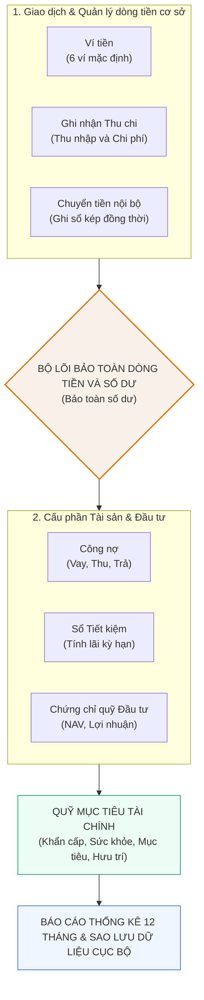
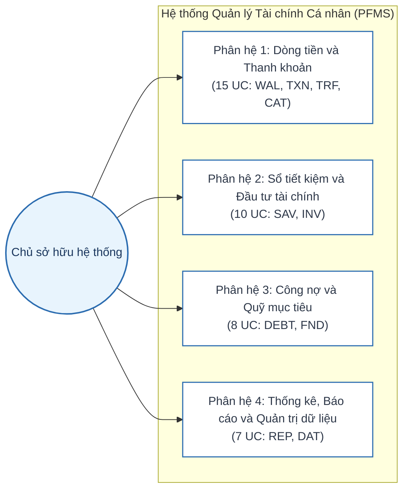
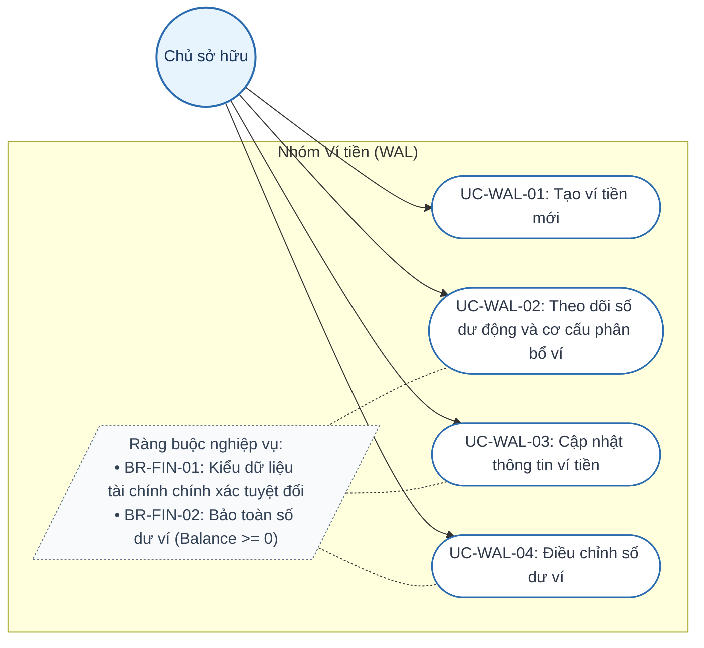
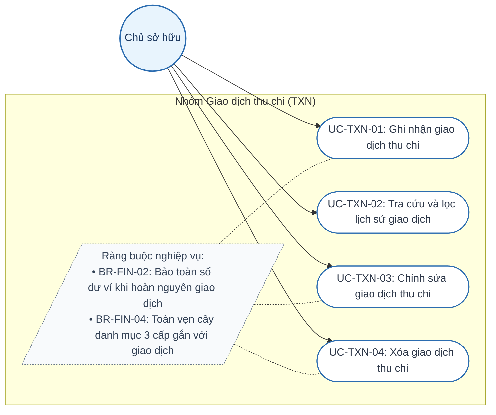
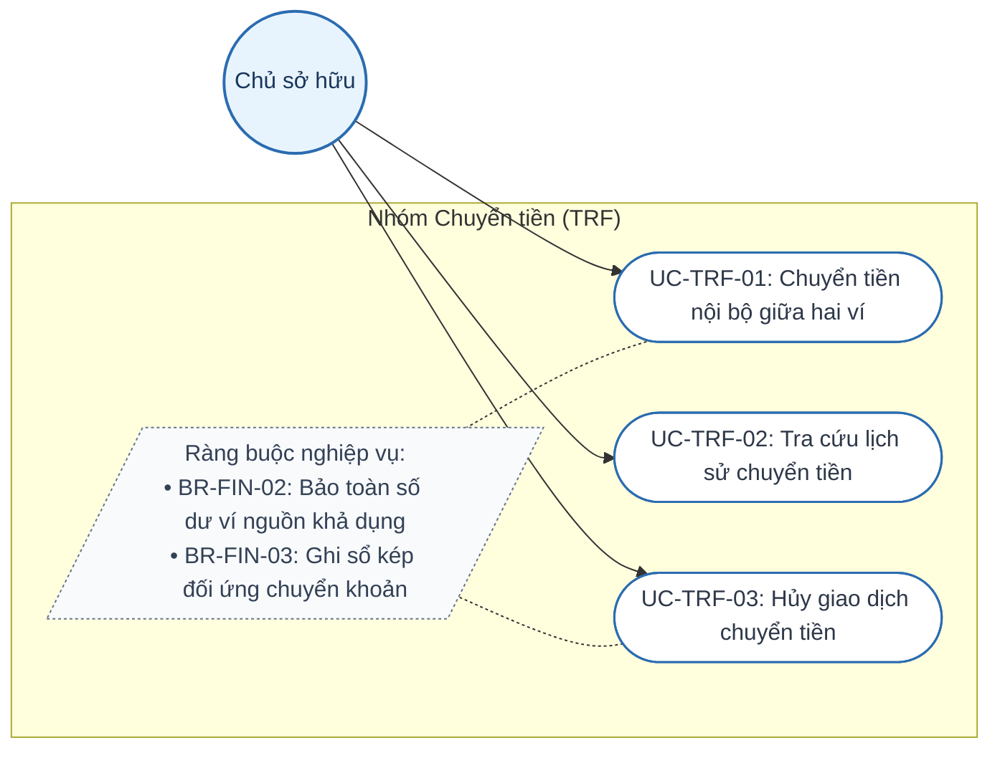
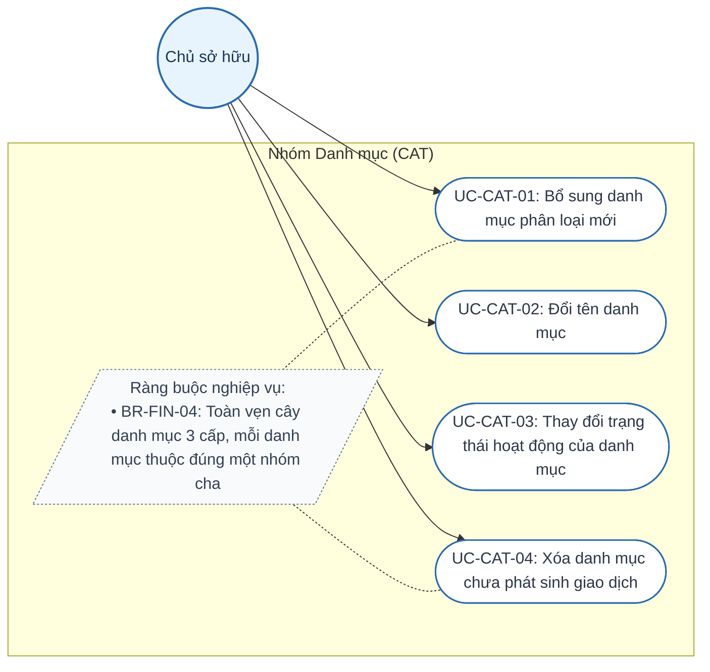
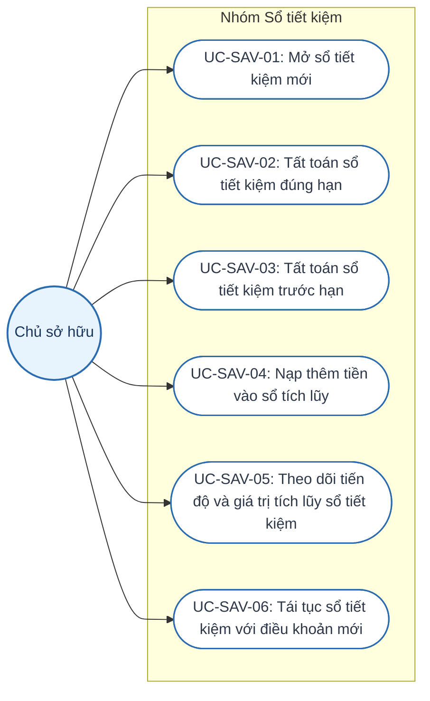
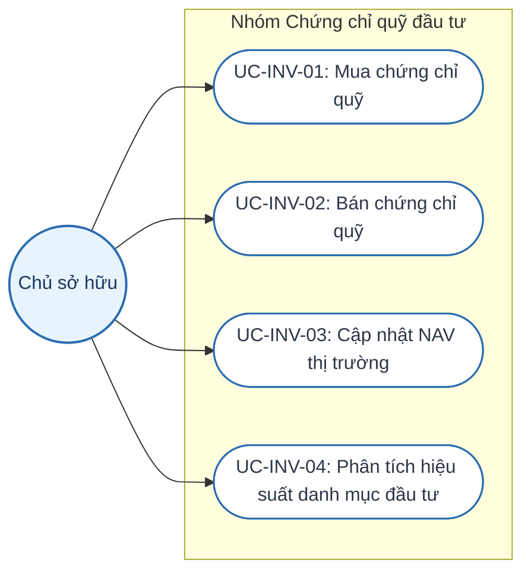
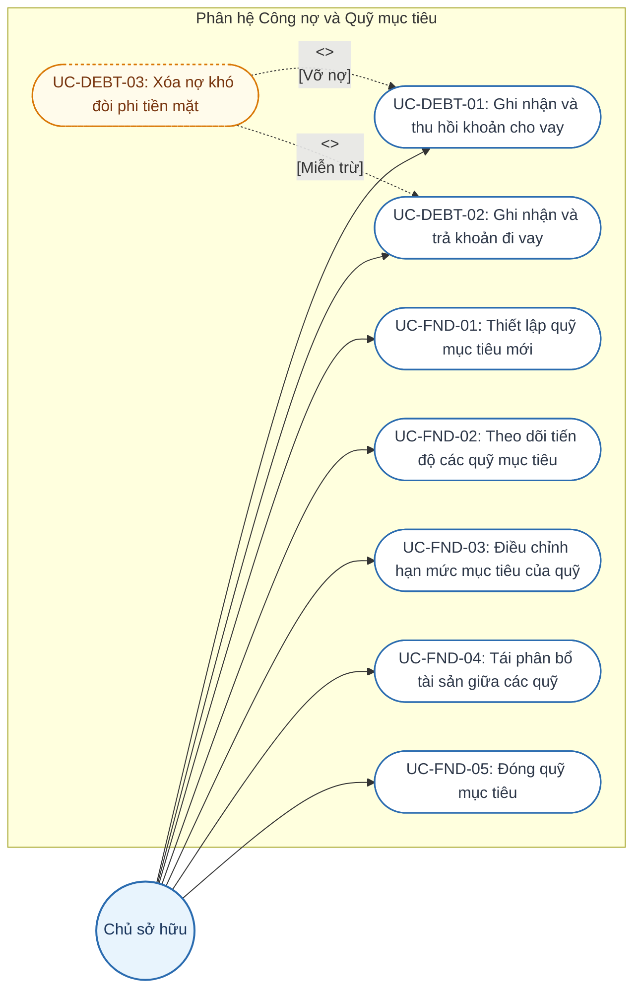
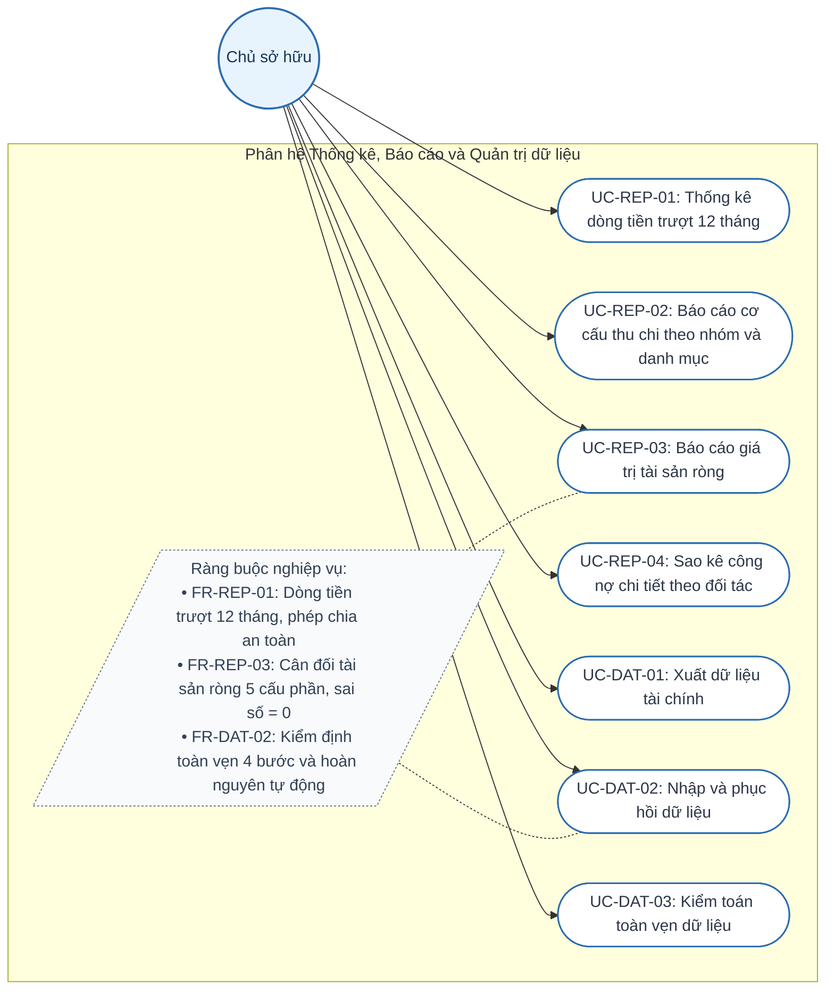

# Đặc tả Yêu cầu Phần mềm và Ca sử dụng Hệ thống Quản lý Tài chính Cá nhân (PFMS)

> **HỌC VIỆN CÔNG NGHỆ BƯU CHÍNH VIỄN THÔNG (PTIT)**  

| Thông tin | Chi tiết |
| :--- | :--- |
| **Khoa** | Khoa Công nghệ Thông tin 1 |
| **Học phần** | Lập trình Hướng đối tượng |
| **Giảng viên** | Phạm Hoàng Việt   Nguyễn Đình Quảng |
| **Nhóm** | 3 |
| **Thành viên** | Lê Anh Minh (B24DCCE180) Ứng Trọng Trình (B24DCCE271) Nguyễn Đình Tiến (B24DCCE264) Nguyễn Đinh Anh Quân (B24DCCE222) |
| **Tài liệu tham khảo** | ISO/IEC/IEEE 29148:2018   IREB CPRE   Craig Larman Use Case Format   Martin Fowler Accounting Patterns |

## MỤC LỤC TỔNG QUAN

- [1. Giới thiệu tổng quan](#1-giới-thiệu-tổng-quan)
  - [1.1 Mục đích tài liệu](#11-mục-đích-tài-liệu)
  - [1.2 Phạm vi sản phẩm](#12-phạm-vi-sản-phẩm)
  - [1.3 Đối tượng sử dụng và hướng dẫn đọc tài liệu](#13-đối-tượng-sử-dụng-và-hướng-dẫn-đọc-tài-liệu)
  - [1.4 Tài liệu tham chiếu chuẩn](#14-tài-liệu-tham-chiếu-chuẩn)
  - [1.5 Bảng thuật ngữ và định nghĩa](#15-bảng-thuật-ngữ-và-định-nghĩa)
- [2. Mô tả tổng quát hệ thống](#2-mô-tả-tổng-quát-hệ-thống)
  - [2.1 Bối cảnh hệ thống](#21-bối-cảnh-hệ-thống)
  - [2.2 Mục tiêu hệ thống](#22-mục-tiêu-hệ-thống)
  - [2.3 Đặc điểm tác nhân người dùng](#23-đặc-điểm-tác-nhân-người-dùng)
  - [2.4 Ràng buộc kỹ thuật, giả định và sự phụ thuộc](#24-ràng-buộc-kỹ-thuật-giả-định-và-sự-phụ-thuộc)
  - [2.5 Môi trường vận hành](#25-môi-trường-vận-hành)
  - [2.6 Luận đề kỹ thuật và phân tích đánh đổi](#26-luận-đề-kỹ-thuật-và-phân-tích-đánh-đổi)
- [3. Quy tắc nghiệp vụ và ràng buộc tài chính](#3-quy-tắc-nghiệp-vụ-và-ràng-buộc-tài-chính)
  - [3.1 BR-FIN-01: Ràng buộc chính xác tài chính](#31-br-fin-01-ràng-buộc-chính-xác-tài-chính)
  - [3.2 BR-FIN-02: Quy tắc bảo toàn số dư ví](#32-br-fin-02-quy-tắc-bảo-toàn-số-dư-ví)
  - [3.3 BR-FIN-03: Quy tắc ghi sổ kép khi chuyển khoản nội bộ](#33-br-fin-03-quy-tắc-ghi-sổ-kép-khi-chuyển-khoản-nội-bộ)
  - [3.4 BR-FIN-04: Quy tắc phân cấp danh mục thu chi 3 cấp](#34-br-fin-04-quy-tắc-phân-cấp-danh-mục-thu-chi-3-cấp)
  - [3.5 BR-FIN-05: Quy tắc tính lãi tiết kiệm có kỳ hạn](#35-br-fin-05-quy-tắc-tính-lãi-tiết-kiệm-có-kỳ-hạn)
  - [3.6 BR-FIN-06: Quy tắc định giá chứng chỉ quỹ đầu tư](#36-br-fin-06-quy-tắc-định-giá-chứng-chỉ-quỹ-đầu-tư)
  - [3.7 BR-FIN-07: Quy tắc theo dõi công nợ](#37-br-fin-07-quy-tắc-theo-dõi-công-nợ)
  - [3.8 BR-FIN-08: Quy tắc phân bổ quỹ mục tiêu](#38-br-fin-08-quy-tắc-phân-bổ-quỹ-mục-tiêu)
- [4. Yêu cầu chức năng chi tiết](#4-yêu-cầu-chức-năng-chi-tiết)
  - [4.1 FR-WAL: Phân hệ Ví tiền](#41-fr-wal-phân-hệ-ví-tiền)
  - [4.2 FR-TXN: Phân hệ Ghi nhận thu chi](#42-fr-txn-phân-hệ-ghi-nhận-thu-chi)
  - [4.3 FR-TRF: Phân hệ Chuyển tiền nội bộ](#43-fr-trf-phân-hệ-chuyển-tiền-nội-bộ)
  - [4.4 FR-CAT: Phân hệ Danh mục phân loại](#44-fr-cat-phân-hệ-danh-mục-phân-loại)
  - [4.5 FR-DEBT: Phân hệ Công nợ](#45-fr-debt-phân-hệ-công-nợ)
  - [4.6 FR-SAV: Phân hệ Sổ tiết kiệm](#46-fr-sav-phân-hệ-sổ-tiết-kiệm)
  - [4.7 FR-INV: Phân hệ Chứng chỉ quỹ đầu tư](#47-fr-inv-phân-hệ-chứng-chỉ-quỹ-đầu-tư)
  - [4.8 FR-FND: Phân hệ Quỹ mục tiêu](#48-fr-fnd-phân-hệ-quỹ-mục-tiêu)
  - [4.9 FR-REP: Phân hệ Thống kê và Báo cáo](#49-fr-rep-phân-hệ-thống-kê-và-báo-cáo)
  - [4.10 FR-DAT: Phân hệ Xuất nhập và Sao lưu dữ liệu](#410-fr-dat-phân-hệ-xuất-nhập-và-sao-lưu-dữ-liệu)
- [5. Yêu cầu phi chức năng](#5-yêu-cầu-phi-chức-năng)
  - [5.1 NFR-01: Độ chính xác và toàn vẹn dữ liệu tài chính](#51-nfr-01-độ-chính-xác-và-toàn-vẹn-dữ-liệu-tài-chính)
  - [5.2 NFR-02: Hiệu năng và độ trễ phản hồi](#52-nfr-02-hiệu-năng-và-độ-trễ-phản-hồi)
  - [5.3 NFR-03: Độ tin cậy và lưu trữ an toàn](#53-nfr-03-độ-tin-cậy-và-lưu-trữ-an-toàn)
  - [5.4 NFR-04: Khả năng bảo trì và kiến trúc hướng đối tượng](#54-nfr-04-khả-năng-bảo-trì-và-kiến-trúc-hướng-đối-tượng)
  - [5.5 NFR-05: Tính khả dụng và trải nghiệm người dùng](#55-nfr-05-tính-khả-dụng-và-trải-nghiệm-người-dùng)
  - [5.6 NFR-06: Tính tương thích và môi trường thực thi](#56-nfr-06-tính-tương-thích-và-môi-trường-thực-thi)
- [6. Đặc tả 40 Ca sử dụng chi tiết](#6-đặc-tả-40-ca-sử-dụng-chi-tiết)
  - [6.1 UC-WAL-01: Tạo ví tiền mới](#61-uc-wal-01-tạo-ví-tiền-mới)
  - [6.2 UC-WAL-02: Theo dõi số dư động và cơ cấu phân bổ ví](#62-uc-wal-02-theo-dõi-số-dư-động-và-cơ-cấu-phân-bổ-ví)
  - [6.3 UC-WAL-03: Cập nhật thông tin ví tiền](#63-uc-wal-03-cập-nhật-thông-tin-ví-tiền)
  - [6.4 UC-WAL-04: Điều chỉnh số dư ví](#64-uc-wal-04-điều-chỉnh-số-dư-ví)
  - [6.5 UC-TXN-01: Ghi nhận giao dịch thu chi](#65-uc-txn-01-ghi-nhận-giao-dịch-thu-chi)
  - [6.6 UC-TXN-02: Tra cứu và lọc lịch sử giao dịch](#66-uc-txn-02-tra-cứu-và-lọc-lịch-sử-giao-dịch)
  - [6.7 UC-TXN-03: Chỉnh sửa giao dịch thu chi](#67-uc-txn-03-chỉnh-sửa-giao-dịch-thu-chi)
  - [6.8 UC-TXN-04: Xóa giao dịch thu chi](#68-uc-txn-04-xóa-giao-dịch-thu-chi)
  - [6.9 UC-TRF-01: Chuyển tiền nội bộ giữa hai ví](#69-uc-trf-01-chuyển-tiền-nội-bộ-giữa-hai-ví)
  - [6.10 UC-TRF-02: Tra cứu lịch sử chuyển tiền](#610-uc-trf-02-tra-cứu-lịch-sử-chuyển-tiền)
  - [6.11 UC-TRF-03: Hủy giao dịch chuyển tiền](#611-uc-trf-03-hủy-giao-dịch-chuyển-tiền)
  - [6.12 UC-CAT-01: Bổ sung danh mục phân loại mới](#612-uc-cat-01-bổ-sung-danh-mục-phân-loại-mới)
  - [6.13 UC-CAT-02: Đổi tên danh mục](#613-uc-cat-02-đổi-tên-danh-mục)
  - [6.14 UC-CAT-03: Thay đổi trạng thái hoạt động của danh mục](#614-uc-cat-03-thay-đổi-trạng-thái-hoạt-động-của-danh-mục)
  - [6.15 UC-CAT-04: Xóa danh mục chưa phát sinh giao dịch](#615-uc-cat-04-xóa-danh-mục-chưa-phát-sinh-giao-dịch)
  - [6.16 UC-DEBT-01: Ghi nhận và thu hồi khoản cho vay](#616-uc-debt-01-ghi-nhận-và-thu-hồi-khoản-cho-vay)
  - [6.17 UC-DEBT-02: Ghi nhận và trả khoản đi vay](#617-uc-debt-02-ghi-nhận-và-trả-khoản-đi-vay)
  - [6.18 UC-DEBT-03: Xóa nợ khó đòi phi tiền mặt](#618-uc-debt-03-xóa-nợ-khó-đòi-phi-tiền-mặt)
  - [6.19 UC-SAV-01: Mở sổ tiết kiệm mới](#619-uc-sav-01-mở-sổ-tiết-kiệm-mới)
  - [6.20 UC-SAV-02: Tất toán sổ tiết kiệm đúng hạn](#620-uc-sav-02-tất-toán-sổ-tiết-kiệm-đúng-hạn)
  - [6.21 UC-SAV-03: Tất toán sổ tiết kiệm trước hạn](#621-uc-sav-03-tất-toán-sổ-tiết-kiệm-trước-hạn)
  - [6.22 UC-SAV-04: Nạp thêm tiền vào sổ tích lũy](#622-uc-sav-04-nạp-thêm-tiền-vào-sổ-tích-lũy)
  - [6.23 UC-SAV-05: Theo dõi tiến độ và giá trị tích lũy sổ tiết kiệm](#623-uc-sav-05-theo-dõi-tiến-độ-và-giá-trị-tích-lũy-sổ-tiết-kiệm)
  - [6.24 UC-SAV-06: Tái tục sổ tiết kiệm với điều khoản mới](#624-uc-sav-06-tái-tục-sổ-tiết-kiệm-với-điều-khoản-mới)
  - [6.25 UC-INV-01: Mua chứng chỉ quỹ](#625-uc-inv-01-mua-chứng-chỉ-quỹ)
  - [6.26 UC-INV-02: Bán chứng chỉ quỹ](#626-uc-inv-02-bán-chứng-chỉ-quỹ)
  - [6.27 UC-INV-03: Cập nhật NAV thị trường](#627-uc-inv-03-cập-nhật-nav-thị-trường)
  - [6.28 UC-INV-04: Phân tích hiệu suất danh mục đầu tư](#628-uc-inv-04-phân-tích-hiệu-suất-danh-mục-đầu-tư)
  - [6.29 UC-FND-01: Thiết lập quỹ mục tiêu mới](#629-uc-fnd-01-thiết-lập-quỹ-mục-tiêu-mới)
  - [6.30 UC-FND-02: Theo dõi tiến độ các quỹ mục tiêu](#630-uc-fnd-02-theo-dõi-tiến-độ-các-quỹ-mục-tiêu)
  - [6.31 UC-FND-03: Điều chỉnh hạn mức mục tiêu của quỹ](#631-uc-fnd-03-điều-chỉnh-hạn-mức-mục-tiêu-của-quỹ)
  - [6.32 UC-FND-04: Tái phân bổ tài sản giữa các quỹ](#632-uc-fnd-04-tái-phân-bổ-tài-sản-giữa-các-quỹ)
  - [6.33 UC-FND-05: Đóng quỹ mục tiêu](#633-uc-fnd-05-đóng-quỹ-mục-tiêu)
  - [6.34 UC-REP-01: Thống kê dòng tiền trượt 12 tháng](#634-uc-rep-01-thống-kê-dòng-tiền-trượt-12-tháng)
  - [6.35 UC-REP-02: Báo cáo cơ cấu thu chi theo nhóm và danh mục](#635-uc-rep-02-báo-cáo-cơ-cấu-thu-chi-theo-nhóm-và-danh-mục)
  - [6.36 UC-REP-03: Báo cáo giá trị tài sản ròng](#636-uc-rep-03-báo-cáo-giá-trị-tài-sản-ròng)
  - [6.37 UC-REP-04: Sao kê công nợ chi tiết theo đối tác](#637-uc-rep-04-sao-kê-công-nợ-chi-tiết-theo-đối-tác)
  - [6.38 UC-DAT-01: Xuất dữ liệu tài chính](#638-uc-dat-01-xuất-dữ-liệu-tài-chính)
  - [6.39 UC-DAT-02: Nhập và phục hồi dữ liệu](#639-uc-dat-02-nhập-và-phục-hồi-dữ-liệu)
  - [6.40 UC-DAT-03: Kiểm toán toàn vẹn dữ liệu](#640-uc-dat-03-kiểm-toán-toàn-vẹn-dữ-liệu)
- [7. Sơ đồ Ca sử dụng hệ thống](#7-sơ-đồ-ca-sử-dụng-hệ-thống)
  - [7.1 Sơ đồ Ca sử dụng tổng quan kiến trúc phân hệ (Tầng 1)](#71-sơ-đồ-ca-sử-dụng-tổng-quan-kiến-trúc-phân-hệ-tầng-1)
  - [7.2 Sơ đồ Ca sử dụng phân rã chi tiết theo 4 phân hệ nghiệp vụ (Tầng 2)](#72-sơ-đồ-ca-sử-dụng-phân-rã-chi-tiết-theo-4-phân-hệ-nghiệp-vụ-tầng-2)
    - [7.2.1 Phân hệ Quản lý Dòng tiền và Thanh khoản](#721-phân-hệ-quản-lý-dòng-tiền-và-thanh-khoản)
    - [7.2.2 Phân hệ Sổ tiết kiệm và Đầu tư tài chính](#722-phân-hệ-sổ-tiết-kiệm-và-đầu-tư-tài-chính)
    - [7.2.3 Phân hệ Công nợ và Quỹ mục tiêu](#723-phân-hệ-công-nợ-và-quỹ-mục-tiêu)
    - [7.2.4 Phân hệ Thống kê, Báo cáo và Quản trị dữ liệu](#724-phân-hệ-thống-kê-báo-cáo-và-quản-trị-dữ-liệu)
- [8. Ma trận kiểm chứng và truy vết yêu cầu (RTM)](#8-ma-trận-kiểm-chứng-và-truy-vết-yêu-cầu-rtm)
  - [8.1 Ma trận truy vết yêu cầu 4 chiều](#81-ma-trận-truy-vết-yêu-cầu-4-chiều)
  - [8.2 Ma trận phương pháp kiểm chứng yêu cầu](#82-ma-trận-phương-pháp-kiểm-chứng-yêu-cầu)
    - [8.2.1 Ma trận phương pháp kiểm chứng yêu cầu chức năng (41 FRs)](#821-ma-trận-phương-pháp-kiểm-chứng-yêu-cầu-chức-năng-41-frs)
    - [8.2.2 Ma trận phương pháp kiểm chứng yêu cầu phi chức năng (6 NFRs)](#822-ma-trận-phương-pháp-kiểm-chứng-yêu-cầu-phi-chức-năng-6-nfrs)
- [9. Tổng kết đặc tả yêu cầu](#9-tổng-kết-đặc-tả-yêu-cầu)

---

## 1. GIỚI THIỆU TỔNG QUAN

### 1.1 Mục đích tài liệu

Tài liệu này là tài liệu Software Requirements Specification (SRS) xác định phạm vi chức năng, các bất biến nghiệp vụ tài chính và tiêu chí kiểm chứng cho hệ thống Quản lý Tài chính Cá nhân (PFMS). Bản đặc tả thiết lập căn cứ kỹ thuật cho việc thiết kế kiến trúc, cài đặt mã nguồn trên nền tảng Java 17 LTS và kiểm thử tự động bằng JUnit 5.

### 1.2 Phạm vi sản phẩm

PFMS là ứng dụng máy tính để bàn thực thi trên máy ảo Java, phục vụ một chủ sở hữu duy nhất để theo dõi, phân loại và kiểm soát các nguồn lực tài chính cá nhân.

Ranh giới chức năng của hệ thống được phân định rõ giữa phạm vi xử lý và phạm vi không hỗ trợ.

Bảng phạm vi xử lý kỹ thuật:

| STT | Phân hệ nghiệp vụ | Mã định danh | Phạm vi xử lý kỹ thuật |
| --- | --- | --- | --- |
| 1 | Ví tiền | FR-WAL | Khởi tạo và quản trị 6 ví tài khoản mặc định theo dữ liệu nguồn (`cash`, `mb bank`, `timo`, `vietcombank`, `msb`, `shopee pay`), hỗ trợ mở rộng thêm ví thẻ tín dụng (`CREDIT`) có hạn mức thấu chi, theo dõi số dư khả dụng và tính toán tỷ trọng phân bổ tài sản thanh khoản. |
| 2 | Ghi nhận thu chi | FR-TXN | Ghi nhật ký giao dịch thu nhập và chi phí phát sinh, liên kết trực tiếp với ví thanh toán, cập nhật biến động số dư tức thời. |
| 3 | Chuyển tiền nội bộ | FR-TRF | Điều chuyển giá trị giữa các ví nội bộ theo nguyên tắc ghi sổ kép đối ứng, bảo toàn tổng lượng tiền mặt trong hệ thống. |
| 4 | Danh mục phân loại | FR-CAT | Chuẩn hóa cây phân loại 3 cấp gồm Loại, Nhóm nhu cầu và Danh mục chi tiết. |
| 5 | Công nợ | FR-DEBT | Giám sát các khoản phải thu và phải trả (đi vay) theo từng đối tác, ghi nhận hoàn ứng và xử lý xóa nợ. |
| 6 | Sổ tiết kiệm | FR-SAV | Theo dõi các khoản tiền gửi có kỳ hạn và không kỳ hạn, tính toán tiền lãi theo ngày thực tế, xử lý tất toán đúng hạn và trước hạn. |
| 7 | Chứng chỉ quỹ đầu tư | FR-INV | Định giá danh mục đầu tư theo giá thị trường dựa trên NAV, theo dõi lãi lỗ chưa thực hiện và tỷ suất sinh lời. |
| 8 | Quỹ mục tiêu | FR-FND | Quy hoạch tài sản từ tiền mặt, sổ tiết kiệm và chứng chỉ quỹ vào 4 quỹ mục tiêu độc lập, giám sát tỷ lệ hoàn thành mục tiêu. |
| 9 | Thống kê và báo cáo | FR-REP | Tự động hóa chuỗi thống kê 12 tháng trượt theo ngày hệ thống, tổng hợp dòng tiền ròng, tỷ lệ tiết kiệm và cơ cấu chi tiêu. |
| 10 | Quản lý dữ liệu và sao lưu | FR-DAT | Lưu trữ dữ liệu cục bộ trên tệp tin, hỗ trợ xuất và nhập dữ liệu để bảo vệ dữ liệu khi vận hành. |

Ranh giới ngoài phạm vi của hệ thống:

- Không kết nối trực tiếp giao diện lập trình ứng dụng API với các ngân hàng thương mại hoặc cổng trung gian thanh toán. Người dùng tự ghi nhận giao dịch vào hệ thống.
- Không hỗ trợ kiến trúc đa người dùng hoặc cơ chế phân quyền truy cập nhiều tầng. Hệ thống vận hành cục bộ cho một chủ sở hữu duy nhất.
- Không thực hiện các lệnh chuyển tiền hoặc thanh toán điện tử thực tế ngoài đời thực. Hệ thống vận hành như một sổ cái quản lý, tính toán và phân tích thông tin tài chính.

### 1.3 Đối tượng sử dụng và hướng dẫn đọc tài liệu

Tài liệu được biên soạn phục vụ các nhóm đối tượng kỹ thuật với mục đích và phạm vi tham chiếu tương ứng:

| Nhóm đối tượng | Mục đích sử dụng tài liệu | Phạm vi tài liệu trọng tâm |
| --- | --- | --- |
| Kỹ sư phân tích và thiết kế | Xác định ranh giới hệ thống, chuyển hóa yêu cầu nghiệp vụ thành mô hình miền và kiến trúc phần mềm chi tiết | Mục 1, Mục 2, Mục 4, Mục 6, Mục 7 |
| Kỹ sư phát triển phần mềm | Cài đặt logic nghiệp vụ, cấu trúc dữ liệu và xử lý ngoại lệ trên nền tảng Java 17 | Mục 3, Mục 4, Mục 6 |
| Kỹ sư kiểm thử phần mềm | Xây dựng ca kiểm thử đơn vị và kiểm thử tích hợp dựa trên luồng sự kiện và điều kiện biên | Mục 3, Mục 6, Mục 8 |
| Cán bộ thẩm định kỹ thuật | Đối soát tính đầy đủ của yêu cầu, kiểm tra mức độ đáp ứng tiêu chuẩn chất lượng | Toàn bộ tài liệu |

Thứ tự tiếp cận tài liệu được khuyến nghị:

1. Tiếp cận tổng quan: Đọc Mục 1 và Mục 2 để nắm rõ bối cảnh, ranh giới phần mềm, các mục tiêu kỹ thuật và ràng buộc môi trường.
2. Nắm bắt logic nghiệp vụ: Đọc Mục 3 để hiểu các bất biến tài chính, quy tắc bảo toàn số dư và công thức tính toán.
3. Hiện thực hóa và kiểm chứng: Đọc song song Mục 4 (Yêu cầu chức năng) và Mục 6 (Ca sử dụng chi tiết), sau đó đối chiếu ma trận truy vết tại Mục 8 để bảo đảm độ bao phủ kiểm thử.

### 1.4 Tài liệu tham chiếu chuẩn

1. ISO/IEC/IEEE 29148:2018: Systems and software engineering: Life cycle processes - Requirements engineering.
2. ISO/IEC 25010:2011: Systems and software engineering: Systems and software Quality Requirements and Evaluation (SQRE) - System and software quality models.
3. ISO/IEC 19505:2012: Information technology: Object Management Group Unified Modeling Language (OMG UML).
4. RFC 2119: Key words for use in RFCs to Indicate Requirement Levels.
5. International Requirements Engineering Board (IREB): CPRE Foundation Level Handbook & Requirements Modeling Handbook.
6. Craig Larman (2004): Applying UML and Patterns: An Introduction to Object-Oriented Analysis and Design and Iterative Development, 3rd Edition, Prentice Hall.
7. Martin Fowler (1997): Accounting Patterns (Mô hình tài khoản, bút toán, giao dịch ghi sổ kép).

### 1.5 Bảng thuật ngữ và định nghĩa

Bảng thuật ngữ định nghĩa thống nhất các khái niệm trong toàn bộ tài liệu:

| Thuật ngữ | Tên tiếng Anh | Định nghĩa kỹ thuật trong hệ thống |
| --- | --- | --- |
| Tác nhân chính | Primary Actor | Người dùng duy nhất tương tác trực tiếp với phần mềm để đạt được mục tiêu cụ thể (vai trò Owner). |
| Kịch bản | Scenario | Một chuỗi các bước tương tác tuần tự giữa tác nhân và hệ thống trong một ngữ cảnh cụ thể. |
| Điều kiện kích hoạt | Trigger | Sự kiện khởi đầu kích thích việc thực thi một ca sử dụng. |
| Tiền điều kiện | Precondition | Trạng thái bắt buộc của hệ thống phải được thỏa mãn trước khi một ca sử dụng có thể bắt đầu. |
| Hậu điều kiện | Postcondition | Trạng thái xác định của hệ thống sau khi ca sử dụng kết thúc, bao gồm cả trường hợp thành công hoặc thất bại. |
| Bất biến miền | Domain Invariant | Quy tắc nghiệp vụ bắt buộc phải luôn luôn đúng tại mọi trạng thái hợp lệ của hệ thống. |
| Ví tiền | Wallet | Một tài khoản thanh khoản thực tế (tiền mặt, thẻ ngân hàng, ví điện tử) lưu giữ số dư tiền khả dụng. Hệ thống hỗ trợ 6 ví mặc định ban đầu: `cash`, `mb bank`, `timo`, `vietcombank`, `msb`, `shopee pay`. |
| Giao dịch thu chi | Transaction | Bản ghi một lần phát sinh tài chính làm tăng hoặc giảm số dư của một ví xác định. |
| Chuyển tiền nội bộ | Internal Transfer | Giao dịch điều chuyển giá trị giữa hai ví nội bộ mà không làm thay đổi tổng tài sản ròng của hệ thống. |
| Cấu trúc danh mục | Category Hierarchy | Mô hình phân loại dạng cây 3 cấp gồm Loại, Nhóm nhu cầu và Danh mục chi tiết. |
| Công nợ | Debt | Nghĩa vụ tài chính phát sinh giữa Owner và đối tác bên ngoài, phân loại thành khoản phải thu và khoản phải trả. |
| Khoản phải thu | Receivable | Tài sản của Owner đang cho đối tác vay (`lend`), phát sinh quyền yêu cầu hoàn trả trong tương lai. |
| Khoản phải trả | Payable | Nghĩa vụ tài chính mà Owner có trách nhiệm hoàn trả cho chủ nợ thông qua hành vi đi vay (`borrow`). |
| Xóa nợ | Write-off | Thao tác kế toán ghi nhận tổn thất tài sản khi khoản cho vay không thể thu hồi, hoặc ghi nhận giảm nghĩa vụ nợ khi được chủ nợ tha nợ. |
| Sổ tiết kiệm | Saving Account | Khoản tiền gửi tích lũy có kỳ hạn hoặc không kỳ hạn tại tổ chức tín dụng để sinh lời theo lãi suất cam kết. |
| Chứng chỉ quỹ | Fund Certificate | Sản phẩm đầu tư tài chính đại diện cho quyền sở hữu một phần danh mục tài sản ròng của quỹ đầu tư. |
| Giá trị tài sản ròng đơn vị | Net Asset Value (NAV) | Giá trị thị trường của một đơn vị chứng chỉ quỹ tại thời điểm định giá. |
| Quỹ mục tiêu | Financial Goal / Fund | Nhóm tài sản độc lập được quy hoạch từ tiền mặt, sổ tiết kiệm và chứng chỉ quỹ để phục vụ một mục tiêu tài chính cụ thể. |
| Ghi sổ kép | Double-Entry | Nguyên lý kế toán yêu cầu mỗi giao dịch chuyển dịch giá trị phải gồm hai vế đối ứng cân bằng: ghi giảm tài khoản nguồn và ghi tăng tài khoản đích tương ứng. |
| Chủ sở hữu duy nhất | Single-user Owner | Mô hình vận hành của hệ thống, trong đó toàn bộ dữ liệu thuộc quyền kiểm soát của một người dùng duy nhất trên ứng dụng máy tính để bàn cục bộ. |

---

## 2. MÔ TẢ TỔNG QUÁT HỆ THỐNG

### 2.1 Bối cảnh hệ thống

Hệ thống Quản lý Tài chính Cá nhân (PFMS) là ứng dụng máy tính để bàn cục bộ đơn người dùng chạy trên nền tảng Java 17, quản lý số dư ví, tài sản tích lũy, đầu tư và công nợ theo nguyên lý ghi sổ kép và bảo toàn số dư toán học.

PFMS quản lý tài chính cá nhân dựa trên các nguyên tắc kỹ thuật:

- Thiết lập tính bất biến số dư ví theo các mẫu kế toán chuẩn mực và áp dụng nguyên lý ghi sổ kép cho các giao dịch chuyển tiền nội bộ.
- Tổng hợp tài sản ròng từ 5 cấu phần: số dư các ví tiền, số dư các sổ tiết kiệm, giá trị thị trường các chứng chỉ quỹ đầu tư, các khoản phải thu và trừ đi các khoản phải trả.
- Tự động hóa thống kê dòng tiền trượt 12 tháng gần nhất dựa trên thời gian hệ thống, hỗ trợ đánh giá tỷ lệ tiết kiệm và xu hướng thu chi.
- Xây dựng kiến trúc phân tầng độc lập trên nền Java 17, lưu trữ dữ liệu trực tiếp trên tệp tin cục bộ bằng cơ chế ghi tệp an toàn, không phụ thuộc vào phần mềm bảng tính hoặc hệ quản trị cơ sở dữ liệu bên ngoài.

### 2.2 Mục tiêu hệ thống

Hệ thống đáp ứng 5 mục tiêu kỹ thuật định lượng và có thể đo kiểm:

| Mã | Tên | Định nghĩa kỹ thuật | Tiêu chí đo kiểm |
| --- | --- | --- | --- |
| G1 | Quản lý dòng tiền và danh mục phân loại | Ghi nhận các biến động số dư phát sinh và gán nhãn theo cấu trúc phân loại 3 cấp (Loại, Nhóm, Danh mục) | 100% giao dịch thu chi được định danh đúng ví và đúng danh mục hợp lệ; số dư ví cập nhật tức thời sau khi ghi nhận |
| G2 | Xác định giá trị tài sản ròng và cơ cấu phân bổ | Tổng hợp tài sản ròng tại thời điểm tra cứu từ 5 cấu phần: ví tiền, sổ tiết kiệm, chứng chỉ quỹ, khoản phải thu và khoản phải trả | Giá trị tài sản ròng khớp đúng tổng đại số của 5 cấu phần với sai số bằng 0; tỷ trọng phân bổ từng ví được tính toán chính xác |
| G3 | Giám sát công nợ, tích lũy và danh mục đầu tư | Theo dõi chi tiết từng khoản vay, nợ phải trả, sổ tiết kiệm có kỳ hạn và chứng chỉ quỹ đầu tư | Số liệu công nợ phân tách rõ theo từng đối tác; tiền lãi tiết kiệm được tính đúng theo công thức số ngày thực tế; giá trị chứng chỉ quỹ phản ánh đúng theo NAV cập nhật |
| G4 | Quy hoạch tài chính theo quỹ mục tiêu | Cho phép gom và theo dõi tiến độ tích lũy từ tiền mặt, sổ tiết kiệm và chứng chỉ quỹ vào 4 quỹ mục tiêu độc lập (khẩn cấp, sức khỏe, mục tiêu cụ thể, hưu trí) | Tỷ lệ hoàn thành tiến độ (%) của từng quỹ được tính tự động từ tổng tài sản phân bổ chia cho số tiền mục tiêu |
| G5 | Bảo đảm độ chính xác số học tài chính | Loại bỏ hoàn toàn sai số làm tròn số thực nhị phân trong các phép tính số dư, tính lãi, định giá và tổng hợp báo cáo | Toàn bộ các phép tính tiền tệ sử dụng `BigDecimal`; không xuất hiện sai số dấu chấm động nhị phân trong bất kỳ kịch bản kiểm thử nào |

### 2.3 Đặc điểm tác nhân người dùng

Hệ thống phục vụ một tác nhân duy nhất là Chủ sở hữu với các đặc điểm vận hành:

| Thuộc tính tác nhân | Đặc tả kỹ thuật |
| --- | --- |
| Tác nhân | Chủ sở hữu |
| Vai trò trong hệ thống | Tác nhân chính duy nhất tương tác trực tiếp với giao diện người dùng |
| Phạm vi quyền hạn | Toàn quyền khởi tạo, sửa đổi, tra cứu và sao lưu dữ liệu trên tất cả 10 phân hệ nghiệp vụ; không áp dụng phân quyền nhiều cấp |
| Yêu cầu kỹ năng | Kỹ năng vận hành ứng dụng máy tính cá nhân cơ bản; hiểu biết các khái niệm tài chính thông dụng gồm thu chi, chuyển tiền, công nợ, tiết kiệm ngân hàng và chứng chỉ quỹ |
| Tần suất tương tác | Tương tác hàng ngày để nhập giao dịch thu chi và chuyển tiền; tương tác định kỳ hàng tuần hoặc hàng tháng để cập nhật NAV, đối soát công nợ, theo dõi tiến độ quỹ mục tiêu và tra cứu báo cáo |

### 2.4 Ràng buộc kỹ thuật, giả định và sự phụ thuộc

Hệ thống tuân thủ các ràng buộc kỹ thuật sau:

Ràng buộc kỹ thuật:

| Mã | Nội dung |
| --- | --- |
| TC-01 | Ứng dụng bắt buộc được biên dịch và thực thi trên môi trường Java Development Kit (JDK) phiên bản 17 LTS trở lên. |
| TC-02 | Hệ thống bắt buộc sử dụng lớp `java.math.BigDecimal` cho mọi giá trị tiền tệ, số dư ví, tỷ lệ phần trăm, lãi suất và biến trung gian; cấm dùng kiểu số thực dấu chấm động (`float`, `double`, `Float`, `Double`) để tránh sai số làm tròn nhị phân. |
| TC-03 | Toàn bộ các quy tắc tính toán số dư, tính lãi, ghi sổ kép và định giá bắt buộc được kiểm chứng tự động bằng khung kiểm thử JUnit 5. |
| TC-04 | Dữ liệu bắt buộc được lưu trữ trên tệp tin cục bộ (định dạng văn bản có cấu trúc như JSON hoặc tệp nhị phân tuần tự hóa), cho phép sao lưu và phục hồi độc lập mà không phụ thuộc vào hệ quản trị cơ sở dữ liệu bên ngoài. |

Giả định của hệ thống:

| Mã | Nội dung |
| --- | --- |
| AS-01 | Hệ thống giả định một năm tài chính quy chuẩn có 365 ngày khi tính toán lãi suất tiết kiệm theo quy định ngân hàng. |
| AS-02 | Hệ thống giả định chỉ có một phiên làm việc duy nhất truy cập vào tệp dữ liệu tại một thời điểm trên ứng dụng máy tính để bàn cục bộ. |
| AS-03 | Giá trị tài sản ròng (NAV) của chứng chỉ quỹ được cập nhật từ người dùng dựa trên công bố thực tế của các đơn vị quản lý quỹ, không yêu cầu tự động crawl dữ liệu trực tuyến. |

Sự phụ thuộc hệ thống:

| Mã | Thành phần | Bản chất |
| --- | --- | --- |
| DE-01 | Đồng hồ hệ thống | Cung cấp mốc thời gian thực tế để ghi nhận thời điểm giao dịch, tính số ngày thực gửi của sổ tiết kiệm và tự động xác định chuỗi 12 tháng trượt trong báo cáo thống kê. |
| DE-02 | Hệ thống tệp tin cục bộ | Cung cấp quyền đọc, ghi tệp tin trên ổ đĩa để lưu trữ bền vững, áp dụng cơ chế ghi tệp an toàn và sao lưu dữ liệu. |

### 2.5 Môi trường vận hành

Yêu cầu môi trường vận hành của hệ thống:

| Yếu tố môi trường | Yêu cầu kỹ thuật tối thiểu | Ghi chú tương thích |
| --- | --- | --- |
| Hệ điều hành | Microsoft Windows 10/11 (64-bit), macOS 12 trở lên, hoặc các bản phân phối Linux 64-bit (Ubuntu 20.04 LTS, Fedora 36 trở lên) | Độc lập nền tảng nhờ môi trường thực thi máy ảo Java |
| Môi trường thực thi Java | Java Runtime Environment (JRE) 17 hoặc Java Development Kit (JDK) 17 LTS trở lên | Bắt buộc để thực thi mã bytecode và chạy bộ kiểm thử JUnit 5 |
| Bộ vi xử lý (CPU) | Vi xử lý x86-64 hoặc ARM64, tối thiểu 2 nhân, tốc độ xung nhịp từ 2.0 GHz | Đủ năng lực xử lý các phép toán tổng hợp và vẽ biểu đồ |
| Bộ nhớ truy cập ngẫu nhiên (RAM) | Tối thiểu 2 GB RAM khả dụng | Dành riêng cho JVM Heap và bộ nhớ ứng dụng |
| Ổ đĩa lưu trữ | Tối thiểu 200 MB dung lượng trống | Dùng để lưu trữ tệp nhị phân chương trình, các tệp nhật ký và sao lưu |
| Độ phân giải hiển thị | Tối thiểu 1280 x 720 pixels | Hiển thị đầy đủ bảng biểu số liệu và biểu đồ báo cáo |

### 2.6 Luận đề kỹ thuật và phân tích đánh đổi

#### Luận đề kỹ thuật

Hệ thống giải quyết bài toán quản lý tài chính cá nhân cho một chủ sở hữu duy nhất trên môi trường máy tính để bàn cục bộ, chủ động đánh đổi sự phức tạp của kiến trúc mạng phân tán và hệ quản trị cơ sở dữ liệu máy chủ để đạt được tính toàn vẹn dữ liệu toán học tuyệt đối, bảo mật dữ liệu ngoại tuyến và tốc độ tính toán số học tức thời.

#### Phân tích ba trục đánh đổi kỹ thuật

| Trục đánh đổi | Lựa chọn kỹ thuật | Lợi ích thu được | Chi phí và đánh đổi chấp nhận |
| --- | --- | --- | --- |
| Độ chính xác số học | Bắt buộc sử dụng `BigDecimal` cho toàn bộ các trường tiền tệ, tỷ lệ và biến trung gian; loại trừ hoàn toàn `float` và `double`. | Loại bỏ 100% sai số làm tròn số thực dấu chấm động nhị phân; bảo đảm tính bất biến số dư sổ cái và cân đối đại số. | Chi phí cấp phát đối tượng trên bộ nhớ JVM Heap và tốc độ tính toán số học chậm hơn kiểu nguyên thủy. Chấp nhận vì tính đúng đắn tài chính là ưu tiên tối thượng. |
| Lưu trữ dữ liệu | Sử dụng tệp tin cục bộ có cấu trúc kết hợp cơ chế ghi tệp an toàn (ghi tạm, đồng bộ vật lý, hoán đổi nguyên tử). | Loại bỏ phụ thuộc vào phần mềm cơ sở dữ liệu bên ngoài; người dùng làm chủ hoàn toàn tệp dữ liệu, thuận tiện sao lưu và di chuyển độc lập. | Không có sẵn tính năng lập chỉ mục nâng cao và tinh chỉnh truy vấn tự động của hệ cơ sở dữ liệu quan hệ; toàn bộ dữ liệu nạp vào bộ nhớ khi khởi động. |
| Kiểm soát truy cập | Mô hình chủ sở hữu duy nhất vận hành trên ứng dụng máy tính để bàn cá nhân. | Đơn giản hóa cơ chế khóa dữ liệu, loại trừ xung đột ghi đồng thời từ nhiều phiên mạng; phản hồi giao diện tức thời. | Không hỗ trợ cộng tác đa người dùng đồng thời qua mạng; chỉ phục vụ nhu cầu quản lý tài chính cá nhân độc lập. |

#### Ngưỡng gãy hệ thống

Hệ thống được thiết kế tối ưu cho không gian vận hành cá nhân với quy mô nhật ký giao dịch đạt tới 10.000 bản ghi. Điểm gãy kỹ thuật xảy ra trong hai trường hợp:
1. Quy mô dữ liệu vượt quá 50.000 giao dịch: Thời gian nạp tệp dữ liệu vào bộ nhớ khi khởi động nguội vượt ngưỡng 3.0 giây và mức chiếm dụng JVM Heap vượt quá 512 MB. Khi đạt ngưỡng này, kiến trúc lưu trữ tệp tin nguyên khối cần được tái cấu trúc sang cơ sở dữ liệu quan hệ nhúng như SQLite hoặc H2 Database.
2. Nhu cầu đồng bộ tức thời đa thiết bị: Khi người dùng yêu cầu cập nhật đồng thời từ điện thoại di động và máy tính, cơ chế tệp tin cục bộ không còn đáp ứng và hệ thống bắt buộc phải chuyển đổi sang kiến trúc dịch vụ mạng Client-Server hoặc Cloud API.

---

## 3. QUY TẮC NGHIỆP VỤ VÀ RÀNG BUỘC TÀI CHÍNH

Mục này đặc tả hình thức 8 quy tắc nghiệp vụ và bất biến miền (BR-FIN-01 đến BR-FIN-08). Các quy tắc này thiết lập điều kiện tiên quyết, công thức toán học và hành vi xử lý ngoại lệ bắt buộc trong toàn bộ vòng đời tính toán của hệ thống PFMS.

### 3.1 BR-FIN-01: Ràng buộc chính xác tài chính

| Thuộc tính | Đặc tả kỹ thuật |
| --- | --- |
| Mã | BR-FIN-01 |
| Tên | Bất biến độ chính xác tài chính |
| Phạm vi áp dụng | Toàn bộ các thực thể miền dữ liệu, các phép tính toán số học và lưu trữ tệp tin (`Wallet`, `Transaction`, `Transfer`, `Debt`, `SavingAccount`, `FundCertificate`, `FinancialGoal`) |
| Mục đích nghiệp vụ | Loại bỏ hoàn toàn sai số làm tròn số thực nhị phân, bảo đảm tính toàn vẹn của các phép toán tiền tệ và giá trị tài sản trong sổ cái kế toán |

#### Biểu thức bất biến hình thức

1. Kiểu dữ liệu số học: Với mọi biến số và thuộc tính $x$ biểu diễn số tiền, số lượng chứng chỉ quỹ, lãi suất hoặc tỷ lệ phân bổ:
$$x \in \text{BigDecimal}, \quad x \notin \text{float}, \text{double}, \text{Float}, \text{Double}$$
2. Sai số tích lũy tổng thể: Với mọi phép toán phân rã một giá trị tổng $S$ thành $n$ phần tử $\{s_1, s_2, \dots, s_n\}$:

$$
\left| S - \sum_{i=1}^{n} s_i \right| = 0.00 \text{ VNĐ}
$$

#### Ràng buộc kỹ thuật và xử lý số học

| Tham số | Quy chuẩn kỹ thuật bắt buộc |
| --- | --- |
| Kiểu dữ liệu lưu trữ | `java.math.BigDecimal` cho toàn bộ các trường số tiền, số dư, đơn giá và tỷ lệ. Cấm sử dụng kiểu số thực nguyên thủy hoặc lớp bao bọc (`float`, `double`, `Float`, `Double`). |
| Phương thức khởi tạo | Bắt buộc khởi tạo giá trị số học từ chuỗi ký tự thập phân chính xác hoặc từ giá trị nguyên. Nghiêm cấm khởi tạo trực tiếp từ số thực nhị phân do giữ nguyên sai số nhị phân của số thực nhị phân. |
| Quy chuẩn Scale tiền tệ | Tiền tệ giao dịch và số dư hiển thị cho VNĐ sử dụng scale = 0 (số nguyên đồng) hoặc scale = 2 (lưu trữ số học nội bộ chuẩn tiền tệ). |
| Quy chuẩn Scale đầu tư | Số lượng chứng chỉ quỹ, đơn giá NAV và các tỷ lệ phần trăm trung gian sử dụng scale tối thiểu = 4 (khuyến nghị scale = 6 trong phép tính trung gian). |
| Chế độ làm tròn | Các phép chia không hết bắt buộc chỉ định tường minh tham số scale và quy tắc làm tròn ngân hàng, làm tròn đến số chẵn gần nhất khi giá trị nằm giữa hai mức (`RoundingMode.HALF_EVEN`) để triệt tiêu độ lệch thống kê tích lũy, hoặc quy tắc làm tròn lên khi giá trị nằm giữa hai mức (`RoundingMode.HALF_UP`) cho các phép tính lãi thương mại. |
| Phép chia số học | Cấm thực hiện phép chia giữa hai giá trị số học chính xác mà không kèm tham số scale và quy tắc làm tròn tường minh. |

#### Quy tắc xử lý vi phạm

1. Khi phát hiện dữ liệu đầu vào sử dụng kiểu số thực nhị phân trong các API nghiệp vụ: Hệ thống từ chối xử lý và báo lỗi nghiệp vụ định dạng kiểu số học không hợp lệ.
2. Khi phát hiện phép chia không xác định scale hoặc quy tắc làm tròn gây số thập phân vô hạn tuần hoàn: Hệ thống báo lỗi nghiệp vụ phép toán số học không xác định, tự động chặn giao dịch và ghi log cảnh báo lỗi thuật toán.
3. Khi tổng các giá trị thành phần sau phân bổ không khớp với giá trị tổng ban đầu: Hệ thống tự động bù sai số lẻ vào phần tử có giá trị lớn nhất hoặc báo lỗi nghiệp vụ vượt ngưỡng sai số nếu sai số vượt ngưỡng 0.01 đơn vị tiền tệ.

### 3.2 BR-FIN-02: Quy tắc bảo toàn số dư ví

| Thuộc tính | Đặc tả kỹ thuật |
| --- | --- |
| Mã | BR-FIN-02 |
| Tên | Bất biến bảo toàn số dư ví |
| Phạm vi áp dụng | Thực thể `Wallet` và toàn bộ các dòng tiền phát sinh từ `Transaction`, `Transfer`, `Debt` |
| Mục đích nghiệp vụ | Xác lập số dư khả dụng của từng ví tiền là kết quả tổng hợp động từ lịch sử dòng tiền, ngăn ngừa việc ghi đè số dư tùy tiện và kiểm soát hạn mức thanh khoản |

#### Biểu thức bất biến hình thức

1. Công thức bảo toàn số dư động: Xét ví $w$ tại thời điểm quan sát $T$, số dư khả dụng $Balance_w(T)$ được tính toán theo biểu thức:
$$Balance_w(T) = Balance_w(0) + \sum_{t \le T} Income_w(t) - \sum_{t \le T} Expense_w(t) + \sum_{t \le T} TransferIn_w(t) - \sum_{t \le T} TransferOut_w(t) + \sum_{t \le T} Borrow_w(t) - \sum_{t \le T} Repay_w(t) - \sum_{t \le T} Lend_w(t) + \sum_{t \le T} Collect_w(t) + \sum_{t \le T} Adjustment_w(t)$$

Trong đó:

- $Balance_w(0)$: Số dư khởi tạo ban đầu của ví $w$.
- $Income_w(t)$: Khoản thu nhập phát sinh trực tiếp vào ví $w$ tại thời điểm $t$.
- $Expense_w(t)$: Khoản chi tiêu chi trả trực tiếp từ ví $w$ tại thời điểm $t$.
- $TransferIn_w(t)$: Khoản tiền nhận được do chuyển từ ví khác vào ví $w$.
- $TransferOut_w(t)$: Khoản tiền chuyển từ ví $w$ sang ví khác.
- $Borrow_w(t)$: Khoản tiền nhận về ví $w$ từ hợp đồng đi vay (dòng tiền dương).
- $Repay_w(t)$: Khoản tiền trích xuất từ ví $w$ để trả nợ đã vay (dòng tiền âm).
- $Lend_w(t)$: Khoản tiền trích xuất từ ví $w$ cho đối tác vay (dòng tiền âm).
- $Collect_w(t)$: Khoản tiền thu hồi nợ cho vay chuyển về nhập vào ví $w$ (dòng tiền dương).
- $Adjustment_w(t)$: Chênh lệch dương hoặc âm phát sinh từ một bút toán điều chỉnh số dư ghi nhận theo FR-WAL-05, không thuộc bất kỳ luồng thu, chi, chuyển khoản, vay hoặc trả nợ nào.

2. Ranh giới dòng tiền phi tiền mặt: Các nghiệp vụ xóa nợ (`write-off lend`) và miễn trừ nợ (`write-off borrow`) chỉ tác động lên sổ cái công nợ, không tạo ra dòng tiền vật lý ra hoặc vào ví:
$$\Delta Balance_w(\text{write-off lend}) = 0$$
$$\Delta Balance_w(\text{write-off borrow}) = 0$$
3. Ràng buộc trạng thái số dư khả dụng:
  - Đối với ví tiền mặt, tài khoản ngân hàng và ví điện tử tiêu chuẩn (`type` $\in$ {`CASH`, `BANK`, `E_WALLET`}):
    $$
    Balance_w(T) \ge 0, \quad \forall T
    $$
  - Đối với ví thẻ tín dụng (`type` = `CREDIT`) có hạn mức thấu chi $Limit_w \ge 0$:
    $$
    Balance_w(T) \ge -Limit_w, \quad \forall T
    $$
4. Ràng buộc bút toán điều chỉnh: Mỗi lần điều chỉnh số dư theo FR-WAL-05 bắt buộc sinh một bản ghi độc lập và bất biến chứa số dư trước điều chỉnh, số dư sau điều chỉnh, giá trị chênh lệch $Adjustment_w(t)$, thời điểm ghi nhận và lý do điều chỉnh. Cơ chế điều chỉnh chỉ áp dụng cho ví có `type` thuộc tập hợp {`CASH`, `BANK`, `E_WALLET`, `CREDIT`}; không áp dụng cho số dư dẫn xuất từ các thực thể `SavingAccount`, `FundCertificate` hoặc `FinancialGoal` vì các thực thể này không thuộc lớp `Wallet` và có cơ chế cập nhật giá trị riêng theo BR-FIN-05, BR-FIN-06 và BR-FIN-08.

#### Ràng buộc kỹ thuật và xử lý số học

| Tham số | Quy chuẩn kỹ thuật bắt buộc |
| --- | --- |
| Cơ chế tính toán | Tính toán động theo thời gian thực dựa trên lịch sử giao dịch. Hệ thống cấm lưu trữ trường số dư tĩnh cho phép ghi đè trực tiếp nếu không có bút toán dòng tiền tương ứng. |
| Đồng bộ dữ liệu | Mọi thao tác thêm, sửa hoặc xóa giao dịch liên quan đến ví $w$ phải kích hoạt tính toán lại số dư tức thời. |
| Kiểm tra tiền điều kiện | Trước khi thực hiện bất kỳ giao dịch làm giảm số dư ví (chi tiêu, chuyển đi, trả nợ, cho vay), hệ thống phải kiểm tra điều kiện khả dụng của số dư hiện tại. |

#### Quy tắc xử lý vi phạm

1. Khi một giao dịch khiến số dư khả dụng của ví rơi vào trạng thái âm ($Balance_w < 0$ với ví thông thường hoặc $Balance_w < -Limit_w$ với thẻ tín dụng): Hệ thống từ chối thực thi giao dịch, hoàn nguyên trạng thái bộ nhớ và báo lỗi nghiệp vụ số dư ví không đủ.
2. Thông báo lỗi phản hồi: `"Giao dịch bị từ chối: Số dư ví không đủ để thực hiện thao tác (Số dư hiện tại: [current], Số tiền yêu cầu: [requested])."`

### 3.3 BR-FIN-03: Quy tắc ghi sổ kép khi chuyển khoản nội bộ

| Thuộc tính | Đặc tả kỹ thuật |
| --- | --- |
| Mã | BR-FIN-03 |
| Tên | Bất biến ghi sổ kép chuyển tiền nội bộ |
| Phạm vi áp dụng | Thực thể `Transfer`, cặp thực thể `Wallet` (ví nguồn $w_{src}$ và ví đích $w_{dst}$), thực thể `Transaction` phụ phát sinh phí |
| Mục đích nghiệp vụ | Bảo đảm tính cân bằng đối ứng và bảo toàn tổng tài sản thanh khoản khi di chuyển tiền tệ giữa các tài khoản nội bộ |

#### Biểu thức bất biến hình thức

1. Cặp bút toán đối ứng: Với một lệnh chuyển tiền từ ví nguồn $w_{src}$ tới ví đích $w_{dst}$ với số tiền chuyển $A > 0$:
$$
\begin{aligned}
\Delta Balance_{w_{src}} &= -A \\
\Delta Balance_{w_{dst}} &= +A
\end{aligned}
$$
2. Bảo toàn tổng giá trị thanh khoản hệ thống: Trước khi tính phí dịch vụ ngoài, tổng tài sản lưu động trên toàn bộ các ví không đổi:
$$\Delta \sum_{w \in Wallets} Balance_w = \Delta Balance_{w_{src}} + \Delta Balance_{w_{dst}} = (-A) + (+A) = 0$$
3. Hạch toán phí dịch vụ chuyển khoản độc lập: Khi phát sinh phí chuyển tiền $Fee \ge 0$ do bên thứ ba thu:
$$\text{Số tiền trừ ví nguồn: } A_{srctotal} = A + Fee$$
$$\text{Số tiền cộng ví đích: } A_{dstnet} = A$$

Khoản phí $Fee$ được ghi nhận thành một giao dịch chi tiêu (`Expense`) độc lập từ ví nguồn, dẫn đến biến động tổng tài sản:

$$
\Delta \sum_{w \in Wallets} Balance_w = -Fee
$$

#### Ràng buộc kỹ thuật và xử lý số học

| Tham số | Quy chuẩn kỹ thuật bắt buộc |
| --- | --- |
| Tính bất khả phân | Hai bút toán trừ ví nguồn và cộng ví đích phải được đóng gói trong cùng một khối giao dịch nguyên tử. Nếu một trong hai bút toán thất bại, toàn bộ giao dịch phải được hoàn nguyên về trạng thái ban đầu. |
| Phân định thực thể | Ví nguồn và ví đích bắt buộc khác nhau: $w_{src} \ne w_{dst}$. |
| Ràng buộc giá trị chuyển | Số tiền chuyển $A$ phải lớn hơn 0 ($A > 0$). Phí chuyển tiền $Fee$ phải không âm ($Fee \ge 0$). |
| Ràng buộc thanh khoản nguồn | Ví nguồn phải thỏa mãn điều kiện số dư trước khi trừ: $Balance_{w_{src}} \ge A + Fee$ (hoặc không vượt quá hạn mức thấu chi đối với thẻ tín dụng). |
| Quy tắc hủy chuyển tiền | Khi hủy một lệnh chuyển khoản đã ghi nhận, hệ thống đảo ngược cả hai bút toán (hoàn $A$ về $w_{src}$, trừ $A$ khỏi $w_{dst}$) và hủy bỏ giao dịch chi phí $Fee$ tương ứng. |

#### Quy tắc xử lý vi phạm

1. Khi ví nguồn trùng ví đích ($w_{src} = w_{dst}$): Hệ thống từ chối thực thi và báo lỗi nghiệp vụ ví nguồn trùng ví đích.
2. Khi số tiền chuyển không hợp lệ ($A \le 0$ hoặc $Fee < 0$): Hệ thống từ chối và báo lỗi nghiệp vụ số tiền không hợp lệ.
3. Khi ví nguồn không đủ số dư để chi trả khoản tiền chuyển cùng phí ($Balance_{w_{src}} < A + Fee$): Hệ thống từ chối và báo lỗi nghiệp vụ số dư ví không đủ.
4. Khi khối giao dịch toàn vẹn gặp sự cố giữa chừng: Hệ thống hoàn nguyên trạng thái, bảo đảm không thất thoát hoặc phát sinh sai lệch tiền tệ.

### 3.4 BR-FIN-04: Quy tắc phân cấp danh mục thu chi 3 cấp

| Thuộc tính | Đặc tả kỹ thuật |
| --- | --- |
| Mã | BR-FIN-04 |
| Tên | Bất biến phân cấp danh mục thu chi |
| Phạm vi áp dụng | Thực thể `Category`, `Group`, `Type` và mối quan hệ tham chiếu từ `Transaction` |
| Mục đích nghiệp vụ | Chuẩn hóa cấu trúc phân loại thu chi theo mô hình cây quan hệ 3 tầng, phục vụ phân tích báo cáo tài chính đa chiều và bảo toàn toàn vẹn dữ liệu lịch sử |

#### Biểu thức bất biến hình thức

1. Cấu trúc cây phân cấp 3 tầng:
$$\text{Type} \xrightarrow{1:N} \text{Group} \xrightarrow{1:N} \text{Category}$$
2. Ràng buộc quan hệ cha - con duy nhất:
  - Mỗi danh mục chi tiết chỉ được gán vào đúng một Nhóm nhu cầu cha tại một thời điểm.
  - Mỗi Nhóm nhu cầu chỉ được gán vào đúng một Loại thu chi gốc tại một thời điểm.
  - Ràng buộc nút mồ côi: Danh mục con bắt buộc phải trực thuộc một nhóm cha hợp lệ.
3. Tập giá trị định danh chuẩn:
  - Tầng 1: $\text{Type} \in \{\text{Income}, \text{Expense}\}$.
  - Tầng 2:
  - Với $\text{Type} = \text{Income}$: $\text{Group} \in \{\text{employment}, \text{assets}, \text{other}\}$.
  - Với $\text{Type} = \text{Expense}$: $\text{Group} \in \{\text{essentials}, \text{personal \& leisure}, \text{obligations \& transfers}, \text{savings \& investing}\}$.
  - Tầng 3: 43 danh mục chi tiết chuẩn được định nghĩa trong danh mục tham chiếu hệ thống.

#### Ràng buộc kỹ thuật và xử lý số học

| Tham số | Quy chuẩn kỹ thuật bắt buộc |
| --- | --- |
| Toàn vẹn tham chiếu xóa | Cấm xóa một `Group` nếu còn tồn tại `Category` trực thuộc. Cấm xóa một `Category` hoặc `Group` nếu đã có ít nhất một bản ghi `Transaction` đang tham chiếu đến danh mục đó. |
| Cơ chế vô hiệu hóa | Khi người dùng muốn ngừng sử dụng một danh mục đã phát sinh giao dịch lịch sử, hệ thống chuyển trạng thái danh mục sang ngưng hoạt động (`Archived` hoặc `Inactive`). Danh mục ngưng hoạt động bị ẩn khỏi giao diện chọn mới nhưng được giữ nguyên trong các báo cáo lịch sử. |
| Bất biến thuộc tính Type | Cấm thay đổi thuộc tính `Type` của một `Group` hoặc `Category` khi đã có giao dịch phát sinh liên kết để tránh sai lệch dữ liệu phân tích thu chi trong quá khứ. |

#### Quy tắc xử lý vi phạm

1. Khi người dùng cố gắng xóa danh mục cha đang chứa danh mục con: Hệ thống từ chối thao tác và báo lỗi nghiệp vụ nhóm danh mục chưa rỗng.
2. Khi người dùng cố gắng xóa danh mục đã được gắn vào giao dịch lịch sử: Hệ thống từ chối xóa vật lý, báo lỗi nghiệp vụ vi phạm toàn vẹn tham chiếu và gợi ý chuyển sang trạng thái ngưng hoạt động (`Archived`).
3. Khi người dùng cố gắng chuyển đổi thuộc tính `Type` của danh mục đã phát sinh dữ liệu: Hệ thống từ chối và báo lỗi nghiệp vụ thuộc tính loại danh mục bất biến.

### 3.5 BR-FIN-05: Quy tắc tính lãi tiết kiệm có kỳ hạn

| Thuộc tính | Đặc tả kỹ thuật |
| --- | --- |
| Mã | BR-FIN-05 |
| Tên | Bất biến tính lãi sổ tiết kiệm |
| Phạm vi áp dụng | Thực thể `SavingAccount`, logic tính toán lãi suất và dòng tiền tất toán |
| Mục đích nghiệp vụ | Phản ánh chính xác giá trị tích lũy của các khoản tiền gửi có kỳ hạn và không kỳ hạn theo chuẩn ngân hàng thương mại khi tất toán đúng hạn hoặc tất toán trước hạn hồi tố |

#### Biểu thức bất biến hình thức

1. Quy đổi kỳ hạn và số ngày thực gửi:
  - Bảng quy đổi kỳ hạn chuẩn: `unlimited` = 0 ngày; 1 tháng = 30 ngày; 3 tháng = 90 ngày; 6 tháng = 180 ngày; 12 tháng = 365 ngày; 24 tháng = 730 ngày; 36 tháng = 1095 ngày; 60 tháng = 1825 ngày.
  - Số ngày gửi thực tế tính đến ngày đánh giá hoặc tất toán ($Days$):
    $$
    Days = \max(0, CurrentDate - StartDate)
    $$
2. Khoản gửi không kỳ hạn (`term` = `unlimited`):
  - Lãi suất tích lũy tính theo phương pháp lãi đơn hàng ngày:
    $$
    Interest_{unlimited} = \frac{Principal \times Rate \times Days}{365}
    $$
  - Số dư ghi nhận:
    $$
    Balance = Principal + Interest_{unlimited}
    $$
3. Khoản gửi có kỳ hạn xác định ($TermDays > 0$):
  - Tiến độ hoàn thành kỳ hạn ($Process$):
    $$
    Process = \min\left(1.0, \frac{Days}{TermDays}\right)
    $$
  - Phương thức tính lãi ($interestMethod$) áp dụng cho khoản gửi có kỳ hạn, thuộc tập hợp {`SIMPLE`, `COMPOUND_MONTHLY`, `PREPAID`, `POSTPAID`}, mặc định `SIMPLE` khi không chỉ định. Lãi dự kiến toàn kỳ theo hợp đồng $ExpectedInterest$ được tính theo từng phương thức:
    - `SIMPLE` hoặc `POSTPAID` (lãi đơn, trả lãi khi tất toán):
      $$
      ExpectedInterest = \frac{Principal \times Rate \times TermDays}{365}
      $$
    - `PREPAID` (lãi trả trước, khấu trừ ngay khi mở sổ): $ExpectedInterest$ tính theo công thức lãi đơn nêu trên, được khấu trừ khỏi số tiền trích từ ví ngay tại thời điểm mở sổ theo FR-SAV-01, số dư danh nghĩa của sổ vẫn ghi nhận đủ $Principal$.
    - `COMPOUND_MONTHLY` (lãi kép vốn hóa hàng tháng):
      $$
      ExpectedInterest = Principal \times \left[\left(1 + \frac{Rate}{12}\right)^{n} - 1\right], \quad n = \left\lfloor \frac{TermDays}{30} \right\rfloor
      $$
  - Số dư danh nghĩa ghi nhận tại thời điểm quan sát:
    $$
    Balance = Principal + (ExpectedInterest \times Process)
    $$
4. Quy tắc giá trị tất toán:
  - Tất toán đúng hạn hoặc sau hạn ($Days \ge TermDays$): Nhận toàn bộ gốc và 100% lãi cam kết theo hợp đồng:
    $$
    Payout_{mature} = Principal + ExpectedInterest
    $$
    Đối với `interestMethod` = `PREPAID`, $ExpectedInterest$ đã được khấu trừ khi mở sổ nên $Payout_{mature} = Principal$.
  - Tất toán trước hạn ($Days < TermDays$): Toàn bộ lãi kỳ hạn dự kiến bị hủy bỏ; hệ thống áp dụng hồi tố lãi suất không kỳ hạn ($DemandRate$) theo số ngày thực gửi:
    $$
    Payout_{early} = Principal + \frac{Principal \times DemandRate \times Days}{365}
    $$
  - Lãi giảm trừ khi tất toán trước hạn:
    $$
    InterestLoss = (ExpectedInterest \times Process) - \frac{Principal \times DemandRate \times Days}{365}
    $$
5. Quy tắc tái tục sổ tiết kiệm theo FR-SAV-05: Tái tục chỉ được thực hiện ngay sau khi tất toán đúng hạn ($Days \ge TermDays$), sử dụng một phần hoặc toàn bộ giá trị $Payout_{mature}$ làm vốn gốc $Principal'$ của một sổ tiết kiệm mới ($0 < Principal' \le Payout_{mature}$). Sổ nguồn chuyển trạng thái `CLOSED` vĩnh viễn; sổ mới được cấp `savingId` độc lập, kỳ hạn, lãi suất và `interestMethod` mới do người dùng chỉ định lại, không kế thừa lịch sử lãi của sổ nguồn. Phần chênh lệch $Payout_{mature} - Principal'$ (nếu có) được ghi nhận vào ví thanh toán do người dùng chỉ định.

#### Ràng buộc kỹ thuật và xử lý số học

| Tham số | Quy chuẩn kỹ thuật bắt buộc |
| --- | --- |
| Cơ sở quy ước năm | Cơ sở tính lãi quy ước chuẩn là 365 ngày trong một năm ($BaseDays = 365$). |
| Độ chính xác số học | Số vốn gốc $Principal$, tiền lãi và giá trị nhận về $Payout$ tính toán bằng `BigDecimal` với scale = 2 và `RoundingMode.HALF_EVEN`. Tỷ lệ lãi suất $Rate$ và $DemandRate$ duy trì scale tối thiểu = 4 (ví dụ 0.0650 biểu thị 6.5%/năm). Số kỳ vốn hóa $n$ của phương thức `COMPOUND_MONTHLY` là số nguyên không âm, tính bằng phép chia lấy phần nguyên. |
| Điều kiện tiền kiểm | $Principal > 0$; $Rate \ge 0$; $DemandRate \ge 0$; $StartDate \le CurrentDate$; $interestMethod$ thuộc tập hợp {`SIMPLE`, `COMPOUND_MONTHLY`, `PREPAID`, `POSTPAID`}. |

#### Quy tắc xử lý vi phạm

1. Khi dữ liệu mở sổ vi phạm ràng buộc tiền kiểm ($Principal \le 0$ hoặc $Rate < 0$): Hệ thống từ chối mở sổ và báo lỗi nghiệp vụ tham số mở sổ tiết kiệm không hợp lệ.
2. Khi ngày tất toán nhỏ hơn ngày gửi sổ ($SettlementDate < StartDate$): Hệ thống từ chối thao tác và báo lỗi nghiệp vụ ngày tất toán không hợp lệ.
3. Khi người dùng yêu cầu tái tục một sổ tiết kiệm chưa đến hạn ($Days < TermDays$): Hệ thống từ chối và báo lỗi nghiệp vụ sổ tiết kiệm chưa đủ điều kiện tái tục.
4. Khi vốn gốc tái tục vượt quá giá trị tất toán của sổ nguồn ($Principal' > Payout_{mature}$): Hệ thống từ chối và báo lỗi nghiệp vụ vốn gốc tái tục vượt quá giá trị tất toán.

### 3.6 BR-FIN-06: Quy tắc định giá chứng chỉ quỹ đầu tư

| Thuộc tính | Đặc tả kỹ thuật |
| --- | --- |
| Mã | BR-FIN-06 |
| Tên | Bất biến định giá và tỷ suất sinh lời chứng chỉ quỹ |
| Phạm vi áp dụng | Thực thể `FundCertificate`, lịch sử giao dịch mua bán và biến động giá trị tài sản ròng `NAV` |
| Mục đích nghiệp vụ | Đo lường chính xác giá trị thị trường của danh mục đầu tư theo cơ chế Mark-to-Market, phản ánh đúng lãi lỗ chưa thực hiện và tỷ suất sinh lời quy đổi năm |

#### Biểu thức bất biến hình thức

1. Phân loại danh mục đầu tư:
$$\text{Type} \in \text{stock}, \text{bond}, \text{balance}$$
Trong đó `stock` là quỹ cổ phiếu, `bond` là quỹ trái phiếu, và `balance` là quỹ cân bằng.
2. Khớp lệnh mua chứng chỉ quỹ:
Số lượng đơn vị quỹ ($Units$) nhận được từ vốn gốc đầu tư $Principal$ và giá trị tài sản ròng khớp lệnh ($BuyNAV$):
$$Units = \frac{Principal}{BuyNAV}$$

$Units$ được làm tròn với scale = 4 theo quy tắc làm tròn ngân hàng, làm tròn đến số chẵn gần nhất khi giá trị nằm giữa hai mức (`RoundingMode.HALF_EVEN`).
3. Định giá theo giá thị trường:
Tại ngày định giá với giá trị tài sản ròng hiện hành $CurrentNAV$, giá trị thị trường của khoản đầu tư ($MarketValue$) là:

$$
MarketValue = Units \times CurrentNAV
$$

4. Lãi lỗ chưa thực hiện:
$$UnrealizedPL = MarketValue - Principal$$
  - $UnrealizedPL > 0$: Danh mục ghi nhận trạng thái lãi danh nghĩa.
  - $UnrealizedPL < 0$: Danh mục ghi nhận trạng thái lỗ danh nghĩa.
  - $UnrealizedPL = 0$: Danh mục đạt trạng thái hòa vốn.
5. Tỷ suất sinh lời quy đổi năm (CAGR):
Số ngày nắm giữ khoản đầu tư: $HoldDays = \max(0, CurrentDate - StartDate)$.
  - Khi $HoldDays < 30$ ngày: Hệ thống tính tỷ suất sinh lời tuyệt đối:
    $$
    Rate_{absolute} = \frac{MarketValue - Principal}{Principal} \times 100\%
    $$
  - Khi $HoldDays \ge 30$ ngày: Hệ thống tính suất sinh lời kép quy đổi năm CAGR:
    $$
    Rate_{annualized} = \left[ \left(\frac{MarketValue}{Principal}\right)^{\frac{365}{HoldDays}} - 1 \right] \times 100\%
    $$

#### Ràng buộc kỹ thuật và xử lý số học

| Tham số | Quy chuẩn kỹ thuật bắt buộc |
| --- | --- |
| Kiểm tra tiền điều kiện | $Principal > 0$, $BuyNAV > 0$, $CurrentNAV > 0$. |
| Độ chính xác số học | $Units$ duy trì scale = 4. Đơn giá $NAV$ duy trì scale từ 2 đến 4 chữ số thập phân. Giá trị thị trường $MarketValue$ và $UnrealizedPL$ tính toán với scale = 2, chế độ làm tròn `RoundingMode.HALF_EVEN`. |
| Quy chuẩn thời gian nắm giữ | Phép tính số mũ quy đổi năm chỉ áp dụng khi $HoldDays \ge 30$ ngày để tránh làm lệch số liệu thống kê từ hiệu ứng khuếch đại số mũ ngắn hạn. |

#### Quy tắc xử lý vi phạm

1. Khi giá trị $BuyNAV \le 0$ hoặc $CurrentNAV \le 0$: Hệ thống từ chối ghi nhận hoặc định giá, báo lỗi nghiệp vụ đơn giá NAV không hợp lệ.
2. Khi vốn đầu tư ban đầu $Principal \le 0$: Hệ thống từ chối tạo lô đầu tư và báo lỗi nghiệp vụ vốn đầu tư không hợp lệ.

### 3.7 BR-FIN-07: Quy tắc theo dõi công nợ

| Thuộc tính | Đặc tả kỹ thuật |
| --- | --- |
| Mã | BR-FIN-07 |
| Tên | Bất biến quản lý công nợ |
| Phạm vi áp dụng | Thực thể `Debt`, các đối tác liên quan (`Person`) và các nghiệp vụ thu hồi nợ, thanh toán nợ |
| Mục đích nghiệp vụ | Phân định rạch ròi quyền tài sản và nghĩa vụ nợ phải trả, bảo đảm số dư nợ không âm và kiểm soát ranh giới giữa biến động công nợ kế toán với dòng tiền thực tế |

#### Biểu thức bất biến hình thức

1. Phân loại 2 nhánh công nợ đối ứng:
  - Khoản phải thu (`Receivable`): Quyền đòi tài sản từ người khác khi phát sinh giao dịch cho vay (`lend`), là một cấu phần thuộc tổng tài sản cá nhân.
  - Khoản phải trả (`Payable`): Nghĩa vụ tài chính phải thanh toán cho chủ nợ khi phát sinh giao dịch đi vay (`borrow`), là một khoản mục nợ phải trừ khi tính giá trị tài sản ròng.
2. Phân loại 6 loại giao dịch nghiệp vụ công nợ:
  - `lend` (Cho vay): Trích tiền xuất khỏi ví của Owner chuyển cho đối tác mượn. Hệ quả: Giảm số dư ví xuất tiền, tăng số dư phải thu từ đối tác.
  - `borrow` (Đi vay): Tiền nhận vào ví của Owner từ chủ nợ. Hệ quả: Tăng số dư ví nhận tiền, tăng số dư phải trả cho chủ nợ.
  - `collect` (Thu hồi nợ): Đối tác hoàn trả tiền đã mượn trước đó. Hệ quả: Tăng số dư ví nhận tiền, giảm số dư phải thu tương ứng.
  - `repay` (Trả nợ đã vay): Owner trả tiền cho chủ nợ. Hệ quả: Giảm số dư ví xuất tiền, giảm số dư phải trả tương ứng.
  - `write-off lend` (Xóa nợ cho vay): Owner xác nhận khoản cho vay không thể thu hồi. Hệ quả: Giảm số dư phải thu, ghi nhận tổn thất tài chính, hoàn toàn không làm biến động số dư ví tiền mặt.
  - `write-off borrow` (Được xóa nợ đi vay): Chủ nợ miễn trừ nghĩa vụ trả nợ cho Owner. Hệ quả: Giảm số dư phải trả, ghi nhận thu nhập khác, hoàn toàn không làm biến động số dư ví tiền mặt.
3. Bất biến số dư nợ không âm:
Tại mọi thời điểm quan sát, số dư nợ tổng thể và số dư nợ chi tiết đối với từng cá nhân ($p \in Persons$) phải luôn lớn hơn hoặc bằng 0:
$$Receivable_p = \sum Lend_p - \sum Collect_p - \sum \text{WriteOffLend}_p \ge 0, \quad \forall p \in Persons$$
$$Payable_p = \sum Borrow_p - \sum Repay_p - \sum \text{WriteOffBorrow}_p \ge 0, \quad \forall p \in Persons$$
Tổng hợp toàn hệ thống:
$$Receivable_{total} = \sum_{p \in Persons} Receivable_p \ge 0$$
$$Payable_{total} = \sum_{p \in Persons} Payable_p \ge 0$$
4. Ràng buộc giới hạn thu hồi và trả nợ:
  - Tổng số tiền thu hồi nợ từ một cá nhân không được vượt quá số dư phải thu còn lại của cá nhân đó:
    $$
    \text{Amount}_{collect} \le Receivable_p
    $$
  - Tổng số tiền trả nợ cho một chủ nợ không được vượt quá số dư phải trả còn lại đối với chủ nợ đó:
    $$
    \text{Amount}_{repay} \le Payable_p
    $$

#### Ràng buộc kỹ thuật và xử lý số học

| Tham số | Quy chuẩn kỹ thuật bắt buộc |
| --- | --- |
| Ranh giới dòng tiền vật lý | Chỉ 4 nghiệp vụ `lend`, `borrow`, `collect`, `repay` mới tạo ra biến động số dư ví tiền mặt. Hai nghiệp vụ `write-off lend` và `write-off borrow` là bút toán kế toán thuần túy, cấm tác động vào số dư ví của bất kỳ tài khoản thanh khoản nào. |
| Tính toàn vẹn số liệu | Mọi khoản tiền trong giao dịch nợ đều tính toán bằng `BigDecimal` với scale = 2 và `RoundingMode.HALF_EVEN`. |
| Đối tượng liên kết | Mọi giao dịch nợ bắt buộc gán với một định danh cá nhân hoặc đối tác ($Person$) xác định. Cấm giao dịch công nợ vô danh. |

#### Quy tắc xử lý vi phạm

1. Khi người dùng nhập số tiền thu nợ lớn hơn số dư phải thu hiện tại của đối tác ($\text{Amount}_{collect} > Receivable_p$): Hệ thống từ chối ghi nhận và báo lỗi nghiệp vụ số tiền vượt quá dư nợ kèm thông báo dư nợ không đủ.
2. Khi người dùng nhập số tiền trả nợ lớn hơn số dư phải trả hiện tại đối với chủ nợ ($\text{Amount}_{repay} > Payable_p$): Hệ thống từ chối ghi nhận và báo lỗi nghiệp vụ số tiền vượt quá dư nợ.
3. Khi giao dịch nợ thiếu thông tin đối tác hoặc số tiền không dương ($\text{Amount} \le 0$): Hệ thống từ chối và báo lỗi nghiệp vụ giao dịch công nợ không hợp lệ.

### 3.8 BR-FIN-08: Quy tắc phân bổ quỹ mục tiêu

| Thuộc tính | Đặc tả kỹ thuật |
| --- | --- |
| Mã | BR-FIN-08 |
| Tên | Bất biến phân bổ tài sản quỹ mục tiêu |
| Phạm vi áp dụng | Thực thể `FinancialGoal`, cấu phần phân bổ từ `funds_cash`, các tài sản liên kết `SavingAccount` và `FundCertificate` |
| Mục đích nghiệp vụ | Quy hoạch và tổng hợp các nguồn lực tài sản độc lập vào các mục tiêu tài chính cụ thể, kiểm soát tiến độ hoàn thành và ngăn ngừa tính trùng giá trị tài sản |

#### Biểu thức bất biến hình thức

1. Danh mục 4 quỹ mục tiêu tiêu chuẩn:
$$\text{Fund} \in \text{emergency}, \text{health}, \text{target}, \text{retirement}$$
  - `emergency`: Quỹ khẩn cấp dự phòng biến cố thu nhập hoặc chi phí bất ngờ.
  - `health`: Quỹ y tế và sức khỏe dự phòng chi phí y tế và bảo hiểm.
  - `target`: Quỹ mục tiêu cụ thể phục vụ mua sắm tài sản hoặc tiêu dùng có kế hoạch.
  - `retirement`: Quỹ hưu trí tích lũy và đầu tư dài hạn.
2. Cấu trúc tổng hợp tài sản quỹ mục tiêu:
Quỹ mục tiêu là thực thể kế toán ảo tổng hợp giá trị từ 3 cấu phần tài sản độc lập:
$$Total_{fund} = Cash_{fund} + \sum_{s \in Savings_{fund}} Balance_s + \sum_{c \in FundCerts_{fund}} MarketValue_c$$
Trong đó:
  - $Cash_{fund}$: Số dư tiền mặt hoặc tiền gửi thanh khoản phân bổ trực tiếp cho quỹ từ bảng phân bổ tiền mặt (`funds_cash`).
  - $Savings_{fund}$: Tập hợp các sổ tiết kiệm đang gán mã tham chiếu trực thuộc quỹ mục tiêu này.
  - $FundCerts_{fund}$: Tập hợp các lô chứng chỉ quỹ đang gán mã tham chiếu trực thuộc quỹ mục tiêu này.
3. Biểu thức tính tiến độ hoàn thành mục tiêu ($Process$):
Với số tiền mục tiêu kỳ vọng $Target \ge 0$:
$$
Process = \begin{cases} \left(\frac{Total_{fund}}{Target}\right) \times 100, & \text{khi } Target > 0 \\ 100, & \text{khi } Target = 0 \text{ và } Total_{fund} \ge 0 \end{cases}
$$

Khi $Process \ge 100$, hệ thống ghi nhận quỹ mục tiêu đã hoàn thành chỉ tiêu tài chính.
4. Bất biến không tính trùng tài sản:
Mỗi sổ tiết kiệm hoặc khoản chứng chỉ quỹ chỉ được liên kết với tối đa một quỹ mục tiêu tại một thời điểm.
5. Bất biến bảo toàn tài sản khi tái phân bổ quỹ:
Khi chuyển quyền sở hữu của một tài sản $a$ (sổ tiết kiệm hoặc chứng chỉ quỹ) từ quỹ $f_1$ sang quỹ $f_2$:

$$
\Delta Total_{f_1} = -Balance_a
$$

$$
\Delta Total_{f_2} = +Balance_a
$$

$$
\Delta \sum_{f \in \text{Funds}} Total_f = 0
$$

#### Ràng buộc kỹ thuật và xử lý số học

| Tham số | Quy chuẩn kỹ thuật bắt buộc |
| --- | --- |
| Độ chính xác số học | Giá trị $Target$, $Total_{fund}$ và $Cash_{fund}$ tính bằng `BigDecimal` với scale = 2 và `RoundingMode.HALF_EVEN`. Tỷ lệ hoàn thành $Process$ duy trì scale = 2 (tỷ lệ phần trăm). |
| Tránh chia cho 0 | Khi $Target = 0$, hệ thống không thực hiện phép chia đại số mà áp dụng quy tắc hàm từng nhánh (nếu $Total_{fund} \ge 0$ thì $Process = 100\%$, ngược lại $Process = 0\%$). |
| Điều kiện tiền kiểm | $Target \ge 0$, $Cash_{fund} \ge 0$. |

#### Quy tắc xử lý vi phạm

1. Khi người dùng gán một sổ tiết kiệm hoặc chứng chỉ quỹ đã thuộc quỹ $f_1$ sang quỹ $f_2$ mà chưa gỡ liên kết hoặc chuyển quyền hợp lệ: Hệ thống từ chối và báo lỗi nghiệp vụ tài sản đã được phân bổ cho quỹ khác.
2. Khi người dùng thiết lập số tiền mục tiêu âm ($Target < 0$): Hệ thống từ chối và báo lỗi nghiệp vụ số tiền mục tiêu không hợp lệ.
3. Khi phân bổ số tiền mặt âm vào quỹ ($Cash_{fund} < 0$): Hệ thống từ chối và báo lỗi nghiệp vụ số tiền mặt phân bổ không hợp lệ.

---

## 4. YÊU CẦU CHỨC NĂNG CHI TIẾT

Phần này đặc tả 41 yêu cầu chức năng cho 10 phân hệ nghiệp vụ của Hệ thống Quản lý Tài chính Cá nhân (PFMS). Mỗi yêu cầu chức năng được chuẩn hóa theo cấu trúc các trường thông tin: Mã, Tên, Phân hệ nghiệp vụ, Ca sử dụng tham chiếu, Mô tả kỹ thuật, Dữ liệu đầu vào, Quy tắc xử lý và ràng buộc, Dữ liệu đầu ra, và Tiêu chí nghiệm thu.

### 4.1 FR-WAL: Phân hệ Ví tiền

Phân hệ Ví tiền theo dõi toàn bộ các nguồn tiền thanh khoản của người dùng, bao gồm tiền mặt, tài khoản thanh toán ngân hàng, ví điện tử và thẻ tín dụng. Hệ thống cung cấp sẵn 6 ví tài khoản mặc định ban đầu (`cash`, `mb bank`, `timo`, `vietcombank`, `msb`, `shopee pay`) và cho phép người dùng tùy biến khởi tạo thêm ví mới. Phân hệ duy trì tính bất biến số dư ví theo quy tắc BR-FIN-02 và phản ánh cơ cấu thanh khoản tức thời.

#### 4.1.1 FR-WAL-01: Khởi tạo ví tiền mới

Bảng thông tin yêu cầu:

| Thuộc tính | Đặc tả kỹ thuật |
| --- | --- |
| Mã | FR-WAL-01 |
| Tên | Khởi tạo ví tiền mới |
| Phân hệ nghiệp vụ | Ví tiền (FR-WAL) |
| Ca sử dụng tham chiếu | UC-WAL-01 đến UC-WAL-03 (chi tiết theo từng FR xem Mục 8.1) |
| Mô tả kỹ thuật | Hệ thống tạo ví tài chính mới để theo dõi tiền mặt, tài khoản ngân hàng, ví điện tử hoặc thẻ tín dụng với số dư ban đầu xác định. |

Dữ liệu đầu vào:

| Tham số | Kiểu dữ liệu | Ràng buộc giá trị | Bắt buộc / Tùy chọn |
| --- | --- | --- | --- |
| `name` | String | Độ dài từ 1 đến 50 ký tự, không trùng lặp với tên ví hiện có (không phân biệt chữ hoa, chữ thường sau khi cắt khoảng trắng thừa). | Bắt buộc |
| `type` | Enum | Thuộc tập hợp: `CASH` (tiền mặt), `BANK` (tài khoản ngân hàng), `E_WALLET` (ví điện tử), `CREDIT` (thẻ tín dụng). | Bắt buộc |
| `initialBalance` | BigDecimal | Giá trị số học chính xác. Ràng buộc: $initialBalance \ge 0$ đối với ví `CASH`, `BANK`, `E_WALLET`; cho phép $initialBalance \le 0$ đối với thẻ tín dụng `CREDIT` khi ghi nhận dư nợ ban đầu. Mặc định: 0.00. | Bắt buộc |
| `description` | String | Độ dài tối đa 255 ký tự. | Tùy chọn |

Quy tắc xử lý và ràng buộc:

1. Kiểm tra tính duy nhất của tên ví: Hệ thống cắt tỉa khoảng trắng ở hai đầu và so sánh không phân biệt chữ hoa, chữ thường với danh sách ví hiện có. Nếu trùng lặp, hệ thống từ chối và báo lỗi nghiệp vụ tên ví đã tồn tại.
2. Xác thực số dư ban đầu: Kiểm tra ràng buộc $initialBalance \ge 0$ đối với các loại ví thông thường (`CASH`, `BANK`, `E_WALLET`). Nếu số dư ban đầu âm trên ví không phải thẻ tín dụng, hệ thống báo lỗi nghiệp vụ số dư ban đầu không hợp lệ.
3. Chuẩn hóa số học: Áp dụng quy tắc BR-FIN-01, chuyển đổi số dư ban đầu về kiểu `BigDecimal` với scale chuẩn là 2 chữ số thập phân, chế độ làm tròn `RoundingMode.HALF_EVEN`.
4. Xác lập trạng thái mặc định: Gán trạng thái hoạt động ban đầu của ví là `ACTIVE`. Khi hệ thống được khởi tạo lần đầu, hệ thống được nạp trước 6 ví mặc định: `cash` (loại `CASH`), `mb bank`, `timo`, `vietcombank`, `msb` (loại `BANK`), và `shopee pay` (loại `E_WALLET`) với số dư ban đầu bằng 0.00.
5. Thiết lập số dư gốc sổ cái: Khởi tạo số dư gốc $Balance_w(0) = initialBalance$ theo quy tắc BR-FIN-02. Khoản này là số dư khởi điểm của sổ cái, không sinh bản ghi thu chi trong sổ nhật ký giao dịch.
6. Cấp phát định danh và lưu trữ: Cấp phát mã định danh duy nhất (`walletId`) cho ví mới, lưu bản ghi vào tệp dữ liệu và trả về kết quả thành công.

Dữ liệu đầu ra:

| Thành phần | Đặc tả kỹ thuật |
| --- | --- |
| Bản ghi dữ liệu | Đối tượng ví (`Wallet`) mới với mã `walletId`, trạng thái `ACTIVE`, thời gian tạo. |
| Biến động số dư | Số dư khả dụng của ví mới được xác lập bằng $initialBalance$; tổng tiền mặt thanh khoản toàn hệ thống tăng thêm $initialBalance$ nếu $initialBalance > 0$. |
| Thông báo phản hồi | Thông báo khởi tạo ví thành công kèm thông tin chi tiết của ví mới. |

Tiêu chí nghiệm thu:

| Mã | Điều kiện kích hoạt | Kết quả kỳ vọng |
| --- | --- | --- |
| TC-WAL-01.1 | Người dùng nhập tên "MB Bank", loại `BANK`, số dư ban đầu 5,000,000 VNĐ. | Hệ thống tạo thành công ví mới có trạng thái `ACTIVE`, số dư khả dụng hiển thị đúng 5,000,000.00 VNĐ. |
| TC-WAL-01.2 | Đã tồn tại ví "MB Bank", người dùng tạo ví mới với tên "mb bank" hoặc " MB Bank ". | Hệ thống từ chối tạo bản ghi, báo lỗi nghiệp vụ tên ví đã tồn tại, thông báo tên ví đã tồn tại. |
| TC-WAL-01.3 | Người dùng nhập số dư ban đầu -500,000 VNĐ cho ví loại `CASH` hoặc `BANK`. | Hệ thống từ chối tạo bản ghi, báo lỗi nghiệp vụ số dư ban đầu không hợp lệ, thông báo số dư ban đầu không được nhỏ hơn 0. |
| TC-WAL-01.4 | Người dùng tạo ví loại `CREDIT` với số dư ban đầu -2,000,000 VNĐ phản ánh dư nợ hiện hữu. | Hệ thống chấp nhận tạo ví thẻ tín dụng với số dư âm tương ứng. |

#### 4.1.2 FR-WAL-02: Xem danh sách và chi tiết số dư động

Bảng thông tin yêu cầu:

| Thuộc tính | Đặc tả kỹ thuật |
| --- | --- |
| Mã | FR-WAL-02 |
| Tên | Xem danh sách và số dư ví động |
| Phân hệ nghiệp vụ | Ví tiền (FR-WAL) |
| Ca sử dụng tham chiếu | UC-WAL-01 đến UC-WAL-03 (chi tiết theo từng FR xem Mục 8.1) |
| Mô tả kỹ thuật | Hệ thống truy vấn danh sách các ví tiền và tính toán số dư khả dụng động tại thời điểm tra cứu dựa trên toàn bộ lịch sử biến động dòng tiền. |

Dữ liệu đầu vào:

| Tham số | Kiểu dữ liệu | Ràng buộc giá trị | Bắt buộc / Tùy chọn |
| --- | --- | --- | --- |
| `statusFilter` | Enum | Thuộc tập hợp: `ACTIVE` (mặc định), `ARCHIVED` (đã lưu trữ), hoặc `ALL` (toàn bộ trạng thái). | Tùy chọn |

Quy tắc xử lý và ràng buộc:

1. Lọc danh sách ví: Truy xuất các bản ghi ví trong hệ thống thỏa mãn điều kiện `statusFilter`.
2. Tính toán số dư động tức thời: Với mỗi ví $w$, hệ thống tính toán số dư khả dụng $Balance_w(T)$ theo đúng công thức bảo toàn số dư BR-FIN-02:
$$Balance_w(T) = Balance_w(0) + \sum Income - \sum Expense + \sum TransferIn - \sum TransferOut + \sum Borrow - \sum Repay - \sum Lend + \sum Collect$$
3. Ràng buộc không lưu trữ số dư tĩnh: Hệ thống không lưu trường số dư tĩnh cho phép ghi đè trực tiếp; mọi giá trị số dư hiển thị đều là kết quả tổng hợp tức thời từ số dư ban đầu và các giao dịch hợp lệ.
4. Tính tổng số dư thanh khoản toàn hệ thống: Tổng hợp số dư của toàn bộ các ví `ACTIVE` bằng phép cộng dồn số học chính xác tuyệt đối, bảo đảm sai số bằng 0.00 VNĐ theo BR-FIN-01.
5. Sắp xếp hiển thị: Danh sách ví được sắp xếp theo tên hoặc theo thứ tự phân loại mặc định (tiền mặt, ngân hàng, ví điện tử, thẻ tín dụng).

Dữ liệu đầu ra:

| Thành phần | Đặc tả kỹ thuật |
| --- | --- |
| Bản ghi dữ liệu | Danh sách đối tượng ví gồm `walletId`, `name`, `type`, `status`, `Balance_w(T)`, ngày phát sinh giao dịch gần nhất. |
| Biến động số dư | Không làm thay đổi số dư trong hệ thống (thao tác đọc). |
| Thông báo phản hồi | Danh sách ví kèm tổng số dư tiền mặt thanh khoản toàn hệ thống hiển thị trên giao diện. |

Tiêu chí nghiệm thu:

| Mã | Điều kiện kích hoạt | Kết quả kỳ vọng |
| --- | --- | --- |
| TC-WAL-02.1 | Cho ví "Timo" có số dư ban đầu 1,000,000 VNĐ, phát sinh 1 giao dịch thu 500,000 VNĐ và 1 giao dịch chi 200,000 VNĐ. | Khi truy vấn danh sách ví, số dư hiển thị của ví Timo là chính xác 1,300,000.00 VNĐ. |
| TC-WAL-02.2 | Người dùng chọn bộ lọc `ACTIVE`. | Hệ thống chỉ hiển thị các ví đang hoạt động, bỏ qua các ví ở trạng thái `ARCHIVED`. |
| TC-WAL-02.3 | Tổng số dư toàn hệ thống ở chân danh sách hiển thị. | Số liệu khớp chính xác từng đơn vị đồng với tổng số dư của các ví thành phần, không có sai số làm tròn. |

#### 4.1.3 FR-WAL-03: Cập nhật thông tin ví tiền

Bảng thông tin yêu cầu:

| Thuộc tính | Đặc tả kỹ thuật |
| --- | --- |
| Mã | FR-WAL-03 |
| Tên | Cập nhật thông tin ví tiền |
| Phân hệ nghiệp vụ | Ví tiền (FR-WAL) |
| Ca sử dụng tham chiếu | UC-WAL-01 đến UC-WAL-03 (chi tiết theo từng FR xem Mục 8.1) |
| Mô tả kỹ thuật | Hệ thống cập nhật các thuộc tính phi tài chính của ví tiền bao gồm tên gọi, mô tả và trạng thái hoạt động; nghiêm cấm chỉnh sửa trực tiếp trường số dư khả dụng. |

Dữ liệu đầu vào:

| Tham số | Kiểu dữ liệu | Ràng buộc giá trị | Bắt buộc / Tùy chọn |
| --- | --- | --- | --- |
| `walletId` | String | Mã định danh ví cần cập nhật, bắt buộc tồn tại trong hệ thống. | Bắt buộc |
| `name` | String | Độ dài từ 1 đến 50 ký tự, không trùng lặp với tên các ví khác. | Bắt buộc |
| `status` | Enum | Thuộc tập hợp: `ACTIVE` hoặc `ARCHIVED`. | Bắt buộc |
| `description` | String | Độ dài tối đa 255 ký tự. | Tùy chọn |

Quy tắc xử lý và ràng buộc:

1. Kiểm tra tồn tại: Tìm kiếm ví theo `walletId`. Nếu không tìm thấy, hệ thống báo lỗi nghiệp vụ không tìm thấy ví.
2. Kiểm tra tính duy nhất của tên mới: Nếu tên ví thay đổi, kiểm tra tên mới không trùng với các ví khác trong hệ thống (cắt khoảng trắng thừa, so sánh không phân biệt hoa thường). Nếu trùng lặp, báo lỗi nghiệp vụ tên ví đã tồn tại.
3. Kiểm tra điều kiện chuyển trạng thái `ARCHIVED`:
  - Tính số dư động hiện tại của ví theo BR-FIN-02.
  - Nếu số dư khác 0, hệ thống hiển thị cảnh báo khuyến nghị chuyển hết tiền khỏi ví trước khi lưu trữ, nhưng vẫn cho phép lưu trữ nếu người dùng xác nhận.
  - Ví ở trạng thái `ARCHIVED` bị khóa, không được phép chọn làm ví nguồn hoặc ví đích trong các giao dịch phát sinh mới (thu, chi, chuyển tiền, cho vay, đi vay, thu nợ, trả nợ).
4. Bất biến bất khả sửa đổi số dư: Hệ thống cấm cung cấp giao diện hoặc phương thức cho phép sửa đổi trực tiếp trường `currentBalance` hoặc `initialBalance`. Trường hợp cần thay đổi số dư ngoài các luồng giao dịch tiêu chuẩn, người dùng bắt buộc thực hiện qua chức năng điều chỉnh số dư quy định tại FR-WAL-05, không được thao tác ghi đè trực tiếp trên bản ghi ví.
5. Cập nhật và lưu trữ: Ghi nhận các thông tin thay đổi vào tệp dữ liệu lưu trữ.

Dữ liệu đầu ra:

| Thành phần | Đặc tả kỹ thuật |
| --- | --- |
| Bản ghi dữ liệu | Bản ghi ví sau khi cập nhật thông tin tên mới, trạng thái mới và mô tả mới. |
| Biến động số dư | Số dư ví không thay đổi. |
| Thông báo phản hồi | Thông báo cập nhật thông tin ví thành công. |

Tiêu chí nghiệm thu:

| Mã | Điều kiện kích hoạt | Kết quả kỳ vọng |
| --- | --- | --- |
| TC-WAL-03.1 | Người dùng đổi tên ví "Timo Bank" thành "Timo Digital". | Hệ thống lưu tên mới và cập nhật tên trên toàn bộ giao diện mà số dư ví không đổi. |
| TC-WAL-03.2 | Người dùng chuyển một ví có số dư về trạng thái `ARCHIVED`. | Hệ thống cảnh báo số dư khác 0; sau khi xác nhận, ví chuyển sang `ARCHIVED` và không còn xuất hiện trong dropdown lựa chọn ví khi thêm giao dịch mới. |
| TC-WAL-03.3 | Người dùng gửi yêu cầu chỉnh sửa số dư trực tiếp qua API hoặc dịch vụ nội bộ. | Hệ thống từ chối và báo lỗi nghiệp vụ chỉnh sửa số dư trực tiếp trái phép. |

#### 4.1.4 FR-WAL-04: Thống kê cơ cấu tài sản theo ví

Bảng thông tin yêu cầu:

| Thuộc tính | Đặc tả kỹ thuật |
| --- | --- |
| Mã | FR-WAL-04 |
| Tên | Thống kê cơ cấu tài sản theo ví |
| Phân hệ nghiệp vụ | Ví tiền (FR-WAL) |
| Ca sử dụng tham chiếu | UC-WAL-01 đến UC-WAL-03 (chi tiết theo từng FR xem Mục 8.1) |
| Mô tả kỹ thuật | Hệ thống phân tích và tính toán tỷ trọng phần trăm giá trị lưu trữ tại từng ví so với tổng lượng tiền mặt thanh khoản trong toàn bộ hệ thống. |

Dữ liệu đầu vào:

| Tham số | Kiểu dữ liệu | Ràng buộc giá trị | Bắt buộc / Tùy chọn |
| --- | --- | --- | --- |
| `calculationDate` | LocalDate | Ngày tính toán, mặc định là ngày hiện tại. | Tùy chọn |

Quy tắc xử lý và ràng buộc:

1. Xác định tập ví hoạt động: Lấy danh sách toàn bộ các ví có trạng thái `ACTIVE` tại thời điểm $T$.
2. Tính tổng số dư thanh khoản:
$$TotalWallets = \sum_{w \in ActiveWallets} Balance_w(T)$$
3. Tính tỷ trọng từng ví theo công thức:
$$Rate_w = \begin{cases} \frac{Balance_w(T)}{TotalWallets} \times 100, & \text{khi } TotalWallets > 0 \\ 0.00, & \text{khi } TotalWallets = 0 \end{cases}$$
4. Chuẩn hóa độ chính xác số học: Thực hiện phép chia số học chính xác với scale tối thiểu là 4 chữ số thập phân, chỉ định tường minh quy tắc làm tròn ngân hàng, làm tròn đến số chẵn gần nhất khi giá trị nằm giữa hai mức (`RoundingMode.HALF_EVEN`) theo BR-FIN-01. Định dạng kết quả hiển thị với 2 chữ số thập phân kèm ký hiệu `%`.
5. Xử lý an toàn khi tổng số dư bằng 0: Khi $TotalWallets = 0$, gán tỷ trọng của mọi ví bằng 0.00%, không thực hiện phép chia cho 0 để tránh phát sinh lỗi nghiệp vụ phép toán số học không xác định.
6. Sắp xếp kết quả: Sắp xếp danh sách ví theo thứ tự tỷ trọng giảm dần để làm rõ các tài khoản nắm giữ phần lớn thanh khoản.

Dữ liệu đầu ra:

| Thành phần | Đặc tả kỹ thuật |
| --- | --- |
| Bản ghi dữ liệu | Bảng cơ cấu phân bổ gồm `name`, `type`, `balance`, `rate`, xếp hạng tỷ trọng. |
| Biến động số dư | Không làm thay đổi số dư trong hệ thống. |
| Thông báo phản hồi | Bảng số liệu phân bổ kèm biểu đồ cơ cấu tài sản theo ví hiển thị trên giao diện. |

Tiêu chí nghiệm thu:

| Mã | Điều kiện kích hoạt | Kết quả kỳ vọng |
| --- | --- | --- |
| TC-WAL-04.1 | Cho ví "MSB" có số dư 6,000,000 VNĐ và ví "ShopeePay" có số dư 4,000,000 VNĐ (tổng 10,000,000 VNĐ). | Hệ thống tính ra tỷ trọng ví MSB là 60.00% và ví ShopeePay là 40.00%. |
| TC-WAL-04.2 | Khi tổng số dư toàn bộ các ví bằng 0.00 VNĐ. | Tỷ trọng hiển thị của từng ví là 0.00%, hệ thống không phát sinh lỗi chia cho 0. |
| TC-WAL-04.3 | Cho 3 ví có số dư lần lượt 1,000,000 VNĐ, 1,000,000 VNĐ và 1,000,000 VNĐ (tổng 3,000,000 VNĐ). | Tỷ trọng mỗi ví được tính là 33.33%, tổng tỷ trọng xấp xỉ không làm sai lệch số dư thực tế. |

#### 4.1.5 FR-WAL-05: Điều chỉnh số dư ví

Bảng thông tin yêu cầu:

| Thuộc tính | Đặc tả kỹ thuật |
| --- | --- |
| Mã | FR-WAL-05 |
| Tên | Điều chỉnh số dư ví |
| Phân hệ nghiệp vụ | Ví tiền (FR-WAL) |
| Ca sử dụng tham chiếu | UC-WAL-04 (chi tiết xem Mục 8.1) |
| Mô tả kỹ thuật | Hệ thống ghi nhận một bút toán điều chỉnh có thể truy vết để đưa số dư khả dụng của ví về đúng giá trị thực tế quan sát được, không thuộc bất kỳ luồng thu, chi hoặc chuyển khoản tiêu chuẩn nào, theo quy tắc BR-FIN-02. |

Dữ liệu đầu vào:

| Tham số | Kiểu dữ liệu | Ràng buộc giá trị | Bắt buộc / Tùy chọn |
| --- | --- | --- | --- |
| `walletId` | String | Mã định danh ví cần điều chỉnh, ví ở trạng thái `ACTIVE`, `type` thuộc {`CASH`, `BANK`, `E_WALLET`, `CREDIT`}. | Bắt buộc |
| `observedBalance` | BigDecimal | Số dư thực tế người dùng quan sát được, chuẩn hóa scale 2, chế độ làm tròn `RoundingMode.HALF_EVEN`. | Bắt buộc |
| `reason` | String | Lý do điều chỉnh, độ dài từ 1 đến 255 ký tự sau khi cắt khoảng trắng. | Bắt buộc |
| `adjustedAt` | LocalDate | Ngày ghi nhận điều chỉnh. Mặc định: ngày hiện tại. | Tùy chọn |

Quy tắc xử lý và ràng buộc:

1. Kiểm tra tồn tại và trạng thái ví: Tìm ví theo `walletId`. Nếu không tồn tại, báo lỗi nghiệp vụ không tìm thấy ví. Nếu ví ở trạng thái `ARCHIVED`, từ chối và báo lỗi nghiệp vụ ví đã lưu trữ không thể điều chỉnh.
2. Kiểm tra loại ví hợp lệ: Nếu `type` của ví không thuộc tập hợp {`CASH`, `BANK`, `E_WALLET`, `CREDIT`}, hệ thống từ chối và báo lỗi nghiệp vụ loại ví không hỗ trợ điều chỉnh số dư.
3. Kiểm tra lý do bắt buộc: Nếu `reason` rỗng hoặc chỉ chứa khoảng trắng, hệ thống từ chối và báo lỗi nghiệp vụ thiếu lý do điều chỉnh.
4. Tính giá trị chênh lệch điều chỉnh theo BR-FIN-02:
$$Adjustment_w = observedBalance - Balance_w(T)$$
5. Ràng buộc số dư sau điều chỉnh: Nếu ví có `type` thuộc {`CASH`, `BANK`, `E_WALLET`} và `observedBalance` < 0, hệ thống từ chối và báo lỗi nghiệp vụ số dư điều chỉnh không hợp lệ. Nếu ví có `type` = `CREDIT` và `observedBalance` < $-Limit_w$, hệ thống từ chối và báo lỗi nghiệp vụ số dư điều chỉnh vượt hạn mức thấu chi.
6. Khi $Adjustment_w = 0$: Hệ thống từ chối ghi nhận và báo lỗi nghiệp vụ số dư quan sát trùng số dư hiện tại, không tạo bút toán rỗng.
7. Ghi nhận bút toán điều chỉnh: Tạo bản ghi bất biến gồm `walletId`, số dư trước điều chỉnh $Balance_w(T)$, số dư sau điều chỉnh `observedBalance`, giá trị `Adjustment_w`, `reason`, `adjustedAt`. Cập nhật số dư động của ví theo công thức BR-FIN-02.

Dữ liệu đầu ra:

| Thành phần | Đặc tả kỹ thuật |
| --- | --- |
| Bản ghi dữ liệu | Bản ghi bút toán điều chỉnh lưu vào danh sách bản ghi `adjustments` kèm số dư ví sau điều chỉnh. |
| Biến động số dư | Số dư ví thay đổi đúng bằng giá trị $Adjustment_w$; tổng tài sản ròng $NetWorth$ biến động tương ứng. |
| Thông báo phản hồi | Thông báo điều chỉnh số dư thành công kèm số dư trước và sau điều chỉnh. |

Tiêu chí nghiệm thu:

| Mã | Điều kiện kích hoạt | Kết quả kỳ vọng |
| --- | --- | --- |
| TC-WAL-05.1 | Cho ví "Tiền mặt" có số dư hệ thống ghi nhận 2,000,000.00 VNĐ, thực tế đếm được 1,750,000.00 VNĐ. Người dùng điều chỉnh với lý do "Kiểm kê tiền mặt định kỳ". | Hệ thống tạo bút toán điều chỉnh $Adjustment = -250,000.00$ VNĐ, số dư ví cập nhật còn 1,750,000.00 VNĐ. |
| TC-WAL-05.2 | Người dùng gửi yêu cầu điều chỉnh với trường `reason` để trống. | Hệ thống từ chối và báo lỗi nghiệp vụ thiếu lý do điều chỉnh. |
| TC-WAL-05.3 | Người dùng gửi yêu cầu điều chỉnh với `observedBalance` bằng đúng số dư hiện tại của ví. | Hệ thống từ chối ghi nhận và báo lỗi nghiệp vụ số dư quan sát trùng số dư hiện tại. |
| TC-WAL-05.4 | Người dùng gửi yêu cầu điều chỉnh trên một ví đang ở trạng thái `ARCHIVED`. | Hệ thống từ chối và báo lỗi nghiệp vụ ví đã lưu trữ không thể điều chỉnh. |

### 4.2 FR-TXN: Phân hệ Ghi nhận thu chi

Phân hệ Ghi nhận thu chi quản lý sổ nhật ký các luồng tiền phát sinh hàng ngày của người dùng. Phân hệ kết nối biến động số dư với cấu trúc phân loại thu chi 3 cấp và bảo đảm số dư ví phản ánh chính xác theo quy tắc BR-FIN-02.

#### 4.2.1 FR-TXN-01: Tạo mới giao dịch thu nhập

Bảng thông tin yêu cầu:

| Thuộc tính | Đặc tả kỹ thuật |
| --- | --- |
| Mã | FR-TXN-01 |
| Tên | Tạo mới giao dịch thu nhập |
| Phân hệ nghiệp vụ | Ghi nhận thu chi (FR-TXN) |
| Ca sử dụng tham chiếu | UC-TXN-01 đến UC-TXN-04 (chi tiết theo từng FR xem Mục 8.1) |
| Mô tả kỹ thuật | Hệ thống ghi nhận khoản thu nhập thực tế, làm tăng số dư của ví nhận tiền và gán nhãn phân loại vào danh mục thu nhập tương ứng. |

Dữ liệu đầu vào:

| Tham số | Kiểu dữ liệu | Ràng buộc giá trị | Bắt buộc / Tùy chọn |
| --- | --- | --- | --- |
| `date` | LocalDate | Mặc định là ngày hiện tại, không được sau ngày hiện tại quá 1 ngày. | Bắt buộc |
| `amount` | BigDecimal | Giá trị số tiền thu, yêu cầu $amount > 0$. | Bắt buộc |
| `walletId` | String | Mã ví nhận tiền, ví phải tồn tại và ở trạng thái `ACTIVE`. | Bắt buộc |
| `categoryId` | String | Mã danh mục phân loại, danh mục phải thuộc nhánh có `Type = Income`. | Bắt buộc |
| `note` | String | Độ dài tối đa 255 ký tự. | Tùy chọn |

Quy tắc xử lý và ràng buộc:

1. Xác thực số tiền: Kiểm tra điều kiện $amount > 0$. Nếu $amount \le 0$, báo lỗi nghiệp vụ số tiền giao dịch không hợp lệ. Chuẩn hóa $amount$ về scale = 2 theo BR-FIN-01.
2. Xác thực ví nhận tiền: Tìm kiếm ví theo `walletId`. Nếu không tồn tại hoặc ví có trạng thái `ARCHIVED`, báo lỗi nghiệp vụ ví không ở trạng thái hoạt động.
3. Xác thực danh mục thu nhập: Truy vấn danh mục theo `categoryId`. Kiểm tra thuộc tính phân loại cấp 1: danh mục bắt buộc thuộc nhánh `Type = Income` theo BR-FIN-04. Nếu danh mục thuộc `Type = Expense`, hệ thống từ chối và báo lỗi nghiệp vụ loại danh mục không khớp.
4. Tạo bản ghi giao dịch: Tạo bản ghi mới trong bảng nhật ký giao dịch (`transactions`) với mã định danh duy nhất (`txnId`), loại giao dịch `Income`, ngày, số tiền, ví nhận, nhóm và danh mục.
5. Cập nhật số dư ví: Áp dụng quy tắc bảo toàn số dư BR-FIN-02, số dư khả dụng của ví nhận tiền tăng thêm đúng bằng số tiền thu nhập: $Balance_w(t) = Balance_w(t-1) + amount$.
6. Đồng bộ thống kê: Kích hoạt cơ chế cập nhật tự động các chỉ số tổng hợp thu nhập tháng và tỷ lệ tiết kiệm liên quan.

Dữ liệu đầu ra:

| Thành phần | Đặc tả kỹ thuật |
| --- | --- |
| Bản ghi dữ liệu | Bản ghi giao dịch thu nhập mới được lưu vào danh sách bản ghi `transactions` với mã `txnId`. |
| Biến động số dư | Số dư ví nhận tiền tăng thêm $amount$; tổng tiền mặt thanh khoản toàn hệ thống tăng thêm $amount$. |
| Thông báo phản hồi | Thông báo ghi nhận giao dịch thu nhập thành công kèm thông tin chi tiết. |

Tiêu chí nghiệm thu:

| Mã | Điều kiện kích hoạt | Kết quả kỳ vọng |
| --- | --- | --- |
| TC-TXN-01.1 | Cho ví "Vietcombank" có số dư 10,000,000 VNĐ. Người dùng ghi nhận thu nhập lương 15,000,000 VNĐ vào ví Vietcombank với danh mục "Lương". | Hệ thống ghi nhận thành công, số dư ví Vietcombank cập nhật thành 25,000,000.00 VNĐ. |
| TC-TXN-01.2 | Người dùng nhập số tiền thu nhập bằng 0 hoặc số âm (-2,000,000 VNĐ). | Hệ thống từ chối giao dịch, báo lỗi nghiệp vụ số tiền giao dịch không hợp lệ. |
| TC-TXN-01.3 | Người dùng chọn danh mục "Ăn uống" (thuộc `Type = Expense`) cho giao dịch thu nhập. | Hệ thống từ chối ghi nhận, báo lỗi nghiệp vụ loại danh mục không khớp. |
| TC-TXN-01.4 | Người dùng chọn ví đã lưu trữ (`ARCHIVED`) làm ví nhận tiền. | Hệ thống từ chối và báo lỗi nghiệp vụ ví không ở trạng thái hoạt động. |

#### 4.2.2 FR-TXN-02: Tạo mới giao dịch chi tiêu

Bảng thông tin yêu cầu:

| Thuộc tính | Đặc tả kỹ thuật |
| --- | --- |
| Mã | FR-TXN-02 |
| Tên | Tạo mới giao dịch chi tiêu |
| Phân hệ nghiệp vụ | Ghi nhận thu chi (FR-TXN) |
| Ca sử dụng tham chiếu | UC-TXN-01 đến UC-TXN-04 (chi tiết theo từng FR xem Mục 8.1) |
| Mô tả kỹ thuật | Hệ thống ghi nhận khoản chi tiêu tiêu dùng hoặc thanh toán sinh hoạt, kiểm tra số dư ví chi tiền, làm giảm số dư của ví và phân loại vào danh mục chi tiêu tương ứng. |

Dữ liệu đầu vào:

| Tham số | Kiểu dữ liệu | Ràng buộc giá trị | Bắt buộc / Tùy chọn |
| --- | --- | --- | --- |
| `date` | LocalDate | Mặc định là ngày hiện tại. | Bắt buộc |
| `amount` | BigDecimal | Giá trị số tiền chi, yêu cầu $amount > 0$. | Bắt buộc |
| `walletId` | String | Mã ví xuất tiền, ví phải tồn tại và ở trạng thái `ACTIVE`. | Bắt buộc |
| `categoryId` | String | Mã danh mục chi tiêu, danh mục phải thuộc nhánh có `Type = Expense`. | Bắt buộc |
| `note` | String | Độ dài tối đa 255 ký tự. | Tùy chọn |

Quy tắc xử lý và ràng buộc:

1. Xác thực số tiền: Kiểm tra điều kiện $amount > 0$. Nếu $amount \le 0$, báo lỗi nghiệp vụ số tiền giao dịch không hợp lệ. Chuẩn hóa $amount$ về scale = 2 theo BR-FIN-01.
2. Xác thực ví chi tiền: Tìm kiếm ví theo `walletId`. Nếu không tồn tại hoặc ví có trạng thái `ARCHIVED`, báo lỗi nghiệp vụ ví không ở trạng thái hoạt động.
3. Xác thực danh mục chi tiêu: Truy vấn danh mục theo `categoryId`. Kiểm tra danh mục bắt buộc thuộc nhánh `Type = Expense` theo BR-FIN-04. Nếu danh mục thuộc `Type = Income`, báo lỗi nghiệp vụ loại danh mục không khớp.
4. Kiểm tra khả năng chi trả của ví:
  - Với ví thông thường (`CASH`, `BANK`, `E_WALLET`): Kiểm tra bất biến số dư không âm theo BR-FIN-02:
   $$Balance_{wallet} - amount \ge 0$$

   Nếu $Balance_{wallet} < amount$, hệ thống từ chối giao dịch và báo lỗi nghiệp vụ số dư ví không đủ.
  - Với thẻ tín dụng (`CREDIT`): Cho phép số dư ví sau chi tiêu mang giá trị âm trong phạm vi hạn mức tín dụng được thiết lập.
5. Tạo bản ghi giao dịch: Lưu bản ghi mới vào danh sách bản ghi `transactions` với mã `txnId`, loại `Expense`, ngày, số tiền, ví chi, nhóm và danh mục.
6. Cập nhật số dư ví: Trừ trực tiếp số tiền chi tiêu khỏi số dư ví: $Balance_w(t) = Balance_w(t-1) - amount$. Tổng thanh khoản toàn hệ thống giảm tương ứng.

Dữ liệu đầu ra:

| Thành phần | Đặc tả kỹ thuật |
| --- | --- |
| Bản ghi dữ liệu | Bản ghi giao dịch chi tiêu mới được lưu vào danh sách bản ghi `transactions` kèm mã `txnId`. |
| Biến động số dư | Số dư ví chi tiền giảm $amount$; tổng tiền mặt thanh khoản toàn hệ thống giảm $amount$. |
| Thông báo phản hồi | Thông báo ghi nhận giao dịch chi tiêu thành công. |

Tiêu chí nghiệm thu:

| Mã | Điều kiện kích hoạt | Kết quả kỳ vọng |
| --- | --- | --- |
| TC-TXN-02.1 | Cho ví "Tiền mặt" có số dư 500,000 VNĐ. Người dùng ghi nhận chi tiêu 120,000 VNĐ cho danh mục "Ăn trưa". | Hệ thống ghi nhận thành công, số dư ví Tiền mặt còn lại 380,000.00 VNĐ. |
| TC-TXN-02.2 | Cho ví "Tiền mặt" có số dư 200,000 VNĐ. Người dùng nhập khoản chi 350,000 VNĐ. | Hệ thống từ chối giao dịch, báo lỗi nghiệp vụ số dư ví không đủ, thông báo số dư ví không đủ chi trả. |
| TC-TXN-02.3 | Cho ví "Credit Card" loại `CREDIT` có số dư 0.00 VNĐ. Người dùng ghi nhận chi tiêu mua sắm 2,500,000 VNĐ. | Hệ thống chấp nhận giao dịch, số dư ví thẻ tín dụng chuyển thành -2,500,000.00 VNĐ. |
| TC-TXN-02.4 | Người dùng chọn danh mục thuộc nhóm thu nhập (`Type = Income`) cho giao dịch chi tiêu. | Hệ thống từ chối, báo lỗi nghiệp vụ loại danh mục không khớp. |

#### 4.2.3 FR-TXN-03: Tra cứu và lọc lịch sử giao dịch

Bảng thông tin yêu cầu:

| Thuộc tính | Đặc tả kỹ thuật |
| --- | --- |
| Mã | FR-TXN-03 |
| Tên | Tra cứu và lọc lịch sử giao dịch |
| Phân hệ nghiệp vụ | Ghi nhận thu chi (FR-TXN) |
| Ca sử dụng tham chiếu | UC-TXN-01 đến UC-TXN-04 (chi tiết theo từng FR xem Mục 8.1) |
| Mô tả kỹ thuật | Hệ thống tìm kiếm, lọc đa tiêu chí và tổng hợp số liệu trên sổ nhật ký giao dịch thu chi để phục vụ đối soát và phân tích tài chính. |

Dữ liệu đầu vào:

| Tham số | Kiểu dữ liệu | Ràng buộc giá trị | Bắt buộc / Tùy chọn |
| --- | --- | --- | --- |
| `fromDate`, `toDate` | LocalDate | Khoảng ngày giao dịch (mặc định từ ngày đầu tháng đến ngày cuối của tháng hiện tại). Ràng buộc: $fromDate \le toDate$. | Tùy chọn |
| `walletIds` | `List<String>` | Danh sách mã ví cần lọc (mặc định toàn bộ ví). | Tùy chọn |
| `type` | Enum | Thuộc tập hợp: `ALL` (mặc định), `INCOME`, `EXPENSE`. | Tùy chọn |
| `groupId` | String | Mã nhóm danh mục. | Tùy chọn |
| `categoryId` | String | Mã danh mục chi tiết. | Tùy chọn |
| `keyword` | String | Từ khóa tìm kiếm trong ghi chú (`note`). | Tùy chọn |
| `pageIndex` | Integer | Số thứ tự trang, bắt buộc $\ge 1$, mặc định 1. | Tùy chọn |
| `pageSize` | Integer | Số bản ghi mỗi trang, trong khoảng [10, 100], mặc định 50. | Tùy chọn |

Quy tắc xử lý và ràng buộc:

1. Kết hợp điều kiện lọc: Áp dụng phép toán logic AND giữa tất cả các tiêu chí lọc được người dùng thiết lập.
2. Tìm kiếm từ khóa: Trường `keyword` được so sánh không phân biệt chữ hoa, chữ thường và hỗ trợ tìm kiếm chuỗi con trong trường ghi chú `note`.
3. Tổng hợp số liệu tài chính: Trên toàn bộ tập kết quả thỏa mãn điều kiện lọc (trước khi phân trang), hệ thống tính toán bằng `BigDecimal`:
  - Tổng thu nhập: $TotalIncome = \sum_{t \in Results, Type=Income} amount_t$
  - Tổng chi tiêu: $TotalExpense = \sum_{t \in Results, Type=Expense} amount_t$
  - Dòng tiền thuần: $NetCashFlow = TotalIncome - TotalExpense$
4. Sắp xếp và phân trang: Sắp xếp danh sách kết quả mặc định theo ngày giao dịch giảm dần (`date DESC`), sau đó theo thời điểm tạo giảm dần. Trích xuất đúng số lượng bản ghi theo `pageIndex` và `pageSize`.

Dữ liệu đầu ra:

| Thành phần | Đặc tả kỹ thuật |
| --- | --- |
| Bản ghi dữ liệu | Danh sách bản ghi giao dịch của trang hiện tại, kèm tổng số bản ghi và tổng số trang. |
| Biến động số dư | Không làm thay đổi số dư trong hệ thống. |
| Thông báo phản hồi | Bộ số liệu thống kê tổng hợp ($TotalIncome$, $TotalExpense$, $NetCashFlow$) kèm danh sách giao dịch hiển thị trên giao diện. |

Tiêu chí nghiệm thu:

| Mã | Điều kiện kích hoạt | Kết quả kỳ vọng |
| --- | --- | --- |
| TC-TXN-03.1 | Người dùng lọc giao dịch từ ngày 01/08/2026 đến 31/08/2026 với `type = EXPENSE`. | Hệ thống trả về danh sách toàn bộ các giao dịch chi tiêu trong tháng 8/2026; tổng chi tiêu hiển thị khớp chính xác tổng số tiền của các giao dịch đó. |
| TC-TXN-03.2 | Người dùng nhập từ khóa "tiền điện". | Hệ thống trả về toàn bộ các giao dịch có chứa cụm từ "tiền điện" trong phần ghi chú, không phân biệt chữ hoa hay chữ thường. |
| TC-TXN-03.3 | Người dùng nhập khoảng ngày có `fromDate` sau `toDate`. | Hệ thống từ chối truy vấn và báo lỗi nghiệp vụ khoảng ngày không hợp lệ. |

#### 4.2.4 FR-TXN-04: Chỉnh sửa giao dịch thu chi

Bảng thông tin yêu cầu:

| Thuộc tính | Đặc tả kỹ thuật |
| --- | --- |
| Mã | FR-TXN-04 |
| Tên | Chỉnh sửa giao dịch thu chi |
| Phân hệ nghiệp vụ | Ghi nhận thu chi (FR-TXN) |
| Ca sử dụng tham chiếu | UC-TXN-01 đến UC-TXN-04 (chi tiết theo từng FR xem Mục 8.1) |
| Mô tả kỹ thuật | Hệ thống cập nhật thông tin của giao dịch đã lưu, thực hiện hoàn nguyên tác động số dư ví cũ và áp dụng số dư ví mới trong một thao tác toàn vẹn để bảo toàn tính toàn vẹn của sổ cái. |

Dữ liệu đầu vào:

| Tham số | Kiểu dữ liệu | Ràng buộc giá trị | Bắt buộc / Tùy chọn |
| --- | --- | --- | --- |
| `txnId` | String | Mã giao dịch cần chỉnh sửa, bắt buộc tồn tại trong hệ thống. | Bắt buộc |
| `date` | LocalDate | Ngày giao dịch mới. | Bắt buộc |
| `amount` | BigDecimal | Số tiền mới, yêu cầu $amount > 0$. | Bắt buộc |
| `walletId` | String | Mã ví mới, ví phải ở trạng thái `ACTIVE`. | Bắt buộc |
| `categoryId` | String | Mã danh mục mới, phải cùng `Type` với giao dịch gốc. | Bắt buộc |
| `note` | String | Độ dài tối đa 255 ký tự. | Tùy chọn |

Quy tắc xử lý và ràng buộc:

1. Kiểm tra tồn tại giao dịch: Tìm bản ghi theo `txnId`. Nếu không tìm thấy, báo lỗi nghiệp vụ không tìm thấy giao dịch.
2. Bất biến loại giao dịch: Nghiêm cấm thay đổi loại giao dịch `Type` (không cho phép chuyển giao dịch `Income` thành `Expense` hoặc ngược lại trong thao tác sửa; nếu cần đổi loại, người dùng phải xóa và tạo mới). Danh mục mới `categoryId` bắt buộc khớp với `Type` của giao dịch gốc theo BR-FIN-04.
3. Hoàn nguyên số dư ví cũ:
  - Nếu giao dịch cũ là `Income`: Trừ số tiền cũ khỏi ví cũ. Kiểm tra số dư ví cũ sau khi trừ: với ví thông thường, nếu $Balance_{oldWallet} - amount_{old} < 0$, báo lỗi nghiệp vụ số dư ví không đủ và hủy thao tác.
  - Nếu giao dịch cũ là `Expense`: Cộng số tiền cũ trả lại ví cũ: $Balance_{oldWallet} + amount_{old}$.
4. Áp dụng tác động lên ví mới:
  - Nếu giao dịch mới là `Income`: Cộng số tiền mới vào ví mới: $Balance_{newWallet} + amount_{new}$.
  - Nếu giao dịch mới là `Expense`: Kiểm tra số dư ví mới: với ví thông thường, yêu cầu $Balance_{newWallet} - amount_{new} \ge 0$. Nếu không đủ, báo lỗi nghiệp vụ số dư ví không đủ và hủy toàn bộ thao tác.
5. Thực thi toàn vẹn: Các bước hoàn nguyên ví cũ, áp dụng ví mới và cập nhật bản ghi giao dịch phải được thực hiện trong một khối giao dịch toàn vẹn duy nhất. Nếu xảy ra lỗi tại bất kỳ bước nào, toàn bộ trạng thái phải được hoàn nguyên về ban đầu.

Dữ liệu đầu ra:

| Thành phần | Đặc tả kỹ thuật |
| --- | --- |
| Bản ghi dữ liệu | Bản ghi giao dịch đã cập nhật thông tin ngày, số tiền, ví, danh mục và ghi chú. |
| Biến động số dư | Số dư ví cũ và ví mới được điều chỉnh chính xác theo khoản tiền chênh lệch. |
| Thông báo phản hồi | Thông báo cập nhật giao dịch thành công. |

Tiêu chí nghiệm thu:

| Mã | Điều kiện kích hoạt | Kết quả kỳ vọng |
| --- | --- | --- |
| TC-TXN-04.1 | Cho giao dịch chi 100,000 VNĐ từ ví A. Người dùng sửa thành chi 150,000 VNĐ từ ví B (ví B có đủ tiền). | Hệ thống hoàn trả 100,000 VNĐ vào ví A và trừ 150,000 VNĐ khỏi ví B, cập nhật thông tin giao dịch thành công. |
| TC-TXN-04.2 | Người dùng sửa giao dịch chi tiêu tăng số tiền từ 200,000 VNĐ lên 800,000 VNĐ trong khi ví chỉ còn số dư khả dụng 300,000 VNĐ. | Hệ thống từ chối cập nhật, báo lỗi nghiệp vụ số dư ví không đủ, trạng thái giao dịch và số dư ví giữ nguyên vẹn. |
| TC-TXN-04.3 | Người dùng cố gắng thay đổi danh mục sang nhánh `Type` đối lập. | Hệ thống từ chối thao tác, báo lỗi nghiệp vụ loại danh mục không khớp. |

#### 4.2.5 FR-TXN-05: Xóa giao dịch thu chi

Bảng thông tin yêu cầu:

| Thuộc tính | Đặc tả kỹ thuật |
| --- | --- |
| Mã | FR-TXN-05 |
| Tên | Xóa giao dịch thu chi |
| Phân hệ nghiệp vụ | Ghi nhận thu chi (FR-TXN) |
| Ca sử dụng tham chiếu | UC-TXN-01 đến UC-TXN-04 (chi tiết theo từng FR xem Mục 8.1) |
| Mô tả kỹ thuật | Hệ thống xóa bản ghi giao dịch khỏi sổ nhật ký và hoàn nguyên số dư của ví tiền liên quan về trạng thái trước khi giao dịch phát sinh. |

Dữ liệu đầu vào:

| Tham số | Kiểu dữ liệu | Ràng buộc giá trị | Bắt buộc / Tùy chọn |
| --- | --- | --- | --- |
| `txnId` | String | Mã giao dịch cần xóa, bắt buộc tồn tại trong hệ thống. | Bắt buộc |
| `confirmed` | Boolean | Giá trị phải là `true` để xác nhận xóa. | Bắt buộc |

Quy tắc xử lý và ràng buộc:

1. Kiểm tra tồn tại giao dịch: Tìm kiếm theo `txnId`. Nếu không tồn tại, báo lỗi nghiệp vụ không tìm thấy giao dịch.
2. Xác thực điều kiện hoàn nguyên số dư theo BR-FIN-02:
  - Nếu giao dịch cần xóa là `Income`: Việc xóa khoản thu nhập yêu cầu phải trừ $amount$ khỏi ví đã nhận. Hệ thống kiểm tra số dư hiện tại của ví: với ví thông thường, nếu $Balance_{wallet} - amount < 0$, việc xóa bị từ chối để bảo vệ bất biến số dư không âm, hệ thống báo lỗi nghiệp vụ số dư ví không đủ.
  - Nếu giao dịch cần xóa là `Expense`: Hoàn trả $amount$ vào số dư của ví chi tiền: $Balance_{wallet} = Balance_{wallet} + amount$.
3. Xóa bản ghi: Xóa bản ghi giao dịch khỏi danh sách bản ghi `transactions`.
4. Cập nhật thống kê: Kích hoạt đồng bộ hóa lại các chỉ số thống kê thu chi và tỷ lệ tiết kiệm tháng liên quan. Thao tác hoàn nguyên và xóa bản ghi được thực hiện trong một khối giao dịch toàn vẹn.

Dữ liệu đầu ra:

| Thành phần | Đặc tả kỹ thuật |
| --- | --- |
| Bản ghi dữ liệu | Bản ghi giao dịch được loại bỏ khỏi tệp dữ liệu lưu trữ. |
| Biến động số dư | Số dư ví liên quan được phục hồi về trạng thái trước khi giao dịch phát sinh. |
| Thông báo phản hồi | Thông báo xóa giao dịch thành công. |

Tiêu chí nghiệm thu:

| Mã | Điều kiện kích hoạt | Kết quả kỳ vọng |
| --- | --- | --- |
| TC-TXN-05.1 | Cho ví "MB Bank" có số dư 4,500,000 VNĐ sau khi ghi nhận một khoản chi 500,000 VNĐ. Khi người dùng xóa giao dịch chi này. | Số dư ví MB Bank tự động phục hồi về đúng 5,000,000.00 VNĐ. |
| TC-TXN-05.2 | Cho ví có số dư hiện tại 200,000 VNĐ, người dùng yêu cầu xóa một giao dịch thu nhập 1,000,000 VNĐ trước đó của ví này. | Hệ thống từ chối xóa và báo lỗi nghiệp vụ số dư ví không đủ do việc trừ tiền sẽ làm âm số dư ví. |
| TC-TXN-05.3 | Người dùng gửi yêu cầu xóa nhưng tham số `confirmed = false`. | Hệ thống không thực hiện xóa và giữ nguyên dữ liệu. |

### 4.3 FR-TRF: Phân hệ Chuyển tiền nội bộ

Phân hệ Chuyển tiền nội bộ thực hiện điều chuyển tiền tệ giữa các ví nội bộ của người dùng theo nguyên tắc ghi sổ kép đối ứng, bảo đảm tính bất biến tổng tài sản thanh khoản theo quy tắc BR-FIN-03.

#### 4.3.1 FR-TRF-01: Chuyển tiền giữa hai ví nội bộ

Bảng thông tin yêu cầu:

| Thuộc tính | Đặc tả kỹ thuật |
| --- | --- |
| Mã | FR-TRF-01 |
| Tên | Chuyển tiền giữa hai ví nội bộ |
| Phân hệ nghiệp vụ | Chuyển tiền nội bộ (FR-TRF) |
| Ca sử dụng tham chiếu | UC-TRF-01 đến UC-TRF-03 (chi tiết theo từng FR xem Mục 8.1) |
| Mô tả kỹ thuật | Hệ thống điều chuyển lượng tiền tệ chỉ định từ ví nguồn sang ví đích trong cùng hệ thống, ghi nhận cặp bút toán đối ứng cân bằng mà không làm thay đổi tổng tài sản ròng. |

Dữ liệu đầu vào:

| Tham số | Kiểu dữ liệu | Ràng buộc giá trị | Bắt buộc / Tùy chọn |
| --- | --- | --- | --- |
| `date` | LocalDate | Mặc định là ngày hiện tại. | Bắt buộc |
| `fromWalletId` | String | Mã ví nguồn, ví phải ở trạng thái `ACTIVE`. | Bắt buộc |
| `toWalletId` | String | Mã ví đích, ví phải ở trạng thái `ACTIVE`. | Bắt buộc |
| `amount` | BigDecimal | Số tiền chuyển, yêu cầu $amount > 0$. | Bắt buộc |
| `note` | String | Độ dài tối đa 255 ký tự. | Tùy chọn |

Quy tắc xử lý và ràng buộc:

1. Xác thực số tiền chuyển: Kiểm tra $amount > 0$. Nếu $amount \le 0$, báo lỗi nghiệp vụ số tiền chuyển không hợp lệ. Chuẩn hóa scale = 2 theo BR-FIN-01.
2. Ràng buộc hai ví phân biệt: Kiểm tra $fromWalletId \ne toWalletId$. Nếu ví nguồn trùng ví đích, hệ thống từ chối và báo lỗi nghiệp vụ ví nguồn trùng ví đích.
3. Xác thực trạng thái ví: Cả hai ví nguồn và đích bắt buộc tồn tại và đang ở trạng thái `ACTIVE`. Nếu một trong hai ví bị `ARCHIVED`, báo lỗi nghiệp vụ ví không ở trạng thái hoạt động.
4. Kiểm tra số dư ví nguồn: Theo BR-FIN-02 và BR-FIN-03, với ví nguồn thông thường (`CASH`, `BANK`, `E_WALLET`), số dư khả dụng phải thỏa mãn:
$$Balance_{from} - amount \ge 0$$
Nếu số dư không đủ, hệ thống báo lỗi nghiệp vụ số dư ví không đủ.
5. Ghi sổ kép đồng thời:
  - Trừ đúng $amount$ khỏi số dư ví nguồn: $Balance_{from} = Balance_{from} - amount$.
  - Cộng đúng $amount$ vào số dư ví đích: $Balance_{to} = Balance_{to} + amount$.
  - Hai thao tác cập nhật số dư và việc tạo bản ghi chuyển tiền trong danh sách bản ghi `transfers` phải nằm trong cùng một giao dịch xử lý tệp an toàn duy nhất. Nếu có lỗi, toàn bộ giao dịch được hoàn nguyên.
6. Bảo toàn thanh khoản: Giao dịch chuyển tiền nội bộ thuần túy không tính vào thu nhập (`Income`) hoặc chi tiêu (`Expense`) của kỳ báo cáo. Tổng số dư toàn bộ các ví trước và sau giao dịch được bảo toàn: $\Delta \sum Balance = 0$.

Dữ liệu đầu ra:

| Thành phần | Đặc tả kỹ thuật |
| --- | --- |
| Bản ghi dữ liệu | Bản ghi chuyển tiền mới lưu vào danh sách bản ghi `transfers` với mã định danh duy nhất (`transferId`), ngày, ví nguồn, ví đích, số tiền, ghi chú. |
| Biến động số dư | Ví nguồn giảm $amount$, ví đích tăng $amount$; tổng tài sản thanh khoản toàn hệ thống không đổi. |
| Thông báo phản hồi | Thông báo chuyển tiền thành công kèm thông tin chi tiết. |

Tiêu chí nghiệm thu:

| Mã | Điều kiện kích hoạt | Kết quả kỳ vọng |
| --- | --- | --- |
| TC-TRF-01.1 | Cho ví "MB Bank" có 5,000,000 VNĐ và ví "Tiền mặt" có 1,000,000 VNĐ. Người dùng chuyển 2,000,000 VNĐ từ MB Bank sang Tiền mặt. | Sau giao dịch, số dư MB Bank là 3,000,000.00 VNĐ, Tiền mặt là 3,000,000.00 VNĐ, tổng số dư hai ví giữ nguyên 6,000,000.00 VNĐ. |
| TC-TRF-01.2 | Người dùng chọn ví nguồn trùng với ví đích (`fromWalletId == toWalletId`). | Hệ thống từ chối và báo lỗi nghiệp vụ ví nguồn trùng ví đích. |
| TC-TRF-01.3 | Cho ví nguồn có số dư 1,500,000 VNĐ, người dùng thực hiện chuyển 2,000,000 VNĐ. | Hệ thống từ chối và báo lỗi nghiệp vụ số dư ví không đủ. |
| TC-TRF-01.4 | Người dùng nhập số tiền chuyển bằng 0 hoặc số âm (-500,000 VNĐ). | Hệ thống từ chối và báo lỗi nghiệp vụ số tiền chuyển không hợp lệ. |

#### 4.3.2 FR-TRF-02: Ghi nhận phí chuyển tiền phát sinh

Bảng thông tin yêu cầu:

| Thuộc tính | Đặc tả kỹ thuật |
| --- | --- |
| Mã | FR-TRF-02 |
| Tên | Ghi nhận phí chuyển tiền phát sinh |
| Phân hệ nghiệp vụ | Chuyển tiền nội bộ (FR-TRF) |
| Ca sử dụng tham chiếu | UC-TRF-01 đến UC-TRF-03 (chi tiết theo từng FR xem Mục 8.1) |
| Mô tả kỹ thuật | Hệ thống tự động ghi nhận giao dịch chi tiêu độc lập cho khoản phí dịch vụ chuyển tiền phát sinh từ ví nguồn, liên kết với giao dịch chuyển tiền theo quy tắc BR-FIN-03. |

Dữ liệu đầu vào:

| Tham số | Kiểu dữ liệu | Ràng buộc giá trị | Bắt buộc / Tùy chọn |
| --- | --- | --- | --- |
| `transferId` | String | Mã giao dịch chuyển tiền liên kết. | Bắt buộc |
| `fee` | BigDecimal | Giá trị phí chuyển tiền, yêu cầu $fee \ge 0$, mặc định 0.00. | Bắt buộc khi có phí |
| `feeCategoryId` | String | Mã danh mục chi phí (mặc định trỏ về danh mục "Phí ngân hàng, chuyển tiền" thuộc nhóm `obligations & transfers`). | Tùy chọn |

Quy tắc xử lý và ràng buộc:

1. Kiểm tra năng lực chi trả tổng thể của ví nguồn: Khi $fee > 0$, hệ thống kiểm tra số dư ví nguồn phải đủ cho cả số tiền chuyển và khoản phí:
$$Balance_{from} \ge amount + fee$$

  Nếu số dư ví nguồn nhỏ hơn $amount + fee$, hệ thống từ chối toàn bộ giao dịch chuyển tiền và báo lỗi nghiệp vụ số dư ví không đủ.
2. Phân tách hạch toán độc lập: Khoản phí $fee$ không được trừ gộp vào số tiền chuyển $amount$, mà được hạch toán thành 2 giao dịch phân biệt trong cùng một khối giao dịch toàn vẹn:
  - Giao dịch chuyển tiền nội bộ số tiền $amount$ từ ví nguồn sang ví đích (bảo toàn thanh khoản).
  - Giao dịch chi tiêu (`Expense`) số tiền $fee$ từ ví nguồn, gán danh mục $feeCategoryId$, lưu trường tham chiếu `linkedTransferId = transferId`.
3. Cập nhật số dư thực tế: Số tiền thực trừ khỏi ví nguồn là $amount + fee$; số tiền thực nhận tại ví đích là $amount$. Khoản phí $fee$ được tính vào tổng chi tiêu (`Expense`) của hệ thống trong kỳ báo cáo.

Dữ liệu đầu ra:

| Thành phần | Đặc tả kỹ thuật |
| --- | --- |
| Bản ghi dữ liệu | Bản ghi chuyển tiền trong danh sách `transfers` và bản ghi giao dịch chi tiêu phí liên kết trong danh sách `transactions`. |
| Biến động số dư | Ví nguồn giảm $amount + fee$, ví đích tăng $amount$; tổng tài sản thanh khoản toàn hệ thống giảm đúng bằng $fee$. |
| Thông báo phản hồi | Thông báo chuyển tiền thành công kèm thông tin chi tiết về số tiền đã chuyển và khoản phí đã trừ. |

Tiêu chí nghiệm thu:

| Mã | Điều kiện kích hoạt | Kết quả kỳ vọng |
| --- | --- | --- |
| TC-TRF-02.1 | Cho ví nguồn có số dư 2,000,000 VNĐ, chuyển 1,000,000 VNĐ sang ví đích với phí 5,500 VNĐ. | Sau giao dịch, ví nguồn còn lại chính xác 994,500.00 VNĐ, ví đích tăng 1,000,000.00 VNĐ, và hệ thống ghi nhận một giao dịch chi tiêu phí ngân hàng 5,500.00 VNĐ. |
| TC-TRF-02.2 | Cho ví nguồn có đúng 1,000,000 VNĐ, thực hiện chuyển 1,000,000 VNĐ với phí 5,500 VNĐ. | Hệ thống từ chối toàn bộ giao dịch do tổng số tiền cần trừ (1,005,500 VNĐ) vượt quá số dư khả dụng, báo lỗi nghiệp vụ số dư ví không đủ. |
| TC-TRF-02.3 | Chuyển tiền với phí $fee = 0.00$ VNĐ. | Hệ thống chỉ tạo bản ghi chuyển tiền, không sinh bản ghi chi tiêu phí thừa. |

#### 4.3.3 FR-TRF-03: Lịch sử và hủy chuyển tiền nội bộ

Bảng thông tin yêu cầu:

| Thuộc tính | Đặc tả kỹ thuật |
| --- | --- |
| Mã | FR-TRF-03 |
| Tên | Lịch sử và hủy chuyển tiền nội bộ |
| Phân hệ nghiệp vụ | Chuyển tiền nội bộ (FR-TRF) |
| Ca sử dụng tham chiếu | UC-TRF-01 đến UC-TRF-03 (chi tiết theo từng FR xem Mục 8.1) |
| Mô tả kỹ thuật | Hệ thống hiển thị lịch sử chuyển tiền nội bộ và cho phép hủy bỏ giao dịch chuyển tiền, tự động hoàn nguyên số dư của cả hai ví đối ứng và khoản phí đi kèm nếu có. |

Dữ liệu đầu vào:

| Tham số | Kiểu dữ liệu | Ràng buộc giá trị | Bắt buộc / Tùy chọn |
| --- | --- | --- | --- |
| `transferId` | String | Mã giao dịch chuyển tiền cần hủy, bắt buộc tồn tại trong hệ thống. | Bắt buộc |
| `confirmed` | Boolean | Giá trị phải là `true` để xác nhận hủy. | Bắt buộc |

Quy tắc xử lý và ràng buộc:

1. Kiểm tra tồn tại và trạng thái: Tìm bản ghi chuyển tiền theo `transferId`. Nếu không tìm thấy, báo lỗi nghiệp vụ không tìm thấy giao dịch chuyển tiền. Nếu giao dịch đã bị hủy trước đó, báo lỗi nghiệp vụ giao dịch chuyển tiền đã bị hủy trước đó.
2. Kiểm tra điều kiện hoàn nguyên tại ví đích: Ví đích phải có đủ số dư khả dụng để trừ lại số tiền đã nhận từ giao dịch chuyển tiền:
$$Balance_{to} - amount \ge 0$$

  Nếu ví đích đã chi tiêu dẫn tới số dư hiện tại nhỏ hơn $amount$, hệ thống từ chối hủy và báo lỗi nghiệp vụ số dư ví đích không đủ để hoàn nguyên.
3. Khôi phục số dư đối ứng đồng thời:
  - Hoàn trả số tiền $amount$ vào số dư của ví nguồn: $Balance_{from} = Balance_{from} + amount$.
  - Thu hồi số tiền $amount$ khỏi số dư của ví đích: $Balance_{to} = Balance_{to} - amount$.
  - Xử lý phí liên kết: Nếu giao dịch có bản ghi chi tiêu phí liên quan (`linkedTransferId`), hệ thống hoàn trả số tiền $fee$ vào ví nguồn và xóa hoặc chuyển trạng thái bản ghi chi tiêu phí sang `CANCELLED`.
4. Cập nhật trạng thái: Đánh dấu trạng thái bản ghi chuyển tiền thành `CANCELLED`. Toàn bộ thao tác hoàn nguyên số dư và cập nhật trạng thái được thực thi trong một khối giao dịch toàn vẹn.

Dữ liệu đầu ra:

| Thành phần | Đặc tả kỹ thuật |
| --- | --- |
| Bản ghi dữ liệu | Bản ghi chuyển tiền cập nhật trạng thái `CANCELLED`, bản ghi chi phí liên kết bị hủy hoặc xóa. |
| Biến động số dư | Ví nguồn được cộng lại $amount + fee$, ví đích bị trừ $amount$; tổng tài sản thanh khoản phục hồi nguyên trạng. |
| Thông báo phản hồi | Thông báo hủy giao dịch chuyển tiền thành công. |

Tiêu chí nghiệm thu:

| Mã | Điều kiện kích hoạt | Kết quả kỳ vọng |
| --- | --- | --- |
| TC-TRF-03.1 | Cho giao dịch chuyển 2,000,000 VNĐ từ ví A sang ví B kèm phí 3,300 VNĐ. Khi người dùng hủy giao dịch thành công. | Ví A được cộng lại 2,003,300.00 VNĐ, ví B bị trừ 2,000,000.00 VNĐ, bản ghi chi tiêu phí bị hủy. |
| TC-TRF-03.2 | Cho ví B sau khi nhận 2,000,000 VNĐ đã chi tiêu hết tiền và chỉ còn lại 500,000 VNĐ. Khi người dùng yêu cầu hủy chuyển tiền. | Hệ thống từ chối và báo lỗi nghiệp vụ số dư ví đích không đủ để hoàn nguyên. |
| TC-TRF-03.3 | Người dùng yêu cầu hủy một giao dịch chuyển tiền đã ở trạng thái `CANCELLED`. | Hệ thống từ chối và báo lỗi nghiệp vụ giao dịch chuyển tiền đã bị hủy trước đó. |

### 4.4 FR-CAT: Phân hệ Danh mục phân loại

Phân hệ Danh mục phân loại quản lý cấu trúc phân cấp cây 3 cấp chuẩn hóa của hệ thống, phục vụ việc phân loại chi tiết các giao dịch thu chi và làm nền tảng cho các báo cáo phân tích tài chính theo quy tắc BR-FIN-04.

#### 4.4.1 FR-CAT-01: Khởi tạo và quản lý cấu trúc phân loại 3 cấp

Bảng thông tin yêu cầu:

| Thuộc tính | Đặc tả kỹ thuật |
| --- | --- |
| Mã | FR-CAT-01 |
| Tên | Khởi tạo và quản lý cấu trúc phân loại 3 cấp |
| Phân hệ nghiệp vụ | Danh mục phân loại (FR-CAT) |
| Ca sử dụng tham chiếu | UC-CAT-01 đến UC-CAT-04 (chi tiết theo từng FR xem Mục 8.1) |
| Mô tả kỹ thuật | Hệ thống thiết lập và duy trì cây phân loại tài chính chuẩn 3 cấp gồm Cấp 1: Loại luồng tiền, Cấp 2: Nhóm nhu cầu, Cấp 3: Danh mục cụ thể theo quy tắc BR-FIN-04. |

Dữ liệu đầu vào:

| Tham số | Kiểu dữ liệu | Ràng buộc giá trị | Bắt buộc / Tùy chọn |
| --- | --- | --- | --- |
| `classificationMasterData` | Structured Data | Dữ liệu khởi tạo chuẩn từ bảng tham chiếu `database.classification`: Type (`Income`, `Expense`), Group (7 nhóm chuẩn), Category (danh mục mặc định gắn với từng nhóm). | Bắt buộc |

Quy tắc xử lý và ràng buộc:

1. Ràng buộc quan hệ cha - con duy nhất: Mỗi danh mục con bắt buộc trực thuộc duy nhất 1 nhóm cha hợp lệ; mỗi nhóm cha bắt buộc trực thuộc duy nhất 1 loại hợp lệ theo mô hình $\text{Type} \xrightarrow{1:N} \text{Group} \xrightarrow{1:N} \text{Category}$.
2. Loại trừ danh mục mồ côi: Nghiêm cấm tồn tại Category không có Group hoặc Group không có Type trong tập dữ liệu hệ thống.
3. Ràng buộc tên duy nhất: Tên của Group trong cùng một Type và tên của Category trong cùng một Group phải là duy nhất (sau khi cắt khoảng trắng thừa, so sánh không phân biệt chữ hoa, chữ thường).
4. Cung cấp API duyệt cây phân cấp: Cung cấp phương thức truy vấn cây phân cấp theo cấu trúc cha con để giao diện hiển thị dropdown động phụ thuộc (khi chọn Type thì nạp các Group tương ứng, khi chọn Group thì nạp các Category tương ứng).

Dữ liệu đầu ra:

| Thành phần | Đặc tả kỹ thuật |
| --- | --- |
| Bản ghi dữ liệu | Cây danh mục phân cấp 3 tầng hoàn chỉnh được khởi tạo và lưu trữ trong tệp dữ liệu hệ thống. |
| Biến động số dư | Không làm thay đổi số dư trong hệ thống. |
| Thông báo phản hồi | Danh mục phân loại sẵn sàng cho các phân hệ giao dịch, ngân sách và báo cáo tra cứu. |

Tiêu chí nghiệm thu:

| Mã | Điều kiện kích hoạt | Kết quả kỳ vọng |
| --- | --- | --- |
| TC-CAT-01.1 | Khi hệ thống khởi tạo lần đầu. | Dữ liệu hệ thống được điền đủ 2 Type, 7 Group chuẩn và toàn bộ danh mục chi tiết khớp với danh mục `database.classification`. |
| TC-CAT-01.2 | Khi người dùng chọn Type là `Expense`. | Hệ thống chỉ cung cấp danh sách 4 Group chi tiêu tương ứng (`essentials`, `personal & leisure`, `obligations & transfers`, `savings & investing`). |
| TC-CAT-01.3 | Người dùng tra cứu danh mục con bất kỳ. | Hệ thống truy xuất chính xác đường dẫn phân cấp đầy đủ gồm Type, Group và Category. |

#### 4.4.2 FR-CAT-02: Tùy biến danh mục người dùng

Bảng thông tin yêu cầu:

| Thuộc tính | Đặc tả kỹ thuật |
| --- | --- |
| Mã | FR-CAT-02 |
| Tên | Tùy biến danh mục người dùng |
| Phân hệ nghiệp vụ | Danh mục phân loại (FR-CAT) |
| Ca sử dụng tham chiếu | UC-CAT-01 đến UC-CAT-04 (chi tiết theo từng FR xem Mục 8.1) |
| Mô tả kỹ thuật | Hệ thống cho phép người dùng bổ sung các danh mục chi tiết mới hoặc ẩn các danh mục không còn nhu cầu sử dụng mà không làm gián đoạn tính toàn vẹn dữ liệu. |

Dữ liệu đầu vào:

| Tham số | Kiểu dữ liệu | Ràng buộc giá trị | Bắt buộc / Tùy chọn |
| --- | --- | --- | --- |
| `name` | String | Độ dài từ 1 đến 50 ký tự, không trùng lặp trong cùng nhóm cha. | Bắt buộc |
| `groupId` | String | Mã nhóm cha, nhóm cha bắt buộc tồn tại trong hệ thống. | Bắt buộc |
| `icon` | String | Độ dài tối đa 50 ký tự. | Tùy chọn |
| `color` | String | Độ dài tối đa 10 ký tự (mã màu Hex). | Tùy chọn |
| `isActive` | Boolean | Trạng thái kích hoạt, mặc định `true`. | Bắt buộc |

Quy tắc xử lý và ràng buộc:

1. Xác thực nhóm cha: Kiểm tra sự tồn tại của `groupId`. Nếu không tìm thấy nhóm cha, báo lỗi nghiệp vụ không tìm thấy nhóm danh mục.
2. Kiểm tra tính duy nhất của tên: Kiểm tra tên danh mục mới không trùng lặp với các danh mục khác trong cùng nhóm cha (cắt khoảng trắng thừa, so sánh không phân biệt chữ hoa, chữ thường). Nếu trùng, báo lỗi nghiệp vụ tên danh mục đã tồn tại trong nhóm.
3. Tạo bản ghi danh mục: Gán mã định danh duy nhất (`categoryId`), liên kết với nhóm cha và lưu bản ghi vào bảng danh mục.
4. Xử lý cờ kích hoạt `isActive`:
  - Khi người dùng chuyển `isActive` sang `false`, danh mục được chuyển sang trạng thái ẩn.
  - Danh mục bị ẩn (`isActive = false`) không còn xuất hiện trong dropdown lựa chọn khi tạo giao dịch mới.
  - Danh mục bị ẩn vẫn tiếp tục xuất hiện trong các báo cáo lịch sử và bộ lọc giao dịch để phản ánh đầy đủ dữ liệu quá khứ.

Dữ liệu đầu ra:

| Thành phần | Đặc tả kỹ thuật |
| --- | --- |
| Bản ghi dữ liệu | Bản ghi danh mục mới hoặc bản ghi danh mục đã cập nhật trạng thái `isActive`. |
| Biến động số dư | Không làm thay đổi số dư trong hệ thống. |
| Thông báo phản hồi | Thông báo tạo danh mục hoặc cập nhật trạng thái thành công. |

Tiêu chí nghiệm thu:

| Mã | Điều kiện kích hoạt | Kết quả kỳ vọng |
| --- | --- | --- |
| TC-CAT-02.1 | Người dùng thêm danh mục "Thú cưng" vào nhóm "personal & leisure". | Danh mục mới được tạo thành công và xuất hiện trong danh sách lựa chọn khi ghi nhận chi tiêu. |
| TC-CAT-02.2 | Người dùng thêm danh mục trùng tên với danh mục đã có trong cùng một nhóm. | Hệ thống từ chối và báo lỗi nghiệp vụ tên danh mục đã tồn tại trong nhóm. |
| TC-CAT-02.3 | Người dùng đặt danh mục "Chơi gôn" sang trạng thái ẩn (`isActive = false`). | Danh mục không còn hiển thị trong danh sách lựa chọn khi thêm giao dịch mới, nhưng các giao dịch cũ gắn với "Chơi gôn" vẫn hiển thị đầy đủ tên danh mục. |

#### 4.4.3 FR-CAT-03: Ràng buộc toàn vẹn khi sửa và xóa danh mục

Bảng thông tin yêu cầu:

| Thuộc tính | Đặc tả kỹ thuật |
| --- | --- |
| Mã | FR-CAT-03 |
| Tên | Ràng buộc toàn vẹn khi sửa và xóa danh mục |
| Phân hệ nghiệp vụ | Danh mục phân loại (FR-CAT) |
| Ca sử dụng tham chiếu | UC-CAT-01 đến UC-CAT-04 (chi tiết theo từng FR xem Mục 8.1) |
| Mô tả kỹ thuật | Hệ thống kiểm soát việc chỉnh sửa và xóa danh mục phân loại để bảo vệ tính toàn vẹn lịch sử và tính nhất quán của báo cáo tài chính theo quy tắc BR-FIN-04. |

Dữ liệu đầu vào:

| Tham số | Kiểu dữ liệu | Ràng buộc giá trị | Bắt buộc / Tùy chọn |
| --- | --- | --- | --- |
| `targetType` | Enum | Thuộc tập hợp: `CATEGORY` hoặc `GROUP`. | Bắt buộc |
| `targetId` | String | Mã danh mục hoặc mã nhóm cần thao tác. | Bắt buộc |
| `action` | Enum | Thuộc tập hợp: `RENAME` (đổi tên), `CHANGE_PARENT` (chuyển nhóm cha), hoặc `DELETE` (xóa). | Bắt buộc |
| `newName` | String | Độ dài từ 1 đến 50 ký tự (bắt buộc khi action là `RENAME`). | Tùy chọn |
| `newParentId` | String | Mã nhóm cha mới (áp dụng khi action là `CHANGE_PARENT`). | Tùy chọn |

Quy tắc xử lý và ràng buộc:

1. Kiểm tra tồn tại đối tượng: Tìm bản ghi theo `targetId` và `targetType`. Nếu không tồn tại, hệ thống báo lỗi nghiệp vụ không tìm thấy danh mục hoặc không tìm thấy nhóm danh mục tương ứng.
2. Ràng buộc đối với hành vi XÓA (`DELETE`):
  - Kiểm tra lịch sử giao dịch: Hệ thống quét danh sách bản ghi `transactions` để kiểm tra xem danh mục (hoặc nhóm) đã từng phát sinh bất kỳ giao dịch nào hay chưa.
  - Nếu đã phát sinh giao dịch: Nghiêm cấm xóa vĩnh viễn khỏi tệp dữ liệu. Hệ thống từ chối xóa, báo lỗi nghiệp vụ vi phạm toàn vẹn tham chiếu, và hướng dẫn người dùng chuyển sang trạng thái ẩn (`isActive = false`).
  - Nếu chưa từng phát sinh giao dịch: Cho phép xóa vĩnh viễn bản ghi khỏi tệp dữ liệu.
  - Với Group: Không cho phép xóa Group nếu nhóm vẫn còn chứa ít nhất một Category con trực thuộc. Hệ thống báo lỗi nghiệp vụ nhóm danh mục chưa rỗng.
3. Ràng buộc đối với hành vi SỬA (`RENAME` / `CHANGE_PARENT`):
  - Bất biến loại luồng tiền: Cấm thay đổi thuộc tính `Type` (từ Income sang Expense hoặc ngược lại) của một Group hoặc Category nếu đã có giao dịch liên kết. Nếu người dùng cố gắng chuyển nhóm cha sang một Group thuộc Type khác, hệ thống báo lỗi nghiệp vụ thuộc tính loại danh mục bất biến.
  - Đổi tên: Cho phép đổi tên danh mục hoặc nhóm nếu tên mới không trùng lặp trong cùng phạm vi cha. Việc đổi tên áp dụng trên các hiển thị mới mà không làm thay đổi mã định danh nội bộ (`categoryId`, `groupId`) và không làm ảnh hưởng các liên kết khóa ngoại lịch sử.

Dữ liệu đầu ra:

| Thành phần | Đặc tả kỹ thuật |
| --- | --- |
| Bản ghi dữ liệu | Bản ghi danh mục hoặc nhóm được cập nhật hoặc xóa bỏ khỏi tệp dữ liệu. |
| Biến động số dư | Không làm thay đổi số dư trong hệ thống. |
| Thông báo phản hồi | Thông báo thực hiện thao tác thành công hoặc thông báo từ chối nêu rõ vi phạm ràng buộc dữ liệu. |

Tiêu chí nghiệm thu:

| Mã | Điều kiện kích hoạt | Kết quả kỳ vọng |
| --- | --- | --- |
| TC-CAT-03.1 | Cho danh mục "Ăn uống" đã liên kết với 50 giao dịch chi tiêu trong quá khứ. Khi người dùng yêu cầu xóa danh mục này. | Hệ thống từ chối thao tác, báo lỗi nghiệp vụ vi phạm toàn vẹn tham chiếu, gợi ý chuyển sang ẩn danh mục. |
| TC-CAT-03.2 | Cho danh mục "Học vẽ" vừa được tạo và chưa phát sinh giao dịch nào. Khi người dùng chọn xóa. | Hệ thống xóa hoàn toàn bản ghi khỏi tệp dữ liệu. |
| TC-CAT-03.3 | Người dùng yêu cầu xóa nhóm "personal & leisure" trong khi nhóm vẫn còn 5 danh mục con. | Hệ thống từ chối xóa và báo lỗi nghiệp vụ nhóm danh mục chưa rỗng. |
| TC-CAT-03.4 | Người dùng cố gắng chuyển danh mục chi tiêu "Xăng xe" sang nhóm thu nhập "employment". | Hệ thống chặn lại và báo lỗi nghiệp vụ thuộc tính loại danh mục bất biến. |

### 4.5 FR-DEBT: Phân hệ Công nợ

Phân hệ Công nợ theo dõi các quyền đòi nợ (khoản phải thu) và nghĩa vụ tài chính (khoản phải trả) phát sinh giữa người dùng với các cá nhân, tổ chức bên ngoài theo quy tắc BR-FIN-07.

#### 4.5.1 FR-DEBT-01: Ghi nhận khoản cho vay

Bảng thông tin yêu cầu:

| Thuộc tính | Đặc tả kỹ thuật |
| --- | --- |
| Mã | FR-DEBT-01 |
| Tên | Ghi nhận khoản cho vay |
| Phân hệ nghiệp vụ | Công nợ (FR-DEBT) |
| Ca sử dụng tham chiếu | UC-DEBT-01 đến UC-DEBT-03 (chi tiết theo từng FR xem Mục 8.1) |
| Mô tả kỹ thuật | Hệ thống trích xuất tiền từ ví thanh toán chỉ định để ghi nhận khoản cho đối tác vay, làm giảm số dư ví xuất tiền và tăng giá trị tài sản khoản phải thu của đối tác theo quy tắc BR-FIN-07. |

Dữ liệu đầu vào:

| Tham số | Kiểu dữ liệu | Ràng buộc giá trị | Bắt buộc / Tùy chọn |
| --- | --- | --- | --- |
| `date` | LocalDate | Định dạng YYYY-MM-DD, không vượt quá ngày hiện tại. Mặc định: ngày hiện tại. | Bắt buộc |
| `batch` | String | Độ dài tối đa 50 ký tự, định danh đợt vay hoặc mã thỏa thuận liên kết. | Tùy chọn |
| `person` | String | Độ dài từ 1 đến 100 ký tự sau khi cắt tỉa khoảng trắng, định danh cá nhân hoặc tổ chức vay nợ. | Bắt buộc |
| `amount` | BigDecimal | Giá trị số học $amount > 0$, chuẩn hóa scale 2, chế độ làm tròn `RoundingMode.HALF_EVEN`. | Bắt buộc |
| `walletId` | String | Mã định danh ví xuất tiền, ví phải ở trạng thái `ACTIVE` và không phải ví loại `CREDIT`. | Bắt buộc |
| `note` | String | Độ dài tối đa 255 ký tự, mô tả mục đích hoặc điều khoản vay. | Tùy chọn |

Quy tắc xử lý và ràng buộc:

1. Xác thực tham số đầu vào: Kiểm tra số tiền $amount > 0$, chuỗi định danh người vay `person` không rỗng và ví xuất tiền tồn tại với trạng thái `ACTIVE`. Nếu dữ liệu không hợp lệ, hệ thống báo lỗi nghiệp vụ giao dịch công nợ không hợp lệ.
2. Kiểm tra khả năng chi trả của ví theo BR-FIN-02: Hệ thống kiểm tra điều kiện số dư khả dụng $Balance_{wallet} - amount \ge 0$ đối với ví thanh toán thông thường (`CASH`, `BANK`, `E_WALLET`). Nếu số dư không đủ chi trả, hệ thống báo lỗi nghiệp vụ số dư ví không đủ và từ chối thực thi.
3. Cập nhật số dư ví xuất tiền theo BR-FIN-02:
$$Balance_{wallet}(t) = Balance_{wallet}(t-1) - amount$$
4. Cập nhật nợ phải thu của cá nhân `person` theo BR-FIN-07:
$$Receivable_{person}(t) = Receivable_{person}(t-1) + amount$$
5. Cập nhật tổng nợ phải thu toàn hệ thống:
$$Receivable_{total} = \sum Lend - \sum Collect - \sum \text{WriteOffLend}$$
6. Ràng buộc hạch toán kế toán: Khoản cho vay chuyển dịch hình thái tài sản từ tiền mặt sang quyền đòi nợ (`Receivable`), không ghi nhận vào chi phí tiêu dùng sinh hoạt (`Expense`) của kỳ báo cáo.
7. Ghi sổ toàn vẹn: Thao tác trừ tiền ví và ghi nhận bản ghi công nợ được đóng gói trong một giao dịch xử lý tệp an toàn.

Dữ liệu đầu ra:

| Thành phần | Đặc tả kỹ thuật |
| --- | --- |
| Bản ghi dữ liệu | Bản ghi công nợ (`DebtRecord`) mới lưu vào danh sách bản ghi `debt` với loại nghiệp vụ `lend`, mã định danh `debtId`, thời gian tạo. |
| Biến động số dư | Số dư khả dụng của ví xuất tiền giảm đúng $amount$; nợ phải thu $Receivable_{person}$ tăng $amount$; tổng tài sản ròng $NetWorth$ giữ nguyên tại thời điểm cho vay. |
| Thông báo phản hồi | Thông báo ghi nhận khoản cho vay thành công kèm số dư nợ phải thu hiện tại của người vay. |

Tiêu chí nghiệm thu:

| Mã | Điều kiện kích hoạt | Kết quả kỳ vọng |
| --- | --- | --- |
| TC-DEBT-01.1 | Cho ví "MB Bank" có số dư 10,000,000.00 VNĐ. Người dùng ghi nhận cho "Nguyễn Văn A" vay 3,000,000.00 VNĐ từ ví MB Bank. | Hệ thống trừ số dư ví MB Bank còn 7,000,000.00 VNĐ, ghi nhận $Receivable_{A} = 3,000,000.00$ VNĐ, không tăng chỉ số Expense trong báo cáo tháng. |
| TC-DEBT-01.2 | Cho ví có số dư 1,000,000.00 VNĐ. Người dùng ghi nhận cho vay 1,500,000.00 VNĐ. | Hệ thống từ chối giao dịch, báo lỗi nghiệp vụ số dư ví không đủ, số dư ví và công nợ giữ nguyên. |
| TC-DEBT-01.3 | Người dùng nhập số tiền cho vay bằng 0 hoặc số âm. | Hệ thống từ chối và báo lỗi nghiệp vụ giao dịch công nợ không hợp lệ. |

#### 4.5.2 FR-DEBT-02: Ghi nhận khoản đi vay

Bảng thông tin yêu cầu:

| Thuộc tính | Đặc tả kỹ thuật |
| --- | --- |
| Mã | FR-DEBT-02 |
| Tên | Ghi nhận khoản đi vay |
| Phân hệ nghiệp vụ | Công nợ (FR-DEBT) |
| Ca sử dụng tham chiếu | UC-DEBT-01 đến UC-DEBT-03 (chi tiết theo từng FR xem Mục 8.1) |
| Mô tả kỹ thuật | Hệ thống ghi nhận khoản tiền người dùng đi vay từ chủ nợ, cộng tiền vào ví thanh toán chỉ định và làm tăng nghĩa vụ nợ phải trả theo quy tắc BR-FIN-07. |

Dữ liệu đầu vào:

| Tham số | Kiểu dữ liệu | Ràng buộc giá trị | Bắt buộc / Tùy chọn |
| --- | --- | --- | --- |
| `date` | LocalDate | Định dạng YYYY-MM-DD, không vượt quá ngày hiện tại. Mặc định: ngày hiện tại. | Bắt buộc |
| `batch` | String | Độ dài tối đa 50 ký tự, định danh đợt vay hoặc hợp đồng nợ. | Tùy chọn |
| `person` | String | Độ dài từ 1 đến 100 ký tự sau khi cắt tỉa khoảng trắng, định danh chủ nợ. | Bắt buộc |
| `amount` | BigDecimal | Giá trị số học $amount > 0$, chuẩn hóa scale 2, `RoundingMode.HALF_EVEN`. | Bắt buộc |
| `walletId` | String | Mã định danh ví nhận tiền, ví ở trạng thái `ACTIVE`. | Bắt buộc |
| `note` | String | Độ dài tối đa 255 ký tự, mô tả khoản vay hoặc kỳ hạn cam kết. | Tùy chọn |

Quy tắc xử lý và ràng buộc:

1. Xác thực dữ liệu đầu vào: Kiểm tra số tiền $amount > 0$, tên chủ nợ `person` không được để trống và ví nhận tiền tồn tại ở trạng thái `ACTIVE`. Nếu vi phạm, hệ thống báo lỗi nghiệp vụ giao dịch công nợ không hợp lệ.
2. Cộng số tiền vay vào ví nhận tiền theo BR-FIN-02:
$$Balance_{wallet}(t) = Balance_{wallet}(t-1) + amount$$
3. Tăng nghĩa vụ nợ phải trả đối với chủ nợ `person` theo BR-FIN-07:
$$Payable_{person}(t) = Payable_{person}(t-1) + amount$$
4. Cập nhật tổng nợ phải trả toàn hệ thống:
$$Payable_{total} = \sum Borrow - \sum Repay - \sum \text{WriteOffBorrow}$$
5. Ràng buộc hạch toán kế toán: Khoản đi vay làm tăng tiền mặt và làm phát sinh nghĩa vụ nợ tương ứng, không ghi nhận vào thu nhập (`Income`) của kỳ báo cáo.
6. Ghi sổ toàn vẹn: Cập nhật tăng số dư ví và lưu bản ghi công nợ `borrow` trong cùng một giao dịch xử lý tệp an toàn.

Dữ liệu đầu ra:

| Thành phần | Đặc tả kỹ thuật |
| --- | --- |
| Bản ghi dữ liệu | Bản ghi công nợ mới lưu vào danh sách bản ghi `debt` với loại nghiệp vụ `borrow`, mã `debtId`. |
| Biến động số dư | Số dư ví nhận tiền tăng $amount$; nghĩa vụ nợ $Payable_{person}$ tăng $amount$; tổng tài sản ròng $NetWorth$ giữ nguyên (tài sản tăng bằng nợ tăng). |
| Thông báo phản hồi | Thông báo ghi nhận khoản đi vay thành công kèm tổng nghĩa vụ nợ phải trả đối với chủ nợ. |

Tiêu chí nghiệm thu:

| Mã | Điều kiện kích hoạt | Kết quả kỳ vọng |
| --- | --- | --- |
| TC-DEBT-02.1 | Cho ví "Tiền mặt" có số dư 1,000,000.00 VNĐ. Người dùng ghi nhận vay của "Trần Thị B" 5,000,000.00 VNĐ nhận vào ví Tiền mặt. | Hệ thống cộng số dư ví Tiền mặt thành 6,000,000.00 VNĐ, tăng nghĩa vụ nợ $Payable_{B} = 5,000,000.00$ VNĐ, không làm tăng thu nhập trong báo cáo tháng. |
| TC-DEBT-02.2 | Người dùng nhập số tiền đi vay bằng 0 hoặc bỏ trống tên chủ nợ. | Hệ thống từ chối thao tác và báo lỗi nghiệp vụ giao dịch công nợ không hợp lệ. |

#### 4.5.3 FR-DEBT-03: Thu hồi nợ cho vay

Bảng thông tin yêu cầu:

| Thuộc tính | Đặc tả kỹ thuật |
| --- | --- |
| Mã | FR-DEBT-03 |
| Tên | Thu hồi nợ cho vay |
| Phân hệ nghiệp vụ | Công nợ (FR-DEBT) |
| Ca sử dụng tham chiếu | UC-DEBT-01 đến UC-DEBT-03 (chi tiết theo từng FR xem Mục 8.1) |
| Mô tả kỹ thuật | Hệ thống ghi nhận việc đối tác hoàn trả tiền nợ cho người dùng, cộng tiền vào ví thanh toán chỉ định và giảm trừ khoản phải thu đối ứng theo quy tắc BR-FIN-07. |

Dữ liệu đầu vào:

| Tham số | Kiểu dữ liệu | Ràng buộc giá trị | Bắt buộc / Tùy chọn |
| --- | --- | --- | --- |
| `date` | LocalDate | Định dạng YYYY-MM-DD, không vượt quá ngày hiện tại. Mặc định: ngày hiện tại. | Bắt buộc |
| `person` | String | Độ dài từ 1 đến 100 ký tự, định danh đối tác trả nợ. | Bắt buộc |
| `amount` | BigDecimal | Giá trị số học $amount > 0$, chuẩn hóa scale 2, `RoundingMode.HALF_EVEN`. | Bắt buộc |
| `walletId` | String | Mã định danh ví nhận tiền, ví ở trạng thái `ACTIVE`. | Bắt buộc |
| `note` | String | Độ dài tối đa 255 ký tự. | Tùy chọn |

Quy tắc xử lý và ràng buộc:

1. Xác định số dư nợ phải thu hiện tại của cá nhân `person` theo BR-FIN-07:
$$Receivable_{person} = \sum Lend_{person} - \sum Collect_{person} - \sum \text{WriteOffLend}_{person}$$
2. Kiểm tra ràng buộc trần thu nợ: Số tiền thu hồi không được vượt quá số dư nợ phải thu hiện tại ($amount \le Receivable_{person}$). Nếu $amount > Receivable_{person}$, hệ thống báo lỗi nghiệp vụ số tiền vượt quá dư nợ và từ chối ghi nhận.
3. Cộng số tiền $amount$ vào số dư ví nhận tiền theo BR-FIN-02:
$$Balance_{wallet}(t) = Balance_{wallet}(t-1) + amount$$
4. Giảm số dư nợ phải thu của cá nhân `person` theo BR-FIN-07:
$$Receivable_{person}(t) = Receivable_{person}(t-1) - amount$$
5. Cập nhật tổng nợ phải thu toàn hệ thống $Receivable_{total}$.
6. Ràng buộc hạch toán kế toán: Nghiệp vụ thu nợ là sự chuyển hóa ngược từ khoản phải thu về tiền mặt thanh khoản, không được tính vào thu nhập (`Income`) trong kỳ.

Dữ liệu đầu ra:

| Thành phần | Đặc tả kỹ thuật |
| --- | --- |
| Bản ghi dữ liệu | Bản ghi công nợ với loại nghiệp vụ `collect` lưu vào danh sách bản ghi `debt`. |
| Biến động số dư | Số dư ví nhận tiền tăng $amount$; khoản phải thu $Receivable_{person}$ giảm $amount$; $NetWorth$ giữ nguyên. |
| Thông báo phản hồi | Thông báo thu hồi nợ thành công kèm số dư nợ còn lại của đối tác. |

Tiêu chí nghiệm thu:

| Mã | Điều kiện kích hoạt | Kết quả kỳ vọng |
| --- | --- | --- |
| TC-DEBT-03.1 | Cho đối tác A đang nợ 3,000,000.00 VNĐ. Người dùng thu hồi 1,500,000.00 VNĐ vào ví MB Bank. | Số dư ví MB Bank tăng 1,500,000.00 VNĐ, số nợ còn phải thu của A giảm xuống đúng 1,500,000.00 VNĐ. |
| TC-DEBT-03.2 | Cho đối tác A đang nợ 1,000,000.00 VNĐ. Người dùng nhập số tiền thu nợ 1,200,000.00 VNĐ. | Hệ thống chặn giao dịch, báo lỗi nghiệp vụ số tiền vượt quá dư nợ, hiển thị thông báo thu vượt quá dư nợ gốc. |
| TC-DEBT-03.3 | Thu hồi toàn bộ số nợ còn lại ($amount = Receivable_{person}$). | Hệ thống cập nhật $Receivable_{person} = 0.00$ VNĐ, đánh dấu công nợ với đối tác đã thanh toán đủ. |

#### 4.5.4 FR-DEBT-04: Trả nợ đi vay

Bảng thông tin yêu cầu:

| Thuộc tính | Đặc tả kỹ thuật |
| --- | --- |
| Mã | FR-DEBT-04 |
| Tên | Trả nợ đi vay |
| Phân hệ nghiệp vụ | Công nợ (FR-DEBT) |
| Ca sử dụng tham chiếu | UC-DEBT-01 đến UC-DEBT-03 (chi tiết theo từng FR xem Mục 8.1) |
| Mô tả kỹ thuật | Hệ thống trích xuất tiền từ ví thanh toán để hoàn trả một phần hoặc toàn bộ số nợ đã vay cho chủ nợ, giảm trừ nghĩa vụ nợ phải trả theo quy tắc BR-FIN-07. |

Dữ liệu đầu vào:

| Tham số | Kiểu dữ liệu | Ràng buộc giá trị | Bắt buộc / Tùy chọn |
| --- | --- | --- | --- |
| `date` | LocalDate | Định dạng YYYY-MM-DD, không vượt quá ngày hiện tại. Mặc định: ngày hiện tại. | Bắt buộc |
| `person` | String | Độ dài từ 1 đến 100 ký tự, định danh chủ nợ tiếp nhận tiền trả. | Bắt buộc |
| `amount` | BigDecimal | Giá trị số học $amount > 0$, chuẩn hóa scale 2, `RoundingMode.HALF_EVEN`. | Bắt buộc |
| `walletId` | String | Mã định danh ví trích tiền thanh toán, ví ở trạng thái `ACTIVE`. | Bắt buộc |
| `note` | String | Độ dài tối đa 255 ký tự. | Tùy chọn |

Quy tắc xử lý và ràng buộc:

1. Xác định nghĩa vụ nợ phải trả hiện tại đối với chủ nợ `person` theo BR-FIN-07:
$$Payable_{person} = \sum Borrow_{person} - \sum Repay_{person} - \sum \text{WriteOffBorrow}_{person}$$
2. Kiểm tra ràng buộc trần trả nợ: Số tiền trả nợ không được vượt quá nghĩa vụ nợ hiện tại ($amount \le Payable_{person}$). Nếu vượt quá, hệ thống báo lỗi nghiệp vụ số tiền vượt quá dư nợ và từ chối giao dịch.
3. Kiểm tra số dư ví trích tiền theo BR-FIN-02: Hệ thống kiểm tra $Balance_{wallet} - amount \ge 0$ đối với ví thông thường. Nếu số dư không đủ chi trả, báo lỗi nghiệp vụ số dư ví không đủ.
4. Trừ số tiền $amount$ khỏi ví trích tiền theo BR-FIN-02:
$$Balance_{wallet}(t) = Balance_{wallet}(t-1) - amount$$
5. Giảm nghĩa vụ nợ phải trả đối với chủ nợ `person` theo BR-FIN-07:
$$Payable_{person}(t) = Payable_{person}(t-1) - amount$$
6. Ràng buộc hạch toán kế toán: Giao dịch trả nợ làm giảm tiền mặt và giảm nghĩa vụ nợ phải trả, không hạch toán vào chi phí sinh hoạt (`Expense`) của kỳ báo cáo.

Dữ liệu đầu ra:

| Thành phần | Đặc tả kỹ thuật |
| --- | --- |
| Bản ghi dữ liệu | Bản ghi công nợ loại `repay` lưu vào danh sách bản ghi `debt`. |
| Biến động số dư | Số dư ví trích tiền giảm $amount$; nghĩa vụ nợ $Payable_{person}$ giảm $amount$; $NetWorth$ giữ nguyên. |
| Thông báo phản hồi | Thông báo trả nợ thành công kèm số nợ còn lại phải trả đối với chủ nợ. |

Tiêu chí nghiệm thu:

| Mã | Điều kiện kích hoạt | Kết quả kỳ vọng |
| --- | --- | --- |
| TC-DEBT-04.1 | Cho nợ chủ nợ B là 5,000,000.00 VNĐ và ví Timo có số dư 4,000,000.00 VNĐ. Người dùng trả nợ cho B 2,000,000.00 VNĐ từ ví Timo. | Ví Timo còn lại 2,000,000.00 VNĐ, nợ còn lại đối với B giảm xuống 3,000,000.00 VNĐ. |
| TC-DEBT-04.2 | Người dùng thực hiện trả nợ 6,000,000.00 VNĐ cho chủ nợ B trong khi nợ thực tế chỉ còn 5,000,000.00 VNĐ. | Hệ thống từ chối giao dịch và báo lỗi nghiệp vụ số tiền vượt quá dư nợ. |
| TC-DEBT-04.3 | Người dùng trả nợ 3,000,000.00 VNĐ từ ví có số dư chỉ 1,000,000.00 VNĐ. | Hệ thống từ chối và báo lỗi nghiệp vụ số dư ví không đủ. |

#### 4.5.5 FR-DEBT-05: Xóa nợ khó đòi và miễn trừ nợ

Bảng thông tin yêu cầu:

| Thuộc tính | Đặc tả kỹ thuật |
| --- | --- |
| Mã | FR-DEBT-05 |
| Tên | Xóa nợ khó đòi và miễn trừ nợ |
| Phân hệ nghiệp vụ | Công nợ (FR-DEBT) |
| Ca sử dụng tham chiếu | UC-DEBT-01 đến UC-DEBT-03 (chi tiết theo từng FR xem Mục 8.1) |
| Mô tả kỹ thuật | Hệ thống thực hiện bút toán điều chỉnh kế toán đối với các khoản nợ cho vay không thể thu hồi (xóa nợ xấu) hoặc các khoản nợ đi vay được chủ nợ tha thứ (miễn trừ nghĩa vụ), không làm biến động số dư các ví tiền theo quy tắc BR-FIN-07. |

Dữ liệu đầu vào:

| Tham số | Kiểu dữ liệu | Ràng buộc giá trị | Bắt buộc / Tùy chọn |
| --- | --- | --- | --- |
| `date` | LocalDate | Định dạng YYYY-MM-DD, không vượt quá ngày hiện tại. Mặc định: ngày hiện tại. | Bắt buộc |
| `person` | String | Độ dài từ 1 đến 100 ký tự, định danh đối tác hoặc chủ nợ liên quan. | Bắt buộc |
| `type` | Enum | Thuộc tập hợp: `WRITE_OFF_LEND` (xóa nợ cho vay), `WRITE_OFF_BORROW` (được miễn trừ nợ đi vay). | Bắt buộc |
| `amount` | BigDecimal | Giá trị số học $amount > 0$, chuẩn hóa scale 2, `RoundingMode.HALF_EVEN`. | Bắt buộc |
| `note` | String | Độ dài từ 1 đến 255 ký tự sau khi cắt khoảng trắng, bắt buộc nhập lý do xử lý nợ. | Bắt buộc |

Quy tắc xử lý và ràng buộc:

1. Xác thực lý do: Tham số `note` bắt buộc chứa nội dung giải trình căn cứ xóa nợ. Nếu để trống, hệ thống báo lỗi nghiệp vụ giao dịch công nợ không hợp lệ.
2. Xử lý trường hợp xóa nợ cho vay (`WRITE_OFF_LEND`):
  - Kiểm tra hạn mức xóa nợ: $amount \le Receivable_{person}$. Nếu vượt quá số dư phải thu còn lại, hệ thống từ chối và báo lỗi nghiệp vụ số tiền vượt quá dư nợ.
  - Giảm số dư phải thu của đối tác: $Receivable_{person}(t) = Receivable_{person}(t-1) - amount$.
  - Giảm tổng nợ phải thu toàn hệ thống $Receivable_{total}$.
  - Ràng buộc phi tiền mặt: Không thay đổi số dư của bất kỳ ví thanh toán nào theo BR-FIN-02 và BR-FIN-07.
  - Ghi nhận khoản tổn thất tài sản vào báo cáo phân tích tài chính.
3. Xử lý trường hợp được miễn trừ nợ đi vay (`WRITE_OFF_BORROW`):
  - Kiểm tra hạn mức miễn trừ: $amount \le Payable_{person}$. Nếu vượt quá số dư nợ còn lại, hệ thống từ chối và báo lỗi nghiệp vụ số tiền vượt quá dư nợ.
  - Giảm số dư phải trả đối với chủ nợ: $Payable_{person}(t) = Payable_{person}(t-1) - amount$.
  - Giảm tổng nợ phải trả toàn hệ thống $Payable_{total}$.
  - Ràng buộc phi tiền mặt: Không thay đổi số dư của bất kỳ ví tiền nào theo BR-FIN-02 và BR-FIN-07.
  - Ghi nhận khoản thu nhập bất thường do miễn trừ nợ vào báo cáo.
4. Tính toàn vẹn: Cập nhật sổ công nợ và lưu bản ghi kiểm toán trong giao dịch xử lý tệp an toàn.

Dữ liệu đầu ra:

| Thành phần | Đặc tả kỹ thuật |
| --- | --- |
| Bản ghi dữ liệu | Bản ghi công nợ với loại `write-off lend` hoặc `write-off borrow` lưu vào danh sách bản ghi `debt`. |
| Biến động số dư | Số dư toàn bộ các ví tiền thanh toán được giữ nguyên; $Receivable$ hoặc $Payable$ giảm tương ứng; $NetWorth$ thay đổi theo biến động quyền tài sản hoặc nghĩa vụ nợ. |
| Thông báo phản hồi | Thông báo xử lý xóa nợ thành công kèm số dư nợ còn lại của đối tác. |

Tiêu chí nghiệm thu:

| Mã | Điều kiện kích hoạt | Kết quả kỳ vọng |
| --- | --- | --- |
| TC-DEBT-05.1 | Đối tác A còn nợ 1,000,000.00 VNĐ nhưng mất khả năng thanh toán. Người dùng ghi nhận `WRITE_OFF_LEND` 1,000,000.00 VNĐ kèm lý do. | Nợ phải thu của A về 0.00 VNĐ, tổng Receivable giảm 1,000,000.00 VNĐ, số dư mọi ví tiền được giữ nguyên. |
| TC-DEBT-05.2 | Người dùng thực hiện xóa nợ với số tiền lớn hơn số dư nợ còn lại của đối tác. | Hệ thống từ chối và báo lỗi nghiệp vụ số tiền vượt quá dư nợ. |
| TC-DEBT-05.3 | Người dùng thực hiện xóa nợ mà để trống trường lý do (`note`). | Hệ thống từ chối và báo lỗi nghiệp vụ giao dịch công nợ không hợp lệ. |

### 4.6 FR-SAV: Phân hệ Sổ tiết kiệm

Phân hệ Sổ tiết kiệm theo dõi các khoản tiền gửi tiết kiệm có kỳ hạn và không kỳ hạn tại các ngân hàng thương mại, tự động tính toán tiền lãi dự kiến và xử lý tất toán theo đúng quy chế ngân hàng tại quy tắc BR-FIN-05.

#### 4.6.1 FR-SAV-01: Mở sổ tiết kiệm mới

Bảng thông tin yêu cầu:

| Thuộc tính | Đặc tả kỹ thuật |
| --- | --- |
| Mã | FR-SAV-01 |
| Tên | Mở sổ tiết kiệm mới |
| Phân hệ nghiệp vụ | Sổ tiết kiệm (FR-SAV) |
| Ca sử dụng tham chiếu | UC-SAV-01 đến UC-SAV-05 (chi tiết theo từng FR xem Mục 8.1) |
| Mô tả kỹ thuật | Hệ thống trích xuất tiền từ ví thanh toán chỉ định để mở sổ tiền gửi tiết kiệm mới, thiết lập vốn gốc, kỳ hạn, lãi suất cam kết và liên kết quỹ mục tiêu theo quy tắc BR-FIN-05 và BR-FIN-08. |

Dữ liệu đầu vào:

| Tham số | Kiểu dữ liệu | Ràng buộc giá trị | Bắt buộc / Tùy chọn |
| --- | --- | --- | --- |
| `bank` | String | Độ dài từ 1 đến 100 ký tự sau khi cắt khoảng trắng, tên ngân hàng hoặc tổ chức tín dụng. | Bắt buộc |
| `principal` | BigDecimal | Số vốn gốc gửi $principal > 0$, chuẩn hóa scale 2, chế độ làm tròn `RoundingMode.HALF_EVEN`. | Bắt buộc |
| `term` | String | Chuỗi kỳ hạn thuộc tập hợp chuẩn hóa: `unlimited`, `1M`, `3M`, `6M`, `12M`, `24M`, `36M`, `60M`. | Bắt buộc |
| `rate` | BigDecimal | Lãi suất cam kết (%/năm), $rate \ge 0$, scale tối thiểu 4 (ví dụ: 6.50% lưu là 6.5000). | Bắt buộc |
| `interestMethod` | Enum | Thuộc tập hợp: `SIMPLE`, `COMPOUND_MONTHLY`, `PREPAID`, `POSTPAID` theo BR-FIN-05. Mặc định `SIMPLE` khi `term` khác `unlimited` và không chỉ định. | Tùy chọn |
| `start` | LocalDate | Ngày bắt đầu gửi tiền, $start \le currentDate$. Mặc định: ngày hiện tại. | Bắt buộc |
| `walletId` | String | Mã định danh ví trích tiền, ví ở trạng thái `ACTIVE`. | Bắt buộc |
| `fund` | String | Mã quỹ mục tiêu liên kết (`emergency`, `health`, `target`, `retirement` hoặc tên quỹ hợp lệ). | Tùy chọn |

Quy tắc xử lý và ràng buộc:

1. Xác thực tham số tiền kiểm: Kiểm tra $principal > 0$ và $rate \ge 0$. Nếu vi phạm, hệ thống báo lỗi nghiệp vụ tham số mở sổ tiết kiệm không hợp lệ.
2. Kiểm tra số dư ví trích tiền theo BR-FIN-02: Hệ thống kiểm tra $Balance_{wallet} - principal \ge 0$ đối với ví thông thường. Nếu số dư khả dụng không đủ, hệ thống báo lỗi nghiệp vụ số dư ví không đủ và từ chối mở sổ.
3. Trừ tiền khỏi ví trích tiền theo BR-FIN-02: Nếu `interestMethod` = `PREPAID`, hệ thống tính trước $ExpectedInterest$ theo công thức lãi đơn tại BR-FIN-05 và trừ $principal - ExpectedInterest$ khỏi ví; với các phương thức còn lại, trừ đủ $principal$:
$$Balance_{wallet}(t) = Balance_{wallet}(t-1) - principal + \begin{cases} ExpectedInterest, & interestMethod = PREPAID \\ 0, & \text{ngược lại} \end{cases}$$
4. Quy đổi số ngày kỳ hạn ($TermDays$) theo bảng chuẩn hóa tại BR-FIN-05:
  - `unlimited`: 0 ngày.
  - `1M`: 30 ngày; `3M`: 90 ngày; `6M`: 180 ngày; `12M`: 365 ngày; `24M`: 730 ngày; `36M`: 1095 ngày; `60M`: 1825 ngày.
5. Xác định ngày đáo hạn:
$$MaturityDate = \begin{cases} start + TermDays, & \text{khi } TermDays > 0 \\ \text{null}, & \text{khi } TermDays = 0 \end{cases}$$
6. Khởi tạo bản ghi sổ tiết kiệm: Cấp phát mã định danh duy nhất `savingId`, trạng thái `OPEN`, `interestMethod` đã xác thực, số dư danh nghĩa ban đầu $Balance = principal$.
7. Thiết lập liên kết quỹ mục tiêu: Nếu tham số `fund` được cung cấp, gán mã quỹ cho sổ tiết kiệm và cập nhật cấu phần tiết kiệm của quỹ theo quy tắc không tính trùng BR-FIN-08.

Dữ liệu đầu ra:

| Thành phần | Đặc tả kỹ thuật |
| --- | --- |
| Bản ghi dữ liệu | Đối tượng sổ tiết kiệm (`SavingAccount`) lưu vào danh sách bản ghi `savings` với mã `savingId`, trạng thái `OPEN`. |
| Biến động số dư | Số dư ví trích tiền giảm $principal$; tổng tài sản sổ tiết kiệm $Savings$ tăng $principal$; tổng tài sản ròng $NetWorth$ giữ nguyên tại thời điểm mở sổ. |
| Thông báo phản hồi | Thông báo mở sổ tiết kiệm thành công kèm thông tin chi tiết về ngân hàng, vốn gốc, kỳ hạn và ngày đáo hạn. |

Tiêu chí nghiệm thu:

| Mã | Điều kiện kích hoạt | Kết quả kỳ vọng |
| --- | --- | --- |
| TC-SAV-01.1 | Cho ví "Vietcombank" có số dư 50,000,000.00 VNĐ. Người dùng mở sổ 30,000,000.00 VNĐ kỳ hạn `6M` (180 ngày), lãi suất 6.00%/năm tại Vietcombank. | Ví VCB giảm còn 20,000,000.00 VNĐ, sổ tiết kiệm được tạo thành công với vốn gốc 30,000,000.00 VNĐ, ngày đáo hạn bằng $start + 180$ ngày, trạng thái `OPEN`. |
| TC-SAV-01.2 | Người dùng mở sổ với số tiền 25,000,000.00 VNĐ từ ví chỉ có số dư khả dụng 10,000,000.00 VNĐ. | Hệ thống từ chối và báo lỗi nghiệp vụ số dư ví không đủ. |
| TC-SAV-01.3 | Người dùng nhập vốn gốc bằng 0 hoặc số âm. | Hệ thống từ chối và báo lỗi nghiệp vụ tham số mở sổ tiết kiệm không hợp lệ. |
| TC-SAV-01.4 | Cho ví "ACB" có số dư 30,000,000.00 VNĐ. Người dùng mở sổ 20,000,000.00 VNĐ kỳ hạn `12M` (365 ngày), lãi suất 6.00%/năm, `interestMethod` = `PREPAID`. | Hệ thống tính $ExpectedInterest$ = 1,200,000.00 VNĐ, trừ ví ACB đúng 18,800,000.00 VNĐ (còn 11,200,000.00 VNĐ), sổ tiết kiệm ghi nhận vốn gốc danh nghĩa đủ 20,000,000.00 VNĐ. |

#### 4.6.2 FR-SAV-02: Tính toán tiền lãi dự kiến và theo dõi kỳ hạn

Bảng thông tin yêu cầu:

| Thuộc tính | Đặc tả kỹ thuật |
| --- | --- |
| Mã | FR-SAV-02 |
| Tên | Tính lãi dự kiến và theo dõi kỳ hạn |
| Phân hệ nghiệp vụ | Sổ tiết kiệm (FR-SAV) |
| Ca sử dụng tham chiếu | UC-SAV-01 đến UC-SAV-05 (chi tiết theo từng FR xem Mục 8.1) |
| Mô tả kỹ thuật | Hệ thống tự động tính toán số ngày đã gửi thực tế, tiến độ thời gian kỳ hạn, tiền lãi dự kiến toàn kỳ và giá trị danh nghĩa của sổ tiết kiệm tại thời điểm quan sát theo quy tắc BR-FIN-05. |

Dữ liệu đầu vào:

| Tham số | Kiểu dữ liệu | Ràng buộc giá trị | Bắt buộc / Tùy chọn |
| --- | --- | --- | --- |
| `savingId` | String | Mã định danh sổ tiết kiệm cần truy vấn. | Bắt buộc |
| `currentDate` | LocalDate | Ngày quan sát tính toán, $currentDate \ge start$. Mặc định: ngày hiện tại. | Tùy chọn |

Quy tắc xử lý và ràng buộc:

1. Xác định số ngày gửi thực tế tính đến ngày quan sát theo BR-FIN-05:
$$Days = \max(0, currentDate - start)$$
2. Trường hợp gửi không kỳ hạn (`term = unlimited` hoặc $TermDays = 0$):
  - Tiến độ quy ước: $Process = 1.0$ (100.00%).
  - Tiền lãi tích lũy theo phương pháp lãi đơn hàng ngày:
    $$
    Interest = \frac{Principal \times Rate \times Days}{365}
    $$
  - Giá trị sổ ghi nhận tại thời điểm quan sát: $Balance = Principal + Interest$.
  - Số ngày còn lại: Không áp dụng.
3. Trường hợp gửi có kỳ hạn ($TermDays > 0$):
  - Tiến độ hoàn thành kỳ hạn:
   $$Process = \min\left(1.0, \frac{Days}{TermDays}\right)$$
  - Tiền lãi cam kết toàn kỳ theo hợp đồng:
    $$
    ExpectedInterest = \frac{Principal \times Rate \times TermDays}{365}
    $$
  - Giá trị danh nghĩa của sổ tại thời điểm quan sát:
    $$
    Balance = Principal + (ExpectedInterest \times Process)
    $$
  - Số ngày còn lại đến đáo hạn: $RemainingDays = \max(0, TermDays - Days)$.
  - Phân loại trạng thái kỳ hạn: Đánh dấu `MATURED` nếu $Days \ge TermDays$ (sổ đã đến hạn hoặc quá hạn tất toán), ngược lại duy trì `OPEN`.
4. Quy chuẩn số học: Toàn bộ phép tính sử dụng `BigDecimal` với scale trung gian tối thiểu là 4 chữ số thập phân, chế độ làm tròn `RoundingMode.HALF_EVEN`, kết quả tiền tệ cuối cùng hiển thị với scale 2.

Dữ liệu đầu ra:

| Thành phần | Đặc tả kỹ thuật |
| --- | --- |
| Bản ghi dữ liệu | Cấu trúc thông tin sổ chi tiết gồm: Vốn gốc, Lãi suất cam kết, Ngày gửi, Ngày đáo hạn, Số ngày đã gửi ($Days$), Số ngày còn lại ($RemainingDays$), Tiến độ kỳ hạn ($Process$ %), Lãi dự kiến toàn kỳ, Giá trị sổ ghi nhận hiện tại ($Balance$). |
| Biến động số dư | Thao tác đọc, không làm biến động số dư sổ cái. |
| Thông báo phản hồi | Dữ liệu tính toán chi tiết hiển thị trên giao diện quản lý sổ tiết kiệm. |

Tiêu chí nghiệm thu:

| Mã | Điều kiện kích hoạt | Kết quả kỳ vọng |
| --- | --- | --- |
| TC-SAV-02.1 | Cho sổ tiết kiệm vốn gốc 100,000,000.00 VNĐ, kỳ hạn `12M` (365 ngày), lãi suất 6.00%/năm; tại thời điểm đã gửi được 180 ngày. | Hệ thống tính lãi dự kiến toàn kỳ là 6,000,000.00 VNĐ, tiến độ kỳ hạn đạt 49.32%, giá trị danh nghĩa ghi nhận là 102,958,904.11 VNĐ, số ngày còn lại là 185 ngày. |
| TC-SAV-02.2 | Cho sổ tiết kiệm gửi đủ hoặc vượt ngày kỳ hạn ($Days \ge TermDays$). | Tiến độ kỳ hạn hiển thị 100.00%, số ngày còn lại bằng 0, giá trị ghi nhận bằng trọn vẹn Gốc cộng Lãi toàn kỳ (106,000,000.00 VNĐ), trạng thái sẵn sàng tất toán đúng hạn. |

#### 4.6.3 FR-SAV-03: Tất toán sổ tiết kiệm đúng hạn

Bảng thông tin yêu cầu:

| Thuộc tính | Đặc tả kỹ thuật |
| --- | --- |
| Mã | FR-SAV-03 |
| Tên | Tất toán sổ tiết kiệm đúng hạn |
| Phân hệ nghiệp vụ | Sổ tiết kiệm (FR-SAV) |
| Ca sử dụng tham chiếu | UC-SAV-01 đến UC-SAV-05 (chi tiết theo từng FR xem Mục 8.1) |
| Mô tả kỹ thuật | Hệ thống đóng sổ tiết kiệm khi đã đến hoặc quá ngày đáo hạn, nhận trọn vẹn vốn gốc và 100% tiền lãi cam kết chuyển về ví thanh toán chỉ định theo quy tắc BR-FIN-05. |

Dữ liệu đầu vào:

| Tham số | Kiểu dữ liệu | Ràng buộc giá trị | Bắt buộc / Tùy chọn |
| --- | --- | --- | --- |
| `savingId` | String | Mã định danh sổ tiết kiệm cần tất toán. | Bắt buộc |
| `settleDate` | LocalDate | Ngày thực hiện tất toán, $settleDate \ge start$. Mặc định: ngày hiện tại. | Bắt buộc |
| `walletId` | String | Mã định danh ví nhận tiền thanh toán, ví ở trạng thái `ACTIVE`. | Bắt buộc |

Quy tắc xử lý và ràng buộc:

1. Kiểm tra trạng thái sổ: Sổ tiết kiệm phải đang ở trạng thái `OPEN`. Nếu sổ đã đóng trước đó, hệ thống báo lỗi nghiệp vụ trạng thái đối tượng không hợp lệ cho thao tác.
2. Xác thực điều kiện tất toán đúng hạn: Ngày tất toán phải lớn hơn hoặc bằng ngày đáo hạn ($settleDate \ge MaturityDate$, tương đương $Days \ge TermDays$). Nếu $settleDate < MaturityDate$, hệ thống từ chối thực hiện và yêu cầu chuyển sang quy trình tất toán trước hạn (FR-SAV-04).
3. Tính tổng số tiền thực nhận theo BR-FIN-05:
$$Payout = Principal + ExpectedInterest = Principal + \frac{Principal \times Rate \times TermDays}{365}$$
4. Cộng số tiền $Payout$ vào số dư ví nhận tiền theo BR-FIN-02:
$$Balance_{wallet}(t) = Balance_{wallet}(t-1) + Payout$$
5. Cập nhật trạng thái sổ tiết kiệm: Chuyển trạng thái sang `SETTLED_MATURED` (đã tất toán đúng hạn), đóng sổ và ngừng theo dõi sinh lãi.
6. Xử lý liên kết quỹ mục tiêu theo BR-FIN-08: Nếu sổ tiết kiệm có liên kết với quỹ mục tiêu, hệ thống tự động gỡ bỏ liên kết tài sản và khấu trừ giá trị sổ khỏi quỹ tương ứng.
7. Ghi sổ toàn vẹn: Toàn bộ quá trình cộng tiền ví, cập nhật trạng thái sổ và gỡ liên kết quỹ được thực hiện trong một khối giao dịch toàn vẹn.

Dữ liệu đầu ra:

| Thành phần | Đặc tả kỹ thuật |
| --- | --- |
| Bản ghi dữ liệu | Bản ghi sổ tiết kiệm cập nhật trạng thái `SETTLED_MATURED`, ngày tất toán thực tế `settleDate`. |
| Biến động số dư | Số dư ví nhận tiền tăng $Payout$; tổng tài sản sổ tiết kiệm $Savings$ giảm $Principal$; tổng tài sản ròng $NetWorth$ tăng đúng bằng tiền lãi cam kết $ExpectedInterest$. |
| Thông báo phản hồi | Thông báo tất toán đúng hạn thành công kèm chi tiết số tiền vốn gốc, tiền lãi cam kết và tổng số tiền đã chuyển về ví. |

Tiêu chí nghiệm thu:

| Mã | Điều kiện kích hoạt | Kết quả kỳ vọng |
| --- | --- | --- |
| TC-SAV-03.1 | Cho sổ tiết kiệm gốc 50,000,000.00 VNĐ, kỳ hạn 6 tháng (180 ngày), lãi suất 6.00%/năm, lãi cam kết 1,479,452.05 VNĐ đã đến ngày đáo hạn. Người dùng tất toán đúng hạn vào ví MB Bank. | Số dư ví MB Bank tăng đúng 51,479,452.05 VNĐ, trạng thái sổ chuyển sang `SETTLED_MATURED`. |
| TC-SAV-03.2 | Người dùng chọn chức năng tất toán đúng hạn vào ngày trước ngày đáo hạn ($settleDate < MaturityDate$). | Hệ thống chặn thao tác, thông báo sổ chưa đến ngày đáo hạn và hướng dẫn chọn tất toán trước hạn. |

#### 4.6.4 FR-SAV-04: Tất toán sổ tiết kiệm trước hạn

Bảng thông tin yêu cầu:

| Thuộc tính | Đặc tả kỹ thuật |
| --- | --- |
| Mã | FR-SAV-04 |
| Tên | Tất toán sổ tiết kiệm trước hạn |
| Phân hệ nghiệp vụ | Sổ tiết kiệm (FR-SAV) |
| Ca sử dụng tham chiếu | UC-SAV-01 đến UC-SAV-05 (chi tiết theo từng FR xem Mục 8.1) |
| Mô tả kỹ thuật | Hệ thống xử lý tất toán rút tiền trước ngày đáo hạn, áp dụng cơ chế hồi tố lãi suất không kỳ hạn, tính toán số tiền lãi bị thiệt hại và chuyển tiền thực nhận về ví thanh toán theo quy tắc BR-FIN-05. |

Dữ liệu đầu vào:

| Tham số | Kiểu dữ liệu | Ràng buộc giá trị | Bắt buộc / Tùy chọn |
| --- | --- | --- | --- |
| `savingId` | String | Mã định danh sổ tiết kiệm cần tất toán. | Bắt buộc |
| `settleDate` | LocalDate | Ngày tất toán trước hạn, $settleDate < MaturityDate$. | Bắt buộc |
| `demandRate` | BigDecimal | Lãi suất tiền gửi không kỳ hạn áp dụng hồi tố (%/năm), $demandRate \ge 0$, scale tối thiểu 4 (thường từ 0.10% đến 0.50%/năm). | Bắt buộc |
| `walletId` | String | Mã định danh ví nhận tiền thanh toán, ví ở trạng thái `ACTIVE`. | Bắt buộc |
| `confirmed` | Boolean | Cờ xác nhận chấp nhận mất lãi kỳ hạn từ người dùng. Bắt buộc là `true`. | Bắt buộc |

Quy tắc xử lý và ràng buộc:

1. Kiểm tra trạng thái sổ: Sổ tiết kiệm phải đang ở trạng thái `OPEN`.
2. Xác thực điều kiện trước hạn: Kiểm tra $Days = settleDate - start < TermDays$. Nếu đã đến hạn hoặc quá hạn, hệ thống hướng dẫn sang quy trình FR-SAV-03.
3. Tính toán phương án tài chính hồi tố theo BR-FIN-05:
  - Số tiền lãi thực tế được nhận theo lãi suất không kỳ hạn:
   $$ActualInterest = \frac{Principal \times demandRate \times Days}{365}$$
  - Lãi cam kết bị mất khi tất toán trước hạn:
    $$
    InterestLoss = (ExpectedInterest \times Process) - ActualInterest
    $$
  - Tổng số tiền thực nhận chuyển về ví:
    $$
    Payout = Principal + ActualInterest
    $$
4. Xác thực xác nhận người dùng: Nếu tham số `confirmed = false`, hệ thống chỉ trả về bảng dữ liệu so sánh tài chính cảnh báo số tiền lãi bị mất và dừng lại, không thực hiện chuyển tiền.
5. Khi `confirmed = true`:
  - Cộng số tiền $Payout$ vào số dư ví nhận tiền theo BR-FIN-02.
  - Chuyển trạng thái sổ tiết kiệm sang `SETTLED_EARLY` (đã tất toán trước hạn), lưu trữ thông tin về $demandRate$, $ActualInterest$ và $InterestLoss$.
  - Gỡ bỏ liên kết tài sản khỏi quỹ mục tiêu theo BR-FIN-08 nếu có.

Dữ liệu đầu ra:

| Thành phần | Đặc tả kỹ thuật |
| --- | --- |
| Bản ghi dữ liệu | Bản ghi sổ tiết kiệm cập nhật trạng thái `SETTLED_EARLY` kèm thông tin hồi tố lãi suất. |
| Biến động số dư | Số dư ví nhận tiền tăng $Payout$; tổng tài sản sổ tiết kiệm $Savings$ giảm $Principal$; tổng tài sản ròng $NetWorth$ tăng một khoản bằng lãi không kỳ hạn $ActualInterest$. |
| Thông báo phản hồi | Thông báo tất toán trước hạn thành công kèm chi tiết số tiền gốc, tiền lãi thực nhận và số tiền lãi cam kết bị mất. |

Tiêu chí nghiệm thu:

| Mã | Điều kiện kích hoạt | Kết quả kỳ vọng |
| --- | --- | --- |
| TC-SAV-04.1 | Cho sổ 100,000,000.00 VNĐ kỳ hạn 365 ngày lãi suất 6.00%/năm, gửi được 90 ngày thì tất toán trước hạn với lãi không kỳ hạn 0.20%/năm. | Hệ thống tính lãi thực nhận là $(100,000,000 \times 0.002 \times 90) / 365 = 49,315.07$ VNĐ; ví nhận được cộng 100,049,315.07 VNĐ; cảnh báo lãi dự kiến bị mất là $(6,000,000 \times 90 / 365) - 49,315.07 = 1,430,136.98$ VNĐ. |
| TC-SAV-04.2 | Người dùng yêu cầu tất toán trước hạn nhưng tham số `confirmed` là `false`. | Hệ thống trả về thông số tài chính để người dùng xem xét, không thay đổi số dư ví và giữ nguyên trạng thái sổ tiết kiệm. |

#### 4.6.5 FR-SAV-05: Tái tục sổ tiết kiệm với điều khoản mới

Bảng thông tin yêu cầu:

| Thuộc tính | Đặc tả kỹ thuật |
| --- | --- |
| Mã | FR-SAV-05 |
| Tên | Tái tục sổ tiết kiệm với điều khoản mới |
| Phân hệ nghiệp vụ | Sổ tiết kiệm (FR-SAV) |
| Ca sử dụng tham chiếu | UC-SAV-06 (chi tiết xem Mục 8.1) |
| Mô tả kỹ thuật | Hệ thống đóng một sổ tiết kiệm đã tất toán đúng hạn và mở một sổ tiết kiệm mới với kỳ hạn, lãi suất và phương thức lãi do người dùng chỉ định lại, trích một phần hoặc toàn bộ giá trị tất toán làm vốn gốc mới theo quy tắc BR-FIN-05. |

Dữ liệu đầu vào:

| Tham số | Kiểu dữ liệu | Ràng buộc giá trị | Bắt buộc / Tùy chọn |
| --- | --- | --- | --- |
| `sourceSavingId` | String | Mã sổ tiết kiệm nguồn, bắt buộc đang ở trạng thái `SETTLED_MATURED`. | Bắt buộc |
| `rolloverAmount` | BigDecimal | Vốn gốc tái tục cho sổ mới, $0 < rolloverAmount \le Payout_{mature}$ của sổ nguồn. | Bắt buộc |
| `walletId` | String | Mã định danh ví hiện đang giữ khoản tất toán của sổ nguồn, ví ở trạng thái `ACTIVE`, $Balance_{wallet} \ge rolloverAmount$. | Bắt buộc |
| `newTerm` | String | Kỳ hạn mới, cùng miền giá trị với `term` tại FR-SAV-01. | Bắt buộc |
| `newRate` | BigDecimal | Lãi suất cam kết mới (%/năm), $newRate \ge 0$. | Bắt buộc |
| `newInterestMethod` | Enum | Phương thức lãi mới theo BR-FIN-05, thuộc {`SIMPLE`, `COMPOUND_MONTHLY`, `PREPAID`, `POSTPAID`}. | Bắt buộc |
| `bank` | String | Tên ngân hàng hoặc tổ chức tín dụng cho sổ mới. Mặc định: giữ nguyên ngân hàng của sổ nguồn. | Tùy chọn |

Quy tắc xử lý và ràng buộc:

1. Kiểm tra điều kiện tái tục theo BR-FIN-05: Sổ nguồn `sourceSavingId` phải đang ở trạng thái `SETTLED_MATURED`. Nếu sổ chưa tất toán đúng hạn hoặc đang ở trạng thái khác, hệ thống từ chối và báo lỗi nghiệp vụ sổ tiết kiệm chưa đủ điều kiện tái tục.
2. Kiểm tra vốn gốc tái tục: Nếu $rolloverAmount > Payout_{mature}$ đã ghi nhận của sổ nguồn, hệ thống từ chối và báo lỗi nghiệp vụ vốn gốc tái tục vượt quá giá trị tất toán.
3. Kiểm tra số dư ví trích tiền theo BR-FIN-02: Nếu $Balance_{wallet} < rolloverAmount$, hệ thống báo lỗi nghiệp vụ số dư ví không đủ và từ chối tái tục.
4. Trừ $rolloverAmount$ khỏi ví trích tiền theo BR-FIN-02, sau đó thực thi lại toàn bộ quy tắc khởi tạo sổ mới của FR-SAV-01 với `principal = rolloverAmount`, `term = newTerm`, `rate = newRate`, `interestMethod = newInterestMethod`.
5. Gắn nhãn truy vết: Sổ mới lưu trường `rolledFrom = sourceSavingId` để phục vụ truy vết lịch sử, không kế thừa số ngày gửi hay lãi suất của sổ nguồn.
6. Xử lý phần chênh lệch: Phần $Payout_{mature} - rolloverAmount$ (nếu có) vẫn giữ nguyên trong ví theo BR-FIN-02, không phát sinh bút toán bổ sung.

Dữ liệu đầu ra:

| Thành phần | Đặc tả kỹ thuật |
| --- | --- |
| Bản ghi dữ liệu | Đối tượng sổ tiết kiệm mới (`SavingAccount`) với mã `savingId` mới, trạng thái `OPEN`, trường `rolledFrom` trỏ về sổ nguồn. |
| Biến động số dư | Số dư ví trích tiền giảm $rolloverAmount$; tổng tài sản sổ tiết kiệm $Savings$ tăng $rolloverAmount$; tổng tài sản ròng $NetWorth$ giữ nguyên tại thời điểm tái tục. |
| Thông báo phản hồi | Thông báo tái tục thành công kèm thông tin sổ mới (kỳ hạn, lãi suất, phương thức lãi, ngày đáo hạn) và số tiền còn lại trong ví nếu tái tục một phần. |

Tiêu chí nghiệm thu:

| Mã | Điều kiện kích hoạt | Kết quả kỳ vọng |
| --- | --- | --- |
| TC-SAV-05.1 | Sổ nguồn đã tất toán đúng hạn với $Payout_{mature}$ = 51,479,452.05 VNĐ tại ví MB Bank. Người dùng tái tục toàn bộ với kỳ hạn `12M`, lãi suất 6.50%/năm, `interestMethod` = `SIMPLE`. | Ví MB Bank giảm đúng 51,479,452.05 VNĐ, sổ mới được tạo với vốn gốc 51,479,452.05 VNĐ, trạng thái `OPEN`, `rolledFrom` trỏ về sổ nguồn. |
| TC-SAV-05.2 | Sổ nguồn đang ở trạng thái `OPEN` (chưa tất toán). Người dùng yêu cầu tái tục. | Hệ thống từ chối và báo lỗi nghiệp vụ sổ tiết kiệm chưa đủ điều kiện tái tục. |
| TC-SAV-05.3 | Sổ nguồn có $Payout_{mature}$ = 30,000,000.00 VNĐ. Người dùng nhập `rolloverAmount` = 35,000,000.00 VNĐ. | Hệ thống từ chối và báo lỗi nghiệp vụ vốn gốc tái tục vượt quá giá trị tất toán. |

### 4.7 FR-INV: Phân hệ Chứng chỉ quỹ đầu tư

Phân hệ Chứng chỉ quỹ đầu tư quản lý các tài sản đầu tư tài chính của người dùng, định giá danh mục theo giá thị trường dựa trên NAV và theo dõi tỷ suất sinh lời thực tế theo quy tắc BR-FIN-06.

#### 4.7.1 FR-INV-01: Ghi nhận lệnh mua chứng chỉ quỹ

Bảng thông tin yêu cầu:

| Thuộc tính | Đặc tả kỹ thuật |
| --- | --- |
| Mã | FR-INV-01 |
| Tên | Ghi nhận lệnh mua chứng chỉ quỹ |
| Phân hệ nghiệp vụ | Chứng chỉ quỹ đầu tư (FR-INV) |
| Ca sử dụng tham chiếu | UC-INV-01 đến UC-INV-04 (chi tiết theo từng FR xem Mục 8.1) |
| Mô tả kỹ thuật | Hệ thống trích xuất tiền từ ví thanh toán chỉ định để mua chứng chỉ quỹ mở, tính toán số lượng đơn vị quỹ sở hữu theo đơn giá NAV khớp lệnh và ghi nhận vào danh mục đầu tư theo quy tắc BR-FIN-06. |

Dữ liệu đầu vào:

| Tham số | Kiểu dữ liệu | Ràng buộc giá trị | Bắt buộc / Tùy chọn |
| --- | --- | --- | --- |
| `name` | String | Mã chứng chỉ quỹ, độ dài từ 1 đến 50 ký tự (ví dụ: `DCDS`, `SSISCA`, `VESAF`). | Bắt buộc |
| `type` | Enum | Loại quỹ đầu tư: `STOCK` (quỹ cổ phiếu), `BOND` (quỹ trái phiếu), `BALANCE` (quỹ cân bằng). | Bắt buộc |
| `start` | LocalDate | Ngày khớp lệnh mua, $start \le currentDate$. Mặc định: ngày hiện tại. | Bắt buộc |
| `principal` | BigDecimal | Số vốn đầu tư $principal > 0$, scale 2, `RoundingMode.HALF_EVEN`. | Bắt buộc |
| `buyNav` | BigDecimal | Đơn giá NAV khớp lệnh mua, $buyNav > 0$, scale từ 2 đến 4 chữ số thập phân. | Bắt buộc |
| `walletId` | String | Mã ví trích tiền thanh toán, ví ở trạng thái `ACTIVE`. | Bắt buộc |
| `fund` | String | Mã quỹ mục tiêu liên kết theo BR-FIN-08. | Tùy chọn |

Quy tắc xử lý và ràng buộc:

1. Kiểm tra tiền điều kiện: Xác thực $principal > 0$ và $buyNav > 0$. Nếu $buyNav \le 0$, báo lỗi nghiệp vụ đơn giá NAV không hợp lệ. Nếu $principal \le 0$, báo lỗi nghiệp vụ vốn đầu tư không hợp lệ.
2. Kiểm tra số dư ví trích tiền theo BR-FIN-02: Hệ thống kiểm tra $Balance_{wallet} - principal \ge 0$. Nếu không đủ số dư chi trả, báo lỗi nghiệp vụ số dư ví không đủ.
3. Trừ số vốn $principal$ khỏi ví trích tiền theo BR-FIN-02:
$$Balance_{wallet}(t) = Balance_{wallet}(t-1) - principal$$
4. Tính toán số lượng đơn vị quỹ ($Units$) sở hữu theo BR-FIN-06:
$$Units = \frac{principal}{buyNav}$$

  Số lượng $Units$ được lưu trữ chính xác với scale = 4, áp dụng `RoundingMode.HALF_EVEN`.
5. Khởi tạo bản ghi đầu tư mới trong danh sách bản ghi `fund_certs` với mã định danh `certId`, trạng thái `HOLDING`, giá trị vốn gốc $Principal = principal$, giá trị thị trường khởi tạo $Balance = principal$.
6. Thiết lập liên kết quỹ mục tiêu: Gán mã quỹ `fund` nếu có, bảo đảm không tính trùng tài sản theo BR-FIN-08.

Dữ liệu đầu ra:

| Thành phần | Đặc tả kỹ thuật |
| --- | --- |
| Bản ghi dữ liệu | Bản ghi khoản đầu tư (`FundCertificate`) mới với mã `certId`, mã quỹ, số lượng `Units`, giá vốn `buyNav`, trạng thái `HOLDING`. |
| Biến động số dư | Số dư ví trích tiền giảm $principal$; danh mục đầu tư $Investments$ tăng $principal$; tổng tài sản ròng $NetWorth$ giữ nguyên tại thời điểm mua. |
| Thông báo phản hồi | Thông báo ghi nhận lệnh mua thành công kèm số lượng CCQ sở hữu và đơn giá NAV mua. |

Tiêu chí nghiệm thu:

| Mã | Điều kiện kích hoạt | Kết quả kỳ vọng |
| --- | --- | --- |
| TC-INV-01.1 | Cho ví "Timo" có số dư 20,000,000.00 VNĐ. Người dùng mua chứng chỉ quỹ DCDS với số tiền 10,000,000.00 VNĐ tại NAV 50,000.00 VNĐ/CCQ. | Ví Timo giảm còn 10,000,000.00 VNĐ, hệ thống ghi nhận sở hữu đúng 200.0000 CCQ DCDS, trạng thái `HOLDING`. |
| TC-INV-01.2 | Người dùng nhập vốn đầu tư lớn hơn số dư khả dụng của ví trích tiền. | Hệ thống từ chối và báo lỗi nghiệp vụ số dư ví không đủ. |
| TC-INV-01.3 | Người dùng nhập đơn giá NAV bằng 0 hoặc số âm. | Hệ thống từ chối và báo lỗi nghiệp vụ đơn giá NAV không hợp lệ. |

#### 4.7.2 FR-INV-02: Cập nhật giá trị tài sản ròng (NAV)

Bảng thông tin yêu cầu:

| Thuộc tính | Đặc tả kỹ thuật |
| --- | --- |
| Mã | FR-INV-02 |
| Tên | Cập nhật giá trị tài sản ròng (NAV) |
| Phân hệ nghiệp vụ | Chứng chỉ quỹ đầu tư (FR-INV) |
| Ca sử dụng tham chiếu | UC-INV-01 đến UC-INV-04 (chi tiết theo từng FR xem Mục 8.1) |
| Mô tả kỹ thuật | Hệ thống cập nhật đơn giá NAV thị trường mới nhất của các mã chứng chỉ quỹ, tự động định giá lại toàn bộ các lô quỹ đang nắm giữ theo cơ chế Mark-to-Market và lưu lịch sử hiệu suất quỹ theo quy tắc BR-FIN-06. |

Dữ liệu đầu vào:

| Tham số | Kiểu dữ liệu | Ràng buộc giá trị | Bắt buộc / Tùy chọn |
| --- | --- | --- | --- |
| `name` | String | Mã chứng chỉ quỹ cần cập nhật đơn giá. | Bắt buộc |
| `updateDate` | LocalDate | Ngày định giá thị trường, không vượt quá ngày hiện tại. Mặc định: ngày hiện tại. | Bắt buộc |
| `latestNav` | BigDecimal | Đơn giá NAV mới nhất, $latestNav > 0$, scale từ 2 đến 4 chữ số thập phân. | Bắt buộc |

Quy tắc xử lý và ràng buộc:

1. Xác thực đơn giá NAV: Kiểm tra $latestNav > 0$. Nếu nhỏ hơn hoặc bằng 0, báo lỗi nghiệp vụ đơn giá NAV không hợp lệ và từ chối cập nhật.
2. Truy vấn danh mục nắm giữ: Tìm tất cả các bản ghi đầu tư trong danh sách `fund_certs` có mã quỹ là `name` và đang ở trạng thái `HOLDING`.
3. Định giá lại theo giá thị trường theo BR-FIN-06:
$$MarketValue = Units \times latestNav$$

  Cập nhật trường giá trị danh nghĩa $Balance = MarketValue$ cho từng bản ghi đầu tư, làm tròn scale 2 với `RoundingMode.HALF_EVEN`.
4. Ghi nhận lịch sử biến động NAV: Lưu bản ghi mới vào danh sách `fund_performance` gồm: mã quỹ, ngày định giá `updateDate`, đơn giá `latestNav` để phục vụ vẽ biểu đồ tăng trưởng hiệu suất danh mục.
5. Cập nhật tổng giá trị đầu tư toàn hệ thống:
$$Investments = \sum_{c \in FundCerts} Balance_c$$

Dữ liệu đầu ra:

| Thành phần | Đặc tả kỹ thuật |
| --- | --- |
| Bản ghi dữ liệu | Đơn giá NAV mới nhất được cập nhật; danh sách `fund_performance` có thêm bản ghi lịch sử NAV; giá trị thị trường của các khoản đầu tư tương ứng được điều chỉnh đồng bộ. |
| Biến động số dư | Số dư các ví tiền mặt không đổi; tổng tài sản đầu tư $Investments$ và tổng tài sản ròng $NetWorth$ biến động theo mức chênh lệch định giá thị trường. |
| Thông báo phản hồi | Thông báo cập nhật đơn giá NAV thành công kèm giá trị thị trường mới của mã chứng chỉ quỹ. |

Tiêu chí nghiệm thu:

| Mã | Điều kiện kích hoạt | Kết quả kỳ vọng |
| --- | --- | --- |
| TC-INV-02.1 | Cho lô chứng chỉ quỹ DCDS sở hữu 200.0000 CCQ với NAV mua 50,000.00 VNĐ (giá trị ban đầu 10,000,000.00 VNĐ). Người dùng cập nhật NAV mới là 55,000.00 VNĐ. | Giá trị thị trường hiện tại của lô quỹ tự động tăng lên 11,000,000.00 VNĐ. |
| TC-INV-02.2 | Người dùng nhập NAV mới bằng 0 hoặc số âm. | Hệ thống từ chối cập nhật và báo lỗi nghiệp vụ đơn giá NAV không hợp lệ. |

#### 4.7.3 FR-INV-03: Định giá thị trường và tính lãi lỗ chưa thực hiện

Bảng thông tin yêu cầu:

| Thuộc tính | Đặc tả kỹ thuật |
| --- | --- |
| Mã | FR-INV-03 |
| Tên | Định giá thị trường và tính lãi lỗ chưa thực hiện |
| Phân hệ nghiệp vụ | Chứng chỉ quỹ đầu tư (FR-INV) |
| Ca sử dụng tham chiếu | UC-INV-01 đến UC-INV-04 (chi tiết theo từng FR xem Mục 8.1) |
| Mô tả kỹ thuật | Hệ thống tự động tính toán lãi lỗ chưa thực hiện, tỷ suất lợi nhuận tuyệt đối và suất sinh lời quy đổi năm CAGR cho từng khoản đầu tư và toàn bộ danh mục theo quy tắc BR-FIN-06. |

Dữ liệu đầu vào:

| Tham số | Kiểu dữ liệu | Ràng buộc giá trị | Bắt buộc / Tùy chọn |
| --- | --- | --- | --- |
| `certId` | String | Mã khoản đầu tư cần định giá, hoặc để trống nếu yêu cầu tổng hợp toàn bộ danh mục. | Tùy chọn |
| `currentDate` | LocalDate | Ngày định giá quan sát. Mặc định: ngày hiện tại. | Tùy chọn |

Quy tắc xử lý và ràng buộc:

1. Tính lãi lỗ chưa thực hiện theo BR-FIN-06:
$$UnrealizedPL = MarketValue - Principal = (Units \times CurrentNAV) - Principal$$
  - $UnrealizedPL > 0$: Trạng thái lãi danh nghĩa.
  - $UnrealizedPL < 0$: Trạng thái lỗ danh nghĩa.
  - $UnrealizedPL = 0$: Trạng thái hòa vốn.
2. Tính tỷ suất sinh lời tuyệt đối:
$$Rate_{absolute} = \frac{UnrealizedPL}{Principal} \times 100$$
3. Tính số ngày nắm giữ thực tế: $HoldDays = \max(0, currentDate - start)$.
4. Tính tỷ suất sinh lời quy đổi năm (CAGR) theo BR-FIN-06:
  - Trường hợp $HoldDays \ge 30$ ngày và $Principal > 0$:
   $$Rate_{annualized} = \left[ \left(\frac{MarketValue}{Principal}\right)^{\frac{365}{HoldDays}} - 1 \right] \times 100$$
  - Trường hợp $HoldDays < 30$ ngày: Hệ thống chỉ hiển thị tỷ suất tuyệt đối $Rate_{absolute}$ và đánh dấu chưa đủ điều kiện thời gian tối thiểu để quy đổi năm, tránh làm lệch số liệu thống kê từ hiệu ứng khuếch đại số mũ ngắn hạn.
5. Xử lý số học: Sử dụng `BigDecimal` với scale tối thiểu 4 cho các bước tính trung gian và làm tròn `RoundingMode.HALF_EVEN`.

Dữ liệu đầu ra:

| Thành phần | Đặc tả kỹ thuật |
| --- | --- |
| Bản ghi dữ liệu | Báo cáo hiệu suất đầu tư gồm: Vốn gốc ($Principal$), Số lượng CCQ ($Units$), NAV hiện hành, Giá trị thị trường ($MarketValue$), Lãi lỗ chưa thực hiện ($UnrealizedPL$), Tỷ suất tuyệt đối ($Rate_{absolute}$ %), Suất sinh lời quy đổi năm ($Rate_{annualized}$ %). |
| Biến động số dư | Thao tác đọc, không làm biến động số dư sổ cái. |
| Thông báo phản hồi | Dữ liệu hiệu suất danh mục hiển thị trực quan trên giao diện đầu tư. |

Tiêu chí nghiệm thu:

| Mã | Điều kiện kích hoạt | Kết quả kỳ vọng |
| --- | --- | --- |
| TC-INV-03.1 | Cho khoản đầu tư vốn gốc 10,000,000.00 VNĐ, giá trị thị trường 12,000,000.00 VNĐ sau đúng 365 ngày nắm giữ. | Hệ thống tính lãi chưa thực hiện là +2,000,000.00 VNĐ, tỷ suất tuyệt đối 20.00%, và suất sinh lời quy đổi năm đúng bằng 20.00%/năm. |
| TC-INV-03.2 | Cho khoản đầu tư mới mua được 15 ngày, có lãi 200,000.00 VNĐ trên vốn 10,000,000.00 VNĐ. | Hệ thống hiển thị tỷ suất lợi nhuận tuyệt đối là 2.00% và không áp dụng công thức quy đổi năm (gắn nhãn chưa đủ 30 ngày). |

#### 4.7.4 FR-INV-04: Ghi nhận bán chứng chỉ quỹ

Bảng thông tin yêu cầu:

| Thuộc tính | Đặc tả kỹ thuật |
| --- | --- |
| Mã | FR-INV-04 |
| Tên | Ghi nhận bán chứng chỉ quỹ |
| Phân hệ nghiệp vụ | Chứng chỉ quỹ đầu tư (FR-INV) |
| Ca sử dụng tham chiếu | UC-INV-01 đến UC-INV-04 (chi tiết theo từng FR xem Mục 8.1) |
| Mô tả kỹ thuật | Hệ thống ghi nhận giao dịch bán một phần hoặc toàn bộ chứng chỉ quỹ đang nắm giữ, kết chuyển tiền ròng về ví thanh toán chỉ định, đóng vị thế và ghi nhận lãi lỗ thực tế đã hiện thực hóa theo quy tắc BR-FIN-06 và BR-FIN-02. |

Dữ liệu đầu vào:

| Tham số | Kiểu dữ liệu | Ràng buộc giá trị | Bắt buộc / Tùy chọn |
| --- | --- | --- | --- |
| `certId` | String | Mã định danh khoản đầu tư cần bán. | Bắt buộc |
| `sellDate` | LocalDate | Ngày thực hiện bán, $sellDate \ge start$. Mặc định: ngày hiện tại. | Bắt buộc |
| `sellUnits` | BigDecimal | Số lượng CCQ bán, $sellUnits > 0$, scale 4, `RoundingMode.HALF_EVEN`. | Bắt buộc |
| `sellNav` | BigDecimal | Đơn giá NAV khớp lệnh bán, $sellNav > 0$, scale từ 2 đến 4 chữ số thập phân. | Bắt buộc |
| `walletId` | String | Mã ví thanh toán nhận tiền, ví ở trạng thái `ACTIVE`. | Bắt buộc |
| `fee` | BigDecimal | Phí giao dịch và thuế bán chứng chỉ quỹ, $fee \ge 0$, scale 2. Mặc định: 0.00. | Tùy chọn |

Quy tắc xử lý và ràng buộc:

1. Kiểm tra số lượng bán hợp lệ: $sellUnits \le Units$ hiện có của lô quỹ. Nếu $sellUnits > Units$, hệ thống báo lỗi nghiệp vụ tham số đầu vào không hợp lệ và từ chối lệnh bán.
2. Tính tổng số tiền thu về gộp từ lệnh bán:
$$GrossProceeds = sellUnits \times sellNav$$
3. Tính số tiền ròng thực nhận sau thuế và phí:
$$NetProceeds = GrossProceeds - fee$$
4. Tính giá vốn tương ứng của lượng CCQ bán ra theo phương pháp tỷ trọng bình quân:
$$CostBasis = \left(\frac{sellUnits}{Units}\right) \times Principal$$
5. Tính lợi nhuận thực tế đã thực hiện:
$$RealizedPL = NetProceeds - CostBasis$$
6. Cộng số tiền ròng $NetProceeds$ vào số dư ví nhận tiền theo BR-FIN-02:
$$Balance_{wallet}(t) = Balance_{wallet}(t-1) + NetProceeds$$
7. Cập nhật khoản đầu tư:
  - Giảm số lượng CCQ nắm giữ: $Units = Units - sellUnits$.
  - Giảm vốn gốc còn lại: $Principal = Principal - CostBasis$.
  - Nếu $Units = 0$, chuyển trạng thái khoản đầu tư sang `CLOSED` (đã đóng vị thế).
8. Gỡ liên kết quỹ mục tiêu nếu lô đầu tư đã bán hết ($Units = 0$) theo BR-FIN-08.
9. Ghi nhận lãi lỗ thực hiện $RealizedPL$ vào báo cáo tài chính trong kỳ.

Dữ liệu đầu ra:

| Thành phần | Đặc tả kỹ thuật |
| --- | --- |
| Bản ghi dữ liệu | Bản ghi giao dịch bán chứng chỉ quỹ lưu vào lịch sử giao dịch đầu tư; trạng thái khoản đầu tư cập nhật `HOLDING` (nếu bán một phần) hoặc `CLOSED` (nếu bán hết). |
| Biến động số dư | Số dư ví nhận tiền tăng $NetProceeds$; tài sản đầu tư $Investments$ giảm $CostBasis$; $NetWorth$ biến động đúng bằng $RealizedPL$. |
| Thông báo phản hồi | Thông báo hoàn tất lệnh bán thành công kèm số tiền thực nhận và lãi lỗ thực hiện. |

Tiêu chí nghiệm thu:

| Mã | Điều kiện kích hoạt | Kết quả kỳ vọng |
| --- | --- | --- |
| TC-INV-04.1 | Cho khoản đầu tư sở hữu 200.0000 CCQ với tổng giá vốn 10,000,000.00 VNĐ. Người dùng bán 100.0000 CCQ tại giá 60,000.00 VNĐ/CCQ, phí 0.00 VNĐ về ví MB Bank. | Ví MB Bank tăng 6,000,000.00 VNĐ, lợi nhuận thực hiện ghi nhận là +1,000,000.00 VNĐ, lô quỹ còn lại 100.0000 CCQ với giá vốn 5,000,000.00 VNĐ. |
| TC-INV-04.2 | Người dùng nhập số lượng bán lớn hơn số lượng CCQ hiện có trong tài khoản. | Hệ thống từ chối và báo lỗi nghiệp vụ tham số đầu vào không hợp lệ. |

### 4.8 FR-FND: Phân hệ Quỹ mục tiêu

Phân hệ Quỹ mục tiêu thiết lập cơ chế quy hoạch và tổng hợp các nguồn lực tài chính đa dạng (tiền mặt thanh khoản, sổ tiết kiệm và chứng chỉ quỹ đầu tư) để phục vụ các mục tiêu dài hạn của người dùng theo quy tắc BR-FIN-08.

#### 4.8.1 FR-FND-01: Thiết lập quỹ tài chính mục tiêu

Bảng thông tin yêu cầu:

| Thuộc tính | Đặc tả kỹ thuật |
| --- | --- |
| Mã | FR-FND-01 |
| Tên | Thiết lập quỹ tài chính mục tiêu |
| Phân hệ nghiệp vụ | Quỹ mục tiêu (FR-FND) |
| Ca sử dụng tham chiếu | UC-FND-01 đến UC-FND-05 (chi tiết theo từng FR xem Mục 8.1) |
| Mô tả kỹ thuật | Hệ thống khởi tạo quỹ tài chính mục tiêu mới thuộc 4 nhóm chuẩn hóa hoặc quỹ tùy biến, xác định số tiền đích cần tích lũy và thời hạn hoàn thành theo quy tắc BR-FIN-08. |

Dữ liệu đầu vào:

| Tham số | Kiểu dữ liệu | Ràng buộc giá trị | Bắt buộc / Tùy chọn |
| --- | --- | --- | --- |
| `fundCode` | String | Mã định danh quỹ, độ dài từ 1 đến 30 ký tự, không trùng lặp (ví dụ: `emergency`, `health`, `target`, `retirement` hoặc mã tùy biến). | Bắt buộc |
| `fundName` | String | Tên quỹ mục tiêu, độ dài từ 1 đến 100 ký tự. | Bắt buộc |
| `targetAmount` | BigDecimal | Số tiền mục tiêu cần tích lũy, $targetAmount \ge 0$, chuẩn hóa scale 2, `RoundingMode.HALF_EVEN`. | Bắt buộc |
| `deadline` | LocalDate | Hạn chót hoàn thành mục tiêu. | Tùy chọn |
| `description` | String | Mô tả hoặc định hướng mục tiêu, tối đa 255 ký tự. | Tùy chọn |

Quy tắc xử lý và ràng buộc:

1. Kiểm tra tính duy nhất: Mã `fundCode` không được trùng lặp với các quỹ đã tồn tại trong hệ thống. Nếu trùng lặp, hệ thống báo lỗi nghiệp vụ mã quỹ đã tồn tại.
2. Xác thực số tiền mục tiêu: Ràng buộc $targetAmount \ge 0$. Nếu $targetAmount < 0$, hệ thống báo lỗi nghiệp vụ số tiền mục tiêu không hợp lệ.
3. Xử lý trường hợp đặc biệt $targetAmount = 0$: Hệ thống ghi nhận đây là quỹ theo dõi tích lũy mở (không giới hạn trần tích lũy), tiến độ khởi tạo quy ước là 100.00% khi số dư không âm.
4. Khởi tạo cấu trúc tài sản quỹ: Thiết lập 3 cấu phần tài sản ban đầu đều bằng 0.00 VNĐ:
  - Tiền mặt phân bổ: $Cash_{fund} = 0.00$ VNĐ (lưu trong danh mục `funds_cash`).
  - Sổ tiết kiệm liên kết: $Savings_{fund} = \emptyset$.
  - Chứng chỉ quỹ liên kết: $FundCerts_{fund} = \emptyset$.
5. Thiết lập trạng thái quỹ: Gán trạng thái khởi tạo là `IN_PROGRESS`, lưu bản ghi vào danh sách `funds`.

Dữ liệu đầu ra:

| Thành phần | Đặc tả kỹ thuật |
| --- | --- |
| Bản ghi dữ liệu | Đối tượng quỹ mục tiêu (`FinancialGoal`) mới với mã `fundCode`, tên `fundName`, trạng thái `IN_PROGRESS`, tiến độ ban đầu 0.00%. |
| Biến động số dư | Thao tác thiết lập kế hoạch, không làm biến động số dư các ví tiền mặt. |
| Thông báo phản hồi | Thông báo thiết lập quỹ mục tiêu thành công. |

Tiêu chí nghiệm thu:

| Mã | Điều kiện kích hoạt | Kết quả kỳ vọng |
| --- | --- | --- |
| TC-FND-01.1 | Người dùng tạo quỹ "emergency" với tên "Quỹ dự phòng khẩn cấp", mục tiêu 60,000,000.00 VNĐ. | Hệ thống lưu thành công với tổng tài sản ban đầu 0.00 VNĐ và tiến độ hiển thị 0.00%. |
| TC-FND-01.2 | Người dùng nhập số tiền mục tiêu là số âm (-10,000,000.00 VNĐ). | Hệ thống từ chối và báo lỗi nghiệp vụ số tiền mục tiêu không hợp lệ. |
| TC-FND-01.3 | Người dùng tạo quỹ có `fundCode` đã tồn tại trong hệ thống. | Hệ thống từ chối và báo lỗi nghiệp vụ mã quỹ đã tồn tại. |

#### 4.8.2 FR-FND-02: Phân bổ tài sản vào quỹ mục tiêu

Bảng thông tin yêu cầu:

| Thuộc tính | Đặc tả kỹ thuật |
| --- | --- |
| Mã | FR-FND-02 |
| Tên | Phân bổ tài sản vào quỹ mục tiêu |
| Phân hệ nghiệp vụ | Quỹ mục tiêu (FR-FND) |
| Ca sử dụng tham chiếu | UC-FND-01 đến UC-FND-05 (chi tiết theo từng FR xem Mục 8.1) |
| Mô tả kỹ thuật | Hệ thống phân bổ các nguồn tài sản gồm tiền mặt dành riêng, sổ tiết kiệm và chứng chỉ quỹ đầu tư vào từng quỹ mục tiêu, bảo đảm bất biến không tính trùng tài sản theo quy tắc BR-FIN-08. |

Dữ liệu đầu vào:

| Tham số | Kiểu dữ liệu | Ràng buộc giá trị | Bắt buộc / Tùy chọn |
| --- | --- | --- | --- |
| `fundCode` | String | Mã quỹ mục tiêu tiếp nhận phân bổ tài sản. | Bắt buộc |
| `cashAmount` | BigDecimal | Số tiền mặt phân bổ cho quỹ, $cashAmount \ge 0$, scale 2. | Tùy chọn |
| `savingIds` | `List<String>` | Danh sách mã sổ tiết kiệm liên kết vào quỹ. | Tùy chọn |
| `certIds` | `List<String>` | Danh sách mã chứng chỉ quỹ liên kết vào quỹ. | Tùy chọn |

Quy tắc xử lý và ràng buộc:

1. Xác thực tham số tiền mặt: Kiểm tra $cashAmount \ge 0$. Nếu âm, báo lỗi nghiệp vụ số tiền mặt phân bổ không hợp lệ. Kiểm tra tổng tiền mặt phân bổ cho mọi quỹ không vượt quá tổng số dư thanh khoản khả dụng trên toàn bộ các ví:
$$\sum_{f \in Funds} Cash_f \le \sum_{w \in Wallets} Balance_w$$
2. Cập nhật tiền mặt phân bổ: Lưu giá trị $cashAmount$ vào danh mục `funds_cash` cho quỹ tương ứng.
3. Bất biến không tính trùng tài sản theo BR-FIN-08: Mỗi sổ tiết kiệm hoặc khoản chứng chỉ quỹ chỉ được liên kết với tối đa một quỹ mục tiêu tại một thời điểm.
4. Cơ chế chuyển dịch quyền sở hữu tài sản: Nếu sổ tiết kiệm hoặc chứng chỉ quỹ trước đó đang liên kết với quỹ $f_{old}$, hệ thống tự động gỡ bỏ liên kết khỏi $f_{old}$ và gán vào quỹ mới `fundCode`, bảo đảm tổng tài sản toàn hệ thống được bảo toàn theo BR-FIN-08:
$$\Delta Total_{f_{old}} = -Balance_a, \quad \Delta Total_{fundCode} = +Balance_a, \quad \Delta \sum Total = 0$$
5. Tự động tính toán lại tiến độ tích lũy của các quỹ bị ảnh hưởng.

Dữ liệu đầu ra:

| Thành phần | Đặc tả kỹ thuật |
| --- | --- |
| Bản ghi dữ liệu | Danh mục `funds_cash` cập nhật số tiền mặt phân bổ; các bản ghi `savings` và `fund_certs` cập nhật trường `fund = fundCode`. |
| Biến động số dư | Số dư thực tế trên các ví tiền mặt không thay đổi; giá trị tích lũy của quỹ mục tiêu được cập nhật. |
| Thông báo phản hồi | Thông báo phân bổ tài sản thành công kèm tổng giá trị tích lũy mới của quỹ. |

Tiêu chí nghiệm thu:

| Mã | Điều kiện kích hoạt | Kết quả kỳ vọng |
| --- | --- | --- |
| TC-FND-02.1 | Cho quỹ "emergency" được gán 10,000,000.00 VNĐ tiền mặt phân bổ và một sổ tiết kiệm giá trị 30,000,000.00 VNĐ. | Hệ thống hiển thị cấu phần tiền mặt là 10,000,000.00 VNĐ, cấu phần tiết kiệm là 30,000,000.00 VNĐ, tổng giá trị quỹ là 40,000,000.00 VNĐ. |
| TC-FND-02.2 | Cho sổ tiết kiệm S1 đang liên kết với quỹ "emergency". Người dùng gán S1 sang quỹ "target". | Hệ thống tự động loại S1 khỏi "emergency" và gán vào "target", tổng giá trị toàn hệ thống được bảo toàn. |
| TC-FND-02.3 | Người dùng phân bổ số tiền mặt lớn hơn tổng số dư khả dụng của tất cả các ví. | Hệ thống cảnh báo vượt hạn mức tiền mặt thanh khoản hiện hữu. |

#### 4.8.3 FR-FND-03: Theo dõi tiến độ tích lũy quỹ

Bảng thông tin yêu cầu:

| Thuộc tính | Đặc tả kỹ thuật |
| --- | --- |
| Mã | FR-FND-03 |
| Tên | Theo dõi tiến độ tích lũy quỹ |
| Phân hệ nghiệp vụ | Quỹ mục tiêu (FR-FND) |
| Ca sử dụng tham chiếu | UC-FND-01 đến UC-FND-05 (chi tiết theo từng FR xem Mục 8.1) |
| Mô tả kỹ thuật | Hệ thống tự động tổng hợp giá trị hiện tại của 3 cấu phần tài sản và tính toán tỷ lệ phần trăm hoàn thành mục tiêu, xử lý an toàn điều kiện chia cho 0 theo quy tắc BR-FIN-08. |

Dữ liệu đầu vào:

| Tham số | Kiểu dữ liệu | Ràng buộc giá trị | Bắt buộc / Tùy chọn |
| --- | --- | --- | --- |
| `fundCode` | String | Mã quỹ mục tiêu cần theo dõi, hoặc để trống để tổng hợp toàn bộ danh sách quỹ. | Tùy chọn |

Quy tắc xử lý và ràng buộc:

1. Tổng hợp giá trị 3 cấu phần tài sản thực tế của quỹ mục tiêu ($Total_{fund}$) theo BR-FIN-08:
$$Total_{fund} = Cash_{fund} + \sum_{s \in Savings_{fund}} Balance_s + \sum_{c \in FundCerts_{fund}} MarketValue_c$$
Trong đó:
  - $Balance_s$: Số dư ghi nhận của sổ tiết kiệm tại thời điểm tính toán theo FR-SAV-02.
  - $MarketValue_c$: Giá trị thị trường hiện tại của chứng chỉ quỹ theo FR-INV-03.
2. Tính toán tỷ lệ tiến độ hoàn thành ($Process$) theo BR-FIN-08:
$$
Process = \begin{cases} \left(\frac{Total_{fund}}{Target}\right) \times 100, & \text{khi } Target > 0 \\ 100, & \text{khi } Target = 0 \text{ và } Total_{fund} \ge 0 \end{cases}
$$

Khi $Process \ge 100$, hệ thống ghi nhận quỹ mục tiêu đã hoàn thành chỉ tiêu tài chính.
3. Tính số tiền còn thiếu để đạt mục tiêu:

$$
Remaining = \max(0, Target - Total_{fund})
$$

4. Đánh giá trạng thái mục tiêu:
  - Nếu $Process \ge 100.00\%$: Đánh dấu trạng thái `REACHED` (Đã hoàn thành mục tiêu).
  - Nếu $Process < 100.00\%$: Duy trì trạng thái `IN_PROGRESS` (Đang tích lũy).
5. Quy chuẩn số học: Toàn bộ phép tính sử dụng `BigDecimal` với scale 2, chế độ làm tròn `RoundingMode.HALF_EVEN`.

Dữ liệu đầu ra:

| Thành phần | Đặc tả kỹ thuật |
| --- | --- |
| Bản ghi dữ liệu | Báo cáo tiến độ quỹ gồm: Tổng tài sản tích lũy ($Total_{fund}$), Phân rã 3 cấu phần ($Cash$, $Savings$, $FundCerts$), Số tiền mục tiêu ($Target$), Tỷ lệ tiến độ ($Process$ %), Số tiền còn thiếu ($Remaining$), Trạng thái hoàn thành (`IN_PROGRESS` / `REACHED`). |
| Biến động số dư | Thao tác đọc, không làm biến động số dư. |
| Thông báo phản hồi | Dữ liệu tiến độ quỹ hiển thị trực quan dạng thanh tiến trình. |

Tiêu chí nghiệm thu:

| Mã | Điều kiện kích hoạt | Kết quả kỳ vọng |
| --- | --- | --- |
| TC-FND-03.1 | Cho quỹ có số tiền mục tiêu Target = 100,000,000.00 VNĐ; tổng tài sản tích lũy hiện tại là 65,000,000.00 VNĐ. | Hệ thống tính ra tiến độ đạt đúng 65.00% và số tiền còn thiếu là 35,000,000.00 VNĐ, trạng thái `IN_PROGRESS`. |
| TC-FND-03.2 | Khi tổng tài sản tích lũy đạt 102,000,000.00 VNĐ (vượt mục tiêu 100,000,000.00 VNĐ). | Tiến độ hiển thị là 102.00%, số tiền còn thiếu là 0.00 VNĐ và trạng thái quỹ chuyển sang `REACHED`. |
| TC-FND-03.3 | Cho quỹ mở có Target = 0.00 VNĐ và tổng tích lũy là 15,000,000.00 VNĐ. | Hệ thống hiển thị tiến độ 100.00% mà không phát sinh lỗi chia cho 0. |

#### 4.8.4 FR-FND-04: Điều chỉnh và tái phân bổ quỹ mục tiêu

Bảng thông tin yêu cầu:

| Thuộc tính | Đặc tả kỹ thuật |
| --- | --- |
| Mã | FR-FND-04 |
| Tên | Điều chỉnh và tái phân bổ quỹ mục tiêu |
| Phân hệ nghiệp vụ | Quỹ mục tiêu (FR-FND) |
| Ca sử dụng tham chiếu | UC-FND-01 đến UC-FND-05 (chi tiết theo từng FR xem Mục 8.1) |
| Mô tả kỹ thuật | Hệ thống cho phép điều chỉnh số tiền mục tiêu, hạn chót hoàn thành hoặc tái điều chuyển tỷ trọng phân bổ tài sản giữa các quỹ, bảo toàn tổng giá trị tài sản theo quy tắc BR-FIN-08. |

Dữ liệu đầu vào:

| Tham số | Kiểu dữ liệu | Ràng buộc giá trị | Bắt buộc / Tùy chọn |
| --- | --- | --- | --- |
| `fundCode` | String | Mã quỹ mục tiêu cần điều chỉnh. | Bắt buộc |
| `newTarget` | BigDecimal | Số tiền mục tiêu điều chỉnh, $newTarget \ge 0$, scale 2. | Bắt buộc |
| `newDeadline` | LocalDate | Hạn chót mới cần cập nhật. | Tùy chọn |
| `newCashAmount` | BigDecimal | Số tiền mặt phân bổ điều chỉnh trong `funds_cash`, $newCashAmount \ge 0$. | Tùy chọn |

Quy tắc xử lý và ràng buộc:

1. Xác thực số tiền mục tiêu mới: Ràng buộc $newTarget \ge 0$. Nếu âm, hệ thống báo lỗi nghiệp vụ số tiền mục tiêu không hợp lệ.
2. Cập nhật thông tin quỹ: Ghi nhận $newTarget$ và $newDeadline$ vào danh sách `funds`.
3. Cập nhật tiền mặt phân bổ: Nếu có tham số $newCashAmount$, cập nhật giá trị mới vào danh mục `funds_cash`, kiểm tra không vượt tổng tiền mặt khả dụng trên các ví.
4. Tính toán lại tức thời: Hệ thống tính toán lại ngay lập tức tỷ lệ tiến độ $Process$ và trạng thái hoàn thành dựa trên $newTarget$.
5. Ràng buộc bảo toàn tài sản: Thao tác điều chỉnh mục tiêu chỉ thay đổi kế hoạch phân bổ trên sổ theo dõi, không phát sinh giao dịch chi tiêu hoặc làm thay đổi số dư thực tế của các ví tiền và sổ tiết kiệm liên kết.

Dữ liệu đầu ra:

| Thành phần | Đặc tả kỹ thuật |
| --- | --- |
| Bản ghi dữ liệu | Bản ghi quỹ mục tiêu được cập nhật với hạn mức và tiến độ mới. |
| Biến động số dư | Số dư các ví tiền mặt và sổ tiết kiệm được giữ nguyên. |
| Thông báo phản hồi | Thông báo điều chỉnh quỹ mục tiêu thành công. |

Tiêu chí nghiệm thu:

| Mã | Điều kiện kích hoạt | Kết quả kỳ vọng |
| --- | --- | --- |
| TC-FND-04.1 | Cho quỹ có mục tiêu cũ 50,000,000.00 VNĐ, đã tích lũy 40,000,000.00 VNĐ (đạt 80.00%). Người dùng nâng mục tiêu lên 80,000,000.00 VNĐ. | Hệ thống cập nhật tiến độ mới thành đúng 50.00%, số tiền tích lũy 40,000,000.00 VNĐ giữ nguyên. |
| TC-FND-04.2 | Người dùng nhập hạn chót là một ngày trong quá khứ so với ngày hiện tại. | Hệ thống ghi nhận nhưng hiển thị cảnh báo trạng thái đã quá hạn để người dùng lưu ý. |

### 4.9 FR-REP: Phân hệ Thống kê và Báo cáo

Phân hệ Thống kê và Báo cáo tự động tổng hợp dữ liệu giao dịch và tài sản để cung cấp chuỗi thời gian dòng tiền trượt 12 tháng, cơ cấu thu chi, báo cáo tài sản ròng và sao kê công nợ đối tác.

#### 4.9.1 FR-REP-01: Bảng thống kê dòng tiền trượt 12 tháng

Bảng thông tin yêu cầu:

| Thuộc tính | Đặc tả kỹ thuật |
| --- | --- |
| Mã | FR-REP-01 |
| Tên | Bảng thống kê dòng tiền trượt 12 tháng |
| Phân hệ nghiệp vụ | Thống kê và Báo cáo (FR-REP) |
| Ca sử dụng tham chiếu | UC-REP-01 đến UC-REP-04 (chi tiết theo từng FR xem Mục 8.1) |
| Mô tả kỹ thuật | Hệ thống tự động tổng hợp và hiển thị chuỗi thời gian 12 tháng gần nhất tự động trượt theo ngày hệ thống, tính toán tổng thu nhập, tổng chi tiêu, dòng tiền thuần và tỷ lệ tiết kiệm từng tháng theo quy tắc BR-FIN-01. |

Dữ liệu đầu vào:

| Tham số | Kiểu dữ liệu | Ràng buộc giá trị | Bắt buộc / Tùy chọn |
| --- | --- | --- | --- |
| Mốc thời gian hệ thống | YearMonth | Lấy từ đồng hồ hệ thống, xác định tháng hiện tại $T = (Year, Month)$. | Bắt buộc (tự động) |

Quy tắc xử lý và ràng buộc:

1. Cơ chế cửa sổ trượt 12 tháng: Tự động sinh danh sách 12 mốc tháng liên tục lùi từ tháng hiện tại ($T, T-1, T-2, \dots, T-11$), neo dòng cuối cùng vào tháng hiện tại. Khi sang tháng mới, bảng dữ liệu tự động dịch chuyển thêm một tháng và loại bỏ tháng cũ nhất mà không cần can thiệp thủ công.
2. Tổng hợp chỉ số cho từng tháng $m$ trong chuỗi 12 tháng:
  - Tổng thu nhập ($Income_m$): Tổng số tiền của các giao dịch `Income` phát sinh trong tháng $m$.
  - Tổng chi tiêu ($Expense_m$): Tổng số tiền của các giao dịch `Expense` phát sinh trong tháng $m$.
  - Dòng tiền thuần ($CashFlow_m$):
    $$
    CashFlow_m = Income_m - Expense_m
    $$
  - Tỷ lệ tiết kiệm ($SavingsRate_m$):
    $$
    SavingsRate_m = \begin{cases} \left(\frac{CashFlow_m}{Income_m}\right) \times 100\%, & \text{khi } Income_m > 0 \\ 0.00\%, & \text{khi } Income_m \le 0 \end{cases}
    $$
3. Xử lý an toàn chống chia cho 0: Khi tháng không phát sinh thu nhập ($Income_m = 0$), hệ thống không thực hiện phép chia đại số mà áp dụng quy tắc hàm từng nhánh, trả về $SavingsRate_m = 0.00\%$.
4. Quy chuẩn số học: Toàn bộ phép tính tổng hợp sử dụng `BigDecimal` với scale 2, `RoundingMode.HALF_EVEN`, sai số cho phép bằng 0.00 VNĐ.

Dữ liệu đầu ra:

| Thành phần | Đặc tả kỹ thuật |
| --- | --- |
| Bản ghi dữ liệu | Bảng thống kê `months_stat` gồm 12 dòng, các cột: Tháng (`month`), Thu nhập (`income`), Chi tiêu (`expense`), Dòng tiền ròng (`cash flow`), Tỷ lệ tiết kiệm (`savings rate`). |
| Biến động số dư | Thao tác đọc, không làm biến động số dư. |
| Thông báo phản hồi | Dữ liệu chuỗi thời gian hiển thị bảng và cung cấp dữ liệu cho biểu đồ xu hướng dòng tiền. |

Tiêu chí nghiệm thu:

| Mã | Điều kiện kích hoạt | Kết quả kỳ vọng |
| --- | --- | --- |
| TC-REP-01.1 | Khi tháng hệ thống là tháng 09/2026. | Danh mục thống kê `months_stat` tự động hiển thị đúng 12 tháng từ tháng 10/2025 đến tháng 09/2026. |
| TC-REP-01.2 | Cho tháng 08/2026 có tổng thu nhập 30,000,000.00 VNĐ và tổng chi tiêu 18,000,000.00 VNĐ. | Hệ thống tính ra Cash Flow là +12,000,000.00 VNĐ và Savings Rate là đúng 40.00%. |
| TC-REP-01.3 | Cho tháng không có thu nhập phát sinh ($Income = 0$) nhưng có chi tiêu 5,000,000.00 VNĐ. | Hệ thống hiển thị Cash Flow là -5,000,000.00 VNĐ, Savings Rate là 0.00% và không phát sinh ngoại lệ chia cho 0. |

#### 4.9.2 FR-REP-02: Báo cáo cơ cấu thu chi theo nhóm và danh mục

Bảng thông tin yêu cầu:

| Thuộc tính | Đặc tả kỹ thuật |
| --- | --- |
| Mã | FR-REP-02 |
| Tên | Báo cáo cơ cấu thu chi theo nhóm và danh mục |
| Phân hệ nghiệp vụ | Thống kê và Báo cáo (FR-REP) |
| Ca sử dụng tham chiếu | UC-REP-01 đến UC-REP-04 (chi tiết theo từng FR xem Mục 8.1) |
| Mô tả kỹ thuật | Hệ thống tổng hợp, phân tích tỷ trọng và so sánh biến động cơ cấu thu nhập hoặc chi tiêu theo 2 tầng phân cấp gồm Nhóm nhu cầu và Danh mục chi tiết theo quy tắc BR-FIN-04. |

Dữ liệu đầu vào:

| Tham số | Kiểu dữ liệu | Ràng buộc giá trị | Bắt buộc / Tùy chọn |
| --- | --- | --- | --- |
| `targetMonth` | YearMonth | Tháng cần phân tích báo cáo. Mặc định: tháng hiện tại. | Bắt buộc |
| `flowType` | Enum | Loại luồng tiền: `INCOME` (thu nhập) hoặc `EXPENSE` (chi tiêu). | Bắt buộc |

Quy tắc xử lý và ràng buộc:

1. Lọc dữ liệu giao dịch: Quét toàn bộ các giao dịch hợp lệ phát sinh trong tháng `targetMonth` có `Type = flowType`.
2. Tổng hợp số liệu theo 2 tầng phân cấp:
  - Tầng nhóm nhu cầu (`Group`): Tổng hợp số tiền phát sinh theo từng nhóm cha.
  - Tầng danh mục con (`Category`): Tổng hợp số tiền chi tiết theo từng danh mục thuộc nhóm cha tương ứng.
3. Tính toán tỷ trọng phần trăm:
  - Tỷ trọng của từng nhóm trên tổng thu chi tháng:
   $$Share_{group} = \left(\frac{Amount_{group}}{TotalMonth}\right) \times 100$$
  - Tỷ trọng của từng danh mục trên tổng nhóm cha và trên tổng toàn bộ tháng:
    $$
    Share_{cat/group} = \left(\frac{Amount_{cat}}{Amount_{group}}\right) \times 100\%, \quad Share_{cat/month} = \left(\frac{Amount_{cat}}{TotalMonth}\right) \times 100\%
    $$
4. So sánh biến động với tháng liền trước ($targetMonth - 1$):
  - Chênh lệch giá trị tuyệt đối: $\Delta Amount = Amount_{thisMonth} - Amount_{lastMonth}$.
  - Tỷ lệ phần trăm biến động:
    $$
    \% Change = \begin{cases} \left(\frac{\Delta Amount}{Amount_{lastMonth}}\right) \times 100\%, & \text{khi } Amount_{lastMonth} > 0 \\ 0.00\%, & \text{khi } Amount_{lastMonth} = 0 \end{cases}
    $$
5. Sắp xếp hiển thị: Danh mục được sắp xếp theo số tiền giảm dần để làm nổi bật các khoản mục chiếm tỷ trọng chi phối.

Dữ liệu đầu ra:

| Thành phần | Đặc tả kỹ thuật |
| --- | --- |
| Bản ghi dữ liệu | Bảng tổng hợp Pivot 2 tầng phân cấp (Nhóm -> Danh mục) kèm số tiền, tỷ trọng %, so sánh chênh lệch với tháng trước. |
| Biến động số dư | Thao tác đọc, không làm biến động số dư. |
| Thông báo phản hồi | Dữ liệu phân tích hiển thị bảng và cung cấp dữ liệu cho biểu đồ tròn cơ cấu và biểu đồ cột so sánh. |

Tiêu chí nghiệm thu:

| Mã | Điều kiện kích hoạt | Kết quả kỳ vọng |
| --- | --- | --- |
| TC-REP-02.1 | Cho tháng 08/2026 có tổng chi tiêu 20,000,000.00 VNĐ, trong đó danh mục "Ăn uống" chi 6,000,000.00 VNĐ. | Báo cáo hiển thị danh mục "Ăn uống" chiếm tỷ trọng chính xác 30.00% tổng chi tiêu tháng. |
| TC-REP-02.2 | Cho chi tiêu danh mục "Ăn uống" tháng 07/2026 là 5,000,000.00 VNĐ. | Báo cáo chỉ ra mức chênh lệch tăng +1,000,000.00 VNĐ (tương ứng biến động tăng +20.00%) so với tháng trước. |

#### 4.9.3 FR-REP-03: Báo cáo tổng tài sản và giá trị tài sản ròng

Bảng thông tin yêu cầu:

| Thuộc tính | Đặc tả kỹ thuật |
| --- | --- |
| Mã | FR-REP-03 |
| Tên | Báo cáo tổng tài sản và giá trị tài sản ròng |
| Phân hệ nghiệp vụ | Thống kê và Báo cáo (FR-REP) |
| Ca sử dụng tham chiếu | UC-REP-01 đến UC-REP-04 (chi tiết theo từng FR xem Mục 8.1) |
| Mô tả kỹ thuật | Hệ thống tổng hợp 5 cấu phần tài sản tại thời điểm quan sát để xác định Giá trị tài sản ròng và phân tích cơ cấu phân bổ tài sản tổng thể theo quy tắc kế toán chuẩn mực. |

Dữ liệu đầu vào:

| Tham số | Kiểu dữ liệu | Ràng buộc giá trị | Bắt buộc / Tùy chọn |
| --- | --- | --- | --- |
| Mốc thời gian quan sát | LocalDateTime | Mặc định: thời điểm hiện tại khi người dùng yêu cầu báo cáo. | Tùy chọn |

Quy tắc xử lý và ràng buộc:

1. Hợp nhất giá trị 5 cấu phần tài sản :
  - Cấu phần 1 (Tổng số dư ví tiền thanh khoản):
   $$Wallets = \sum_{w \in Wallets} Balance_w$$
  - Cấu phần 2 (Tổng giá trị sổ tiết kiệm):
    $$
    Savings = \sum_{s \in Savings} Balance_s
    $$
  - Cấu phần 3 (Tổng giá trị thị trường chứng chỉ quỹ đầu tư):
    $$
    Investments = \sum_{c \in FundCerts} MarketValue_c
    $$
  - Cấu phần 4 (Tổng các khoản phải thu cho vay):
    $$
    Receivable = \sum Lend - \sum Collect - \sum \text{WriteOffLend}
    $$
  - Cấu phần 5 (Tổng các khoản phải trả đi vay):
    $$
    Payable = \sum Borrow - \sum Repay - \sum \text{WriteOffBorrow}
    $$
2. Xác định Giá trị tài sản ròng:
$$NetWorth = Wallets + Savings + Investments + Receivable - Payable$$
3. Xác định Tổng tài sản gộp:
$$TotalAssets = Wallets + Savings + Investments + Receivable$$
4. Tính tỷ trọng phần trăm phân bổ của từng cấu phần trên tổng tài sản gộp:
$$Share_i = \left(\frac{Asset_i}{TotalAssets}\right) \times 100$$
5. Quy chuẩn số học: Toàn bộ phép tính sử dụng `BigDecimal` với scale 2, `RoundingMode.HALF_EVEN`.

Dữ liệu đầu ra:

| Thành phần | Đặc tả kỹ thuật |
| --- | --- |
| Bản ghi dữ liệu | Bảng tổng hợp tài sản gồm 5 dòng: Wallets, Savings, Investments, Receivable, Payable. |
| Biến động số dư | Thao tác đọc, không làm biến động số dư. |
| Thông báo phản hồi | Báo cáo tổng tài sản hiển thị giá trị Net Worth và biểu đồ phân bổ cơ cấu tài sản. |

Tiêu chí nghiệm thu:

| Mã | Điều kiện kích hoạt | Kết quả kỳ vọng |
| --- | --- | --- |
| TC-REP-03.1 | Cho Wallets = 50,000,000.00 VNĐ; Savings = 100,000,000.00 VNĐ; Investments = 50,000,000.00 VNĐ; Receivable = 20,000,000.00 VNĐ; Payable = 10,000,000.00 VNĐ. | Hệ thống tính ra Giá trị tài sản ròng Net Worth đúng bằng 210,000,000.00 VNĐ và Tổng tài sản gộp bằng 220,000,000.00 VNĐ. |
| TC-REP-03.2 | Khi phát sinh giao dịch chi tiêu hoặc trả nợ làm biến động số dư ví. | Báo cáo Net Worth phản ánh sự thay đổi tức thời khi người dùng tra cứu lại màn hình. |

#### 4.9.4 FR-REP-04: Sao kê công nợ chi tiết theo đối tác

Bảng thông tin yêu cầu:

| Thuộc tính | Đặc tả kỹ thuật |
| --- | --- |
| Mã | FR-REP-04 |
| Tên | Sao kê công nợ chi tiết theo đối tác |
| Phân hệ nghiệp vụ | Thống kê và Báo cáo (FR-REP) |
| Ca sử dụng tham chiếu | UC-REP-01 đến UC-REP-04 (chi tiết theo từng FR xem Mục 8.1) |
| Mô tả kỹ thuật | Hệ thống lập bảng sao kê chi tiết toàn bộ lịch sử phát sinh và số dư công nợ lũy kế đối ứng với từng cá nhân đối tác theo trình tự thời gian theo quy tắc BR-FIN-07. |

Dữ liệu đầu vào:

| Tham số | Kiểu dữ liệu | Ràng buộc giá trị | Bắt buộc / Tùy chọn |
| --- | --- | --- | --- |
| `person` | String | Tên cá nhân đối tác cần sao kê, nếu để trống thì lập danh sách tổng hợp mọi đối tác có dư nợ. | Tùy chọn |
| `debtStatus` | Enum | Bộ lọc trạng thái nợ: `ALL` (tất cả), `OUTSTANDING` (còn dư nợ), `SETTLED` (đã tất toán). Mặc định: `OUTSTANDING`. | Tùy chọn |

Quy tắc xử lý và ràng buộc:

1. Lọc bản ghi giao dịch: Truy xuất toàn bộ các bản ghi trong danh sách `debt` thỏa mãn điều kiện lọc `person` và `debtStatus`.
2. Sắp xếp theo trình tự thời gian tăng dần.
3. Tính toán số dư nợ lũy kế sau từng giao dịch cho đối tác:
  - Giao dịch `lend`: Tăng dư nợ phải thu.
  - Giao dịch `collect` hoặc `write-off lend`: Giảm dư nợ phải thu.
  - Giao dịch `borrow`: Tăng dư nợ phải trả.
  - Giao dịch `repay` hoặc `write-off borrow`: Giảm dư nợ phải trả.
4. Tổng hợp các chỉ số công nợ của đối tác:
  - Nhánh cho vay: Tổng đã cho vay ($\sum Lend$), Tổng đã thu hồi ($\sum Collect$), Tổng đã xóa nợ ($\sum \text{WriteOffLend}$), Dư nợ còn phải thu ($Receivable_p$).
  - Nhánh đi vay: Tổng đã vay ($\sum Borrow$), Tổng đã trả ($\sum Repay$), Tổng được xóa nợ ($\sum \text{WriteOffBorrow}$), Dư nợ còn phải trả ($Payable_p$).
5. Ràng buộc đối soát khớp đúng: Tổng số nợ phải thu và phải trả của tất cả các cá nhân cộng lại phải khớp chính xác với chỉ số $Receivable$ và $Payable$ trên báo cáo Net Worth toàn hệ thống.

Dữ liệu đầu ra:

| Thành phần | Đặc tả kỹ thuật |
| --- | --- |
| Bản ghi dữ liệu | Bảng sao kê công nợ chi tiết gồm: Ngày phát sinh, Loại nghiệp vụ, Số tiền, Ví liên kết, Ghi chú, Dư nợ lũy kế sau giao dịch; Bảng tổng kết số dư nợ hiện tại với đối tác. |
| Biến động số dư | Thao tác đọc, không làm biến động số dư. |
| Thông báo phản hồi | Bảng sao kê công nợ hiển thị chi tiết trên giao diện tra cứu. |

Tiêu chí nghiệm thu:

| Mã | Điều kiện kích hoạt | Kết quả kỳ vọng |
| --- | --- | --- |
| TC-REP-04.1 | Cho đối tác "Nguyễn Văn A" có 1 lần vay 5,000,000.00 VNĐ và 1 lần trả 2,000,000.00 VNĐ. | Sao kê của A hiển thị chi tiết 2 dòng giao dịch và kết luận nợ phải thu còn lại là đúng 3,000,000.00 VNĐ. |
| TC-REP-04.2 | Người dùng lọc danh sách theo điều kiện `OUTSTANDING`. | Hệ thống chỉ hiển thị những cá nhân có số dư nợ phải thu hoặc nợ phải trả lớn hơn 0.00 VNĐ. |

### 4.10 FR-DAT: Phân hệ Xuất nhập và Sao lưu dữ liệu

Phân hệ Xuất nhập và Sao lưu dữ liệu bảo đảm tính độc lập, khả năng bảo toàn dữ liệu và phục hồi an toàn của tệp dữ liệu hệ thống trên môi trường máy tính cục bộ.

#### 4.10.1 FR-DAT-01: Xuất dữ liệu tài chính

Bảng thông tin yêu cầu:

| Thuộc tính | Đặc tả kỹ thuật |
| --- | --- |
| Mã | FR-DAT-01 |
| Tên | Xuất dữ liệu tài chính |
| Phân hệ nghiệp vụ | Xuất nhập và Sao lưu dữ liệu (FR-DAT) |
| Ca sử dụng tham chiếu | UC-DAT-01 đến UC-DAT-03 (chi tiết theo từng FR xem Mục 8.1) |
| Mô tả kỹ thuật | Hệ thống xuất toàn bộ hoặc từng phần dữ liệu sổ cái, danh mục và cấu hình ra các tệp tin cục bộ theo định dạng tiêu chuẩn (JSON hoặc CSV) chuẩn UTF-8 phục vụ lưu trữ hoặc chia sẻ dữ liệu. |

Dữ liệu đầu vào:

| Tham số | Kiểu dữ liệu | Ràng buộc giá trị | Bắt buộc / Tùy chọn |
| --- | --- | --- | --- |
| `scope` | Enum | Phạm vi dữ liệu xuất: `FULL` (toàn bộ hệ thống), `TRANSACTIONS` (sổ thu chi), `DEBTS` (công nợ), `SAVINGS` (sổ tiết kiệm), `INVESTMENTS` (chứng chỉ quỹ). | Bắt buộc |
| `format` | Enum | Định dạng tệp xuất: `JSON` hoặc `CSV`. | Bắt buộc |
| `destinationPath` | String | Đường dẫn thư mục lưu trữ hợp lệ trên máy tính cục bộ. | Bắt buộc |

Quy tắc xử lý và ràng buộc:

1. Trích xuất dữ liệu: Đọc dữ liệu từ bộ nhớ hoặc tệp dữ liệu cục bộ theo phạm vi `scope` yêu cầu.
2. Chuyển đổi dữ liệu có cấu trúc:
  - Định dạng JSON: Tuân thủ cấu trúc JSON tiêu chuẩn với định dạng phân tầng các thực thể.
  - Định dạng CSV: Mỗi phân hệ tương ứng một bảng dữ liệu CSV với dòng tiêu đề rõ ràng, phân cách bằng dấu phẩy.
3. Ràng buộc chuẩn hóa số học: Toàn bộ các trường dữ liệu `BigDecimal` khi xuất ra tệp bắt buộc biểu diễn dưới dạng chuỗi số học chính xác (ví dụ: `"15000000.00"`), cấm biểu diễn dưới dạng số thực dấu chấm động hoặc ký hiệu khoa học (như `1.5E7`) để tránh mất độ chính xác khi nhập lại.
4. Quy tắc đặt tên tệp tự động: Tệp xuất được đặt tên theo định dạng chuẩn: `pfms_export_{scope}_{yyyyMMdd_HHmmss}.{ext}`.
5. Mã hóa ký tự: Toàn bộ tệp xuất sử dụng chuẩn mã hóa ký tự UTF-8 không BOM.

Dữ liệu đầu ra:

| Thành phần | Đặc tả kỹ thuật |
| --- | --- |
| Bản ghi dữ liệu | Tệp dữ liệu xuất được tạo thành công tại đường dẫn chỉ định. |
| Biến động số dư | Thao tác xuất dữ liệu, không làm biến động số dư. |
| Thông báo phản hồi | Thông báo xuất dữ liệu thành công kèm đường dẫn tệp, kích thước tệp và số lượng bản ghi đã xuất. |

Tiêu chí nghiệm thu:

| Mã | Điều kiện kích hoạt | Kết quả kỳ vọng |
| --- | --- | --- |
| TC-DAT-01.1 | Người dùng chọn xuất toàn bộ hệ thống (`FULL`) sang định dạng JSON. | Tệp JSON được tạo ra chứa đầy đủ 10 phân hệ với số lượng bản ghi khớp hoàn toàn với tệp dữ liệu hiện tại. |
| TC-DAT-01.2 | Kiểm tra nội dung tệp JSON đã xuất. | Toàn bộ các trường số tiền đều là chuỗi số học đầy đủ chữ số thập phân, không bị làm tròn hoặc chuyển sang ký hiệu khoa học. |

#### 4.10.2 FR-DAT-02: Nhập dữ liệu và phục hồi

Bảng thông tin yêu cầu:

| Thuộc tính | Đặc tả kỹ thuật |
| --- | --- |
| Mã | FR-DAT-02 |
| Tên | Nhập và phục hồi dữ liệu |
| Phân hệ nghiệp vụ | Xuất nhập và Sao lưu dữ liệu (FR-DAT) |
| Ca sử dụng tham chiếu | UC-DAT-01 đến UC-DAT-03 (chi tiết theo từng FR xem Mục 8.1) |
| Mô tả kỹ thuật | Hệ thống nạp và phục hồi dữ liệu từ tệp sao lưu, thực hiện quy trình kiểm định toàn vẹn 4 bước và cơ chế giao dịch toàn vẹn (All-or-Nothing hoặc Rollback) trước khi ghi vào hệ thống. |

Dữ liệu đầu vào:

| Tham số | Kiểu dữ liệu | Ràng buộc giá trị | Bắt buộc / Tùy chọn |
| --- | --- | --- | --- |
| `sourceFilePath` | String | Đường dẫn tệp sao lưu trên máy tính cục bộ. | Bắt buộc |
| `importMode` | Enum | Chế độ nạp dữ liệu: `OVERWRITE` (ghi đè toàn bộ dữ liệu hiện tại) hoặc `MERGE` (hợp nhất bổ sung bản ghi mới). | Bắt buộc |

Quy tắc xử lý và ràng buộc:

1. Kiểm tra cấu trúc tệp: Đọc tệp và phân tích cú pháp (Parse JSON hoặc CSV). Nếu tệp hỏng, sai cấu trúc hoặc không đúng chuẩn UTF-8, hệ thống từ chối nạp và báo lỗi nghiệp vụ định dạng dữ liệu không hợp lệ.
2. Quy trình kiểm định toàn vẹn 4 bước:
  - Bước 1 (Kiểm tra định dạng): Xác thực các trường bắt buộc, định dạng ngày tháng (YYYY-MM-DD), chuỗi số học hợp lệ.
  - Bước 2 (Toàn vẹn danh mục theo BR-FIN-04): Mọi `categoryId` trong các giao dịch phải tham chiếu tới một danh mục hợp lệ có thuộc tính `Type` tương thích.
  - Bước 3 (Toàn vẹn ví tiền): Mọi giao dịch, chuyển tiền, công nợ, tiết kiệm, đầu tư phải tham chiếu tới ví tồn tại trong danh sách ví.
  - Bước 4 (Kiểm tra bất biến số dư không âm theo BR-FIN-02): Đảm bảo sau khi phục hồi dữ liệu, không có ví thông thường nào bị rơi vào trạng thái số dư âm.
3. Cơ chế giao dịch toàn vẹn: Nếu phát hiện bất kỳ lỗi vi phạm nào trong 4 bước kiểm định, hệ thống hoàn nguyên toàn bộ quá trình nhập, bảo toàn 100% trạng thái dữ liệu hiện hữu và trả về danh sách chi tiết các lỗi dữ liệu.
4. Áp dụng dữ liệu: Khi dữ liệu hợp lệ hoàn toàn, ghi dữ liệu vào hệ thống và tự động kích hoạt tính toán lại toàn bộ số dư động, quỹ mục tiêu và các bảng thống kê trượt 12 tháng.

Dữ liệu đầu ra:

| Thành phần | Đặc tả kỹ thuật |
| --- | --- |
| Bản ghi dữ liệu | Toàn bộ dữ liệu hệ thống được phục hồi hoặc hợp nhất thành công. |
| Biến động số dư | Số dư ví, công nợ, tiết kiệm, đầu tư được tái thiết lập theo đúng dữ liệu tệp sao lưu. |
| Thông báo phản hồi | Báo cáo kết quả nhập gồm: Tổng số bản ghi xử lý, số bản ghi thêm mới, số bản ghi cập nhật và thông báo hoàn tất phục hồi. |

Tiêu chí nghiệm thu:

| Mã | Điều kiện kích hoạt | Kết quả kỳ vọng |
| --- | --- | --- |
| TC-DAT-02.1 | Cho tệp JSON sao lưu hợp lệ của toàn bộ hệ thống; người dùng thực hiện nhập với chế độ `OVERWRITE`. | Toàn bộ dữ liệu giao dịch và số dư ví được khôi phục nguyên vẹn khớp với thời điểm sao lưu. |
| TC-DAT-02.2 | Cho tệp nhập chứa một giao dịch tham chiếu tới danh mục không tồn tại. | Hệ thống từ chối nạp, dữ liệu hiện tại được bảo toàn 100% và hiển thị cảnh báo lỗi vi phạm khóa ngoại danh mục. |
| TC-DAT-02.3 | Cho tệp nhập có giao dịch làm một ví tiền mặt thông thường bị số dư âm. | Hệ thống từ chối nhập dữ liệu và cảnh báo vi phạm bất biến số dư BR-FIN-02. |

#### 4.10.3 FR-DAT-03: Kiểm tra tính toàn vẹn dữ liệu

Bảng thông tin yêu cầu:

| Thuộc tính | Đặc tả kỹ thuật |
| --- | --- |
| Mã | FR-DAT-03 |
| Tên | Kiểm tra tính toàn vẹn dữ liệu |
| Phân hệ nghiệp vụ | Xuất nhập và Sao lưu dữ liệu (FR-DAT) |
| Ca sử dụng tham chiếu | UC-DAT-01 đến UC-DAT-03 (chi tiết theo từng FR xem Mục 8.1) |
| Mô tả kỹ thuật | Hệ thống cung cấp công cụ tự động quét, kiểm toán và đối soát toàn bộ 4 bất biến tài chính của hệ thống để phát hiện sớm các sai lệch số dư, bút toán mất cân bằng hoặc mâu thuẫn dữ liệu. |

Dữ liệu đầu vào:

| Tham số | Kiểu dữ liệu | Ràng buộc giá trị | Bắt buộc / Tùy chọn |
| --- | --- | --- | --- |
| Lệnh yêu cầu kiểm toán | Action | Kích hoạt thủ công từ người dùng hoặc tự động kích hoạt định kỳ khi khởi động ứng dụng. | Bắt buộc |

Quy tắc xử lý và ràng buộc:

1. Quét đối soát 4 quy tắc bất biến hệ thống:
  - Bất biến 1 (Số dư ví theo BR-FIN-02): Tính toán lại số dư độc lập từ toàn bộ lịch sử 8 dòng tiền giao dịch và so sánh với số dư ghi nhận của từng ví. Sai số cho phép bằng đúng 0 ($\Delta = 0.00$ VNĐ).
  - Bất biến 2 (Ghi sổ kép chuyển khoản theo BR-FIN-03): Quét toàn bộ các giao dịch chuyển tiền nội bộ, kiểm tra số tiền trừ tại ví nguồn phải bằng chính xác số tiền cộng tại ví đích.
  - Bất biến 3 (Cây danh mục theo BR-FIN-04): Quét toàn bộ sổ nhật ký giao dịch để đảm bảo không có giao dịch mồ côi (tham chiếu danh mục không tồn tại) hoặc mâu thuẫn về nhánh `Type` (thu nhập gán vào chi tiêu).
  - Bất biến 4 (Công nợ không âm theo BR-FIN-07): Xác thực số dư nợ phải thu và nợ phải trả của từng cá nhân và toàn hệ thống đều thỏa mãn $Receivable \ge 0$ và $Payable \ge 0$.
2. Phân loại mức độ nghiêm trọng: Phân loại kết quả kiểm tra thành 3 mức: `INFO` (thông tin), `WARNING` (cảnh báo bất thường), `ERROR` (lỗi toàn vẹn nghiêm trọng).
3. Đề xuất phương án khắc phục: Đi kèm mỗi phát hiện bất thường là đề xuất hành động cụ thể (như tính toán lại số dư, khôi phục từ tệp sao lưu).

Dữ liệu đầu ra:

| Thành phần | Đặc tả kỹ thuật |
| --- | --- |
| Bản ghi dữ liệu | Báo cáo kiểm toán toàn vẹn dữ liệu hiển thị trạng thái của từng quy tắc kiểm tra (`PASS` hoặc `FAIL`). |
| Biến động số dư | Thao tác đọc, không làm biến động số dư. |
| Thông báo phản hồi | Danh sách chi tiết các sai lệch phát hiện được kèm hướng dẫn khắc phục cụ thể. |

Tiêu chí nghiệm thu:

| Mã | Điều kiện kích hoạt | Kết quả kỳ vọng |
| --- | --- | --- |
| TC-DAT-03.1 | Khi dữ liệu hệ thống hoàn toàn nhất quán. | Công cụ kiểm toán trả về kết quả 100% `PASS` cho toàn bộ 4 quy tắc kiểm tra số dư, ghi sổ kép, danh mục và công nợ. |
| TC-DAT-03.2 | Khi có một giao dịch ngoài luồng làm sai lệch số dư ví. | Công cụ kiểm toán phát hiện chính xác ví bị lệch, chỉ rõ số tiền chênh lệch cụ thể và hiển thị trạng thái `FAIL` kèm khuyến nghị phục hồi dữ liệu. |

---

## 5. YÊU CẦU PHI CHỨC NĂNG

Mục này đặc tả các yêu cầu phi chức năng (Non-Functional Requirements: NFR) của Hệ thống Quản lý Tài chính Cá nhân (PFMS), xác lập các chỉ số định lượng về độ tin cậy, hiệu năng và độ chính xác dữ liệu.

Mỗi yêu cầu phi chức năng được chuẩn hóa thống nhất theo 4 thành phần kỹ thuật:

1. Bảng phân loại thuộc tính chất lượng: Xác định đặc tính chất lượng chính, phân nhóm thuộc tính con.
2. Mô tả yêu cầu kỹ thuật: Xác định phạm vi kỹ thuật, nguyên tắc triển khai và giải pháp kiến trúc.
3. Bảng chỉ số đo lường định lượng và ngưỡng nghiệm thu: Xác lập các ngưỡng kỹ thuật có thể đo kiểm khách quan.
4. Bảng phương pháp và công cụ kiểm chứng: Xác định phương thức nghiệm thu (Soát xét, Kiểm thử, Trình diễn, Phân tích) và công cụ đo lường tương ứng.

---

### 5.1 NFR-01: Độ chính xác và toàn vẹn dữ liệu tài chính

Bảng phân loại thuộc tính chất lượng:

| Đặc tính chất lượng chính | Phân nhóm thuộc tính con |
| --- | --- |
| Mức độ phù hợp chức năng | Tính chính xác chức năng |
| Độ tin cậy | Tính toàn vẹn dữ liệu |

Mô tả yêu cầu kỹ thuật:

1. Chuẩn hóa kiểu dữ liệu số học:
Tất cả các trường dữ liệu số, biến trung gian và phép tính liên quan đến số tiền giao dịch, số dư ví, lãi suất tiết kiệm, số lượng chứng chỉ quỹ, đơn giá NAV và tổng tài sản bắt buộc sử dụng kiểu số học thập phân có độ chính xác tùy ý (không giới hạn số chữ số, không quy đổi sang nhị phân trung gian). Cấm hoàn toàn việc sử dụng kiểu dữ liệu số thực dấu chấm động nhị phân trong toàn bộ các cấu trúc dữ liệu miền, các thuật toán tính toán và lưu trữ dữ liệu. Quy định này loại bỏ hoàn toàn sai số làm tròn số thực nhị phân cơ số 2 của số học dấu chấm động.
2. Quy chuẩn khởi tạo, độ chính xác thập phân và chế độ làm tròn:
  - Khởi tạo giá trị số: Bắt buộc khởi tạo từ biểu diễn chuỗi thập phân chính xác của số tiền. Nghiêm cấm khởi tạo trực tiếp từ giá trị số thực dấu chấm động do giữ nguyên sai số nhị phân của số thực.
  - Quy chuẩn Scale giao dịch tiền tệ: Đối với các giao dịch tiền tệ nội tệ (VNĐ), giá trị hiển thị sử dụng scale = 0 (số nguyên đồng), giá trị lưu trữ và xử lý số học nội bộ sử dụng scale = 2 (2 chữ số thập phân).
  - Quy chuẩn Scale chứng chỉ quỹ và tỷ lệ: Đối với số lượng chứng chỉ quỹ đầu tư và đơn giá NAV trên một đơn vị quỹ, bắt buộc sử dụng scale tối thiểu là 4 chữ số thập phân (khuyến nghị scale = 6 cho các phép tính trung gian).
  - Chế độ làm tròn: Khi thực hiện phép chia, quy đổi lãi suất ngày (`annualRate / 365`), hoặc tính thuế phí, hệ thống bắt buộc chỉ định tường minh tham số scale và chế độ làm tròn ngân hàng (`RoundingMode.HALF_EVEN`, làm tròn đến số chẵn gần nhất khi giá trị nằm giữa hai mức) để triệt tiêu độ lệch thống kê tích lũy, hoặc chế độ làm tròn lên (`RoundingMode.HALF_UP`) cho các phép tính lãi thương mại. Cấm thực hiện phép chia thiếu tham số scale và chế độ làm tròn để tránh phát sinh lỗi số học khi kết quả là số thập phân vô hạn tuần hoàn.
3. Kiểm soát sai số tích lũy:
Sai số phát sinh từ mọi chuỗi phép tính trong từng giao dịch và trên toàn bộ sổ cái tổng hợp phải bằng 0.00 VNĐ. Khi phân bổ một giá trị tổng thành các phần lẻ, hệ thống tự động bù sai số làm tròn vào phần tử có giá trị lớn nhất hoặc từ chối thao tác kèm báo lỗi nghiệp vụ Sai số vượt ngưỡng cho phép nếu sai số vượt ngưỡng 0.01 đơn vị tiền tệ.
4. Toàn vẹn dữ liệu và bảo toàn số dư theo BR-FIN-02:
Tại mọi thời điểm trạng thái $t$, số dư khả dụng của từng ví tiền luôn thỏa mãn phương trình bảo toàn:
$$Balance_{wallet}(t) = Balance_{wallet}(0) + \sum_{k=1}^{n} Income_k - \sum_{j=1}^{m} Expense_j + \sum_{p=1}^{u} TransferIn_p - \sum_{q=1}^{v} TransferOut_q + \sum Borrow - \sum Repay - \sum Lend + \sum Collect$$
5. Cân bằng ghi sổ kép đối ứng theo BR-FIN-03:
Mọi thao tác điều chuyển tiền nội bộ giữa hai ví phải thỏa mãn phương trình cân bằng đối ứng ($Debit_{src} = Credit_{dst}$), bảo đảm tổng lượng tiền mặt trong hệ thống không thay đổi sau giao dịch chuyển khoản.

Bảng chỉ số đo lường định lượng và ngưỡng nghiệm thu:

| Thuộc tính đo kiểm | Chỉ số định lượng | Ngưỡng nghiệm thu chấp thuận |
| --- | --- | --- |
| Sai số tích lũy số học cho phép ($\lvert \Delta S \rvert$) | $\lvert \Delta S \rvert = \lvert S_{expected} - S_{actual} \rvert$ | $0.00$ VNĐ (không phát sinh sai lệch) |
| Tỷ lệ xuất hiện kiểu số thực `float` hoặc `double` trong Domain Model | $Count(\text{float}, \text{double}) / Count(\text{Total Numeric Fields})$ | $0.00\%$ |
| Tỷ lệ vi phạm bất biến bảo toàn số dư BR-FIN-02 | $Count(\text{Violations}) / Count(\text{Transactions})$ | $0.00\%$ trên toàn bộ tập dữ liệu kiểm thử |
| Tỷ lệ sai lệch ghi sổ kép chuyển khoản BR-FIN-03 | $\lvert \sum Debit - \sum Credit \rvert$ | $0.00$ VNĐ |
| Độ chính xác Scale giao dịch tiền tệ VNĐ | Số chữ số thập phân lưu trữ và hiển thị | Scale = 0 (hiển thị) / Scale = 2 (lưu trữ nội bộ) |
| Độ chính xác Scale chứng chỉ quỹ và NAV | Số chữ số thập phân đơn vị quỹ và NAV | Scale $\ge 4$ (tối thiểu 4 chữ số thập phân) |
| Tỷ lệ chỉ định tường minh quy tắc làm tròn trong phép chia | Số phép chia số học chính xác có kèm tham số scale và quy tắc làm tròn | $100.00\%$ |

Bảng phương pháp và công cụ kiểm chứng:

| Phương pháp nghiệm thu | Công cụ kỹ thuật đo lường | Quy trình kiểm chứng |
| --- | --- | --- |
| Soát xét kỹ thuật | Công cụ phân tích mã nguồn tĩnh | Quét toàn bộ mã nguồn tầng miền và tầng dịch vụ để phát hiện khai báo kiểu số thực dấu chấm động hoặc khởi tạo số học chính xác trực tiếp từ số thực nhị phân; kiểm tra các phép chia thiếu tham số scale và quy tắc làm tròn. |
| Kiểm thử tự động | JUnit 5 | Thực thi bộ kiểm thử giá trị biên số học (giao dịch giá trị lớn $10^{14}$ VNĐ, chia tỷ lệ lãi suất ngày lẻ, phân bổ chứng chỉ quỹ lô lẻ) và kiểm thử độ bền với chuỗi 100,000 giao dịch liên tiếp để đối chiếu số dư tính toán với số dư thực tế. |

---

### 5.2 NFR-02: Hiệu năng và độ trễ phản hồi

Bảng phân loại thuộc tính chất lượng:

| Đặc tính chất lượng chính | Phân nhóm thuộc tính con |
| --- | --- |
| Hiệu quả vận hành | Hành vi thời gian |
| Hiệu quả vận hành | Mức sử dụng tài nguyên |

Mô tả yêu cầu kỹ thuật:

1. Độ trễ ghi nhận giao dịch:
Thời gian tính từ thời điểm người dùng xác nhận ghi sổ một giao dịch (thu chi, chuyển khoản, cập nhật công nợ hoặc mua bán chứng chỉ quỹ) cho đến khi hệ thống hoàn tất cập nhật vào bộ nhớ, đồng bộ số dư các thực thể liên quan và hiển thị thông báo phản hồi thành công trên giao diện không vượt quá 100 ms tại bách phân vị 95 (P95).
2. Độ trễ truy vấn và lọc dữ liệu:
Thời gian phản hồi cho thao tác lọc danh sách giao dịch theo khoảng thời gian, theo danh mục hoặc ví, tìm kiếm từ khóa và hiển thị kết quả phân trang trên tập dữ liệu quy mô $N \ge 2,000$ bản ghi không vượt quá 300 ms.
3. Độ trễ tổng hợp báo cáo:
Quá trình tính toán bảng thống kê dòng tiền trượt 12 tháng (`MonthlyStat`), tổng hợp cơ cấu chi tiêu 2 cấp danh mục và tính toán tổng tài sản ròng trên tập dữ liệu quy mô $N \ge 10,000$ bản ghi phải hoàn tất trong thời gian không vượt quá 500 ms.
4. Thời gian khởi động nguội:
Thời gian tính từ khi kích hoạt tiến trình ứng dụng đến khi giao diện điều khiển chính hiển thị đầy đủ, hoàn tất nạp cấu trúc dữ liệu và sẵn sàng tiếp nhận tương tác không vượt quá 2.0 giây trên cấu hình phần cứng tham chiếu (CPU 2 nhân 2.0 GHz, RAM 4 GB, ổ cứng SSD).
5. Mức chiếm dụng bộ nhớ RAM:
Tổng dung lượng bộ nhớ Heap và Non-heap của JVM trong trạng thái hoạt động ổn định khi nạp toàn bộ dữ liệu sổ cái với 10,000 bản ghi giao dịch và danh mục phân loại không vượt quá 256 MB.

Bảng chỉ số đo lường định lượng và ngưỡng nghiệm thu:

| Thuộc tính đo kiểm | Chỉ số định lượng | Ngưỡng nghiệm thu chấp thuận |
| --- | --- | --- |
| Thời gian phản hồi ghi sổ giao dịch ($T_{write}$) | Đo tại bách phân vị 95 (P95) | $\le 100$ ms |
| Thời gian truy vấn và lọc lịch sử ($T_{query}$) | Đo trên tập dữ liệu quy mô $N \ge 2,000$ bản ghi | $\le 300$ ms |
| Thời gian tổng hợp báo cáo dòng tiền 12 tháng ($T_{report}$) | Đo trên tập dữ liệu quy mô $N \ge 10,000$ bản ghi | $\le 500$ ms |
| Thời gian khởi động nguội ứng dụng ($T_{startup}$) | Tính từ khi kích hoạt tiến trình đến khi sẵn sàng nhận lệnh | $\le 2.0$ giây |
| Mức chiếm dụng bộ nhớ RAM tối đa ($Memory_{JVM}$) | Tổng Heap và Non-heap khi nạp 10,000 bản ghi dữ liệu | $\le 256$ MB |

Bảng phương pháp và công cụ kiểm chứng:

| Phương pháp nghiệm thu | Công cụ kỹ thuật đo lường | Quy trình kiểm chứng |
| --- | --- | --- |
| Kiểm thử hiệu năng | Java Microbenchmark Harness (JMH), JUnit 5 | Xây dựng các ca kiểm thử benchmark vi mô đo thời gian thực thi các phương thức ghi sổ, truy vấn dữ liệu và tổng hợp báo cáo với tập dữ liệu giả lập 2,000 và 10,000 bản ghi giao dịch; thống kê giá trị trung bình và bách phân vị 95. |
| Phân tích tài nguyên | VisualVM, JConsole, Java Flight Recorder (JFR) | Giám sát mức phân bổ Heap, chu kỳ thu gom rác và mức chiếm dụng bộ nhớ trong kịch bản nạp tải liên tục 10,000 bản ghi giao dịch trên môi trường thử nghiệm. |

---

### 5.3 NFR-03: Độ tin cậy và lưu trữ an toàn

Bảng phân loại thuộc tính chất lượng:

| Đặc tính chất lượng chính | Phân nhóm thuộc tính con |
| --- | --- |
| Độ tin cậy | Khả năng chịu lỗi |
| Độ tin cậy | Khả năng phục hồi |

Mô tả yêu cầu kỹ thuật:

1. Cơ chế ghi tệp an toàn chống hỏng:
Để ngăn ngừa tình trạng hỏng hóc hoặc thất thoát tệp dữ liệu khi phát sinh sự cố ngắt nguồn, tắt hệ điều hành đột ngột hoặc tiến trình bị buộc dừng, hệ thống áp dụng quy trình ghi tệp 3 bước:
  - Bước 1 (Ghi tệp tạm thời): Ghi toàn bộ nội dung dữ liệu JSON cập nhật ra một tệp tạm thời (phần mở rộng `.tmp`) nằm trong cùng thư mục lưu trữ với tệp đích.
  - Bước 2 (Đồng bộ đĩa vật lý): Đồng bộ cưỡng bức toàn bộ khối dữ liệu từ bộ đệm của hệ điều hành xuống đĩa lưu trữ vật lý để triệt tiêu nguy cơ mất mát dữ liệu khi ngắt điện đột ngột.
  - Bước 3 (Hoán đổi tệp an toàn): Thực hiện thao tác hoán đổi tệp nguyên tử (`ATOMIC_MOVE`) để thay thế tệp dữ liệu chính thức bằng tệp tạm. Nếu hệ thống tệp không hỗ trợ cờ hoán đổi nguyên tử, hệ thống tự động sao lưu tệp gốc sang tệp dự phòng `.bak` trước khi thực hiện thay thế.
2. Tự động sao lưu và xoay vòng dữ liệu:
Hệ thống tự động kích hoạt tạo bản sao lưu dữ liệu có gắn nhãn thời gian theo định dạng `backup_YYYYMMDD_HHMMSS.json` tại thư mục cô lập `backups/` trong các trường hợp:
  - Trước khi thực hiện các tác vụ có nguy cơ ghi đè dữ liệu quy mô lớn (phục hồi dữ liệu từ tệp nhập ngoài theo UC-DAT-02, thiết lập lại hệ thống).
  - Duy trì tối thiểu 5 bản sao lưu xoay vòng gần nhất, tự động xóa các bản sao lưu cũ vượt quá giới hạn để tiết kiệm dung lượng lưu trữ.
3. Cơ chế phục hồi toàn vẹn:
Khi nạp dữ liệu từ tệp lưu trữ hoặc bản sao lưu, hệ thống kiểm tra tính toàn vẹn trước khi cập nhật vào bộ nhớ làm việc. Trường hợp tệp sai cấu trúc JSON, vi phạm khóa ngoại danh mục hoặc sai lệch bất biến số dư, toàn bộ tiến trình nạp bị hủy bỏ, giữ nguyên trạng thái dữ liệu trước đó và hiển thị thông báo lỗi chi tiết.
4. Quản lý và xử lý lỗi đọc ghi tệp:
Mọi thao tác đọc ghi hệ thống tệp bắt buộc kiểm soát và bắt lỗi đầy đủ. Trường hợp ổ đĩa đầy hoặc thư mục bị khóa quyền ghi, hệ thống giữ nguyên trạng tệp dữ liệu gốc và thông báo lỗi rõ ràng tới người dùng.

Bảng chỉ số đo lường định lượng và ngưỡng nghiệm thu:

| Thuộc tính đo kiểm | Chỉ số định lượng | Ngưỡng nghiệm thu chấp thuận |
| --- | --- | --- |
| Tỷ lệ tệp dữ liệu chính bị hỏng khi tiến trình ngắt đột ngột | $Count(\text{Corrupted Files}) / Count(\text{Interrupted Writes})$ | $0.00\%$ |
| Tỷ lệ bảo toàn dữ liệu lịch sử đã cam kết | Tỷ lệ bản ghi giao dịch bảo toàn sau sự cố ngắt tiến trình | $100.00\%$ |
| Thời gian thực hiện thao tác thay thế tệp an toàn ($T_{atomic\_move}$) | Thời gian thực thi lệnh hoán đổi tệp qua `ATOMIC_MOVE` | $\le 50$ ms |
| Số lượng bản sao lưu tự động tối thiểu được duy trì ($N_{backups}$) | Số bản ghi sao lưu gần nhất trong thư mục `backups/` | $\ge 5$ bản sao lưu |
| Thời gian tạo bản sao lưu tự động ($T_{backup}$) | Đo với kích thước tệp dữ liệu lên đến 10 MB | $\le 500$ ms |
| Thời gian phục hồi dữ liệu từ bản sao lưu ($T_{restore}$) | Thời gian nạp và đối soát toàn vẹn khi phục hồi | $\le 3.0$ giây |

Bảng phương pháp và công cụ kiểm chứng:

| Phương pháp nghiệm thu | Công cụ kỹ thuật đo lường | Quy trình kiểm chứng |
| --- | --- | --- |
| Kiểm thử tiêm lỗi | Fault Injection Test Harness, JUnit 5 | Viết chương trình mô phỏng quá trình ghi tệp dữ liệu dung lượng lớn, đồng thời gửi tín hiệu cưỡng bức ngắt tiến trình (`taskkill /F` trên Windows hoặc `kill -9` trên Linux) ngay tại thời điểm đang ghi tệp tạm; sau đó khởi động lại ứng dụng để xác minh tệp dữ liệu chính vẫn nguyên vẹn và nạp dữ liệu thành công. |
| Soát xét kỹ thuật | ArchUnit, SonarQube | Quét mã nguồn tầng lưu trữ kiểm tra sự hiện diện đầy đủ của cờ `ATOMIC_MOVE`, lời gọi `FileChannel.force(true)` và khối xử lý ngoại lệ an toàn. |

---

### 5.4 NFR-04: Khả năng bảo trì và kiến trúc hướng đối tượng

Bảng phân loại thuộc tính chất lượng:

| Đặc tính chất lượng chính | Phân nhóm thuộc tính con |
| --- | --- |
| Khả năng bảo trì | Tính module hóa |
| Khả năng bảo trì | Tính tái sử dụng |
| Khả năng bảo trì | Tính phân tích được |
| Khả năng bảo trì | Tính kiểm thử được |

Mô tả yêu cầu kỹ thuật:

1. Kiến trúc phân tầng và phân định trách nhiệm mô đun hóa (SOLID):
Hệ thống tổ chức theo mô hình kiến trúc phân tầng 4 lớp độc lập: Giao diện người dùng $\rightarrow$ Dịch vụ ứng dụng $\rightarrow$ Mô hình miền nghiệp vụ $\rightarrow$ Tầng lưu trữ dữ liệu.
  - Phụ thuộc một chiều: Tầng bên ngoài phụ thuộc vào tầng bên trong; không phát sinh phụ thuộc ngược chiều hoặc phụ thuộc vòng giữa các gói mã nguồn (Cyclic Dependencies = 0).
  - Nguyên lý đơn trách nhiệm (SRP): Mỗi lớp chỉ đảm nhiệm một trách nhiệm duy nhất. Các lớp thực thể miền (`Wallet`, `Transaction`, `Debt`, `SavingAccount`, `FundCertificate`, `FinancialGoal`) chỉ quản lý trạng thái nghiệp vụ và bất biến nội tại, tách biệt khỏi logic biểu diễn giao diện và cơ chế lưu trữ tệp.
2. Tính đóng gói và bản sao phòng vệ:
  - 100% thuộc tính của các lớp thực thể miền phải khai báo với mức truy cập `private`. Dữ liệu chỉ được truy xuất qua các phương thức getter hoặc phương thức nghiệp vụ chuyên biệt. Không cung cấp phương thức setter công khai cho phép gán đè số dư ví hoặc trạng thái giao dịch ngoài quy trình hạch toán dòng tiền.
  - Đối với các thuộc tính dạng tập hợp dữ liệu biến đổi (`List`, `Map`, `Set`), các phương thức khởi tạo và getter phải trả về bản sao hoặc bọc trong tập hợp bất biến (`Collections.unmodifiableList`, `Collections.unmodifiableMap`) để ngăn ngừa can thiệp dữ liệu từ bên ngoài.
3. Kế thừa, đa hình và khả năng mở rộng (OCP, LSP):
  - Thiết lập giao diện trừu tượng `Asset` được cài đặt bởi `Wallet`, `SavingAccount` và `FundCertificate`, cho phép công cụ tổng hợp tài sản ròng và phân bổ tài sản hoạt động đa hình mà không phụ thuộc vào lớp cụ thể.
  - Cấu trúc phân loại danh mục và các lớp thực thể tài sản cho phép mở rộng danh mục hoặc loại tài sản mới mà không cần chỉnh sửa mã nguồn của công cụ tính toán số dư.
4. Độ bao phủ kiểm thử tự động và kiểm soát độ phức tạp mã nguồn:
  - Toàn bộ quy tắc nghiệp vụ tài chính, thuật toán tính số dư và công thức tính lãi suất phải có kiểm thử đơn vị tự động với JUnit 5.
  - Độ bao phủ dòng lệnh của mô hình miền và logic xử lý nghiệp vụ đạt tối thiểu 80%.
  - Độ bao phủ nhánh điều kiện của mô hình miền và logic xử lý nghiệp vụ đạt tối thiểu 75%.
  - Độ phức tạp chu trình cyclomatic của mỗi phương thức nghiệp vụ không được vượt quá 10 ($V(G) \le 10$).

Bảng chỉ số đo lường định lượng và ngưỡng nghiệm thu:

| Thuộc tính đo kiểm | Chỉ số định lượng | Ngưỡng nghiệm thu chấp thuận |
| --- | --- | --- |
| Độ bao phủ dòng lệnh | Đo trên mô hình miền và logic xử lý nghiệp vụ | $\ge 80.00\%$ |
| Độ bao phủ nhánh điều kiện | Đo trên mô hình miền và logic xử lý nghiệp vụ | $\ge 75.00\%$ |
| Độ phức tạp chu trình cyclomatic ($V(G)$) | Đo trên từng phương thức nghiệp vụ | $V(G) \le 10$ trên 100% các phương thức |
| Mức độ phụ thuộc vòng giữa các gói | Số chu trình phụ thuộc giữa các package | $0$ chu trình phụ thuộc |
| Tỷ lệ thuộc tính thực thể tuân thủ đóng gói | Thuộc tính khai báo `private` và không có setter tùy tiện | $100.00\%$ |
| Tỷ lệ áp dụng bản sao phòng vệ cho tập hợp biến đổi | Trả về tập hợp bất biến hoặc bản sao | $100.00\%$ |

Bảng phương pháp và công cụ kiểm chứng:

| Phương pháp nghiệm thu | Công cụ kỹ thuật đo lường | Quy trình kiểm chứng |
| --- | --- | --- |
| Phân tích độ bao phủ mã nguồn | JaCoCo, Maven Surefire Plugin | Tích hợp công cụ JaCoCo trong tiến trình build Maven để tự động trích xuất báo cáo tỷ lệ bao phủ dòng lệnh và nhánh; thiết lập cổng chất lượng chặn build nếu không đạt ngưỡng. |
| Soát xét kỹ thuật kiến trúc tĩnh | ArchUnit, Checkstyle, Metrics Reloaded | Định nghĩa bộ quy tắc kiến trúc trong ArchUnit để kiểm tra: không có phụ thuộc vòng giữa các gói, tầng Domain không phụ thuộc tầng ngoài, các thuộc tính thực thể tuân thủ mức truy cập `private` và độ phức tạp chu trình $V(G) \le 10$. |

---

### 5.5 NFR-05: Tính khả dụng và trải nghiệm người dùng

Bảng phân loại thuộc tính chất lượng:

| Đặc tính chất lượng chính | Phân nhóm thuộc tính con |
| --- | --- |
| Tính khả dụng | Tính dễ học |
| Tính khả dụng | Tính dễ vận hành |
| Tính khả dụng | Bảo vệ người dùng khỏi lỗi |

Mô tả yêu cầu kỹ thuật:

1. Trải nghiệm người dùng và tinh giản thao tác nhập liệu:
  - Giới hạn bước tương tác: Thao tác ghi nhận một giao dịch chi tiêu hoặc thu nhập thông thường hoàn tất trong tối đa 3 bước (chọn danh mục, nhập số tiền, nhấn lưu).
  - Tự động điền giá trị mặc định: Trường ngày giao dịch trong các biểu mẫu ghi nhận thu chi, chuyển tiền mặc định điền ngày hiện tại của hệ thống (`LocalDate.now()`). Ví thanh toán mặc định chọn ví chính hoặc ví gần nhất.
  - Tự động định vị con trỏ nhập liệu: Khi mở hộp thoại ghi nhận giao dịch, con trỏ tự động tập trung vào ô nhập số tiền để sẵn sàng nhận số liệu.
  - Lọc danh mục theo ngữ cảnh: Hệ thống tự động lọc danh mục thu chi theo phân loại ngữ cảnh (khi chọn giao dịch Thu nhập chỉ hiển thị các danh mục thuộc loại Thu nhập; khi chọn Chi tiêu chỉ hiển thị các danh mục thuộc loại Chi tiêu), loại trừ lỗi phân loại sai.
  - Định dạng số tiền trực quan theo thời gian thực: Khi người dùng nhập các con số vào ô tiền tệ, hệ thống tự động định dạng phân tách hàng nghìn bằng dấu phẩy (ví dụ: nhập `1500000` tự động hiển thị `1,500,000 VNĐ`), hạn chế sai sót khi nhập liệu.
2. Bảo vệ người dùng khỏi lỗi và xác nhận thao tác xóa hoặc ghi đè dữ liệu:
  - Cảnh báo xác nhận trước thao tác xóa hoặc ghi đè làm mất dữ liệu: Đối với các thao tác xóa giao dịch, xóa ví, tất toán sổ tiết kiệm trước hạn gây mất lãi cam kết, hoặc nhập tệp ghi đè dữ liệu, hệ thống bắt buộc hiển thị hộp thoại cảnh báo rủi ro và yêu cầu người dùng xác nhận tường minh trước khi thực thi.
  - Kiểm tra tính hợp lệ tức thời: Hệ thống thực hiện xác thực định dạng số tiền và điều kiện tiên quyết ngay khi nhập liệu, ngăn chặn việc gửi yêu cầu không hợp lệ.
3. Chuẩn hóa thông báo lỗi định hướng khắc phục:
  - Toàn bộ thông báo lỗi xác thực dữ liệu đầu vào và vi phạm quy tắc nghiệp vụ phải được thể hiện bằng ngôn ngữ tiếng Việt tự nhiên, ngắn gọn, chỉ rõ nguyên nhân phát sinh lỗi và đưa ra hướng xử lý khắc phục cụ thể. Ví dụ: khi số dư ví không đủ chi trả khoản chi, thông báo hiển thị: "Số dư ví MB Bank hiện tại là 150,000 VNĐ, không đủ để chi trả khoản chi 200,000 VNĐ. Vui lòng giảm số tiền chi tiêu hoặc chuyển tiền từ ví khác sang".
  - Không hiển thị thông báo lỗi kỹ thuật thuần túy, vết ngăn xếp ngoại lệ hoặc mã lỗi hệ thống chưa qua xử lý lên giao diện người dùng. Mọi ngoại lệ kỹ thuật phải ánh xạ sang thông điệp trong danh mục bảng mã lỗi chuẩn của hệ thống.

Bảng chỉ số đo lường định lượng và ngưỡng nghiệm thu:

| Thuộc tính đo kiểm | Chỉ số định lượng | Ngưỡng nghiệm thu chấp thuận |
| --- | --- | --- |
| Số bước tương tác ghi nhận giao dịch tiêu chuẩn | Số hành động người dùng cần thực hiện | $\le 3$ bước tương tác (chọn danh mục, nhập tiền, lưu) |
| Tỷ lệ thông báo lỗi có định hướng giải pháp khắc phục | Số thông báo lỗi có hướng dẫn cụ thể | $100.00\%$ nằm trong danh mục bảng mã lỗi |
| Tỷ lệ hiển thị lỗi ngoại lệ chưa bắt hoặc stack trace | Tỷ lệ thông báo kỹ thuật rò rỉ ra giao diện | $0.00\%$ |
| Thời gian làm quen hệ thống cho người dùng mới | Thời gian hoàn thành việc tạo ví và ghi giao dịch đầu tiên | $\le 2.0$ phút (không cần tài liệu hướng dẫn) |
| Tỷ lệ thao tác xóa hoặc ghi đè dữ liệu có cảnh báo xác nhận | Số thao tác xóa hoặc ghi đè có hộp thoại xác nhận | $100.00\%$ |

Bảng phương pháp và công cụ kiểm chứng:

| Phương pháp nghiệm thu | Công cụ kỹ thuật đo lường | Quy trình kiểm chứng |
| --- | --- | --- |
| Trình diễn thao tác | Kịch bản kiểm thử Usability Walkthrough, đồng hồ bấm giờ | Thực hiện kiểm thử quan sát thao tác người dùng trên nhóm thử nghiệm với 3 kịch bản sử dụng cơ bản (tạo ví, ghi chi tiêu, chuyển tiền); bấm giờ đo thời gian hoàn tất tác vụ và ghi nhận số bước tương tác. |
| Soát xét kỹ thuật thông báo lỗi | Danh mục bảng mã lỗi, Checkstyle | Rà soát toàn bộ bảng thông điệp lỗi trong mã nguồn để kiểm tra tính đầy đủ của ngôn ngữ tiếng Việt và hướng dẫn xử lý khắc phục; quét mã nguồn đảm bảo không có lệnh `e.printStackTrace()` hiển thị ra giao diện. |

---

### 5.6 NFR-06: Tính tương thích và môi trường thực thi

Bảng phân loại thuộc tính chất lượng:

| Đặc tính chất lượng chính | Phân nhóm thuộc tính con |
| --- | --- |
| Tính khả chuyển | Tính thích ứng |
| Tính khả chuyển | Tính dễ cài đặt |

Mô tả yêu cầu kỹ thuật:

1. Môi trường thực thi tiêu chuẩn:
Ứng dụng vận hành trên nền tảng Java Virtual Machine (JVM) tương thích với phiên bản Java Development Kit (JDK) 17 Long-Term Support (LTS) trở lên, bảo đảm tính ổn định lâu dài và hỗ trợ các tính năng chuẩn hóa của Java hiện đại cùng thư viện thời gian chuẩn `java.time`.
2. Độc lập nền tảng hệ điều hành:
Ứng dụng đóng gói độc lập và thực thi đồng nhất trên cả 3 hệ điều hành máy tính cá nhân phổ biến: Microsoft Windows 10/11 (64-bit), macOS (kiến trúc Intel x86_64 và Apple Silicon ARM64), và các bản phân phối Linux thông dụng (Ubuntu 20.04+, Fedora 36+, Debian 11+) mà không cần thay đổi mã nguồn hoặc biên dịch lại theo từng hệ điều hành.
3. Chuẩn hóa thao tác đường dẫn hệ thống tệp:
Không viết cố định các ký tự phân cách thư mục đặc thù của hệ điều hành như dấu gạch chéo ngược Windows `\` hoặc dấu gạch chéo Unix `/`. Toàn bộ thao tác định vị tệp và thư mục phải sử dụng lớp trừu tượng `java.nio.file.Path`, phương thức tiện ích `Paths.get()`, hoặc hằng số `File.separator`.
4. Tiêu chuẩn mã hóa ký tự UTF-8 không BOM:
Mọi thao tác đọc, ghi tệp dữ liệu cục bộ, tệp xuất dữ liệu JSON và xuất báo cáo phải chỉ định tường minh bảng mã UTF-8 không BOM thông qua hằng số `StandardCharsets.UTF_8`. Quy chuẩn này bảo đảm dữ liệu tiếng Việt có dấu lưu trữ và hiển thị chính xác, tránh lỗi vỡ phông chữ bất kể bảng mã mặc định của hệ điều hành máy tính là gì.
5. Không phụ thuộc thư viện nhị phân ngoại lai:
Ứng dụng không sử dụng thư viện nhị phân phụ thuộc nền tảng (0 thư viện JNI/JNA), cho phép đóng gói và phân phối độc lập dưới dạng tệp Java Archive (`.jar`) hoặc gói ứng dụng tạo bởi `jpackage`.

Bảng chỉ số đo lường định lượng và ngưỡng nghiệm thu:

| Thuộc tính đo kiểm | Chỉ số định lượng | Ngưỡng nghiệm thu chấp thuận |
| --- | --- | --- |
| Tỷ lệ vượt qua bộ kiểm thử tự động trên 3 hệ điều hành (Windows, macOS, Linux) | Tỷ lệ test case đạt kết quả PASS trên cả 3 nền tảng | $100.00\%$ |
| Tỷ lệ thao tác đọc ghi tệp chỉ định tường minh bảng mã UTF-8 | Tỷ lệ các lời gọi I/O truyền tham số `StandardCharsets.UTF_8` | $100.00\%$ |
| Tỷ lệ lỗi vỡ phông chữ tiếng Việt | Số trường hợp hiển thị sai ký tự có dấu phát hiện được | $0$ lỗi phông chữ |
| Số lượng thư viện nhị phân phụ thuộc nền tảng | Số thư viện JNI hoặc JNA sử dụng | $0$ thư viện |
| Phiên bản Java hỗ trợ tối thiểu | Phiên bản JDK / JRE yêu cầu | Java SE 17 LTS |

Bảng phương pháp và công cụ kiểm chứng:

| Phương pháp nghiệm thu | Công cụ kỹ thuật đo lường | Quy trình kiểm chứng |
| --- | --- | --- |
| Kiểm thử tương thích đa nền tảng | Ma trận kiểm thử CI (GitHub Actions Matrix: Windows, macOS, Linux), Maven Surefire | Thực thi bộ kiểm thử đơn vị tự động trên cả 3 môi trường hệ điều hành thực tế thông qua quy trình tích hợp liên tục để bảo đảm tính tương đương của kết quả chạy thử. |
| Soát xét mã nguồn I/O tĩnh | ArchUnit, Checkstyle, Script quét UTF-8 | Quét soát xét mã nguồn tĩnh đối với toàn bộ các lời gọi hàm I/O (`Files.newBufferedReader`, `Files.newBufferedWriter`, `FileReader`, `FileWriter`) để bảo đảm luôn truyền tham số `StandardCharsets.UTF_8` và sử dụng trừu tượng `Path`. |

---

## 6. ĐẶC TẢ 40 CA SỬ DỤNG CHI TIẾT

Phần này đặc tả chi tiết 40 ca sử dụng của Hệ thống Quản lý Tài chính Cá nhân (PFMS) theo định dạng ca sử dụng chi tiết. Mỗi ca sử dụng bao gồm đầy đủ 10 trường thông tin kỹ thuật:

1. Mã và Tên ca sử dụng
2. Tác nhân chính: Owner
3. Mô tả tóm tắt
4. Điều kiện kích hoạt
5. Tiền điều kiện
6. Hậu điều kiện thành công
7. Luồng sự kiện chính
8. Các luồng rẽ nhánh
9. Các luồng ngoại lệ
10. Quy tắc nghiệp vụ đặc thù

Toàn bộ các ca sử dụng được thiết kế xoay quanh tác nhân duy nhất là Chủ sở hữu, tuân thủ các bất biến tài chính được xác lập tại Mục 3 và các yêu cầu chức năng tại Mục 4. Mỗi ca sử dụng thể hiện đúng một mục tiêu hoàn chỉnh mang lại giá trị đo lường được cho Owner; các luồng rẽ nhánh chỉ còn giữ lại biến thể hợp lệ của cùng một mục tiêu hoặc luồng lỗi, không còn tồn tại luồng rẽ nhánh dạng thao tác quản trị độc lập.

### 6.1 UC-WAL-01: Tạo ví tiền mới

Bảng thuộc tính ca sử dụng:

| Thuộc tính | Đặc tả chi tiết |
| --- | --- |
| Mã | UC-WAL-01 |
| Tên | Tạo ví tiền mới |
| Tác nhân chính | Chủ sở hữu |
| Phạm vi và Cấp độ | Hệ thống PFMS, Mục tiêu người dùng |
| Các bên liên quan và mối quan tâm | Thiết lập đầy đủ các nguồn tiền thanh khoản để phục vụ ghi chép giao dịch và tính toán tổng tài sản. |
| Mô tả tóm tắt | Tạo ví tài chính mới với loại ví, số dư ban đầu và ghi chú mô tả; khởi tạo bất biến số dư ban đầu và cập nhật ngay bảng cơ cấu phân bổ tài sản. |
| Điều kiện kích hoạt | Người dùng cần bổ sung một nguồn tiền thanh khoản mới vào hệ thống. |

**Tiền điều kiện:**

1. Hệ thống PFMS đã khởi chạy và nạp thành công tệp dữ liệu cục bộ.
2. Owner đang ở giao diện Quản lý ví tiền.
3. Hệ thống đã nạp sẵn danh mục 6 ví mặc định (`cash`, `mb bank`, `timo`, `vietcombank`, `msb`, `shopee pay`) hoặc các ví hiện hữu.

**Hậu điều kiện thành công:**

1. Ví tiền mới được lưu trữ trong tệp dữ liệu với trạng thái `ACTIVE` và số dư ban đầu hợp lệ.
2. Bất biến số dư ví theo `BR-FIN-02` được bảo đảm; tổng tài sản thanh khoản toàn hệ thống được cập nhật tức thời.
3. Bảng cơ cấu phân bổ tài sản phản ánh đúng tỷ trọng của ví mới theo `FR-WAL-04`.

#### Luồng sự kiện chính

1. Người dùng chọn chức năng "Thêm ví mới" trên giao diện quản lý ví.
2. Hệ thống hiển thị biểu mẫu tạo ví gồm các trường: Tên ví, Loại ví (`CASH`, `BANK`, `E_WALLET`, `CREDIT`), Số dư ban đầu, Ghi chú mô tả.
3. Người dùng nhập tên ví, chọn loại ví từ danh sách thả xuống, nhập số dư ban đầu (hoặc giữ giá trị mặc định là 0), và nhập ghi chú mô tả (nếu có).
4. Người dùng xác nhận lưu thông tin ví mới.
5. Hệ thống xác thực dữ liệu đầu vào: kiểm tra tên ví không rỗng và không trùng lặp với tên ví đã có trong hệ thống (so sánh không phân biệt chữ hoa, chữ thường sau khi cắt khoảng trắng thừa), kiểm tra số dư ban đầu không âm đối với các ví thuộc loại `CASH`, `BANK`, `E_WALLET`.
6. Hệ thống tạo đối tượng ví mới trong tệp dữ liệu với mã định danh duy nhất (`walletId`), gán trạng thái `ACTIVE`, chuẩn hóa số dư ban đầu về kiểu dữ liệu tài chính chính xác tuyệt đối có scale là 2 chữ số thập phân theo quy tắc `BR-FIN-01`.
7. Hệ thống tính toán lại số dư động của ví mới và tổng số dư thanh khoản toàn hệ thống theo quy tắc `BR-FIN-02`.
8. Hệ thống cập nhật bảng tỷ trọng cơ cấu tài sản theo từng ví theo quy tắc `FR-WAL-04`.
9. Hệ thống thông báo tạo ví thành công, cập nhật danh sách ví trên màn hình và làm mới bảng cơ cấu tài sản.

#### Các luồng rẽ nhánh

Không phát sinh luồng rẽ nhánh nghiệp vụ nào khác ngoài luồng sự kiện chính đối với mục tiêu tạo ví mới.

#### Các luồng ngoại lệ

##### Luồng ngoại lệ 5a: Trùng tên ví đã tồn tại

1. Tại bước 5 của luồng chính, hệ thống phát hiện tên ví đã tồn tại trong hệ thống (so sánh không phân biệt chữ hoa, chữ thường sau khi cắt khoảng trắng thừa).
2. Hệ thống hủy bỏ thao tác ghi dữ liệu, đánh dấu trường tên ví bị lỗi và hiển thị thông báo lỗi: "Tên ví này đã tồn tại trong hệ thống. Vui lòng chọn một tên khác".
3. Người dùng cung cấp lại tên ví hợp lệ hoặc hủy bỏ yêu cầu.

##### Luồng ngoại lệ 5b: Số dư khởi tạo ban đầu là số âm cho ví thông thường

1. Tại bước 5 của luồng chính, hệ thống phát hiện ví thuộc loại `CASH`, `BANK` hoặc `E_WALLET` nhưng số dư ban đầu nhập vào nhỏ hơn 0 ($initialBalance < 0$).
2. Hệ thống chặn thao tác tạo ví và hiển thị thông báo lỗi: "Số dư khởi tạo của ví tiền mặt, ngân hàng hoặc ví điện tử không được nhỏ hơn 0".
3. Người dùng điều chỉnh lại số dư ban đầu lớn hơn hoặc bằng 0.

#### Quy tắc nghiệp vụ đặc thù

1. Bất biến bảo toàn số dư theo `BR-FIN-02`: Số dư của ví luôn bằng số dư ban đầu cộng tổng thu nhập, chuyển đến, đi vay, thu nợ trừ tổng chi tiêu, chuyển đi, trả nợ, cho vay.
2. Bất biến tính toán tài chính `BR-FIN-01`: Bắt buộc sử dụng kiểu dữ liệu tài chính chính xác tuyệt đối, cấm dùng kiểu số thực có sai số làm tròn nhị phân.
3. Phù hợp các yêu cầu chức năng: `FR-WAL-01`, `FR-WAL-02`, `FR-WAL-03`, `FR-WAL-04`.

### 6.2 UC-WAL-02: Theo dõi số dư động và cơ cấu phân bổ ví

Bảng thuộc tính ca sử dụng:

| Thuộc tính | Đặc tả chi tiết |
| --- | --- |
| Mã | UC-WAL-02 |
| Tên | Theo dõi số dư động và cơ cấu phân bổ ví |
| Tác nhân chính | Chủ sở hữu |
| Phạm vi và Cấp độ | Hệ thống PFMS, Mục tiêu người dùng |
| Các bên liên quan và mối quan tâm | Theo dõi số dư khả dụng của từng ví theo thời gian thực và cơ cấu phân bổ tài sản thanh khoản giữa các ví. |
| Mô tả tóm tắt | Xem danh sách ví kèm số dư khả dụng tính toán theo thời gian thực từ lịch sử dòng tiền, đồng thời phân tích tỷ trọng phân bổ tài sản thanh khoản giữa các ví đang hoạt động. |
| Điều kiện kích hoạt | Người dùng cần tra cứu số dư hiện tại của các ví hoặc phân tích cơ cấu phân bổ tài sản. |

**Tiền điều kiện:**

1. Hệ thống PFMS đã khởi chạy và nạp thành công tệp dữ liệu cục bộ.
2. Owner đang ở giao diện Quản lý ví tiền.

**Hậu điều kiện thành công:**

1. Số dư khả dụng của từng ví được tính toán chính xác theo `BR-FIN-02` tại thời điểm truy vấn.
2. Bảng tỷ trọng cơ cấu phân bổ tài sản phản ánh đúng theo `FR-WAL-04`.

#### Luồng sự kiện chính

1. Người dùng mở màn hình danh sách ví, tùy chọn áp dụng bộ lọc trạng thái (`ACTIVE`, `ARCHIVED` hoặc `ALL`).
2. Hệ thống quét toàn bộ lịch sử dòng tiền của từng ví thỏa mãn điều kiện lọc, áp dụng công thức `BR-FIN-02` để tính số dư khả dụng thực tế tại thời điểm truy vấn.
3. Hệ thống tổng hợp tổng số dư tiền mặt thanh khoản bằng phép cộng số học chính xác tuyệt đối trên toàn bộ các ví thỏa mãn điều kiện lọc.
4. Hệ thống hiển thị danh sách ví kèm số dư động, loại ví, trạng thái và tổng số dư khả dụng toàn hệ thống ở chân danh sách.

#### Các luồng rẽ nhánh

##### Luồng rẽ nhánh: Xem phân tích cơ cấu tài sản thanh khoản

1. Người dùng chọn tab "Cơ cấu phân bổ ví".
2. Hệ thống tính tổng số dư tất cả các ví đang `ACTIVE`: $TotalWallets = \sum Balance_w$.
3. Nếu $TotalWallets > 0$, hệ thống tính tỷ trọng phần trăm từng ví theo công thức: $Rate_w = (Balance_w / TotalWallets) \times 100\%$, sử dụng phép chia số học chính xác với quy tắc làm tròn ngân hàng (làm tròn đến số chẵn gần nhất khi giá trị nằm giữa hai mức) và scale tối thiểu 4 chữ số thập phân, định dạng 2 chữ số thập phân ra giao diện.
4. Hệ thống sắp xếp các ví theo thứ tự tỷ trọng giảm dần và hiển thị dưới dạng bảng dữ liệu kèm biểu đồ trực quan.

#### Các luồng ngoại lệ

##### Luồng ngoại lệ 3a: Tổng số dư toàn bộ các ví bằng 0 khi tính cơ cấu

1. Tại bước 3 của luồng rẽ nhánh "Xem phân tích cơ cấu tài sản thanh khoản", hệ thống ghi nhận $TotalWallets = 0$.
2. Hệ thống gán tỷ trọng của toàn bộ các ví bằng 0.00%, không thực hiện phép chia cho 0.

#### Quy tắc nghiệp vụ đặc thù

1. Bất biến bảo toàn số dư theo `BR-FIN-02`: Số dư động của ví luôn được tính lại từ lịch sử dòng tiền tại thời điểm truy vấn.
2. Bất biến tính toán tài chính `BR-FIN-01`: Toàn bộ phép cộng, phép chia sử dụng kiểu dữ liệu tài chính chính xác tuyệt đối.
3. Phù hợp các yêu cầu chức năng: `FR-WAL-02`, `FR-WAL-04`.

### 6.3 UC-WAL-03: Cập nhật thông tin ví tiền

Bảng thuộc tính ca sử dụng:

| Thuộc tính | Đặc tả chi tiết |
| --- | --- |
| Mã | UC-WAL-03 |
| Tên | Cập nhật thông tin ví tiền |
| Tác nhân chính | Chủ sở hữu |
| Phạm vi và Cấp độ | Hệ thống PFMS, Mục tiêu người dùng |
| Các bên liên quan và mối quan tâm | Điều chỉnh thông tin mô tả của ví và chuyển trạng thái lưu trữ khi ví không còn sử dụng, không làm sai lệch bất biến số dư. |
| Mô tả tóm tắt | Cập nhật tên ví, ghi chú mô tả và trạng thái hoạt động của ví; khi chuyển trạng thái sang lưu trữ, hệ thống cảnh báo số dư còn lại và ẩn ví khỏi các danh sách chọn ví cho giao dịch mới trong khi vẫn bảo toàn dữ liệu lịch sử. |
| Điều kiện kích hoạt | Người dùng cần điều chỉnh thông tin của một ví đã tồn tại hoặc đưa một ví không còn sử dụng vào trạng thái lưu trữ. |

**Tiền điều kiện:**

1. Ví cần cập nhật đã tồn tại trong hệ thống.
2. Owner đang ở giao diện Quản lý ví tiền.

**Hậu điều kiện thành công:**

1. Thông tin ví (tên, ghi chú, trạng thái hoạt động) được cập nhật chính xác trong tệp dữ liệu.
2. Số dư ví không bị thay đổi qua thao tác cập nhật thông tin.
3. Khi chuyển trạng thái sang `ARCHIVED`, ví bị ẩn khỏi danh sách chọn ví cho giao dịch mới nhưng vẫn hiển thị đầy đủ trong các báo cáo lịch sử.

#### Luồng sự kiện chính

1. Người dùng yêu cầu điều chỉnh thông tin của một ví xác định từ danh sách.
2. Hệ thống hiển thị biểu mẫu chỉnh sửa cho phép sửa Tên ví, Ghi chú mô tả và Trạng thái hoạt động (`ACTIVE` hoặc `ARCHIVED`). Trường số dư bị khóa hoàn toàn, không cho phép can thiệp trực tiếp.
3. Người dùng cập nhật thông tin và xác nhận lưu thay đổi.
4. Hệ thống kiểm tra tên ví mới không trùng lặp với các ví khác đang tồn tại.
5. Hệ thống ghi nhận thông tin cập nhật vào tệp dữ liệu và hiển thị thông báo thành công.

#### Các luồng rẽ nhánh

##### Luồng rẽ nhánh: Chuyển trạng thái lưu trữ ví không còn sử dụng

1. Tại bước 3 của luồng chính, Người dùng chuyển trạng thái ví từ `ACTIVE` sang `ARCHIVED`.
2. Hệ thống kiểm tra số dư khả dụng hiện tại của ví. Nếu số dư khác 0, hệ thống hiển thị hộp thoại cảnh báo: ví vẫn còn số dư, khuyến nghị điều chuyển hết tiền trước khi lưu trữ, nhưng vẫn cho phép Người dùng lựa chọn tiếp tục hoặc hủy bỏ.
3. Người dùng xác nhận tiếp tục lưu trữ.
4. Hệ thống cập nhật trạng thái ví thành `ARCHIVED`, ẩn ví này khỏi danh sách chọn ví trong các chức năng tạo giao dịch mới, nhưng tiếp tục duy trì dữ liệu trong các báo cáo lịch sử.

#### Các luồng ngoại lệ

##### Luồng ngoại lệ 4a: Trùng tên ví đã tồn tại

1. Tại bước 4 của luồng chính, hệ thống phát hiện tên ví mới trùng với tên ví khác đã tồn tại trong hệ thống (so sánh không phân biệt chữ hoa, chữ thường sau khi cắt khoảng trắng thừa).
2. Hệ thống hủy bỏ thao tác ghi dữ liệu và hiển thị thông báo lỗi: "Tên ví này đã tồn tại trong hệ thống. Vui lòng chọn một tên khác".
3. Người dùng cung cấp lại tên ví hợp lệ hoặc hủy bỏ yêu cầu.

##### Luồng ngoại lệ: Cố ý chỉnh sửa trực tiếp số dư ví

1. Hệ thống phát hiện yêu cầu sửa đổi trực tiếp trường số dư khả dụng (`currentBalance` hoặc `initialBalance`) của một ví đã có giao dịch lịch sử.
2. Hệ thống từ chối thực thi thao tác, ghi nhận cảnh báo vi phạm bất biến dữ liệu tài chính và ghi nhật ký an toàn.

#### Quy tắc nghiệp vụ đặc thù

1. Bất biến toàn vẹn dữ liệu: Không hỗ trợ xóa vật lý ví tiền nếu ví đó đã phát sinh giao dịch trong sổ nhật ký giao dịch, sổ chuyển tiền hoặc sổ công nợ. Chỉ hỗ trợ chuyển trạng thái `ARCHIVED`.
2. Bất biến tính toán tài chính `BR-FIN-01`: Trường số dư chỉ được thay đổi gián tiếp thông qua các nghiệp vụ phát sinh dòng tiền, không cho phép can thiệp trực tiếp.
3. Phù hợp các yêu cầu chức năng: `FR-WAL-01`, `FR-WAL-03`.

### 6.4 UC-WAL-04: Điều chỉnh số dư ví

Bảng thuộc tính ca sử dụng:

| Thuộc tính | Đặc tả chi tiết |
| --- | --- |
| Mã | UC-WAL-04 |
| Tên | Điều chỉnh số dư ví |
| Tác nhân chính | Chủ sở hữu |
| Phạm vi và Cấp độ | Hệ thống PFMS, Mục tiêu người dùng |
| Các bên liên quan và mối quan tâm | Đưa số dư ghi nhận trong hệ thống khớp với số dư thực tế quan sát được (kiểm kê tiền mặt, đối soát sao kê ngân hàng) mà vẫn giữ được dấu vết kiểm toán của khoản chênh lệch. |
| Mô tả tóm tắt | Ghi nhận một bút toán điều chỉnh số dư có thể truy vết khi số dư thực tế của ví lệch khỏi số dư hệ thống đang lưu, không thông qua bất kỳ giao dịch thu, chi hay chuyển khoản tiêu chuẩn nào. |
| Điều kiện kích hoạt | Người dùng phát hiện chênh lệch giữa số dư thực tế và số dư hệ thống của một ví đang hoạt động. |

**Tiền điều kiện:**

1. Ví cần điều chỉnh đã tồn tại và đang ở trạng thái `ACTIVE`, `type` thuộc {`CASH`, `BANK`, `E_WALLET`, `CREDIT`}.
2. Owner đang ở giao diện Quản lý ví tiền.

**Hậu điều kiện thành công:**

1. Số dư động của ví khớp với `observedBalance` do người dùng nhập.
2. Một bản ghi bút toán điều chỉnh bất biến được lưu vào tệp dữ liệu, thể hiện số dư trước, số dư sau, giá trị chênh lệch và lý do điều chỉnh.

#### Luồng sự kiện chính

1. Người dùng chọn một ví đang hoạt động và chọn thao tác "Điều chỉnh số dư".
2. Hệ thống hiển thị số dư hiện tại của ví theo BR-FIN-02 và yêu cầu người dùng nhập số dư thực tế quan sát được cùng lý do điều chỉnh.
3. Người dùng nhập `observedBalance` và `reason`, xác nhận điều chỉnh.
4. Hệ thống tính giá trị chênh lệch `Adjustment` theo FR-WAL-05 và hiển thị bản xem trước số dư sau điều chỉnh để người dùng xác nhận lần cuối.
5. Người dùng xác nhận. Hệ thống ghi nhận bút toán điều chỉnh, cập nhật số dư động của ví và hiển thị thông báo điều chỉnh thành công.

#### Các luồng rẽ nhánh

Không phát sinh luồng rẽ nhánh nghiệp vụ nào khác ngoài luồng sự kiện chính đối với mục tiêu điều chỉnh số dư.

#### Các luồng ngoại lệ

##### Luồng ngoại lệ 3a: Thiếu lý do điều chỉnh

1. Tại bước 3 của luồng chính, người dùng để trống hoặc chỉ nhập khoảng trắng vào trường `reason`.
2. Hệ thống từ chối xác nhận và hiển thị thông báo: "Vui lòng nhập lý do điều chỉnh số dư".

##### Luồng ngoại lệ 4a: Số dư quan sát trùng số dư hiện tại

1. Tại bước 4 của luồng chính, hệ thống tính $Adjustment = 0$.
2. Hệ thống từ chối ghi nhận bút toán rỗng và hiển thị thông báo: "Số dư bạn nhập trùng với số dư hệ thống đang ghi nhận, không có chênh lệch cần điều chỉnh".

##### Luồng ngoại lệ 4b: Số dư điều chỉnh vi phạm ràng buộc trạng thái

1. Tại bước 4 của luồng chính, hệ thống phát hiện `observedBalance` vi phạm ràng buộc trạng thái số dư khả dụng của BR-FIN-02 (âm đối với ví tiêu chuẩn, hoặc vượt hạn mức thấu chi đối với ví thẻ tín dụng).
2. Hệ thống từ chối ghi nhận và hiển thị thông báo nêu rõ ràng buộc số dư tối thiểu cho phép của loại ví tương ứng.

#### Quy tắc nghiệp vụ đặc thù

1. Bất biến bảo toàn số dư theo `BR-FIN-02`: Bút toán điều chỉnh là một số hạng độc lập trong công thức số dư động, không thay thế hay xóa bỏ lịch sử dòng tiền đã ghi nhận trước đó.
2. Bất biến kiểm toán: Bản ghi điều chỉnh là bất biến, không cho phép sửa hoặc xóa sau khi đã ghi nhận.
3. Phù hợp các yêu cầu chức năng: `FR-WAL-05`.

### 6.5 UC-TXN-01: Ghi nhận giao dịch thu chi

Bảng thuộc tính ca sử dụng:

| Thuộc tính | Đặc tả chi tiết |
| --- | --- |
| Mã | UC-TXN-01 |
| Tên | Ghi nhận giao dịch thu chi |
| Tác nhân chính | Chủ sở hữu |
| Phạm vi và Cấp độ | Hệ thống PFMS, Mục tiêu người dùng |
| Các bên liên quan và mối quan tâm | Ghi nhận biến động thu chi, phân loại theo danh mục và đồng bộ số dư ví. |
| Mô tả tóm tắt | Ghi nhận phát sinh thu nhập hoặc chi tiêu, phân loại theo cây danh mục 3 cấp, liên kết với ví thanh toán tương ứng và cập nhật số dư ví tức thời. |
| Điều kiện kích hoạt | Người dùng ghi chép một giao dịch thu chi mới phát sinh trong thực tế. |

**Tiền điều kiện:**

1. Hệ thống đã có ít nhất một ví tiền ở trạng thái `ACTIVE`.
2. Cây danh mục phân loại 3 cấp đã được thiết lập với các danh mục tương ứng cho Loại thu nhập hoặc chi tiêu.
3. Owner đang ở màn hình Quản lý Giao dịch thu chi.

**Hậu điều kiện thành công:**

1. Giao dịch mới được lưu vào danh sách bản ghi `transactions` với mã `txnId` duy nhất.
2. Số dư của ví liên quan được cập nhật tức thời theo quy tắc `BR-FIN-02` (cộng tiền nếu thu nhập, trừ tiền nếu chi tiêu).
3. Số dư của ví thông thường không âm sau giao dịch chi tiêu.
4. Các bảng thống kê dòng tiền tháng và báo cáo cơ cấu thu chi được đồng bộ hóa dữ liệu tức thời.

#### Luồng sự kiện chính

1. Người dùng chọn chức năng "Thêm giao dịch mới".
2. Hệ thống hiển thị biểu mẫu nhập giao dịch gồm các trường: Ngày giao dịch (mặc định hôm nay), Loại giao dịch (`Income` hoặc `Expense`), Ví thanh toán, Cây danh mục phân loại (Type -> Group -> Category), Số tiền giao dịch, Ghi chú mô tả.
3. Người dùng chọn Loại giao dịch là `Expense` (Chi tiêu).
4. Hệ thống tải động danh sách các Nhóm nhu cầu (`Group`) và Danh mục chi tiết (`Category`) tương ứng thuộc Loại chi tiêu (`Type = Expense`) theo quy tắc `BR-FIN-04`.
5. Người dùng chọn ngày giao dịch, chọn ví thanh toán (đang ở trạng thái `ACTIVE`), chọn danh mục chi tiết, nhập số tiền giao dịch ($amount > 0$) và nhập ghi chú mô tả nội dung chi tiêu.
6. Người dùng xác nhận lưu giao dịch thu chi mới.
7. Hệ thống xác thực dữ liệu:
  - Số tiền giao dịch $amount$ phải lớn hơn 0 và được chuẩn hóa về kiểu dữ liệu tài chính chính xác tuyệt đối scale 2 theo quy tắc `BR-FIN-01`.
  - Danh mục được chọn phải đang ở trạng thái hoạt động (`isActive = true`) và thuộc đúng loại `Expense` theo quy tắc `BR-FIN-04`.
  - Kiểm tra số dư ví theo `BR-FIN-02`: Nếu ví không phải loại thẻ tín dụng (`CREDIT`), hệ thống kiểm tra số dư khả dụng bảo đảm điều kiện $Balance_{wallet} - amount \ge 0$.
8. Hệ thống tạo bản ghi giao dịch mới trong danh sách bản ghi `transactions` kèm mã `txnId` duy nhất.
9. Hệ thống cập nhật số dư ví: trừ số tiền $amount$ khỏi số dư khả dụng của ví được chọn theo quy tắc `BR-FIN-02`.
10. Hệ thống tự động cập nhật các chỉ số tổng hợp tài chính của tháng quan sát.
11. Hệ thống hiển thị thông báo ghi nhận giao dịch thành công và làm mới bảng nhật ký giao dịch trên màn hình.

#### Các luồng rẽ nhánh

##### Luồng rẽ nhánh: Ghi nhận giao dịch Thu nhập

1. Tại bước 3 của luồng chính, Người dùng chọn Loại giao dịch là `Income`.
2. Hệ thống tải động danh sách các Nhóm nhu cầu và Danh mục thuộc `Type = Income` (ví dụ: tiền lương, tiền thưởng, lãi đầu tư).
3. Người dùng chọn ví nhận tiền, chọn danh mục thu nhập, nhập số tiền và ghi chú mô tả.
4. Tại bước 7 của luồng chính, hệ thống kiểm tra danh mục thuộc `Type = Income` và số tiền $amount > 0$ (không cần kiểm tra số dư ví phải đủ để trừ).
5. Tại bước 9 của luồng chính, hệ thống cộng số tiền $amount$ vào số dư khả dụng của ví nhận tiền: $Balance_{wallet}(t) = Balance_{wallet}(t-1) + amount$.

#### Các luồng ngoại lệ

##### Luồng ngoại lệ 7a: Số tiền giao dịch nhỏ hơn hoặc bằng 0

1. Tại bước 7 của luồng chính, hệ thống phát hiện số tiền nhập vào $\le 0$ hoặc không đúng định dạng số học.
2. Hệ thống từ chối lưu và hiển thị thông báo: "Số tiền giao dịch phải là một số dương lớn hơn 0".
3. Người dùng nhập lại số tiền hợp lệ.

##### Luồng ngoại lệ 7b: Số dư ví không đủ chi trả

1. Tại bước 7 của luồng chính, hệ thống phát hiện ví chi tiền không phải là thẻ tín dụng và số dư khả dụng nhỏ hơn số tiền cần chi trả ($Balance_{wallet} < amount$).
2. Hệ thống từ chối thực hiện giao dịch, hiển thị thông báo: "Số dư khả dụng của ví không đủ để thực hiện khoản chi tiêu này".
3. Người dùng chọn ví thanh toán khác hoặc điều chỉnh giảm số tiền chi tiêu.

##### Luồng ngoại lệ 7c: Danh mục bị vô hiệu hóa hoặc không khớp Loại giao dịch

1. Tại bước 7 của luồng chính, hệ thống phát hiện danh mục đã bị ẩn (`isActive = false`) hoặc có `Type` không khớp với Loại giao dịch đã chọn (ví dụ chọn danh mục Chi tiêu cho giao dịch Thu nhập).
2. Hệ thống chặn thao tác và hiển thị cảnh báo: "Danh mục không hợp lệ hoặc không tương thích với loại luồng tiền đã chọn".
3. Người dùng chọn lại danh mục hợp lệ từ cây danh mục.

#### Quy tắc nghiệp vụ đặc thù

1. Bảo toàn số dư ví theo `BR-FIN-02`: Mọi giao dịch thu chi đều phải phản ánh trực tiếp vào số dư ví tương ứng.
2. Bất biến phân cấp danh mục `BR-FIN-04`: Mọi giao dịch phải được phân loại theo cấu trúc 3 cấp và bảo đảm tính tương thích của `Type`.
3. Độ chính xác tài chính `BR-FIN-01`: Xử lý toàn bộ bằng kiểu dữ liệu tài chính chính xác tuyệt đối, không phát sinh sai số làm tròn.
4. Phù hợp các yêu cầu chức năng: `FR-TXN-01`, `FR-TXN-02`, `FR-TXN-03`, `FR-TXN-04`, `FR-TXN-05`.

### 6.6 UC-TXN-02: Tra cứu và lọc lịch sử giao dịch

Bảng thuộc tính ca sử dụng:

| Thuộc tính | Đặc tả chi tiết |
| --- | --- |
| Mã | UC-TXN-02 |
| Tên | Tra cứu và lọc lịch sử giao dịch |
| Tác nhân chính | Chủ sở hữu |
| Phạm vi và Cấp độ | Hệ thống PFMS, Mục tiêu người dùng |
| Các bên liên quan và mối quan tâm | Tra cứu, đối chiếu lịch sử thu chi theo nhiều tiêu chí kết hợp. |
| Mô tả tóm tắt | Tra cứu và lọc lịch sử giao dịch đa tiêu chí theo khoảng thời gian, ví, loại giao dịch, danh mục và từ khóa ghi chú, kèm tổng hợp dòng tiền thuần trên tập kết quả lọc. |
| Điều kiện kích hoạt | Người dùng cần tra cứu hoặc đối soát lại các giao dịch thu chi đã ghi nhận. |

**Tiền điều kiện:**

1. Hệ thống đã có ít nhất một giao dịch được ghi nhận trong danh sách bản ghi `transactions`.
2. Owner đang ở màn hình Quản lý Giao dịch thu chi.

**Hậu điều kiện thành công:**

1. Bảng danh sách giao dịch phản ánh đúng tập kết quả thỏa mãn toàn bộ các tiêu chí lọc.
2. Khối tổng hợp tài chính (tổng thu nhập, tổng chi tiêu, dòng tiền thuần) được tính chính xác theo `BR-FIN-01` trên tập kết quả lọc.

#### Luồng sự kiện chính

1. Người dùng mở màn hình "Nhật ký giao dịch" và thiết lập bộ lọc: khoảng thời gian (`fromDate`, `toDate`), danh sách ví, loại giao dịch (`ALL`, `INCOME`, `EXPENSE`), nhóm danh mục, danh mục chi tiết, từ khóa tìm kiếm trong ghi chú.
2. Hệ thống áp dụng kết hợp logic AND trên toàn bộ các tiêu chí lọc, thực hiện truy vấn và phân trang kết quả (mặc định 50 bản ghi mỗi trang, sắp xếp ngày giao dịch giảm dần).
3. Hệ thống tính toán tổng số tiền thu nhập, tổng số tiền chi tiêu và dòng tiền thuần (Cash Flow = Tổng thu nhập - Tổng chi tiêu) trên tập kết quả lọc bằng kiểu dữ liệu tài chính chính xác tuyệt đối.
4. Hệ thống hiển thị bảng danh sách giao dịch kèm tổng số bản ghi và khối tổng hợp tài chính tương ứng.

#### Các luồng rẽ nhánh

Không phát sinh luồng rẽ nhánh nghiệp vụ nào khác ngoài luồng sự kiện chính đối với mục tiêu tra cứu lịch sử giao dịch.

#### Các luồng ngoại lệ

Không phát sinh luồng ngoại lệ nghiệp vụ đặc thù bổ sung ngoài việc trả về tập kết quả rỗng khi không có giao dịch nào thỏa mãn tiêu chí lọc.

#### Quy tắc nghiệp vụ đặc thù

1. Độ chính xác tài chính `BR-FIN-01`: Toàn bộ phép tổng hợp thực hiện bằng kiểu dữ liệu tài chính chính xác tuyệt đối.
2. Phù hợp các yêu cầu chức năng: `FR-TXN-02`.

### 6.7 UC-TXN-03: Chỉnh sửa giao dịch thu chi

Bảng thuộc tính ca sử dụng:

| Thuộc tính | Đặc tả chi tiết |
| --- | --- |
| Mã | UC-TXN-03 |
| Tên | Chỉnh sửa giao dịch thu chi |
| Tác nhân chính | Chủ sở hữu |
| Phạm vi và Cấp độ | Hệ thống PFMS, Mục tiêu người dùng |
| Các bên liên quan và mối quan tâm | Điều chỉnh nội dung một giao dịch đã ghi nhận mà không làm sai lệch số dư sổ cái. |
| Mô tả tóm tắt | Chỉnh sửa số tiền, ví thanh toán hoặc danh mục của một giao dịch đã lưu, với cơ chế hoàn nguyên số dư ví cũ và áp dụng số dư mới trong cùng một khối giao dịch toàn vẹn. |
| Điều kiện kích hoạt | Người dùng cần điều chỉnh lại thông tin của một giao dịch đã ghi nhận trước đó. |

**Tiền điều kiện:**

1. Giao dịch cần chỉnh sửa đã tồn tại trong danh sách bản ghi `transactions`.
2. Owner đang ở màn hình Quản lý Giao dịch thu chi.

**Hậu điều kiện thành công:**

1. Bản ghi giao dịch được cập nhật với thông tin mới trong tệp dữ liệu.
2. Số dư ví cũ và ví mới liên quan được đồng bộ hóa chính xác theo quy tắc `BR-FIN-02`.
3. Số dư của ví thông thường không âm sau khi áp dụng giao dịch đã chỉnh sửa.

#### Luồng sự kiện chính

1. Người dùng yêu cầu điều chỉnh thông tin của một giao dịch xác định từ sổ nhật ký.
2. Hệ thống nạp thông tin giao dịch hiện tại lên biểu mẫu chỉnh sửa.
3. Người dùng sửa đổi các trường cần thiết (thay đổi số tiền, đổi ví thanh toán hoặc đổi danh mục) và xác nhận lưu cập nhật.
4. Hệ thống thực hiện hoàn nguyên số dư ví cũ theo quy tắc `BR-FIN-02`: nếu giao dịch cũ là `Income` thì trừ số tiền cũ khỏi ví cũ; nếu giao dịch cũ là `Expense` thì cộng hoàn trả số tiền cũ vào ví cũ.
5. Hệ thống kiểm tra tính hợp lệ của giao dịch mới đối với ví mới: nếu là `Expense`, bảo đảm $Balance_{newWallet} - newAmount \ge 0$.
6. Nếu hợp lệ, hệ thống áp dụng số tiền mới vào ví mới (cộng nếu `Income`, trừ nếu `Expense`), cập nhật bản ghi giao dịch trong tệp dữ liệu trong cùng một khối giao dịch toàn vẹn.
7. Hệ thống thông báo cập nhật thành công và đồng bộ lại số dư các ví liên quan.

#### Các luồng rẽ nhánh

Không phát sinh luồng rẽ nhánh nghiệp vụ nào khác ngoài luồng sự kiện chính đối với mục tiêu chỉnh sửa giao dịch.

#### Các luồng ngoại lệ

##### Luồng ngoại lệ 5a: Số tiền giao dịch mới nhỏ hơn hoặc bằng 0

1. Tại bước 5 của luồng chính, hệ thống phát hiện số tiền mới nhập vào $\le 0$ hoặc không đúng định dạng số học.
2. Hệ thống từ chối lưu và hiển thị thông báo: "Số tiền giao dịch phải là một số dương lớn hơn 0".
3. Người dùng nhập lại số tiền hợp lệ.

#### Quy tắc nghiệp vụ đặc thù

1. Tính toàn vẹn khi chỉnh sửa: Thao tác sửa giao dịch bảo đảm đồng bộ hoàn nguyên số dư ví cũ và áp dụng số dư mới trong cùng một khối giao dịch toàn vẹn; nếu phát sinh lỗi, hệ thống tự động hoàn nguyên toàn bộ.
2. Độ chính xác tài chính `BR-FIN-01`: Toàn bộ phép cộng, trừ số dư sử dụng kiểu dữ liệu tài chính chính xác tuyệt đối.
3. Phù hợp các yêu cầu chức năng: `FR-TXN-03`.

### 6.8 UC-TXN-04: Xóa giao dịch thu chi

Bảng thuộc tính ca sử dụng:

| Thuộc tính | Đặc tả chi tiết |
| --- | --- |
| Mã | UC-TXN-04 |
| Tên | Xóa giao dịch thu chi |
| Tác nhân chính | Chủ sở hữu |
| Phạm vi và Cấp độ | Hệ thống PFMS, Mục tiêu người dùng |
| Các bên liên quan và mối quan tâm | Loại bỏ một giao dịch ghi nhận sai mà không làm sai lệch số dư sổ cái. |
| Mô tả tóm tắt | Xóa một giao dịch thu chi đã lưu, hoàn nguyên số dư ví tương ứng và cập nhật lại các báo cáo thống kê tháng. |
| Điều kiện kích hoạt | Người dùng cần loại bỏ một giao dịch đã ghi nhận sai hoặc không còn hợp lệ. |

**Tiền điều kiện:**

1. Giao dịch cần xóa đã tồn tại trong danh sách bản ghi `transactions`.
2. Owner đang ở màn hình Quản lý Giao dịch thu chi.

**Hậu điều kiện thành công:**

1. Bản ghi giao dịch bị xóa khỏi danh sách bản ghi `transactions`.
2. Số dư ví liên quan được hoàn nguyên chính xác theo quy tắc `BR-FIN-02`.
3. Các báo cáo thống kê tháng liên quan được cập nhật lại tức thời.

#### Luồng sự kiện chính

1. Người dùng gửi yêu cầu xóa một giao dịch thu chi khỏi hệ thống.
2. Hệ thống hiển thị hộp thoại cảnh báo xác nhận việc xóa giao dịch và nêu rõ tác động hoàn nguyên số dư ví.
3. Người dùng xác nhận đồng ý xóa.
4. Hệ thống kiểm tra điều kiện hoàn nguyên: nếu giao dịch là `Income`, việc trừ lại tiền khỏi ví không làm cho số dư ví bị âm ($Balance_{wallet} - amount \ge 0$).
5. Hệ thống hoàn nguyên số dư ví (trừ tiền nếu xóa giao dịch thu, cộng trả lại tiền nếu xóa giao dịch chi) theo quy tắc `BR-FIN-02`.
6. Hệ thống xóa bản ghi khỏi danh sách bản ghi `transactions` và cập nhật lại các báo cáo thống kê tháng.
7. Hệ thống hiển thị thông báo xóa giao dịch thành công.

#### Các luồng rẽ nhánh

Không phát sinh luồng rẽ nhánh nghiệp vụ nào khác ngoài luồng sự kiện chính đối với mục tiêu xóa giao dịch.

#### Các luồng ngoại lệ

##### Luồng ngoại lệ 4a: Không thể xóa giao dịch thu nhập do làm âm số dư ví

1. Tại bước 4 của luồng chính, hệ thống phát hiện việc xóa giao dịch thu nhập sẽ làm số dư ví hiện tại rơi vào số âm (do tiền từ khoản thu này đã được chi tiêu hoặc chuyển đi trong các giao dịch kế tiếp).
2. Hệ thống từ chối thao tác xóa và hiển thị thông báo: "Không thể xóa giao dịch thu nhập này vì sẽ làm số dư ví bị âm. Vui lòng kiểm tra lại các khoản chi tiêu liên quan của ví trước khi thực hiện".

#### Quy tắc nghiệp vụ đặc thù

1. Tính toàn vẹn khi xóa: Thao tác xóa giao dịch bảo đảm đồng bộ hoàn nguyên số dư ví trong cùng một khối giao dịch toàn vẹn; nếu phát sinh lỗi, hệ thống tự động hoàn nguyên toàn bộ.
2. Bảo toàn số dư ví theo `BR-FIN-02`: Việc xóa giao dịch không được phép làm số dư ví thông thường trở nên âm.
3. Phù hợp các yêu cầu chức năng: `FR-TXN-04`.

### 6.9 UC-TRF-01: Chuyển tiền nội bộ giữa hai ví

Bảng thuộc tính ca sử dụng:

| Thuộc tính | Đặc tả chi tiết |
| --- | --- |
| Mã | UC-TRF-01 |
| Tên | Chuyển tiền nội bộ giữa hai ví |
| Tác nhân chính | Chủ sở hữu |
| Phạm vi và Cấp độ | Hệ thống PFMS, Mục tiêu người dùng |
| Các bên liên quan và mối quan tâm | Điều chuyển vốn giữa các ví nội bộ, bảo toàn tổng thanh khoản và hạch toán chi phí chuyển tiền phát sinh. |
| Mô tả tóm tắt | Điều chuyển giá trị tiền tệ giữa hai ví thanh khoản nội bộ trong hệ thống; áp dụng nguyên lý ghi sổ kép đối ứng: tự động trừ ví nguồn, cộng ví đích và tách khoản phí chuyển tiền phát sinh (nếu có) thành khoản chi phí độc lập, bảo toàn tổng tài sản thanh khoản. |
| Điều kiện kích hoạt | Người dùng cần điều chuyển số dư giữa các ví hoặc ghi nhận giao dịch chuyển tiền đã phát sinh thực tế. |

**Tiền điều kiện:**

1. Hệ thống có ít nhất hai ví tiền ở trạng thái `ACTIVE`.
2. Số dư khả dụng của ví nguồn lớn hơn hoặc bằng tổng số tiền chuyển cộng phí chuyển tiền.
3. Owner đang ở giao diện Chuyển tiền nội bộ.

**Hậu điều kiện thành công:**

1. Bản ghi chuyển tiền mới được lưu vào danh sách bản ghi `transfers` với mã `transferId` duy nhất.
2. Bút toán kép được ghi nhận đồng thời và bất khả phân: ví nguồn giảm chính xác $amount + fee$, ví đích tăng chính xác $amount$.
3. Nếu có phí chuyển tiền ($fee > 0$), một giao dịch chi tiêu phí độc lập được tự động ghi nhận vào danh sách `transactions` liên kết với `transferId`.
4. Tổng tài sản ví thanh khoản toàn hệ thống giảm đúng bằng khoản phí $fee$; nếu không có phí thì tổng tài sản bảo toàn theo `BR-FIN-03`.

#### Luồng sự kiện chính

1. Người dùng chọn chức năng "Chuyển tiền nội bộ".
2. Hệ thống hiển thị biểu mẫu chuyển tiền gồm các trường: Ngày chuyển tiền (mặc định hôm nay), Ví nguồn (trích tiền), Ví đích (nhận tiền), Số tiền chuyển, Phí chuyển tiền (tùy chọn, mặc định 0), Danh mục phí (mặc định "Phí ngân hàng / chuyển tiền"), Ghi chú mô tả.
3. Người dùng chọn Ví nguồn từ danh sách ví đang `ACTIVE`. Hệ thống hiển thị số dư khả dụng hiện tại của ví nguồn để hỗ trợ quan sát.
4. Người dùng chọn Ví đích từ danh sách ví đang `ACTIVE`.
5. Người dùng nhập số tiền cần chuyển ($amount > 0$).
6. Người dùng nhập số tiền phí chuyển tiền ($fee \ge 0$) nếu giao dịch thực tế có tính phí.
7. Người dùng cung cấp ghi chú mô tả (nếu có) và xác nhận thực thi lệnh chuyển tiền.
8. Hệ thống xác thực nghiệp vụ:
  - Kiểm tra ví nguồn phải khác ví đích ($fromWalletId \ne toWalletId$).
  - Kiểm tra số tiền chuyển $amount > 0$ và phí chuyển tiền $fee \ge 0$, chuẩn hóa về kiểu dữ liệu tài chính chính xác tuyệt đối scale 2 theo quy tắc `BR-FIN-01`.
  - Kiểm tra năng lực thanh toán của ví nguồn theo `BR-FIN-02`: $Balance_{from} \ge amount + fee$.
9. Hệ thống thực hiện ghi sổ kép đồng thời theo quy tắc `BR-FIN-03`:
  - Trừ số tiền $amount$ khỏi số dư ví nguồn $fromWalletId$.
  - Cộng số tiền $amount$ vào số dư ví đích $toWalletId$.
  - Lưu bản ghi chuyển tiền vào danh sách `transfers` với mã định danh `transferId`.
10. Nếu $fee > 0$, hệ thống tự động sinh một bản ghi chi tiêu (`Expense`) độc lập trong danh sách `transactions` với số tiền $fee$, trừ tiếp $fee$ khỏi ví nguồn $fromWalletId$, gắn với danh mục chi phí ngân hàng và lưu mã tham chiếu `linkedTransferId = transferId`.
11. Hệ thống đồng bộ hóa dữ liệu xuống tệp lưu trữ và xác nhận giao dịch hoàn tất thành công.
12. Hệ thống hiển thị thông báo chuyển tiền thành công kèm thông tin chi tiết: số tiền chuyển, phí đã trừ, số dư mới của ví nguồn và ví đích.

#### Các luồng rẽ nhánh

##### Luồng rẽ nhánh: Chuyển tiền không mất phí ($fee = 0$)

1. Tại bước 6 của luồng chính, Người dùng giữ nguyên mức phí bằng 0 (hoặc để trống).
2. Hệ thống chỉ thực hiện ghi sổ kép đối ứng trừ $amount$ ở ví nguồn và cộng $amount$ ở ví đích.
3. Hệ thống không sinh bản ghi chi tiêu phí liên kết; tổng số dư toàn bộ các ví trước và sau giao dịch được bảo toàn ($\Delta \sum Balance = 0$).

#### Các luồng ngoại lệ

##### Luồng ngoại lệ 8a: Ví nguồn trùng ví đích

1. Tại bước 8 của luồng chính, hệ thống phát hiện $fromWalletId = toWalletId$.
2. Hệ thống chặn giao dịch và hiển thị thông báo lỗi: "Ví nguồn và ví đích không được trùng nhau. Vui lòng chọn hai ví khác nhau".
3. Người dùng chọn lại ví đích phù hợp.

##### Luồng ngoại lệ 8b: Số tiền chuyển nhỏ hơn hoặc bằng 0

1. Tại bước 8 của luồng chính, hệ thống phát hiện số tiền chuyển nhập vào $\le 0$.
2. Hệ thống thông báo lỗi: "Số tiền chuyển phải là một số dương lớn hơn 0".
3. Người dùng nhập lại số tiền hợp lệ.

##### Luồng ngoại lệ 8c: Số dư ví nguồn không đủ thanh toán

1. Tại bước 8 của luồng chính, hệ thống tính tổng nghĩa vụ cần trừ tại ví nguồn là $amount + fee$ và phát hiện vượt quá số dư khả dụng hiện tại của ví nguồn ($Balance_{from} < amount + fee$).
2. Hệ thống từ chối thực hiện và hiển thị thông báo lỗi: "Số dư ví nguồn không đủ để thực hiện chuyển tiền".
3. Người dùng có thể nạp thêm tiền vào ví nguồn, giảm số tiền chuyển hoặc chọn ví nguồn khác.

##### Luồng ngoại lệ 9a: Lỗi một vế trong quá trình ghi sổ kép

1. Trong quá trình thực thi bước 9 hoặc bước 10 của luồng chính, nếu thao tác trừ tiền ở ví nguồn thành công nhưng thao tác cộng tiền ở ví đích bị gián đoạn do lỗi kỹ thuật.
2. Hệ thống tự động kích hoạt cơ chế Rollback toàn bộ giao dịch, hủy bỏ thao tác trừ tiền ở ví nguồn, khôi phục trạng thái trước giao dịch.
3. Hệ thống ghi nhật ký lỗi chi tiết và hiển thị thông báo: "Giao dịch chuyển tiền bị gián đoạn và đã được phục hồi nguyên trạng để bảo toàn dữ liệu tài sản. Vui lòng thử lại sau".

#### Quy tắc nghiệp vụ đặc thù

1. Bất biến ghi sổ kép theo `BR-FIN-03`: Tổng tài sản trên toàn bộ các ví được bảo toàn đối với giao dịch chuyển tiền thuần túy ($\Delta \sum Balance = 0$).
2. Bất biến tách biệt phí dịch vụ: Khoản phí ngân hàng bắt buộc phải được hạch toán thành một giao dịch chi tiêu (`Expense`) riêng biệt, không được khấu trừ gộp làm sai lệch số tiền chuyển thực nhận của ví đích.
3. Bất biến số học `BR-FIN-01`: Toàn bộ các bước tính toán trừ cộng số dư đều thực hiện bằng kiểu dữ liệu tài chính chính xác tuyệt đối.
4. Phù hợp các yêu cầu chức năng: `FR-TRF-01`.

### 6.10 UC-TRF-02: Tra cứu lịch sử chuyển tiền

Bảng thuộc tính ca sử dụng:

| Thuộc tính | Đặc tả chi tiết |
| --- | --- |
| Mã | UC-TRF-02 |
| Tên | Tra cứu lịch sử chuyển tiền |
| Tác nhân chính | Chủ sở hữu |
| Phạm vi và Cấp độ | Hệ thống PFMS, Mục tiêu người dùng |
| Các bên liên quan và mối quan tâm | Đối soát lại các lệnh chuyển tiền nội bộ đã thực hiện giữa các ví. |
| Mô tả tóm tắt | Xem danh sách các lần chuyển tiền nội bộ đã thực hiện, kèm ví nguồn, ví đích, số tiền chuyển, phí dịch vụ và trạng thái. |
| Điều kiện kích hoạt | Người dùng cần tra cứu lại lịch sử các lệnh chuyển tiền nội bộ đã thực hiện. |

**Tiền điều kiện:**

1. Hệ thống đã có ít nhất một bản ghi trong danh sách `transfers`.
2. Owner đang ở giao diện Chuyển tiền nội bộ.

**Hậu điều kiện thành công:**

1. Danh sách lịch sử chuyển tiền được hiển thị đầy đủ và chính xác theo thứ tự thời gian.

#### Luồng sự kiện chính

1. Người dùng mở tab "Lịch sử chuyển tiền".
2. Hệ thống hiển thị danh sách các lần chuyển tiền nội bộ đã thực hiện, sắp xếp theo thứ tự ngày giảm dần, hiển thị rõ ví nguồn, ví đích, số tiền chuyển, phí dịch vụ và trạng thái.

#### Các luồng rẽ nhánh

Không phát sinh luồng rẽ nhánh nghiệp vụ nào khác ngoài luồng sự kiện chính đối với mục tiêu tra cứu lịch sử chuyển tiền.

#### Các luồng ngoại lệ

Không phát sinh luồng ngoại lệ nghiệp vụ đặc thù bổ sung ngoài việc hiển thị danh sách rỗng khi chưa có lệnh chuyển tiền nào được ghi nhận.

#### Quy tắc nghiệp vụ đặc thù

1. Phù hợp các yêu cầu chức năng: `FR-TRF-02`.

### 6.11 UC-TRF-03: Hủy giao dịch chuyển tiền

Bảng thuộc tính ca sử dụng:

| Thuộc tính | Đặc tả chi tiết |
| --- | --- |
| Mã | UC-TRF-03 |
| Tên | Hủy giao dịch chuyển tiền |
| Tác nhân chính | Chủ sở hữu |
| Phạm vi và Cấp độ | Hệ thống PFMS, Mục tiêu người dùng |
| Các bên liên quan và mối quan tâm | Hoàn nguyên một lệnh chuyển tiền ghi nhận sai mà không làm sai lệch số dư hai ví liên quan. |
| Mô tả tóm tắt | Hủy bỏ một lệnh chuyển tiền nội bộ đã ghi nhận, khôi phục số dư đối ứng tại ví nguồn và ví đích, hoàn trả khoản phí chuyển tiền liên kết (nếu có). |
| Điều kiện kích hoạt | Người dùng cần hoàn nguyên một lệnh chuyển tiền đã ghi nhận sai hoặc không còn hợp lệ. |

**Tiền điều kiện:**

1. Lệnh chuyển tiền cần hủy đã tồn tại trong danh sách bản ghi `transfers`.
2. Owner đang ở giao diện Chuyển tiền nội bộ.

**Hậu điều kiện thành công:**

1. Số dư ví nguồn và ví đích được khôi phục đối ứng chính xác theo quy tắc `BR-FIN-03`.
2. Bản ghi chuyển tiền chuyển sang trạng thái `CANCELLED` (hoặc bị xóa khỏi sổ chuyển tiền).

#### Luồng sự kiện chính

1. Tại danh sách lịch sử chuyển tiền, Người dùng yêu cầu hoàn nguyên một lệnh chuyển tiền đã ghi nhận.
2. Hệ thống hiển thị hộp thoại xác nhận hủy, liệt kê chi tiết các khoản hoàn nguyên sẽ diễn ra.
3. Người dùng xác nhận hoàn nguyên giao dịch.
4. Hệ thống kiểm tra điều kiện hoàn nguyên tại ví đích theo quy tắc `FR-TRF-03`: số dư khả dụng của ví đích lớn hơn hoặc bằng số tiền đã nhận ($Balance_{to} \ge amount$).
5. Hệ thống thực hiện khôi phục số dư đối ứng đồng thời:
  - Cộng trả lại $amount$ vào số dư ví nguồn.
  - Trừ $amount$ khỏi số dư ví đích.
  - Nếu giao dịch có phí chuyển tiền liên kết, hệ thống hoàn trả $fee$ vào ví nguồn và xóa bản ghi chi tiêu phí trong danh sách `transactions`.
6. Hệ thống cập nhật trạng thái của bản ghi chuyển tiền sang `CANCELLED` (hoặc xóa khỏi sổ chuyển tiền).
7. Hệ thống hiển thị thông báo hủy chuyển tiền thành công và cập nhật lại số dư hai ví.

#### Các luồng rẽ nhánh

Không phát sinh luồng rẽ nhánh nghiệp vụ nào khác ngoài luồng sự kiện chính đối với mục tiêu hủy giao dịch chuyển tiền.

#### Các luồng ngoại lệ

##### Luồng ngoại lệ 4a: Ví đích không đủ số dư để hoàn nguyên khi hủy giao dịch

1. Tại bước 4 của luồng chính, hệ thống phát hiện số dư khả dụng hiện tại của ví đích nhỏ hơn số tiền đã nhận từ giao dịch chuyển tiền ($Balance_{to} < amount$) do ví đích đã dùng tiền này để chi tiêu trong các giao dịch tiếp theo.
2. Hệ thống từ chối thao tác hủy và hiển thị thông báo: "Không thể hủy giao dịch chuyển tiền này vì ví đích không còn đủ số dư để hoàn trả".

#### Quy tắc nghiệp vụ đặc thù

1. Bất biến ghi sổ kép theo `BR-FIN-03`: Hoàn nguyên chuyển tiền phải khôi phục đối ứng chính xác tại cả ví nguồn và ví đích.
2. Phù hợp các yêu cầu chức năng: `FR-TRF-03`.
### 6.12 UC-CAT-01: Bổ sung danh mục phân loại mới

Bảng thuộc tính ca sử dụng:

| Thuộc tính | Đặc tả chi tiết |
| --- | --- |
| Mã | UC-CAT-01 |
| Tên | Bổ sung danh mục phân loại mới |
| Tác nhân chính | Chủ sở hữu |
| Phạm vi và Cấp độ | Hệ thống PFMS, Mục tiêu người dùng |
| Các bên liên quan và mối quan tâm | Mở rộng cây danh mục phân loại 3 cấp để phản ánh sát hơn cơ cấu thu chi thực tế. |
| Mô tả tóm tắt | Bổ sung một danh mục chi tiết mới vào một Nhóm nhu cầu đã tồn tại trong cây phân cấp Type -> Group -> Category. |
| Điều kiện kích hoạt | Người dùng cần thêm một danh mục phân loại mới phục vụ ghi chép thu chi. |

**Tiền điều kiện:**

1. Hệ thống đã khởi tạo sẵn bộ danh mục chuẩn từ danh mục `database.classification` (2 Type, 7 Group chuẩn).
2. Owner đang ở giao diện Quản lý Danh mục.

**Hậu điều kiện thành công:**

1. Danh mục mới được thêm vào đúng Group cha và thừa hưởng thuộc tính `Type` tương ứng.
2. Tính toàn vẹn của cây danh mục 3 cấp được bảo toàn: không có danh mục mồ côi, không trùng lặp tên trong cùng một nhóm cha.

#### Luồng sự kiện chính

1. Người dùng chọn chức năng "Quản lý danh mục thu chi".
2. Hệ thống hiển thị toàn bộ cây danh mục phân loại 3 cấp: Cấp 1 gồm hai nhánh gốc `Income` và `Expense`; Cấp 2 gồm các Nhóm nhu cầu (`Group`); Cấp 3 gồm các Danh mục chi tiết (`Category`) trực thuộc từng nhóm.
3. Người dùng chọn một Nhóm nhu cầu cụ thể (ví dụ: nhóm `essentials` thuộc `Expense`) và yêu cầu bổ sung danh mục mới.
4. Hệ thống hiển thị biểu mẫu tạo danh mục gồm các trường: Nhóm cha đã chọn, Tên danh mục mới, Biểu tượng và màu sắc nhận diện (tùy chọn), Trạng thái hoạt động (mặc định kích hoạt).
5. Người dùng cung cấp tên danh mục mới, biểu tượng phân loại và xác nhận lưu danh mục.
6. Hệ thống xác thực dữ liệu:
  - Tên danh mục không được để trống (độ dài từ 1 đến 50 ký tự).
  - Kiểm tra tên danh mục không trùng lặp với các danh mục khác đã tồn tại trong cùng Nhóm cha (so sánh không phân biệt hoa thường sau khi cắt khoảng trắng thừa).
  - Kiểm tra tính tồn tại của Nhóm cha (`groupId`).
7. Hệ thống tạo bản ghi mới cho Category trong tệp dữ liệu với mã định danh duy nhất (`categoryId`), thiết lập liên kết khóa ngoại với `groupId`, gán cờ `isActive = true`.
8. Hệ thống làm mới cây danh mục hiển thị trên giao diện, mở rộng nhánh nhóm cha vừa thêm để làm nổi bật danh mục mới.
9. Hệ thống cập nhật danh sách chọn động tại biểu mẫu ghi nhận giao dịch để sẵn sàng sử dụng danh mục mới.

#### Các luồng rẽ nhánh

Không phát sinh luồng rẽ nhánh nghiệp vụ nào khác ngoài luồng sự kiện chính đối với mục tiêu bổ sung danh mục mới.

#### Các luồng ngoại lệ

##### Luồng ngoại lệ 6a: Trùng tên danh mục trong cùng một nhóm

1. Tại bước 6 của luồng chính, hệ thống phát hiện tên danh mục nhập vào trùng với tên của một danh mục đã tồn tại trong cùng Nhóm cha.
2. Hệ thống từ chối lưu và hiển thị thông báo lỗi: "Tên danh mục này đã tồn tại trong nhóm. Vui lòng đặt tên khác".
3. Người dùng điều chỉnh lại tên danh mục.

##### Luồng ngoại lệ 6b: Nhóm cha không tồn tại hoặc bị lỗi tham chiếu

1. Tại bước 6 của luồng chính, hệ thống phát hiện mã nhóm cha `groupId` không tồn tại trong danh mục hệ thống.
2. Hệ thống từ chối tạo và thông báo lỗi cấu trúc: "Không tìm thấy nhóm nhu cầu cha hợp lệ".

#### Quy tắc nghiệp vụ đặc thù

1. Bất biến cấu trúc 3 cấp theo `BR-FIN-04`: Luôn bảo đảm cây phân cấp Type -> Group -> Category nguyên vẹn, không tồn tại nút mồ côi.
2. Phù hợp các yêu cầu chức năng: `FR-CAT-01`.

### 6.13 UC-CAT-02: Đổi tên danh mục

Bảng thuộc tính ca sử dụng:

| Thuộc tính | Đặc tả chi tiết |
| --- | --- |
| Mã | UC-CAT-02 |
| Tên | Đổi tên danh mục |
| Tác nhân chính | Chủ sở hữu |
| Phạm vi và Cấp độ | Hệ thống PFMS, Mục tiêu người dùng |
| Các bên liên quan và mối quan tâm | Cập nhật tên hiển thị của danh mục mà không phá vỡ liên kết với các giao dịch lịch sử. |
| Mô tả tóm tắt | Đổi tên hiển thị của một danh mục chi tiết đã tồn tại trong cây phân cấp, bảo đảm toàn bộ các giao dịch quá khứ liên kết với danh mục này tự động hiển thị theo tên mới. |
| Điều kiện kích hoạt | Người dùng cần chỉnh sửa tên hiển thị của một danh mục đã tồn tại. |

**Tiền điều kiện:**

1. Danh mục cần đổi tên đã tồn tại trong cây phân cấp.
2. Owner đang ở giao diện Quản lý Danh mục.

**Hậu điều kiện thành công:**

1. Tên hiển thị của danh mục được cập nhật trong tệp dữ liệu.
2. Toàn bộ các giao dịch trong quá khứ liên kết với `categoryId` này tiếp tục giữ nguyên liên kết khóa ngoại và hiển thị theo tên mới.

#### Luồng sự kiện chính

1. Người dùng chọn một danh mục cụ thể trên cây phân cấp và yêu cầu đổi tên hiển thị.
2. Hệ thống hiển thị hộp thoại cho phép chỉnh sửa tên hiển thị.
3. Người dùng nhập tên mới và xác nhận lưu.
4. Hệ thống kiểm tra tên mới không trùng lặp với các danh mục khác trong cùng nhóm.
5. Hệ thống cập nhật tên danh mục trong tệp dữ liệu. Toàn bộ các giao dịch trong quá khứ liên kết với `categoryId` này sẽ tự động hiển thị theo tên mới mà không bị phá vỡ liên kết khóa ngoại.
6. Hệ thống hiển thị thông báo đổi tên thành công.

#### Các luồng rẽ nhánh

Không phát sinh luồng rẽ nhánh nghiệp vụ nào khác ngoài luồng sự kiện chính đối với mục tiêu đổi tên danh mục.

#### Các luồng ngoại lệ

##### Luồng ngoại lệ 4a: Trùng tên danh mục trong cùng một nhóm

1. Tại bước 4 của luồng chính, hệ thống phát hiện tên mới nhập vào trùng với tên của một danh mục đã tồn tại trong cùng Nhóm cha.
2. Hệ thống từ chối lưu và hiển thị thông báo lỗi: "Tên danh mục này đã tồn tại trong nhóm. Vui lòng đặt tên khác".
3. Người dùng điều chỉnh lại tên danh mục.

##### Luồng ngoại lệ: Cố ý thay đổi loại luồng tiền của danh mục đã có giao dịch

1. Nếu có yêu cầu chuyển đổi một danh mục từ nhóm Chi tiêu sang nhóm Thu nhập (hoặc ngược lại) khi danh mục đó đã có giao dịch trong quá khứ.
2. Hệ thống từ chối thao tác, thông báo lỗi vi phạm bất biến phân loại thu chi theo quy tắc `BR-FIN-04` và từ chối thay đổi.

#### Quy tắc nghiệp vụ đặc thù

1. Bất biến bảo toàn lịch sử giao dịch: Việc đổi tên danh mục không được phá vỡ liên kết khóa ngoại với các giao dịch lịch sử.
2. Bất biến tính nhất quán của Loại theo `BR-FIN-04`: Không cho phép chuyển đổi nhánh gốc giữa Thu nhập và Chi tiêu đối với danh mục đã có giao dịch để tránh sai lệch báo cáo dòng tiền quá khứ.
3. Phù hợp các yêu cầu chức năng: `FR-CAT-02`.

### 6.14 UC-CAT-03: Thay đổi trạng thái hoạt động của danh mục

Bảng thuộc tính ca sử dụng:

| Thuộc tính | Đặc tả chi tiết |
| --- | --- |
| Mã | UC-CAT-03 |
| Tên | Thay đổi trạng thái hoạt động của danh mục |
| Tác nhân chính | Chủ sở hữu |
| Phạm vi và Cấp độ | Hệ thống PFMS, Mục tiêu người dùng |
| Các bên liên quan và mối quan tâm | Ẩn danh mục không còn nhu cầu sử dụng hoặc kích hoạt lại danh mục khi có nhu cầu trở lại, mà không làm mất dữ liệu lịch sử. |
| Mô tả tóm tắt | Chuyển đổi cờ trạng thái hoạt động (`isActive`) của một danh mục giữa hai trạng thái ẩn và kích hoạt, kiểm soát danh mục nào xuất hiện trong danh sách chọn khi ghi nhận giao dịch mới mà không ảnh hưởng đến báo cáo lịch sử. |
| Điều kiện kích hoạt | Người dùng cần ngừng sử dụng tạm thời một danh mục hoặc kích hoạt lại một danh mục đã bị ẩn trước đó. |

**Tiền điều kiện:**

1. Danh mục cần đổi trạng thái đã tồn tại trong cây phân cấp.
2. Owner đang ở giao diện Quản lý Danh mục.

**Hậu điều kiện thành công:**

1. Cờ `isActive` của danh mục được cập nhật chính xác trong tệp dữ liệu.
2. Mọi báo cáo thống kê lịch sử của các tháng trước có chứa giao dịch thuộc danh mục này vẫn hiển thị dữ liệu bình thường, bảo đảm tính liên tục của số liệu tài chính.

#### Luồng sự kiện chính

1. Người dùng chọn một danh mục không còn nhu cầu sử dụng và chọn thao tác "Ngừng sử dụng (Ẩn)".
2. Hệ thống cập nhật trường `isActive = false` của danh mục.
3. Hệ thống loại bỏ danh mục này khỏi danh sách gợi ý khi tạo giao dịch mới, đồng thời hiển thị ký hiệu đánh dấu danh mục đã bị ẩn trên cây quản lý.
4. Mọi báo cáo thống kê lịch sử của các tháng trước có chứa giao dịch thuộc danh mục này vẫn hiển thị dữ liệu bình thường, bảo đảm tính liên tục của số liệu tài chính.

#### Các luồng rẽ nhánh

##### Luồng rẽ nhánh: Kích hoạt lại danh mục đã bị ẩn

1. Người dùng chọn một danh mục đang ở trạng thái ẩn (`isActive = false`) và yêu cầu kích hoạt lại danh mục.
2. Hệ thống cập nhật cờ `isActive = true`. Danh mục xuất hiện trở lại trong danh sách lựa chọn khi thêm giao dịch mới.

#### Các luồng ngoại lệ

Không phát sinh luồng ngoại lệ nghiệp vụ đặc thù bổ sung ngoài các kiểm tra tồn tại danh mục đã liệt kê ở luồng sự kiện chính.

#### Quy tắc nghiệp vụ đặc thù

1. Bất biến bảo toàn lịch sử giao dịch: Việc ẩn hoặc kích hoạt lại danh mục không làm thay đổi hoặc xóa bỏ dữ liệu giao dịch lịch sử đã liên kết.
2. Phù hợp các yêu cầu chức năng: `FR-CAT-03`.

### 6.15 UC-CAT-04: Xóa danh mục chưa phát sinh giao dịch

Bảng thuộc tính ca sử dụng:

| Thuộc tính | Đặc tả chi tiết |
| --- | --- |
| Mã | UC-CAT-04 |
| Tên | Xóa danh mục chưa phát sinh giao dịch |
| Tác nhân chính | Chủ sở hữu |
| Phạm vi và Cấp độ | Hệ thống PFMS, Mục tiêu người dùng |
| Các bên liên quan và mối quan tâm | Loại bỏ vĩnh viễn một danh mục dư thừa mà không làm mất dữ liệu giao dịch lịch sử. |
| Mô tả tóm tắt | Xóa vĩnh viễn một danh mục khỏi cây phân cấp khi danh mục này hoàn toàn chưa phát sinh bất kỳ giao dịch nào trong sổ nhật ký. |
| Điều kiện kích hoạt | Người dùng cần loại bỏ vĩnh viễn một danh mục dư thừa chưa từng được sử dụng. |

**Tiền điều kiện:**

1. Danh mục cần xóa đã tồn tại trong cây phân cấp.
2. Owner đang ở giao diện Quản lý Danh mục.

**Hậu điều kiện thành công:**

1. Danh mục bị xóa vĩnh viễn khỏi tệp dữ liệu nếu chưa có giao dịch nào tham chiếu tới.
2. Các danh mục liên kết với giao dịch lịch sử không bị xóa khỏi hệ thống.

#### Luồng sự kiện chính

1. Người dùng gửi yêu cầu xóa một danh mục khỏi hệ thống phân loại.
2. Hệ thống quét bảng nhật ký `transactions` để kiểm tra sự tồn tại của các giao dịch tham chiếu tới `categoryId` này.
3. Nếu hoàn toàn chưa có giao dịch nào liên kết, hệ thống hiển thị hộp thoại xác nhận xóa vĩnh viễn.
4. Người dùng xác nhận xóa.
5. Hệ thống thực hiện xóa vĩnh viễn bản ghi danh mục khỏi tệp dữ liệu và thông báo xóa thành công.

#### Các luồng rẽ nhánh

Không phát sinh luồng rẽ nhánh nghiệp vụ nào khác ngoài luồng sự kiện chính đối với mục tiêu xóa danh mục.

#### Các luồng ngoại lệ

##### Luồng ngoại lệ 3a: Cố gắng xóa danh mục đã phát sinh giao dịch lịch sử

1. Tại bước 3 của luồng chính, hệ thống phát hiện đã có ít nhất một bản ghi giao dịch trong danh sách `transactions` đang liên kết với danh mục này.
2. Hệ thống từ chối xóa vật lý bản ghi và hiển thị hộp thoại thông báo: "Danh mục này đã có dữ liệu giao dịch phát sinh trong lịch sử và không thể xóa để bảo toàn dữ liệu sổ cái. Bạn có muốn chuyển danh mục này sang trạng thái ẩn (ngừng sử dụng) hay không?".
3. Nếu Người dùng chọn đồng ý ẩn, hệ thống chuyển hướng thực hiện ca sử dụng `UC-CAT-03` (Thay đổi trạng thái hoạt động của danh mục); nếu Người dùng chọn hủy, hệ thống giữ nguyên trạng thái danh mục.

#### Quy tắc nghiệp vụ đặc thù

1. Bất biến bảo toàn lịch sử giao dịch: Danh mục đã phát sinh dữ liệu trong sổ cái không được phép xóa vật lý (chỉ cho phép ẩn qua cờ `isActive`).
2. Phù hợp các yêu cầu chức năng: `FR-CAT-03`.
### 6.16 UC-DEBT-01: Ghi nhận và thu hồi khoản cho vay

Bảng thuộc tính ca sử dụng:

| Thuộc tính | Đặc tả chi tiết |
| --- | --- |
| Mã | UC-DEBT-01 |
| Tên | Ghi nhận và thu hồi khoản cho vay |
| Tác nhân chính | Chủ sở hữu |
| Phạm vi và Cấp độ | Hệ thống PFMS, Mục tiêu người dùng |
| Các bên liên quan và mối quan tâm | Theo dõi nghĩa vụ phải thu theo từng người vay, từ thời điểm phát sinh khoản cho vay đến khi thu hồi hoàn tất. |
| Mô tả tóm tắt | Ghi nhận một khoản cho vay mới đối với một cá nhân, trích tiền từ ví thanh khoản; theo dõi và thu hồi dần khoản nợ phải thu này về ví theo quy tắc trần thu nợ `BR-FIN-07`. |
| Điều kiện kích hoạt | Người dùng phát sinh khoản cho vay bằng tiền mặt mới, hoặc cần thu hồi một phần hay toàn bộ khoản nợ phải thu đã có với một người vay. |

**Tiền điều kiện:**

1. Hệ thống có ít nhất một ví tiền ở trạng thái `ACTIVE`.
2. Đối với nghiệp vụ thu hồi nợ, đối tác phải đang có số dư nợ phải thu lớn hơn 0.
3. Owner đang ở giao diện Quản lý Công nợ.

**Hậu điều kiện thành công:**

1. Bản ghi công nợ mới được lưu vào danh sách bản ghi `debt` với loại nghiệp vụ chính xác (`lend` hoặc `collect`).
2. Số dư ví liên quan được đồng bộ hóa tức thời theo quy tắc `BR-FIN-02`.
3. Số dư nợ phải thu của đối tác và tổng chỉ số $Receivable$ toàn hệ thống được tính toán theo `BR-FIN-07`.
4. Bất biến số dư nợ không âm luôn được thỏa mãn: không thu nợ vượt quá nợ phải thu.

#### Luồng sự kiện chính

1. Người dùng chọn chức năng "Tạo khoản cho vay mới".
2. Hệ thống hiển thị biểu mẫu ghi nhận cho vay gồm các trường: Ngày cho vay (mặc định hôm nay), Mã đợt vay (tùy chọn), Tên người vay (`person`), Số tiền cho vay, Ví xuất tiền, Ghi chú mô tả.
3. Người dùng nhập tên người vay, nhập số tiền cho vay ($amount > 0$), chọn ví trích tiền (đang ở trạng thái `ACTIVE`), nhập mã đợt và ghi chú (nếu có).
4. Người dùng xác nhận ghi nhận khoản cho vay mới.
5. Hệ thống xác thực dữ liệu:
  - Tên người vay không được để trống (độ dài từ 1 đến 100 ký tự).
  - Số tiền cho vay $amount$ phải lớn hơn 0, chuẩn hóa về kiểu dữ liệu tài chính chính xác tuyệt đối scale 2 theo quy tắc `BR-FIN-01`.
  - Kiểm tra số dư ví xuất tiền theo `BR-FIN-02`: $Balance_{wallet} - amount \ge 0$.
6. Hệ thống thực hiện ghi sổ nghiệp vụ:
  - Trừ số tiền $amount$ khỏi số dư khả dụng của ví xuất tiền theo quy tắc `BR-FIN-02`.
  - Tăng số dư nợ phải thu của người vay: $Receivable_{person}(t) = Receivable_{person}(t-1) + amount$.
  - Lưu bản ghi mới vào danh sách bản ghi `debt` với loại `lend` kèm mã `debtId` duy nhất.
7. Hệ thống cập nhật tổng tài sản khoản phải thu toàn hệ thống ($Receivable$). Khoản tiền này chuyển từ tài sản thanh khoản sang tài sản quyền đòi nợ, không tính vào chi phí tiêu dùng (`Expense`).
8. Hệ thống thông báo ghi nhận khoản cho vay thành công và cập nhật bảng theo dõi công nợ trên màn hình.

#### Các luồng rẽ nhánh

##### Luồng rẽ nhánh: Thu hồi nợ cho vay

1. Người dùng chọn một người vay trong danh sách nợ phải thu và yêu cầu thu hồi nợ.
2. Hệ thống hiển thị số dư nợ phải thu còn lại của người này và mở biểu mẫu thu nợ: Ngày thu (mặc định hôm nay), Số tiền thu, Ví nhận tiền (danh sách ví `ACTIVE`), Ghi chú.
3. Người dùng nhập số tiền thu hồi ($amount > 0$), chọn ví nhận tiền và xác nhận thu nợ.
4. Hệ thống kiểm tra ràng buộc trần thu nợ theo quy tắc `BR-FIN-07`: $amount \le Receivable_{person}$.
5. Hệ thống cộng số tiền $amount$ vào ví nhận tiền theo quy tắc `BR-FIN-02`.
6. Hệ thống giảm số dư nợ phải thu của người vay: $Receivable_{person}(t) = Receivable_{person}(t-1) - amount$.
7. Nếu $Receivable_{person} = 0$, hệ thống đánh dấu trạng thái công nợ của người này là đã hoàn tất (`PAID`).
8. Hệ thống lưu bản ghi loại `collect` vào danh sách bản ghi `debt` và hiển thị thông báo thành công kèm dư nợ còn lại.

#### Các luồng ngoại lệ

##### Luồng ngoại lệ 5a: Tên đối tác để trống

1. Tại bước 5 của luồng chính, hệ thống phát hiện trường tên đối tác `person` để trống hoặc chỉ chứa khoảng trắng.
2. Hệ thống từ chối lưu và báo lỗi: "Tên đối tác không được để trống. Vui lòng nhập tên người vay".
3. Người dùng nhập tên đối tác hợp lệ.

##### Luồng ngoại lệ 5b: Số tiền cho vay nhỏ hơn hoặc bằng 0

1. Tại bước 5 của luồng chính (hoặc bước 3 của luồng thu hồi nợ), hệ thống phát hiện $amount \le 0$ hoặc sai định dạng số học.
2. Hệ thống báo lỗi: "Số tiền giao dịch phải là một số dương lớn hơn 0".
3. Người dùng nhập lại số tiền hợp lệ.

##### Luồng ngoại lệ 5c: Số dư ví xuất tiền không đủ

1. Tại bước 5 của luồng chính, hệ thống phát hiện số dư khả dụng của ví xuất tiền nhỏ hơn số tiền cho vay ($Balance_{wallet} < amount$).
2. Hệ thống từ chối thực thi và hiển thị thông báo: "Số dư ví trích tiền không đủ để thực hiện giao dịch công nợ".
3. Người dùng chọn ví xuất tiền khác hoặc điều chỉnh giảm số tiền cho vay.

##### Luồng ngoại lệ 4a: Thu hồi nợ vượt quá dư nợ phải thu

1. Tại bước 4 của luồng rẽ nhánh "Thu hồi nợ cho vay", hệ thống phát hiện số tiền thu nợ lớn hơn số dư nợ phải thu còn lại của người vay ($amount > Receivable_{person}$).
2. Hệ thống từ chối và thông báo lỗi: "Số tiền thu hồi không được vượt quá số dư nợ gốc hiện tại của đối tác".
3. Người dùng điều chỉnh lại số tiền thu nợ chính xác.

#### Quy tắc nghiệp vụ đặc thù

1. Bất biến số dư nợ không âm theo `BR-FIN-07`: $Receivable \ge 0$ tại mọi cấp độ (toàn hệ thống và từng cá nhân).
2. Bất biến dòng tiền ví theo `BR-FIN-02`: Nghiệp vụ `lend` và `collect` tác động trực tiếp đến số dư ví.
3. Bất biến độc lập với thu chi tiêu dùng: Cho vay và thu nợ không phải là chi tiêu hoặc thu nhập, không tính gộp vào báo cáo kết quả hoạt động tiêu dùng hàng tháng.
4. Phù hợp các yêu cầu chức năng: `FR-DEBT-01`, `FR-DEBT-02`.

### 6.17 UC-DEBT-02: Ghi nhận và trả khoản đi vay

Bảng thuộc tính ca sử dụng:

| Thuộc tính | Đặc tả chi tiết |
| --- | --- |
| Mã | UC-DEBT-02 |
| Tên | Ghi nhận và trả khoản đi vay |
| Tác nhân chính | Chủ sở hữu |
| Phạm vi và Cấp độ | Hệ thống PFMS, Mục tiêu người dùng |
| Các bên liên quan và mối quan tâm | Theo dõi nghĩa vụ phải trả theo từng chủ nợ, từ thời điểm phát sinh khoản đi vay đến khi hoàn trả hoàn tất. |
| Mô tả tóm tắt | Ghi nhận một khoản đi vay mới từ một chủ nợ, cộng tiền vào ví thanh khoản; theo dõi và hoàn trả dần khoản nợ phải trả này theo quy tắc trần trả nợ `BR-FIN-07`. |
| Điều kiện kích hoạt | Người dùng phát sinh khoản đi vay bằng tiền mặt mới, hoặc cần trả một phần hay toàn bộ khoản nợ phải trả đã có với một chủ nợ. |

**Tiền điều kiện:**

1. Hệ thống có ít nhất một ví tiền ở trạng thái `ACTIVE`.
2. Đối với nghiệp vụ trả nợ, đối tác phải đang có số dư nợ phải trả lớn hơn 0.
3. Owner đang ở giao diện Quản lý Công nợ.

**Hậu điều kiện thành công:**

1. Bản ghi công nợ mới được lưu vào danh sách bản ghi `debt` với loại nghiệp vụ chính xác (`borrow` hoặc `repay`).
2. Số dư ví liên quan được đồng bộ hóa tức thời theo quy tắc `BR-FIN-02`.
3. Số dư nợ phải trả của đối tác và tổng chỉ số $Payable$ toàn hệ thống được tính toán theo `BR-FIN-07`.
4. Bất biến số dư nợ không âm luôn được thỏa mãn: không trả nợ vượt quá nợ phải trả.

#### Luồng sự kiện chính

1. Người dùng chọn chức năng "Ghi nhận khoản đi vay".
2. Hệ thống hiển thị biểu mẫu nhập: Ngày vay (mặc định hôm nay), Mã đợt vay (tùy chọn), Tên chủ nợ (`person`), Số tiền vay, Ví nhận tiền, Ghi chú mô tả.
3. Người dùng cung cấp thông tin hợp lệ ($amount > 0$, ví nhận tiền đang ở trạng thái `ACTIVE`) và xác nhận lưu khoản đi vay.
4. Hệ thống xác thực dữ liệu: tên chủ nợ không để trống, số tiền $amount > 0$ chuẩn hóa kiểu dữ liệu tài chính chính xác tuyệt đối theo quy tắc `BR-FIN-01`.
5. Hệ thống cộng số tiền $amount$ vào số dư khả dụng của ví nhận tiền theo quy tắc `BR-FIN-02`.
6. Hệ thống tăng nghĩa vụ nợ phải trả đối với chủ nợ: $Payable_{person}(t) = Payable_{person}(t-1) + amount$.
7. Hệ thống lưu bản ghi công nợ loại `borrow` vào danh sách bản ghi `debt` kèm mã `debtId` duy nhất, cập nhật tổng $Payable$ toàn hệ thống. Khoản tiền này không tính vào doanh thu tiêu dùng (`Income`).
8. Hệ thống hiển thị thông báo ghi nhận khoản đi vay thành công và làm mới giao diện theo dõi công nợ.

#### Các luồng rẽ nhánh

##### Luồng rẽ nhánh: Trả nợ đi vay

1. Người dùng chọn một chủ nợ trong danh sách nợ phải trả và yêu cầu trả nợ.
2. Hệ thống hiển thị dư nợ phải trả hiện tại và biểu mẫu trả nợ: Ngày trả (mặc định hôm nay), Số tiền trả, Ví trích tiền (danh sách ví `ACTIVE`), Ghi chú.
3. Người dùng nhập số tiền hoàn trả ($amount > 0$), chọn ví trích tiền và xác nhận trả nợ.
4. Hệ thống kiểm tra ràng buộc trần trả nợ ($amount \le Payable_{person}$) theo `BR-FIN-07` và kiểm tra số dư ví trích tiền ($Balance_{wallet} - amount \ge 0$) theo `BR-FIN-02`.
5. Hệ thống trừ $amount$ khỏi ví trích tiền theo quy tắc `BR-FIN-02`.
6. Hệ thống giảm nghĩa vụ nợ phải trả đối với chủ nợ: $Payable_{person}(t) = Payable_{person}(t-1) - amount$.
7. Nếu $Payable_{person} = 0$, hệ thống đánh dấu trạng thái đã hoàn tất trả nợ (`PAID`).
8. Hệ thống lưu bản ghi loại `repay` vào danh sách bản ghi `debt` và hiển thị thông báo thành công kèm dư nợ còn lại.

#### Các luồng ngoại lệ

##### Luồng ngoại lệ 4a: Tên đối tác để trống

1. Tại bước 4 của luồng chính, hệ thống phát hiện trường tên đối tác `person` để trống hoặc chỉ chứa khoảng trắng.
2. Hệ thống từ chối lưu và báo lỗi: "Tên đối tác không được để trống. Vui lòng nhập tên chủ nợ".
3. Người dùng nhập tên đối tác hợp lệ.

##### Luồng ngoại lệ 4b: Số tiền vay nhỏ hơn hoặc bằng 0

1. Tại bước 4 của luồng chính (hoặc bước 3 của luồng trả nợ), hệ thống phát hiện $amount \le 0$ hoặc sai định dạng số học.
2. Hệ thống báo lỗi: "Số tiền giao dịch phải là một số dương lớn hơn 0".
3. Người dùng nhập lại số tiền hợp lệ.

##### Luồng ngoại lệ 4c: Số dư ví trích tiền không đủ khi trả nợ

1. Tại bước 4 của luồng rẽ nhánh "Trả nợ đi vay", hệ thống phát hiện số dư khả dụng của ví trích tiền nhỏ hơn số tiền trả nợ ($Balance_{wallet} < amount$).
2. Hệ thống từ chối thực thi và hiển thị thông báo: "Số dư ví trích tiền không đủ để thực hiện giao dịch công nợ".
3. Người dùng chọn ví trích tiền khác hoặc điều chỉnh giảm số tiền trả nợ.

##### Luồng ngoại lệ 4d: Trả nợ vượt quá dư nợ phải trả

1. Tại bước 4 của luồng rẽ nhánh "Trả nợ đi vay", hệ thống phát hiện số tiền trả nợ lớn hơn nghĩa vụ nợ phải trả còn lại đối với chủ nợ ($amount > Payable_{person}$).
2. Hệ thống từ chối và thông báo lỗi: "Số tiền hoàn trả không được vượt quá nghĩa vụ nợ hiện tại đối với chủ nợ".
3. Người dùng điều chỉnh lại số tiền trả nợ.

#### Quy tắc nghiệp vụ đặc thù

1. Bất biến số dư nợ không âm theo `BR-FIN-07`: $Payable \ge 0$ tại mọi cấp độ (toàn hệ thống và từng cá nhân).
2. Bất biến dòng tiền ví theo `BR-FIN-02`: Nghiệp vụ `borrow` và `repay` tác động trực tiếp đến số dư ví.
3. Bất biến độc lập với thu chi tiêu dùng: Đi vay và trả nợ không phải là thu nhập hoặc chi tiêu, không tính gộp vào báo cáo kết quả hoạt động tiêu dùng hàng tháng.
4. Phù hợp các yêu cầu chức năng: `FR-DEBT-01`, `FR-DEBT-03`.

### 6.18 UC-DEBT-03: Xóa nợ khó đòi phi tiền mặt

Bảng thuộc tính ca sử dụng:

| Thuộc tính | Đặc tả chi tiết |
| --- | --- |
| Mã | UC-DEBT-03 |
| Tên | Xóa nợ khó đòi phi tiền mặt |
| Tác nhân chính | Chủ sở hữu |
| Phạm vi và Cấp độ | Hệ thống PFMS, Mục tiêu người dùng |
| Các bên liên quan và mối quan tâm | Đóng lại một khoản nợ không thể thu hồi hoặc được miễn trừ mà không làm sai lệch số dư ví tiền mặt. |
| Mô tả tóm tắt | Ghi giảm số dư nợ của một đối tác khi khoản nợ được xác định không thể thu hồi hoặc được chủ nợ miễn trừ, mà không tác động đến số dư của bất kỳ ví tiền mặt nào. |
| Điều kiện kích hoạt | Người dùng xác định một khoản nợ không còn khả năng thu hồi hoặc được miễn trừ nghĩa vụ và cần đóng khoản nợ đó khỏi sổ theo dõi. |

**Tiền điều kiện:**

1. Đối tác đang có số dư nợ phải thu hoặc phải trả tương ứng lớn hơn 0.
2. Owner đang ở giao diện Quản lý Công nợ.

**Hậu điều kiện thành công:**

1. Bản ghi công nợ mới được lưu vào danh sách bản ghi `debt` với loại `write-off lend` hoặc `write-off borrow`.
2. Số dư nợ của đối tác được ghi giảm chính xác theo quy tắc `BR-FIN-07`.
3. Số dư của toàn bộ các ví tiền mặt không bị thay đổi bởi nghiệp vụ xóa nợ.

#### Luồng sự kiện chính

1. Người dùng chọn một khoản nợ không thể thu hồi hoặc được chủ nợ miễn trừ nghĩa vụ và chọn chức năng "Xóa nợ".
2. Người dùng chọn loại hình xóa nợ (`write-off lend` nếu là khoản cho vay mất khả năng thu hồi, hoặc `write-off borrow` nếu được chủ nợ xóa nợ), nhập số tiền xóa nợ ($amount > 0$), và bắt buộc nhập lý do xóa nợ vào ô ghi chú.
3. Hệ thống kiểm tra số tiền xóa nợ không vượt quá dư nợ hiện tại của đối tác ($amount \le Receivable_{person}$ hoặc $amount \le Payable_{person}$).
4. Hệ thống ghi giảm số dư nợ của đối tác tương ứng theo quy tắc `BR-FIN-07`: nếu cho vay thì trừ $Receivable_{person}$, nếu đi vay thì trừ $Payable_{person}$.
5. Hệ thống giữ nguyên số dư của toàn bộ các ví tiền mặt (nghiệp vụ phi tiền mặt theo `BR-FIN-02`).
6. Hệ thống lưu bản ghi công nợ loại `write-off lend` hoặc `write-off borrow` vào danh sách bản ghi `debt` và thông báo hoàn tất xóa nợ.

#### Các luồng rẽ nhánh

Không phát sinh luồng rẽ nhánh nghiệp vụ nào khác ngoài luồng sự kiện chính đối với mục tiêu xóa nợ khó đòi.

#### Các luồng ngoại lệ

##### Luồng ngoại lệ 3a: Xóa nợ vượt quá dư nợ hiện tại

1. Tại bước 3 của luồng chính, số tiền xóa nợ nhập vào vượt quá số dư nợ hiện tại của đối tác ($amount > Receivable_{person}$ hoặc $amount > Payable_{person}$).
2. Hệ thống từ chối và báo lỗi: "Số tiền xóa nợ vượt quá giới hạn dư nợ cho phép của đối tác".
3. Người dùng điều chỉnh lại số tiền xóa nợ.

#### Quy tắc nghiệp vụ đặc thù

1. Bất biến số dư nợ không âm theo `BR-FIN-07`: Số tiền xóa nợ không được vượt quá dư nợ hiện tại của đối tác.
2. Bất biến dòng tiền ví theo `BR-FIN-02`: Nghiệp vụ `write-off` không làm thay đổi số dư ví.
3. Phù hợp các yêu cầu chức năng: `FR-DEBT-04`, `FR-DEBT-05`.
### 6.19 UC-SAV-01: Mở sổ tiết kiệm mới

Bảng thuộc tính ca sử dụng:

| Thuộc tính | Đặc tả chi tiết |
| --- | --- |
| Mã | UC-SAV-01 |
| Tên | Mở sổ tiết kiệm mới |
| Tác nhân chính | Chủ sở hữu |
| Phạm vi và Cấp độ | Hệ thống PFMS, Mục tiêu người dùng |
| Các bên liên quan và mối quan tâm | Trích vốn từ ví thanh khoản để mở một sổ tiết kiệm có kỳ hạn hoặc không kỳ hạn, tùy chọn liên kết với một quỹ mục tiêu. |
| Mô tả tóm tắt | Mở sổ tiết kiệm mới bằng cách trích vốn gốc từ ví thanh khoản, xác định kỳ hạn, lãi suất cam kết và ngày đáo hạn dự kiến; tùy chọn liên kết sổ với một quỹ mục tiêu theo quy tắc `BR-FIN-08`. |
| Điều kiện kích hoạt | Người dùng cần mở một sổ tiết kiệm mới để sinh lời cho một khoản vốn nhàn rỗi. |

**Tiền điều kiện:**

1. Hệ thống có ít nhất một ví tiền ở trạng thái `ACTIVE` có số dư khả dụng đủ để trích nợ vốn gốc mở sổ.
2. Bảng chuẩn hóa kỳ hạn (`database.term`) đã nạp đầy đủ các kỳ hạn chuẩn (`unlimited`, `1M`, `3M`, `6M`, `12M`, `24M`, `36M`, `60M`).
3. Owner đang ở giao diện phân hệ Quản lý Sổ tiết kiệm.

**Hậu điều kiện thành công:**

1. Sổ tiết kiệm mới được lưu vào danh sách `savings` với trạng thái `OPEN`, số dư ví trích tiền giảm đúng bằng số vốn gốc $Principal$ theo `BR-FIN-02`.
2. Liên kết quỹ mục tiêu tài chính (nếu có) được cập nhật đồng bộ theo `BR-FIN-08`.

#### Luồng sự kiện chính

1. Người dùng chọn chức năng "Mở sổ tiết kiệm mới".
2. Hệ thống hiển thị biểu mẫu mở sổ gồm các trường: Tên ngân hàng hoặc tổ chức tín dụng (`bank`), Số vốn gốc gửi (`principal`), Kỳ hạn gửi (`term`, danh sách chọn từ bảng chuẩn hóa), Lãi suất cam kết (`rate`, %/năm), Ngày bắt đầu gửi (`start`, mặc định hôm nay), Ví trích tiền (`walletId`, danh sách ví `ACTIVE`), Quỹ mục tiêu liên kết (`fund`, tùy chọn), Ghi chú mô tả.
3. Người dùng nhập tên ngân hàng, nhập số tiền vốn gốc ($principal > 0$), chọn kỳ hạn gửi (ví dụ: `6M`), nhập lãi suất năm cam kết (ví dụ: `6.0%`), chọn ngày bắt đầu, chọn ví nguồn trích tiền, và chọn quỹ mục tiêu liên kết (nếu có).
4. Người dùng xác nhận khởi tạo sổ tiết kiệm mới.
5. Hệ thống xác thực nghiệp vụ:
  - Tên ngân hàng không được để trống (độ dài từ 1 đến 100 ký tự).
  - Số vốn gốc $principal > 0$ và lãi suất $rate > 0$, chuẩn hóa về kiểu dữ liệu tài chính chính xác tuyệt đối theo quy tắc `BR-FIN-01`.
  - Kiểm tra kỳ hạn thuộc danh mục hợp lệ và tra cứu số ngày kỳ hạn ($TermDays$) từ danh mục kỳ hạn `database.term`.
  - Kiểm tra số dư khả dụng của ví trích tiền theo quy tắc `BR-FIN-02`: $Balance_{wallet} - principal \ge 0$.
6. Hệ thống thực hiện bút toán trích tiền: Trừ số vốn gốc $principal$ khỏi số dư khả dụng của ví trích tiền được chọn.
7. Hệ thống xác định ngày đáo hạn: $MaturityDate = start + TermDays$ (đối với kỳ hạn xác định).
8. Hệ thống khởi tạo bản ghi mới trong danh sách `savings` với mã `savingId` duy nhất, lưu các thuộc tính: `bank`, `principal`, `term`, `rate`, `start`, `maturityDate`, `walletId`, `fund`, trạng thái `status = OPEN`, số dư ghi nhận ban đầu $Balance = principal$.
9. Nếu người dùng chỉ định quỹ mục tiêu (`fund`), hệ thống ghi nhận liên kết sổ tiết kiệm này vào quỹ mục tiêu tương ứng theo quy tắc `BR-FIN-08`, tự động cộng giá trị sổ vào tài sản quỹ.
10. Hệ thống hiển thị thông báo mở sổ tiết kiệm thành công kèm thông tin chi tiết: mã sổ, ngày đáo hạn dự kiến, lãi dự kiến toàn kỳ và số dư mới của ví nguồn.

#### Các luồng rẽ nhánh

Không phát sinh luồng rẽ nhánh nghiệp vụ nào khác ngoài luồng sự kiện chính đối với mục tiêu mở sổ tiết kiệm mới.

#### Các luồng ngoại lệ

##### Luồng ngoại lệ 5a: Số vốn gốc nhỏ hơn hoặc bằng 0

1. Tại bước 5 của luồng chính, hệ thống phát hiện $principal \le 0$.
2. Hệ thống báo lỗi: "Số tiền vốn gốc gửi tiết kiệm phải là số dương lớn hơn 0".
3. Người dùng nhập lại số tiền hợp lệ.

##### Luồng ngoại lệ 5b: Số dư ví trích tiền không đủ

1. Tại bước 5 của luồng chính, hệ thống phát hiện số dư khả dụng của ví nguồn nhỏ hơn số vốn gốc gửi tiết kiệm ($Balance_{wallet} < principal$).
2. Hệ thống từ chối mở sổ và hiển thị thông báo lỗi: "Số dư khả dụng của ví nguồn không đủ để trích nợ mở sổ tiết kiệm".
3. Người dùng chọn ví nguồn khác có đủ tiền hoặc điều chỉnh giảm số vốn gốc.

##### Luồng ngoại lệ 5c: Lãi suất hoặc kỳ hạn không hợp lệ

1. Tại bước 5 của luồng chính, hệ thống phát hiện lãi suất $rate \le 0$ hoặc kỳ hạn được chọn không tồn tại trong bảng chuẩn hóa `database.term`.
2. Hệ thống từ chối mở sổ và thông báo lỗi: "Lãi suất cam kết và kỳ hạn gửi không hợp lệ. Vui lòng kiểm tra lại".
3. Người dùng chọn lại kỳ hạn chuẩn và nhập lãi suất hợp lệ.

#### Quy tắc nghiệp vụ đặc thù

1. Bất biến bảo toàn số dư ví `BR-FIN-02`: Mở sổ làm giảm số dư ví nguồn đúng bằng số vốn gốc.
2. Bất biến liên kết quỹ mục tiêu `BR-FIN-08`: Mỗi sổ tiết kiệm chỉ được liên kết với tối đa một quỹ mục tiêu tại một thời điểm để tránh tính trùng lặp tài sản.
3. Phù hợp các yêu cầu chức năng: `FR-SAV-01`.

### 6.20 UC-SAV-02: Tất toán sổ tiết kiệm đúng hạn

Bảng thuộc tính ca sử dụng:

| Thuộc tính | Đặc tả chi tiết |
| --- | --- |
| Mã | UC-SAV-02 |
| Tên | Tất toán sổ tiết kiệm đúng hạn |
| Tác nhân chính | Chủ sở hữu |
| Phạm vi và Cấp độ | Hệ thống PFMS, Mục tiêu người dùng |
| Các bên liên quan và mối quan tâm | Thu hồi trọn vẹn vốn gốc và tiền lãi cam kết khi sổ tiết kiệm đã đến hoặc quá ngày đáo hạn. |
| Mô tả tóm tắt | Tất toán một sổ tiết kiệm đã đến hoặc quá ngày đáo hạn, chuyển trọn vẹn vốn gốc cộng tiền lãi cam kết toàn kỳ về một ví thanh khoản, đóng sổ và ngừng tính lãi. |
| Điều kiện kích hoạt | Ngày hiện tại đã đến hoặc quá ngày đáo hạn của một sổ tiết kiệm đang mở và Người dùng yêu cầu tất toán. |

**Tiền điều kiện:**

1. Sổ tiết kiệm đang ở trạng thái `OPEN` và ngày hiện tại đã đến hoặc quá ngày đáo hạn ($currentDate \ge MaturityDate$).
2. Owner đang ở giao diện phân hệ Quản lý Sổ tiết kiệm.

**Hậu điều kiện thành công:**

1. Sổ tiết kiệm chuyển trạng thái `SETTLED_MATURED`, ví thanh khoản nhận trọn vẹn $Payout = Principal + ExpectedInterest$.
2. Liên kết quỹ mục tiêu tài chính (nếu có) được gỡ bỏ và cập nhật đồng bộ theo `BR-FIN-08`.

#### Luồng sự kiện chính

1. Tại danh sách sổ tiết kiệm, Người dùng chọn một sổ đang mở có ngày hiện tại đã đến hoặc quá ngày đáo hạn ($currentDate \ge MaturityDate$) và yêu cầu tất toán đúng hạn.
2. Hệ thống hiển thị biểu mẫu tất toán đúng hạn gồm: Mã sổ, Ngân hàng, Vốn gốc, Lãi suất, Số ngày gửi thực tế, Tiền lãi cam kết trọn kỳ ($ExpectedInterest$), Tổng số tiền thực nhận ($Payout = Principal + ExpectedInterest$), và danh sách chọn Ví thanh khoản nhận tiền.
3. Người dùng chọn ví nhận tiền (trạng thái `ACTIVE`) và xác nhận tất toán.
4. Hệ thống kiểm tra điều kiện ngày tất toán: bảo đảm $currentDate \ge MaturityDate$.
5. Hệ thống cộng số tiền $Payout$ vào số dư khả dụng của ví nhận tiền theo quy tắc `BR-FIN-02`.
6. Hệ thống cập nhật trạng thái sổ tiết kiệm sang `SETTLED_MATURED`, ghi nhận ngày tất toán thực tế `settledDate = currentDate`, đóng sổ và ngừng tính lãi.
7. Nếu sổ có liên kết với quỹ mục tiêu, hệ thống tự động gỡ liên kết sổ tiết kiệm khỏi quỹ mục tiêu đó theo quy tắc `BR-FIN-08`, trừ giá trị sổ khỏi quỹ tương ứng.
8. Hệ thống hiển thị thông báo tất toán thành công kèm biên lai tóm tắt số tiền vốn gốc và tiền lãi đã nhập ví.

#### Các luồng rẽ nhánh

Không phát sinh luồng rẽ nhánh nghiệp vụ nào khác ngoài luồng sự kiện chính đối với mục tiêu tất toán đúng hạn. Trường hợp cần rút vốn trước ngày đáo hạn thuộc phạm vi ca sử dụng độc lập `UC-SAV-03`.

#### Các luồng ngoại lệ

##### Luồng ngoại lệ: Cố ý tất toán sổ tiết kiệm đã đóng

1. Người dùng chọn thao tác tất toán trên một sổ tiết kiệm đã ở trạng thái `SETTLED_MATURED` hoặc `SETTLED_EARLY`.
2. Hệ thống từ chối thực thi và thông báo: "Sổ tiết kiệm này đã được tất toán trước đó và không thể thực hiện lại".

##### Luồng ngoại lệ 4a: Tất toán đúng hạn khi sổ chưa đến ngày đáo hạn

1. Tại bước 4 của luồng chính, nếu có yêu cầu gọi lệnh tất toán đúng hạn nhưng ngày hiện tại vẫn trước ngày đáo hạn ($currentDate < MaturityDate$).
2. Hệ thống từ chối thao tác và thông báo: "Sổ tiết kiệm chưa đến ngày đáo hạn cam kết. Vui lòng sử dụng chức năng Tất toán trước hạn nếu có nhu cầu rút vốn ngay".

#### Quy tắc nghiệp vụ đặc thù

1. Bất biến tính toán lãi tiết kiệm `BR-FIN-05`: Lãi suất tính trên cơ sở 365 ngày/năm; áp dụng quy tắc làm tròn ngân hàng (làm tròn đến số chẵn gần nhất khi giá trị nằm giữa hai mức).
2. Bất biến trạng thái vòng đời sổ tiết kiệm: Chuyển dịch trạng thái tuân thủ nghiêm ngặt máy trạng thái từ `OPEN` sang `SETTLED_MATURED`. Không cho phép tái kích hoạt sổ đã tất toán.
3. Phù hợp các yêu cầu chức năng: `FR-SAV-02`.

### 6.21 UC-SAV-03: Tất toán sổ tiết kiệm trước hạn

Bảng thuộc tính ca sử dụng:

| Thuộc tính | Đặc tả chi tiết |
| --- | --- |
| Mã | UC-SAV-03 |
| Tên | Tất toán sổ tiết kiệm trước hạn |
| Tác nhân chính | Chủ sở hữu |
| Phạm vi và Cấp độ | Hệ thống PFMS, Mục tiêu người dùng |
| Các bên liên quan và mối quan tâm | Rút vốn khỏi sổ tiết kiệm trước ngày đáo hạn, chấp nhận cơ chế hồi tố lãi suất không kỳ hạn theo `BR-FIN-05`. |
| Mô tả tóm tắt | Tất toán một sổ tiết kiệm đang mở trước ngày đáo hạn, tính lại tiền lãi thực nhận theo lãi suất không kỳ hạn hồi tố, chuyển vốn gốc cộng lãi thực nhận về một ví thanh khoản và đóng sổ. |
| Điều kiện kích hoạt | Người dùng cần rút vốn khỏi một sổ tiết kiệm đang mở trước khi đến ngày đáo hạn. |

**Tiền điều kiện:**

1. Sổ tiết kiệm đang ở trạng thái `OPEN` và ngày hiện tại chưa đến ngày đáo hạn ($currentDate < MaturityDate$).
2. Owner đang ở giao diện phân hệ Quản lý Sổ tiết kiệm.

**Hậu điều kiện thành công:**

1. Sổ tiết kiệm chuyển trạng thái `SETTLED_EARLY`, ví thanh khoản nhận $Payout = Principal + ActualInterest$ (theo lãi suất không kỳ hạn), phần chênh lệch lãi kỳ hạn bị hủy bỏ.
2. Liên kết quỹ mục tiêu tài chính (nếu có) được gỡ bỏ và cập nhật đồng bộ theo `BR-FIN-08`.

#### Luồng sự kiện chính

1. Người dùng chọn một sổ tiết kiệm đang mở nhưng chưa đến ngày đáo hạn ($currentDate < MaturityDate$) và yêu cầu tất toán trước hạn.
2. Hệ thống hiển thị hộp thoại cảnh báo tất toán trước hạn kèm biểu mẫu nhập: Ngày tất toán (mặc định hôm nay), Lãi suất không kỳ hạn áp dụng hồi tố (`demandRate`, mặc định 0.2%/năm, cho phép chỉnh sửa), Ví nhận tiền, và ô đánh dấu bắt buộc "Tôi hiểu và chấp nhận mất quyền hưởng lãi suất có kỳ hạn".
3. Hệ thống tính toán và hiển thị bảng đối chiếu tài chính:
  - Số ngày thực gửi: $Days = currentDate - start$.
  - Lãi cam kết ban đầu bị mất:
    $$
    ExpectedInterest = \frac{Principal \times Rate \times TermDays}{365}
    $$
  - Lãi không kỳ hạn thực nhận:
    $$
    ActualInterest = \frac{Principal \times demandRate \times Days}{365}
    $$
  - Khoản thiệt hại lãi:
    $$
    \Delta Loss = ExpectedInterest - ActualInterest
    $$
  - Tổng tiền thực nhận chuyển về ví:
    $$
    Payout = Principal + ActualInterest
    $$
4. Người dùng kiểm tra số liệu, chọn ví nhận tiền, tích chọn ô cam kết chấp nhận mất lãi và nhấn "Xác nhận tất toán trước hạn".
5. Hệ thống cộng số tiền $Payout$ vào số dư khả dụng của ví nhận tiền theo quy tắc `BR-FIN-02`.
6. Hệ thống cập nhật trạng thái sổ tiết kiệm sang `SETTLED_EARLY`, ghi nhận `settledDate`, `actualInterest`, và khoản lãi bị mất `lostInterest = \Delta Loss`.
7. Hệ thống gỡ liên kết sổ tiết kiệm khỏi quỹ mục tiêu liên quan (nếu có) theo quy tắc `BR-FIN-08`.
8. Hệ thống hiển thị thông báo tất toán trước hạn hoàn tất, ghi nhận vào sổ nhật ký tài chính.

#### Các luồng rẽ nhánh

Không phát sinh luồng rẽ nhánh nghiệp vụ nào khác ngoài luồng sự kiện chính đối với mục tiêu tất toán trước hạn. Trường hợp sổ đã đến hoặc quá ngày đáo hạn thuộc phạm vi ca sử dụng độc lập `UC-SAV-02`.

#### Các luồng ngoại lệ

##### Luồng ngoại lệ: Cố ý tất toán sổ tiết kiệm đã đóng

1. Người dùng chọn thao tác tất toán trên một sổ tiết kiệm đã ở trạng thái `SETTLED_MATURED` hoặc `SETTLED_EARLY`.
2. Hệ thống từ chối thực thi và thông báo: "Sổ tiết kiệm này đã được tất toán trước đó và không thể thực hiện lại".

##### Luồng ngoại lệ 4a: Chưa xác nhận chấp nhận mất lãi khi tất toán trước hạn

1. Tại bước 4 của luồng chính, Người dùng chưa tích chọn ô xác nhận cam kết chấp nhận mất lãi kỳ hạn.
2. Hệ thống vô hiệu hóa nút xác nhận và hiển thị nhắc nhở yêu cầu người dùng xác nhận điều khoản trước khi tiếp tục.

#### Quy tắc nghiệp vụ đặc thù

1. Bất biến tính toán lãi tiết kiệm `BR-FIN-05`: Lãi suất tính trên cơ sở 365 ngày/năm; áp dụng quy tắc làm tròn ngân hàng.
2. Bất biến trạng thái vòng đời sổ tiết kiệm: Chuyển dịch trạng thái từ `OPEN` sang `SETTLED_EARLY`. Không cho phép tái kích hoạt sổ đã tất toán.
3. Phù hợp các yêu cầu chức năng: `FR-SAV-02`.

### 6.22 UC-SAV-04: Nạp thêm tiền vào sổ tích lũy

Bảng thuộc tính ca sử dụng:

| Thuộc tính | Đặc tả chi tiết |
| --- | --- |
| Mã | UC-SAV-04 |
| Tên | Nạp thêm tiền vào sổ tích lũy |
| Tác nhân chính | Chủ sở hữu |
| Phạm vi và Cấp độ | Hệ thống PFMS, Mục tiêu người dùng |
| Các bên liên quan và mối quan tâm | Tăng vốn gốc của một sổ tiết kiệm tích lũy đang mở bằng cách trích thêm tiền từ ví thanh khoản. |
| Mô tả tóm tắt | Nạp thêm tiền vào một sổ tiết kiệm tích lũy đang mở, trích tiền từ ví trích tiền và tăng vốn gốc của sổ, cập nhật lại tiến độ và lãi dự kiến. |
| Điều kiện kích hoạt | Người dùng cần nạp thêm tiền vào một sổ tiết kiệm tích lũy định kỳ đang mở. |

**Tiền điều kiện:**

1. Sổ tiết kiệm tích lũy đang ở trạng thái `OPEN`.
2. Hệ thống có ít nhất một ví tiền ở trạng thái `ACTIVE` đủ số dư để trích nạp thêm.
3. Owner đang ở giao diện phân hệ Quản lý Sổ tiết kiệm.

**Hậu điều kiện thành công:**

1. Vốn gốc của sổ tiết kiệm tăng đúng bằng số tiền nạp thêm.
2. Số dư ví trích tiền giảm đúng bằng số tiền nạp thêm theo `BR-FIN-02`.
3. Tiến độ và lãi dự kiến của sổ tiết kiệm được cập nhật lại theo `BR-FIN-05`.

#### Luồng sự kiện chính

1. Người dùng chọn một sổ tiết kiệm thuộc gói tích lũy mở và chọn chức năng "Nạp thêm tiền tích lũy".
2. Hệ thống hiển thị biểu mẫu nạp tiền: Số tiền nạp thêm ($amount > 0$), Ngày nạp (mặc định hôm nay), Ví trích tiền (danh sách ví `ACTIVE`), Ghi chú.
3. Người dùng nhập số tiền muốn nạp thêm, chọn ví trích tiền và nhấn "Xác nhận nạp tiền".
4. Hệ thống kiểm tra số dư ví trích tiền theo quy tắc `BR-FIN-02`: $Balance_{wallet} - amount \ge 0$.
5. Hệ thống trừ số tiền $amount$ khỏi ví trích tiền, đồng thời tăng vốn gốc của sổ tiết kiệm: $Principal_{mới} = Principal + amount$.
6. Hệ thống lưu vết giao dịch nạp tích lũy và cập nhật lại tiến độ, lãi dự kiến của sổ tiết kiệm theo `BR-FIN-05`.
7. Hệ thống hiển thị thông báo nạp tiền thành công và cập nhật số dư vốn gốc mới của sổ tiết kiệm.

#### Các luồng rẽ nhánh

Không phát sinh luồng rẽ nhánh nghiệp vụ nào khác ngoài luồng sự kiện chính đối với mục tiêu nạp thêm tiền tích lũy.

#### Các luồng ngoại lệ

##### Luồng ngoại lệ 3a: Số tiền nạp thêm nhỏ hơn hoặc bằng 0

1. Tại bước 3 của luồng chính, hệ thống phát hiện $amount \le 0$.
2. Hệ thống báo lỗi: "Số tiền nạp thêm vào sổ tiết kiệm phải là số dương lớn hơn 0".
3. Người dùng nhập lại số tiền hợp lệ.

##### Luồng ngoại lệ 4a: Số dư ví trích tiền không đủ

1. Tại bước 4 của luồng chính, hệ thống phát hiện số dư khả dụng của ví trích tiền nhỏ hơn số tiền muốn nạp thêm ($Balance_{wallet} < amount$).
2. Hệ thống từ chối nạp và hiển thị thông báo lỗi: "Số dư khả dụng của ví nguồn không đủ để nạp thêm vào sổ tiết kiệm".
3. Người dùng chọn ví nguồn khác có đủ tiền hoặc điều chỉnh giảm số tiền nạp thêm.

#### Quy tắc nghiệp vụ đặc thù

1. Bất biến bảo toàn số dư ví `BR-FIN-02`: Nạp thêm tiền làm giảm số dư ví trích tiền đúng bằng số tiền nạp thêm.
2. Bất biến tính toán lãi tiết kiệm `BR-FIN-05`: Vốn gốc tăng thêm phải được đưa vào công thức tính lãi dự kiến kể từ thời điểm nạp.
3. Phù hợp các yêu cầu chức năng: `FR-SAV-03`.

### 6.23 UC-SAV-05: Theo dõi tiến độ và giá trị tích lũy sổ tiết kiệm

Bảng thuộc tính ca sử dụng:

| Thuộc tính | Đặc tả chi tiết |
| --- | --- |
| Mã | UC-SAV-05 |
| Tên | Theo dõi tiến độ và giá trị tích lũy sổ tiết kiệm |
| Tác nhân chính | Chủ sở hữu |
| Phạm vi và Cấp độ | Hệ thống PFMS, Mục tiêu người dùng |
| Các bên liên quan và mối quan tâm | Nắm bắt tiến độ kỳ hạn và giá trị tích lũy hiện tại của toàn bộ danh mục sổ tiết kiệm theo thời gian thực. |
| Mô tả tóm tắt | Xem danh sách sổ tiết kiệm kèm tiến độ kỳ hạn, số ngày còn lại và giá trị tích lũy hiện tại được tính toán tự động theo thời gian thực. |
| Điều kiện kích hoạt | Người dùng cần tra cứu tiến độ và giá trị hiện tại của các sổ tiết kiệm đang nắm giữ. |

**Tiền điều kiện:**

1. Hệ thống đã có ít nhất một sổ tiết kiệm trong danh sách `savings`.
2. Owner đang ở giao diện phân hệ Quản lý Sổ tiết kiệm.

**Hậu điều kiện thành công:**

1. Hệ thống phản ánh chính xác số ngày gửi thực tế $Days$, tiến độ kỳ hạn $Process$, lãi dự kiến toàn kỳ $ExpectedInterest$ và giá trị hiện tại $Balance$ theo `BR-FIN-05` cho mọi sổ đang `OPEN`.

#### Luồng sự kiện chính

1. Người dùng mở màn hình danh sách sổ tiết kiệm, chọn bộ lọc trạng thái (`OPEN`, `SETTLED_MATURED`, `SETTLED_EARLY`, hoặc `ALL`).
2. Với từng sổ tiết kiệm đang ở trạng thái `OPEN`, hệ thống lấy ngày hệ thống hiện tại ($currentDate$) và tự động tính toán theo quy tắc `BR-FIN-05`:
  - Số ngày thực gửi: $Days = \max(0, currentDate - start)$.
  - Nếu là gửi không kỳ hạn (`unlimited` hoặc $TermDays = 0$):
    $$
    Process = 1.0, \quad Interest = \frac{Principal \times Rate \times Days}{365}, \quad Balance = Principal + Interest
    $$
  - Nếu là gửi có kỳ hạn ($TermDays > 0$):
    $$
    Process = \min\left(1.0, \frac{Days}{TermDays}\right)
    $$
    $$
    ExpectedInterest = \frac{Principal \times Rate \times TermDays}{365}
    $$
    $$
    Balance = Principal + (ExpectedInterest \times Process)
    $$
    $$
    RemainingDays = \max(0, TermDays - Days)
    $$
3. Hệ thống tổng hợp tổng vốn gốc đang gửi, tổng lãi dự kiến và tổng giá trị hiện tại của toàn bộ danh mục tiết kiệm bằng phép cộng số học chính xác tuyệt đối.
4. Hệ thống hiển thị bảng danh sách sổ tiết kiệm kèm thanh tiến độ thời gian, số ngày còn lại, lãi tích lũy và các nút chức năng thao tác tương ứng.

#### Các luồng rẽ nhánh

Không phát sinh luồng rẽ nhánh nghiệp vụ nào khác ngoài luồng sự kiện chính đối với mục tiêu theo dõi tiến độ tích lũy.

#### Các luồng ngoại lệ

Không phát sinh luồng ngoại lệ nghiệp vụ đặc thù bổ sung ngoài việc hiển thị danh sách rỗng khi chưa có sổ tiết kiệm nào được mở.

#### Quy tắc nghiệp vụ đặc thù

1. Bất biến tính toán lãi tiết kiệm `BR-FIN-05`: Lãi suất tính trên cơ sở 365 ngày/năm, tiến độ kỳ hạn không vượt quá 1.0.
2. Phù hợp các yêu cầu chức năng: `FR-SAV-04`.

### 6.24 UC-SAV-06: Tái tục sổ tiết kiệm với điều khoản mới

Bảng thuộc tính ca sử dụng:

| Thuộc tính | Đặc tả chi tiết |
| --- | --- |
| Mã | UC-SAV-06 |
| Tên | Tái tục sổ tiết kiệm với điều khoản mới |
| Tác nhân chính | Chủ sở hữu |
| Phạm vi và Cấp độ | Hệ thống PFMS, Mục tiêu người dùng |
| Các bên liên quan và mối quan tâm | Tiếp tục gửi tiết kiệm khoản tiền vừa tất toán với kỳ hạn, lãi suất hoặc phương thức lãi mới phù hợp hơn với biểu lãi suất hiện hành, thay vì phải rút tiền ra và mở sổ mới thủ công. |
| Điều kiện kích hoạt | Người dùng vừa tất toán đúng hạn một sổ tiết kiệm và muốn gửi tiếp một phần hoặc toàn bộ số tiền nhận được với điều khoản mới. |

**Tiền điều kiện:**

1. Sổ tiết kiệm nguồn đã tất toán đúng hạn, đang ở trạng thái `SETTLED_MATURED`.
2. Ví đang giữ khoản tất toán của sổ nguồn có số dư khả dụng đủ cho vốn gốc tái tục mong muốn.

**Hậu điều kiện thành công:**

1. Sổ tiết kiệm nguồn giữ nguyên trạng thái `SETTLED_MATURED`, không bị chỉnh sửa thêm.
2. Một sổ tiết kiệm mới được tạo với `savingId` độc lập, trạng thái `OPEN`, trường `rolledFrom` trỏ về sổ nguồn.
3. Số dư ví trích tiền giảm đúng bằng vốn gốc tái tục.

#### Luồng sự kiện chính

1. Ngay sau khi hoàn tất luồng tất toán đúng hạn của UC-SAV-02, hệ thống hiển thị tùy chọn "Tái tục sổ tiết kiệm" bên cạnh số tiền vừa nhận được.
2. Người dùng chọn tái tục và nhập vốn gốc tái tục mong muốn, kỳ hạn mới, lãi suất mới và phương thức lãi mới.
3. Hệ thống hiển thị bản xem trước: vốn gốc tái tục, ngày đáo hạn dự kiến của sổ mới và số tiền còn lại trong ví sau khi trích vốn gốc.
4. Người dùng xác nhận. Hệ thống trừ vốn gốc tái tục khỏi ví, đóng sổ nguồn ở trạng thái `SETTLED_MATURED` (không thay đổi thêm) và khởi tạo sổ tiết kiệm mới theo FR-SAV-05.
5. Hệ thống hiển thị thông báo tái tục thành công kèm thông tin sổ mới.

#### Các luồng rẽ nhánh

##### Luồng rẽ nhánh: Tái tục một phần giá trị tất toán

1. Tại bước 2 của luồng chính, người dùng nhập vốn gốc tái tục nhỏ hơn toàn bộ giá trị tất toán.
2. Hệ thống trích đúng phần vốn gốc tái tục để mở sổ mới, phần chênh lệch còn lại vẫn giữ nguyên trong ví theo BR-FIN-02.

#### Các luồng ngoại lệ

##### Luồng ngoại lệ 1a: Sổ nguồn chưa đủ điều kiện tái tục

1. Người dùng cố gắng tái tục một sổ tiết kiệm chưa được tất toán đúng hạn (đang `OPEN`, `SETTLED_EARLY` hoặc trạng thái khác).
2. Hệ thống từ chối và hiển thị thông báo: "Chỉ có thể tái tục sổ tiết kiệm đã tất toán đúng hạn."

##### Luồng ngoại lệ 2a: Vốn gốc tái tục vượt quá giá trị tất toán

1. Tại bước 2 của luồng chính, người dùng nhập vốn gốc tái tục lớn hơn giá trị tất toán của sổ nguồn.
2. Hệ thống từ chối và hiển thị thông báo nêu rõ giới hạn tối đa cho phép tái tục.

#### Quy tắc nghiệp vụ đặc thù

1. Bất biến tính toán lãi tiết kiệm `BR-FIN-05`: Sổ mới không kế thừa số ngày gửi hay lãi suất của sổ nguồn, được tính lãi độc lập kể từ ngày mở sổ mới.
2. Phù hợp các yêu cầu chức năng: `FR-SAV-05`.

### 6.25 UC-INV-01: Mua chứng chỉ quỹ

Bảng thuộc tính ca sử dụng:

| Thuộc tính | Đặc tả chi tiết |
| --- | --- |
| Mã | UC-INV-01 |
| Tên | Mua chứng chỉ quỹ |
| Tác nhân chính | Chủ sở hữu |
| Phạm vi và Cấp độ | Hệ thống PFMS, Mục tiêu người dùng |
| Các bên liên quan và mối quan tâm | Trích vốn từ ví thanh khoản để mua chứng chỉ quỹ mở, ghi nhận đúng số lượng đơn vị quỹ sở hữu. |
| Mô tả tóm tắt | Ghi nhận lệnh mua chứng chỉ quỹ mở, trích tiền từ ví thanh khoản và tính toán số lượng đơn vị quỹ sở hữu; tùy chọn liên kết khoản đầu tư với một quỹ mục tiêu theo `BR-FIN-08`. |
| Điều kiện kích hoạt | Người dùng cần đầu tư một khoản vốn vào một mã chứng chỉ quỹ mở. |

**Tiền điều kiện:**

1. Hệ thống có ít nhất một ví tiền ở trạng thái `ACTIVE` có đủ số dư khả dụng khi mua chứng chỉ quỹ.
2. Danh mục loại quỹ đầu tư hỗ trợ đầy đủ 3 loại: `STOCK`, `BOND`, `BALANCE`.
3. Owner đang ở giao diện phân hệ Quản lý Chứng chỉ quỹ đầu tư.

**Hậu điều kiện thành công:**

1. Bản ghi đầu tư mới được lưu vào danh sách `fund_certs` với trạng thái `HOLDING`, số lượng đơn vị quỹ $Units = Principal / buyNav$ được tính với độ chính xác tối thiểu 4 chữ số thập phân, số dư ví trích tiền giảm đúng bằng số vốn đầu tư theo `BR-FIN-02`.

#### Luồng sự kiện chính

1. Người dùng chọn chức năng "Mua chứng chỉ quỹ".
2. Hệ thống hiển thị biểu mẫu mua chứng chỉ quỹ gồm các trường: Mã chứng chỉ quỹ (`name`, ví dụ: `DCDS`, `VESAF`, `SSISCA`), Loại tài sản quỹ (`type`: `STOCK`, `BOND`, `BALANCE`), Ngày giao dịch (`start`, mặc định hôm nay), Số vốn đầu tư (`principal`), Đơn giá NAV mua (`buyNav`), Ví trích tiền (`walletId`, danh sách ví `ACTIVE`), Quỹ mục tiêu liên kết (`fund`, tùy chọn), Ghi chú mô tả.
3. Người dùng nhập mã chứng chỉ quỹ, chọn loại tài sản, chọn ngày giao dịch, nhập số tiền đầu tư ($principal > 0$), nhập đơn giá NAV mua ($buyNav > 0$), chọn ví trích tiền và chọn quỹ mục tiêu (nếu có).
4. Người dùng xác nhận thực hiện lệnh mua chứng chỉ quỹ.
5. Hệ thống xác thực nghiệp vụ:
  - Mã chứng chỉ quỹ không được để trống (độ dài từ 1 đến 50 ký tự, tự động chuyển thành chữ hoa).
  - Số tiền đầu tư $principal > 0$ và đơn giá NAV $buyNav > 0$, chuẩn hóa về kiểu dữ liệu tài chính chính xác tuyệt đối theo quy tắc `BR-FIN-01`.
  - Kiểm tra số dư ví trích tiền theo `BR-FIN-02`: $Balance_{wallet} - principal \ge 0$.
6. Hệ thống trừ số tiền vốn đầu tư $principal$ khỏi số dư khả dụng của ví trích tiền.
7. Hệ thống tính số lượng chứng chỉ quỹ mua được theo quy tắc `BR-FIN-06`:
$$Units = \frac{principal}{buyNav}$$
Kết quả được lưu trữ với scale tối thiểu 4 chữ số thập phân, áp dụng quy tắc làm tròn ngân hàng (làm tròn đến số chẵn gần nhất khi giá trị nằm giữa hai mức).
8. Hệ thống tạo bản ghi đầu tư mới trong danh sách `fund_certs` với mã `certId` duy nhất, lưu trữ các trường: `name`, `type`, `start`, `principal`, `buyNav`, `units`, `currentNav = buyNav`, `balance = principal`, trạng thái `HOLDING`, và `fund` liên kết.
9. Hệ thống ghi nhận điểm dữ liệu đầu tiên vào bảng lịch sử hiệu suất `fund_performance` (ngày giao dịch, mã quỹ, NAV mua).
10. Nếu có chỉ định quỹ mục tiêu, hệ thống đồng bộ hóa giá trị tài sản đầu tư vào quỹ theo quy tắc `BR-FIN-08`.
11. Hệ thống hiển thị thông báo mua thành công kèm chi tiết: số lượng chứng chỉ quỹ sở hữu, đơn giá mua và số dư mới của ví thanh khoản.

#### Các luồng rẽ nhánh

Không phát sinh luồng rẽ nhánh nghiệp vụ nào khác ngoài luồng sự kiện chính đối với mục tiêu mua chứng chỉ quỹ.

#### Các luồng ngoại lệ

##### Luồng ngoại lệ 5a: Đơn giá NAV hoặc số tiền mua nhỏ hơn hoặc bằng 0

1. Tại bước 5 của luồng chính, hệ thống ghi nhận $principal \le 0$ hoặc $buyNav \le 0$.
2. Hệ thống báo lỗi: "Đơn giá NAV và số tiền giao dịch phải là các số dương lớn hơn 0".
3. Người dùng nhập lại đơn giá hoặc số tiền hợp lệ.

##### Luồng ngoại lệ 5b: Số dư ví thanh toán không đủ

1. Tại bước 5 của luồng chính, hệ thống phát hiện $Balance_{wallet} < principal$.
2. Hệ thống từ chối lệnh mua và hiển thị thông báo: "Số dư ví nguồn không đủ để mua chứng chỉ quỹ".
3. Người dùng đổi ví khác hoặc giảm số vốn mua.

#### Quy tắc nghiệp vụ đặc thù

1. Bất biến định giá theo thị trường `BR-FIN-06`: Số lượng đơn vị quỹ mua được luôn bằng tích số nghịch đảo giữa vốn đầu tư và đơn giá NAV mua.
2. Bất biến độ chính xác số học `BR-FIN-01`: Số lượng đơn vị quỹ $Units$ được duy trì scale tối thiểu là 4 chữ số thập phân.
3. Bất biến bảo toàn dòng tiền `BR-FIN-02`: Mua chứng chỉ quỹ làm giảm số dư ví nguồn đúng bằng $Principal$.
4. Bất biến liên kết tài sản quỹ mục tiêu `BR-FIN-08`: Mỗi khoản đầu tư chứng chỉ quỹ chỉ được thuộc về duy nhất một quỹ mục tiêu.
5. Phù hợp các yêu cầu chức năng: `FR-INV-01`.

### 6.26 UC-INV-02: Bán chứng chỉ quỹ

Bảng thuộc tính ca sử dụng:

| Thuộc tính | Đặc tả chi tiết |
| --- | --- |
| Mã | UC-INV-02 |
| Tên | Bán chứng chỉ quỹ |
| Tác nhân chính | Chủ sở hữu |
| Phạm vi và Cấp độ | Hệ thống PFMS, Mục tiêu người dùng |
| Các bên liên quan và mối quan tâm | Tất toán một phần hoặc toàn bộ khoản đầu tư chứng chỉ quỹ, xác định chính xác lợi nhuận thực tế hiện thực hóa. |
| Mô tả tóm tắt | Bán một phần hoặc toàn bộ số lượng chứng chỉ quỹ đang nắm giữ trong một khoản đầu tư, kết chuyển tiền thu về một ví thanh khoản và ghi nhận lợi nhuận thực tế đã hiện thực hóa. |
| Điều kiện kích hoạt | Người dùng cần bán một phần hoặc toàn bộ một khoản đầu tư chứng chỉ quỹ đang nắm giữ. |

**Tiền điều kiện:**

1. Khoản đầu tư cần bán đang ở trạng thái `HOLDING` với số lượng đơn vị quỹ lớn hơn 0.
2. Owner đang ở giao diện phân hệ Quản lý Chứng chỉ quỹ đầu tư.

**Hậu điều kiện thành công:**

1. Số tiền thu về $Proceeds = sellUnits \times sellNav$ được cộng vào ví nhận tiền; số lượng chứng chỉ quỹ nắm giữ và vốn gốc được khấu trừ theo phương pháp tỷ trọng bình quân; lợi nhuận thực tế $RealizedPL$ được ghi nhận; nếu bán hết thì chuyển trạng thái sang `CLOSED`.

#### Luồng sự kiện chính

1. Tại bảng danh mục đầu tư, Người dùng chọn một khoản đầu tư cụ thể và yêu cầu bán chứng chỉ quỹ.
2. Hệ thống hiển thị biểu mẫu bán gồm: Mã quỹ, Loại tài sản, Số lượng chứng chỉ quỹ hiện có ($Units$), Vốn gốc ban đầu ($Principal$), Giá vốn bình quân ($BuyNAV$), Ngày bán (mặc định hôm nay), Số lượng chứng chỉ quỹ muốn bán (`sellUnits`), Đơn giá bán NAV (`sellNav`), Ví nhận tiền (`walletId`, danh sách ví `ACTIVE`), Ghi chú.
3. Người dùng nhập số lượng chứng chỉ quỹ cần bán ($0 < sellUnits \le Units$), đơn giá bán NAV ($sellNav > 0$), chọn ví nhận tiền và xác nhận bán.
4. Hệ thống kiểm tra tính hợp lệ của số lượng bán: $sellUnits \le Units$.
5. Hệ thống tính toán các giá trị tài chính theo quy tắc `FR-INV-04`:
  - Số tiền bán thu về:
    $$Proceeds = sellUnits \times sellNav$$
  - Giá vốn tương ứng của lượng chứng chỉ quỹ bán:
    $$
    CostBasis = \frac{sellUnits}{Units} \times Principal
    $$
  - Lợi nhuận thực tế đã hiện thực hóa:
    $$
    RealizedPL = Proceeds - CostBasis
    $$
6. Hệ thống thực hiện các bút toán đồng bộ:
  - Cộng số tiền thu về $Proceeds$ vào số dư khả dụng của ví nhận tiền theo quy tắc `BR-FIN-02`.
  - Giảm số lượng chứng chỉ quỹ nắm giữ của khoản đầu tư: $Units_{mới} = Units - sellUnits$.
  - Giảm vốn gốc của khoản đầu tư: $Principal_{mới} = Principal - CostBasis$.
  - Tính lại giá trị thị trường còn lại: $Balance_{mới} = Units_{mới} \times sellNav$.
  - Nếu $Units_{mới} = 0$, chuyển trạng thái khoản đầu tư sang `CLOSED`.
7. Hệ thống ghi nhận $RealizedPL$ vào báo cáo kết quả hoạt động tài chính trong kỳ.
8. Nếu khoản đầu tư có liên kết quỹ mục tiêu, hệ thống cập nhật lại giá trị quỹ theo quy tắc `BR-FIN-08`.
9. Hệ thống thông báo hoàn tất giao dịch bán, hiển thị biên lai tóm tắt gồm số tiền thu về, lãi hoặc lỗ thực tế và số lượng chứng chỉ quỹ còn lại.

#### Các luồng rẽ nhánh

Không phát sinh luồng rẽ nhánh nghiệp vụ nào khác ngoài luồng sự kiện chính đối với mục tiêu bán chứng chỉ quỹ.

#### Các luồng ngoại lệ

##### Luồng ngoại lệ 3a: Đơn giá bán hoặc số lượng bán không hợp lệ

1. Tại bước 3 của luồng chính, hệ thống ghi nhận $sellNav \le 0$.
2. Hệ thống báo lỗi: "Đơn giá NAV bán phải là số dương lớn hơn 0".
3. Người dùng nhập lại đơn giá hợp lệ.

##### Luồng ngoại lệ: Cố ý bán khoản đầu tư đã đóng

1. Người dùng chọn thao tác bán trên khoản đầu tư đã có số lượng bằng 0 và trạng thái `CLOSED`.
2. Hệ thống từ chối thực hiện và thông báo: "Khoản đầu tư này đã được bán hết và tất toán toàn bộ".

##### Luồng ngoại lệ 4a: Bán số lượng chứng chỉ quỹ vượt quá số dư nắm giữ

1. Tại bước 4 của luồng chính, Người dùng nhập số lượng bán lớn hơn số lượng chứng chỉ quỹ đang có trong khoản đầu tư ($sellUnits > Units$).
2. Hệ thống từ chối và thông báo: "Số lượng chứng chỉ quỹ bán vượt quá số lượng hiện đang nắm giữ".
3. Người dùng điều chỉnh số lượng bán nhỏ hơn hoặc bằng số lượng hiện có.

#### Quy tắc nghiệp vụ đặc thù

1. Bất biến định giá theo thị trường `BR-FIN-06`: Giá vốn của lượng chứng chỉ quỹ bán được khấu trừ theo phương pháp tỷ trọng bình quân trên tổng số lượng đang nắm giữ.
2. Bất biến bảo toàn dòng tiền `BR-FIN-02`: Bán chứng chỉ quỹ làm tăng số dư ví đích đúng bằng $Proceeds$.
3. Bất biến liên kết tài sản quỹ mục tiêu `BR-FIN-08`: Giá trị quỹ mục tiêu liên kết phải được cập nhật lại đồng thời với giao dịch bán.
4. Phù hợp các yêu cầu chức năng: `FR-INV-02`, `FR-INV-04`.

### 6.27 UC-INV-03: Cập nhật NAV thị trường

Bảng thuộc tính ca sử dụng:

| Thuộc tính | Đặc tả chi tiết |
| --- | --- |
| Mã | UC-INV-03 |
| Tên | Cập nhật NAV thị trường |
| Tác nhân chính | Chủ sở hữu |
| Phạm vi và Cấp độ | Hệ thống PFMS, Mục tiêu người dùng |
| Các bên liên quan và mối quan tâm | Định giá lại danh mục đầu tư theo nguyên tắc Mark-to-Market khi có đơn giá NAV mới công bố trên thị trường. |
| Mô tả tóm tắt | Cập nhật đơn giá NAV thị trường mới nhất cho một mã chứng chỉ quỹ, định giá lại toàn bộ các khoản đầu tư đang nắm giữ thuộc mã quỹ đó theo nguyên tắc Mark-to-Market. |
| Điều kiện kích hoạt | Người dùng nhận được đơn giá NAV mới công bố trên thị trường cho một mã chứng chỉ quỹ đang nắm giữ. |

**Tiền điều kiện:**

1. Có ít nhất một khoản đầu tư đang ở trạng thái `HOLDING` thuộc mã chứng chỉ quỹ cần cập nhật.
2. Owner đang ở giao diện phân hệ Quản lý Chứng chỉ quỹ đầu tư.

**Hậu điều kiện thành công:**

1. Giá trị thị trường hiện tại của toàn bộ các lô quỹ cùng mã được tính lại tức thời: $Balance = Units \times latestNav$ theo `BR-FIN-06`, lưu lịch sử vào `fund_performance`.

#### Luồng sự kiện chính

1. Người dùng chọn chức năng "Cập nhật NAV thị trường".
2. Hệ thống hiển thị biểu mẫu cập nhật: Danh sách chọn Mã chứng chỉ quỹ đang nắm giữ, Ngày cập nhật (`updateDate`, mặc định hôm nay), Đơn giá NAV mới nhất (`latestNav`).
3. Người dùng chọn mã quỹ (ví dụ: `DCDS`), nhập giá trị NAV mới (ví dụ: 58,250 VNĐ/CCQ) và nhấn "Cập nhật".
4. Hệ thống kiểm tra điều kiện $latestNav > 0$.
5. Hệ thống tìm tất cả các khoản đầu tư đang mở (`HOLDING`) thuộc mã quỹ này.
6. Với từng khoản đầu tư, hệ thống định giá lại theo nguyên tắc Mark-to-Market tại quy tắc `BR-FIN-06`:
$$Balance = Units \times latestNav$$
Cập nhật trường `currentNav = latestNav` và `balance = Balance`.
7. Hệ thống thêm bản ghi biến động giá vào danh sách `fund_performance` (mã quỹ, ngày cập nhật, đơn giá NAV mới).
8. Nếu các khoản đầu tư này có liên kết với quỹ mục tiêu, hệ thống cập nhật lại tổng giá trị tích lũy của quỹ mục tiêu tương ứng theo quy tắc `BR-FIN-08`.
9. Hệ thống thông báo cập nhật NAV thành công và làm mới bảng định giá danh mục đầu tư trên màn hình.

#### Các luồng rẽ nhánh

Không phát sinh luồng rẽ nhánh nghiệp vụ nào khác ngoài luồng sự kiện chính đối với mục tiêu cập nhật NAV thị trường.

#### Các luồng ngoại lệ

##### Luồng ngoại lệ 4a: Đơn giá NAV mới nhỏ hơn hoặc bằng 0

1. Tại bước 4 của luồng chính, hệ thống ghi nhận $latestNav \le 0$.
2. Hệ thống báo lỗi: "Đơn giá NAV cập nhật phải là số dương lớn hơn 0".
3. Người dùng nhập lại đơn giá hợp lệ.

#### Quy tắc nghiệp vụ đặc thù

1. Bất biến định giá theo thị trường `BR-FIN-06`: Giá trị ghi nhận $Balance$ luôn phản ánh tích số giữa số lượng đơn vị quỹ và NAV tại ngày định giá gần nhất.
2. Bất biến liên kết tài sản quỹ mục tiêu `BR-FIN-08`: Định giá lại phải kéo theo cập nhật đồng bộ giá trị quỹ mục tiêu liên kết.
3. Phù hợp các yêu cầu chức năng: `FR-INV-03`.

### 6.28 UC-INV-04: Phân tích hiệu suất danh mục đầu tư

Bảng thuộc tính ca sử dụng:

| Thuộc tính | Đặc tả chi tiết |
| --- | --- |
| Mã | UC-INV-04 |
| Tên | Phân tích hiệu suất danh mục đầu tư |
| Tác nhân chính | Chủ sở hữu |
| Phạm vi và Cấp độ | Hệ thống PFMS, Mục tiêu người dùng |
| Các bên liên quan và mối quan tâm | Đánh giá hiệu suất sinh lời của toàn bộ danh mục chứng chỉ quỹ đang nắm giữ. |
| Mô tả tóm tắt | Phân tích lãi lỗ chưa thực hiện, tỷ suất sinh lời tuyệt đối và suất sinh lời quy đổi năm (CAGR) của từng khoản đầu tư và toàn bộ danh mục theo `BR-FIN-06`. |
| Điều kiện kích hoạt | Người dùng cần đánh giá hiệu suất sinh lời hiện tại của danh mục đầu tư chứng chỉ quỹ. |

**Tiền điều kiện:**

1. Có ít nhất một khoản đầu tư đang ở trạng thái `HOLDING`.
2. Owner đang ở giao diện phân hệ Quản lý Chứng chỉ quỹ đầu tư.

**Hậu điều kiện thành công:**

1. Lãi lỗ chưa thực hiện $UnrealizedPL$, tỷ suất lợi nhuận tuyệt đối và suất sinh lời quy đổi năm $AnnualizedRate$ (nếu $HoldDays \ge 30$) được tính toán chính xác theo `BR-FIN-06`.

#### Luồng sự kiện chính

1. Người dùng truy cập tab "Danh mục đầu tư và Hiệu suất".
2. Hệ thống nạp danh sách toàn bộ các khoản đầu tư đang nắm giữ (`HOLDING`), lấy ngày hiện tại ($currentDate$) và tính toán các chỉ số cho từng khoản theo quy tắc `BR-FIN-06`:
  - Lãi lỗ chưa thực hiện: $UnrealizedPL = Balance - Principal$.
  - Tỷ suất sinh lời tuyệt đối:
    $$
    AbsoluteReturn = \frac{UnrealizedPL}{Principal} \times 100\%
    $$
  - Số ngày nắm giữ: $HoldDays = \max(1, currentDate - start)$.
  - Suất sinh lời quy đổi năm (CAGR):
    - Nếu $HoldDays \ge 30$ ngày và $Principal > 0$:
      $$
      AnnualizedRate = \left[ \left( \frac{Balance}{Principal} \right)^{\frac{365}{HoldDays}} - 1 \right] \times 100\%
      $$
    - Nếu $HoldDays < 30$ ngày: Hiển thị giá trị $AbsoluteReturn$ kèm ghi chú "Chưa đủ 30 ngày để quy đổi năm" để ngăn chặn sai lệch thống kê số mũ.
3. Hệ thống tổng hợp các chỉ tiêu toàn danh mục: Tổng vốn đầu tư ban đầu, Tổng giá trị thị trường hiện tại, Tổng lãi lỗ danh nghĩa toàn danh mục, Tỷ trọng phân bổ theo từng loại quỹ (`STOCK`, `BOND`, `BALANCE`).
4. Hệ thống hiển thị bảng dữ liệu chi tiết kèm các đồ thị phân bổ tỷ trọng và đường cong tăng trưởng NAV theo thời gian.

#### Các luồng rẽ nhánh

Không phát sinh luồng rẽ nhánh nghiệp vụ nào khác ngoài luồng sự kiện chính đối với mục tiêu phân tích hiệu suất danh mục.

#### Các luồng ngoại lệ

Không phát sinh luồng ngoại lệ nghiệp vụ đặc thù bổ sung ngoài việc hiển thị ghi chú khi số ngày nắm giữ chưa đủ 30 ngày để quy đổi năm.

#### Quy tắc nghiệp vụ đặc thù

1. Bất biến định giá theo thị trường `BR-FIN-06`: Suất sinh lời quy đổi năm chỉ được tính khi số ngày nắm giữ đạt tối thiểu 30 ngày để tránh sai lệch thống kê số mũ.
2. Phù hợp các yêu cầu chức năng: `FR-INV-04`.
### 6.29 UC-FND-01: Thiết lập quỹ mục tiêu mới

Bảng thuộc tính ca sử dụng:

| Thuộc tính | Đặc tả chi tiết |
| --- | --- |
| Mã | UC-FND-01 |
| Tên | Thiết lập quỹ mục tiêu mới |
| Tác nhân chính | Chủ sở hữu |
| Phạm vi và Cấp độ | Hệ thống PFMS, Mục tiêu người dùng |
| Các bên liên quan và mối quan tâm | Quy hoạch một mục tiêu tích lũy mới và phân bổ tài sản ban đầu vào mục tiêu đó mà không làm thay đổi số dư sổ cái. |
| Mô tả tóm tắt | Thiết lập một quỹ mục tiêu tài chính mới với hạn mức cần tích lũy, sau đó phân bổ tài sản ban đầu từ 3 cấu phần (tiền mặt, sổ tiết kiệm liên kết, chứng chỉ quỹ liên kết) theo quy tắc `BR-FIN-08`. |
| Điều kiện kích hoạt | Người dùng cần thiết lập một mục tiêu tích lũy tài chính mới. |

**Tiền điều kiện:**

1. Hệ thống đã khởi tạo sẵn cấu trúc 4 quỹ chuẩn (`emergency`, `health`, `target`, `retirement`) hoặc cho phép tạo thêm quỹ tùy chỉnh.
2. Owner đang ở giao diện phân hệ Quản lý Quỹ mục tiêu tài chính.

**Hậu điều kiện thành công:**

1. Quỹ mục tiêu mới được lưu vào danh sách bản ghi `funds` với mã định danh `fundCode` duy nhất.
2. Tổng giá trị tích lũy của quỹ $Total_{fund}$ được tính toán tự động từ 3 cấu phần ($Cash_{fund} + \sum Balance_{savings} + \sum Balance_{fundCerts}$) theo quy tắc `BR-FIN-08`.
3. Tiến độ hoàn thành $Process$ được tính toán chính xác.
4. Nguyên tắc không tính trùng tài sản: không có sổ tiết kiệm hay khoản chứng chỉ quỹ nào liên kết với hai quỹ cùng lúc.
5. Tổng lượng tiền mặt phân bổ trên toàn bộ các quỹ mục tiêu không vượt quá tổng số dư tiền mặt khả dụng trên tất cả các ví thanh khoản của hệ thống.

#### Luồng sự kiện chính

1. Người dùng chọn chức năng "Thiết lập quỹ mục tiêu mới".
2. Hệ thống hiển thị biểu mẫu thiết lập quỹ gồm các trường: Mã quỹ (`fundCode`), Tên quỹ mục tiêu (`fundName`), Số tiền mục tiêu cần tích lũy (`targetAmount`), Hạn chót hoàn thành (`deadline`, tùy chọn), Mô tả mục tiêu.
3. Người dùng nhập mã quỹ (ví dụ: `study_abroad`), tên quỹ (ví dụ: "Quỹ du học nâng cao trình độ"), số tiền mục tiêu (ví dụ: 150,000,000 VNĐ), chọn hạn chót trong tương lai và nhập mô tả định hướng.
4. Người dùng xác nhận lưu thiết lập quỹ mục tiêu.
5. Hệ thống xác thực dữ liệu:
  - Mã quỹ `fundCode` không trùng lặp với các quỹ đã có trong hệ thống (chuỗi không khoảng trắng, tự động chuyển chữ thường).
  - Tên quỹ không được để trống (độ dài từ 1 đến 100 ký tự).
  - Số tiền mục tiêu $targetAmount \ge 0$, chuẩn hóa về kiểu dữ liệu tài chính chính xác tuyệt đối theo quy tắc `BR-FIN-01`.
6. Hệ thống tạo bản ghi quỹ mới trong danh sách `funds` với 3 cấu phần ban đầu bằng 0 ($Cash = 0, Savings = 0, FundCerts = 0$), tiến độ ban đầu $Process = 0.00\%$.
7. Hệ thống chuyển sang màn hình "Phân bổ tài sản vào quỹ" và hiển thị các nguồn lực tài sản khả dụng:
  - Số dư tiền mặt khả dụng chưa phân bổ trong hệ thống:
   $$UnallocatedCash = \sum Balance_{wallets} - \sum Cash_{funds}$$
  - Danh sách các sổ tiết kiệm đang mở chưa liên kết với quỹ nào.
  - Danh sách các khoản chứng chỉ quỹ đang nắm giữ chưa liên kết với quỹ nào.
8. Người dùng nhập số tiền mặt muốn phân bổ từ ví vào quỹ này ($cashAmount$), tích chọn các sổ tiết kiệm muốn gắn vào quỹ, và tích chọn các khoản chứng chỉ quỹ muốn gắn vào quỹ.
9. Người dùng xác nhận phân bổ tài sản vào quỹ mục tiêu.
10. Hệ thống xác thực nghiệp vụ phân bổ:
  - Kiểm tra tiền mặt: $cashAmount \le UnallocatedCash$.
  - Kiểm tra tài sản liên kết: Bảo đảm các sổ tiết kiệm và chứng chỉ quỹ được chọn không bị liên kết trùng lặp theo quy tắc `BR-FIN-08`.
11. Hệ thống cập nhật danh mục `funds_cash`, lưu trường `cashAmount` cho quỹ tương ứng.
12. Hệ thống cập nhật trường `fund = fundCode` cho các bản ghi sổ tiết kiệm trong danh sách `savings` và các bản ghi chứng chỉ quỹ trong danh sách `fund_certs`.
13. Hệ thống tính toán lại tổng tài sản tích lũy thực tế $Total_{fund}$ và tỷ lệ tiến độ $Process$ theo quy tắc `BR-FIN-08`:
$$Total_{fund} = Cash_{fund} + \sum_{s \in Savings_{fund}} Balance_s + \sum_{c \in FundCerts_{fund}} Balance_c$$
$$Process = \frac{Total_{fund}}{targetAmount} \times 100$$
14. Hệ thống thông báo phân bổ tài sản thành công, cập nhật giao diện tổng quan các quỹ mục tiêu kèm thanh tiến độ trực quan.

#### Các luồng rẽ nhánh

Không phát sinh luồng rẽ nhánh nghiệp vụ nào khác ngoài luồng sự kiện chính đối với mục tiêu thiết lập quỹ mục tiêu mới, do bước phân bổ tài sản ban đầu là một chuỗi liền mạch không thể tách rời trong cùng một phiên với bước khởi tạo quỹ.

#### Các luồng ngoại lệ

##### Luồng ngoại lệ 5a: Số tiền mục tiêu nhỏ hơn 0

1. Tại bước 5 của luồng chính, Người dùng nhập số tiền mục tiêu là số âm ($targetAmount < 0$).
2. Hệ thống từ chối và thông báo lỗi: "Số tiền mục tiêu phải là số lớn hơn hoặc bằng 0".
3. Người dùng nhập lại số tiền mục tiêu hợp lệ.

##### Luồng ngoại lệ 5b: Trùng mã quỹ mục tiêu

1. Tại bước 5 của luồng chính, hệ thống phát hiện mã quỹ `fundCode` đã tồn tại trong hệ thống.
2. Hệ thống báo lỗi trùng mã và yêu cầu Người dùng nhập mã định danh khác.
3. Người dùng nhập lại mã quỹ duy nhất.

##### Luồng ngoại lệ 10a: Phân bổ tiền mặt vượt quá tổng số dư tiền mặt chưa phân bổ

1. Tại bước 10 của luồng chính, hệ thống phát hiện số tiền mặt người dùng muốn phân bổ vào quỹ lớn hơn số dư tiền mặt chưa phân bổ ($cashAmount > UnallocatedCash$).
2. Hệ thống từ chối phân bổ và thông báo: "Số tiền mặt phân bổ vượt quá tổng lượng tiền mặt khả dụng hiện có trên tất cả các ví".
3. Người dùng giảm số tiền mặt phân bổ hoặc nạp thêm tiền vào các ví.

##### Luồng ngoại lệ 10b: Liên kết trùng lặp tài sản vào nhiều quỹ khác nhau

1. Tại bước 10 của luồng chính, hệ thống phát hiện một sổ tiết kiệm hoặc khoản chứng chỉ quỹ đang được chọn đã thuộc về một quỹ mục tiêu khác và người dùng chưa xác nhận chuyển quyền sở hữu.
2. Hệ thống hiển thị hộp thoại cảnh báo: "Tài sản này đang thuộc về quỹ khác. Bạn có muốn chuyển tài sản sang quỹ này không? Thao tác này sẽ làm giảm giá trị của quỹ cũ".
3. Nếu Người dùng chọn Đồng ý, hệ thống tự động gỡ khỏi quỹ cũ và gán sang quỹ mới theo quy tắc `BR-FIN-08`; nếu Người dùng chọn Hủy, hệ thống giữ nguyên liên kết cũ.

#### Quy tắc nghiệp vụ đặc thù

1. Bất biến cấu trúc 3 cấu phần theo `BR-FIN-08`: Giá trị quỹ luôn bằng tổng đại số chính xác của 3 cấu phần ($Cash + Savings + FundCerts$).
2. Bất biến không tính trùng tài sản: Mỗi sổ tiết kiệm và khoản chứng chỉ quỹ chỉ được thuộc về duy nhất một quỹ mục tiêu tại một thời điểm.
3. Bất biến hạn mức tiền mặt: Tổng tiền mặt phân bổ trên toàn bộ các quỹ không vượt quá tổng số dư tiền mặt trên toàn bộ các ví ($\sum Cash_{funds} \le \sum Balance_{wallets}$).
4. Độc lập kế toán: Quỹ mục tiêu là thực thể quy hoạch kế hoạch, không phải là ví tiền thực tế; việc tạo quỹ mục tiêu không làm thay đổi tổng tài sản ròng hay số dư khả dụng thực tế của ví.
5. Phù hợp các yêu cầu chức năng: `FR-FND-01`.

### 6.30 UC-FND-02: Theo dõi tiến độ các quỹ mục tiêu

Bảng thuộc tính ca sử dụng:

| Thuộc tính | Đặc tả chi tiết |
| --- | --- |
| Mã | UC-FND-02 |
| Tên | Theo dõi tiến độ các quỹ mục tiêu |
| Tác nhân chính | Chủ sở hữu |
| Phạm vi và Cấp độ | Hệ thống PFMS, Mục tiêu người dùng |
| Các bên liên quan và mối quan tâm | Nắm bắt tiến độ hoàn thành và cơ cấu tài sản của toàn bộ danh sách quỹ mục tiêu. |
| Mô tả tóm tắt | Xem tổng quan tiến độ tích lũy của toàn bộ danh sách quỹ mục tiêu, phân rã theo 3 cấu phần tài sản và phân loại trạng thái đã đạt mục tiêu hay đang tích lũy. |
| Điều kiện kích hoạt | Người dùng cần tra cứu tiến độ hoàn thành hiện tại của các quỹ mục tiêu. |

**Tiền điều kiện:**

1. Hệ thống đã có ít nhất một quỹ mục tiêu trong danh sách `funds`.
2. Owner đang ở giao diện phân hệ Quản lý Quỹ mục tiêu tài chính.

**Hậu điều kiện thành công:**

1. Tiến độ hoàn thành $Process$ được tính toán chính xác; tự động hiển thị trạng thái "ĐÃ HOÀN THÀNH" khi $Process \ge 100\%$.

#### Luồng sự kiện chính

1. Người dùng mở màn hình tổng quan "Quỹ mục tiêu tài chính".
2. Hệ thống quét dữ liệu và tính toán động các chỉ số cho toàn bộ danh sách quỹ (4 quỹ chuẩn: `Emergency`, `Health`, `Target`, `Retirement` và các quỹ tùy chỉnh):
  - Cấu phần tiền mặt: Lấy giá trị $Cash_{fund}$ từ danh mục `funds_cash`.
  - Cấu phần sổ tiết kiệm: Quét danh sách `savings` có `fund = fundCode` và trạng thái `OPEN`, lấy tổng $Balance_s$ tính theo `FR-SAV-02`.
  - Cấu phần đầu tư: Quét danh sách `fund_certs` có `fund = fundCode` và trạng thái `HOLDING`, lấy tổng $Balance_c$ định giá theo `FR-INV-03`.
  - Tổng tài sản tích lũy: $Total_{fund} = Cash_{fund} + Savings_{fund} + FundCerts_{fund}$.
  - Tỷ lệ tiến độ: $Process = (Total_{fund} / Target) \times 100\%$. Nếu $Target = 0$, $Process = 100\%$.
  - Số tiền còn thiếu: $Remaining = \max(0, Target - Total_{fund})$.
3. Hệ thống phân loại trạng thái quỹ: Nếu $Process \ge 100\%$, gắn nhãn "ĐÃ ĐẠT MỤC TIÊU"; nếu $Process < 100\%$, gắn nhãn "ĐANG TÍCH LŨY".
4. Hệ thống hiển thị bảng so sánh tổng hợp, biểu đồ tiến độ thanh ngang và phân rã màu sắc cho 3 cấu phần tài sản của từng quỹ.

#### Các luồng rẽ nhánh

Không phát sinh luồng rẽ nhánh nghiệp vụ nào khác ngoài luồng sự kiện chính đối với mục tiêu theo dõi tiến độ các quỹ mục tiêu.

#### Các luồng ngoại lệ

Không phát sinh luồng ngoại lệ nghiệp vụ đặc thù bổ sung ngoài việc hiển thị danh sách rỗng khi chưa có quỹ mục tiêu nào được thiết lập.

#### Quy tắc nghiệp vụ đặc thù

1. Bất biến cấu trúc 3 cấu phần theo `BR-FIN-08`: Tổng tài sản tích lũy luôn bằng tổng đại số chính xác của 3 cấu phần.
2. Phù hợp các yêu cầu chức năng: `FR-FND-02`.

### 6.31 UC-FND-03: Điều chỉnh hạn mức mục tiêu của quỹ

Bảng thuộc tính ca sử dụng:

| Thuộc tính | Đặc tả chi tiết |
| --- | --- |
| Mã | UC-FND-03 |
| Tên | Điều chỉnh hạn mức mục tiêu của quỹ |
| Tác nhân chính | Chủ sở hữu |
| Phạm vi và Cấp độ | Hệ thống PFMS, Mục tiêu người dùng |
| Các bên liên quan và mối quan tâm | Cập nhật lại số tiền mục tiêu hoặc hạn chót của một quỹ mà không làm thay đổi số dư tài sản thực tế. |
| Mô tả tóm tắt | Điều chỉnh tên quỹ, số tiền mục tiêu mới hoặc hạn chót mới của một quỹ mục tiêu đã tồn tại, tính toán lại tỷ lệ tiến độ tương ứng. |
| Điều kiện kích hoạt | Người dùng cần thay đổi hạn mức tích lũy hoặc hạn chót của một quỹ mục tiêu đã thiết lập. |

**Tiền điều kiện:**

1. Quỹ mục tiêu cần điều chỉnh đã tồn tại trong danh sách `funds`.
2. Owner đang ở giao diện phân hệ Quản lý Quỹ mục tiêu tài chính.

**Hậu điều kiện thành công:**

1. Hạn mức mục tiêu và hạn chót mới được cập nhật trong danh sách `funds`.
2. Tỷ lệ tiến độ $Process$ được tính toán lại chính xác theo hạn mức mới.
3. Số dư thực tế của ví tiền, sổ tiết kiệm hay chứng chỉ quỹ không bị thay đổi bởi thao tác này.

#### Luồng sự kiện chính

1. Người dùng chọn một quỹ mục tiêu và yêu cầu điều chỉnh mục tiêu tích lũy.
2. Hệ thống hiển thị biểu mẫu cho phép sửa: Tên quỹ (`fundName`), Số tiền mục tiêu mới (`newTarget`), Hạn chót mới (`newDeadline`), Ghi chú định hướng.
3. Người dùng nhập các thông số mới và xác nhận lưu điều chỉnh.
4. Hệ thống kiểm tra $newTarget \ge 0$.
5. Hệ thống cập nhật danh sách `funds` với hạn mức mới, tính toán lại tỷ lệ tiến độ $Process_{mới} = (Total_{fund} / newTarget) \times 100\%$.
6. Thao tác này không làm thay đổi số dư thực tế của ví tiền, sổ tiết kiệm hay chứng chỉ quỹ.
7. Hệ thống thông báo điều chỉnh thành công và cập nhật tỷ lệ tiến độ mới.

#### Các luồng rẽ nhánh

Không phát sinh luồng rẽ nhánh nghiệp vụ nào khác ngoài luồng sự kiện chính đối với mục tiêu điều chỉnh hạn mức quỹ.

#### Các luồng ngoại lệ

##### Luồng ngoại lệ 4a: Số tiền mục tiêu mới nhỏ hơn 0

1. Tại bước 4 của luồng chính, Người dùng nhập số tiền mục tiêu mới là số âm ($newTarget < 0$).
2. Hệ thống từ chối và thông báo lỗi: "Số tiền mục tiêu phải là số lớn hơn hoặc bằng 0".
3. Người dùng nhập lại số tiền mục tiêu hợp lệ.

#### Quy tắc nghiệp vụ đặc thù

1. Độc lập kế toán: Việc điều chỉnh hạn mức mục tiêu không làm thay đổi tổng tài sản ròng hay số dư khả dụng thực tế của ví.
2. Phù hợp các yêu cầu chức năng: `FR-FND-03`.

### 6.32 UC-FND-04: Tái phân bổ tài sản giữa các quỹ

Bảng thuộc tính ca sử dụng:

| Thuộc tính | Đặc tả chi tiết |
| --- | --- |
| Mã | UC-FND-04 |
| Tên | Tái phân bổ tài sản giữa các quỹ |
| Tác nhân chính | Chủ sở hữu |
| Phạm vi và Cấp độ | Hệ thống PFMS, Mục tiêu người dùng |
| Các bên liên quan và mối quan tâm | Dịch chuyển tiền mặt, sổ tiết kiệm hoặc chứng chỉ quỹ từ quỹ mục tiêu này sang quỹ mục tiêu khác mà không làm thay đổi tổng tài sản toàn hệ thống. |
| Mô tả tóm tắt | Chuyển giao hạn mức tiền mặt hoặc quyền liên kết của một sổ tiết kiệm, khoản chứng chỉ quỹ từ Quỹ A sang Quỹ B, tính toán lại tổng tài sản và tiến độ của cả hai quỹ. |
| Điều kiện kích hoạt | Người dùng cần tái cơ cấu tài sản giữa hai hoặc nhiều quỹ mục tiêu đã thiết lập. |

**Tiền điều kiện:**

1. Cả hai quỹ tham gia tái phân bổ đã tồn tại trong danh sách `funds`.
2. Owner đang ở giao diện phân hệ Quản lý Quỹ mục tiêu tài chính.

**Hậu điều kiện thành công:**

1. Tổng tài sản $Total$ và tiến độ $Process$ của cả Quỹ A và Quỹ B được tính toán lại chính xác.
2. Tổng tài sản toàn hệ thống được bảo toàn qua thao tác tái phân bổ.

#### Luồng sự kiện chính

1. Người dùng chọn chức năng "Tái phân bổ tài sản giữa các quỹ" hoặc điều chỉnh phân bổ của một quỹ.
2. Hệ thống hiển thị bảng chuyển giao tài sản:
  - Thay đổi hạn mức tiền mặt phân bổ: Cho phép giảm tiền mặt ở Quỹ A và tăng tương ứng ở Quỹ B trong danh mục `funds_cash`.
  - Chuyển sổ tiết kiệm hoặc chứng chỉ quỹ: Cho phép chọn một sổ tiết kiệm hoặc khoản chứng chỉ quỹ đang thuộc Quỹ A và gán lại sang Quỹ B.
3. Người dùng thực hiện thao tác dịch chuyển tài sản mong muốn và nhấn "Xác nhận tái phân bổ".
4. Hệ thống kiểm tra tính hợp lệ: Số tiền mặt trích khỏi Quỹ A không vượt quá số tiền mặt hiện có của Quỹ A ($amount \le Cash_A$).
5. Hệ thống cập nhật đồng bộ:
  - Nếu chuyển tiền mặt: $Cash_A = Cash_A - amount$; $Cash_B = Cash_B + amount$.
  - Nếu chuyển sổ tiết kiệm hoặc chứng chỉ quỹ: Cập nhật trường `fund = fundCode_B` cho tài sản đó.
6. Hệ thống tính toán lại $Total$ và $Process$ của cả hai Quỹ A và Quỹ B. Tổng tài sản toàn hệ thống được bảo toàn.
7. Hệ thống hiển thị thông báo tái phân bổ hoàn tất kèm bảng so sánh trước và sau khi tái cơ cấu.

#### Các luồng rẽ nhánh

Không phát sinh luồng rẽ nhánh nghiệp vụ nào khác ngoài luồng sự kiện chính đối với mục tiêu tái phân bổ tài sản.

#### Các luồng ngoại lệ

##### Luồng ngoại lệ 4a: Trích tiền mặt vượt quá số tiền hiện có của Quỹ A

1. Tại bước 4 của luồng chính, hệ thống phát hiện số tiền mặt muốn trích khỏi Quỹ A vượt quá số tiền mặt hiện có của Quỹ A ($amount > Cash_A$).
2. Hệ thống từ chối tái phân bổ và thông báo: "Số tiền mặt trích khỏi quỹ vượt quá số dư hiện có của quỹ nguồn".
3. Người dùng điều chỉnh lại số tiền chuyển giao.

#### Quy tắc nghiệp vụ đặc thù

1. Bất biến không tính trùng tài sản theo `BR-FIN-08`: Sau tái phân bổ, mỗi sổ tiết kiệm và khoản chứng chỉ quỹ chỉ thuộc về duy nhất một quỹ mục tiêu.
2. Bất biến hạn mức tiền mặt: Tổng tiền mặt phân bổ trên toàn bộ các quỹ không vượt quá tổng số dư tiền mặt trên toàn bộ các ví.
3. Phù hợp các yêu cầu chức năng: `FR-FND-04`.

### 6.33 UC-FND-05: Đóng quỹ mục tiêu

Bảng thuộc tính ca sử dụng:

| Thuộc tính | Đặc tả chi tiết |
| --- | --- |
| Mã | UC-FND-05 |
| Tên | Đóng quỹ mục tiêu |
| Tác nhân chính | Chủ sở hữu |
| Phạm vi và Cấp độ | Hệ thống PFMS, Mục tiêu người dùng |
| Các bên liên quan và mối quan tâm | Giải phóng toàn bộ tài sản đã phân bổ vào một quỹ không còn nhu cầu theo dõi, không làm mất tiền mặt hay tài sản thực tế. |
| Mô tả tóm tắt | Đóng hoặc xóa một quỹ mục tiêu không còn nhu cầu theo dõi, gỡ bỏ toàn bộ liên kết tài sản và hoàn trả hạn mức tiền mặt phân bổ về trạng thái chưa phân bổ. |
| Điều kiện kích hoạt | Người dùng cần đóng hoặc xóa một quỹ mục tiêu không còn nhu cầu theo dõi. |

**Tiền điều kiện:**

1. Quỹ mục tiêu cần đóng đã tồn tại trong danh sách `funds`.
2. Owner đang ở giao diện phân hệ Quản lý Quỹ mục tiêu tài chính.

**Hậu điều kiện thành công:**

1. Số tiền mặt phân bổ của quỹ được hoàn trả về hạn mức tiền mặt khả dụng chưa phân bổ.
2. Toàn bộ các sổ tiết kiệm và khoản chứng chỉ quỹ liên kết được gỡ bỏ liên kết (`fund = null`).
3. Bản ghi quỹ bị xóa khỏi danh sách `funds` hoặc chuyển trạng thái `CLOSED`.

#### Luồng sự kiện chính

1. Người dùng chọn một quỹ mục tiêu không còn nhu cầu theo dõi và chọn chức năng "Đóng / Xóa quỹ mục tiêu".
2. Hệ thống hiển thị hộp thoại xác nhận kèm cảnh báo: việc xóa quỹ sẽ gỡ bỏ toàn bộ liên kết tài sản và giải phóng hạn mức tiền mặt phân bổ về trạng thái chưa phân bổ, không làm mất tiền mặt hay tài sản thực tế.
3. Người dùng xác nhận đồng ý đóng hoặc xóa quỹ.
4. Hệ thống thực hiện giải phóng tài sản:
  - Cập nhật số tiền mặt phân bổ của quỹ này về 0 trong danh mục `funds_cash`, hoàn trả lại số tiền mặt này vào hạn mức tiền mặt khả dụng chưa phân bổ ($UnallocatedCash$).
  - Cập nhật trường `fund = null` cho toàn bộ các sổ tiết kiệm trong danh sách `savings` đang liên kết với quỹ này.
  - Cập nhật trường `fund = null` cho toàn bộ các khoản chứng chỉ quỹ trong danh sách `fund_certs` đang liên kết với quỹ này.
5. Hệ thống xóa bản ghi quỹ khỏi danh sách `funds` (hoặc chuyển trạng thái `CLOSED`).
6. Hệ thống làm mới giao diện tổng quan các quỹ mục tiêu và thông báo đóng quỹ thành công.

#### Các luồng rẽ nhánh

Không phát sinh luồng rẽ nhánh nghiệp vụ nào khác ngoài luồng sự kiện chính đối với mục tiêu đóng quỹ mục tiêu.

#### Các luồng ngoại lệ

Không phát sinh luồng ngoại lệ nghiệp vụ đặc thù bổ sung ngoài các kiểm tra tồn tại quỹ đã liệt kê ở luồng sự kiện chính.

#### Quy tắc nghiệp vụ đặc thù

1. Độc lập kế toán: Việc đóng quỹ mục tiêu không làm thay đổi tổng tài sản ròng hay số dư khả dụng thực tế của ví, sổ tiết kiệm hay chứng chỉ quỹ.
2. Phù hợp các yêu cầu chức năng: `FR-FND-04`.
### 6.34 UC-REP-01: Thống kê dòng tiền trượt 12 tháng

Bảng thuộc tính ca sử dụng:

| Thuộc tính | Đặc tả chi tiết |
| --- | --- |
| Mã | UC-REP-01 |
| Tên | Thống kê dòng tiền trượt 12 tháng |
| Tác nhân chính | Chủ sở hữu |
| Phạm vi và Cấp độ | Hệ thống PFMS, Mục tiêu người dùng |
| Các bên liên quan và mối quan tâm | Đánh giá tình hình tài chính định kỳ qua chuỗi dòng tiền 12 tháng gần nhất và tỷ lệ tiết kiệm tương ứng. |
| Mô tả tóm tắt | Tổng hợp chuỗi thời gian dòng tiền 12 tháng trượt tự động từ thời điểm hiện tại tương ứng danh mục thống kê `months_stat`, tính toán thu nhập, chi tiêu, dòng tiền thuần và tỷ lệ tiết kiệm theo quy tắc `BR-FIN-01` và `FR-REP-01`. |
| Điều kiện kích hoạt | Người dùng cần đánh giá dòng tiền định kỳ trong 12 tháng gần nhất. |

**Tiền điều kiện:**

1. Hệ thống đã khởi chạy và nạp thành công tệp dữ liệu giao dịch.
2. Owner đang ở giao diện phân hệ Thống kê và Báo cáo tài chính.

**Hậu điều kiện thành công:**

1. Bảng thống kê `months_stat` gồm đúng 12 dòng liên tục lùi từ tháng hiện tại được tổng hợp đầy đủ, không để trống trường dữ liệu nào.
2. Dòng tiền thuần $CashFlow = Income - Expense$ và Tỷ lệ tiết kiệm $SavingsRate$ được tính toán chính xác theo quy tắc `FR-REP-01`.

#### Luồng sự kiện chính

1. Người dùng chọn chức năng "Bảng thống kê dòng tiền trượt 12 tháng".
2. Hệ thống tự động xác định mốc thời gian hiện tại từ đồng hồ hệ thống, trích xuất năm và tháng hiện tại ($YearMonth_{now}$).
3. Hệ thống tạo danh sách 12 mốc tháng liên tục từ $YearMonth_{now} - 11$ đến $YearMonth_{now}$, sắp xếp theo trình tự thời gian tăng dần (neo tháng hiện tại ở dòng cuối cùng).
4. Với từng tháng $m$ trong chuỗi 12 tháng, hệ thống duyệt danh sách bản ghi `transactions`:
  - Lọc các giao dịch có ngày nằm trong khoảng từ ngày đầu tháng đến ngày cuối tháng của tháng $m$.
  - Tính tổng thu nhập: $Income_m = \sum Amount$ của các giao dịch có `Type = Income`.
  - Tính tổng chi tiêu: $Expense_m = \sum Amount$ của các giao dịch có `Type = Expense`.
5. Hệ thống tính toán các chỉ số phái sinh cho từng tháng theo quy tắc `FR-REP-01`:
  - Dòng tiền thuần:
    $$CashFlow_m = Income_m - Expense_m$$
  - Tỷ lệ tiết kiệm:
    $$
    SavingsRate_m = \begin{cases} \left(\frac{CashFlow_m}{Income_m}\right) \times 100\%, & \text{khi } Income_m > 0 \\ 0.00\%, & \text{khi } Income_m \le 0 \end{cases}
    $$
    Áp dụng quy tắc làm tròn ngân hàng với scale hiển thị là 2 chữ số thập phân.
6. Hệ thống tính tổng lũy kế và mức bình quân tháng của chuỗi 12 tháng: Tổng thu nhập 12 tháng, Tổng chi tiêu 12 tháng, Dòng tiền thuần tích lũy, và Tỷ lệ tiết kiệm bình quân.
7. Hệ thống hiển thị bảng dữ liệu `months_stat` gồm 12 dòng kèm dòng tổng cộng và bình quân ở chân bảng, đồng thời hiển thị biểu đồ trực quan kết hợp cột thu chi và đường biểu diễn dòng tiền thuần.

#### Các luồng rẽ nhánh

Không phát sinh luồng rẽ nhánh nghiệp vụ nào khác ngoài luồng sự kiện chính đối với mục tiêu thống kê dòng tiền trượt 12 tháng.

#### Các luồng ngoại lệ

##### Luồng ngoại lệ 4a: Tháng hoàn toàn không có giao dịch phát sinh

1. Tại bước 4 của luồng chính, hệ thống ghi nhận trong một tháng $m$ nào đó không có bất kỳ giao dịch thu chi nào phát sinh ($Income_m = 0$ và $Expense_m = 0$).
2. Hệ thống hiển thị giá trị số tiền là "0.00 VNĐ", không để trống ô dữ liệu hoặc gán giá trị null.
3. Hệ thống gán $CashFlow_m = 0.00$ và $SavingsRate_m = 0.00\%$, bảo đảm bảng dữ liệu 12 tháng luôn liên tục và không gây lỗi giao diện.

##### Luồng ngoại lệ 5a: Tháng có thu nhập bằng 0 nhưng chi tiêu lớn hơn 0

1. Tại bước 5 của luồng chính, hệ thống phát hiện $Income_m = 0$ nhưng $Expense_m > 0$ (người dùng không có thu nhập phát sinh trong tháng nhưng vẫn có chi tiêu sinh hoạt).
2. Nếu thực hiện phép chia trực tiếp để tính $SavingsRate$, hệ thống sẽ gặp lỗi chia cho 0.
3. Theo quy tắc xử lý biên `FR-REP-01`, hệ thống áp dụng hàm từng nhánh, gán $SavingsRate_m = 0.00\%$, hiển thị dòng tiền thuần âm ($CashFlow_m = -Expense_m$) và đưa ra chỉ báo thâm hụt ngân sách.

#### Quy tắc nghiệp vụ đặc thù

1. Bất biến chuỗi thời gian trượt 12 tháng theo `FR-REP-01`: Bảng thống kê luôn gồm đúng 12 tháng liên tục lùi từ tháng hiện tại, tự động thích ứng với ngày hệ thống mà không cần cập nhật thủ công.
2. Bất biến tính toán tài chính theo `BR-FIN-01`: Toàn bộ các chỉ số thu nhập, chi tiêu, dòng tiền thuần đều tính toán bằng kiểu dữ liệu tài chính chính xác tuyệt đối, áp dụng quy tắc làm tròn ngân hàng với scale 2, không phát sinh sai số làm tròn.
3. Phù hợp các yêu cầu chức năng: `FR-REP-01`.

### 6.35 UC-REP-02: Báo cáo cơ cấu thu chi theo nhóm và danh mục

Bảng thuộc tính ca sử dụng:

| Thuộc tính | Đặc tả chi tiết |
| --- | --- |
| Mã | UC-REP-02 |
| Tên | Báo cáo cơ cấu thu chi theo nhóm và danh mục |
| Tác nhân chính | Chủ sở hữu |
| Phạm vi và Cấp độ | Hệ thống PFMS, Mục tiêu người dùng |
| Các bên liên quan và mối quan tâm | Phân tích cơ cấu thu chi 2 tầng phân cấp theo nhóm và danh mục, đối chiếu biến động so với tháng liền trước. |
| Mô tả tóm tắt | Phân tích cơ cấu thu chi 2 tầng phân cấp theo Nhóm nhu cầu và Danh mục chi tiết trong một tháng được chọn, kèm so sánh biến động với tháng liền trước theo `FR-REP-02`. |
| Điều kiện kích hoạt | Người dùng cần phân tích cơ cấu thu chi theo nhóm và danh mục của một tháng cụ thể. |

**Tiền điều kiện:**

1. Hệ thống đã khởi chạy và nạp thành công tệp dữ liệu giao dịch.
2. Owner đang ở giao diện phân hệ Thống kê và Báo cáo tài chính.

**Hậu điều kiện thành công:**

1. Báo cáo cơ cấu thu chi 2 tầng phân cấp (Nhóm nhu cầu -> Danh mục) phản ánh chính xác tỷ trọng và biến động so với tháng liền kề theo `FR-REP-02`.

#### Luồng sự kiện chính

1. Người dùng chọn tab "Cơ cấu thu chi", chọn tháng cần phân tích (mặc định tháng hiện tại) và chọn loại luồng tiền (`EXPENSE` hoặc `INCOME`).
2. Hệ thống quét các giao dịch trong tháng được chọn có loại tương ứng.
3. Hệ thống tổng hợp số liệu theo 2 tầng phân cấp theo quy tắc `FR-REP-02`:
  - Cấp nhóm nhu cầu (`Group`): Tính tổng số tiền và tỷ trọng % trên tổng thu hoặc chi của tháng:
    $$Share_{group} = \left(\frac{Amount_{group}}{TotalMonth}\right) \times 100$$
  - Cấp danh mục chi tiết (`Category`): Tính tổng số tiền, tỷ trọng % trên nhóm cha và tỷ trọng % trên toàn bộ tháng:
    $$
    Share_{cat/group} = \left(\frac{Amount_{cat}}{Amount_{group}}\right) \times 100\%, \quad Share_{cat/month} = \left(\frac{Amount_{cat}}{TotalMonth}\right) \times 100\%
    $$
4. Hệ thống truy vấn số liệu của tháng liền trước ($month - 1$) để tính toán so sánh:
  - Chênh lệch tuyệt đối:
    $$\Delta Amount = Amount_{thángnày} - Amount_{thángtrước}$$
  - Tỷ lệ phần trăm biến động:
    $$
    \% Change = \begin{cases} \left(\frac{\Delta Amount}{Amount_{tháng\_trước}}\right) \times 100\%, & \text{khi } Amount_{tháng\_trước} > 0 \\ 0.00\%, & \text{khi } Amount_{tháng\_trước} = 0 \end{cases}
    $$
5. Hệ thống sắp xếp các danh mục theo số tiền chi tiêu giảm dần.
6. Hệ thống hiển thị bảng Pivot phân cấp kèm biểu đồ tròn cơ cấu chi tiêu.

#### Các luồng rẽ nhánh

Không phát sinh luồng rẽ nhánh nghiệp vụ nào khác ngoài luồng sự kiện chính đối với mục tiêu phân tích cơ cấu thu chi.

#### Các luồng ngoại lệ

##### Luồng ngoại lệ 4a: Tháng trước không có chi tiêu khi so sánh biến động

1. Tại bước 4 của luồng chính, hệ thống phát hiện tháng trước không có chi tiêu trong danh mục này ($Amount_{tháng\_trước} = 0$) nhưng tháng này có chi tiêu ($Amount_{tháng\_này} > 0$).
2. Hệ thống hiển thị chênh lệch tuyệt đối $\Delta Amount = Amount_{tháng\_này}$ và hiển thị tỷ lệ biến động là "Mới" (hoặc N/A), tránh thực hiện phép chia cho 0.

#### Quy tắc nghiệp vụ đặc thù

1. Bất biến tính toán tài chính theo `BR-FIN-01`: Toàn bộ các phép tổng hợp và tỷ trọng phần trăm tính bằng kiểu dữ liệu tài chính chính xác tuyệt đối.
2. Phù hợp các yêu cầu chức năng: `FR-REP-02`.

### 6.36 UC-REP-03: Báo cáo giá trị tài sản ròng

Bảng thuộc tính ca sử dụng:

| Thuộc tính | Đặc tả chi tiết |
| --- | --- |
| Mã | UC-REP-03 |
| Tên | Báo cáo giá trị tài sản ròng |
| Tác nhân chính | Chủ sở hữu |
| Phạm vi và Cấp độ | Hệ thống PFMS, Mục tiêu người dùng |
| Các bên liên quan và mối quan tâm | Kiểm soát giá trị tài sản ròng hợp nhất từ toàn bộ 5 cấu phần tài sản và nghĩa vụ của hệ thống. |
| Mô tả tóm tắt | Hợp nhất báo cáo tổng tài sản và giá trị tài sản ròng từ 5 cấu phần (ví thanh khoản, sổ tiết kiệm, danh mục đầu tư, khoản phải thu, khoản phải trả) theo `FR-REP-03`. |
| Điều kiện kích hoạt | Người dùng cần tra cứu giá trị tài sản ròng hiện tại của toàn hệ thống. |

**Tiền điều kiện:**

1. Hệ thống đã khởi chạy và nạp thành công tệp dữ liệu giao dịch.
2. Owner đang ở giao diện phân hệ Thống kê và Báo cáo tài chính.

**Hậu điều kiện thành công:**

1. Báo cáo Giá trị tài sản ròng hợp nhất chính xác 5 cấu phần (Wallets + Savings + Investments + Receivable - Payable) theo `FR-REP-03`.

#### Luồng sự kiện chính

1. Người dùng chọn tab "Báo cáo tài sản ròng".
2. Hệ thống truy vấn đồng thời 5 cấu phần tài sản tại thời điểm hiện tại theo quy tắc `FR-REP-03`:
  - Cấu phần 1 (Tiền mặt thanh khoản $Wallets$): Tổng số dư các ví đang ở trạng thái `ACTIVE` theo quy tắc `BR-FIN-02`.
  - Cấu phần 2 (Tiền gửi tiết kiệm $Savings$): Tổng giá trị hiện tại của các sổ tiết kiệm đang ở trạng thái `OPEN` theo quy tắc `BR-FIN-05`.
  - Cấu phần 3 (Danh mục đầu tư $Investments$): Tổng giá trị thị trường các khoản chứng chỉ quỹ đang ở trạng thái `HOLDING` theo quy tắc `BR-FIN-06`.
  - Cấu phần 4 (Khoản phải thu $Receivable$): Tổng dư nợ cho vay chưa thu hồi theo quy tắc `BR-FIN-07`.
  - Cấu phần 5 (Khoản phải trả $Payable$): Tổng dư nợ đi vay chưa thanh toán theo quy tắc `BR-FIN-07`.
3. Hệ thống tính toán:
$$NetWorth = Wallets + Savings + Investments + Receivable - Payable$$
$$TotalAssets = Wallets + Savings + Investments + Receivable$$
4. Hệ thống tính tỷ trọng phần trăm của từng cấu phần trên tổng tài sản gộp $TotalAssets$:
$$Share_i = \left(\frac{Asset_i}{TotalAssets}\right) \times 100$$
5. Hệ thống hiển thị bảng cân đối tài sản cá nhân kèm biểu đồ thể hiện tỷ trọng phân bổ tài sản.

#### Các luồng rẽ nhánh

Không phát sinh luồng rẽ nhánh nghiệp vụ nào khác ngoài luồng sự kiện chính đối với mục tiêu báo cáo giá trị tài sản ròng.

#### Các luồng ngoại lệ

Không phát sinh luồng ngoại lệ nghiệp vụ đặc thù bổ sung ngoài trường hợp toàn bộ 5 cấu phần đều bằng 0, khi đó hệ thống hiển thị $NetWorth = 0.00$ VNĐ.

#### Quy tắc nghiệp vụ đặc thù

1. Bất biến Giá trị tài sản ròng theo `FR-REP-03`: Luôn bảo đảm cân bằng kế toán giữa 5 cấu phần, phản ánh trung thực toàn bộ tài sản thanh khoản, tài sản đầu tư, tiền gửi tiết kiệm và nghĩa vụ công nợ.
2. Phù hợp các yêu cầu chức năng: `FR-REP-03`.

### 6.37 UC-REP-04: Sao kê công nợ chi tiết theo đối tác

Bảng thuộc tính ca sử dụng:

| Thuộc tính | Đặc tả chi tiết |
| --- | --- |
| Mã | UC-REP-04 |
| Tên | Sao kê công nợ chi tiết theo đối tác |
| Tác nhân chính | Chủ sở hữu |
| Phạm vi và Cấp độ | Hệ thống PFMS, Mục tiêu người dùng |
| Các bên liên quan và mối quan tâm | Đối soát lịch sử công nợ lũy kế theo từng đối tác và tổng hợp nghĩa vụ công nợ toàn hệ thống. |
| Mô tả tóm tắt | Tra cứu sao kê công nợ lũy kế theo từng đối tác hoặc xem tổng hợp nghĩa vụ công nợ toàn hệ thống, phản ánh đúng số dư nợ còn lại theo `FR-REP-04` và `BR-FIN-07`. |
| Điều kiện kích hoạt | Người dùng cần đối soát công nợ với một đối tác cụ thể hoặc tra cứu tổng hợp công nợ toàn hệ thống. |

**Tiền điều kiện:**

1. Hệ thống đã có ít nhất một bản ghi trong danh sách `debt`.
2. Owner đang ở giao diện phân hệ Thống kê và Báo cáo tài chính (hoặc Quản lý Công nợ).

**Hậu điều kiện thành công:**

1. Sao kê công nợ theo đối tác phản ánh đúng lịch sử lũy kế và số dư nợ còn lại theo `FR-REP-04`.
2. Tổng số dư nợ phải thu và phải trả trên sao kê của toàn bộ các đối tác khớp chính xác với chỉ số $Receivable$ và $Payable$ trên báo cáo Net Worth toàn hệ thống.

#### Luồng sự kiện chính

1. Người dùng chọn chức năng "Sao kê công nợ đối tác", có thể xem tổng hợp toàn hệ thống hoặc chọn một cá nhân đối tác cụ thể từ danh sách đối tác có phát sinh giao dịch nợ (áp dụng bộ lọc `OUTSTANDING` hoặc `ALL`).
2. Nếu xem tổng hợp toàn hệ thống, hệ thống tính tổng nợ phải thu ($Receivable = \sum Receivable_{person}$) và tổng nợ phải trả ($Payable = \sum Payable_{person}$) trên toàn bộ đối tác.
3. Nếu chọn một đối tác cụ thể, hệ thống trích xuất toàn bộ các bản ghi trong danh sách `debt` liên quan đến cá nhân này, sắp xếp theo thứ tự ngày tăng dần theo quy tắc `FR-REP-04`.
4. Với từng giao dịch, hệ thống tính số dư nợ lũy kế: nghiệp vụ cho vay (`lend`) tăng dư nợ phải thu; nghiệp vụ thu hồi nợ (`collect`) hoặc xóa nợ cho vay (`write-off lend`) giảm dư nợ phải thu; nghiệp vụ đi vay (`borrow`) tăng dư nợ phải trả; nghiệp vụ trả nợ (`repay`) hoặc được xóa nợ đi vay (`write-off borrow`) giảm dư nợ phải trả.
5. Hệ thống tổng kết theo từng đối tác: Tổng đã cho vay, Tổng đã thu hồi, Dư nợ phải thu còn lại, Tổng đã vay, Tổng đã trả, Dư nợ phải trả còn lại.
6. Hệ thống hiển thị bảng sao kê chi tiết phục vụ đối soát và theo dõi nghĩa vụ tài chính.

#### Các luồng rẽ nhánh

Không phát sinh luồng rẽ nhánh nghiệp vụ nào khác ngoài luồng sự kiện chính đối với mục tiêu sao kê công nợ theo đối tác.

#### Các luồng ngoại lệ

Không phát sinh luồng ngoại lệ nghiệp vụ đặc thù bổ sung ngoài việc hiển thị sao kê rỗng khi đối tác được chọn chưa từng có giao dịch công nợ.

#### Quy tắc nghiệp vụ đặc thù

1. Bất biến nhất quán công nợ theo `FR-REP-04` và `BR-FIN-07`: Tổng số dư nợ phải thu và phải trả trên sao kê của toàn bộ các đối tác phải khớp chính xác với chỉ số $Receivable$ và $Payable$ trên báo cáo Net Worth toàn hệ thống.
2. Phù hợp các yêu cầu chức năng: `FR-REP-04`.

### 6.38 UC-DAT-01: Xuất dữ liệu tài chính

Bảng thuộc tính ca sử dụng:

| Thuộc tính | Đặc tả chi tiết |
| --- | --- |
| Mã | UC-DAT-01 |
| Tên | Xuất dữ liệu tài chính |
| Tác nhân chính | Chủ sở hữu |
| Phạm vi và Cấp độ | Hệ thống PFMS, Mục tiêu người dùng |
| Các bên liên quan và mối quan tâm | Sao lưu dữ liệu tài chính cục bộ ra định dạng mở, bảo toàn tuyệt đối độ chính xác số học. |
| Mô tả tóm tắt | Xuất dữ liệu sổ cái (toàn phần hoặc từng phần) ra định dạng JSON hoặc CSV, duy trì độ chính xác của các trường số học tài chính theo `FR-DAT-01`. |
| Điều kiện kích hoạt | Người dùng cần sao lưu định kỳ hoặc xuất dữ liệu ra tệp định dạng mở. |

**Tiền điều kiện:**

1. Hệ thống PFMS đang hoạt động bình thường, có quyền đọc và ghi trên thư mục lưu trữ cục bộ được chỉ định.
2. Owner đang ở giao diện phân hệ Sao lưu và Quản lý dữ liệu.

**Hậu điều kiện thành công:**

1. Tệp sao lưu được tạo thành công với mã hóa UTF-8, các trường số học được lưu dưới dạng chuỗi số học đầy đủ chữ số (không bị làm tròn, không dùng ký hiệu khoa học), tệp đặt tên tự động theo cấu trúc `pfms_export_{scope}_{yyyyMMdd_HHmmss}.{ext}` theo quy tắc `FR-DAT-01`.

#### Luồng sự kiện chính

1. Người dùng chọn chức năng "Xuất dữ liệu tài chính".
2. Hệ thống hiển thị biểu mẫu xuất dữ liệu gồm các tùy chọn:
  - Phạm vi dữ liệu (`scope`): `FULL` (Toàn bộ hệ thống), `TRANSACTIONS` (Sổ nhật ký thu chi), `DEBTS` (Sổ công nợ), `SAVINGS` (Sổ tiết kiệm), `INVESTMENTS` (Chứng chỉ quỹ đầu tư).
  - Định dạng tệp (`format`): `JSON` (chuẩn cấu trúc dữ liệu phân cấp) hoặc `CSV` (chuẩn dữ liệu dạng bảng phân tách bằng dấu phẩy).
  - Thư mục lưu trữ trên máy tính (`destinationPath`): Người dùng chọn qua hộp thoại duyệt thư mục.
3. Người dùng chọn phạm vi là `FULL`, định dạng `JSON`, và chọn thư mục lưu trữ đích.
4. Người dùng xác nhận bắt đầu tiến trình xuất dữ liệu.
5. Hệ thống trích xuất toàn bộ dữ liệu hiện tại từ tệp dữ liệu: ví tiền, danh mục phân loại, nhật ký thu chi, chuyển tiền nội bộ, công nợ, sổ tiết kiệm, chứng chỉ quỹ, quỹ mục tiêu.
6. Hệ thống chuyển đổi các thực thể miền sang cấu trúc JSON tiêu chuẩn:
  - Chuẩn hóa toàn bộ các trường số học tài chính thành chuỗi số học chính xác (ví dụ: `"50000000.00"`), cấm chuyển đổi sang kiểu số thực có sai số hoặc ký hiệu số mũ khoa học (`5.0E7`) theo quy tắc `FR-DAT-01`.
  - Định dạng các trường ngày tháng theo định dạng `yyyy-MM-dd`.
7. Hệ thống tạo tên tệp theo quy tắc: `pfms_export_full_{yyyyMMdd_HHmmss}.json`.
8. Hệ thống ghi tệp an toàn xuống đĩa cứng với bảng mã UTF-8 không BOM.
9. Hệ thống kiểm tra lại kích thước và tính toàn vẹn của tệp vừa tạo.
10. Hệ thống hiển thị thông báo xuất dữ liệu thành công kèm đường dẫn tệp, kích thước tệp và tổng số lượng bản ghi đã xuất của từng phân hệ.

#### Các luồng rẽ nhánh

Không phát sinh luồng rẽ nhánh nghiệp vụ nào khác ngoài luồng sự kiện chính đối với mục tiêu xuất dữ liệu tài chính.

#### Các luồng ngoại lệ

##### Luồng ngoại lệ 8a: Lỗi quyền ghi tệp hoặc ổ đĩa đầy khi xuất dữ liệu

1. Tại bước 8 của luồng chính, hệ thống không thể ghi tệp xuống thư mục chỉ định do không đủ quyền truy cập hệ thống tệp hoặc ổ đĩa đã hết dung lượng lưu trữ.
2. Hệ thống phát hiện lỗi ghi tệp, hiển thị thông báo: "Không thể lưu tệp dữ liệu vào thư mục đã chọn do lỗi quyền truy cập hoặc ổ đĩa đầy. Vui lòng chọn thư mục khác".
3. Thao tác xuất bị hủy bỏ và không để lại tệp rác trên đĩa cứng.

#### Quy tắc nghiệp vụ đặc thù

1. Bất biến bảo toàn độ chính xác số học theo `FR-DAT-01`: Không làm tròn hoặc sử dụng ký hiệu khoa học đối với trường dữ liệu số học tài chính khi xuất tệp sao lưu.
2. Phù hợp các yêu cầu chức năng: `FR-DAT-01`.

### 6.39 UC-DAT-02: Nhập và phục hồi dữ liệu

Bảng thuộc tính ca sử dụng:

| Thuộc tính | Đặc tả chi tiết |
| --- | --- |
| Mã | UC-DAT-02 |
| Tên | Nhập và phục hồi dữ liệu |
| Tác nhân chính | Chủ sở hữu |
| Phạm vi và Cấp độ | Hệ thống PFMS, Mục tiêu người dùng |
| Các bên liên quan và mối quan tâm | Phục hồi dữ liệu tài chính từ một tệp sao lưu đã xuất trước đó mà không làm sai lệch các bất biến tài chính hiện hành. |
| Mô tả tóm tắt | Nhập và phục hồi dữ liệu từ một tệp sao lưu qua quy trình kiểm định toàn vẹn 4 bước (cú pháp, danh mục theo `BR-FIN-04`, ví tiền và số dư không âm theo `BR-FIN-02`) kèm cơ chế hoàn nguyên tự động theo `FR-DAT-02`. |
| Điều kiện kích hoạt | Người dùng cần phục hồi dữ liệu từ một tệp sao lưu đã có trước đó. |

**Tiền điều kiện:**

1. Hệ thống PFMS đang hoạt động bình thường, có quyền đọc trên tệp sao lưu được chỉ định.
2. Owner đang ở giao diện phân hệ Sao lưu và Quản lý dữ liệu.

**Hậu điều kiện thành công:**

1. Dữ liệu từ tệp sao lưu được phục hồi trọn vẹn vào hệ thống theo chế độ đã chọn (`OVERWRITE` hoặc `MERGE`), toàn bộ các bất biến số dư `BR-FIN-02`, ghi sổ kép `BR-FIN-03` và danh mục `BR-FIN-04` được thỏa mãn.
2. Nếu tệp nhập chứa dữ liệu lỗi: Toàn bộ thao tác bị hủy bỏ và hoàn nguyên nguyên trạng, dữ liệu hệ thống hiện tại không bị thay đổi hoặc làm sai lệch.

#### Luồng sự kiện chính

1. Người dùng chọn chức năng "Nhập dữ liệu từ tệp sao lưu".
2. Hệ thống hiển thị biểu mẫu nhập dữ liệu: Hộp thoại chọn tệp sao lưu từ máy tính (`.json` hoặc `.csv`), và Tùy chọn chế độ nhập (`OVERWRITE`: ghi đè toàn bộ, hoặc `MERGE`: hợp nhất bổ sung).
3. Người dùng chọn tệp sao lưu JSON hợp lệ, chọn chế độ `OVERWRITE`.
4. Hệ thống hiển thị hộp thoại cảnh báo: "Chế độ ghi đè sẽ thay thế toàn bộ dữ liệu tài chính hiện tại bằng dữ liệu từ tệp sao lưu. Bạn có chắc chắn muốn tiếp tục?".
5. Người dùng xác nhận tiếp tục thao tác ghi đè dữ liệu.
6. Hệ thống phân tích cú pháp tệp JSON và thực hiện quy trình kiểm định toàn vẹn 4 bước theo quy tắc `FR-DAT-02`:
  - Bước 1 (Kiểm tra định dạng): Xác thực cấu trúc cú pháp tệp và tính hợp lệ của định dạng ngày tháng YYYY-MM-DD, chuỗi số học.
  - Bước 2 (Toàn vẹn danh mục theo BR-FIN-04): Mọi `categoryId` tham chiếu trong các giao dịch phải thuộc về nhóm hợp lệ và có thuộc tính `Type` tương thích.
  - Bước 3 (Toàn vẹn ví tiền): Mọi giao dịch, chuyển tiền, công nợ, tiết kiệm, đầu tư phải tham chiếu đến một ví tồn tại trong danh sách ví.
  - Bước 4 (Bất biến số dư ví theo BR-FIN-02): Tính toán lại số dư của từng ví từ lịch sử giao dịch trong tệp, bảo đảm không có ví thông thường nào bị rơi vào số dư âm.
7. Nếu toàn bộ 4 bước kiểm định đều ĐẠT:
  - Hệ thống bắt đầu một giao dịch ghi tệp an toàn.
  - Xóa dữ liệu cũ (nếu là `OVERWRITE`) và nạp toàn bộ các bản ghi từ tệp vào tệp dữ liệu hệ thống.
  - Hệ thống cam kết giao dịch.
  - Kích hoạt tính toán lại toàn bộ số dư động, quỹ mục tiêu và các bảng thống kê trượt 12 tháng.
8. Hệ thống hiển thị báo cáo tổng kết nhập dữ liệu thành công: số lượng ví, giao dịch, sổ tiết kiệm, chứng chỉ quỹ đã được phục hồi nguyên vẹn.

#### Các luồng rẽ nhánh

Không phát sinh luồng rẽ nhánh nghiệp vụ nào khác ngoài luồng sự kiện chính đối với mục tiêu nhập và phục hồi dữ liệu.

#### Các luồng ngoại lệ

##### Luồng ngoại lệ 5a: Người dùng hủy bỏ thao tác khi được cảnh báo ghi đè

1. Tại bước 4 của luồng chính, trước cảnh báo ghi đè toàn bộ dữ liệu, Người dùng chọn "Hủy bỏ".
2. Hệ thống dừng thao tác nhập, đóng hộp thoại và giữ nguyên hiện trạng dữ liệu.

##### Luồng ngoại lệ 6a: Tệp sao lưu không đúng định dạng cú pháp hoặc bị hỏng

1. Tại bước 6 của luồng chính, hệ thống đọc tệp và phát hiện tệp tin bị lỗi định dạng JSON (thiếu dấu ngoặc, tệp rỗng, hoặc sai chuẩn mã hóa ký tự).
2. Hệ thống hủy bỏ tiến trình nạp và thông báo lỗi: "Tệp sao lưu bị lỗi cấu trúc cú pháp hoặc bị hỏng dữ liệu. Vui lòng kiểm tra lại tệp nguồn".
3. Dữ liệu hiện tại trong hệ thống được bảo toàn.

##### Luồng ngoại lệ 6b: Dữ liệu trong tệp vi phạm bất biến kế toán

1. Tại bước 6 của luồng chính, hệ thống phát hiện ít nhất một lỗi vi phạm: ví dụ giao dịch chi tiêu trỏ tới một ví không tồn tại, hoặc lịch sử giao dịch trong tệp làm cho số dư ví tiền mặt bị âm ($Balance_{wallet} < 0$).
2. Hệ thống lập tức hủy bỏ toàn bộ quá trình nhập, không ghi bất kỳ bản ghi nào vào tệp dữ liệu.
3. Hệ thống hiển thị bảng thông báo lỗi chi tiết: liệt kê số dòng bị lỗi, loại vi phạm (vi phạm khóa ngoại hoặc vi phạm bất biến số dư `BR-FIN-02`) để người dùng sửa chữa tệp trước khi thử lại.

#### Quy tắc nghiệp vụ đặc thù

1. Tính toàn vẹn giao dịch tệp: Quá trình nhập dữ liệu phải tuân thủ nguyên tắc All-or-Nothing; nếu xuất hiện bất kỳ lỗi nào, toàn bộ quá trình phải được hoàn nguyên về trạng thái trước đó.
2. Bất biến kiểm định 4 bước theo `FR-DAT-02`: Không nạp dữ liệu vào tệp dữ liệu nếu chưa vượt qua đầy đủ 4 bước kiểm tra cấu trúc, danh mục theo `BR-FIN-04`, ví và số dư không âm theo `BR-FIN-02`.
3. Phù hợp các yêu cầu chức năng: `FR-DAT-02`.

### 6.40 UC-DAT-03: Kiểm toán toàn vẹn dữ liệu

Bảng thuộc tính ca sử dụng:

| Thuộc tính | Đặc tả chi tiết |
| --- | --- |
| Mã | UC-DAT-03 |
| Tên | Kiểm toán toàn vẹn dữ liệu |
| Tác nhân chính | Chủ sở hữu |
| Phạm vi và Cấp độ | Hệ thống PFMS, Mục tiêu người dùng |
| Các bên liên quan và mối quan tâm | Đối soát độc lập 4 bất biến tài chính cốt lõi của hệ thống để phát hiện sớm sai lệch dữ liệu. |
| Mô tả tóm tắt | Chạy công cụ kiểm toán đối soát độc lập để phát hiện sai lệch số dư ví, mất cân bằng bút toán chuyển tiền, liên kết danh mục mồ côi hoặc vi phạm bất biến công nợ theo `FR-DAT-03`. |
| Điều kiện kích hoạt | Người dùng cần chạy kiểm toán tính toàn vẹn dữ liệu định kỳ hoặc khi nghi ngờ có sai lệch. |

**Tiền điều kiện:**

1. Hệ thống PFMS đang hoạt động bình thường, có quyền đọc trên tệp dữ liệu cục bộ.
2. Owner đang ở giao diện phân hệ Sao lưu và Quản lý dữ liệu.

**Hậu điều kiện thành công:**

1. Báo cáo kiểm toán toàn vẹn dữ liệu phản ánh trung thực trạng thái của 4 quy tắc bất biến hệ thống theo `FR-DAT-03`.

#### Luồng sự kiện chính

1. Người dùng chọn chức năng "Kiểm toán toàn vẹn dữ liệu".
2. Hệ thống tự động kích hoạt tiến trình quét toàn bộ tệp dữ liệu, thực hiện kiểm tra tuần tự 4 quy tắc bất biến theo quy tắc `FR-DAT-03`:
  - Bước 1 (Kiểm toán số dư ví theo BR-FIN-02): Quét toàn bộ lịch sử giao dịch của từng ví, tính số dư độc lập theo công thức `BR-FIN-02` và so sánh với số dư ghi nhận của từng ví. Kiểm tra sai số $\Delta = 0.00$ VNĐ.
  - Bước 2 (Kiểm toán ghi sổ kép chuyển tiền theo BR-FIN-03): Quét toàn bộ danh sách bản ghi `transfers`, kiểm tra số tiền trừ tại ví nguồn bằng chính xác số tiền cộng tại ví đích.
  - Bước 3 (Kiểm toán liên kết danh mục theo BR-FIN-04): Quét danh sách `transactions`, kiểm tra không có giao dịch nào tham chiếu danh mục mồ côi hoặc không khớp `Type`.
  - Bước 4 (Kiểm toán bất biến công nợ theo BR-FIN-07): Kiểm tra toàn bộ các đối tác có số dư nợ phải thu và nợ phải trả đều $\ge 0$.
3. Hệ thống tổng hợp kết quả thành Báo cáo Kiểm toán Toàn vẹn Dữ liệu, phân loại mức độ nghiêm trọng thành 3 mức: `INFO`, `WARNING`, `ERROR`.
4. Nếu tất cả đều ĐẠT, hệ thống hiển thị dấu tích xanh và thông báo: "Dữ liệu hệ thống nhất quán và bảo toàn dữ liệu".
5. Nếu phát hiện sai lệch, hệ thống đánh dấu đỏ, liệt kê chi tiết mã giao dịch, số tiền chênh lệch và hướng dẫn người dùng biện pháp xử lý.

#### Các luồng rẽ nhánh

Không phát sinh luồng rẽ nhánh nghiệp vụ nào khác ngoài luồng sự kiện chính đối với mục tiêu kiểm toán toàn vẹn dữ liệu.

#### Các luồng ngoại lệ

Không phát sinh luồng ngoại lệ nghiệp vụ đặc thù bổ sung ngoài việc phân loại mức độ nghiêm trọng của sai lệch đã liệt kê ở luồng sự kiện chính.

#### Quy tắc nghiệp vụ đặc thù

1. Bất biến đối soát kiểm toán theo `FR-DAT-03`: Công cụ kiểm toán độc lập bảo đảm kiểm tra tự động 4 bất biến số dư ví, ghi sổ kép chuyển tiền, cây danh mục và số dư công nợ.
2. Phù hợp các yêu cầu chức năng: `FR-DAT-03`.

---

## 7. SƠ ĐỒ CA SỬ DỤNG HỆ THỐNG

Hệ thống sơ đồ ca sử dụng của PFMS xác lập ranh giới chức năng, phân nhóm gói nghiệp vụ và trực quan hóa tương tác giữa tác nhân Owner với hệ thống theo cấu trúc 2 tầng:

Tầng 1 (Mục 7.1) là sơ đồ tổng quan kiến trúc phân hệ, thể hiện ranh giới hệ thống, tác nhân Owner và 4 phân hệ nghiệp vụ chứa 40 ca sử dụng (`UC-WAL`, `UC-TXN`, `UC-TRF`, `UC-CAT`, `UC-SAV`, `UC-INV`, `UC-DEBT`, `UC-FND`, `UC-REP`, `UC-DAT`). Tầng 2 (Mục 7.2) gồm tám sơ đồ phân rã chi tiết, trực quan hóa từng nhóm domain, làm rõ các ca sử dụng thành phần, điểm mở rộng (`<<extend>>`) và các ghi chú ràng buộc nghiệp vụ chi phối chuẩn UML. Phân hệ 1 (15 UC) và Phân hệ 2 (10 UC) vượt giới hạn 9 nút/sơ đồ nên mỗi phân hệ được tách thành các sơ đồ con theo domain (`WAL`, `TXN`, `TRF`, `CAT` cho Phân hệ 1; `SAV`, `INV` cho Phân hệ 2); Phân hệ 3, 4 giữ nguyên mỗi phân hệ 1 sơ đồ do số lượng ca sử dụng trong mỗi phân hệ không vượt ngưỡng.

Phân bổ 40 ca sử dụng theo 4 phân hệ nghiệp vụ:
- Phân hệ 1: Dòng tiền và Thanh khoản: `UC-WAL-01..04`, `UC-TXN-01..04`, `UC-TRF-01..03`, `UC-CAT-01..04` (15 UC).
- Phân hệ 2: Sổ tiết kiệm và Đầu tư tài chính: `UC-SAV-01..06`, `UC-INV-01..04` (10 UC).
- Phân hệ 3: Công nợ và Quỹ mục tiêu: `UC-DEBT-01..03`, `UC-FND-01..05` (8 UC).
- Phân hệ 4: Thống kê, Báo cáo và Quản trị dữ liệu: `UC-REP-01..04`, `UC-DAT-01..03` (7 UC).

---

### 7.1 Sơ đồ Ca sử dụng tổng quan kiến trúc phân hệ (Tầng 1)

Sơ đồ Tầng 1 thiết lập khung kiến trúc của hệ thống PFMS theo chuẩn C4 và Scott Ambler Agile Modeling, trực quan hóa tương tác giữa tác nhân Owner với ranh giới hệ thống và 4 phân hệ gói nghiệp vụ cố kết.

#### Phân tích kiến trúc phân hệ Tầng 1

##### Bảng phân bổ 40 Ca sử dụng theo Mục tiêu Tác nhân

| Phân hệ | Mã UC | Tên Ca sử dụng | Mục tiêu nghiệp vụ của Tác nhân | Bất biến nghiệp vụ chi phối |
|---|:---:|---|---|---|
| **Phân hệ 1:** Dòng tiền & Thanh khoản | `UC-WAL-01..04` | Tạo, theo dõi, cập nhật và điều chỉnh số dư ví tiền | Duy trì các nguồn tiền thanh khoản tức thời và kiểm soát số dư khả dụng | `BR-FIN-01`, `BR-FIN-02` |
| | `UC-TXN-01..04` | Ghi nhận, tra cứu, chỉnh sửa và xóa giao dịch thu chi | Nhập phát sinh thu nhập và chi phí hàng ngày, gán nhãn phân loại chuẩn hóa | `BR-FIN-01`, `BR-FIN-02`, `BR-FIN-04` |
| | `UC-TRF-01..03` | Chuyển tiền, tra cứu và hủy giao dịch chuyển tiền nội bộ | Điều chuyển dòng tiền giữa hai ví thanh khoản, tự động cân bằng đối ứng hai vế | `BR-FIN-01`, `BR-FIN-02`, `BR-FIN-03` |
| | `UC-CAT-01..04` | Bổ sung, đổi tên, đổi trạng thái và xóa danh mục | Thiết lập cây cấu trúc phân loại thu chi 3 cấp phục vụ thống kê báo cáo chuẩn | `BR-FIN-04` |
| **Phân hệ 2:** Sổ tiết kiệm & Đầu tư | `UC-SAV-01..06` | Mở, tất toán đúng hạn, tất toán trước hạn, nạp thêm, theo dõi và tái tục sổ tiết kiệm | Tích lũy vốn có kỳ hạn, giám sát lãi dự kiến và xử lý tất toán tiền gửi | `BR-FIN-01`, `BR-FIN-02`, `BR-FIN-05` |
| | `UC-INV-01..04` | Mua, bán, cập nhật NAV và phân tích hiệu suất chứng chỉ quỹ | Đầu tư chứng chỉ quỹ, cập nhật biến động NAV và đo lường tỷ suất sinh lời thị trường | `BR-FIN-01`, `BR-FIN-02`, `BR-FIN-06` |
| **Phân hệ 3:** Công nợ & Quỹ mục tiêu | `UC-DEBT-01..03` | Cho vay và thu hồi, đi vay và trả nợ, xóa nợ khó đòi | Quản lý nghĩa vụ nợ phải thu và nợ phải trả theo từng đối tác giao dịch | `BR-FIN-01`, `BR-FIN-02`, `BR-FIN-07` |
| | `UC-FND-01..05` | Thiết lập, theo dõi, điều chỉnh, tái phân bổ và đóng quỹ mục tiêu | Gom cụm tài sản đa thành phần để theo dõi tiến độ hoàn thành mục tiêu tài chính | `BR-FIN-01`, `BR-FIN-08` |
| **Phân hệ 4:** Báo cáo & Quản trị | `UC-REP-01..04` | Thống kê dòng tiền, cơ cấu thu chi, tài sản ròng và sao kê công nợ | Tổng hợp dòng tiền trượt 12 tháng, cơ cấu chi tiêu, tài sản ròng và tình trạng công nợ theo đối tác | `BR-FIN-01`, `FR-REP-01` đến `FR-REP-04` |
| | `UC-DAT-01..03` | Xuất, nhập phục hồi và kiểm toán toàn vẹn dữ liệu | Lưu trữ dữ liệu sổ cái an toàn cục bộ, phục hồi tệp và kiểm toán toàn vẹn | `BR-FIN-01`, `FR-DAT-01` đến `FR-DAT-03` |

---

### 7.2 Sơ đồ Ca sử dụng phân rã chi tiết theo 4 phân hệ nghiệp vụ (Tầng 2)

---

#### 7.2.1a Nhóm Ví tiền (WAL)

Nhóm quản lý các nguồn tiền thanh khoản tức thời (`cash`, tài khoản ngân hàng, ví điện tử, thẻ tín dụng), thuộc Phân hệ 1: Dòng tiền và Thanh khoản.

##### Cấu trúc ca sử dụng và ràng buộc nhóm

| Thành phần | Mô tả |
|---|---|
| Ca sử dụng thành phần | `UC-WAL-01: Tạo ví tiền mới`: Khởi tạo ví thanh khoản mới với số dư ban đầu. `UC-WAL-02: Theo dõi số dư động và cơ cấu phân bổ ví`: Quan sát số dư khả dụng theo thời gian thực và tỷ trọng phân bổ giữa các ví. `UC-WAL-03: Cập nhật thông tin ví tiền`: Chỉnh sửa thuộc tính ví, bao gồm chuyển đổi trạng thái lưu trữ như một luồng thay thế của việc cập nhật. `UC-WAL-04: Điều chỉnh số dư ví`: Ghi nhận bút toán điều chỉnh có thể truy vết khi số dư thực tế lệch khỏi số dư hệ thống. |
| Quan hệ mở rộng | Không có quan hệ `<<extend>>` trong nhóm này. |
| Ràng buộc nghiệp vụ | Neo giữ bất biến kiểu dữ liệu tài chính chính xác tuyệt đối (`BR-FIN-01`) và bảo toàn số dư ví không âm (`BR-FIN-02`). |

---

#### 7.2.1b Nhóm Giao dịch thu chi (TXN)

Nhóm ghi nhận, tra cứu, chỉnh sửa và xóa các phát sinh thu nhập và chi phí hàng ngày, thuộc Phân hệ 1: Dòng tiền và Thanh khoản.

##### Cấu trúc ca sử dụng và ràng buộc nhóm

| Thành phần | Mô tả |
|---|---|
| Ca sử dụng thành phần | `UC-TXN-01: Ghi nhận giao dịch thu chi`: Nhập giao dịch thu nhập hoặc chi phí hàng ngày, gán nhãn danh mục chuẩn hóa. `UC-TXN-02: Tra cứu và lọc lịch sử giao dịch`: Truy vấn danh sách giao dịch theo khoảng thời gian, ví, danh mục. `UC-TXN-03: Chỉnh sửa giao dịch thu chi`: Cập nhật số tiền, danh mục hoặc ghi chú của giao dịch đã ghi nhận, hoàn nguyên số dư ví trước khi ghi lại. `UC-TXN-04: Xóa giao dịch thu chi`: Loại bỏ giao dịch khỏi sổ cái và hoàn nguyên số dư ví liên quan. |
| Quan hệ mở rộng | Không có quan hệ `<<extend>>` trong nhóm này. |
| Ràng buộc nghiệp vụ | Bảo toàn số dư ví khi hoàn nguyên giao dịch (`BR-FIN-02`) và khóa ngoại cây danh mục 3 cấp (`BR-FIN-04`). |

---

#### 7.2.1c Nhóm Chuyển tiền (TRF)

Nhóm điều chuyển dòng tiền giữa hai ví thanh khoản nội bộ và quản trị lịch sử chuyển tiền, thuộc Phân hệ 1: Dòng tiền và Thanh khoản.

##### Cấu trúc ca sử dụng và ràng buộc nhóm

| Thành phần | Mô tả |
|---|---|
| Ca sử dụng thành phần | `UC-TRF-01: Chuyển tiền nội bộ giữa hai ví`: Điều chuyển giá trị tiền tệ giữa ví nguồn và ví đích, hạch toán phí chuyển tiền (nếu có) như một bước trong luồng chính. `UC-TRF-02: Tra cứu lịch sử chuyển tiền`: Truy vấn danh sách các bản ghi chuyển tiền đã thực hiện. `UC-TRF-03: Hủy giao dịch chuyển tiền`: Hoàn nguyên bút toán kép của một giao dịch chuyển tiền đã ghi nhận. |
| Quan hệ mở rộng | Không có quan hệ `<<extend>>` trong nhóm này. Khoản phí chuyển tiền đã được gộp vào luồng chính của `UC-TRF-01` (không còn là nhánh mở rộng riêng). |
| Ràng buộc nghiệp vụ | Neo giữ bất biến số dư ví khả dụng (`BR-FIN-02`) và ghi sổ kép đối ứng (`BR-FIN-03`). |

---

#### 7.2.1d Nhóm Danh mục (CAT)

Nhóm quản trị cây cấu trúc phân loại thu chi 3 cấp `Type -> Group -> Category`, thuộc Phân hệ 1: Dòng tiền và Thanh khoản.

##### Cấu trúc ca sử dụng và ràng buộc nhóm

| Thành phần | Mô tả |
|---|---|
| Ca sử dụng thành phần | `UC-CAT-01: Bổ sung danh mục phân loại mới`: Tạo mới nút danh mục trong cây phân loại 3 cấp. `UC-CAT-02: Đổi tên danh mục`: Cập nhật tên hiển thị của một danh mục hiện có. `UC-CAT-03: Thay đổi trạng thái hoạt động của danh mục`: Kích hoạt hoặc vô hiệu hóa danh mục cho các giao dịch mới. `UC-CAT-04: Xóa danh mục chưa phát sinh giao dịch`: Loại bỏ danh mục khỏi cây phân loại khi chưa có giao dịch nào tham chiếu. |
| Quan hệ mở rộng | Không có quan hệ `<<extend>>` trong nhóm này. |
| Ràng buộc nghiệp vụ | Khóa ngoại cây danh mục 3 cấp, mỗi danh mục thuộc đúng một nhóm cha (`BR-FIN-04`). |

---

#### 7.2.2 Phân hệ Sổ tiết kiệm và Đầu tư tài chính

Phân hệ quản trị các tài sản tài chính trung và dài hạn gồm tiền gửi tiết kiệm có kỳ hạn tại ngân hàng thương mại và danh mục chứng chỉ quỹ đầu tư mở. Phân hệ này gồm 10 ca sử dụng, vượt giới hạn 9 nút cho một sơ đồ duy nhất khi tính cả tác nhân Owner, nên được tách thành hai sơ đồ con theo domain nghiệp vụ.

##### 7.2.2a Nhóm Sổ tiết kiệm (SAV)

##### 7.2.2b Nhóm Chứng chỉ quỹ đầu tư (INV)

##### Cấu trúc ca sử dụng và ràng buộc phân hệ

| Thành phần | Mô tả |
|---|---|
| Ca sử dụng thành phần | Nhóm Sổ tiết kiệm gồm `UC-SAV-01 Mở sổ tiết kiệm mới`, `UC-SAV-02 Tất toán sổ tiết kiệm đúng hạn`, `UC-SAV-03 Tất toán sổ tiết kiệm trước hạn`, `UC-SAV-04 Nạp thêm tiền vào sổ tích lũy`, `UC-SAV-05 Theo dõi tiến độ và giá trị tích lũy sổ tiết kiệm` và `UC-SAV-06 Tái tục sổ tiết kiệm với điều khoản mới`. Nhóm Chứng chỉ quỹ gồm `UC-INV-01 Mua chứng chỉ quỹ`, `UC-INV-02 Bán chứng chỉ quỹ`, `UC-INV-03 Cập nhật NAV thị trường` và `UC-INV-04 Phân tích hiệu suất danh mục đầu tư`. |
| Quan hệ mở rộng | Không có quan hệ `<<extend>>` trong phân hệ này. `UC-SAV-02 Tất toán sổ tiết kiệm đúng hạn` và `UC-SAV-03 Tất toán sổ tiết kiệm trước hạn` là hai ca sử dụng độc lập, loại trừ lẫn nhau tại cùng một thời điểm trên cùng một sổ tiết kiệm, cùng chia sẻ tiền điều kiện sổ đang ở trạng thái `OPEN` nhưng phân biệt bằng điều kiện kích hoạt khác nhau ($currentDate \ge MaturityDate$ so với $currentDate < MaturityDate$); không tồn tại đường nối UML nào giữa hai ca sử dụng này. `UC-SAV-06 Tái tục sổ tiết kiệm với điều khoản mới` là một mục tiêu độc lập của Owner, chỉ khả thi về mặt tiền điều kiện sau khi `UC-SAV-02` hoàn tất, nhưng không được mô hình hóa bằng quan hệ `<<include>>` hay `<<extend>>` vì đây là một lựa chọn nghiệp vụ riêng biệt của người dùng, không phải một bước con bắt buộc của tất toán. |
| Ràng buộc nghiệp vụ | `BR-FIN-05`: Công thức tính lãi theo chuẩn 365 ngày/năm, chi phối cả `UC-SAV-02` và `UC-SAV-03`; tất toán trước hạn áp dụng hồi tố lãi suất không kỳ hạn; tái tục (`UC-SAV-06`) chỉ khả thi khi sổ nguồn đang ở trạng thái `SETTLED_MATURED`. `BR-FIN-06`: Định giá Mark-to-Market theo NAV, chi phối `UC-INV-03` và điều kiện tính suất sinh lời quy đổi năm CAGR ($HoldDays \ge 30$ ngày) trong `UC-INV-04`. |

---

#### 7.2.3 Phân hệ Công nợ và Quỹ mục tiêu

Phân hệ quản lý hai nhánh nghĩa vụ tài chính cá nhân gồm quan hệ công nợ đối tác (phải thu và phải trả) và quy hoạch nguồn lực tài sản vào các quỹ mục tiêu độc lập.

##### Cấu trúc ca sử dụng và ràng buộc phân hệ

| Thành phần | Mô tả |
|---|---|
| Ca sử dụng thành phần | Nhánh Công nợ gồm `UC-DEBT-01 Ghi nhận và thu hồi khoản cho vay` và `UC-DEBT-02 Ghi nhận và trả khoản đi vay`. Chức năng sao kê công nợ chi tiết theo đối tác được tập trung xử lý tại `UC-REP-04` thuộc Phân hệ 4, không còn liên hệ nào với các ca sử dụng của phân hệ này trên sơ đồ. Nhánh Quỹ mục tiêu gồm `UC-FND-01 Thiết lập quỹ mục tiêu mới`, `UC-FND-02 Theo dõi tiến độ các quỹ mục tiêu`, `UC-FND-03 Điều chỉnh hạn mức mục tiêu của quỹ`, `UC-FND-04 Tái phân bổ tài sản giữa các quỹ` và `UC-FND-05 Đóng quỹ mục tiêu`. |
| Quan hệ mở rộng | `UC-DEBT-03 Xóa nợ khó đòi phi tiền mặt` mở rộng hai ca sử dụng cơ sở: Mở rộng `UC-DEBT-01 Ghi nhận và thu hồi khoản cho vay` tại Điểm mở rộng `[Mất khả năng hoàn trả]` khi `[Đối tác vỡ nợ không thể thu hồi]`. Luồng mở rộng giảm số dư phải thu mà không tạo dòng tiền vào ví. Mở rộng `UC-DEBT-02 Ghi nhận và trả khoản đi vay` tại Điểm mở rộng `[Miễn trừ nghĩa vụ nợ]` khi `[Được chủ nợ xóa bớt nợ]`. Luồng mở rộng giảm số nợ phải trả mà không trích xuất tiền từ ví. |
| Ràng buộc nghiệp vụ | `BR-FIN-07`: Bất biến dư nợ không âm, trần thu nợ hoặc trả nợ và đặc tính phi tiền mặt của thao tác xóa nợ. `BR-FIN-08`: Công thức tổng hợp tài sản 3 cấu phần, bất biến không tính trùng tài sản và bảo toàn tài sản khi tái phân bổ. |

---

#### 7.2.4 Phân hệ Thống kê, Báo cáo và Quản trị dữ liệu

Phân hệ tổng hợp số liệu quản trị, phân tích xu hướng tài chính và thực thi cơ chế sao lưu, phục hồi, kiểm toán an toàn dữ liệu sổ cái.

##### Cấu trúc ca sử dụng và ràng buộc phân hệ

| Thành phần | Mô tả |
|---|---|
| Ca sử dụng thành phần | Nhánh Thống kê báo cáo gồm `UC-REP-01 Thống kê dòng tiền trượt 12 tháng`, `UC-REP-02 Báo cáo cơ cấu thu chi theo nhóm và danh mục`, `UC-REP-03 Báo cáo giá trị tài sản ròng` và `UC-REP-04 Sao kê công nợ chi tiết theo đối tác`. Nhánh Quản trị dữ liệu gồm `UC-DAT-01 Xuất dữ liệu tài chính`, `UC-DAT-02 Nhập và phục hồi dữ liệu` và `UC-DAT-03 Kiểm toán toàn vẹn dữ liệu`. |
| Tương tác tác nhân | Tác nhân Owner tương tác trực tiếp với cả 7 ca sử dụng. `UC-REP-04` thuộc hẳn domain báo cáo, không còn liên hệ nào với các ca sử dụng công nợ (`UC-DEBT`) của Phân hệ 3 trên sơ đồ. Thao tác kiểm toán toàn vẹn dữ liệu (`UC-DAT-03`) vận hành độc lập, cho phép kích hoạt theo nhu cầu đối soát sổ cái. |
| Ràng buộc nghiệp vụ | `FR-REP-01`: Chuỗi 12 tháng liên tục neo theo ngày hệ thống và phép chia an toàn khi tính tỷ lệ tiết kiệm. `FR-REP-03`: Bảng cân đối tài sản ròng 5 cấu phần với sai số đại số bằng 0.00 VNĐ. `FR-DAT-02`: Quy trình kiểm định 4 bước khi nhập dữ liệu và cơ chế hoàn nguyên tự động khi phát sinh lỗi. |

---
## 8. MA TRẬN KIỂM CHỨNG VÀ TRUY VẾT YÊU CẦU (RTM)

Phần này thiết lập ma trận truy vết và phương pháp kiểm chứng yêu cầu giữa mục tiêu, phân hệ, ca sử dụng và các thực thể miền. Ma trận cung cấp cơ sở kỹ thuật để:

1. Xác nhận tính đầy đủ: Mọi mục tiêu hệ thống (G1 đến G5) đều chuyển hóa thành các yêu cầu chức năng (FR-WAL đến FR-DAT) và hiện thực hóa qua các ca sử dụng (UC-WAL-01 đến UC-DAT-03).
2. Định hướng thực thể miền nghiệp vụ: Thiết lập mối liên kết trực tiếp giữa các yêu cầu chức năng với các thực thể nghiệp vụ cốt lõi của hệ thống.
3. Kiểm soát chất lượng nghiệm thu: Xác định phương pháp kiểm chứng cụ thể (Soát xét, Kiểm thử, Trình diễn, Phân tích) cùng tiêu chí nghiệm thu tương ứng cho toàn bộ 41 yêu cầu chức năng và 6 yêu cầu phi chức năng.

---

### 8.1 Ma trận truy vết yêu cầu 4 chiều

Bảng dưới đây đối chiếu 4 chiều kỹ thuật của hệ thống:

1. Mục tiêu hệ thống: 5 mục tiêu từ Mục 2.2 (`G1` đến `G5`).
2. Phân hệ nghiệp vụ và Yêu cầu chức năng: 41 yêu cầu chức năng từ Mục 4 (`FR-WAL-01` đến `FR-DAT-03`).
3. Ca sử dụng tham chiếu (UC ID): 40 ca sử dụng chi tiết từ Mục 6, đánh mã theo cú pháp `UC-<DOMAIN>-NN` (`UC-WAL-01` đến `UC-DAT-03`), phân bổ qua 10 phân hệ nghiệp vụ `WAL`, `TXN`, `TRF`, `CAT`, `DEBT`, `SAV`, `INV`, `FND`, `REP`, `DAT`.
4. Thực thể miền nghiệp vụ: Các thực thể nghiệp vụ xuất phát từ ngữ cảnh tài chính thực tế của hệ thống (`Wallet`, `Transaction`, `Transfer`, `Category`, `Debt`, `SavingAccount`, `FundCertificate`, `FinancialGoal`, `MonthlyStat`, `FinancialLedger`).

| Mã mục tiêu | Phân hệ nghiệp vụ | Mã yêu cầu | Tên chức năng | Ca sử dụng tham chiếu | Thực thể miền nghiệp vụ |
| --- | --- | --- | --- | --- | --- |
| G2, G1 | Ví tiền | FR-WAL-01 | Khởi tạo ví tiền mới | UC-WAL-01, UC-WAL-03 | `Wallet` |
| G2 | Ví tiền | FR-WAL-02 | Xem danh sách và chi tiết số dư động | UC-WAL-01, UC-WAL-02 | `Wallet` |
| G2 | Ví tiền | FR-WAL-03 | Cập nhật thông tin ví tiền | UC-WAL-01, UC-WAL-03 | `Wallet` |
| G2 | Ví tiền | FR-WAL-04 | Thống kê cơ cấu tài sản theo ví | UC-WAL-01, UC-WAL-02 | `Wallet` |
| G2 | Ví tiền | FR-WAL-05 | Điều chỉnh số dư ví | UC-WAL-04 | `Wallet` |
| G1, G5 | Ghi nhận thu chi | FR-TXN-01 | Tạo mới giao dịch thu nhập | UC-TXN-01 | `Transaction`, `Wallet`, `Category` |
| G1, G5 | Ghi nhận thu chi | FR-TXN-02 | Tạo mới giao dịch chi tiêu | UC-TXN-01, UC-TXN-02 | `Transaction`, `Wallet`, `Category` |
| G1 | Ghi nhận thu chi | FR-TXN-03 | Tra cứu và lọc lịch sử giao dịch | UC-TXN-01, UC-TXN-03 | `Transaction`, `Wallet`, `Category` |
| G1, G5 | Ghi nhận thu chi | FR-TXN-04 | Chỉnh sửa giao dịch thu chi | UC-TXN-01, UC-TXN-04 | `Transaction`, `Wallet`, `Category` |
| G1, G5 | Ghi nhận thu chi | FR-TXN-05 | Xóa giao dịch thu chi | UC-TXN-01 | `Transaction`, `Wallet` |
| G1, G5 | Chuyển tiền nội bộ | FR-TRF-01 | Chuyển tiền giữa hai ví nội bộ | UC-TRF-01 | `Transfer`, `Wallet` |
| G1, G5 | Chuyển tiền nội bộ | FR-TRF-02 | Ghi nhận phí chuyển tiền phát sinh | UC-TRF-01, UC-TRF-02 | `Transfer`, `Transaction`, `Wallet` |
| G1, G5 | Chuyển tiền nội bộ | FR-TRF-03 | Lịch sử và hủy chuyển tiền nội bộ | UC-TRF-02, UC-TRF-03 | `Transfer`, `Wallet` |
| G1 | Danh mục phân loại | FR-CAT-01 | Khởi tạo và quản lý cấu trúc phân loại 3 cấp | UC-CAT-01 | `Category` |
| G1 | Danh mục phân loại | FR-CAT-02 | Tùy biến danh mục người dùng | UC-CAT-02 | `Category` |
| G1 | Danh mục phân loại | FR-CAT-03 | Ràng buộc toàn vẹn khi sửa và xóa danh mục | UC-CAT-03, UC-CAT-04 | `Category`, `Transaction` |
| G3, G2 | Công nợ | FR-DEBT-01 | Ghi nhận khoản cho vay | UC-DEBT-01 | `Debt`, `Wallet`, `Transaction` |
| G3, G2 | Công nợ | FR-DEBT-02 | Ghi nhận khoản đi vay | UC-DEBT-02 | `Debt`, `Wallet`, `Transaction` |
| G3, G2 | Công nợ | FR-DEBT-03 | Thu hồi nợ cho vay | UC-DEBT-01 | `Debt`, `Wallet`, `Transaction` |
| G3, G2 | Công nợ | FR-DEBT-04 | Trả nợ đi vay | UC-DEBT-02 | `Debt`, `Wallet`, `Transaction` |
| G3, G2 | Công nợ | FR-DEBT-05 | Xóa nợ khó đòi và miễn trừ nợ | UC-DEBT-03 | `Debt` |
| G3, G2 | Sổ tiết kiệm | FR-SAV-01 | Mở sổ tiết kiệm mới | UC-SAV-01 | `SavingAccount`, `Wallet`, `Transaction` |
| G3, G5 | Sổ tiết kiệm | FR-SAV-02 | Tính toán tiền lãi dự kiến và theo dõi kỳ hạn | UC-SAV-02, UC-SAV-03 | `SavingAccount` |
| G3, G2, G5 | Sổ tiết kiệm | FR-SAV-03 | Tất toán sổ tiết kiệm đúng hạn | UC-SAV-04 | `SavingAccount`, `Wallet`, `Transaction` |
| G3, G2, G5 | Sổ tiết kiệm | FR-SAV-04 | Tất toán sổ tiết kiệm trước hạn | UC-SAV-05 | `SavingAccount`, `Wallet`, `Transaction` |
| G3, G5 | Sổ tiết kiệm | FR-SAV-05 | Tái tục sổ tiết kiệm với điều khoản mới | UC-SAV-06 | `SavingAccount`, `Wallet` |
| G3, G2 | Chứng chỉ quỹ đầu tư | FR-INV-01 | Ghi nhận lệnh mua chứng chỉ quỹ | UC-INV-01 | `FundCertificate`, `Wallet`, `Transaction` |
| G3, G2 | Chứng chỉ quỹ đầu tư | FR-INV-02 | Cập nhật giá trị tài sản ròng (NAV) | UC-INV-02 | `FundCertificate` |
| G3, G2, G5 | Chứng chỉ quỹ đầu tư | FR-INV-03 | Định giá thị trường và tính lãi lỗ chưa thực hiện | UC-INV-03 | `FundCertificate` |
| G3, G2, G5 | Chứng chỉ quỹ đầu tư | FR-INV-04 | Ghi nhận bán chứng chỉ quỹ | UC-INV-02, UC-INV-04 | `FundCertificate`, `Wallet`, `Transaction` |
| G4, G2 | Quỹ mục tiêu | FR-FND-01 | Thiết lập quỹ tài chính mục tiêu | UC-FND-01 | `FinancialGoal` |
| G4, G2 | Quỹ mục tiêu | FR-FND-02 | Phân bổ tài sản vào quỹ mục tiêu | UC-FND-02 | `FinancialGoal`, `Wallet`, `SavingAccount`, `FundCertificate` |
| G4, G2 | Quỹ mục tiêu | FR-FND-03 | Theo dõi tiến độ tích lũy quỹ | UC-FND-03 | `FinancialGoal` |
| G4, G2 | Quỹ mục tiêu | FR-FND-04 | Điều chỉnh và tái phân bổ quỹ mục tiêu | UC-FND-04, UC-FND-05 | `FinancialGoal` |
| G1, G5 | Thống kê và báo cáo | FR-REP-01 | Bảng thống kê dòng tiền trượt 12 tháng | UC-REP-01 | `MonthlyStat`, `Transaction` |
| G1 | Thống kê và báo cáo | FR-REP-02 | Báo cáo cơ cấu thu chi theo nhóm và danh mục | UC-REP-02 | `MonthlyStat`, `Category`, `Transaction` |
| G2, G5 | Thống kê và báo cáo | FR-REP-03 | Báo cáo tổng tài sản và giá trị tài sản ròng | UC-REP-03 | `FinancialLedger`, `Wallet`, `SavingAccount`, `FundCertificate`, `Debt` |
| G3 | Thống kê và báo cáo | FR-REP-04 | Sao kê công nợ chi tiết theo đối tác | UC-REP-04 | `Debt` |
| G2, G5 | Dữ liệu | FR-DAT-01 | Xuất dữ liệu tài chính | UC-DAT-01 | `FinancialLedger` |
| G2, G5 | Dữ liệu | FR-DAT-02 | Nhập dữ liệu và phục hồi | UC-DAT-02 | `FinancialLedger` |
| G5 | Dữ liệu | FR-DAT-03 | Kiểm tra tính toàn vẹn dữ liệu | UC-DAT-03 | `FinancialLedger` |

---

### 8.2 Ma trận phương pháp kiểm chứng yêu cầu

Các phương pháp kiểm chứng được phân định thành 4 loại hình chuẩn mực:

| Ký hiệu | Phương pháp kiểm chứng | Tên tiếng Anh | Định nghĩa kỹ thuật |
| --- | --- | --- | --- |
| I | Soát xét kỹ thuật | Inspection | Kiểm tra trực quan mã nguồn, tài liệu thiết kế, rà soát mã nguồn tĩnh mà không thực thi chương trình. |
| T | Kiểm thử tự động | Test | Thực thi chương trình hoặc các module với tập dữ liệu đầu vào xác định, đối chiếu tự động kết quả thực tế với kết quả kỳ vọng (Unit test JUnit 5, Integration test). |
| D | Trình diễn hoạt động | Demonstration | Vận hành chức năng trực tiếp trên giao diện tương tác người dùng để quan sát hành vi, luồng xử lý và kết quả đầu ra theo kịch bản sử dụng thực tế. |
| A | Phân tích định lượng | Analysis | Đánh giá các chỉ số kỹ thuật thông qua công cụ phân tích dữ liệu, tính toán thống kê, profiling hiệu năng và đo lường độ bao phủ mã nguồn (JMH, VisualVM, JaCoCo). |

#### 8.2.1 Ma trận phương pháp kiểm chứng yêu cầu chức năng (41 FRs)

| Mã yêu cầu | Tên chức năng | Phương pháp chính | Môi trường và công cụ kiểm chứng | Tiêu chí nghiệm thu kỹ thuật |
| --- | --- | --- | --- | --- |
| FR-WAL-01 | Khởi tạo ví tiền mới | T, D | JUnit 5 / JavaFX UI | Tạo ví thành công với tên duy nhất, loại ví hợp lệ và số dư ban đầu không âm |
| FR-WAL-02 | Xem danh sách và chi tiết số dư động | T, D | JUnit 5 / JavaFX UI | Hiển thị chính xác danh sách ví và số dư động theo đúng công thức BR-FIN-02 |
| FR-WAL-03 | Cập nhật thông tin ví tiền | T, D | JUnit 5 / JavaFX UI | Cập nhật tên ví và trạng thái; cấm đổi trực tiếp số dư khả dụng |
| FR-WAL-04 | Thống kê cơ cấu tài sản theo ví | T, D | JUnit 5 / JavaFX UI | Tính toán chính xác tỷ trọng phần trăm số dư từng ví trên tổng tài sản thanh khoản |
| FR-WAL-05 | Điều chỉnh số dư ví | T, D | JUnit 5 / JavaFX UI | Bút toán điều chỉnh ghi đúng chênh lệch $Adjustment_w$, bắt buộc lý do, từ chối khi chênh lệch bằng 0 |
| FR-TXN-01 | Tạo mới giao dịch thu nhập | T, D | JUnit 5 / JavaFX UI | Số tiền > 0, danh mục Type = Income; số dư ví nhận tăng đúng bằng số tiền thu |
| FR-TXN-02 | Tạo mới giao dịch chi tiêu | T, D | JUnit 5 / JavaFX UI | Số tiền > 0, danh mục Type = Expense, số dư ví chi đủ thanh toán; trừ số dư ví chính xác |
| FR-TXN-03 | Tra cứu và lọc lịch sử giao dịch | T, D | JUnit 5 / JavaFX UI | Lọc chính xác theo khoảng ngày, ví, danh mục, từ khóa; tính đúng tổng thu chi |
| FR-TXN-04 | Chỉnh sửa giao dịch thu chi | T, D | JUnit 5 / JavaFX UI | Hoàn tác số tiền cũ trên ví cũ, áp dụng số tiền mới trên ví mới; số dư ví nhất quán |
| FR-TXN-05 | Xóa giao dịch thu chi | T, D | JUnit 5 / JavaFX UI | Xóa giao dịch thành công và phục hồi số dư ví chính xác theo quy tắc đảo ngược |
| FR-TRF-01 | Chuyển tiền giữa hai ví nội bộ | T, D | JUnit 5 / JavaFX UI | Ghi sổ kép đối ứng: ví nguồn trừ đúng bằng ví đích cộng; bảo toàn tổng tiền |
| FR-TRF-02 | Ghi nhận phí chuyển tiền phát sinh | T, D | JUnit 5 / JavaFX UI | Ví nguồn bị trừ thêm khoản phí; tạo giao dịch chi phí chuyển khoản tự động |
| FR-TRF-03 | Lịch sử và hủy chuyển tiền nội bộ | T, D | JUnit 5 / JavaFX UI | Hủy chuyển tiền hoàn lại tiền cho cả hai ví và xóa phí phát sinh liên quan |
| FR-CAT-01 | Khởi tạo và quản lý cấu trúc phân loại 3 cấp | T, I | JUnit 5 / Inspection | Cây danh mục 3 cấp (Type -> Group -> Category) đúng chuẩn phân cấp |
| FR-CAT-02 | Tùy biến danh mục người dùng | T, D | JUnit 5 / JavaFX UI | Thêm mới danh mục con thành công; tên danh mục không trùng trong cùng một nhóm |
| FR-CAT-03 | Ràng buộc toàn vẹn khi sửa và xóa danh mục | T, D | JUnit 5 / JavaFX UI | Chặn xóa danh mục đang có giao dịch tham chiếu; hỗ trợ gom danh mục an toàn |
| FR-DEBT-01 | Ghi nhận khoản cho vay | T, D | JUnit 5 / JavaFX UI | Trừ tiền ví cho vay; ghi nhận dư nợ phải thu của đối tác; cập nhật sổ nợ |
| FR-DEBT-02 | Ghi nhận khoản đi vay | T, D | JUnit 5 / JavaFX UI | Cộng tiền vào ví nhận; ghi nhận nghĩa vụ nợ phải trả của đối tác |
| FR-DEBT-03 | Thu hồi nợ cho vay | T, D | JUnit 5 / JavaFX UI | Cộng tiền vào ví; giảm trừ dư nợ phải thu; chuyển trạng thái PAID khi hết nợ |
| FR-DEBT-04 | Trả nợ đi vay | T, D | JUnit 5 / JavaFX UI | Trừ tiền ví chi trả; giảm trừ nghĩa vụ nợ phải trả; kiểm tra số tiền trả không vượt nợ |
| FR-DEBT-05 | Xóa nợ khó đòi và miễn trừ nợ | T, D | JUnit 5 / JavaFX UI | Đưa dư nợ về 0 với trạng thái WRITTEN_OFF; số dư các ví tiền giữ nguyên không đổi |
| FR-SAV-01 | Mở sổ tiết kiệm mới | T, D | JUnit 5 / JavaFX UI | Trừ tiền ví nguồn gửi; ghi nhận sổ tiết kiệm với gốc, kỳ hạn, lãi suất và ngày đáo hạn |
| FR-SAV-02 | Tính toán tiền lãi dự kiến và theo dõi kỳ hạn | T, A | JUnit 5 / Analysis | Tính đúng tiền lãi dự kiến theo công thức BR-FIN-05; phân loại trạng thái đáo hạn chuẩn |
| FR-SAV-03 | Tất toán sổ tiết kiệm đúng hạn | T, D | JUnit 5 / JavaFX UI | Cộng cả gốc và đủ lãi có kỳ hạn vào ví nhận; chuyển trạng thái sổ sang CLOSED |
| FR-SAV-04 | Tất toán sổ tiết kiệm trước hạn | T, D | JUnit 5 / JavaFX UI | Cộng gốc và tính lãi không kỳ hạn theo số ngày thực gửi; tất toán an toàn |
| FR-SAV-05 | Tái tục sổ tiết kiệm với điều khoản mới | T, D | JUnit 5 / JavaFX UI | Chỉ tái tục sổ đã `SETTLED_MATURED`; vốn gốc tái tục không vượt giá trị tất toán; sổ mới tính lãi độc lập theo điều khoản mới |
| FR-INV-01 | Ghi nhận lệnh mua chứng chỉ quỹ | T, D | JUnit 5 / JavaFX UI | Trừ tiền ví mua; tính chính xác số lượng chứng chỉ quỹ khớp lệnh với scale 4 |
| FR-INV-02 | Cập nhật giá trị tài sản ròng (NAV) | T, D | JUnit 5 / JavaFX UI | Lưu lịch sử biến động NAV theo ngày; cập nhật giá trị thị trường của danh mục quỹ |
| FR-INV-03 | Định giá thị trường và tính lãi lỗ chưa thực hiện | T, A | JUnit 5 / Analysis | Tính đúng giá trị hiện tại theo NAV mới nhất, tỷ suất sinh lời và lãi lỗ chưa thực hiện |
| FR-INV-04 | Ghi nhận bán chứng chỉ quỹ | T, D | JUnit 5 / JavaFX UI | Giảm số lượng chứng chỉ quỹ sở hữu; tính tiền thu ròng sau thuế phí và cộng vào ví |
| FR-FND-01 | Thiết lập quỹ tài chính mục tiêu | T, D | JUnit 5 / JavaFX UI | Khởi tạo mục tiêu với số tiền đích và hạn chót; trạng thái IN_PROGRESS |
| FR-FND-02 | Phân bổ tài sản vào quỹ mục tiêu | T, D | JUnit 5 / JavaFX UI | Gán tài sản (tiền mặt, sổ tiết kiệm, quỹ) vào mục tiêu; kiểm soát không phân bổ vượt 100% |
| FR-FND-03 | Theo dõi tiến độ tích lũy quỹ | T, D | JUnit 5 / JavaFX UI | Tính đúng tỷ lệ phần trăm hoàn thành; kích hoạt trạng thái REACHED khi đạt 100% |
| FR-FND-04 | Điều chỉnh và tái phân bổ quỹ mục tiêu | T, D | JUnit 5 / JavaFX UI | Điều chỉnh số tiền mục tiêu hoặc tái cấu trúc danh mục tài sản phân bổ an toàn |
| FR-REP-01 | Bảng thống kê dòng tiền trượt 12 tháng | T, A | JUnit 5 / Analysis | Trượt đúng 12 tháng liên tục; tổng hợp chính xác tổng thu, tổng chi, dòng tiền ròng và tỷ lệ tiết kiệm |
| FR-REP-02 | Báo cáo cơ cấu thu chi theo nhóm và danh mục | T, D | JUnit 5 / JavaFX UI | Tính đúng tổng số tiền và tỷ trọng phần trăm chi tiêu của từng nhóm nhu cầu và danh mục |
| FR-REP-03 | Báo cáo tổng tài sản và giá trị tài sản ròng | T, A | JUnit 5 / Analysis | Tổng hợp chuẩn xác: Tổng tài sản = Tiền mặt + Tiết kiệm + Đầu tư + Nợ phải thu - Nợ phải trả |
| FR-REP-04 | Sao kê công nợ chi tiết theo đối tác | T, D | JUnit 5 / JavaFX UI | Liệt kê chi tiết toàn bộ lịch sử vay, trả, dư nợ còn lại và trạng thái theo từng đối tác |
| FR-DAT-01 | Xuất dữ liệu tài chính | T, I | JUnit 5 / Inspection | Xuất toàn bộ dữ liệu ra tệp JSON chuẩn UTF-8; bảo toàn nguyên vẹn kiểu số BigDecimal |
| FR-DAT-02 | Nhập dữ liệu và phục hồi | T, D | JUnit 5 / JavaFX UI | Kiểm tra tính hợp lệ dữ liệu 4 bước trước khi nạp; khôi phục hoàn toàn trạng thái hệ thống |
| FR-DAT-03 | Kiểm tra tính toàn vẹn dữ liệu | T, A | JUnit 5 / Analysis | Thuật toán kiểm toán quét toàn bộ sổ cái; phát hiện 100% các sai lệch số dư nếu có |

#### 8.2.2 Ma trận phương pháp kiểm chứng yêu cầu phi chức năng (6 NFRs)

| Mã yêu cầu | Tên yêu cầu phi chức năng | Phân loại chất lượng (ISO 25010) | Phương pháp chính | Công cụ và kỹ thuật đo lường | Ngưỡng định lượng nghiệm thu |
| --- | --- | --- | --- | --- | --- |
| NFR-01 | Độ chính xác và toàn vẹn dữ liệu tài chính | Phù hợp chức năng / Tính chính xác | T, I | JUnit 5, Checkstyle, ArchUnit | Sai số tích lũy = 0.00 VNĐ; 0% kiểu float/double; vi phạm BR-FIN-02 = 0.00% |
| NFR-02 | Hiệu năng và độ trễ phản hồi | Hiệu quả vận hành / Hành vi thời gian | T, A | JMH, VisualVM, System.nanoTime | Ghi sổ < 100ms; lọc dữ liệu < 300ms; báo cáo < 500ms; RAM < 256MB; khởi động < 2s |
| NFR-03 | Độ tin cậy và lưu trữ an toàn | Độ tin cậy / Khả năng chịu lỗi & Phục hồi | T, I | Fault Injection Test, Process Kill | Tỷ lệ hỏng tệp = 0.00%; ghi tệp an toàn ATOMIC_MOVE; lưu trữ $\ge 5$ bản sao lưu |
| NFR-04 | Khả năng bảo trì và kiến trúc hướng đối tượng | Khả năng bảo trì / Tính module hóa & Kiểm thử | A, I | JaCoCo, SonarQube, Metrics Reloaded | Test coverage dòng $\ge 80\%$, nhánh $\ge 75\%$; độ phức tạp $V(G) \le 10$; 0 cyclic dependency |
| NFR-05 | Tính khả dụng và trải nghiệm người dùng | Tính khả dụng / Tính dễ học & Phòng ngừa lỗi | D, I | Usability Walkthrough, Error Catalog | Ghi nhận chi tiêu $\le 3$ tương tác; 100% thông báo lỗi tiếng Việt rõ ràng có gợi ý xử lý |
| NFR-06 | Tính tương thích và môi trường thực thi | Tính khả chuyển / Tính thích ứng & Cài đặt | T, I | Cross-Platform CI (Win/macOS/Linux) | 100% pass kiểm thử trên cả 3 hệ điều hành; 100% tệp dùng UTF-8; 0 native library |

---

## 9. TỔNG KẾT ĐẶC TẢ YÊU CẦU

Tài liệu này tổng kết toàn bộ yêu cầu của hệ thống Quản lý Tài chính Cá nhân (PFMS). Phạm vi chức năng, quy tắc tài chính và tiêu chí kiểm chứng được trình bày chi tiết từ Mục 1 đến Mục 8.

Bảng tổng hợp các thành phần đặc tả:

| Thành phần | Phạm vi định danh | Số lượng | Mô tả kỹ thuật |
| :--- | :--- | :---: | :--- |
| Mục tiêu hệ thống | G1 đến G5 | 5 | Tiêu chí đo kiểm định lượng |
| Quy tắc nghiệp vụ tài chính | BR-FIN-01 đến BR-FIN-08 | 8 | Bất biến mô hình hóa bằng công thức toán học |
| Yêu cầu chức năng | FR-WAL-01 đến FR-DAT-03 | 41 | Phân bổ qua 10 phân hệ nghiệp vụ |
| Yêu cầu phi chức năng | NFR-01 đến NFR-06 | 6 | Phân loại theo ISO/IEC 25010 kèm ngưỡng kiểm thử |
| Ca sử dụng chi tiết | UC-WAL-01 đến UC-DAT-03 | 40 | Đầy đủ kịch bản chính, luồng ngoại lệ và điều kiện biên |
| Sơ đồ ca sử dụng | Tầng 1 tổng quan và 8 sơ đồ con Tầng 2 | 9 | Chuẩn mô hình hóa OMG UML, mỗi sơ đồ tối đa 9 nút |
| Ma trận kiểm chứng (RTM) | Truy vết 4 chiều và phương pháp I, T, D, A | 47 | Phủ kín 100% yêu cầu chức năng và phi chức năng |

Nội dung trên là tài liệu cơ sở cho giai đoạn thiết kế và cài đặt hệ thống.
