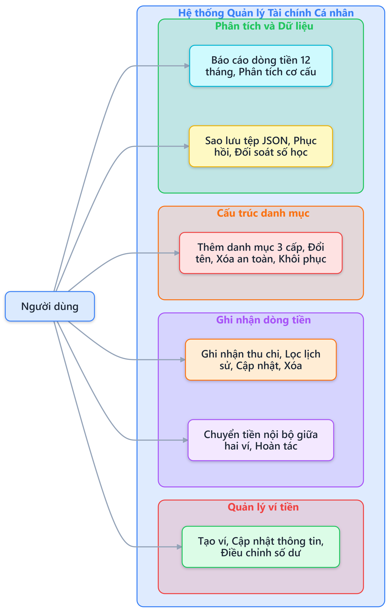
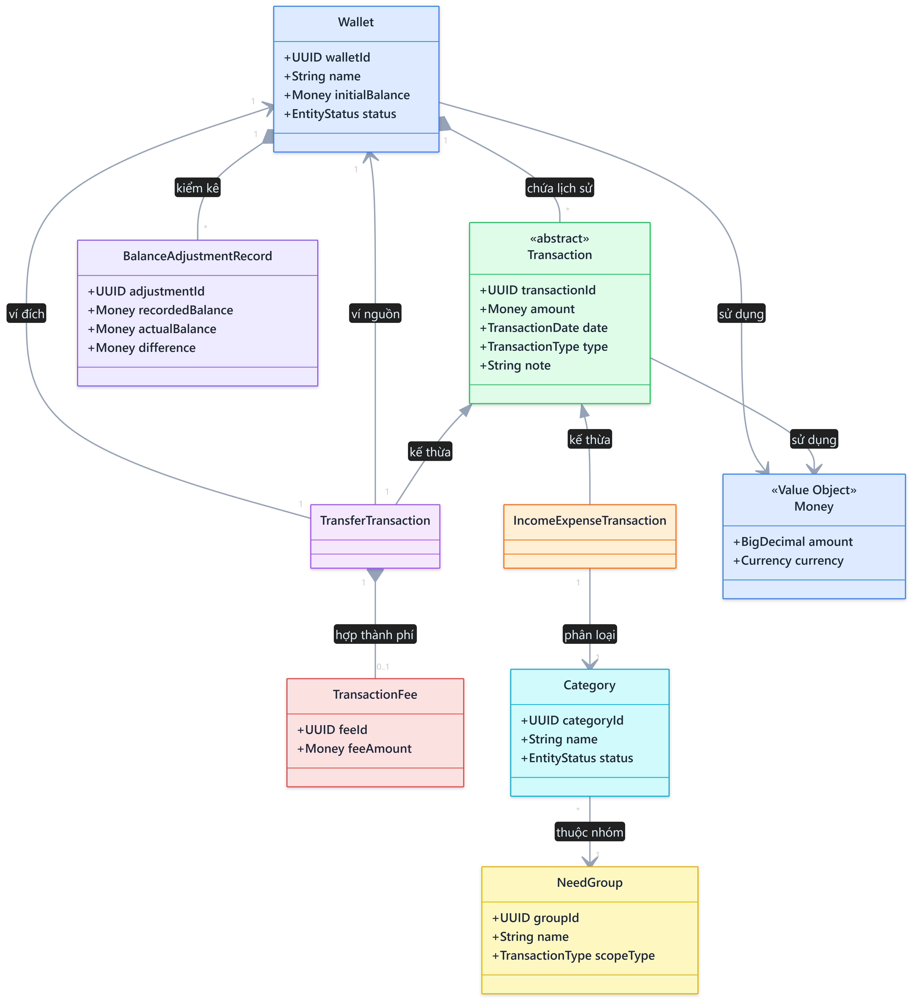
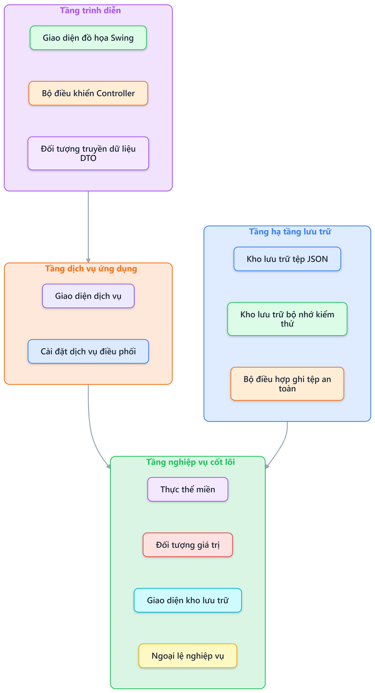
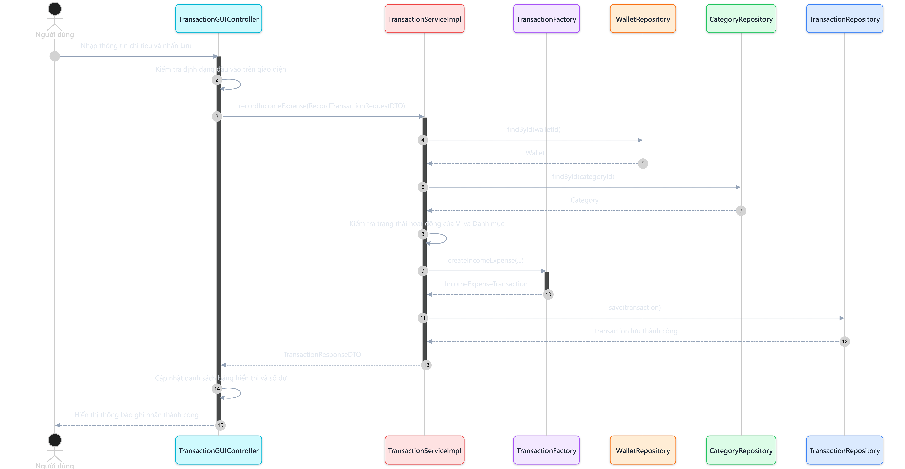
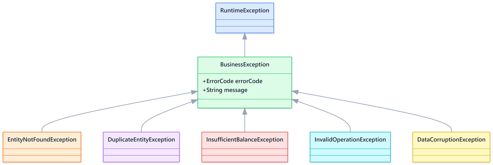
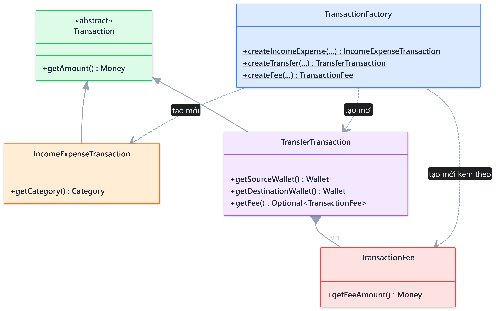
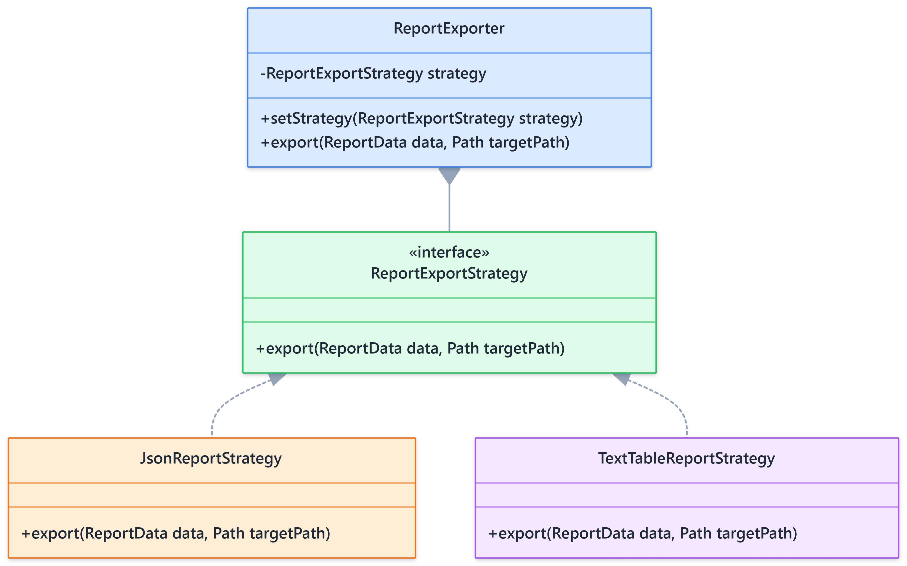

# Giới thiệu và yêu cầu phần mềm

## Bối cảnh và mục tiêu xây dựng hệ thống

Trong quản lý tài chính cá nhân và hộ gia đình, người dùng thường phân bổ dòng tiền trên nhiều kênh khác nhau như tài khoản ngân hàng, ví điện tử và tiền mặt. Việc theo dõi phân tán khiến việc kiểm soát chi tiêu, duy trì tỷ lệ tiết kiệm và lập kế hoạch tài chính dài hạn gặp nhiều khó khăn. Các phần mềm di động phổ biến hiện nay thường yêu cầu kết nối mạng liên tục, đồng bộ dữ liệu lên máy chủ đám mây của bên thứ ba, tiềm ẩn nguy cơ rò rỉ dữ liệu tài chính nhạy cảm hoặc phụ thuộc vào chính sách dịch vụ trực tuyến.

Hệ thống Quản lý Tài chính Cá nhân (PFMS) được xây dựng với mục tiêu cung cấp giải pháp máy tính để bàn vận hành hoàn toàn độc lập và cục bộ trên thiết bị người dùng. Hệ thống tập trung giải quyết các bài toán kỹ thuật trọng tâm:
- Bảo mật thông tin: Toàn bộ dữ liệu tài chính, nhật ký thu chi và thông tin ví được lưu trữ cục bộ, không gửi dữ liệu qua Internet.
- Kiểm soát dòng tiền chính xác: Mọi biến động số dư đều được tính toán từ các bản ghi giao dịch lịch sử, ngăn chặn hoàn toàn sai lệch số học.
- Hỗ trợ ra quyết định tài chính: Cung cấp mô hình phân loại đa tầng và các báo cáo phân tích trực quan về cơ cấu chi tiêu cũng như xu hướng dòng tiền thuần theo thời gian.

## Phạm vi hoạt động và ranh giới hệ thống

Hệ thống xác định rõ ranh giới chức năng và kỹ thuật nhằm tối ưu hóa tính tin cậy và sự tập trung vào nghiệp vụ cốt lõi:

Phạm vi trong hệ thống:
- Quản lý đa ví tiền và các loại tài sản tương đương tiền.
- Thiết lập cây danh mục phân loại thu chi 3 cấp theo mô hình chuẩn hóa.
- Ghi nhận, điều chỉnh, tra cứu và lọc các giao dịch thu chi.
- Chuyển tiền nội bộ hai chiều giữa các ví kèm chi phí phát sinh nếu có.
- Kết xuất báo cáo phân tích dòng tiền và cơ cấu chi tiêu theo khoảng thời gian tùy chọn.
- Sao lưu dữ liệu ra định dạng tệp có cấu trúc, phục hồi hệ thống và đối soát toàn vẹn số học.

Ranh giới ngoài hệ thống:
- Không kết nối trực tiếp cổng thanh toán trực tuyến hoặc các dịch vụ ngân hàng điện tử qua mạng viễn thông.
- Không tự động trích xuất nội dung tin nhắn biến động số dư hoặc liên kết giao dịch thẻ tín dụng tự động.
- Không tích hợp các thuật toán học máy hoặc trí tuệ nhân tạo để phán đoán thói quen chi tiêu mà dựa hoàn toàn vào dữ liệu thực tế do người dùng xác nhận.

## Các quy tắc nghiệp vụ tài chính cốt lõi

Hệ thống tuân thủ 5 quy tắc nghiệp vụ bất biến nhằm duy trì tính toàn vẹn và chuẩn mực trong tính toán tài chính:

1. Quy tắc độ chính xác số học tài chính:
Mọi số liệu tiền tệ trong hệ thống được quản lý thông qua kiểu dữ liệu có thang đo cố định 4 chữ số thập phân (`BigDecimal`). Hệ thống áp dụng quy tắc làm tròn nửa chẵn (Banker's Rounding, `RoundingMode.HALF_EVEN`) theo chuẩn quốc tế nhằm triệt tiêu độ lệch tích lũy khi tổng hợp dòng tiền. Hệ thống nghiêm cấm sử dụng các kiểu dữ liệu số thực dấu phẩy động cơ bản (`float`, `double`) trong mọi phép tính tài chính.

2. Quy tắc bảo toàn số dư ví:
Số dư của mỗi ví tại thời điểm bất kỳ là một đại lượng được bảo toàn và phải bằng đúng tổng số dư ban đầu cộng tổng các khoản thu nhập, trừ tổng các khoản chi tiêu, trừ tổng các khoản chuyển đi và cộng tổng các khoản chuyển đến. Mọi hành vi cập nhật số dư trực tiếp mà không thông qua bản ghi giao dịch đều bị từ chối. Khi người dùng thực hiện kiểm kê thực tế, phần chênh lệch phải được ghi nhận dưới dạng một bản ghi điều chỉnh số dư riêng biệt.

3. Quy tắc chuyển tiền nội bộ hai pha nguyên tử:
Giao dịch chuyển tiền giữa hai ví nội bộ phải tác động đồng thời lên cả hai ví: khấu trừ số tiền chuyển khỏi ví nguồn và cộng đúng số tiền đó vào ví đích trong cùng một ngữ cảnh giao dịch. Nếu phát sinh chi phí chuyển tiền, khoản phí này được trừ trực tiếp từ ví nguồn và được liên kết vòng đời chặt chẽ với giao dịch chuyển tiền gốc.

4. Quy tắc phân cấp danh mục thu chi 3 cấp:
Mọi khoản thu chi đều được định tuyến theo cấu trúc phân cấp gồm: Loại biến động tài chính (Thu nhập hoặc Chi phí), Nhóm nhu cầu (Nhu cầu thiết yếu, Nhu cầu linh hoạt, Tích lũy đầu tư) và Danh mục chi tiết (Ăn uống, Nhà ở, Học tập, Đi lại...). Cấu trúc này ngăn chặn việc phân loại tùy tiện và đảm bảo số liệu báo cáo luôn phản ánh đúng bản chất tài chính cá nhân.

5. Quy tắc chuẩn hóa và kiểm tra trùng lặp tên:
Tên của ví tiền, nhóm nhu cầu và danh mục chi tiết phải có độ dài từ 1 đến 50 ký tự, tự động loại bỏ các khoảng trắng thừa ở hai đầu. Trong cùng một phạm vi quản lý, hệ thống không cho phép tồn tại hai tên trùng nhau (không phân biệt chữ hoa và chữ thường).

## Nhóm chức năng chính của phần mềm

Các tính năng của hệ thống được tổ chức thành 6 phân hệ nghiệp vụ độc lập:

| Phân hệ chức năng | Mục tiêu nghiệp vụ | Danh sách tính năng thành phần |
| :--- | :--- | :--- |
| **Quản lý ví tiền** | Quản lý danh mục ví tài sản và giám sát số dư tức thời. | Tạo ví mới, cập nhật thông tin ví, xem tổng quan cơ cấu số dư, kiểm kê điều chỉnh số dư thực tế, quản lý trạng thái ví. |
| **Ghi nhận thu chi** | Theo dõi chi tiết mọi phát sinh dòng tiền vào và ra khỏi các ví. | Tạo giao dịch thu, tạo giao dịch chi, tra cứu và lọc giao dịch đa tiêu chí, chỉnh sửa thông tin giao dịch, xóa giao dịch an toàn. |
| **Chuyển tiền nội bộ** | Điều chuyển vốn giữa các ví tài khoản cá nhân. | Chuyển tiền giữa hai ví, ghi nhận chi phí phát sinh, tra cứu lịch sử chuyển tiền, xóa và hoàn tác giao dịch chuyển tiền. |
| **Danh mục phân loại** | Chuẩn hóa cây phân loại chi tiêu và thu nhập. | Khởi tạo danh mục mặc định, tạo danh mục tùy biến, đổi tên danh mục, xóa danh mục an toàn có kiểm tra ràng buộc toàn vẹn, khôi phục danh mục. |
| **Báo cáo và thống kê** | Phân tích sức khỏe tài chính và cấu trúc dòng tiền. | Báo cáo dòng tiền 12 tháng gần nhất, phân tích tỷ trọng chi tiêu theo nhóm và danh mục, tính tỷ lệ tiết kiệm ròng. |
| **Quản trị dữ liệu** | Đảm bảo tính an toàn, bền vững và đối soát dữ liệu. | Xuất toàn bộ dữ liệu ra tệp JSON, phục hồi dữ liệu từ bản sao lưu, kiểm tra đối soát tính đúng đắn và tính toàn vẹn số dư hệ thống. |

## Danh sách các ca sử dụng

Hệ thống thiết kế 20 ca sử dụng chuẩn hóa bao phủ toàn diện 6 nhóm chức năng, được mô tả tổng hợp trong bảng dưới đây:

| Mã ca sử dụng | Tên ca sử dụng | Phân hệ | Tác nhân chính | Mục tiêu tóm tắt |
| :--- | :--- | :--- | :--- | :--- |
| UC-WAL-01 | Tạo ví mới | Quản lý ví | Người dùng | Khởi tạo một ví tài chính mới với số dư ban đầu và đơn vị tiền tệ. |
| UC-WAL-02 | Xem tổng hợp số dư và cơ cấu ví | Quản lý ví | Người dùng | Hiển thị danh sách ví, số dư tính lại từ dòng tiền và tỷ trọng tài sản. |
| UC-WAL-03 | Cập nhật thông tin ví | Quản lý ví | Người dùng | Cập nhật tên ví, loại ví và ghi chú diễn giải. |
| UC-WAL-04 | Điều chỉnh số dư ví | Quản lý ví | Người dùng | Ghi nhận chênh lệch kiểm kê thực tế và cân bằng lại số dư ví. |
| UC-TXN-01 | Ghi nhận giao dịch thu chi | Ghi nhận thu chi | Người dùng | Lưu vết một khoản thu nhập hoặc chi tiêu vào ví chỉ định. |
| UC-TXN-02 | Tra cứu và lọc lịch sử giao dịch | Ghi nhận thu chi | Người dùng | Tìm kiếm giao dịch theo khoảng ngày, ví, danh mục hoặc từ khóa. |
| UC-TXN-03 | Chỉnh sửa giao dịch thu chi | Ghi nhận thu chi | Người dùng | Cập nhật số tiền, ngày, danh mục và tự động cân bằng lại số dư ví. |
| UC-TXN-04 | Xóa giao dịch thu chi | Ghi nhận thu chi | Người dùng | Hủy bản ghi giao dịch và hoàn trả số dư ví về trạng thái trước đó. |
| UC-TRF-01 | Chuyển tiền nội bộ giữa hai ví | Chuyển tiền | Người dùng | Điều chuyển tiền từ ví nguồn sang ví đích kèm phí giao dịch nếu có. |
| UC-TRF-02 | Tra cứu lịch sử chuyển tiền | Chuyển tiền | Người dùng | Xem danh sách các lần chuyển tiền và lọc theo ví nguồn hoặc ví đích. |
| UC-TRF-03 | Xóa giao dịch chuyển tiền | Chuyển tiền | Người dùng | Hoàn tác đồng thời số dư tại cả ví nguồn và ví đích về trạng thái gốc. |
| UC-CAT-01 | Bổ sung danh mục phân loại mới | Danh mục | Người dùng | Tạo thêm danh mục con thuộc nhóm nhu cầu tương ứng. |
| UC-CAT-02 | Đổi tên danh mục | Danh mục | Người dùng | Thay đổi tên hiển thị của danh mục mà không làm gián đoạn liên kết cũ. |
| UC-CAT-03 | Khôi phục danh mục đã xóa | Danh mục | Người dùng | Kích hoạt lại danh mục đã bị đánh dấu xóa mềm trước đó. |
| UC-CAT-04 | Xóa danh mục hoặc nhóm | Danh mục | Người dùng | Thực hiện xóa mềm danh mục khi không có ràng buộc dữ liệu hoạt động. |
| UC-REP-01 | Thống kê dòng tiền 12 tháng gần nhất | Báo cáo | Người dùng | Tính toán tổng thu, tổng chi và dòng tiền thuần của từng tháng. |
| UC-REP-02 | Phân tích cơ cấu thu chi | Báo cáo | Người dùng | Tính tỷ trọng phần trăm chi tiêu theo từng nhóm nhu cầu và danh mục. |
| UC-DAT-01 | Xuất dữ liệu tài chính | Quản trị dữ liệu | Người dùng | Trích xuất toàn bộ dữ liệu ra tệp lưu trữ JSON an toàn. |
| UC-DAT-02 | Phục hồi dữ liệu từ bản sao lưu | Quản trị dữ liệu | Người dùng | Đọc và kiểm định tệp JSON để nạp lại trạng thái hệ thống. |
| UC-DAT-03 | Kiểm tra lại dữ liệu hệ thống | Quản trị dữ liệu | Người dùng | Quét toàn bộ hệ thống để phát hiện các sai lệch số dư nếu có. |

Sơ đồ ca sử dụng tổng quan dưới đây thể hiện mối liên hệ giữa Người dùng và 6 nhóm tính năng của hệ thống:

{width=85%}

## Yêu cầu chất lượng và ràng buộc kỹ thuật

Hệ thống thiết lập các tiêu chí định lượng về chất lượng phần mềm:
- Độ chính xác số học: Dung sai tính toán số học bằng 0. Mọi phép toán nhân chia tỷ lệ đều tuân thủ làm tròn nửa chẵn với 4 chữ số thập phân trước khi chuyển về định dạng hiển thị.
- Hiệu năng phản hồi: Thời gian xử lý cho các tác vụ thêm mới, cập nhật hoặc tính toán lại số dư không vượt quá 200 mili-giây với quy mô dữ liệu cá nhân lên đến 50.000 bản ghi.
- Tính tin cậy và lưu trữ tệp: Quá trình lưu trữ tệp JSON áp dụng cơ chế ghi tệp nguyên tử qua tệp tạm trung gian, ngăn chặn hiện tượng hỏng tệp khi ứng dụng bị tắt đột ngột.
- Khả năng bảo trì: Mã nguồn tuân thủ triệt để tính đóng gói, phân tách giao diện và trừu tượng hóa, cho phép thay thế cơ chế lưu trữ mà không ảnh hưởng đến tầng nghiệp vụ.
- Môi trường vận hành: Ứng dụng chạy trên nền tảng Java 17 LTS, tương thích hoàn toàn trên các hệ điều hành Windows, macOS và Linux.

# Phân tích hướng đối tượng

## Mô hình khái niệm và các đối tượng nghiệp vụ

Trong giai đoạn phân tích hướng đối tượng, hệ thống phân tách rõ ràng giữa hai nhóm khái niệm căn bản của miền tài chính: Thực thể mang bản sắc định danh độc lập và Đối tượng giá trị đại diện cho các đại lượng đo lường bất biến.

Danh mục các lớp thực thể:
1. `Wallet`: Đại diện cho ví tài chính cá nhân. Mỗi ví có mã định danh duy nhất (UUID), tên ví, ghi chú, trạng thái ví mặc định, thời điểm tạo và trạng thái vòng đời.
2. `IncomeExpenseTransaction`: Đại diện cho giao dịch thu nhập hoặc chi tiêu diễn ra tại một ví xác định, được gán với một danh mục phân loại chi tiết.
3. `TransferTransaction`: Đại diện cho giao dịch điều chuyển tiền giữa hai ví nội bộ, ghi nhận ví nguồn, ví đích và chi phí chuyển tiền đi kèm nếu có.
4. `TransactionFee`: Đại diện cho khoản phí phát sinh khi thực hiện chuyển tiền. Lớp này có quan hệ hợp thành sinh tử với giao dịch chuyển tiền gốc.
5. `Category`: Đại diện cho danh mục phân loại chi tiết cấp 3 (ví dụ: Ăn uống, Tiền thuê nhà, Tiền lương).
6. `NeedGroup`: Đại diện cho nhóm nhu cầu tài chính cấp 2 (Nhu cầu thiết yếu, Nhu cầu linh hoạt, Tích lũy đầu tư), đóng vai trò phân tầng chi tiêu.
7. `BalanceAdjustmentRecord`: Đại diện cho bản ghi kiểm kê thực tế khi phát sinh chênh lệch số dư giữa sổ sách và tiền mặt thực tế.

Danh mục các đối tượng giá trị:
1. `Money`: Bọc đại lượng tiền tệ với độ chính xác cao bằng `BigDecimal` và mã tiền tệ chuẩn hóa (mặc định VND). Lớp này hoàn toàn bất biến và cung cấp các phép toán cộng, trừ, nhân tỷ lệ an toàn.
2. `TransactionDate`: Đóng gói thời điểm diễn ra biến động tài chính, đảm bảo ngày giao dịch hợp lệ theo định dạng chuẩn ISO-8601 và không vượt quá thời gian thực tế.
3. `TransactionType`: Kiểu liệt kê phân định rõ bản chất biến động tài chính: `INCOME` (Thu nhập), `EXPENSE` (Chi phí), `TRANSFER` (Chuyển tiền), `ADJUSTMENT` (Điều chỉnh số dư).
4. `NetCashFlow`: Giá trị đại số thể hiện dòng tiền thuần trong kỳ, tính bằng tổng thu nhập trừ tổng chi phí.
5. `SavingsRate`: Tỷ lệ phần trăm tiết kiệm được trên tổng thu nhập, phản ánh hiệu quả tích lũy tài chính.
6. `SpendingStructureShare`: Tỷ trọng chi tiêu của một nhóm hoặc danh mục cụ thể trên tổng chi tiêu toàn hệ thống.

Sơ đồ mô hình miền khái niệm dưới đây thể hiện mối quan hệ ngữ nghĩa giữa các thực thể và đối tượng giá trị:

{width=85%}

## Sơ đồ tương tác tuần tự cấp hệ thống

Sơ đồ tuần tự hệ thống mô tả cách người dùng gửi các thông điệp nghiệp vụ đến ranh giới hệ thống dạng hộp đen và nhận lại kết quả phản hồi.

Sơ đồ dưới đây minh họa luồng thực hiện thao tác chuyển tiền nội bộ giữa hai ví:

{width=85%}

## Ràng buộc thực hiện thao tác nghiệp vụ

Mọi biến động dữ liệu trong hệ thống đều được kiểm soát bằng các hợp đồng thao tác định rõ điều kiện tiền đề (Pre-conditions) và kết quả bảo đảm sau thực thi (Post-conditions).

Hai hợp đồng thao tác đại diện cho các ca sử dụng then chốt:

1. Hợp đồng thao tác ghi nhận thu chi (`recordIncomeExpense`):
- Điều kiện tiền đề: Ví tài chính được chọn phải tồn tại và đang ở trạng thái hoạt động (`ACTIVE`). Danh mục phân loại phải tồn tại, đang hoạt động và có loại biến động trùng khớp với loại giao dịch. Số tiền giao dịch phải là một số dương lớn hơn 0.
- Kết quả sau thực thi: Một thể hiện mới của `IncomeExpenseTransaction` được tạo lập và lưu trữ bền vững. Số dư tính toán của ví được cập nhật tương ứng (tăng lên nếu là khoản thu, giảm đi nếu là khoản chi). Sự kiện biến động dòng tiền được ghi nhận phục vụ báo cáo.

2. Hợp đồng thao tác chuyển tiền nội bộ (`transferFunds`):
- Điều kiện tiền đề: Ví nguồn và ví đích phải cùng tồn tại trong hệ thống, đang hoạt động và có mã định danh khác nhau. Số tiền chuyển và số tiền phí (nếu có) phải lớn hơn hoặc bằng 0. Số dư hiện tại của ví nguồn phải đủ để chi trả tổng số tiền chuyển và phí phát sinh.
- Kết quả sau thực thi: Một thể hiện `TransferTransaction` được tạo lập đồng thời với một thể hiện `TransactionFee` nếu có phí. Số dư ví nguồn giảm đi đúng bằng tổng số tiền chuyển và phí. Số dư ví đích tăng lên đúng bằng số tiền chuyển.

## Vòng đời và trạng thái của các thực thể

Hệ thống quản lý trạng thái của các thực thể thông qua các tập giá trị chuẩn mực nhằm bảo vệ tính toàn vẹn lịch sử:

| Thực thể | Các trạng thái hợp lệ | Quy tắc chuyển đổi và bảo toàn dữ liệu |
| :--- | :--- | :--- |
| **Ví tiền** | Đang hoạt động (`ACTIVE`), Lưu trữ (`ARCHIVED`), Đã xóa (`DELETED`). | Ví mới tạo luôn ở trạng thái hoạt động. Người dùng có thể chuyển sang trạng thái lưu trữ khi không còn sử dụng thường xuyên. Thao tác xóa ví áp dụng cơ chế xóa mềm; ví chỉ được xóa khi toàn bộ giao dịch liên quan đã được xử lý hoặc xác nhận hủy. |
| **Danh mục** | Đang hoạt động (`ACTIVE`), Đã xóa (`DELETED`). | Danh mục chỉ được xóa mềm khi không còn bất kỳ giao dịch nào đang tham chiếu tới. Nếu người dùng muốn sử dụng lại một danh mục đã xóa, hệ thống hỗ trợ khôi phục về trạng thái hoạt động mà không làm mất lịch sử cũ. |
| **Giao dịch** | Đã ghi nhận (`RECORDED`), Đã hủy (`VOIDED`). | Giao dịch tài chính là bản ghi bất biến sau khi hoàn tất. Khi người dùng thực hiện xóa giao dịch, hệ thống không xóa vật lý ngay lập tức mà chuyển trạng thái sang đã hủy, đồng thời kích hoạt quy trình hoàn tác số dư đối soát an toàn. |

## Phân định trách nhiệm giữa các thành phần

Hệ thống sử dụng kỹ thuật phân tích Robustness theo mô hình Ranh giới, Điều khiển và Thực thể kết hợp thẻ CRC để phân định rõ vai trò của từng cấu phần:

- Lớp ranh giới: Đón nhận tương tác từ người dùng, thực hiện kiểm tra sơ bộ định dạng dữ liệu đầu vào và hiển thị thông điệp phản hồi (ví dụ: `TransactionFormBoundary`, `WalletOverviewBoundary`).
- Lớp điều khiển: Chứa logic phối hợp luồng nghiệp vụ, kiểm tra các ràng buộc tài chính và điều phối các thực thể miền (ví dụ: `TransactionCoordinator`, `TransferManager`).
- Lớp thực thể: Chứa đựng dữ liệu nghiệp vụ và các phương thức nghiệp vụ nội tại độc lập với giao diện (ví dụ: `Wallet`, `Transaction`, `Category`).

Bảng phân bổ trách nhiệm theo thẻ CRC cho các thành phần cốt lõi:

| Lớp thành phần | Trách nhiệm chính | Thành phần cộng tác |
| :--- | :--- | :--- |
| `Wallet` | Quản lý số dư khả dụng, thẩm định khả năng chi trả, duy trì trạng thái hoạt động và cung cấp thông tin định danh. | `Money`, `Transaction` |
| `IncomeExpenseTransaction` | Cung cấp thông tin số tiền, ngày phát sinh, liên kết ví và danh mục phân loại. | `Wallet`, `Category`, `Money` |
| `TransferTransaction` | Gắn kết hai ví nội bộ, quản lý chi phí phát sinh và đảm bảo tính cân đối hai đầu chuyển. | `Wallet`, `TransactionFee`, `Money` |
| `Category` | Định danh phân loại chi tiêu, kiểm soát tính hợp lệ theo nhóm nhu cầu. | `NeedGroup` |
| `TransactionService` | Điều phối tiếp nhận yêu cầu, gọi kiểm tra nghiệp vụ, lưu trữ giao dịch và thông báo biến động. | `TransactionRepository`, `WalletRepository`, `TransactionFactory` |

# Thiết kế kiến trúc và mô hình lớp

## Mô hình kiến trúc phân tầng

Hệ thống Quản lý Tài chính Cá nhân áp dụng mô hình kiến trúc phân tầng hướng tâm gồm 4 tầng phân định rõ ranh giới trách nhiệm, bảo đảm nguyên tắc phụ thuộc một chiều từ ngoài vào trong:

{width=85%}

Trách nhiệm cụ thể của từng tầng:
- Tầng Trình diễn (`com.pfms.presentation`): Chịu trách nhiệm hiển thị dữ liệu trực quan qua các bảng biểu đồ họa, thu nhận thao tác người dùng, đóng gói dữ liệu vào các DTO và chuyển tiếp cho tầng dịch vụ xử lý. Tầng này không chứa logic tính toán tài chính.
- Tầng Dịch vụ ứng dụng (`com.pfms.service`): Đóng vai trò nhạc trưởng điều phối các ca sử dụng, kiểm tra tính hợp lệ của tham số, quản lý giao dịch nghiệp vụ và chuyển đổi giữa DTO và thực thể miền.
- Tầng Nghiệp vụ cốt lõi (`com.pfms.domain`): Trái tim của hệ thống, chứa toàn bộ quy tắc nghiệp vụ tài chính, định nghĩa cấu trúc dữ liệu thực thể, đối tượng giá trị và giao diện kho lưu trữ. Tầng này hoàn toàn độc lập, không phụ thuộc vào bất kỳ thư viện giao diện hay công nghệ lưu trữ cụ thể nào.
- Tầng Hạ tầng (`com.pfms.infrastructure`): Cung cấp cài đặt cụ thể cho các giao diện kho lưu trữ được định nghĩa ở tầng miền, đảm bảo lưu trữ tệp bền vững hoặc cung cấp bộ lưu trữ tạm thời trong bộ nhớ phục vụ kiểm thử.

## Thiết kế chi tiết các lớp dữ liệu và thực thể

Hệ thống vận dụng sâu sắc các nguyên lý hướng đối tượng trong thiết kế lớp nhằm bảo vệ tối đa tính bao gói và tính toàn vẹn dữ liệu:

1. Tính bao gói dữ liệu và đối tượng giá trị bất biến:
Mọi thuộc tính của các lớp thực thể và đối tượng giá trị đều được khai báo với phạm vi truy cập `private`. Các đối tượng giá trị như `Money` và `TransactionDate` được thiết kế bất biến hoàn toàn (`immutable`), không cung cấp bất kỳ phương thức sửa đổi trạng thái nào sau khi khởi tạo. Mọi phép toán số học như cộng hoặc trừ tiền tệ đều tạo ra và trả về một thể hiện `Money` hoàn toàn mới, triệt tiêu nguy cơ phát sinh tác dụng phụ (side-effects).

2. Kế thừa và đa hình trong phân cấp giao dịch:
Lớp trừu tượng `Transaction` đóng vai trò lớp cha định nghĩa các thuộc tính chung gồm mã định danh, số tiền, ngày giao dịch, loại giao dịch và ghi chú. Hai lớp con cụ thể gồm `IncomeExpenseTransaction` (bổ sung thuộc tính danh mục phân loại) và `TransferTransaction` (bổ sung liên kết ví nguồn và ví đích). Thiết kế này cho phép tầng lưu trữ và các giải thuật tính toán báo cáo xử lý tập hợp các giao dịch thông qua kiểu tham chiếu lớp cha mà không cần quan tâm đến chi tiết riêng biệt của từng loại.

3. Quan hệ hợp thành trong quản lý chi phí:
Khoản phí giao dịch (`TransactionFee`) được thiết kế theo quan hệ hợp thành với `TransferTransaction`. Bản ghi phí không thể tồn tại độc lập mà gắn liền sinh tử với giao dịch chuyển tiền gốc. Khi một giao dịch chuyển tiền bị xóa hoặc hoàn tác, bản ghi chi phí đi kèm cũng được tự động xử lý đồng bộ.

## Thiết kế các dịch vụ xử lý nghiệp vụ

Tầng dịch vụ ứng dụng được phân rã thành 6 giao diện chuyên biệt, đảm bảo tính gắn kết cao và tuân thủ nguyên lý phân tách giao diện:

| Giao diện dịch vụ | Lớp cài đặt chính | Chức năng điều phối trọng tâm |
| :--- | :--- | :--- |
| `WalletService` | `WalletServiceImpl` | Quản lý vòng đời ví, điều phối kiểm kê điều chỉnh số dư, tổng hợp số dư thực tế tính toán từ toàn bộ dòng tiền lịch sử. |
| `TransactionService` | `TransactionServiceImpl` | Xử lý ghi nhận thu chi, thực hiện tìm kiếm và lọc giao dịch đa tiêu chí, điều phối cập nhật và xóa giao dịch an toàn. |
| `TransferService` | `TransferServiceImpl` | Điều phối chuyển tiền nguyên tử hai pha giữa hai ví, tính toán chi phí, xử lý hoàn tác giao dịch chuyển tiền. |
| `CategoryService` | `CategoryServiceImpl` | Quản trị cây danh mục 3 cấp, kiểm tra ràng buộc toàn vẹn trước khi cho phép xóa mềm hoặc khôi phục danh mục. |
| `ReportService` | `ReportServiceImpl` | Tổng hợp dòng tiền 12 tháng, phân tích cơ cấu chi tiêu theo nhóm và danh mục, tính toán các chỉ số sức khỏe tài chính. |
| `DataManagementService` | `DataManagementServiceImpl` | Xuất toàn bộ dữ liệu ra tệp JSON, kiểm định và nạp dữ liệu từ bản sao lưu, thực hiện đối soát toàn diện tính toàn vẹn số học. |

## Thiết kế cơ chế lưu trữ và truy xuất dữ liệu

Tầng lưu trữ được thiết kế dựa trên mẫu Repository kết hợp kỹ thuật lập trình tổng quát với Generics:

1. Giao diện lưu trữ cơ sở tổng quát:
Giao diện `GenericRepository<E, ID>` định nghĩa các phương thức thao tác dữ liệu chuẩn mực: `save(E entity)`, `findById(ID id)`, `findAll()`, `deleteById(ID id)` và `existsById(ID id)`. Việc sử dụng Generics giúp loại bỏ việc viết lặp lại các thao tác cơ bản cho từng thực thể.

2. Các giao diện kho lưu trữ nghiệp vụ chuyên biệt:
Từ giao diện cơ sở, hệ thống mở rộng thành 5 giao diện chuyên biệt bổ sung các phương thức nghiệp vụ: `WalletRepository` (tìm kiếm theo tên ví), `TransactionRepository` (tìm kiếm theo khoảng thời gian, lọc theo ví hoặc danh mục), `CategoryRepository` (tìm kiếm theo tên và nhóm nhu cầu), `BalanceAdjustmentRepository` (lọc theo ví và khoảng ngày) và `BackupRepository` (quản lý xuất nhập dữ liệu toàn phần).

3. Đa cơ chế cài đặt hạ tầng:
Hệ thống cung cấp hai nhóm lớp cài đặt:
- Cài đặt tệp bền vững (`JsonWalletRepository`, `JsonTransactionRepository`...): Đọc và ghi dữ liệu ra tệp định dạng JSON trên ổ đĩa. Quá trình ghi tệp áp dụng kỹ thuật ghi nguyên tử: dữ liệu được ghi vào một tệp tạm thời `.tmp`, sau khi hoàn tất thành công mới tiến hành đổi tên đè lên tệp chính. Kỹ thuật này bảo đảm tệp dữ liệu không bao giờ bị hỏng dù xảy ra sự cố mất điện đột ngột trong khi ghi.
- Cài đặt bộ nhớ tạm thời (`MemoryWalletRepository`, `MemoryTransactionRepository`...): Lưu trữ các đối tượng trực tiếp trong `ConcurrentHashMap`, hỗ trợ thực thi nhanh toàn bộ bộ kiểm thử tự động với tốc độ tính bằng mili-giây mà không bị nghẽn vào ra ổ đĩa.

## Sơ đồ tương tác chi tiết giữa các đối tượng

Sơ đồ tuần tự thiết kế dưới đây thể hiện quy trình phối hợp chi tiết giữa các tầng khi người dùng thực hiện ghi nhận một khoản chi tiêu mới:

{width=85%}

## Cơ chế kiểm soát lỗi và ngoại lệ

Hệ thống xây dựng một cây phân cấp ngoại lệ nghiệp vụ có cấu trúc chặt chẽ, kế thừa trực tiếp từ lớp ngoại lệ cơ sở `BusinessException` (thuộc nhóm `RuntimeException`):

{width=85%}

Ý nghĩa và ngữ cảnh ném lỗi của từng lớp ngoại lệ:
- `EntityNotFoundException`: Ném ra khi tra cứu một thực thể (ví, danh mục, giao dịch) theo mã định danh nhưng không tìm thấy trong kho dữ liệu.
- `DuplicateEntityException`: Ném ra khi người dùng cố gắng tạo ví hoặc danh mục có tên đã tồn tại trong cùng phạm vi quản lý.
- `InsufficientBalanceException`: Ném ra khi ví nguồn không có đủ số dư khả dụng để trang trải số tiền chuyển cùng phí phát sinh.
- `InvalidOperationException`: Ném ra khi vi phạm các quy tắc nghiệp vụ về trạng thái, ví dụ cố gắng ghi nhận giao dịch vào một ví đang bị đóng băng hoặc xóa một danh mục đang có giao dịch phát sinh.
- `DataCorruptionException`: Ném ra trong quá trình đối soát dữ liệu hoặc nạp tệp sao lưu nếu phát hiện cấu trúc tệp JSON sai lệch hoặc số liệu số dư không khớp với tổng dòng tiền lịch sử.

Mỗi ngoại lệ đều đi kèm một mã lỗi chuẩn hóa (`ErrorCode`) định dạng rõ ràng, cho phép tầng trình diễn tự động chuyển dịch sang các thông điệp cảnh báo thân thiện với người dùng cuối mà không làm lộ các chi tiết kỹ thuật nội bộ của hệ thống.

# Cài đặt phần mềm và áp dụng mẫu thiết kế

## Áp dụng năm nguyên lý thiết kế hướng đối tượng

Hệ thống Quản lý Tài chính Cá nhân áp dụng trọn vẹn 5 nguyên lý SOLID trên các lớp và giao diện thực tế của dự án, bảo đảm tính gắn kết cao và độ ghép nối lỏng:

| Nguyên lý thiết kế | Nội dung nguyên lý | Minh chứng cài đặt trong hệ thống PFMS |
| :--- | :--- | :--- |
| **Đơn trách nhiệm** (SRP) | Mỗi lớp chỉ đảm nhiệm một lý do duy nhất để thay đổi; phân định rõ giữa quy tắc nghiệp vụ, điều phối và lưu trữ tệp. | Hệ thống phân tách độc lập giữa: thực thể `Wallet` (chịu trách nhiệm về quy tắc và tính toán số dư nội tại), dịch vụ `WalletServiceImpl` (điều phối luồng ca sử dụng) và kho lưu trữ `WalletRepository` (xử lý lưu đọc tệp). Thay đổi về định dạng tệp JSON hoàn toàn không ảnh hưởng đến thực thể `Wallet`. |
| **Đóng mở** (OCP) | Mở rộng cho việc bổ sung hành vi mới nhưng đóng trước việc sửa đổi mã nguồn sẵn có. | Lớp trừu tượng `Transaction` đóng vai trò khung cơ sở cho hai lớp con `IncomeExpenseTransaction` và `TransferTransaction`. Khi hệ thống cần bổ sung loại giao dịch mới (như giao dịch đầu tư tài chính), lập trình viên chỉ cần tạo thêm lớp con mới kế thừa `Transaction` mà không phải sửa đổi mã nguồn lớp cha hay cấu trúc điều phối của tầng dịch vụ. |
| **Thay thế Liskov** (LSP) | Các đối tượng lớp con có thể thay thế hoàn toàn cho đối tượng lớp cha mà không làm sai lệch tính đúng đắn của chương trình. | `IncomeExpenseTransaction` và `TransferTransaction` có thể thay thế hoàn toàn cho `Transaction` trong phương thức lưu trữ `TransactionRepository.save(Transaction)` cũng như trong các giải thuật trích xuất ngày và tính toán dòng tiền của `ReportServiceImpl` mà không gây ra bất kỳ lỗi hành vi nào. |
| **Phân tách giao diện** (ISP) | Không ép buộc các thành phần phụ thuộc vào các giao diện chứa phương thức mà chúng không có nhu cầu sử dụng. | Thay vì xây dựng một giao diện dịch vụ khổng lồ duy nhất, hệ thống chia nhỏ thành 6 giao diện dịch vụ độc lập: `WalletService`, `TransactionService`, `TransferService`, `CategoryService`, `ReportService`, `DataManagementService`. Mỗi Controller tầng trình diễn chỉ phụ thuộc vào đúng giao diện cần dùng (ví dụ: `WalletGUIController` chỉ phụ thuộc `WalletService`). |
| **Nghịch đảo phụ thuộc** (DIP) | Mô đun cấp cao không phụ thuộc mô đun cấp thấp; cả hai cùng phụ thuộc vào sự trừu tượng hóa. | Tầng dịch vụ (`WalletServiceImpl`) không phụ thuộc trực tiếp vào lớp đọc ghi tệp cụ thể `JsonWalletRepository` mà phụ thuộc vào giao diện trừu tượng `WalletRepository`. Cài đặt cụ thể được tiêm qua hàm khởi tạo, cho phép dễ dàng hoán đổi sang `MemoryWalletRepository` để chạy kiểm thử tự động tốc độ cao. |

Hệ thống duy trì điểm cân bằng kỹ thuật thực tế nhằm tránh thiết kế quá mức:
- Sử dụng cơ chế tiêm phụ thuộc thủ công thuần Java tại điểm khởi động chương trình (`Main`), không đưa các khung công nghệ nặng như Spring Framework vào ứng dụng máy tính để bàn cục bộ.
- Tái sử dụng giao diện kho lưu trữ cơ sở `GenericRepository<E, ID>` để chuẩn hóa các thao tác cơ bản, chỉ khai báo thêm các phương thức nghiệp vụ thực sự cần thiết theo từng ca sử dụng.

## Cài đặt các mẫu thiết kế kinh điển

Hệ thống chọn lọc và cài đặt 4 mẫu thiết kế hướng đối tượng cốt lõi thuộc nhóm mẫu thiết kế kinh điển GoF nhằm chuẩn hóa quá trình tạo lập đối tượng, đóng gói thuật toán xuất dữ liệu, quản lý trạng thái và ghi nhận vết kiểm toán:

### Mẫu phương thức nhà máy trong khởi tạo giao dịch

Lớp `TransactionFactory` được định vị tại tầng nghiệp vụ (`com.pfms.domain.model`) nhằm đóng gói toàn bộ quy trình tiếp nhận tham số, phân định đa hình và khởi tạo đúng loại giao dịch:

{width=85%}

Lợi ích kỹ thuật:
- Đóng gói trọn vẹn quy trình tạo lập giao dịch phức tạp kèm chi phí hợp thành sinh tử.
- Giải phóng các lớp dịch vụ `TransactionServiceImpl` và `TransferServiceImpl` khỏi việc gọi trực tiếp lệnh `new` cho từng lớp con, giúp tầng dịch vụ không bị phụ thuộc vào chi tiết cài đặt của các lớp cụ thể.

### Mẫu chiến lược trong xuất báo cáo tài chính

Hệ thống sử dụng mẫu thiết kế Chiến lược để đóng gói các thuật toán định dạng và xuất báo cáo tài chính ra nhiều định dạng khác nhau:

{width=85%}

Lợi ích kỹ thuật:
- Giao diện `ReportExportStrategy` định nghĩa phương thức xuất dữ liệu chuẩn mực `export(ReportData data, Path targetPath)`.
- Hai chiến lược cài đặt gồm `JsonReportStrategy` (kết xuất tệp cấu trúc JSON phục vụ lưu trữ trao đổi) và `TextTableReportStrategy` (kết xuất báo cáo bảng văn bản định dạng bảng ASCII phục vụ in ấn hoặc đọc nhanh).
- Lớp ngữ cảnh `ReportExporter` cho phép tráo đổi linh hoạt định dạng xuất tại thời điểm thực thi dựa trên lựa chọn của người dùng tại giao diện mà không phải sửa đổi mã nguồn điều phối.

### Mẫu trạng thái trong quản lý vòng đời thực thể

Thực thể Ví tiền (`Wallet`) đóng vai trò ngữ cảnh áp dụng mẫu thiết kế Trạng thái để kiểm soát vòng đời và hành vi biến động số dư. Cấu trúc lớp gồm giao diện `WalletState` và 3 lớp trạng thái cụ thể:
- `ActiveWalletState`: Trạng thái hoạt động, tiếp nhận bình thường mọi biến động dòng tiền gồm nạp tiền (`credit`), chi tiêu (`debit`), chuyển tiền và cho phép chuyển sang trạng thái lưu trữ hoặc xóa.
- `ArchivedWalletState`: Trạng thái lưu trữ, số dư vẫn được tính vào tổng tài sản nhưng từ chối mọi giao dịch thu chi hoặc điều chuyển tiền mới. Trạng thái này chỉ cho phép thao tác kích hoạt lại (`activate`).
- `DeletedWalletState`: Trạng thái đã xóa, từ chối mọi biến động số dư và thao tác chuyển đổi trạng thái.

Việc đóng gói hành vi vào các lớp trạng thái giúp loại bỏ hoàn toàn các khối lệnh rẽ nhánh điều kiện lặp lại `if-else` trong các phương thức của `Wallet`.

### Mẫu người quan sát trong theo dõi biến động dữ liệu

Hệ thống áp dụng mẫu thiết kế Người quan sát để xử lý các tác vụ phụ trợ sau khi một giao dịch tài chính hoàn tất mà không làm thắt chặt khớp nối trong tầng dịch vụ:
- Nguồn phát sự kiện: Lớp `TransactionServiceImpl` phối hợp cùng bộ điều phối `TransactionEventPublisher` đóng vai trò là chủ thể phát sự kiện.
- Giao diện người quan sát: Giao diện `TransactionEventListener` định nghĩa phương thức tiếp nhận sự kiện `onTransactionCreated(TransactionCreatedEvent event)`.
- Các bộ lắng nghe cụ thể: `WalletBalanceUpdateListener` (cập nhật số dư tức thời lên ví liên quan theo quy tắc bảo toàn) và `AuditLogEventListener` (ghi nhận vết kiểm toán vào nhật ký hệ thống phục vụ đối soát).
- Đối tượng sự kiện: `TransactionCreatedEvent` đóng gói bất biến thông tin mã giao dịch, số tiền và mốc thời gian.

Cơ chế này giúp tầng dịch vụ chỉ tập trung vào việc hạch toán giao dịch chính mà không bị phụ thuộc vào các phân hệ ghi nhật ký hay kiểm toán bên ngoài.

## Xử lý tính toán tài chính chính xác và cấu trúc dữ liệu

Trong lập trình tài chính, độ chính xác số học là yếu tố sống còn. Hệ thống thiết lập các chuẩn mực kỹ thuật nghiêm ngặt trong mã nguồn:

1. Xử lý số học tài chính chuẩn mực với `BigDecimal`:
Toàn bộ các phép tính tiền tệ trong lớp `Money` và các lớp dịch vụ đều sử dụng `BigDecimal` được khởi tạo từ chuỗi ký tự (`String`) hoặc số nguyên, tuyệt đối không khởi tạo từ số thực `double` để tránh sai số biểu diễn nhị phân. Các phép toán chia tỷ lệ và tính tỷ trọng đều chỉ định rõ thang đo 4 chữ số thập phân và áp dụng quy tắc làm tròn nửa chẵn (`RoundingMode.HALF_EVEN`), triệt tiêu hoàn toàn sai số làm tròn tích lũy.

2. Bảo vệ cấu trúc dữ liệu với Collections không thể sửa đổi:
Khi các thực thể hoặc lớp dịch vụ trả về danh sách tập hợp các giao dịch hoặc danh mục, hệ thống luôn bọc kết quả thông qua `Collections.unmodifiableList(...)` hoặc sao chép phòng thủ. Kỹ thuật này ngăn chặn các thành phần bên ngoài can thiệp làm biến đổi trực tiếp danh sách dữ liệu nội bộ của thực thể, bảo vệ tính toàn vẹn của mô hình hướng đối tượng.

3. Kiểm tra tiền điều kiện với lớp tiện ích `Preconditions`:
Hệ thống xây dựng lớp tiện ích tập trung `Preconditions` để thẩm định dữ liệu đầu vào ngay tại cửa ngõ của các hàm khởi tạo và phương thức dịch vụ:
- `requireNonBlank(String text, String message)`: Đảm bảo chuỗi ký tự không rỗng và không chỉ chứa khoảng trắng.
- `requirePositive(BigDecimal amount, String message)`: Đảm bảo số tiền phát sinh phải lớn hơn 0.
- `requireNonNegative(BigDecimal amount, String message)`: Đảm bảo số dư ban đầu không được âm.
- `requireValidDateRange(LocalDate from, LocalDate to)`: Đảm bảo ngày bắt đầu không được sau ngày kết thúc.
Các kiểm tra này giúp hệ thống phát hiện và ngăn chặn dữ liệu không hợp lệ từ sớm (Fail-fast principle).

# Kiểm thử, vận hành và đánh giá kết quả

## Chiến lược kiểm thử tự động

Hệ thống Quản lý Tài chính Cá nhân áp dụng chiến lược kiểm thử tự động toàn diện với khung kiểm thử JUnit 5, kết hợp chặt chẽ với phương pháp phát triển hướng kiểm thử TDD:

1. Kiểm thử đơn vị cô lập:
Mọi thực thể nghiệp vụ và đối tượng giá trị đều được bao phủ bởi các bài kiểm thử đơn vị độc lập. Lớp `MoneyTest` kiểm tra toàn diện các phép toán cộng, trừ, nhân tỷ lệ, làm tròn nửa chẵn và so sánh tiền tệ. Lớp `WalletTest` kiểm tra việc khởi tạo, bảo toàn số dư và tính toán số dư mới khi có biến động.

2. Kiểm thử giá trị biên và ràng buộc dữ liệu:
Hệ thống thiết kế các ca kiểm thử chuyên biệt để rà soát hành vi tại các điểm giới hạn: số tiền giao dịch bằng 0, số tiền giao dịch cực đại (lên đến hàng trăm tỷ đồng mà không bị tràn số), độ dài tên ví và tên danh mục tại đúng các mốc biên 1 ký tự và 50 ký tự, chuỗi ký tự chứa khoảng trắng hoặc ký tự đặc biệt.

3. Kiểm thử chuyển trạng thái thực thể:
Các bài kiểm thử trạng thái thẩm định việc chuyển đổi giữa các trạng thái `ACTIVE`, `ARCHIVED` và `DELETED`, bảo đảm hệ thống từ chối các thao tác sai ngữ cảnh (ví dụ: không cho phép ghi nhận giao dịch vào ví đã lưu trữ hoặc không cho phép xóa danh mục khi đang có giao dịch tham chiếu).

4. Kiểm thử tầng dịch vụ độc lập với bộ nhớ tạm:
Bằng cách sử dụng các kho lưu trữ trong bộ nhớ (`MemoryWalletRepository`, `MemoryTransactionRepository`...), toàn bộ các ca sử dụng phức tạp của tầng dịch vụ được kiểm thử với đầy đủ các kịch bản thành công và ngoại lệ mà không phải phụ thuộc vào việc đọc ghi tệp vật lý trên đĩa.

## Kết quả kiểm thử thực tế trên hệ thống

Quá trình xây dựng và kiểm thử hệ thống được tự động hóa hoàn toàn thông qua công cụ Apache Maven. Kết quả thực thi thực tế của bộ kiểm thử trên toàn bộ dự án:

```text
-------------------------------------------------------
 T E S T S
-------------------------------------------------------
Results:

Tests run: 2288, Failures: 0, Errors: 0, Skipped: 0

------------------------------------------------------------------------
BUILD SUCCESS
------------------------------------------------------------------------
Total time:  18.062 s
```

Bảng phân bổ các ca kiểm thử theo từng phân hệ kiến trúc:

| Phân hệ mã nguồn | Số lượng ca kiểm thử | Tỷ lệ thành công | Trọng tâm kiểm thử |
| :--- | :--- | :--- | :--- |
| **Thực thể và Đối tượng giá trị** (`domain.model`) | 522 tests | 100% (522/522) | Độ chính xác số học `Money`, tính bất biến, quy tắc nghiệp vụ nội tại của `Wallet`, `Transaction`, `Category`. |
| **Ngoại lệ và Tiện ích** (`domain.exception`, `common.util`) | 121 tests | 100% (121/121) | Các điều kiện ném lỗi của `Preconditions`, ánh xạ mã lỗi và kiểm tra định dạng dữ liệu. |
| **Tầng Dịch vụ ứng dụng** (`service.impl`) | 360 tests | 100% (360/360) | Điều phối nghiệp vụ, chuyển tiền nguyên tử hai pha, tính toán báo cáo dòng tiền, kiểm kê số dư và kiểm tra ràng buộc toàn vẹn. |
| **Tầng Hạ tầng lưu trữ** (`infrastructure`) | 218 tests | 100% (218/218) | Cơ chế đọc ghi tệp JSON, an toàn tệp qua cơ chế ghi nguyên tử, đối soát tệp sao lưu. |
| **Tầng Trình diễn và Điều khiển** (`presentation`) | 1.067 tests | 100% (1067/1067) | Khởi tạo giao diện đồ họa Swing, kiểm tra biến đổi DTO, bộ điều khiển sự kiện và các chiến lược xuất báo cáo. |
| **Tổng cộng toàn hệ thống** | **2.288 tests** | **100%** | **Hệ thống đạt trạng thái không lỗi (0 failures, 0 errors, 0 skipped).** |

## Giao diện ứng dụng và kịch bản vận hành

Hệ thống xây dựng giao diện đồ họa người dùng bằng Java Swing, tuân thủ mô hình kiến trúc Model-View-Presenter (MVP) và tổ chức mã nguồn theo tính năng (Package-by-Feature):

Cấu trúc giao diện người dùng:
- Màn hình Tổng quan Ví: Bảng thống kê danh sách ví tài khoản, hiển thị số dư tính lại từ dòng tiền lịch sử, nút tạo ví mới, cập nhật ví và hộp thoại kiểm kê điều chỉnh số dư.
- Màn hình Ghi nhận Giao dịch: Form nhập liệu thu chi với danh mục thả xuống theo nhóm nhu cầu, bảng lịch sử giao dịch hỗ trợ lọc tức thời theo ví, khoảng thời gian và từ khóa.
- Màn hình Chuyển tiền nội bộ: Form điều chuyển tiền giữa hai ví, tính năng tính phí chuyển tiền tùy chọn, bảng lịch sử chuyển tiền và nút hoàn tác giao dịch.
- Màn hình Quản lý Danh mục: Cây danh mục 3 cấp trực quan cho phép thêm mới danh mục con, đổi tên danh mục và xóa an toàn có cảnh báo ràng buộc dữ liệu.
- Màn hình Báo cáo và Thống kê: Bảng tổng hợp dòng tiền thuần 12 tháng, cơ cấu chi tiêu theo nhóm nhu cầu và nút xuất báo cáo ra tệp JSON hoặc bảng văn bản in ấn.
- Màn hình Quản trị Dữ liệu: Tính năng xuất bản sao lưu hệ thống ra tệp JSON, nạp phục hồi từ bản sao lưu và nút bấm kiểm tra đối soát toàn vẹn số học.

Kịch bản vận hành trình diễn hệ thống qua 6 bước:
1. Bước 1: Khởi động ứng dụng từ màn hình chính. Người dùng kiểm tra ví mặc định "Tiền mặt" (khởi điểm 0 VND) và tạo thêm "Ví Ngân hàng". Người dùng ghi nhận khoản thu nhập đầu kỳ 5.000.000 VND vào ví tiền mặt và 10.000.000 VND vào ví ngân hàng để hình thành số dư hoạt động ban đầu theo đúng quy tắc bảo toàn số dư.
2. Bước 2: Truy cập phân hệ Danh mục, kiểm tra các danh mục chuẩn đã được nạp sẵn. Người dùng tạo thêm danh mục con "Cà phê sáng" thuộc nhóm "Nhu cầu linh hoạt".
3. Bước 3: Truy cập phân hệ Giao dịch, ghi nhận một khoản chi tiêu 45.000 VND cho danh mục "Cà phê sáng" từ "Ví Tiền mặt". Hệ thống ghi nhận thành công, số dư "Ví Tiền mặt" tự động cập nhật về 4.955.000 VND.
4. Bước 4: Truy cập phân hệ Chuyển tiền, thực hiện chuyển 2.000.000 VND từ "Ví Ngân hàng" sang "Ví Tiền mặt" với chi phí chuyển tiền là 1.100 VND. Hệ thống khấu trừ 2.001.100 VND tại ví ngân hàng và cộng đúng 2.000.000 VND vào ví tiền mặt.
5. Bước 5: Truy cập phân hệ Báo cáo, xem biểu bảng dòng tiền và cơ cấu chi tiêu trong tháng hiện tại. Người dùng nhấn nút xuất báo cáo ra tệp bảng văn bản để lưu trữ.
6. Bước 6: Truy cập phân hệ Quản trị dữ liệu, xuất toàn bộ dữ liệu ra tệp sao lưu JSON an toàn và chạy chức năng đối soát số học. Hệ thống thông báo toàn bộ dữ liệu được bảo toàn nguyên vẹn với 0 sai lệch.

## Đánh giá kết quả đạt được và hướng phát triển

Đánh giá kết quả đạt được:
- Hệ thống hoàn thành 100% mục tiêu ban đầu của đề tài môn học, đáp ứng đầy đủ 20 ca sử dụng chuẩn hóa trải đều trên 6 phân hệ nghiệp vụ.
- Thiết kế hướng đối tượng chặt chẽ, tuân thủ xuất sắc 5 nguyên lý SOLID và áp dụng hiệu quả 4 mẫu thiết kế GoF kinh điển.
- Toàn bộ các phép tính tiền tệ được bảo vệ bằng kiểu dữ liệu có độ chính xác cao `BigDecimal` và quy tắc làm tròn nửa chẵn, triệt tiêu hoàn toàn sai số tích lũy.
- Chất lượng phần mềm được kiểm chứng định lượng bằng 2.288 bài kiểm thử tự động với tỷ lệ vượt qua tuyệt đối 100%.

Giới hạn kỹ thuật hiện tại:
- Ứng dụng vận hành dưới dạng phần mềm máy tính để bàn cục bộ đơn người dùng, chưa hỗ trợ đồng bộ hóa dữ liệu trực tuyến qua mạng giữa nhiều thiết bị khác nhau.
- Cơ chế lưu trữ sử dụng tệp JSON phẳng, phù hợp tối ưu cho dữ liệu cá nhân (dưới 100.000 bản ghi) nhưng chưa khai thác các hệ quản trị cơ sở dữ liệu quan hệ cho các bài toán quy mô lớn.

Hướng phát triển trong tương lai:
- Bổ sung biểu đồ trực quan động và nâng cao trải nghiệm người dùng với các giao diện hiện đại hơn.
- Mở rộng hỗ trợ tính năng quản lý danh mục đầu tư tài chính sinh lời và đa tiền tệ với bảng tỷ giá quy đổi linh hoạt.
- Đóng gói ứng dụng thành tệp cài đặt độc lập cho từng hệ điều hành máy trạm.

# Tài liệu tham khảo

1. Bloch, J. (2018). *Effective Java* (3rd ed.). Addison-Wesley Professional.
2. Cockburn, A. (2001). *Writing Effective Use Cases*. Addison-Wesley Professional.
3. Evans, E. (2003). *Domain-Driven Design: Tackling Complexity in the Heart of Software*. Addison-Wesley.
4. Fowler, M. (2002). *Patterns of Enterprise Application Architecture*. Addison-Wesley Professional.
5. Gamma, E., Helm, R., Johnson, R., & Vlissides, J. (1994). *Design Patterns: Elements of Reusable Object-Oriented Software*. Addison-Wesley.
6. IEEE/ISO/IEC. (2018). *ISO/IEC/IEEE 29148:2018 Systems and software engineering: Life cycle processes: Requirements engineering*. IEEE.
7. Larman, C. (2004). *Applying UML and Patterns: An Introduction to Object-Oriented Analysis and Design and Iterative Development* (3rd ed.). Prentice Hall.
8. Martin, R. C. (2018). *Clean Architecture: A Craftsman's Guide to Software Structure and Design*. Prentice Hall.
