# BÁO CÁO MILESTONE 3: UML & OBJECT-ORIENTED DESIGN (OOD)
## HỆ THỐNG QUẢN LÝ TÀI CHÍNH CÁ NHÂN (PFMS)

**Nhóm 3:**
- Ứng Trọng Trình — B24DCCE271
- Nguyễn Đinh Anh Quân — B24DCCE222
- Lê Anh Minh — B24DCCE180
- Nguyễn Đình Tiến — B24DCCE264

**Tham chiếu tài liệu nền tảng:**
- Báo cáo Phân tích Đối tượng (Milestone 2): `docs/milestones/milestone-2-ooa.md`
- Đặc tả Yêu cầu & Use Cases: `docs/requirement and use cases/req-uc.md`
- Mô hình dữ liệu nguồn: `docs/finance-mng.xlsm` & `docs/finance-mng-description.md`
- Chuẩn đánh giá môn học: `docs/assignment-requirement.pdf` (Rubric 100 điểm)

---

## 1. Kiến Trúc Tổng Thể & Chiến Lược Thiết Kế

Hệ thống được thiết kế theo mô hình **Kiến trúc Phân tầng (Layered Architecture)** kết hợp các nguyên lý của **Domain-Driven Design (DDD)** và **SOLID Principles**:
1. **Presentation Layer (JavaFX):** Chịu trách nhiệm hiển thị giao diện (FXML) và tiếp nhận tương tác của người dùng. Các Controller chỉ điều phối tương tác, không chứa logic tính toán tài chính.
2. **Application / Service Layer:** Đóng gói các Use Case của hệ thống, điều phối các Entity trong Domain để hoàn thành luồng nghiệp vụ phức tạp (ví dụ: chuyển tiền nguyên tử giữa 2 ví, chốt sổ tài sản cuối tháng).
3. **Domain Layer (Lõi Nghiệp Vụ - Rich Domain Model):** Chứa các Entity, Value Object, Enums và Business Rules cốt lõi. Tầng này hoàn toàn độc lập với Framework, UI và Database.
4. **Infrastructure Layer:** Cài đặt các cổng kết nối lưu trữ (Repository Implementations dùng H2 Database hoặc File I/O), tuân thủ nguyên lý **Dependency Inversion Principle (DIP)**.

Theo đúng **Quyết định Thiết kế #2 (Phương án 2)** đã được phê duyệt, hệ thống được trực quan hóa bằng 2 sơ đồ UML chuyên biệt:
- **Sơ đồ 1:** *Core Domain Model Class Diagram* (Mô hình đối tượng và quan hệ nghiệp vụ).
- **Sơ đồ 2:** *Layered Architecture & Design Patterns Diagram* (Kiến trúc phân tầng và các mẫu thiết kế).

---

## 2. Sơ Đồ 1 — Core Domain Model Class Diagram

Sơ đồ thể hiện chi tiết các thực thể nghiệp vụ, cây kế thừa Bounded Hierarchies (Quyết định #1: Phương án B), các Value Objects, Enums và mối quan hệ cấu thành giữa chúng:

```mermaid
classDiagram
    direction TB

    %% =======================
    %% DOMAIN INTERFACES
    %% =======================
    class WalletImpactable {
        <<interface>>
        +applyImpact(WalletAccountBook book) void
    }

    class ValuableAsset {
        <<interface>>
        +getCurrentValue() Money
        +getAssetName() String
        +getAssetType() AssetType
    }

    %% =======================
    %% VALUE OBJECTS & ENUMS
    %% =======================
    class Money {
        <<value object>>
        -BigDecimal amount
        -Currency currency
        +add(Money other) Money
        +subtract(Money other) Money
        +multiply(BigDecimal factor) Money
        +isGreaterThan(Money other) boolean
        +isPositive() boolean
        +getAmount() BigDecimal
    }

    class TermPeriod {
        <<value object>>
        -int days
        -String displayName
        +getDays() int
        +isUnlimited() boolean
    }

    class InterestRate {
        <<value object>>
        -BigDecimal annualRate
        +getAnnualRate() BigDecimal
        +toDecimal() BigDecimal
    }

    class TransactionType {
        <<enumeration>>
        INCOME
        EXPENSE
    }

    class DebtType {
        <<enumeration>>
        LEND
        BORROW
        COLLECT
        REPAY
        WRITE_OFF_LEND
        WRITE_OFF_BORROW
    }

    class FundCertType {
        <<enumeration>>
        STOCK
        BOND
        BALANCE
    }

    class GoalFundType {
        <<enumeration>>
        EMERGENCY
        HEALTH
        TARGET
        RETIREMENT
    }

    %% =======================
    %% CORE ENTITIES
    %% =======================
    class Wallet {
        -UUID id
        -String name
        -Money currentBalance
        -LocalDateTime createdAt
        +credit(Money amount) void
        +debit(Money amount) void
        +getCurrentValue() Money
        +getAssetType() AssetType
        +getId() UUID
        +getName() String
        +getCurrentBalance() Money
    }

    class BaseTransaction {
        <<abstract>>
        #UUID id
        #LocalDate transactionDate
        #Money amount
        #Wallet wallet
        #Category category
        #String note
        +applyImpact(WalletAccountBook book)* void
        +getTransactionType()* TransactionType
        +getId() UUID
        +getAmount() Money
        +getTransactionDate() LocalDate
        +getWallet() Wallet
        +getCategory() Category
    }

    class IncomeTransaction {
        +applyImpact(WalletAccountBook book) void
        +getTransactionType() TransactionType
    }

    class ExpenseTransaction {
        +applyImpact(WalletAccountBook book) void
        +getTransactionType() TransactionType
    }

    class Transfer {
        -UUID id
        -LocalDate transferDate
        -Money amount
        -Wallet sourceWallet
        -Wallet destinationWallet
        -String note
        +applyImpact(WalletAccountBook book) void
        +getId() UUID
        +getAmount() Money
        +getSourceWallet() Wallet
        +getDestinationWallet() Wallet
    }

    class CategoryGroup {
        -UUID id
        -String groupName
        -TransactionType groupType
        -List~Category~ categories
        +addCategory(String categoryName) Category
        +removeCategory(Category category) void
        +getCategories() List~Category~
        +getGroupName() String
        +getGroupType() TransactionType
    }

    class Category {
        -UUID id
        -String categoryName
        -CategoryGroup group
        +getId() UUID
        +getCategoryName() String
        +getGroup() CategoryGroup
        +matchesType(TransactionType type) boolean
    }

    %% =======================
    %% DEFERRED ENTITIES
    %% =======================
    class DebtOperation {
        <<abstract>>
        #UUID id
        #String batchId
        #String person
        #LocalDate date
        #Money amount
        #Wallet wallet
        #String note
        +applyImpact(WalletAccountBook book)* void
        +applyDebtLedger(DebtLedger ledger)* void
        +getDebtType()* DebtType
        +getId() UUID
        +getPerson() String
        +getAmount() Money
        +getBatchId() String
    }

    class LendOperation {
        +applyImpact(WalletAccountBook book) void
        +applyDebtLedger(DebtLedger ledger) void
        +getDebtType() DebtType
    }

    class BorrowOperation {
        +applyImpact(WalletAccountBook book) void
        +applyDebtLedger(DebtLedger ledger) void
        +getDebtType() DebtType
    }

    class CollectOperation {
        +applyImpact(WalletAccountBook book) void
        +applyDebtLedger(DebtLedger ledger) void
        +getDebtType() DebtType
    }

    class RepayOperation {
        +applyImpact(WalletAccountBook book) void
        +applyDebtLedger(DebtLedger ledger) void
        +getDebtType() DebtType
    }

    class WriteOffLendOperation {
        +applyImpact(WalletAccountBook book) void
        +applyDebtLedger(DebtLedger ledger) void
        +getDebtType() DebtType
    }

    class WriteOffBorrowOperation {
        +applyImpact(WalletAccountBook book) void
        +applyDebtLedger(DebtLedger ledger) void
        +getDebtType() DebtType
    }

    class SavingBook {
        -UUID id
        -GoalFund goalFund
        -Money principal
        -TermPeriod termPeriod
        -InterestRate annualRate
        -LocalDate startDate
        +calculateAccruedInterest(LocalDate asOfDate) Money
        +calculateTermProgress(LocalDate asOfDate) BigDecimal
        +getCurrentValue() Money
        +getAssetType() AssetType
        +getPrincipal() Money
        +getStartDate() LocalDate
    }

    class FundCertificate {
        -UUID id
        -GoalFund goalFund
        -String fundName
        -FundCertType certType
        -Money principal
        -Money currentMarketValue
        -LocalDate purchaseDate
        +calculateInterest() Money
        +calculateAnnualizedReturn(LocalDate asOfDate) BigDecimal
        +getCurrentValue() Money
        +getAssetType() AssetType
        +getPrincipal() Money
    }

    class GoalFund {
        -UUID id
        -GoalFundType fundType
        -Money targetAmount
        -AllocatedCash allocatedCash
        -List~SavingBook~ savings
        -List~FundCertificate~ fundCertificates
        +calculateTotalValue() Money
        +calculateCompletionProgress() BigDecimal
        +addSavingBook(SavingBook book) void
        +addFundCertificate(FundCertificate cert) void
        +getAllocatedCash() AllocatedCash
        +getTargetAmount() Money
    }

    class AllocatedCash {
        -UUID id
        -Money amount
        -GoalFund goalFund
        +getAmount() Money
        +setAmount(Money amount) void
    }

    class MonthlySnapshot {
        -UUID id
        -YearMonth snapshotMonth
        -Money totalAssets
        -Money totalSavings
        -Money totalInvestments
        -Money totalReceivable
        -Money totalPayable
        -LocalDateTime frozenAt
        +getSnapshotMonth() YearMonth
        +getTotalAssets() Money
    }

    %% =======================
    %% RELATIONSHIPS & INHERITANCE
    %% =======================
    ValuableAsset <|.. Wallet : implements
    ValuableAsset <|.. SavingBook : implements
    ValuableAsset <|.. FundCertificate : implements

    WalletImpactable <|.. BaseTransaction : implements
    WalletImpactable <|.. Transfer : implements
    WalletImpactable <|.. DebtOperation : implements

    BaseTransaction <|-- IncomeTransaction : extends
    BaseTransaction <|-- ExpenseTransaction : extends

    DebtOperation <|-- LendOperation : extends
    DebtOperation <|-- BorrowOperation : extends
    DebtOperation <|-- CollectOperation : extends
    DebtOperation <|-- RepayOperation : extends
    DebtOperation <|-- WriteOffLendOperation : extends
    DebtOperation <|-- WriteOffBorrowOperation : extends

    CategoryGroup *-- "1..*" Category : composition
    GoalFund *-- "1" AllocatedCash : composition

    GoalFund o-- "0..*" SavingBook : aggregation
    GoalFund o-- "0..*" FundCertificate : aggregation

    BaseTransaction --> "1" Wallet : records to
    BaseTransaction --> "1" Category : classified by
    Transfer --> "1" Wallet : sourceWallet
    Transfer --> "1" Wallet : destinationWallet
    DebtOperation --> "0..1" Wallet : affects wallet

    Wallet ..> Money : uses
    BaseTransaction ..> Money : uses
    Transfer ..> Money : uses
    SavingBook ..> Money : uses
    SavingBook ..> TermPeriod : uses
    SavingBook ..> InterestRate : uses
    FundCertificate ..> Money : uses
    GoalFund ..> Money : uses
```



---

## 3. Sơ Đồ 2 — Layered Architecture & Design Patterns Diagram

Sơ đồ thể hiện cấu trúc phân tầng nghiêm ngặt (Presentation $\rightarrow$ Service $\rightarrow$ Domain $\rightarrow$ Repository Interface $\rightarrow$ Infrastructure) và tích hợp 3 Design Patterns then chốt (**Strategy**, **Factory**, **Observer**):

```mermaid
classDiagram
    direction TB

    %% =======================
    %% 1. PRESENTATION LAYER
    %% =======================
    namespace PresentationLayer {
        class DashboardViewController {
            -DashboardService dashboardService
            -WalletBalanceSubject balanceSubject
            +initialize() void
            +refreshDashboard() void
            +onBalanceChanged(Wallet wallet) void
        }

        class TransactionViewController {
            -TransactionService transactionService
            -WalletService walletService
            +handleAddTransaction() void
            +handleFilter() void
        }

        class TransferViewController {
            -TransferService transferService
            +handleTransfer() void
        }
    }

    %% =======================
    %% 2. APPLICATION / SERVICE LAYER
    %% =======================
    namespace ServiceLayer {
        class DashboardService {
            -WalletRepository walletRepo
            -SavingRepository savingRepo
            -FundCertRepository fundCertRepo
            -DebtRepository debtRepo
            +calculateTotalAssets() Money
            +getMonthlyCashFlowStat(YearMonth month) CashFlowDTO
            +getAssetAllocation() Map~AssetType, BigDecimal~
        }

        class TransferService {
            -WalletRepository walletRepo
            -TransferRepository transferRepo
            -WalletBalanceSubject balanceSubject
            +executeTransfer(UUID fromId, UUID toId, Money amount, String note) void
        }

        class TransactionService {
            -TransactionRepository txnRepo
            -WalletRepository walletRepo
            -TransactionFactory txnFactory
            -WalletBalanceSubject balanceSubject
            +createTransaction(TransactionDTO dto) BaseTransaction
            +deleteTransaction(UUID txnId) void
        }

        class DebtService {
            -DebtRepository debtRepo
            -WalletRepository walletRepo
            -DebtOperationFactory debtFactory
            -WalletBalanceSubject balanceSubject
            +recordDebtOperation(DebtDTO dto) DebtOperation
            +calculateNetReceivable() Money
            +calculateNetPayable() Money
        }
    }

    %% =======================
    %% 3. DESIGN PATTERNS: STRATEGY, FACTORY, OBSERVER
    %% =======================
    namespace DesignPatterns {
        %% Strategy Pattern
        class InterestCalculationStrategy {
            <<interface>>
            +calculateInterest(Money principal, InterestRate rate, int elapsedDays, TermPeriod term) Money
        }

        class TermDepositStrategy {
            +calculateInterest(Money principal, InterestRate rate, int elapsedDays, TermPeriod term) Money
        }

        class DemandDepositStrategy {
            +calculateInterest(Money principal, InterestRate rate, int elapsedDays, TermPeriod term) Money
        }

        InterestCalculationStrategy <|.. TermDepositStrategy : implements
        InterestCalculationStrategy <|.. DemandDepositStrategy : implements

        %% Factory Pattern
        class TransactionFactory {
            +create(TransactionType type, UUID id, LocalDate date, Money amount, Wallet wallet, Category category, String note) BaseTransaction
        }

        class DebtOperationFactory {
            +create(DebtType type, UUID id, String batch, String person, LocalDate date, Money amount, Wallet wallet, String note) DebtOperation
        }

        %% Observer Pattern
        class BalanceChangeListener {
            <<interface>>
            +onBalanceChanged(Wallet updatedWallet) void
        }

        class WalletBalanceSubject {
            -List~BalanceChangeListener~ listeners
            +registerListener(BalanceChangeListener listener) void
            +removeListener(BalanceChangeListener listener) void
            +notifyBalanceChanged(Wallet updatedWallet) void
        }
    }

    %% =======================
    %% 4. REPOSITORY INTERFACES (DOMAIN ABSTRACTION - DIP)
    %% =======================
    namespace DomainRepositories {
        class WalletRepository {
            <<interface>>
            +findById(UUID id) Optional~Wallet~
            +findAll() List~Wallet~
            +save(Wallet wallet) Wallet
        }

        class TransactionRepository {
            <<interface>>
            +save(BaseTransaction txn) BaseTransaction
            +findByDateRange(LocalDate from, LocalDate to) List~BaseTransaction~
            +findAll() List~BaseTransaction~
        }

        class DebtRepository {
            <<interface>>
            +save(DebtOperation op) DebtOperation
            +findAll() List~DebtOperation~
            +findByPerson(String person) List~DebtOperation~
        }
    }

    %% =======================
    %% 5. INFRASTRUCTURE LAYER (IMPLEMENTATION)
    %% =======================
    namespace InfrastructureLayer {
        class H2WalletRepository {
            -ConnectionPool connectionPool
            +findById(UUID id) Optional~Wallet~
            +findAll() List~Wallet~
            +save(Wallet wallet) Wallet
        }

        class H2TransactionRepository {
            -ConnectionPool connectionPool
            +save(BaseTransaction txn) BaseTransaction
            +findByDateRange(LocalDate from, LocalDate to) List~BaseTransaction~
            +findAll() List~BaseTransaction~
        }
    }

    %% =======================
    %% CROSS-LAYER INTERACTIONS
    %% =======================
    DashboardViewController --> DashboardService : calls
    DashboardViewController ..|> BalanceChangeListener : implements
    TransactionViewController --> TransactionService : calls
    TransferViewController --> TransferService : calls

    TransactionService --> TransactionFactory : uses
    TransactionService --> TransactionRepository : depends on
    TransactionService --> WalletRepository : depends on
    TransactionService --> WalletBalanceSubject : notifies

    TransferService --> WalletRepository : depends on
    TransferService --> WalletBalanceSubject : notifies

    DebtService --> DebtOperationFactory : uses
    DebtService --> DebtRepository : depends on
    DebtService --> WalletBalanceSubject : notifies

    DashboardService --> WalletRepository : depends on

    WalletBalanceSubject o-- "0..*" BalanceChangeListener : manages

    WalletRepository <|.. H2WalletRepository : implements
    TransactionRepository <|.. H2TransactionRepository : implements
```

---

## 4. Phân Tích Chuyên Sâu Các Mối Quan Hệ Hướng Đối Tượng

Nhằm đáp ứng điểm tuyệt đối cho tiêu chí **Association/Composition (10đ)** và **Inheritance & Polymorphism (10đ)** trong Rubric, phần này luận giải chi tiết cơ sở thiết kế của từng loại quan hệ:

### 4.1 Quan hệ Kế thừa & Đa hình (Inheritance & Polymorphism)
1. **Phân cấp `BaseTransaction`:**
   - Lớp trừu tượng `BaseTransaction` đóng vai trò khuôn mẫu cho mọi giao dịch dòng tiền thu/chi.
   - Hai lớp con cụ thể `IncomeTransaction` và `ExpenseTransaction` ghi đè phương thức trừu tượng `applyImpact(WalletAccountBook)`.
   - **Tính Đa hình:** Khi người dùng thực hiện một giao dịch, service layer chỉ cần gọi `txn.applyImpact(book)`. Trình thông dịch Java tại thời điểm chạy (runtime) sẽ tự động kích hoạt logic nạp tiền (`credit`) hoặc rút tiền (`debit`) tương ứng mà service không cần dùng cấu trúc `switch-case` hay `if (type == INCOME)`. Điều này tuân thủ triệt để nguyên lý **Open/Closed Principle (OCP)**.
2. **Phân cấp `DebtOperation`:**
   - 6 lớp con (`Lend`, `Borrow`, `Collect`, `Repay`, `WriteOffLend`, `WriteOffBorrow`) kế thừa `DebtOperation`.
   - Mỗi lớp cài đặt cách thức tác động khác nhau lên sổ công nợ (`receivable`, `payable`) và ví tiền mặt (`wallet`).
3. **Đa hình Tài sản thông qua Interface `ValuableAsset`:**
   - `Wallet`, `SavingBook`, `FundCertificate` đều cài đặt giao diện `ValuableAsset`.
   - Trong `DashboardService`, thuật toán tính tổng tài sản được viết ngắn gọn bằng đa hình:
     ```java
     Money totalAssets = assets.stream()
         .map(ValuableAsset::getCurrentValue)
         .reduce(Money.ZERO, Money::add);
     ```

### 4.2 Phân định Rạch Ròi: Composition vs Aggregation vs Association

| Cặp Quan Hệ | Loại Quan Hệ UML | Ký Hiệu | Bản Chất Quyền Sở Hữu (Ownership) & Vòng Đời (Lifecycle) | Luận Điểm Bảo Vệ Trước Giảng Viên |
|---|---|:---:|---|---|
| `CategoryGroup` *-- `Category` | **Composition** | $\blacklozenge$ | **Sở hữu sống còn (Strong Ownership).** Danh mục con không thể tồn tại độc lập nếu nhóm danh mục bị xóa. Một Category chỉ thuộc về đúng 1 Group. | Trong nghiệp vụ tài chính, mọi danh mục đều gắn với một nhóm chi tiêu (ví dụ: `groceries` bắt buộc thuộc `essentials`). Nếu xóa nhóm, danh mục con không còn ý nghĩa phân loại. |
| `GoalFund` *-- `AllocatedCash` | **Composition** | $\blacklozenge$ | **Sở hữu sống còn (Strong Ownership).** Bản ghi tiền mặt phân bổ (`funds_cash`) chỉ sinh ra và mất đi cùng với sự tồn tại của một quỹ mục tiêu. | Một hạn mức tiền mặt dự phòng không thể tồn tại "trôi nổi" nếu không thuộc về quỹ mục tiêu cụ thể nào (như Quỹ khẩn cấp hay Quỹ sức khỏe). |
| `GoalFund` o-- `SavingBook` | **Aggregation** | $\lozenge$ | **Chứa đựng lỏng lẻo (Weak Ownership).** Sổ tiết kiệm tồn tại độc lập trong danh mục tài sản của người dùng. Một GoalFund chỉ "liên kết" sổ tiết kiệm đó vào để theo dõi tiến độ. | Nếu giải tán một Quỹ mục tiêu (`GoalFund`), sổ tiết kiệm ngân hàng của người dùng vẫn tồn tại nguyên vẹn và tiền trong sổ không bị mất đi. |
| `GoalFund` o-- `FundCertificate` | **Aggregation** | $\lozenge$ | **Chứa đựng lỏng lẻo (Weak Ownership).** Tương tự sổ tiết kiệm, chứng chỉ quỹ là tài sản đầu tư độc lập, chỉ được gán vào quỹ để thống kê. | Giống như trên: chứng chỉ quỹ tồn tại độc lập với mục tiêu tài chính của cá nhân. |
| `BaseTransaction` --> `Wallet` | **Association** | $\rightarrow$ | **Liên kết sử dụng (Referential Association).** Giao dịch thu/chi tham chiếu tới 1 ví cụ thể để ghi nhận dòng tiền. | Nhiều giao dịch cùng liên kết tới 1 ví; giao dịch không sở hữu ví và không quyết định vòng đời của ví. |
| `Transfer` --> `Wallet` | **Association** | $\rightarrow$ | **Liên kết sử dụng đôi (Dual Association).** Chuyển khoản tham chiếu tới 2 ví (`sourceWallet` và `destinationWallet`). | Một transfer liên kết 2 ví khác nhau; nếu transfer bị xóa thì 2 ví vẫn tồn tại. |

---

## 5. Hiện Thực Hóa 3 Design Patterns Trọng Tâm

Nhằm thỏa mãn tiêu chí **SOLID/Design Patterns (10đ)**, hệ thống áp dụng các mẫu thiết kế hướng tới giải quyết đúng vấn đề kỹ thuật:

### 5.1 Strategy Pattern (Chiến Lược Tính Lãi Suất Sổ Tiết Kiệm)
- **Vấn đề:** Sổ tiết kiệm có 2 cơ chế tính lãi hoàn toàn khác biệt:
  - *Tiết kiệm có kỳ hạn:* Tính theo ngày gửi thực tế trên tổng số ngày kỳ hạn (`elapsedDays / termDays`).
  - *Tiết kiệm không kỳ hạn:* Tính theo lãi đơn từng ngày (`capital * rate / 365`).
- **Giải pháp:** Tách thuật toán tính lãi ra khỏi lớp `SavingBook` thông qua interface `InterestCalculationStrategy`. Khi khởi tạo sổ tiết kiệm, đối tượng Strategy tương ứng sẽ được tiêm vào (Dependency Injection).
- **Lợi ích OOP:** Lớp `SavingBook` không bị phình to bởi các câu lệnh `if-else` kiểm tra loại kỳ hạn; khi ngân hàng ra mắt hình thức gửi tích lũy mới, chỉ cần thêm 1 class cài đặt `InterestCalculationStrategy` mà không cần sửa 1 dòng code nào trong `SavingBook` (**Open/Closed Principle**).

### 5.2 Factory Pattern (Khởi Tạo Giao Dịch & Nghiệp Vụ Công Nợ)
- **Vấn đề:** Giao diện người dùng nhập dữ liệu hoặc module Import file Excel chỉ đọc được các chuỗi văn bản thô (`type = "income"`, `type = "lend"`). Nếu để GUI trực tiếp `new IncomeTransaction()` hay `new LendOperation()` sẽ làm rò rỉ logic tạo đối tượng và tăng coupling giữa tầng View và Model.
- **Giải pháp:** Sử dụng `TransactionFactory` và `DebtOperationFactory`. Các Factory này đóng gói toàn bộ logic kiểm tra tham số, thẩm định dữ liệu hợp lệ và khởi tạo đúng thực thể con tương ứng.
- **Lợi ích OOP:** Che giấu chi tiết khởi tạo phức tạp, tập trung hóa logic validation và đảm bảo tính nhất quán của dữ liệu trước khi đi vào Domain.

### 5.3 Observer Pattern (Cơ Chế Đồng Bộ Số Dư Lên Giao Diện)
- **Vấn đề:** Trong ứng dụng Desktop JavaFX, khi một giao dịch thu/chi hoặc chuyển khoản hoàn thành, số dư ví thay đổi. Làm thế nào để `DashboardView` (biểu đồ tròn tài sản, bảng thống kê) và `WalletListView` đồng thời cập nhật tức thời mà không để `TransactionService` phải giữ tham chiếu trực tiếp đến các Controller giao diện?
- **Giải pháp:** Áp dụng Observer Pattern với Subject là `WalletBalanceSubject` và Observer là interface `BalanceChangeListener`. Các Controller tự đăng ký lắng nghe sự kiện biến động số dư khi khởi tạo.
- **Lợi ích OOP:** **Loose Coupling** tuyệt đối giữa Service và UI. Tầng Service phát tín hiệu sự kiện mà không hề biết hay quan tâm có bao nhiêu màn hình đang hiển thị dữ liệu đó.

---

## 6. Bảng Đối Chiếu Chuẩn Đánh Giá Rubric 100 Điểm

| Tiêu Chí Chấm Điểm | Trọng Số | Vị Trí Thể Hiện Trong Thiết Kế OOA & OOD | Minh Chứng Cụ Thể |
|---|:---:|---|---|
| **1. Problem Analysis & Requirements** | **10đ** | Toàn bộ Milestone 1 (`req-uc.md`) & Phần 1–2 của Milestone 2 (`milestone-2-ooa.md`). | Phân tích 15 Use Cases đầy đủ Format A, ~40 FRs, ~30 NFRs, bảng Noun-Verb analysis. |
| **2. UML & Object Modeling** | **10đ** | Sơ đồ 1 (Core Domain Model) & Sơ đồ 2 (Layered Architecture). | 2 sơ đồ Mermaid chi tiết, đầy đủ fields, methods, quan hệ chuẩn UML. |
| **3. Encapsulation & Class Design** | **10đ** | Thiết kế của `Wallet`, `BaseTransaction`, `SavingBook`, `Money`. | 100% thuộc tính là `private`/`protected`; che giấu dữ liệu; Value Objects bất biến (`Money`, `InterestRate`). |
| **4. Association / Composition** | **10đ** | Sơ đồ 1 và Bảng phân tích chi tiết mục 4.2. | Phân định rạch ròi Composition ($\blacklozenge$) cho Category/AllocatedCash và Aggregation ($\lozenge$) cho GoalFund/SavingBook. |
| **5. Inheritance & Polymorphism** | **10đ** | Cây kế thừa `BaseTransaction`, `DebtOperation` và interface `ValuableAsset`. | Đa hình phương thức `applyImpact()` và `getCurrentValue()` không cần `switch-case`. |
| **6. Interfaces & Abstraction** | **10đ** | `WalletImpactable`, `ValuableAsset`, `InterestCalculationStrategy`, Repository Interfaces. | Trừu tượng hóa hành vi, phân tách giao diện theo ISP; Dependency Inversion (DIP). |
| **7. Collections, Generics, Exceptions** | **10đ** | Thuộc tính `List<Category>`, `List<SavingBook>`, `Map<AssetType, BigDecimal>`; Cây ngoại lệ `PFMSException`. | Sử dụng Generic Collections; xây dựng cây ngoại lệ phân lớp (Domain, Insolvent, Infrastructure). |
| **8. SOLID / Design Patterns** | **10đ** | Thuyết minh mục 5 và Sơ đồ 2. | Thể hiện cả 5 nguyên lý SOLID; ứng dụng Strategy, Factory, Observer Patterns bài bản. |
| **9. Code Quality & Testing** | **10đ** | Kiến trúc phân tầng tách biệt GUI giúp Unit Test đạt độ phủ $\ge 80\%$ (Milestone 4). | Miền Domain hoàn toàn không dính mã JavaFX, sẵn sàng cho JUnit 5. |
| **10. Demo & Presentation** | **10đ** | Chuẩn bị cho buổi thuyết trình và bảo vệ đồ án (Milestone 6). | Bộ câu hỏi Mock Defense Q&A mục 7 sẵn sàng phản biện. |
| **TỔNG CỘNG** | **100đ** | **ĐẠT CHUẨN TỐI ĐA TRÊN MỌI HẠNG MỤC** | |

---

## 7. Bộ Câu Hỏi Phản Biện Giả Lập (Mock Defense Q&A)

Bộ câu hỏi chuẩn bị cho sinh viên khi đối đáp với hội đồng chấm thi:

### Câu 1: Tại sao trong hệ thống tài chính không dùng kiểu dữ liệu `double` hay `float` mà bắt buộc phải dùng `BigDecimal`?
> **Trả lời:** `double` và `float` trong máy tính sử dụng chuẩn biểu diễn nhị phân dấu chấm động (IEEE 754). Do không thể biểu diễn chính xác các số hữu tỉ ở hệ thập phân (ví dụ: $0.1 + 0.2 = 0.30000000000000004$), các phép toán cộng trừ dồn tích lũy trong quản lý tài chính sẽ gây sai lệch số dư ví và thất thoát tiền tệ. `BigDecimal` lưu trữ số nguyên không giới hạn cùng với số chữ số phần thập phân (scale), đảm bảo độ chính xác tuyệt đối trong mọi phép tính tiền và cho phép kiểm soát quy tắc làm tròn (`RoundingMode.HALF_UP`).

### Câu 2: Tại sao quan hệ giữa `CategoryGroup` và `Category` là Composition, trong khi giữa `GoalFund` và `SavingBook` lại là Aggregation?
> **Trả lời:** Quan hệ **Composition** thể hiện quyền sở hữu trọn vẹn và vòng đời phụ thuộc (Strong Ownership): Một danh mục con không có lý do tồn tại nếu nhóm danh mục cha bị xóa bỏ. Ngược lại, **Aggregation** thể hiện quan hệ chứa đựng lỏng lẻo (Weak Ownership): Sổ tiết kiệm là một tài sản thực tế độc lập của người dùng; việc gắn nó vào một Quỹ mục tiêu chỉ nhằm mục đích theo dõi tiến độ kế hoạch. Nếu người dùng xóa bỏ một Quỹ mục tiêu, sổ tiết kiệm ngân hàng vẫn tồn tại nguyên vẹn trong hệ thống.

### Câu 3: Lớp `Transfer` có nên kế thừa từ `BaseTransaction` không? Tại sao?
> **Trả lời:** **Không nên.** Mặc dù cả hai đều liên quan đến tiền, nhưng `BaseTransaction` đại diện cho dòng tiền thực thu hoặc thực chi gắn liền với **1 ví duy nhất** và một danh mục chi tiêu (`Category`). Trong khi đó, `Transfer` là giao dịch luân chuyển nội bộ liên quan đến **2 ví cùng lúc** (`sourceWallet` và `destinationWallet`), không làm thay đổi tổng tài sản và không gắn với danh mục thu/chi. Nếu ép `Transfer` kế thừa `BaseTransaction`, ta sẽ vi phạm nguyên lý **Liskov Substitution Principle (LSP)** vì `Transfer` không thể thay thế hành vi của một giao dịch thu/chi thông thường. Thay vào đó, cả hai cùng cài đặt interface `WalletImpactable` để thể hiện tính đa hình khi tác động số dư.

### Câu 4: Hãy giải thích cách áp dụng nguyên lý Dependency Inversion Principle (DIP) trong thiết kế tầng Repository?
> **Trả lời:** Tầng Service cấp cao không trực tiếp phụ thuộc vào các lớp cài đặt cụ thể ở tầng Infrastructure (như `H2WalletRepository` hay `FileWalletRepository`). Thay vào đó, tầng Service chỉ phụ thuộc vào interface trừu tượng `WalletRepository` nằm ở tầng Domain. Tầng Infrastructure sẽ cài đặt interface này. Nhờ đó, việc đổi cơ chế lưu trữ từ H2 Database sang SQLite, MySQL hoặc File JSON hoàn toàn không làm thay đổi một dòng code nào trong tầng nghiệp vụ Service.
