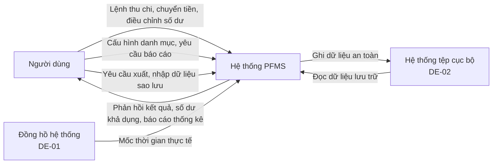

# 1. Giới thiệu và Ngữ cảnh Hệ thống

Tài liệu Phân tích Hướng đối tượng (Object-Oriented Analysis - OOA) xác lập mô hình quan niệm và cấu trúc hành vi mức bài toán cho Hệ thống Quản lý Tài chính Cá nhân (PFMS). Tài liệu tiếp nhận các yêu cầu nghiệp vụ từ hồ sơ Đặc tả Yêu cầu Phần mềm (SRS) và chuẩn hóa thành hệ thống khái niệm miền, sự kiện hệ thống cùng hợp đồng thao tác, cung cấp cơ sở kỹ thuật trực tiếp cho giai đoạn Thiết kế Hướng đối tượng (OOD).

Phân tích hướng đối tượng tập trung xác định bản chất các khái niệm nghiệp vụ cần quản lý và cơ chế tiếp nhận tương tác từ môi trường ngoài. Tài liệu giữ tính trung lập công nghệ, độc lập hoàn toàn với ngôn ngữ lập trình, cấu trúc lưu trữ dữ liệu vật lý, giao diện người dùng và các mẫu thiết kế phần mềm chi tiết.

## 1.1 Mục đích và Phạm vi Tài liệu OOA

Tài liệu OOA xác định cấu trúc phân tích cho hệ thống PFMS với 4 mục tiêu kỹ thuật:
1. Xác lập mô hình miền khái niệm (Domain Model): Định danh các lớp khái niệm phản ánh thực thể tài chính thực tế, thuộc tính bản chất và các mối quan hệ ngữ nghĩa trong không gian bài toán.
2. Mô hình hóa hành vi mức hộp đen: Đặc tả luồng tương tác giữa tác nhân ngoài và thực thể trung tâm `:System` thông qua Sơ đồ Tuần tự Hệ thống (SSD) cho các ca sử dụng.
3. Chuẩn hóa trạng thái và hợp đồng thao tác: Xác định biến đổi trạng thái của các thực thể cốt lõi, đồng thời thiết lập cam kết tiền điều kiện và hậu điều kiện cho từng thao tác hệ thống theo chuẩn Craig Larman.
4. Thiết lập tính truy vết nghiệp vụ hai chiều: Ánh xạ toàn bộ 20 ca sử dụng và 5 quy tắc nghiệp vụ tài chính từ hồ sơ SRS sang các cấu trúc phân tích, bảo đảm tính khép kín của phạm vi yêu cầu.

Phạm vi mô hình hóa bao phủ toàn bộ 6 nhóm chức năng nghiệp vụ của hệ thống PFMS:

| STT | Nhóm chức năng | Mã nhóm | Quy mô UC | Dải ca sử dụng | Nội dung nghiệp vụ chính |
| :---: | :--- | :---: | :---: | :---: | :--- |
| 1 | Quản lý Ví | `WAL` | 4 | `UC-WAL-01` – `UC-WAL-04` | Quản lý ví tiền mặt và các ví tạo thêm; xác định số dư khả dụng và tỷ lệ phân bổ ví với yêu cầu bảo toàn số dư không âm (`BR-FIN-02`), tính số học chính xác (`BR-FIN-01`) và chuẩn đặt tên (`BR-NAM-01`). |
| 2 | Ghi nhận Thu chi | `TXN` | 4 | `UC-TXN-01` – `UC-TXN-04` | Ghi nhận các giao dịch thu nhập và chi tiêu; liên kết ví thanh toán, gán danh mục hợp lệ theo phân cấp (`BR-FIN-04`), cập nhật số dư ví tức thời (`BR-FIN-02`) và hạch toán chi phí liên kết chính xác (`BR-FIN-01`). |
| 3 | Chuyển tiền Nội bộ | `TRF` | 3 | `UC-TRF-01` – `UC-TRF-03` | Điều chuyển tiền giữa hai ví nội bộ theo nguyên tắc ghi nhận đồng thời bảo toàn tổng số dư (`BR-FIN-03`), kiểm soát số dư khả dụng ví nguồn (`BR-FIN-02`) và tính phí giao dịch chính xác (`BR-FIN-01`). |
| 4 | Danh mục Phân loại | `CAT` | 4 | `UC-CAT-01` – `UC-CAT-04` | Quản lý cây phân loại 3 cấp gồm Loại thu chi, Nhóm nhu cầu và Danh mục chi tiết (`BR-FIN-04`); kiểm soát toàn vẹn tham chiếu khi xóa danh mục và kiểm tra tính duy nhất của tên (`BR-NAM-01`). |
| 5 | Thống kê và Báo cáo | `REP` | 2 | `UC-REP-01` – `UC-REP-02` | Trích xuất chuỗi dữ liệu 12 tháng liên tục; tổng hợp dòng tiền thuần, cơ cấu chi tiêu theo nhóm nhu cầu (`BR-FIN-04`) và tính tỷ lệ tiết kiệm theo quy tắc làm tròn ngân hàng (`BR-FIN-01`). |
| 6 | Lưu trữ và Sao lưu | `DAT` | 3 | `UC-DAT-01` – `UC-DAT-03` | Kiểm tra tính toàn vẹn dữ liệu tài chính và đối soát số dư ví (`BR-FIN-02`); xuất bản sao lưu độc lập và phục hồi dữ liệu từ bản sao lưu hợp lệ (`AS-02`, `CON-04`). |
| **Tổng** | **6 nhóm chức năng** |  | **20** | **20 ca sử dụng** |  |

Tài liệu phục vụ 4 nhóm đối tượng kỹ thuật:

| Nhóm đối tượng | Vai trò kỹ thuật | Mục đích sử dụng tài liệu OOA |
| :--- | :--- | :--- |
| Kỹ sư phân tích hệ thống | Tác giả mô hình | Kiểm soát ranh giới bài toán, duy trì ma trận truy vết và tính nhất quán với hồ sơ SRS. |
| Kỹ sư thiết kế kiến trúc | Tiếp nhận chuyển giao | Căn cứ trực tiếp để xây dựng biểu đồ lớp chi tiết, phân bổ trách nhiệm bằng các nguyên tắc GRASP và lựa chọn mẫu thiết kế phù hợp. |
| Kỹ sư kiểm thử phần mềm | Kiểm thử chấp thuận | Đối chiếu tiền điều kiện và hậu điều kiện trong hợp đồng thao tác để thiết kế kịch bản kiểm thử hành vi nghiệp vụ mức hộp đen. |
| Chuyên gia thẩm định kỹ thuật | Đánh giá độc lập | Rà soát tính chính xác của mô hình hóa hướng đối tượng, kiểm tra tính đầy đủ của các quy tắc bất biến tài chính. |

## 1.2 Ranh giới Hệ thống và Nguyên tắc Hộp đen (:System)

Trong pha phân tích hướng đối tượng, toàn bộ hệ thống phần mềm được mô hình hóa dưới dạng một khối thống nhất trừu tượng mang tên `:System` (Larman, 2004). Cách tiếp cận theo nguyên tắc hộp đen tập trung mô tả hành vi bên ngoài của hệ thống qua chuỗi kích hoạt và phản hồi, tách biệt hoàn toàn với cấu trúc cài đặt nội bộ.

Ranh giới hệ thống được xác lập cụ thể qua hai vùng không gian:
- Vùng ngoài hệ thống: Gồm tác nhân trực tiếp là Người dùng, cùng các thành phần môi trường máy trạm phụ thuộc gồm Đồng hồ hệ thống (`DE-01`) cung cấp mốc thời gian thực tế và Hệ thống tệp tin cục bộ (`DE-02`) cung cấp không gian lưu trữ vật lý.
- Vùng trong hệ thống: Là không gian bao đóng của phần mềm PFMS, chịu trách nhiệm lưu trữ và duy trì tính toàn vẹn của mô hình khái niệm gồm các ví, danh mục, giao dịch và thống kê dòng tiền, đồng thời thực thi nghiêm ngặt 5 quy tắc nghiệp vụ tài chính.

Giao tiếp qua ranh giới hộp đen được kiểm soát thông qua hai dòng thông điệp trừu tượng:
- Sự kiện hệ thống: Các thông điệp do tác nhân ngoài khởi tạo gửi đến `:System`, mang theo các tham số nghiệp vụ đầu vào để yêu cầu thực thi một thao tác nghiệp vụ.
- Thông điệp phản hồi: Dữ liệu trạng thái hoặc kết quả xác thực do `:System` trả về cho tác nhân ngoài sau khi xử lý xong sự kiện hệ thống.

Nguyên tắc ranh giới hộp đen loại bỏ các giả định về cấu trúc cài đặt nội bộ. Trong phạm vi phân tích, `:System` không bị phân rã thành các thành phần kỹ thuật như bộ điều khiển giao diện, tầng xử lý trung gian hay tầng lưu trữ dữ liệu. Trọng tâm mô hình hóa hướng hoàn toàn vào việc xác định chính xác các sự kiện đầu vào, điều kiện ràng buộc nghiệp vụ và kết quả phản hồi của hệ thống.

## 1.3 Mô hình Ngữ cảnh Hệ thống

Mô hình ngữ cảnh hệ thống biểu diễn mối quan hệ tương tác giữa Hệ thống PFMS với các thực thể môi trường bao quanh (Ambler, 2004). Hệ thống vận hành trên môi trường máy tính cá nhân cục bộ theo giả định `AS-01`, tiếp nhận tương tác trực tiếp từ một Người dùng duy nhất và tương tác với hai thành phần môi trường máy trạm.

Các luồng thông tin nghiệp vụ trên mô hình ngữ cảnh được phân định theo 3 nhóm tương tác:

1. Tương tác giữa Người dùng và Hệ thống PFMS:
- Luồng giao dịch tài chính: Người dùng gửi các sự kiện yêu cầu tạo mới, cập nhật hoặc xóa giao dịch thu nhập, chi tiêu, chuyển tiền nội bộ và điều chỉnh số dư ví. Hệ thống tiếp nhận, kiểm tra các bất biến nghiệp vụ và phản hồi xác nhận trạng thái xử lý kèm số dư khả dụng cập nhật tức thời của các ví liên quan.
- Luồng cấu trúc danh mục và báo cáo: Người dùng gửi yêu cầu thiết lập cấu trúc phân loại danh mục thu chi 3 cấp hoặc yêu cầu trích xuất dữ liệu phân tích định kỳ. Hệ thống phản hồi cây danh mục hợp lệ hoặc chuỗi dữ liệu tổng hợp dòng tiền 12 tháng, cơ cấu chi tiêu và tỷ lệ tiết kiệm.
- Luồng quản lý dữ liệu: Người dùng gửi yêu cầu kết xuất dữ liệu sang tệp lưu trữ độc lập hoặc nạp bản sao lưu để phục hồi trạng thái hệ thống.

2. Tương tác giữa Hệ thống PFMS và Đồng hồ hệ thống (`DE-01`):
- Đồng hồ hệ thống từ phần cứng và hệ điều hành máy trạm cung cấp mốc thời gian thực tế cho hệ thống. Mốc thời gian này được sử dụng để gắn dấu thời gian tạo lập bản ghi giao dịch và xác định phạm vi 12 tháng liên tục phục vụ tổng hợp báo cáo định kỳ.

3. Tương tác giữa Hệ thống PFMS và Hệ thống tệp cục bộ (`DE-02`):
- Hệ thống thực hiện đọc tệp dữ liệu lưu trữ khi khởi động ứng dụng hoặc khi tiếp nhận yêu cầu phục hồi dữ liệu từ bản sao lưu.
- Hệ thống thực hiện cơ chế ghi tệp an toàn xuống ổ đĩa cục bộ sau mỗi biến động số dư hoặc thay đổi cấu hình danh mục, bảo đảm dữ liệu không bị hỏng khi xảy ra ngắt nguồn đột ngột.

## 1.4 Đặc tả Tác nhân Hệ thống

Hệ thống vận hành theo mô hình đơn người dùng trên máy tính cá nhân cục bộ theo giả định `AS-01` và phân tích tại SRS Mục 2.3. Trong suốt vòng đời vận hành, hệ thống chỉ tương tác với một tác nhân con người duy nhất.

Hồ sơ tác nhân Người dùng:
- Phân loại tác nhân: Tác nhân chính trực tiếp vận hành hệ thống.
- Mục tiêu nghiệp vụ: Ghi nhận các biến động dòng tiền hàng ngày, phân bổ và theo dõi số dư các ví, duy trì cấu trúc danh mục thu chi, trích xuất báo cáo phân tích định kỳ và quản lý các bản sao lưu an toàn.
- Quyền hạn vận hành: Toàn quyền kiểm soát toàn bộ 6 nhóm chức năng nghiệp vụ (`WAL`, `TXN`, `TRF`, `CAT`, `REP`, `DAT`). Hệ thống không áp dụng cơ chế phân quyền đa cấp hay tài khoản người dùng trực tuyến.
- Cơ chế tương tác: Phiên làm việc đơn tiến trình cục bộ, tương tác trực tiếp với giao diện máy tính để bàn.

Đặc điểm vận hành của tác nhân chi phối mô hình phân tích:
- Tính bao quát nghiệp vụ: Do hệ thống không phân chia vai trò người dùng, tác nhân Người dùng là nguồn kích hoạt của toàn bộ 20 ca sử dụng và là đối tượng tiếp nhận trực tiếp toàn bộ thông tin phản hồi từ hệ thống.
- Tần suất kích hoạt sự kiện: Tác nhân khởi phát các sự kiện ghi nhận giao dịch thu chi và chuyển tiền theo phát sinh thực tế hàng ngày; kiểm tra số dư ví và điều chỉnh danh mục khi có biến động; trích xuất dữ liệu tổng hợp dòng tiền 12 tháng theo chu kỳ định kỳ hàng tuần hoặc hàng tháng.
- Tác động đến ranh giới trách nhiệm: Việc chỉ có một tác nhân duy nhất trong phiên làm việc cục bộ loại trừ yêu cầu mô hình hóa việc xác thực danh tính, quản lý phiên truy cập mạng hoặc xử lý xung đột ghi dữ liệu đồng thời giữa nhiều người dùng trong phạm vi phân tích.

## 1.5 Mối liên kết với Đặc tả Yêu cầu SRS

Hồ sơ OOA kế thừa và hiện thực hóa toàn bộ các yêu cầu từ hồ sơ Đặc tả Yêu cầu Phần mềm (SRS). Nhằm bảo đảm tính khép kín và loại trừ hoàn toàn các yêu cầu mồ côi, mối liên kết hai chiều giữa 6 nhóm chức năng nghiệp vụ, 20 ca sử dụng, các quy tắc nghiệp vụ tài chính và các cấu trúc khái niệm OOA được xác lập trong bảng dưới đây:

| Nhóm chức năng | Ca sử dụng liên quan | Khái niệm và Thực thể mô hình hóa | Bất biến và Quy tắc chi phối |
| :--- | :--- | :--- | :--- |
| Quản lý Ví (`WAL`) | `UC-WAL-01`, `UC-WAL-02`, `UC-WAL-03`, `UC-WAL-04` | Thực thể `Wallet`, `BalanceAdjustmentRecord`; Đối tượng giá trị `Money` | `BR-FIN-01` (chính xác số học), `BR-FIN-02` (bảo toàn số dư), `BR-NAM-01` (quy tắc tên ví) |
| Ghi nhận Thu chi (`TXN`) | `UC-TXN-01`, `UC-TXN-02`, `UC-TXN-03`, `UC-TXN-04` | Thực thể `IncomeExpenseTransaction`, `TransactionFee`; Đối tượng giá trị `Money`, `TransactionType` | `BR-FIN-01` (độ chính xác), `BR-FIN-02` (cập nhật số dư), `BR-FIN-04` (phân loại hợp lệ) |
| Chuyển tiền Nội bộ (`TRF`) | `UC-TRF-01`, `UC-TRF-02`, `UC-TRF-03` | Thực thể `TransferTransaction`, `TransactionFee`; Đối tượng giá trị `Money` | `BR-FIN-01` (độ chính xác), `BR-FIN-02` (khả dụng ví nguồn), `BR-FIN-03` (ghi nhận đồng thời) |
| Danh mục Phân loại (`CAT`) | `UC-CAT-01`, `UC-CAT-02`, `UC-CAT-03`, `UC-CAT-04` | Thực thể `Category`, `NeedGroup`; Đối tượng giá trị `TransactionType` | `BR-FIN-04` (cấu trúc cây 3 cấp), `BR-NAM-01` (quy tắc tên nhóm và danh mục) |
| Thống kê và Báo cáo (`REP`) | `UC-REP-01`, `UC-REP-02` | Đối tượng giá trị `NetCashFlow`, `SavingsRate`, `SpendingStructureShare` | `BR-FIN-01` (làm tròn ngân hàng), `BR-FIN-04` (tổng hợp theo nhóm nhu cầu) |
| Lưu trữ và Sao lưu (`DAT`) | `UC-DAT-01`, `UC-DAT-02`, `UC-DAT-03` | Khái niệm kiểm soát toàn vẹn dữ liệu, kiểm tra đối soát số dư và cơ chế xuất, phục hồi bản sao lưu an toàn | `AS-02` (toàn vẹn bản sao lưu), `CON-04` (cấu trúc tệp dữ liệu), bảo toàn bất biến `BR-FIN-02` |

Tính khép kín của mô hình phân tích:
- Độ bao phủ yêu cầu: 100% ca sử dụng (20 trên 20 ca sử dụng) và toàn bộ 5 quy tắc nghiệp vụ tài chính từ SRS đều có cấu trúc khái niệm tương ứng trong các tài liệu phân tích tiếp theo.
- Tính độc lập phân tích: Mọi khái niệm trong bảng ma trận đều được định nghĩa ở mức mô hình bài toán, không chứa các chi tiết kỹ thuật thuộc tầng cài đặt hoặc cơ chế lưu trữ vật lý.
