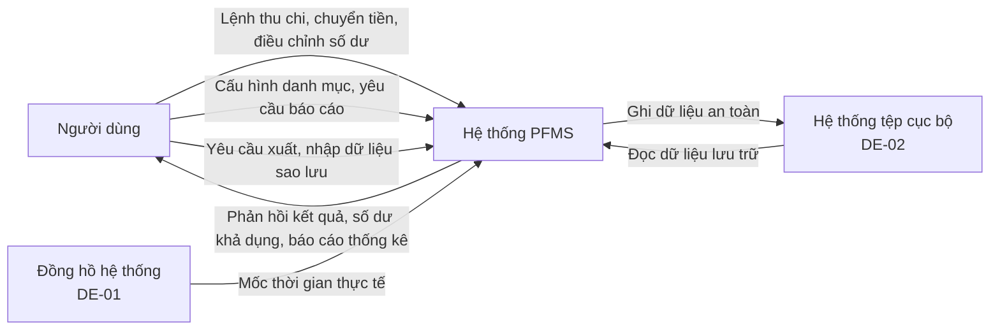

# 1. Giới thiệu và ngữ cảnh hệ thống

Tài liệu Phân tích hướng đối tượng (OOA) xác lập mô hình miền khái niệm, hành vi tương tác và hợp đồng thao tác cho Hệ thống quản lý tài chính cá nhân (PFMS). Tài liệu chuẩn hóa các khái niệm nghiệp vụ, quy tắc bất biến tài chính và sự kiện hệ thống trên nguyên tắc trung lập công nghệ (độc lập với ngôn ngữ lập trình, cơ sở dữ liệu, giao diện và mẫu thiết kế chi tiết), làm cơ sở cho giai đoạn Thiết kế hướng đối tượng (OOD).

## 1.1 Mục đích và phạm vi tài liệu OOA

Tài liệu mô hình hóa miền khái niệm, hành vi tương tác hộp đen và hợp đồng thao tác trên toàn bộ 6 nhóm chức năng nghiệp vụ:

| STT | Nhóm chức năng | Mã nhóm | Số UC | Dải ca sử dụng | Nội dung nghiệp vụ chính |
| :---: | :--- | :---: | :---: | :---: | :--- |
| 1 | Quản lý ví | `WAL` | 4 | `UC-WAL-01` - `UC-WAL-04` | Quản lý ví tiền mặt và các ví tạo thêm; tính số dư khả dụng, tỷ lệ phân bổ; bảo toàn số dư không âm (`BR-FIN-02`), số học chính xác (`BR-FIN-01`) và chuẩn đặt tên (`BR-NAM-01`). |
| 2 | Ghi nhận thu chi | `TXN` | 4 | `UC-TXN-01` - `UC-TXN-04` | Ghi nhận giao dịch thu chi; liên kết ví, gán danh mục theo phân cấp (`BR-FIN-04`), cập nhật số dư tức thời (`BR-FIN-02`) và hạch toán phí chính xác (`BR-FIN-01`). |
| 3 | Chuyển tiền nội bộ | `TRF` | 3 | `UC-TRF-01` - `UC-TRF-03` | Điều chuyển tiền giữa hai ví nội bộ; ghi nhận đồng thời bảo toàn tổng số dư (`BR-FIN-03`), kiểm soát số dư ví nguồn (`BR-FIN-02`) và tính phí chính xác (`BR-FIN-01`). |
| 4 | Danh mục phân loại | `CAT` | 4 | `UC-CAT-01` - `UC-CAT-04` | Quản lý cây phân loại 3 cấp: loại thu chi, nhóm nhu cầu, danh mục chi tiết (`BR-FIN-04`); bảo đảm toàn vẹn tham chiếu khi xóa và tính duy nhất của tên (`BR-NAM-01`). |
| 5 | Thống kê và báo cáo | `REP` | 2 | `UC-REP-01` - `UC-REP-02` | Trích xuất dữ liệu 12 tháng liên tục; tổng hợp thu chi (gồm phí theo `BR-FIN-02`), dòng tiền thuần, cơ cấu chi tiêu (`BR-FIN-04`) và tỷ lệ tiết kiệm làm tròn ngân hàng (`BR-FIN-01`). |
| 6 | Lưu trữ và sao lưu | `DAT` | 3 | `UC-DAT-01` - `UC-DAT-03` | Kiểm tra toàn vẹn dữ liệu, đối soát số dư ví (`BR-FIN-02`); xuất và phục hồi dữ liệu từ bản sao lưu hợp lệ (`AS-02`, `CON-04`). |
| **Tổng** | **6 nhóm chức năng** | | **20** | **20 ca sử dụng** | |

Tài liệu phục vụ 4 nhóm đối tượng kỹ thuật:

| Nhóm đối tượng | Vai trò kỹ thuật | Mục đích sử dụng tài liệu OOA |
| :--- | :--- | :--- |
| Kỹ sư phân tích hệ thống | Tác giả mô hình | Kiểm soát ranh giới bài toán, duy trì ma trận truy vết và tính toàn vẹn của mô hình. |
| Kỹ sư thiết kế kiến trúc | Tiếp nhận chuyển giao | Xây dựng biểu đồ lớp chi tiết, phân bổ trách nhiệm và lựa chọn mẫu thiết kế phù hợp. |
| Kỹ sư kiểm thử phần mềm | Kiểm thử chấp thuận | Đối chiếu tiền/hậu điều kiện trong hợp đồng thao tác để thiết kế kịch bản kiểm thử hộp đen. |
| Chuyên gia thẩm định kỹ thuật | Đánh giá độc lập | Rà soát tính chính xác của mô hình hướng đối tượng và tính đầy đủ của các quy tắc bất biến. |

## 1.2 Ranh giới và ngữ cảnh hệ thống

Hệ thống được tiếp cận theo mô hình hộp đen, chỉ xét thông tin tiếp nhận từ môi trường ngoài và kết quả phản hồi mà không đi vào cấu trúc nội bộ. Phần mềm vận hành cục bộ trên máy tính cá nhân, phục vụ một người dùng duy nhất và tương tác với hai thành phần môi trường là đồng hồ hệ thống (`DE-01`) cùng hệ thống tệp cục bộ (`DE-02`).

Các thành phần tương tác qua ranh giới hệ thống:
- **Người dùng**: Tác nhân duy nhất vận hành hệ thống cục bộ (`AS-01`), kiểm soát toàn bộ 6 nhóm chức năng (20 ca sử dụng). Do chạy đơn tiến trình cục bộ, hệ thống không yêu cầu xác thực danh tính, quản lý phiên mạng hay phân quyền.
- **Đồng hồ hệ thống (`DE-01`)**: Cung cấp mốc thời gian thực để gắn nhãn giao dịch và xác định chu kỳ báo cáo 12 tháng.
- **Hệ thống tệp cục bộ (`DE-02`)**: Đọc dữ liệu khi khởi động/phục hồi và ghi tệp an toàn xuống đĩa sau mỗi biến động tài chính để phòng sự cố mất nguồn.

## 1.3 Bảng đối chiếu khái niệm miền theo nhóm chức năng

Bảng tổng hợp các thực thể, đối tượng giá trị và quy tắc nghiệp vụ của 6 nhóm chức năng:

| Nhóm chức năng | Ca sử dụng | Thực thể miền | Đối tượng giá trị | Quy tắc nghiệp vụ áp dụng |
| :--- | :--- | :--- | :--- | :--- |
| Quản lý ví (`WAL`) | `UC-WAL-01` - `UC-WAL-04` | `Wallet`, `BalanceAdjustmentRecord` | `Money` | Chính xác số học (`BR-FIN-01`), số dư không âm (`BR-FIN-02`), tên ví duy nhất (`BR-NAM-01`) |
| Ghi nhận thu chi (`TXN`) | `UC-TXN-01` - `UC-TXN-04` | `IncomeExpenseTransaction`, `TransactionFee` | `Money`, `TransactionType` | Chính xác số học (`BR-FIN-01`), cập nhật số dư tức thời (`BR-FIN-02`), phân loại hợp lệ (`BR-FIN-04`) |
| Chuyển tiền nội bộ (`TRF`) | `UC-TRF-01` - `UC-TRF-03` | `TransferTransaction`, `TransactionFee` | `Money` | Chính xác số học (`BR-FIN-01`), kiểm soát ví nguồn (`BR-FIN-02`), ghi nhận đồng thời (`BR-FIN-03`) |
| Danh mục phân loại (`CAT`) | `UC-CAT-01` - `UC-CAT-04` | `Category`, `NeedGroup` | `TransactionType` | Cấu trúc phân cấp 3 cấp (`BR-FIN-04`), tên danh mục duy nhất (`BR-NAM-01`) |
| Thống kê và báo cáo (`REP`) | `UC-REP-01` - `UC-REP-02` | `IncomeExpenseTransaction`, `TransactionFee`, `NeedGroup`, `Category`, `TransferTransaction` (chỉ đọc ngày của phí) | `NetCashFlow`, `SavingsRate`, `SpendingStructureShare`, `TransactionDate`, `TransactionType` | Làm tròn ngân hàng (`BR-FIN-01`), cộng phí giao dịch bảo toàn số dư (`BR-FIN-02`), tổng hợp theo nhóm nhu cầu (`BR-FIN-04`) |
| Lưu trữ và sao lưu (`DAT`) | `UC-DAT-01` - `UC-DAT-03` | | | Bảo toàn số dư khi phục hồi (`BR-FIN-02`) |
