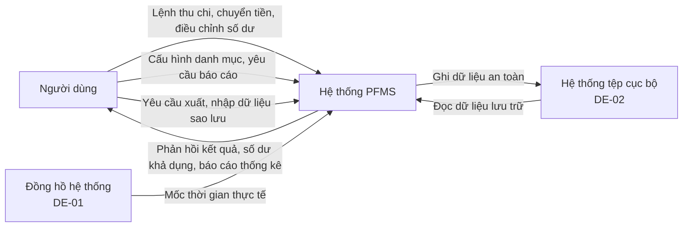

# 1. Giới thiệu và Ngữ cảnh Hệ thống

Tài liệu Phân tích Hướng đối tượng xác lập mô hình quan niệm và cấu trúc hành vi mức bài toán cho Hệ thống Quản lý Tài chính Cá nhân (PFMS). Tài liệu trực tiếp định nghĩa và chuẩn hóa hệ thống khái niệm miền, quy tắc bất biến tài chính, sự kiện hệ thống cùng hợp đồng thao tác, cung cấp cơ sở kỹ thuật độc lập cho giai đoạn Thiết kế Hướng đối tượng.

Phân tích hướng đối tượng tập trung xác định bản chất các khái niệm nghiệp vụ cần quản lý và cơ chế tiếp nhận tương tác từ môi trường ngoài. Tài liệu giữ tính trung lập công nghệ, độc lập hoàn toàn với ngôn ngữ lập trình, cấu trúc lưu trữ dữ liệu vật lý, giao diện người dùng và các mẫu thiết kế phần mềm chi tiết.

## 1.1 Mục đích và Phạm vi Tài liệu OOA

Tài liệu xác lập mô hình miền khái niệm, mô hình hóa hành vi tương tác hộp đen và các hợp đồng thao tác nghiệp vụ của Hệ thống. Phạm vi phân tích bao phủ toàn bộ 6 nhóm chức năng nghiệp vụ:

| STT | Nhóm chức năng | Mã nhóm | Quy mô UC | Dải ca sử dụng | Nội dung nghiệp vụ chính |
| :---: | :--- | :---: | :---: | :---: | :--- |
| 1 | Quản lý Ví | `WAL` | 4 | `UC-WAL-01` - `UC-WAL-04` | Quản lý ví tiền mặt và các ví tạo thêm; xác định số dư khả dụng và tỷ lệ phân bổ ví với yêu cầu bảo toàn số dư không âm (`BR-FIN-02`), tính số học chính xác (`BR-FIN-01`) và chuẩn đặt tên (`BR-NAM-01`). |
| 2 | Ghi nhận Thu chi | `TXN` | 4 | `UC-TXN-01` - `UC-TXN-04` | Ghi nhận các giao dịch thu nhập và chi tiêu; liên kết ví thanh toán, gán danh mục hợp lệ theo phân cấp (`BR-FIN-04`), cập nhật số dư ví tức thời (`BR-FIN-02`) và hạch toán chi phí liên kết chính xác (`BR-FIN-01`). |
| 3 | Chuyển tiền Nội bộ | `TRF` | 3 | `UC-TRF-01` - `UC-TRF-03` | Điều chuyển tiền giữa hai ví nội bộ theo nguyên tắc ghi nhận đồng thời bảo toàn tổng số dư (`BR-FIN-03`), kiểm soát số dư khả dụng ví nguồn (`BR-FIN-02`) và tính phí giao dịch chính xác (`BR-FIN-01`). |
| 4 | Danh mục Phân loại | `CAT` | 4 | `UC-CAT-01` - `UC-CAT-04` | Quản lý cây phân loại 3 cấp gồm Loại thu chi, Nhóm nhu cầu và Danh mục chi tiết (`BR-FIN-04`); kiểm soát toàn vẹn tham chiếu khi xóa danh mục và kiểm tra tính duy nhất của tên (`BR-NAM-01`). |
| 5 | Thống kê và Báo cáo | `REP` | 2 | `UC-REP-01` - `UC-REP-02` | Trích xuất chuỗi dữ liệu 12 tháng liên tục; tổng hợp thu nhập, chi tiêu (gồm phí giao dịch liên kết theo `BR-FIN-02`), dòng tiền thuần, cơ cấu thu chi theo nhóm nhu cầu và danh mục (`BR-FIN-04`) và tính tỷ lệ tiết kiệm theo quy tắc làm tròn ngân hàng (`BR-FIN-01`). |
| 6 | Lưu trữ và Sao lưu | `DAT` | 3 | `UC-DAT-01` - `UC-DAT-03` | Kiểm tra tính toàn vẹn dữ liệu tài chính và đối soát số dư ví (`BR-FIN-02`); xuất bản sao lưu độc lập và phục hồi dữ liệu từ bản sao lưu hợp lệ (`AS-02`, `CON-04`). |
| **Tổng** | **6 nhóm chức năng** |  | **20** | **20 ca sử dụng** |  |

Tài liệu phục vụ 4 nhóm đối tượng kỹ thuật:

| Nhóm đối tượng | Vai trò kỹ thuật | Mục đích sử dụng tài liệu OOA |
| :--- | :--- | :--- |
| Kỹ sư phân tích hệ thống | Tác giả mô hình | Kiểm soát ranh giới bài toán, duy trì ma trận truy vết và bảo đảm tính toàn vẹn của mô hình phân tích. |
| Kỹ sư thiết kế kiến trúc | Tiếp nhận chuyển giao | Căn cứ trực tiếp để xây dựng biểu đồ lớp chi tiết, phân bổ trách nhiệm bằng các nguyên tắc thiết kế và lựa chọn mẫu phù hợp. |
| Kỹ sư kiểm thử phần mềm | Kiểm thử chấp thuận | Đối chiếu tiền điều kiện và hậu điều kiện trong hợp đồng thao tác để thiết kế kịch bản kiểm thử hành vi nghiệp vụ mức hộp đen. |
| Chuyên gia thẩm định kỹ thuật | Đánh giá độc lập | Rà soát tính chính xác của mô hình hóa hướng đối tượng, kiểm tra tính đầy đủ của các quy tắc bất biến tài chính. |

## 1.2 Ranh giới và Ngữ cảnh Hệ thống

Hệ thống được tiếp cận hoàn toàn từ góc nhìn của người dùng bên ngoài, xem toàn bộ phần mềm như một thể thống nhất. Cách tiếp cận này chỉ tập trung vào hai yếu tố: thông tin tiếp nhận từ môi trường ngoài và kết quả phản hồi của phần mềm, không đề cập đến cấu trúc lập trình hay lưu trữ nội bộ.

Hệ thống vận hành cục bộ trên máy tính cá nhân, tiếp nhận thao tác trực tiếp từ một Người dùng duy nhất và tương tác với hai thành phần môi trường máy trạm gồm Đồng hồ hệ thống (`DE-01`) để lấy mốc thời gian thực tế và Hệ thống tệp cục bộ (`DE-02`) để lưu trữ dữ liệu.

Các thành phần tương tác qua ranh giới hệ thống gồm:
- Tác nhân Người dùng: Là tác nhân con người duy nhất trực tiếp vận hành hệ thống trên môi trường máy trạm cục bộ (`AS-01`), nắm toàn quyền kiểm soát 6 nhóm chức năng và khởi phát toàn bộ 20 ca sử dụng. Do đặc thù phiên làm việc đơn tiến trình cục bộ, mô hình phân tích loại trừ hoàn toàn các yêu cầu về xác thực danh tính, quản lý phiên làm việc mạng hay phân quyền truy cập.
- Đồng hồ hệ thống (`DE-01`): Cung cấp mốc thời gian thực tế để gắn dấu thời gian tạo lập giao dịch và xác định phạm vi 12 tháng phục vụ báo cáo định kỳ.
- Hệ thống tệp cục bộ (`DE-02`): Đọc dữ liệu khi khởi động hoặc phục hồi sao lưu; thực hiện ghi tệp an toàn xuống đĩa cứng sau mỗi biến động tài chính nhằm bảo đảm an toàn dữ liệu khi có sự cố ngắt nguồn.

## 1.3 Bảng Đối chiếu Khái niệm Miền theo Nhóm Chức năng

Bảng dưới đây tổng hợp các thực thể, đối tượng giá trị và quy tắc nghiệp vụ tương ứng cho 6 nhóm chức năng của hệ thống:

| Nhóm chức năng | Ca sử dụng | Thực thể miền | Đối tượng giá trị | Quy tắc nghiệp vụ áp dụng |
| :--- | :--- | :--- | :--- | :--- |
| Quản lý ví (`WAL`) | `UC-WAL-01` - `UC-WAL-04` | `Wallet`, `BalanceAdjustmentRecord` | `Money` | Chính xác số học (`BR-FIN-01`), số dư không âm (`BR-FIN-02`), tên ví duy nhất (`BR-NAM-01`) |
| Ghi nhận thu chi (`TXN`) | `UC-TXN-01` - `UC-TXN-04` | `IncomeExpenseTransaction`, `TransactionFee` | `Money`, `TransactionType` | Chính xác số học (`BR-FIN-01`), cập nhật số dư tức thời (`BR-FIN-02`), phân loại hợp lệ (`BR-FIN-04`) |
| Chuyển tiền nội bộ (`TRF`) | `UC-TRF-01` - `UC-TRF-03` | `TransferTransaction`, `TransactionFee` | `Money` | Chính xác số học (`BR-FIN-01`), kiểm soát ví nguồn (`BR-FIN-02`), ghi nhận đồng thời (`BR-FIN-03`) |
| Danh mục phân loại (`CAT`) | `UC-CAT-01` - `UC-CAT-04` | `Category`, `NeedGroup` | `TransactionType` | Cấu trúc phân cấp 3 cấp (`BR-FIN-04`), tên danh mục duy nhất (`BR-NAM-01`) |
| Thống kê và báo cáo (`REP`) | `UC-REP-01` - `UC-REP-02` | `IncomeExpenseTransaction`, `TransactionFee`, `NeedGroup`, `Category`, `TransferTransaction` (chỉ đọc ngày của phí) | `NetCashFlow`, `SavingsRate`, `SpendingStructureShare`, `TransactionDate`, `TransactionType` | Làm tròn ngân hàng (`BR-FIN-01`), cộng phí giao dịch bảo toàn số dư (`BR-FIN-02`), tổng hợp theo nhóm nhu cầu (`BR-FIN-04`) |
| Lưu trữ và sao lưu (`DAT`) | `UC-DAT-01` - `UC-DAT-03` |  |  | Bảo toàn số dư khi phục hồi (`BR-FIN-02`) |
