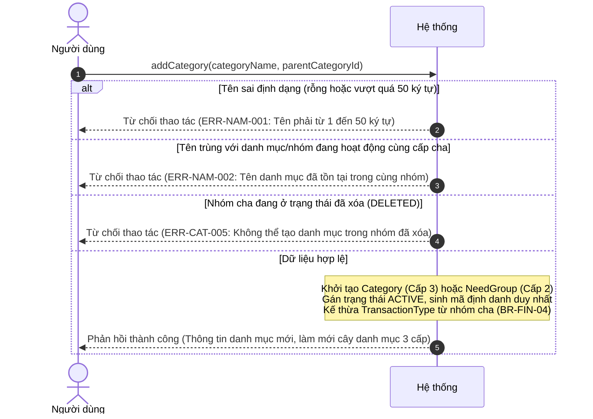
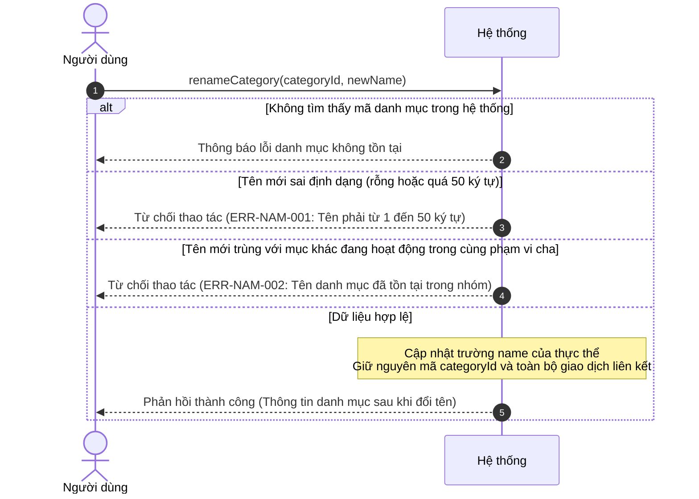
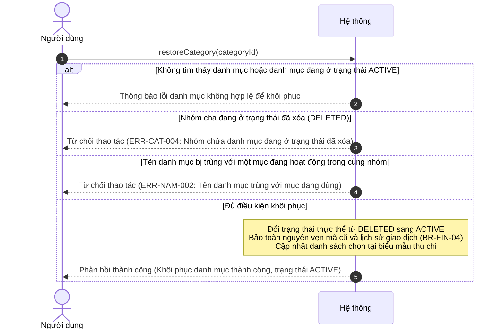
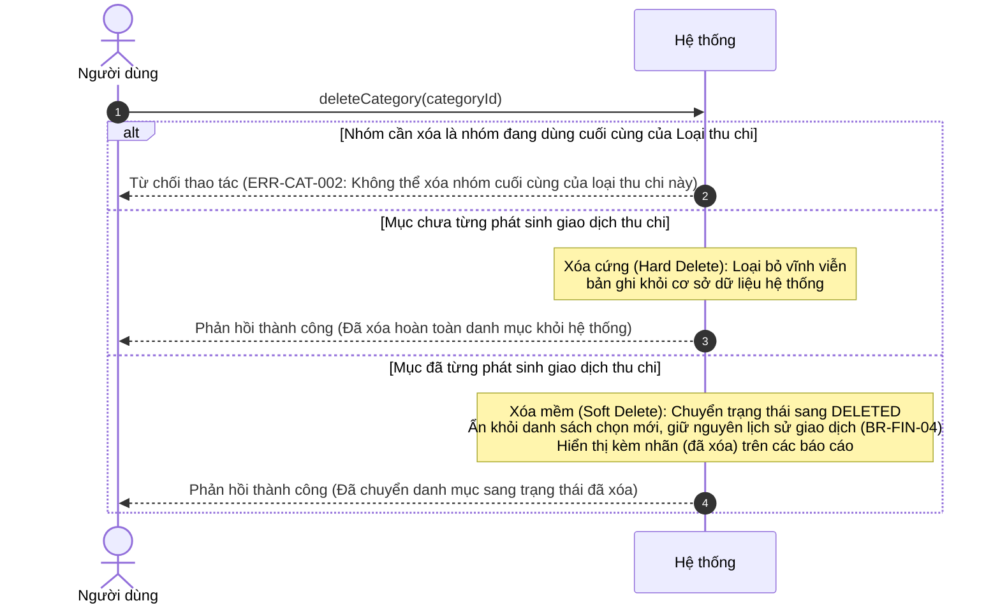
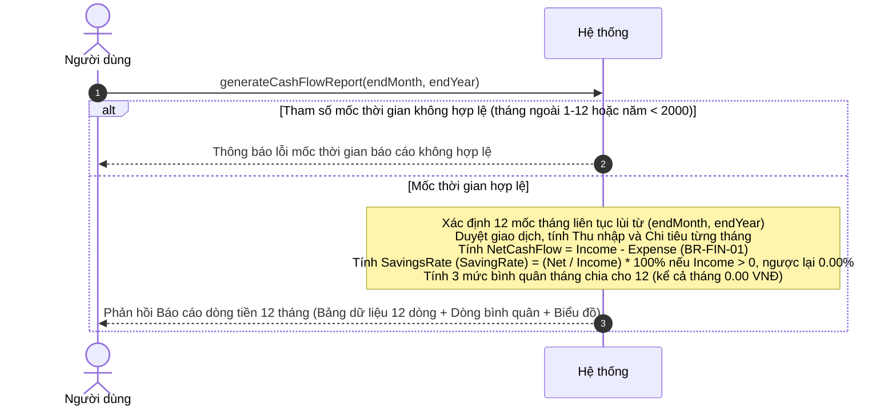
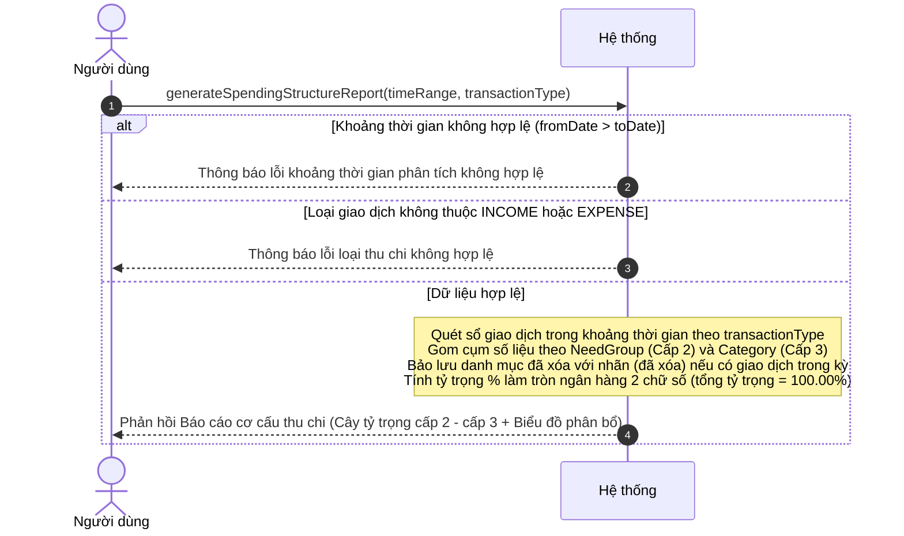
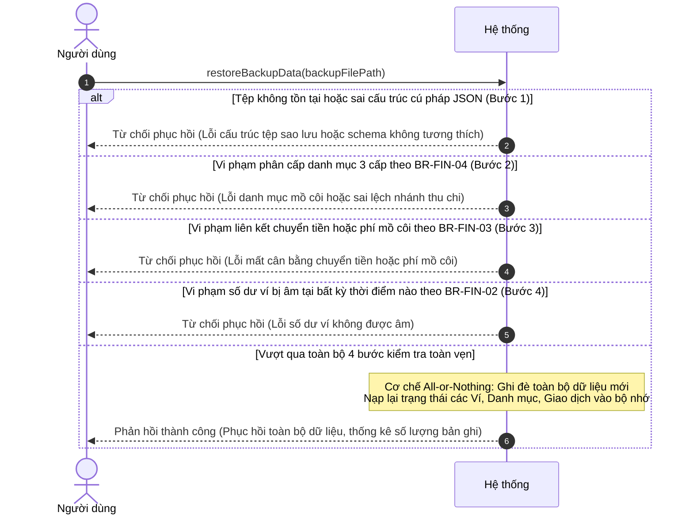
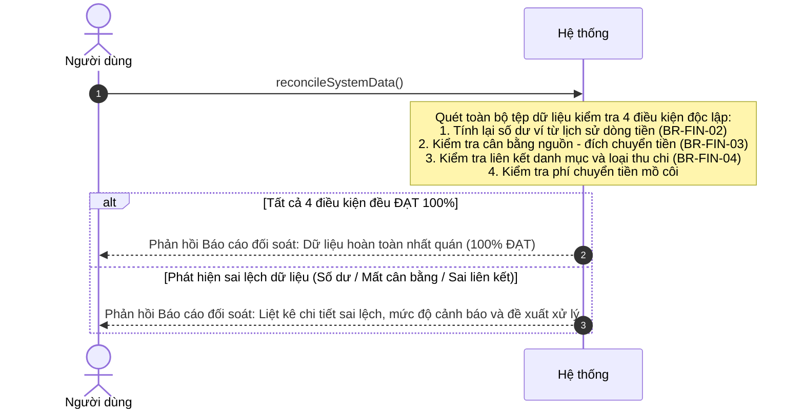

# 3. Sơ đồ Tuần tự Hệ thống

Sơ đồ tuần tự hệ thống mô tả trình tự tương tác giữa Người dùng và Hệ thống cho từng kịch bản ca sử dụng theo trục thời gian. Trong giai đoạn phân tích, sơ đồ này đóng vai trò cầu nối nghiệp vụ: chuyển các bước mô tả bằng lời văn trong hồ sơ ca sử dụng thành các sự kiện đầu vào rõ ràng, làm căn cứ xác định các hợp đồng thao tác tại Mục 4 trước khi bước vào thiết kế chi tiết các lớp bên trong phần mềm.

## 3.1 Nguyên tắc Mô hình hóa và Ranh giới Tương tác Hệ thống

Khi mô hình hóa tuần tự ở tầng phân tích, toàn bộ phần mềm được xem như một thể thống nhất, tiếp cận hoàn toàn từ góc nhìn của người dùng bên ngoài. Cách tiếp cận này chỉ tập trung vào hai yếu tố: thông tin Người dùng gửi vào và kết quả Hệ thống phản hồi lại. Cấu trúc bên trong phần mềm được giữ kín, không đề cập đến các thành phần lập trình như bộ điều khiển, dịch vụ xử lý, các lớp dữ liệu hay cấu trúc cơ sở dữ liệu.

Các yêu cầu Người dùng gửi đến được chuẩn hóa thành các thao tác hệ thống bằng tiếng Anh theo dạng động từ kết hợp danh từ như `createWallet`, `recordTransaction`, `transferFunds`. Các tham số truyền vào thể hiện dữ liệu nghiệp vụ thực tế, không gắn với kiểu dữ liệu của bất kỳ ngôn ngữ lập trình nào. Phía Hệ thống sẽ kiểm tra các quy tắc nghiệp vụ về số dư và tính hợp lệ của dữ liệu để phản hồi kết quả thành công hoặc gửi thông báo từ chối tương ứng khi phát hiện vi phạm.

## 3.2 Tổng hợp Thao tác Hệ thống theo Nhóm Chức năng

Hệ thống PFMS tiếp nhận 20 thao tác từ người dùng, tương ứng với 20 ca sử dụng đã xác định trong tài liệu yêu cầu. Các thao tác này được chia theo 6 nhóm chức năng. Mỗi thao tác là một yêu cầu gửi đến Hệ thống để truy vấn thông tin hoặc thay đổi trạng thái của các thực thể tài chính.

| STT | Nhóm chức năng | Mã nhóm | Ca sử dụng | Thao tác hệ thống |
| :---: | :--- | :---: | :---: | :--- |
| 1 | Quản lý Ví | `WAL` | `UC-WAL-01` đến `UC-WAL-04` | `createWallet`, `getWalletsSummary`, `updateWallet`, `adjustBalance` |
| 2 | Ghi nhận Thu chi | `TXN` | `UC-TXN-01` đến `UC-TXN-04` | `recordIncomeExpense`, `filterTransactions`, `updateTransaction`, `deleteTransaction` |
| 3 | Chuyển tiền Nội bộ | `TRF` | `UC-TRF-01` đến `UC-TRF-03` | `transferFunds`, `filterTransfers`, `deleteTransfer` |
| 4 | Danh mục Phân loại | `CAT` | `UC-CAT-01` đến `UC-CAT-04` | `addCategory`, `renameCategory`, `restoreCategory`, `deleteCategory` |
| 5 | Thống kê và Báo cáo | `REP` | `UC-REP-01`, `UC-REP-02` | `generateCashFlowReport`, `generateSpendingStructureReport` |
| 6 | Lưu trữ và Sao lưu Dữ liệu | `DAT` | `UC-DAT-01` đến `UC-DAT-03` | `exportBackupData`, `restoreBackupData`, `reconcileSystemData` |

Bảng thông số chi tiết của từng thao tác, bao gồm danh sách tham số, dữ liệu phản hồi và kịch bản tuần tự được trình bày cụ thể trong từng nhóm chức năng tương ứng từ Mục 3.3 đến Mục 3.8.

## 3.3 Nhóm Chức năng Quản lý Ví (WAL)

Nhóm chức năng Quản lý Ví đảm nhiệm việc quản lý các nguồn tiền thanh toán, theo dõi số dư khả dụng và xử lý các khoản chênh lệch kiểm kê thực tế. Toàn bộ các thao tác trong nhóm này chịu sự chi phối trực tiếp của quy tắc đặt tên `BR-NAM-01` và quy tắc bảo toàn số dư không âm `BR-FIN-02`.

| Mã UC | Tên ca sử dụng | Thao tác hệ thống | Mục đích nghiệp vụ | Loại thao tác |
| :---: | :--- | :--- | :--- | :--- |
| `UC-WAL-01` | Tạo ví mới | `createWallet` | Khởi tạo nguồn tiền mới với số dư ban đầu bằng 0 | Ghi nhận |
| `UC-WAL-02` | Theo dõi số dư tính lại và cơ cấu ví | `getWalletsSummary` | Tính số dư khả dụng tức thời và tỷ lệ phân bổ ví | Truy vấn |
| `UC-WAL-03` | Cập nhật thông tin ví | `updateWallet` | Sửa tên, ghi chú hoặc chuyển đổi trạng thái lưu trữ ví | Cập nhật |
| `UC-WAL-04` | Điều chỉnh số dư ví | `adjustBalance` | Ghi nhận mốc chênh lệch kiểm kê thực tế | Ghi nhận |

### 3.3.1 Tạo ví mới

(Mô tả khoảng 1 đến 2 câu về bối cảnh tương tác giữa Người dùng và Hệ thống khi khởi tạo nguồn tiền mới)

- Thao tác hệ thống: `createWallet(walletName, note)`
- Kết quả phản hồi: (Nêu dữ liệu trả về khi thành công hoặc thông báo từ chối khi vi phạm quy tắc)

**Danh sách tham số đầu vào**

(Nếu không có danh sách tham số đầu vào thì ghi "Thao tác này không yêu cầu tham số đầu vào")

| Tham số | Ý nghĩa nghiệp vụ | Ràng buộc dữ liệu |
| :--- | :--- | :--- |
| (Nêu tên tham số cần truyền) | (Nêu ý nghĩa nghiệp vụ của tham số) | (Nêu các quy tắc ràng buộc dữ liệu theo BR-NAM, BR-FIN tương ứng trong SRS) |

**Sơ đồ tuần tự hệ thống**

(Vẽ sequence diagram theo use case ở SRS)

### 3.3.2 Xem tổng hợp số dư và cơ cấu ví

(Mô tả khoảng 1 đến 2 câu về bối cảnh tương tác giữa Người dùng và Hệ thống khi truy vấn số dư khả dụng tức thời và phân tích cơ cấu phân bổ giữa các ví)

- Thao tác hệ thống: `getWalletsSummary()`
- Kết quả phản hồi: (Nêu dữ liệu trả về khi thành công hoặc thông báo từ chối khi vi phạm quy tắc)

**Danh sách tham số đầu vào**

(Nếu không có danh sách tham số đầu vào thì ghi "Thao tác này không yêu cầu tham số đầu vào")

| Tham số | Ý nghĩa nghiệp vụ | Ràng buộc dữ liệu |
| :--- | :--- | :--- |
| (Nêu tên tham số cần truyền) | (Nêu ý nghĩa nghiệp vụ của tham số) | (Nêu các quy tắc ràng buộc dữ liệu theo BR-NAM, BR-FIN tương ứng trong SRS) |

**Sơ đồ tuần tự hệ thống**

(Vẽ sequence diagram theo use case ở SRS)

### 3.3.3 Cập nhật thông tin ví

(Mô tả khoảng 1 đến 2 câu về bối cảnh tương tác giữa Người dùng và Hệ thống khi chỉnh sửa tên, ghi chú hoặc chuyển đổi trạng thái lưu trữ của ví)

- Thao tác hệ thống: `updateWallet(walletId, walletName, note)`
- Kết quả phản hồi: (Nêu dữ liệu trả về khi thành công hoặc thông báo từ chối khi vi phạm quy tắc)

**Danh sách tham số đầu vào**

(Nếu không có danh sách tham số đầu vào thì ghi "Thao tác này không yêu cầu tham số đầu vào")

| Tham số | Ý nghĩa nghiệp vụ | Ràng buộc dữ liệu |
| :--- | :--- | :--- |
| (Nêu tên tham số cần truyền) | (Nêu ý nghĩa nghiệp vụ của tham số) | (Nêu các quy tắc ràng buộc dữ liệu theo BR-NAM, BR-FIN tương ứng trong SRS) |

**Sơ đồ tuần tự hệ thống**

(Vẽ sequence diagram theo use case ở SRS)

### 3.3.4 Điều chỉnh số dư ví thực tế

(Mô tả khoảng 1 đến 2 câu về bối cảnh tương tác giữa Người dùng và Hệ thống khi ghi nhận mốc điều chỉnh số dư thực tế lệch khỏi số dư hệ thống)

- Thao tác hệ thống: `adjustBalance(walletId, actualBalance, reason)`
- Kết quả phản hồi: (Nêu dữ liệu trả về khi thành công hoặc thông báo từ chối khi vi phạm quy tắc)

**Danh sách tham số đầu vào**

(Nếu không có danh sách tham số đầu vào thì ghi "Thao tác này không yêu cầu tham số đầu vào")

| Tham số | Ý nghĩa nghiệp vụ | Ràng buộc dữ liệu |
| :--- | :--- | :--- |
| (Nêu tên tham số cần truyền) | (Nêu ý nghĩa nghiệp vụ của tham số) | (Nêu các quy tắc ràng buộc dữ liệu theo BR-NAM, BR-FIN tương ứng trong SRS) |

**Sơ đồ tuần tự hệ thống**

(Vẽ sequence diagram theo use case ở SRS)

## 3.4 Nhóm Chức năng Ghi nhận Thu chi (TXN)

Nhóm chức năng Ghi nhận Thu chi điều hành các sự kiện phát sinh dòng tiền hàng ngày của người dùng. Các thao tác trong nhóm kiểm soát việc hạch toán thu nhập, chi tiêu kèm chi phí phát sinh, đồng thời bảo đảm việc cập nhật, chỉnh sửa hoặc xóa giao dịch luôn tuân thủ quy tắc bảo toàn số dư không âm `BR-FIN-02` và tính hợp lệ của phân cấp danh mục `BR-FIN-04`.

| Mã UC | Tên ca sử dụng | Thao tác hệ thống | Mục đích nghiệp vụ | Loại thao tác |
| :---: | :--- | :--- | :--- | :--- |
| `UC-TXN-01` | Ghi nhận giao dịch thu chi | `recordIncomeExpense` | Ghi nhận khoản thu nhập hoặc chi tiêu phát sinh kèm chi phí liên kết nếu có | Ghi nhận |
| `UC-TXN-02` | Tra cứu và lọc lịch sử giao dịch thu chi | `filterTransactions` | Trích xuất danh sách giao dịch thu chi theo thời gian, ví thanh toán và danh mục | Truy vấn |
| `UC-TXN-03` | Chỉnh sửa giao dịch thu chi | `updateTransaction` | Điều chỉnh thuộc tính giao dịch, hoàn nguyên tác động cũ và kiểm soát số dư | Cập nhật |
| `UC-TXN-04` | Xóa giao dịch thu chi | `deleteTransaction` | Loại bỏ giao dịch khỏi sổ theo dõi, hoàn nguyên số dư ví và xóa chi phí kèm theo | Xóa |

### 3.4.1 Ghi nhận giao dịch thu chi

(Mô tả khoảng 1 đến 2 câu về bối cảnh tương tác giữa Người dùng và Hệ thống khi ghi nhận một khoản thu nhập hoặc chi tiêu phát sinh kèm chi phí nếu có)

- Thao tác hệ thống: `recordIncomeExpense(walletId, categoryId, amount, transactionDate, note, feeAmount, feeCategoryId)`
- Kết quả phản hồi: (Nêu dữ liệu trả về khi thành công hoặc thông báo từ chối khi vi phạm quy tắc)

**Danh sách tham số đầu vào**

(Nếu không có danh sách tham số đầu vào thì ghi "Thao tác này không yêu cầu tham số đầu vào")

| Tham số | Ý nghĩa nghiệp vụ | Ràng buộc dữ liệu |
| :--- | :--- | :--- |
| (Nêu tên tham số cần truyền) | (Nêu ý nghĩa nghiệp vụ của tham số) | (Nêu các quy tắc ràng buộc dữ liệu theo BR-NAM, BR-FIN tương ứng trong SRS) |

**Sơ đồ tuần tự hệ thống**

(Vẽ sequence diagram theo use case ở SRS)

### 3.4.2 Tra cứu và lọc lịch sử giao dịch

(Mô tả khoảng 1 đến 2 câu về bối cảnh tương tác giữa Người dùng và Hệ thống khi truy vấn và lọc danh sách các giao dịch thu chi theo tiêu chí thời gian, ví hoặc danh mục)

- Thao tác hệ thống: `filterTransactions(startDate, endDate, walletId, categoryId)`
- Kết quả phản hồi: (Nêu dữ liệu trả về khi thành công hoặc thông báo từ chối khi vi phạm quy tắc)

**Danh sách tham số đầu vào**

(Nếu không có danh sách tham số đầu vào thì ghi "Thao tác này không yêu cầu tham số đầu vào")

| Tham số | Ý nghĩa nghiệp vụ | Ràng buộc dữ liệu |
| :--- | :--- | :--- |
| (Nêu tên tham số cần truyền) | (Nêu ý nghĩa nghiệp vụ của tham số) | (Nêu các quy tắc ràng buộc dữ liệu theo BR-NAM, BR-FIN tương ứng trong SRS) |

**Sơ đồ tuần tự hệ thống**

(Vẽ sequence diagram theo use case ở SRS)

### 3.4.3 Chỉnh sửa giao dịch thu chi

(Mô tả khoảng 1 đến 2 câu về bối cảnh tương tác giữa Người dùng và Hệ thống khi điều chỉnh thuộc tính giao dịch cũ, hoàn nguyên tác động cũ và kiểm soát số dư an toàn)

- Thao tác hệ thống: `updateTransaction(transactionId, walletId, categoryId, amount, transactionDate, note, feeAmount, feeCategoryId)`
- Kết quả phản hồi: (Nêu dữ liệu trả về khi thành công hoặc thông báo từ chối khi vi phạm quy tắc)

**Danh sách tham số đầu vào**

(Nếu không có danh sách tham số đầu vào thì ghi "Thao tác này không yêu cầu tham số đầu vào")

| Tham số | Ý nghĩa nghiệp vụ | Ràng buộc dữ liệu |
| :--- | :--- | :--- |
| (Nêu tên tham số cần truyền) | (Nêu ý nghĩa nghiệp vụ của tham số) | (Nêu các quy tắc ràng buộc dữ liệu theo BR-NAM, BR-FIN tương ứng trong SRS) |

**Sơ đồ tuần tự hệ thống**

(Vẽ sequence diagram theo use case ở SRS)

### 3.4.4 Xóa giao dịch thu chi

(Mô tả khoảng 1 đến 2 câu về bối cảnh tương tác giữa Người dùng và Hệ thống khi loại bỏ giao dịch khỏi sổ theo dõi, hoàn nguyên số dư ví và xóa phí kèm theo)

- Thao tác hệ thống: `deleteTransaction(transactionId)`
- Kết quả phản hồi: (Nêu dữ liệu trả về khi thành công hoặc thông báo từ chối khi vi phạm quy tắc)

**Danh sách tham số đầu vào**

(Nếu không có danh sách tham số đầu vào thì ghi "Thao tác này không yêu cầu tham số đầu vào")

| Tham số | Ý nghĩa nghiệp vụ | Ràng buộc dữ liệu |
| :--- | :--- | :--- |
| (Nêu tên tham số cần truyền) | (Nêu ý nghĩa nghiệp vụ của tham số) | (Nêu các quy tắc ràng buộc dữ liệu theo BR-NAM, BR-FIN tương ứng trong SRS) |

**Sơ đồ tuần tự hệ thống**

(Vẽ sequence diagram theo use case ở SRS)

## 3.5 Nhóm Chức năng Chuyển tiền Nội bộ (TRF)

Nhóm chức năng Chuyển tiền Nội bộ quản lý các giao dịch điều chuyển giá trị giữa các ví nội bộ của người dùng. Các thao tác trong nhóm thực hiện nguyên tắc ghi nhận đồng thời theo `BR-FIN-03`: tự động trừ số dư ví nguồn, cộng số dư ví đích và hạch toán chi phí chuyển tiền phát sinh, đảm bảo số dư ví nguồn không âm theo `BR-FIN-02`.

| Mã UC | Tên ca sử dụng | Thao tác hệ thống | Mục đích nghiệp vụ | Loại thao tác |
| :---: | :--- | :--- | :--- | :--- |
| `UC-TRF-01` | Chuyển tiền nội bộ giữa hai ví | `transferFunds` | Điều chuyển tiền giữa hai ví theo cơ chế ghi nhận đồng thời kèm chi phí nếu có | Ghi nhận |
| `UC-TRF-02` | Tra cứu lịch sử chuyển tiền | `filterTransfers` | Trích xuất lịch sử các lượt điều chuyển tiền nội bộ và tổng chi phí phát sinh | Truy vấn |
| `UC-TRF-03` | Xóa giao dịch chuyển tiền | `deleteTransfer` | Hủy giao dịch chuyển tiền, hoàn nguyên đồng thời số dư hai ví và xóa chi phí | Xóa |

### 3.5.1 Chuyển tiền giữa hai ví

(Mô tả khoảng 1 đến 2 câu về bối cảnh tương tác giữa Người dùng và Hệ thống khi điều chuyển tiền giữa hai ví theo cơ chế ghi nhận đồng thời kèm chi phí phát sinh nếu có)

- Thao tác hệ thống: `transferFunds(sourceWalletId, destinationWalletId, amount, transferDate, note, feeAmount, feeCategoryId)`
- Kết quả phản hồi: (Nêu dữ liệu trả về khi thành công hoặc thông báo từ chối khi vi phạm quy tắc)

**Danh sách tham số đầu vào**

(Nếu không có danh sách tham số đầu vào thì ghi "Thao tác này không yêu cầu tham số đầu vào")

| Tham số | Ý nghĩa nghiệp vụ | Ràng buộc dữ liệu |
| :--- | :--- | :--- |
| (Nêu tên tham số cần truyền) | (Nêu ý nghĩa nghiệp vụ của tham số) | (Nêu các quy tắc ràng buộc dữ liệu theo BR-NAM, BR-FIN tương ứng trong SRS) |

**Sơ đồ tuần tự hệ thống**

(Vẽ sequence diagram theo use case ở SRS)

### 3.5.2 Tra cứu lịch sử chuyển tiền

(Mô tả khoảng 1 đến 2 câu về bối cảnh tương tác giữa Người dùng và Hệ thống khi truy vấn danh sách các lượt điều chuyển tiền nội bộ và tổng chi phí phát sinh)

- Thao tác hệ thống: `filterTransfers(startDate, endDate, sourceWalletId, destinationWalletId)`
- Kết quả phản hồi: (Nêu dữ liệu trả về khi thành công hoặc thông báo từ chối khi vi phạm quy tắc)

**Danh sách tham số đầu vào**

(Nếu không có danh sách tham số đầu vào thì ghi "Thao tác này không yêu cầu tham số đầu vào")

| Tham số | Ý nghĩa nghiệp vụ | Ràng buộc dữ liệu |
| :--- | :--- | :--- |
| (Nêu tên tham số cần truyền) | (Nêu ý nghĩa nghiệp vụ của tham số) | (Nêu các quy tắc ràng buộc dữ liệu theo BR-NAM, BR-FIN tương ứng trong SRS) |

**Sơ đồ tuần tự hệ thống**

(Vẽ sequence diagram theo use case ở SRS)

### 3.5.3 Xóa giao dịch chuyển tiền

(Mô tả khoảng 1 đến 2 câu về bối cảnh tương tác giữa Người dùng và Hệ thống khi hủy bỏ giao dịch chuyển tiền, hoàn nguyên đồng thời số dư hai ví và xóa chi phí liên kết)

- Thao tác hệ thống: `deleteTransfer(transferId)`
- Kết quả phản hồi: (Nêu dữ liệu trả về khi thành công hoặc thông báo từ chối khi vi phạm quy tắc)

**Danh sách tham số đầu vào**

(Nếu không có danh sách tham số đầu vào thì ghi "Thao tác này không yêu cầu tham số đầu vào")

| Tham số | Ý nghĩa nghiệp vụ | Ràng buộc dữ liệu |
| :--- | :--- | :--- |
| (Nêu tên tham số cần truyền) | (Nêu ý nghĩa nghiệp vụ của tham số) | (Nêu các quy tắc ràng buộc dữ liệu theo BR-NAM, BR-FIN tương ứng trong SRS) |

**Sơ đồ tuần tự hệ thống**

(Vẽ sequence diagram theo use case ở SRS)

## 3.6 Nhóm Chức năng Danh mục Phân loại (CAT)

Nhóm chức năng Danh mục Phân loại thiết lập hệ thống phân loại thu chi phục vụ theo dõi và phân tích tài chính. Các thao tác trong nhóm vận hành theo cấu trúc phân cấp 3 cấp quy định tại `BR-FIN-04`, bảo đảm tính duy nhất của tên gọi theo `BR-NAM-01` và duy trì tính toàn vẹn lịch sử giao dịch thông qua cơ chế xóa mềm.

| Mã UC | Tên ca sử dụng | Thao tác hệ thống | Mục đích nghiệp vụ | Loại thao tác |
| :---: | :--- | :--- | :--- | :--- |
| `UC-CAT-01` | Bổ sung danh mục phân loại mới | `addCategory` | Tạo mới danh mục chi tiết thuộc nhóm nhu cầu hợp lệ trong cấu trúc phân cấp | Ghi nhận |
| `UC-CAT-02` | Đổi tên danh mục | `renameCategory` | Thay đổi tên hiển thị của danh mục hoặc nhóm nhu cầu và kiểm tra tính duy nhất | Cập nhật |
| `UC-CAT-03` | Khôi phục hoặc tạo lại mục đã xóa | `restoreCategory` | Phục hồi trạng thái hoạt động cho danh mục đã bị xóa mềm trước đó | Cập nhật |
| `UC-CAT-04` | Xóa danh mục hoặc nhóm | `deleteCategory` | Xóa hoàn toàn danh mục chưa có dữ liệu hoặc xóa mềm nếu đã phát sinh giao dịch | Xóa |

### 3.6.1 Thêm danh mục phân loại mới

Người dùng tương tác với Hệ thống để bổ sung một danh mục chi tiết (cấp 3) vào một nhóm nhu cầu cha đang dùng (cấp 2), hoặc bổ sung một nhóm nhu cầu mới (cấp 2) vào một nhánh loại thu chi (cấp 1) nhằm phục vụ phân loại giao dịch chính xác.

- Thao tác hệ thống: `addCategory(categoryName, parentCategoryId)`
- Kết quả phản hồi: Hệ thống khởi tạo bản ghi danh mục mới ở trạng thái đang dùng (`ACTIVE`), cấp phát mã định danh duy nhất, kế thừa thuộc tính loại thu chi từ nhóm cha và trả về thông tin danh mục vừa tạo kèm cấu trúc danh mục đã làm mới; trường hợp vi phạm, hệ thống từ chối thao tác và gửi thông báo lỗi: `ERR-NAM-001` (tên sai định dạng hoặc rỗng), `ERR-NAM-002` (tên trùng lặp trong cùng nhóm cha), hoặc `ERR-CAT-005` (nhóm cha đang ở trạng thái đã xóa).

**Danh sách tham số đầu vào**

| Tham số | Ý nghĩa nghiệp vụ | Ràng buộc dữ liệu |
| :--- | :--- | :--- |
| `categoryName` | Tên gọi của danh mục chi tiết hoặc nhóm nhu cầu mới cần tạo | Chuỗi ký tự từ 1 đến 50 ký tự sau khi cắt tỉa khoảng trắng hai đầu (`trim`), không được để rỗng theo `BR-NAM-01` (vi phạm báo lỗi `ERR-NAM-001`). Phải là duy nhất trong cùng nhóm nhu cầu cha hoặc cùng loại thu chi theo `BR-NAM-01` (vi phạm báo lỗi `ERR-NAM-002`). |
| `parentCategoryId` | Mã định danh của nhóm nhu cầu cha (nếu tạo danh mục cấp 3) hoặc loại thu chi gốc (nếu tạo nhóm cấp 2) | Chuỗi định danh hợp lệ của nhóm nhu cầu hoặc loại thu chi (`INCOME`, `EXPENSE`). Nhóm cha bắt buộc phải đang ở trạng thái hoạt động (`ACTIVE`), không được ở trạng thái đã xóa theo `BR-FIN-04` (vi phạm báo lỗi `ERR-CAT-005`). |

**Sơ đồ tuần tự hệ thống**

### 3.6.2 Đổi tên danh mục

Người dùng yêu cầu Hệ thống thay đổi tên hiển thị của một danh mục chi tiết hoặc nhóm nhu cầu đang tồn tại nhằm chuẩn hóa cách gọi và trực quan hóa sổ theo dõi thu chi mà không làm thay đổi các liên kết lịch sử.

- Thao tác hệ thống: `renameCategory(categoryId, newName)`
- Kết quả phản hồi: Hệ thống cập nhật tên mới cho danh mục hoặc nhóm nhu cầu, bảo toàn nguyên vẹn mã định danh, trạng thái hoạt động và các liên kết giao dịch trong quá khứ, trả về thông tin danh mục sau cập nhật; trường hợp vi phạm, hệ thống từ chối thao tác và gửi thông báo lỗi: `ERR-NAM-001` (tên sai định dạng hoặc rỗng), `ERR-NAM-002` (tên mới trùng lặp trong cùng phạm vi cha), hoặc thông báo không tìm thấy danh mục.

**Danh sách tham số đầu vào**

| Tham số | Ý nghĩa nghiệp vụ | Ràng buộc dữ liệu |
| :--- | :--- | :--- |
| `categoryId` | Mã định danh của danh mục chi tiết hoặc nhóm nhu cầu cần đổi tên | Chuỗi định danh bắt buộc tồn tại trong hệ thống và thuộc cấu trúc phân cấp danh mục đang quản lý (`BR-FIN-04`). |
| `newName` | Tên gọi mới cần áp dụng cho danh mục hoặc nhóm nhu cầu | Chuỗi ký tự từ 1 đến 50 ký tự sau khi cắt tỉa khoảng trắng hai đầu (`trim`), không được để rỗng theo `BR-NAM-01` (vi phạm báo lỗi `ERR-NAM-001`). Phải là duy nhất trong cùng nhóm cha đối với danh mục chi tiết, hoặc trong cùng loại thu chi đối với nhóm nhu cầu theo `BR-NAM-01` (vi phạm báo lỗi `ERR-NAM-002`). |

**Sơ đồ tuần tự hệ thống**

### 3.6.3 Khôi phục danh mục đã xóa

Người dùng thực hiện phục hồi trạng thái hoạt động cho một danh mục chi tiết (hoặc nhóm nhu cầu) đã bị xóa mềm trước đó để tiếp tục sử dụng trong việc ghi nhận các giao dịch thu chi mới.

- Thao tác hệ thống: `restoreCategory(categoryId)`
- Kết quả phản hồi: Hệ thống chuyển đổi trạng thái của danh mục từ đã xóa (`DELETED`) sang đang dùng (`ACTIVE`), đưa danh mục trở lại danh sách chọn trên các biểu mẫu giao dịch và phản hồi thông báo khôi phục thành công; trường hợp nhóm cha của danh mục đang ở trạng thái đã xóa, hệ thống từ chối theo `ERR-CAT-004`; trường hợp tên của danh mục khôi phục trùng với một danh mục đang hoạt động khác trong cùng nhóm, hệ thống từ chối theo `ERR-NAM-002`.

**Danh sách tham số đầu vào**

| Tham số | Ý nghĩa nghiệp vụ | Ràng buộc dữ liệu |
| :--- | :--- | :--- |
| `categoryId` | Mã định danh của danh mục hoặc nhóm nhu cầu đang ở trạng thái đã xóa cần khôi phục | Bắt buộc tồn tại trong hệ thống và hiện có trạng thái là đã xóa mềm (`isDeleted = true`, trạng thái `DELETED` / `SOFT_DELETED`). Khôi phục giữ nguyên vẹn mã định danh cũ để bảo toàn liên kết dữ liệu theo `BR-FIN-04`. |

**Sơ đồ tuần tự hệ thống**

### 3.6.4 Xóa danh mục phân loại

Người dùng yêu cầu xóa một danh mục chi tiết hoặc một nhóm nhu cầu không còn sử dụng, hệ thống tự động đánh giá lịch sử phát sinh giao dịch để quyết định xóa hẳn khỏi cơ sở dữ liệu hay thực hiện xóa mềm bảo toàn số liệu.

- Thao tác hệ thống: `deleteCategory(categoryId)`
- Kết quả phản hồi: Hệ thống xóa hoàn toàn (xóa cứng) nếu mục chưa từng phát sinh giao dịch thu chi, hoặc chuyển trạng thái sang đã xóa (`DELETED` - xóa mềm) và ẩn khỏi danh sách tạo giao dịch mới nếu mục đã có giao dịch lịch sử; trường hợp người dùng xóa nhóm nhu cầu đang dùng cuối cùng của một Loại thu chi, hệ thống từ chối theo `ERR-CAT-002`.

**Danh sách tham số đầu vào**

| Tham số | Ý nghĩa nghiệp vụ | Ràng buộc dữ liệu |
| :--- | :--- | :--- |
| `categoryId` | Mã định danh của danh mục chi tiết hoặc nhóm nhu cầu cần xóa | Chuỗi định danh bắt buộc tồn tại trong hệ thống và đang ở trạng thái hoạt động (`ACTIVE`). Nếu là nhóm nhu cầu, không được là nhóm hoạt động cuối cùng của loại thu chi theo `BR-FIN-04` (vi phạm báo lỗi `ERR-CAT-002`). |

**Sơ đồ tuần tự hệ thống**

## 3.7 Nhóm Chức năng Thống kê và Báo cáo (REP)

Nhóm chức năng Thống kê và Báo cáo cung cấp các công cụ truy vấn và phân tích số liệu tài chính định kỳ cho người dùng. Các thao tác trong nhóm thực hiện trích xuất chuỗi dữ liệu 12 tháng liên tục, tính toán dòng tiền thuần và cơ cấu chi tiêu theo nhóm nhu cầu theo quy tắc `BR-FIN-01` và `BR-FIN-04` mà không làm thay đổi trạng thái dữ liệu hệ thống.

| Mã UC | Tên ca sử dụng | Thao tác hệ thống | Mục đích nghiệp vụ | Loại thao tác |
| :---: | :--- | :--- | :--- | :--- |
| `UC-REP-01` | Thống kê dòng tiền 12 tháng gần nhất | `generateCashFlowReport` | Trích xuất chuỗi dữ liệu 12 tháng liên tục, tính dòng tiền thuần và tỷ lệ tiết kiệm | Truy vấn |
| `UC-REP-02` | Phân tích cơ cấu thu chi theo nhóm và danh mục | `generateSpendingStructureReport` | Phân tích cơ cấu chi tiêu theo từng nhóm nhu cầu và danh mục chi tiết trong kỳ | Truy vấn |

### 3.7.1 Báo cáo dòng tiền 12 tháng gần nhất

Người dùng yêu cầu Hệ thống tổng hợp và phân tích chuỗi dữ liệu dòng tiền liên tục trong vòng 12 tháng tính lùi từ một mốc tháng chỉ định nhằm đánh giá xu hướng thu nhập, chi tiêu và năng lực tích lũy tài chính định kỳ.

- Thao tác hệ thống: `generateCashFlowReport(endMonth, endYear)`
- Kết quả phản hồi: Hệ thống tổng hợp và trả về bảng thống kê tài chính gồm đúng 12 dòng tháng liên tục sắp xếp theo trình tự thời gian tăng dần (gồm tổng thu nhập, tổng chi tiêu, dòng tiền thuần và tỷ lệ tiết kiệm từng tháng) kèm 3 chỉ số bình quân tháng trên toàn bộ chuỗi 12 tháng; thao tác hoạt động ở chế độ thuần đọc (read-only), không làm thay đổi trạng thái hay số dư tài chính của hệ thống.

**Danh sách tham số đầu vào**

| Tham số | Ý nghĩa nghiệp vụ | Ràng buộc dữ liệu |
| :--- | :--- | :--- |
| `endMonth` | Tháng kết thúc của chuỗi 12 tháng thống kê dòng tiền | Số nguyên dương từ 1 đến 12. Tham số tùy chọn, nếu không truyền hệ thống mặc định lấy tháng hiện tại từ đồng hồ hệ thống (`FR-REP-01`). |
| `endYear` | Năm kết thúc của chuỗi 12 tháng thống kê dòng tiền | Số nguyên dương hợp lệ từ năm 2000 trở đi. Tham số tùy chọn, nếu không truyền hệ thống mặc định lấy năm hiện tại (`FR-REP-01`). |

**Sơ đồ tuần tự hệ thống**

### 3.7.2 Phân tích cơ cấu thu chi theo nhóm

Người dùng yêu cầu Hệ thống phân tích tỷ trọng và cơ cấu phân bổ dòng tiền chi tiết theo từng nhóm nhu cầu và danh mục con trong một khoảng thời gian xác định nhằm nhận diện thói quen chi tiêu hoặc nguồn thu nhập chính.

- Thao tác hệ thống: `generateSpendingStructureReport(timeRange, transactionType)`
- Kết quả phản hồi: Hệ thống trích xuất và trả về báo cáo cơ cấu phân cấp đa tầng gồm tổng giá trị phát sinh của loại thu chi trong kỳ, danh sách phân bổ theo nhóm nhu cầu (cấp 2) và danh mục chi tiết (cấp 3) kèm tỷ trọng phần trăm chính xác (bảo đảm tổng tỷ trọng đạt 100.00% theo `BR-FIN-01`, `BR-FIN-04`); trường hợp khoảng thời gian lọc không hợp lệ, hệ thống phản hồi thông báo từ chối.

**Danh sách tham số đầu vào**

| Tham số | Ý nghĩa nghiệp vụ | Ràng buộc dữ liệu |
| :--- | :--- | :--- |
| `timeRange` | Khoảng thời gian phân tích (từ ngày bắt đầu đến ngày kết thúc) | Đối tượng chứa `fromDate` và `toDate` theo chuẩn `yyyy-MM-dd`. Bắt buộc `fromDate <= toDate` và không vượt quá giới hạn ngày hợp lệ (`FR-REP-02`). |
| `transactionType` | Loại giao dịch tài chính cần lập báo cáo cơ cấu | Nhận một trong hai giá trị cố định: `INCOME` (Thu nhập) hoặc `EXPENSE` (Chi tiêu) theo chuẩn phân cấp (`BR-FIN-04`). |

**Sơ đồ tuần tự hệ thống**

## 3.8 Nhóm Chức năng Lưu trữ và Sao lưu Dữ liệu (DAT)

Nhóm chức năng Lưu trữ và Sao lưu Dữ liệu đảm bảo an toàn và tính toàn vẹn cho dữ liệu tài chính của người dùng trên môi trường máy tính cá nhân. Các thao tác trong nhóm chịu trách nhiệm sao lưu nguyên khối dữ liệu ra tệp cục bộ, xác thực và phục hồi an toàn từ bản sao lưu, đồng thời cung cấp công cụ đối soát độc lập để phát hiện sai lệch số dư theo các quy tắc `BR-FIN-02` và `BR-FIN-03`.

| Mã UC | Tên ca sử dụng | Thao tác hệ thống | Mục đích nghiệp vụ | Loại thao tác |
| :---: | :--- | :--- | :--- | :--- |
| `UC-DAT-01` | Xuất dữ liệu tài chính | `exportBackupData` | Đóng gói toàn bộ dữ liệu tài chính của hệ thống ra tệp sao lưu an toàn | Truy vấn |
| `UC-DAT-02` | Phục hồi dữ liệu hệ thống từ bản sao lưu | `restoreBackupData` | Kiểm tra toàn vẹn tệp sao lưu và nạp lại toàn bộ dữ liệu tài chính vào bộ nhớ | Cập nhật |
| `UC-DAT-03` | Kiểm tra lại dữ liệu hệ thống | `reconcileSystemData` | Duyệt lại toàn bộ lịch sử giao dịch để đối soát độc lập tính cân bằng số dư ví | Đối soát |

### 3.8.1 Xuất dữ liệu sao lưu

Người dùng yêu cầu Hệ thống trích xuất ảnh chụp trạng thái toàn vẹn của toàn bộ dữ liệu tài chính tại một thời điểm ra tệp lưu trữ JSON trên đĩa cứng cục bộ để phòng ngừa sự cố mất mát dữ liệu hoặc phục vụ lưu trữ lâu dài.

- Thao tác hệ thống: `exportBackupData(exportPath)`
- Kết quả phản hồi: Hệ thống đóng gói toàn bộ 5 nhóm thực thể tài chính thành tệp tin JSON an toàn (mã hóa UTF-8, định dạng số học chuẩn xác theo `BR-FIN-01`), lưu trữ tại đường dẫn chỉ định và phản hồi thông báo thành công kèm đường dẫn tệp sao lưu; trường hợp đường dẫn đích không hợp lệ hoặc thiếu quyền ghi tệp, hệ thống từ chối và báo lỗi thiết bị lưu trữ.

**Danh sách tham số đầu vào**

| Tham số | Ý nghĩa nghiệp vụ | Ràng buộc dữ liệu |
| :--- | :--- | :--- |
| `exportPath` | Đường dẫn thư mục hoặc vị trí tệp đích trên máy tính cục bộ để lưu tệp sao lưu | Chuỗi ký tự biểu diễn đường dẫn hợp lệ trên hệ điều hành, thư mục phải tồn tại và ứng dụng có quyền ghi tệp (`WRITE permission`) theo `FR-DAT-01`. |

**Sơ đồ tuần tự hệ thống**

### 3.8.2 Phục hồi dữ liệu từ bản sao lưu

Người dùng yêu cầu nạp lại toàn bộ dữ liệu tài chính của hệ thống từ một tệp sao lưu JSON đã tạo trước đó, hệ thống thực hiện quy trình kiểm tra nghiêm ngặt 4 bước độc lập theo cơ chế "All-or-Nothing" trước khi ghi đè dữ liệu.

- Thao tác hệ thống: `restoreBackupData(backupFilePath)`
- Kết quả phản hồi: Hệ thống phục hồi thành công toàn bộ dữ liệu tài chính nếu tệp sao lưu vượt qua đầy đủ 4 bước kiểm định (cấu trúc JSON, phân cấp danh mục `BR-FIN-04`, liên kết chuyển tiền `BR-FIN-03`, số dư ví không âm `BR-FIN-02`), nạp lại toàn bộ vào bộ nhớ và phản hồi thông báo thành công; trường hợp phát hiện bất kỳ sai phạm nào trong 4 bước kiểm định, hệ thống hủy bỏ toàn bộ thao tác, bảo toàn 100% dữ liệu hiện tại và thông báo lý do từ chối cụ thể.

**Danh sách tham số đầu vào**

| Tham số | Ý nghĩa nghiệp vụ | Ràng buộc dữ liệu |
| :--- | :--- | :--- |
| `backupFilePath` | Đường dẫn tuyệt đối tới tệp sao lưu dữ liệu JSON trên máy tính cá nhân | Chuỗi ký tự biểu diễn đường dẫn tệp sao lưu hợp lệ trên đĩa cứng, tệp phải tồn tại, có quyền đọc (`READ permission`) và định dạng tệp là JSON theo `FR-DAT-02`. |

**Sơ đồ tuần tự hệ thống**

### 3.8.3 Đối soát toàn vẹn dữ liệu hệ thống

Người dùng kích hoạt tiến trình đối soát độc lập tự động của Hệ thống nhằm rà soát và kiểm chứng 4 điều kiện toàn vẹn cốt lõi của toàn bộ cơ sở dữ liệu tài chính, phát hiện kịp thời các sai lệch số dư hoặc liên kết mồ côi.

- Thao tác hệ thống: `reconcileSystemData()`
- Kết quả phản hồi: Hệ thống thực thi duyệt lại toàn bộ các bản ghi và trả về Báo cáo Kiểm tra Toàn vẹn Dữ liệu chi tiết cho cả 4 điều kiện đối soát (Số dư ví theo `BR-FIN-02`, Cân bằng nguồn - đích chuyển tiền theo `BR-FIN-03`, Toàn vẹn liên kết danh mục theo `BR-FIN-04`, và Toàn vẹn liên kết phí chuyển tiền), phân loại mức độ nghiêm trọng (`INFO`, `WARNING`, `ERROR`) kèm khuyến nghị khắc phục nếu phát hiện sai lệch; thao tác là thuần kiểm tra chỉ đọc, không làm biến động số dư hoặc sửa đổi bản ghi tài chính.

**Danh sách tham số đầu vào**

Thao tác này không yêu cầu tham số đầu vào.

**Sơ đồ tuần tự hệ thống**

