# 3. Sơ đồ Tuần tự Hệ thống

Sơ đồ tuần tự hệ thống mô tả trình tự tương tác giữa Người dùng và Hệ thống cho từng kịch bản ca sử dụng theo trục thời gian. Trong giai đoạn phân tích, sơ đồ này đóng vai trò cầu nối nghiệp vụ: chuyển các bước mô tả bằng lời văn trong hồ sơ ca sử dụng thành các sự kiện đầu vào rõ ràng, làm căn cứ xác định các hợp đồng thao tác tại Mục 4 trước khi bước vào thiết kế chi tiết các lớp bên trong phần mềm.

## 3.1 Nguyên tắc Mô hình hóa và Ranh giới Tương tác Hệ thống

Khi mô hình hóa tuần tự ở tầng phân tích, toàn bộ phần mềm được xem như một thể thống nhất, tiếp cận hoàn toàn từ góc nhìn của người dùng bên ngoài. Cách tiếp cận này chỉ tập trung vào hai yếu tố: thông tin Người dùng gửi vào và kết quả Hệ thống phản hồi lại. Cấu trúc bên trong phần mềm được giữ kín, không đề cập đến các thành phần lập trình như bộ điều khiển, dịch vụ xử lý, các lớp dữ liệu hay cấu trúc cơ sở dữ liệu.

Các yêu cầu Người dùng gửi đến được chuẩn hóa thành các thao tác hệ thống bằng tiếng Anh theo dạng động từ kết hợp danh từ như `createWallet`, `recordTransaction`, `transferFunds`. Các tham số truyền vào thể hiện dữ liệu nghiệp vụ thực tế, không gắn với kiểu dữ liệu của bất kỳ ngôn ngữ lập trình nào. Phía Hệ thống sẽ kiểm tra các quy tắc nghiệp vụ về số dư và tính hợp lệ của dữ liệu để phản hồi kết quả thành công hoặc gửi thông báo từ chối tương ứng khi phát hiện vi phạm.

## 3.2 Tổng hợp Thao tác Hệ thống theo Nhóm Chức năng

Hệ thống PFMS tiếp nhận 20 thao tác từ người dùng, tương ứng với 20 ca sử dụng đã xác định trong tài liệu yêu cầu. Các thao tác này được chia theo 6 nhóm chức năng. Mỗi thao tác là một yêu cầu gửi đến Hệ thống để truy vấn thông tin hoặc thay đổi trạng thái của các thực thể tài chính.

| STT | Nhóm chức năng | Mã nhóm | Ca sử dụng | Thao tác hệ thống |
| :---: | :--- | :---: | :---: | :--- |
| 1 | Quản lý Ví | `WAL` | `UC-WAL-01` đến `UC-WAL-04` | `createWallet`, `getWalletsSummary`, `updateWallet`, `adjustBalance` |
| 2 | Ghi nhận Thu chi | `TXN` | `UC-TXN-01` đến `UC-TXN-04` | `recordIncomeExpense`, `filterTransactions`, `updateTransaction`, `deleteTransaction` |
| 3 | Chuyển tiền Nội bộ | `TRF` | `UC-TRF-01` đến `UC-TRF-03` | `transferFunds`, `filterTransfers`, `deleteTransfer` |
| 4 | Danh mục Phân loại | `CAT` | `UC-CAT-01` đến `UC-CAT-04` | `addCategory`, `renameCategory`, `restoreCategory`, `deleteCategory` |
| 5 | Thống kê và Báo cáo | `REP` | `UC-REP-01`, `UC-REP-02` | `generateCashFlowReport`, `generateSpendingStructureReport` |
| 6 | Lưu trữ và Sao lưu Dữ liệu | `DAT` | `UC-DAT-01` đến `UC-DAT-03` | `exportBackupData`, `restoreBackupData`, `reconcileSystemData` |

Bảng thông số chi tiết của từng thao tác, bao gồm danh sách tham số, dữ liệu phản hồi và kịch bản tuần tự được trình bày cụ thể trong từng nhóm chức năng tương ứng từ Mục 3.3 đến Mục 3.8.

## 3.3 Nhóm Chức năng Quản lý Ví (WAL)

Nhóm chức năng Quản lý Ví quản lý các nguồn tiền thanh toán, theo dõi số dư khả dụng và xử lý chênh lệch kiểm kê thực tế. Các thao tác trong nhóm tuân thủ quy tắc đặt tên duy nhất (`BR-NAM-01`) và bảo toàn số dư không âm (`BR-FIN-02`).

| Mã UC | Tên ca sử dụng | Thao tác hệ thống | Mục đích nghiệp vụ | Loại thao tác |
| :---: | :--- | :--- | :--- | :--- |
| `UC-WAL-01` | Tạo ví mới | `createWallet` | Khởi tạo nguồn tiền mới với số dư ban đầu bằng 0 | Ghi nhận |
| `UC-WAL-02` | Theo dõi số dư tính lại và cơ cấu ví | `getWalletsSummary` | Tính số dư khả dụng tức thời và tỷ lệ phân bổ ví | Truy vấn |
| `UC-WAL-03` | Cập nhật thông tin ví | `updateWallet` | Sửa tên, ghi chú hoặc chuyển đổi trạng thái lưu trữ ví | Cập nhật |
| `UC-WAL-04` | Điều chỉnh số dư ví | `adjustBalance` | Ghi nhận mốc chênh lệch kiểm kê thực tế | Ghi nhận |

### 3.3.1 Tạo ví mới

Người dùng gửi yêu cầu khởi tạo một nguồn tiền mới kèm tên định danh và ghi chú mô tả để theo dõi số dư tách biệt. Hệ thống kiểm tra tên ví (`BR-NAM-01`), tạo bản ghi ví mới với số dư khởi điểm 0.00 VNĐ (`BR-FIN-02`) và tính lại cơ cấu phân bổ giữa các ví (`FR-WAL-04`).

- Thao tác hệ thống: `createWallet(walletName, note)`
- Kết quả phản hồi: Hệ thống khởi tạo bản ghi ví mới ở trạng thái hoạt động (`ACTIVE`) với mã định danh duy nhất, gán số dư ban đầu 0.00 VNĐ (`BR-FIN-02`), cập nhật bảng cơ cấu số dư và trả về thông tin ví vừa tạo; trường hợp vi phạm, hệ thống từ chối thao tác và báo lỗi tên sai định dạng (`ERR-NAM-001`), trùng tên ví (`ERR-NAM-002`) hoặc ghi chú vượt quá 255 ký tự.

**Danh sách tham số đầu vào**

| Tham số | Ý nghĩa nghiệp vụ | Ràng buộc dữ liệu |
| :--- | :--- | :--- |
| `walletName` | Tên gọi của ví thanh toán mới cần khởi tạo | Chuỗi 1 đến 50 ký tự sau khi cắt khoảng trắng hai đầu (`trim`), không để rỗng và duy nhất trên toàn bộ ví trong hệ thống (gồm cả ví đang hoạt động và ví lưu trữ), không phân biệt hoa thường (`BR-NAM-01`); trường hợp vi phạm, báo lỗi tên sai định dạng (`ERR-NAM-001`), trùng tên ví (`ERR-NAM-002`). |
| `note` | Ghi chú mô tả mục đích sử dụng hoặc thông tin tài khoản của ví | Chuỗi ký tự tùy chọn, cho phép để trống, tối đa 255 ký tự sau khi cắt khoảng trắng hai đầu (`FR-WAL-01`). |

**Sơ đồ tuần tự hệ thống**

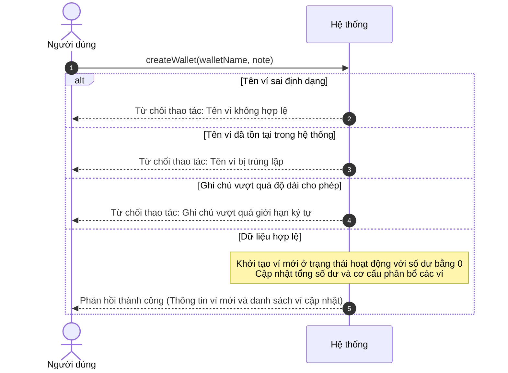

### 3.3.2 Xem tổng hợp số dư và cơ cấu ví

Người dùng truy vấn danh sách ví hiện có để xem số dư khả dụng tức thời và tỷ trọng phân bổ tài sản toàn hệ thống. Hệ thống tính lại số dư từng ví từ lịch sử dòng tiền (`BR-FIN-02`), tổng hợp cơ cấu phân bổ giữa các ví (`FR-WAL-04`) và làm tròn tỷ lệ phần trăm tương ứng (`BR-FIN-01`).

- Thao tác hệ thống: `getWalletsSummary()`
- Kết quả phản hồi: Hệ thống trả về danh sách ví kèm số dư tính lại từ lịch sử dòng tiền (`BR-FIN-02`), tổng số dư hệ thống và tỷ lệ phân bổ từng ví làm tròn ngân hàng 2 chữ số thập phân (`BR-FIN-01`); nếu tổng số dư bằng 0.00 VNĐ, hệ thống gán tỷ lệ 0.00% cho mọi ví để tránh lỗi chia cho 0 (`ERR-FIN-002`). Thao tác chỉ đọc dữ liệu, không làm thay đổi trạng thái hệ thống.

**Danh sách tham số đầu vào**

Thao tác này không yêu cầu tham số đầu vào.

**Sơ đồ tuần tự hệ thống**

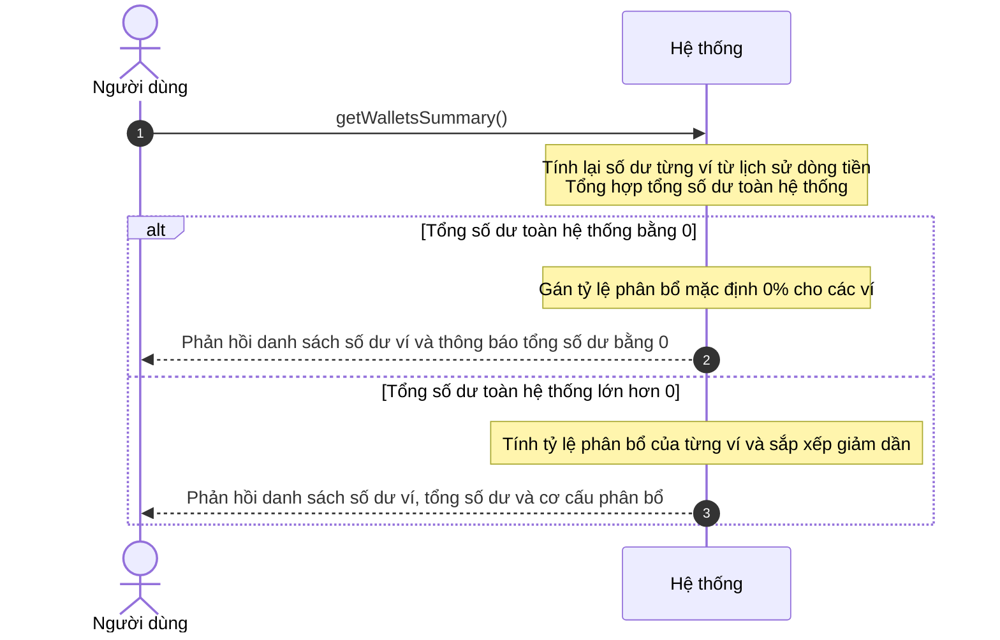

### 3.3.3 Cập nhật thông tin ví

Người dùng gửi yêu cầu chỉnh sửa tên hiển thị hoặc ghi chú mô tả của một ví đang tồn tại. Hệ thống kiểm tra thông tin mới (`BR-NAM-01`) và cập nhật hồ sơ ví mà không thay đổi số dư hay lịch sử giao dịch (`BR-FIN-02`).

- Thao tác hệ thống: `updateWallet(walletId, walletName, note)`
- Kết quả phản hồi: Hệ thống cập nhật tên và ghi chú mới cho ví, giữ nguyên `walletId`, số dư hiện hành và các giao dịch liên kết (`BR-FIN-02`), trả về thông tin ví sau cập nhật; trường hợp vi phạm, hệ thống từ chối thao tác và báo lỗi không tìm thấy ví, tên sai định dạng (`ERR-NAM-001`), trùng tên với ví khác (`ERR-NAM-002`) hoặc ghi chú vượt quá 255 ký tự.

**Danh sách tham số đầu vào**

| Tham số | Ý nghĩa nghiệp vụ | Ràng buộc dữ liệu |
| :--- | :--- | :--- |
| `walletId` | Mã định danh của ví cần cập nhật thông tin | Chuỗi định danh bắt buộc tồn tại trong danh sách ví của hệ thống (`FR-WAL-03`). |
| `walletName` | Tên gọi mới cần áp dụng cho ví | Chuỗi 1 đến 50 ký tự sau khi cắt khoảng trắng hai đầu (`trim`), không để rỗng và duy nhất so với các ví khác trong hệ thống, không phân biệt hoa thường (`BR-NAM-01`); trường hợp vi phạm, báo lỗi tên sai định dạng (`ERR-NAM-001`), trùng tên ví (`ERR-NAM-002`). |
| `note` | Ghi chú mô tả mới của ví | Chuỗi ký tự tùy chọn, cho phép để trống, tối đa 255 ký tự sau khi cắt khoảng trắng hai đầu (`FR-WAL-03`). |

**Sơ đồ tuần tự hệ thống**

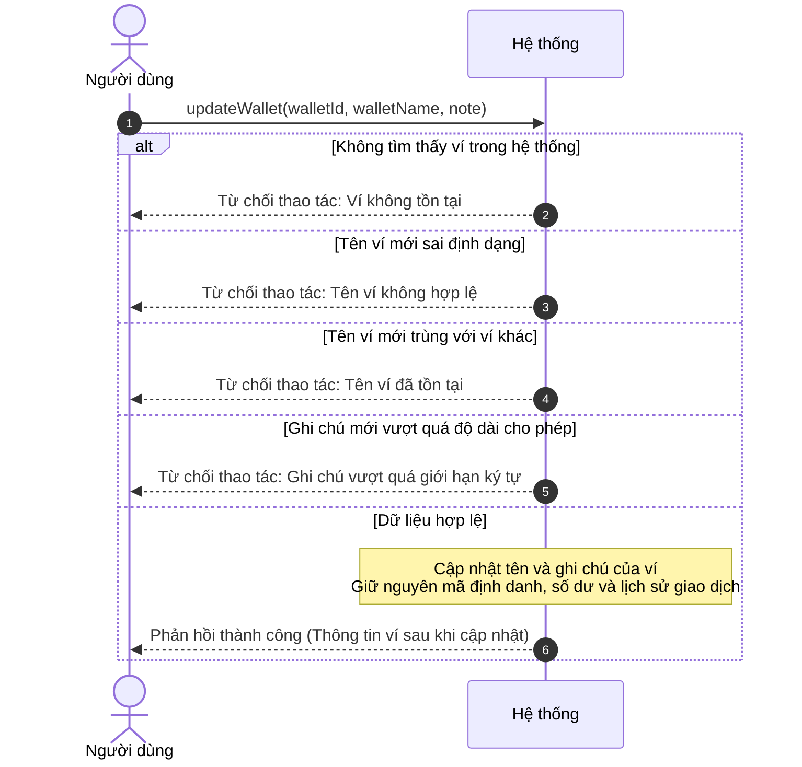

### 3.3.4 Điều chỉnh số dư ví thực tế

Người dùng đối chiếu tiền thực tế với số dư phần mềm và gửi yêu cầu điều chỉnh khi có chênh lệch. Hệ thống tính mức chênh lệch (`BR-FIN-01`), tạo bản ghi điều chỉnh cố định và đồng bộ số dư ví khớp với giá trị thực tế (`BR-FIN-02`).

- Thao tác hệ thống: `adjustBalance(walletId, actualBalance, reason)`
- Kết quả phản hồi: Hệ thống tính chênh lệch giữa số dư thực tế và số dư hiện tại, tạo bản ghi điều chỉnh (`BalanceAdjustmentRecord`) cố định, cập nhật số dư ví khớp với `actualBalance` (`BR-FIN-02`) và trả về bản ghi vừa tạo; trường hợp vi phạm, hệ thống từ chối thao tác và báo lỗi ví không hoạt động, sai định dạng số học (`ERR-FIN-001`), số dư thực tế âm (`ERR-WAL-001`), chênh lệch bằng 0.00 VNĐ hoặc lý do vượt quá 255 ký tự.

**Danh sách tham số đầu vào**

| Tham số | Ý nghĩa nghiệp vụ | Ràng buộc dữ liệu |
| :--- | :--- | :--- |
| `walletId` | Mã định danh của ví cần điều chỉnh số dư thực tế | Chuỗi định danh tồn tại trong hệ thống, ví đang ở trạng thái hoạt động (`ACTIVE`) (`FR-WAL-05`). |
| `actualBalance` | Số dư thực tế quan sát được khi kiểm kê ví | Số thập phân chính xác 2 chữ số thập phân (`BR-FIN-01`), không âm (`BR-FIN-02`) và khác số dư hiện tại của ví (`FR-WAL-05`); trường hợp vi phạm, báo lỗi sai định dạng số học (`ERR-FIN-001`), số dư thực tế âm (`ERR-WAL-001`). |
| `reason` | Lý do giải trình nguyên nhân chênh lệch số dư | Chuỗi ký tự tùy chọn, cho phép để trống, tối đa 255 ký tự sau khi cắt khoảng trắng hai đầu (`FR-WAL-05`). |

**Sơ đồ tuần tự hệ thống**

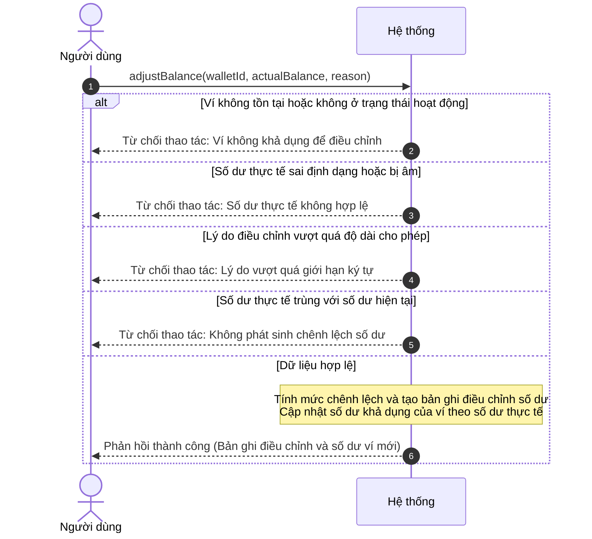

## 3.4 Nhóm Chức năng Ghi nhận Thu chi (TXN)

Nhóm chức năng Ghi nhận Thu chi xử lý các giao dịch dòng tiền hàng ngày của người dùng. Các thao tác trong nhóm hạch toán thu nhập, chi tiêu kèm chi phí phát sinh, đồng thời kiểm soát việc chỉnh sửa, xóa giao dịch đảm bảo số dư ví không âm (`BR-FIN-02`) và đúng phân cấp danh mục 3 cấp (`BR-FIN-04`).

| Mã UC | Tên ca sử dụng | Thao tác hệ thống | Mục đích nghiệp vụ | Loại thao tác |
| :---: | :--- | :--- | :--- | :--- |
| `UC-TXN-01` | Ghi nhận giao dịch thu chi | `recordIncomeExpense` | Ghi nhận khoản thu nhập hoặc chi tiêu phát sinh kèm chi phí liên kết nếu có | Ghi nhận |
| `UC-TXN-02` | Tra cứu và lọc lịch sử giao dịch thu chi | `filterTransactions` | Trích xuất danh sách giao dịch thu chi theo thời gian, ví thanh toán và danh mục | Truy vấn |
| `UC-TXN-03` | Chỉnh sửa giao dịch thu chi | `updateTransaction` | Điều chỉnh thuộc tính giao dịch, hoàn nguyên tác động cũ và kiểm soát số dư | Cập nhật |
| `UC-TXN-04` | Xóa giao dịch thu chi | `deleteTransaction` | Loại bỏ giao dịch khỏi sổ theo dõi, hoàn nguyên số dư ví và xóa chi phí kèm theo | Xóa |

### 3.4.1 Ghi nhận giao dịch thu chi

Người dùng gửi thông tin khoản thu nhập hoặc chi tiêu kèm ví thanh toán, danh mục và chi phí phát sinh (nếu có). Hệ thống kiểm tra danh mục cấp 3 (`BR-FIN-04`) và số dư ví (`BR-FIN-02`), sau đó ghi nhận đồng thời giao dịch gốc cùng bản ghi phí liên kết.

- Thao tác hệ thống: `recordIncomeExpense(walletId, categoryId, amount, transactionDate, note, feeAmount, feeCategoryId)`
- Kết quả phản hồi: Hệ thống tạo bản ghi giao dịch (`IncomeExpenseTransaction`) với mã duy nhất, tạo bản ghi phí (`TransactionFee`) liên kết nếu `feeAmount > 0.00 VNĐ`, cập nhật số dư ví (`BR-FIN-02`) và trả về thông tin giao dịch vừa lưu; trường hợp vi phạm, hệ thống hủy thao tác và báo lỗi số tiền sai định dạng hoặc $\le 0$ (`ERR-FIN-001`), chi phí âm (`ERR-FEE-001`), thiếu danh mục phí (`ERR-FEE-002`), danh mục phí sai loại hoặc đã xóa (`ERR-FEE-003`), không đủ số dư ví (`ERR-WAL-001`), hoặc từ chối khi ví không hoạt động hay danh mục sai phân cấp (`BR-FIN-04`).

**Danh sách tham số đầu vào**

| Tham số | Ý nghĩa nghiệp vụ | Ràng buộc dữ liệu |
| :--- | :--- | :--- |
| `walletId` | Mã định danh của ví tiếp nhận khoản thu hoặc chi trả khoản chi | Mã ví tồn tại và đang hoạt động (`ACTIVE`) khi ghi nhận thu nhập (`FR-TXN-01`) hoặc chi tiêu (`FR-TXN-02`). Số dư ví sau khi áp dụng giao dịch và chi phí phải không âm (`BR-FIN-02`); trường hợp vi phạm, báo lỗi không đủ số dư ví (`ERR-WAL-001`). |
| `categoryId` | Mã định danh danh mục chi tiết cấp 3 dùng để phân loại giao dịch | Mã danh mục cấp 3 đang hoạt động (`ACTIVE`), thuộc nhánh Thu nhập (`INCOME`) hoặc Chi tiêu (`EXPENSE`) (`BR-FIN-04`). |
| `amount` | Số tiền gốc của giao dịch thu nhập hoặc chi tiêu | Số thập phân chính xác lớn hơn 0.00 VNĐ với 2 chữ số thập phân (`BR-FIN-01`); trường hợp vi phạm, báo lỗi số tiền sai định dạng (`ERR-FIN-001`). |
| `transactionDate` | Ngày phát sinh giao dịch thực tế | Ngày tháng định dạng `YYYY-MM-DD`, không vượt quá ngày hiện tại đối với khoản thu (`FR-TXN-01`) và khoản chi (`FR-TXN-02`). |
| `note` | Ghi chú diễn giải nội dung khoản thu chi | Chuỗi ký tự tùy chọn, cho phép để trống, tối đa 255 ký tự sau khi cắt khoảng trắng hai đầu đối với khoản thu (`FR-TXN-01`) và khoản chi (`FR-TXN-02`). |
| `feeAmount` | Số tiền chi phí phụ phát sinh đi kèm giao dịch | Số thập phân chính xác 2 chữ số thập phân (`BR-FIN-01`), không âm ($\ge 0.00$ VNĐ) và mặc định 0.00 VNĐ (`BR-FIN-02`); trường hợp vi phạm, báo lỗi chi phí âm (`ERR-FEE-001`). |
| `feeCategoryId` | Mã định danh danh mục chi tiêu dùng để hạch toán chi phí giao dịch | Tùy chọn khi `feeAmount = 0.00 VNĐ`; bắt buộc chọn khi `feeAmount > 0.00 VNĐ` (`BR-FIN-02`). Phải là danh mục cấp 3 đang hoạt động (`ACTIVE`) thuộc nhánh Chi tiêu (`EXPENSE`) (`BR-FIN-04`); trường hợp vi phạm, báo lỗi thiếu danh mục phí (`ERR-FEE-002`), danh mục phí sai loại hoặc đã xóa (`ERR-FEE-003`). |

**Sơ đồ tuần tự hệ thống**

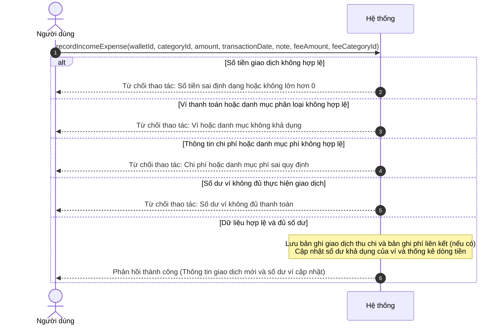

### 3.4.2 Tra cứu và lọc lịch sử giao dịch

Người dùng gửi tiêu chí lọc theo khoảng thời gian, ví thanh toán và danh mục để trích xuất lịch sử thu chi. Hệ thống lọc sổ giao dịch và tổng hợp tổng thu, tổng chi (gồm cả phí giao dịch) cùng dòng tiền thuần (`BR-FIN-01`).

- Thao tác hệ thống: `filterTransactions(startDate, endDate, walletId, categoryId)`
- Kết quả phản hồi: Hệ thống trả về danh sách giao dịch thu chi và phí giao dịch thỏa mãn bộ lọc sắp xếp theo ngày giảm dần (kèm nhãn đã xóa nếu danh mục đã xóa mềm), cùng tổng thu nhập, tổng chi tiêu và dòng tiền thuần (`BR-FIN-01`); nếu `startDate > endDate`, hệ thống từ chối truy vấn và báo lỗi khoảng thời gian. Thao tác chỉ đọc dữ liệu, không làm biến động số dư ví.

**Danh sách tham số đầu vào**

| Tham số | Ý nghĩa nghiệp vụ | Ràng buộc dữ liệu |
| :--- | :--- | :--- |
| `startDate` | Ngày bắt đầu của khoảng thời gian tra cứu lịch sử thu chi | Ngày bắt đầu định dạng `YYYY-MM-DD`, nhỏ hơn hoặc bằng `endDate` (`FR-TXN-03`). |
| `endDate` | Ngày kết thúc của khoảng thời gian tra cứu lịch sử thu chi | Ngày kết thúc định dạng `YYYY-MM-DD`, lớn hơn hoặc bằng `startDate` (`FR-TXN-03`). |
| `walletId` | Mã định danh ví thanh toán cần lọc giao dịch | Tham số tùy chọn; truyền mã ví hợp lệ để lọc riêng một ví hoặc để trống để lấy toàn bộ ví (`FR-TXN-03`). |
| `categoryId` | Mã định danh nhóm nhu cầu hoặc danh mục chi tiết cần lọc | Tham số tùy chọn theo tiêu chí lọc (`FR-TXN-03`); nhận mã nhóm nhu cầu hoặc danh mục chi tiết, bao gồm cả mục đã xóa mềm (`DELETED`) (`BR-FIN-04`). |

**Sơ đồ tuần tự hệ thống**

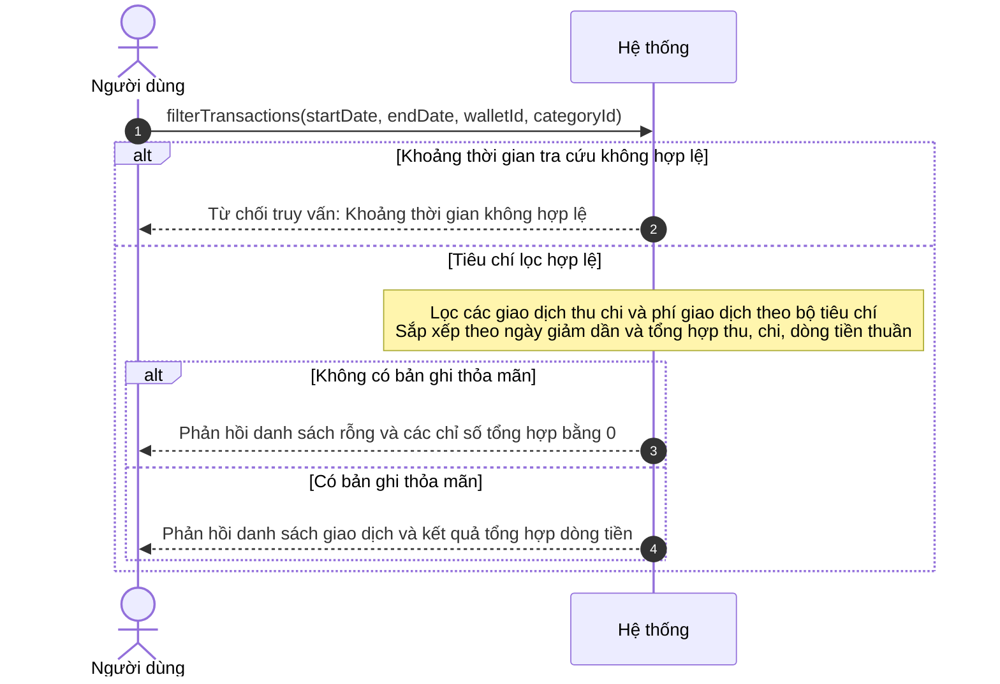

### 3.4.3 Chỉnh sửa giao dịch thu chi

Người dùng gửi yêu cầu hiệu chỉnh thông tin một giao dịch thu chi đã lưu. Hệ thống hoàn nguyên tác động tài chính cũ trên ví ban đầu và áp dụng thông số mới lên ví đích trong cùng một bước xử lý, đảm bảo số dư các ví không âm (`BR-FIN-02`).

- Thao tác hệ thống: `updateTransaction(transactionId, walletId, categoryId, amount, transactionDate, note, feeAmount, feeCategoryId)`
- Kết quả phản hồi: Hệ thống hoàn nguyên số dư ví cũ, cập nhật số dư ví mới (`BR-FIN-02`), ghi đè bản ghi giao dịch gốc, đồng thời tạo mới, cập nhật hoặc xóa bản ghi phí (`TransactionFee`) liên kết và trả về giao dịch sau chỉnh sửa; trường hợp vi phạm, hệ thống giữ nguyên dữ liệu cũ và báo lỗi sai định dạng số tiền (`ERR-FIN-001`), chi phí âm (`ERR-FEE-001`), thiếu danh mục phí (`ERR-FEE-002`), danh mục phí sai loại hoặc đã xóa (`ERR-FEE-003`), làm âm số dư ví (`ERR-WAL-001`), hoặc từ chối khi không tìm thấy giao dịch, sửa trực tiếp bản ghi phí độc lập hay đổi loại thu chi (`BR-FIN-04`).

**Danh sách tham số đầu vào**

| Tham số | Ý nghĩa nghiệp vụ | Ràng buộc dữ liệu |
| :--- | :--- | :--- |
| `transactionId` | Mã định danh của giao dịch thu chi gốc cần chỉnh sửa | Mã giao dịch gốc tồn tại trong sổ thu chi (`FR-TXN-04`), không phải bản ghi phí giao dịch độc lập (`BR-FIN-02`). |
| `walletId` | Mã định danh của ví thanh toán áp dụng sau khi chỉnh sửa | Mã ví tồn tại và đang hoạt động (`ACTIVE`). Số dư ví cũ sau hoàn nguyên và số dư ví mới sau cập nhật đều phải không âm (`BR-FIN-02`); trường hợp vi phạm, báo lỗi làm âm số dư ví (`ERR-WAL-001`). |
| `categoryId` | Mã định danh danh mục chi tiết cấp 3 sau khi chỉnh sửa | Mã danh mục cấp 3 cùng nhánh Loại thu chi (`INCOME` hoặc `EXPENSE`) với giao dịch gốc (`BR-FIN-04`). Danh mục chọn mới phải đang hoạt động (`ACTIVE`), cho phép giữ nguyên danh mục cũ đã xóa mềm (`FR-TXN-04`). |
| `amount` | Số tiền giao dịch mới sau khi hiệu chỉnh | Số thập phân chính xác lớn hơn 0.00 VNĐ với 2 chữ số thập phân (`BR-FIN-01`); trường hợp vi phạm, báo lỗi số tiền sai định dạng (`ERR-FIN-001`). |
| `transactionDate` | Ngày phát sinh giao dịch mới | Ngày tháng định dạng `YYYY-MM-DD`, không vượt quá ngày hiện tại (`FR-TXN-04`). |
| `note` | Ghi chú diễn giải mới của giao dịch | Chuỗi ký tự tùy chọn, tối đa 255 ký tự sau khi cắt khoảng trắng hai đầu (`FR-TXN-04`). |
| `feeAmount` | Số tiền chi phí giao dịch mới | Số thập phân chính xác 2 chữ số thập phân (`BR-FIN-01`) và không âm ($\ge 0.00$ VNĐ) (`BR-FIN-02`); trường hợp vi phạm, báo lỗi chi phí âm (`ERR-FEE-001`). |
| `feeCategoryId` | Mã định danh danh mục chi tiêu cho khoản phí mới | Bắt buộc chọn khi `feeAmount > 0.00 VNĐ` (`BR-FIN-02`). Phải thuộc nhánh Chi tiêu (`EXPENSE`) và đang hoạt động (`ACTIVE`) nếu chọn mới, hoặc giữ nguyên danh mục phí cũ đã xóa mềm (`FR-TXN-04`); trường hợp vi phạm, báo lỗi thiếu danh mục phí (`ERR-FEE-002`), danh mục phí sai loại hoặc đã xóa (`ERR-FEE-003`). |

**Sơ đồ tuần tự hệ thống**

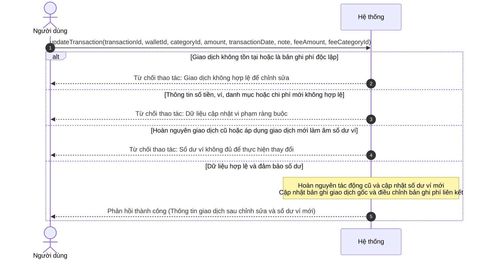

### 3.4.4 Xóa giao dịch thu chi

Người dùng yêu cầu xóa một giao dịch thu chi khỏi sổ theo dõi. Hệ thống kiểm tra số dư hoàn nguyên (`BR-FIN-02`), xóa đồng thời giao dịch gốc cùng bản ghi phí liên kết (nếu có) và khôi phục số dư ví.

- Thao tác hệ thống: `deleteTransaction(transactionId)`
- Kết quả phản hồi: Hệ thống xóa vĩnh viễn bản ghi giao dịch gốc và bản ghi phí (`TransactionFee`) liên kết, hoàn nguyên số dư ví (`BR-FIN-02`) và phản hồi thông báo xóa thành công; trường hợp vi phạm, hệ thống từ chối thao tác và báo lỗi làm âm số dư ví khi trừ lại khoản thu nhập (`ERR-WAL-001`), hoặc từ chối khi không tìm thấy giao dịch hay xóa trực tiếp bản ghi phí độc lập (`BR-FIN-02`).

**Danh sách tham số đầu vào**

| Tham số | Ý nghĩa nghiệp vụ | Ràng buộc dữ liệu |
| :--- | :--- | :--- |
| `transactionId` | Mã định danh của giao dịch thu chi cần xóa khỏi hệ thống | Mã giao dịch gốc tồn tại trong sổ thu chi (`FR-TXN-05`), không phải bản ghi phí độc lập và khi xóa giao dịch thu nhập (`INCOME`), số dư ví sau khi trừ khoản thu và cộng lại phí liên kết phải không âm (`BR-FIN-02`); trường hợp vi phạm, báo lỗi làm âm số dư ví (`ERR-WAL-001`). |

**Sơ đồ tuần tự hệ thống**

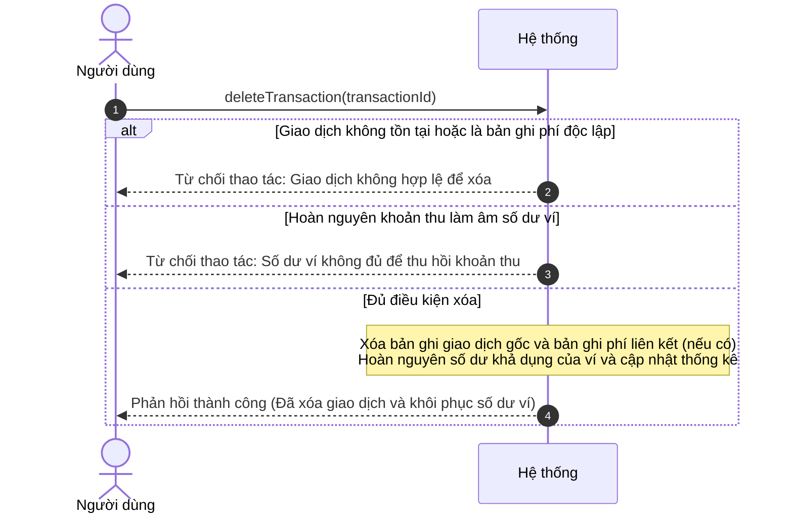

## 3.5 Nhóm Chức năng Chuyển tiền Nội bộ (TRF)

Nhóm chức năng Chuyển tiền Nội bộ quản lý các giao dịch điều chuyển tiền giữa các ví của người dùng. Các thao tác trong nhóm thực hiện ghi nhận đồng thời trừ ví nguồn, cộng ví đích kèm chi phí phát sinh (`BR-FIN-03`) và giữ số dư các ví luôn không âm (`BR-FIN-02`).

| Mã UC | Tên ca sử dụng | Thao tác hệ thống | Mục đích nghiệp vụ | Loại thao tác |
| :---: | :--- | :--- | :--- | :--- |
| `UC-TRF-01` | Chuyển tiền nội bộ giữa hai ví | `transferFunds` | Điều chuyển tiền giữa hai ví theo cơ chế ghi nhận đồng thời kèm chi phí nếu có | Ghi nhận |
| `UC-TRF-02` | Tra cứu lịch sử chuyển tiền | `filterTransfers` | Trích xuất lịch sử các lượt điều chuyển tiền nội bộ và tổng chi phí phát sinh | Truy vấn |
| `UC-TRF-03` | Xóa giao dịch chuyển tiền | `deleteTransfer` | Hủy giao dịch chuyển tiền, hoàn nguyên đồng thời số dư hai ví và xóa chi phí | Xóa |

### 3.5.1 Chuyển tiền giữa hai ví

Người dùng yêu cầu điều chuyển tiền từ ví nguồn sang ví đích kèm chi phí chuyển tiền (nếu có). Hệ thống kiểm tra hai ví phân biệt (`BR-FIN-03`) và số dư khả dụng của ví nguồn (`BR-FIN-02`), sau đó trừ tiền ví nguồn, cộng tiền ví đích đồng thời và tạo bản ghi phí liên kết.

- Thao tác hệ thống: `transferFunds(sourceWalletId, destinationWalletId, amount, transferDate, note, feeAmount, feeCategoryId)`
- Kết quả phản hồi: Hệ thống tạo bản ghi chuyển tiền (`TransferTransaction`) với mã duy nhất, trừ đồng thời số tiền chuyển và phí khỏi ví nguồn, cộng số tiền chuyển vào ví đích (`BR-FIN-03`), tạo bản ghi phí (`TransactionFee`) loại `EXPENSE` nếu `feeAmount > 0.00 VNĐ` và trả về số dư mới của hai ví; trường hợp vi phạm, hệ thống hủy giao dịch và báo lỗi trùng ví chuyển và ví nhận (`ERR-TRF-001`), số tiền chuyển $\le 0$ (`ERR-TRF-002`), sai định dạng số học (`ERR-FIN-001`), chi phí âm (`ERR-FEE-001`), thiếu danh mục phí (`ERR-FEE-002`), danh mục phí sai loại hoặc đã xóa (`ERR-FEE-003`), hoặc ví nguồn không đủ số dư (`ERR-WAL-001`).

**Danh sách tham số đầu vào**

| Tham số | Ý nghĩa nghiệp vụ | Ràng buộc dữ liệu |
| :--- | :--- | :--- |
| `sourceWalletId` | Mã định danh của ví nguồn trích tiền chuyển đi | Mã ví nguồn tồn tại và đang hoạt động (`ACTIVE`) (`BR-FIN-03`), có số dư khả dụng lớn hơn hoặc bằng `amount + feeAmount` (`BR-FIN-02`); trường hợp vi phạm, báo lỗi ví nguồn không đủ số dư (`ERR-WAL-001`). |
| `destinationWalletId` | Mã định danh của ví đích tiếp nhận khoản tiền chuyển đến | Mã ví đích tồn tại, đang hoạt động (`ACTIVE`) và khác `sourceWalletId` (`BR-FIN-03`); trường hợp vi phạm, báo lỗi trùng ví chuyển và ví nhận (`ERR-TRF-001`). |
| `amount` | Số tiền điều chuyển giữa hai ví nội bộ | Số thập phân chính xác 2 chữ số thập phân (`BR-FIN-01`) và lớn hơn 0.00 VNĐ (`BR-FIN-03`); trường hợp vi phạm, báo lỗi sai định dạng số học (`ERR-FIN-001`), số tiền chuyển nhỏ hơn hoặc bằng 0 (`ERR-TRF-002`). |
| `transferDate` | Ngày thực hiện giao dịch chuyển tiền | Ngày tháng định dạng `YYYY-MM-DD`, không vượt quá ngày hiện tại (`FR-TRF-01`). |
| `note` | Ghi chú diễn giải mục đích điều chuyển tiền | Chuỗi ký tự tùy chọn, cho phép để trống, tối đa 255 ký tự sau khi cắt khoảng trắng hai đầu (`FR-TRF-01`). |
| `feeAmount` | Số tiền chi phí chuyển tiền phát sinh do bên thứ ba thu | Số thập phân chính xác 2 chữ số thập phân (`BR-FIN-01`), không âm ($\ge 0.00$ VNĐ) và mặc định 0.00 VNĐ (`BR-FIN-03`); trường hợp vi phạm, báo lỗi chi phí âm (`ERR-FEE-001`). |
| `feeCategoryId` | Mã định danh danh mục chi tiêu dùng để hạch toán phí chuyển tiền | Tùy chọn khi `feeAmount = 0.00 VNĐ`; bắt buộc chọn khi `feeAmount > 0.00 VNĐ` (`BR-FIN-02`). Phải là danh mục cấp 3 đang hoạt động (`ACTIVE`) thuộc nhánh Chi tiêu (`EXPENSE`) (`BR-FIN-04`); trường hợp vi phạm, báo lỗi thiếu danh mục phí (`ERR-FEE-002`), danh mục phí sai loại hoặc đã xóa (`ERR-FEE-003`). |

**Sơ đồ tuần tự hệ thống**

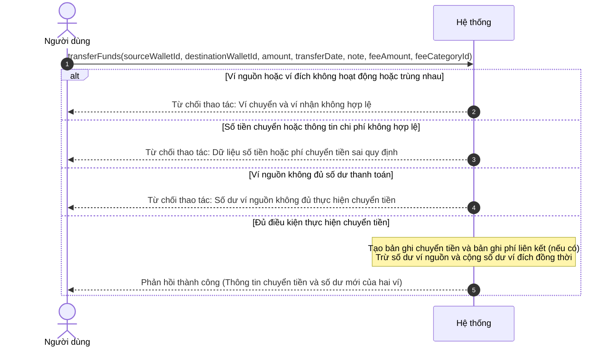

### 3.5.2 Tra cứu lịch sử chuyển tiền

Người dùng truy vấn lịch sử điều chuyển tiền nội bộ theo khoảng thời gian, ví nguồn hoặc ví đích. Hệ thống lọc sổ chuyển tiền, kết hợp thông tin chi phí liên kết và trả về danh sách sắp xếp theo ngày giảm dần (`FR-TRF-02`).

- Thao tác hệ thống: `filterTransfers(startDate, endDate, sourceWalletId, destinationWalletId)`
- Kết quả phản hồi: Hệ thống trả về danh sách bản ghi chuyển tiền thỏa mãn bộ lọc sắp xếp theo ngày giảm dần (gồm mã chuyển tiền, ngày thực hiện, ví nguồn, ví đích, số tiền chuyển, chi phí và ghi chú) kèm tổng tiền chuyển và tổng chi phí (`BR-FIN-01`); nếu `startDate > endDate`, hệ thống từ chối truy vấn và báo lỗi khoảng thời gian. Thao tác chỉ đọc dữ liệu, không làm thay đổi số dư ví.

**Danh sách tham số đầu vào**

| Tham số | Ý nghĩa nghiệp vụ | Ràng buộc dữ liệu |
| :--- | :--- | :--- |
| `startDate` | Ngày bắt đầu của khoảng thời gian tra cứu lịch sử chuyển tiền | Ngày bắt đầu tùy chọn định dạng `YYYY-MM-DD`, nhỏ hơn hoặc bằng `endDate` (`FR-TRF-02`). |
| `endDate` | Ngày kết thúc của khoảng thời gian tra cứu lịch sử chuyển tiền | Ngày kết thúc tùy chọn định dạng `YYYY-MM-DD`, lớn hơn hoặc bằng `startDate` (`FR-TRF-02`). |
| `sourceWalletId` | Mã định danh ví nguồn cần lọc các giao dịch chuyển tiền đi | Tham số tùy chọn; truyền mã ví hợp lệ hoặc để trống để lấy toàn bộ ví nguồn (`FR-TRF-02`). |
| `destinationWalletId` | Mã định danh ví đích cần lọc các giao dịch nhận tiền chuyển đến | Tham số tùy chọn; truyền mã ví hợp lệ hoặc để trống để lấy toàn bộ ví đích (`FR-TRF-02`). |

**Sơ đồ tuần tự hệ thống**

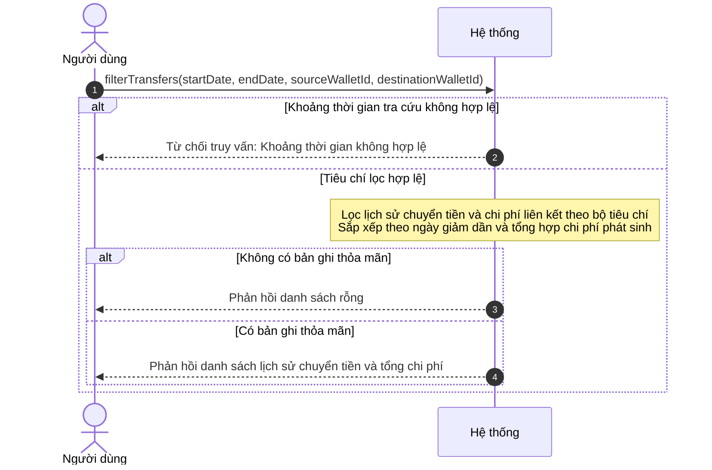

### 3.5.3 Xóa giao dịch chuyển tiền

Người dùng yêu cầu xóa một giao dịch chuyển tiền nội bộ để khôi phục số dư hai ví về trạng thái trước khi chuyển. Hệ thống kiểm tra số dư khả dụng của ví đích (`BR-FIN-02`), xóa đồng thời bản ghi chuyển tiền cùng phí liên kết và hoàn nguyên số dư hai ví (`BR-FIN-03`).

- Thao tác hệ thống: `deleteTransfer(transferId)`
- Kết quả phản hồi: Hệ thống xóa vĩnh viễn bản ghi chuyển tiền (`TransferTransaction`) và bản ghi phí (`TransactionFee`) liên kết, hoàn nguyên đồng thời hai đầu ví (`BR-FIN-03`), tính lại số dư khả dụng (`BR-FIN-02`) và phản hồi thông báo xóa thành công; trường hợp vi phạm, hệ thống giữ nguyên dữ liệu hai ví và báo lỗi ví đích không đủ số dư để hoàn trả (`ERR-WAL-001`) hoặc từ chối khi không tìm thấy giao dịch.

**Danh sách tham số đầu vào**

| Tham số | Ý nghĩa nghiệp vụ | Ràng buộc dữ liệu |
| :--- | :--- | :--- |
| `transferId` | Mã định danh của giao dịch chuyển tiền nội bộ cần xóa | Mã giao dịch chuyển tiền tồn tại trong hệ thống (`FR-TRF-02`). Khi hoàn nguyên đồng thời hai đầu ví (`BR-FIN-03`), số dư khả dụng hiện tại của ví đích phải lớn hơn hoặc bằng số tiền đã nhận (`amount`) để không làm âm ví đích (`BR-FIN-02`); trường hợp vi phạm, báo lỗi ví đích không đủ số dư để hoàn trả (`ERR-WAL-001`). |

**Sơ đồ tuần tự hệ thống**

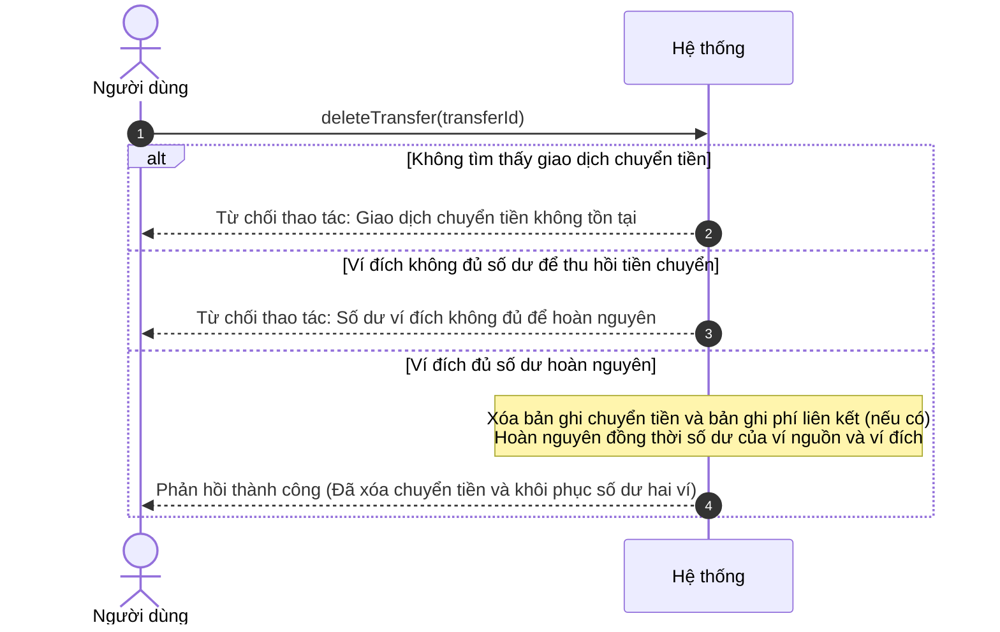

## 3.6 Nhóm Chức năng Danh mục Phân loại (CAT)

Nhóm chức năng Danh mục Phân loại thiết lập hệ thống phân loại thu chi phục vụ theo dõi và phân tích tài chính. Các thao tác trong nhóm vận hành theo cấu trúc phân cấp 3 cấp quy định tại `BR-FIN-04`, bảo đảm tính duy nhất của tên gọi theo `BR-NAM-01` và duy trì tính toàn vẹn lịch sử giao dịch thông qua cơ chế xóa mềm.

| Mã UC | Tên ca sử dụng | Thao tác hệ thống | Mục đích nghiệp vụ | Loại thao tác |
| :---: | :--- | :--- | :--- | :--- |
| `UC-CAT-01` | Bổ sung danh mục phân loại mới | `addCategory` | Tạo mới danh mục chi tiết thuộc nhóm nhu cầu hợp lệ trong cấu trúc phân cấp | Ghi nhận |
| `UC-CAT-02` | Đổi tên danh mục | `renameCategory` | Thay đổi tên hiển thị của danh mục hoặc nhóm nhu cầu và kiểm tra tính duy nhất | Cập nhật |
| `UC-CAT-03` | Khôi phục hoặc tạo lại mục đã xóa | `restoreCategory` | Phục hồi trạng thái hoạt động cho danh mục đã bị xóa mềm trước đó | Cập nhật |
| `UC-CAT-04` | Xóa danh mục hoặc nhóm | `deleteCategory` | Xóa hoàn toàn danh mục chưa có dữ liệu hoặc xóa mềm nếu đã phát sinh giao dịch | Xóa |

### 3.6.1 Thêm danh mục phân loại mới

Người dùng tương tác với Hệ thống để bổ sung một danh mục chi tiết (cấp 3) vào một nhóm nhu cầu cha đang dùng (cấp 2), hoặc bổ sung một nhóm nhu cầu mới (cấp 2) vào một nhánh loại thu chi (cấp 1) nhằm phục vụ phân loại giao dịch chính xác.

- Thao tác hệ thống: `addCategory(categoryName, parentCategoryId)`
- Kết quả phản hồi: Hệ thống khởi tạo bản ghi danh mục mới ở trạng thái đang dùng (`ACTIVE`), cấp phát mã định danh duy nhất, kế thừa thuộc tính loại thu chi từ nhóm cha và trả về thông tin danh mục vừa tạo kèm cấu trúc danh mục đã làm mới; trường hợp vi phạm, hệ thống từ chối thao tác và gửi thông báo lỗi: `ERR-NAM-001` (tên sai định dạng hoặc rỗng), `ERR-NAM-002` (tên trùng lặp trong cùng nhóm cha), hoặc `ERR-CAT-005` (nhóm cha đang ở trạng thái đã xóa).

**Danh sách tham số đầu vào**

| Tham số | Ý nghĩa nghiệp vụ | Ràng buộc dữ liệu |
| :--- | :--- | :--- |
| `categoryName` | Tên gọi của danh mục chi tiết hoặc nhóm nhu cầu mới cần tạo | Chuỗi ký tự từ 1 đến 50 ký tự sau khi cắt tỉa khoảng trắng hai đầu (`trim`), không được để rỗng theo `BR-NAM-01` (vi phạm báo lỗi `ERR-NAM-001`). Phải là duy nhất trong cùng nhóm nhu cầu cha hoặc cùng loại thu chi theo `BR-NAM-01` (vi phạm báo lỗi `ERR-NAM-002`). |
| `parentCategoryId` | Mã định danh của nhóm nhu cầu cha (nếu tạo danh mục cấp 3) hoặc loại thu chi gốc (nếu tạo nhóm cấp 2) | Chuỗi định danh hợp lệ của nhóm nhu cầu hoặc loại thu chi (`INCOME`, `EXPENSE`). Nhóm cha bắt buộc phải đang ở trạng thái hoạt động (`ACTIVE`), không được ở trạng thái đã xóa theo `BR-FIN-04` (vi phạm báo lỗi `ERR-CAT-005`). |

**Sơ đồ tuần tự hệ thống**

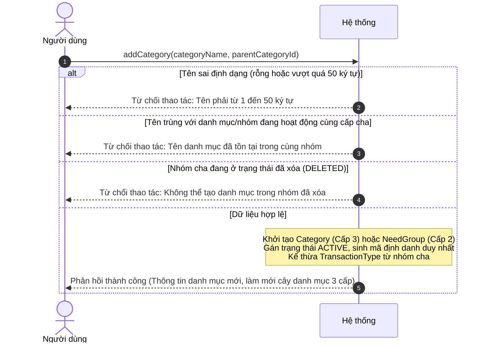

### 3.6.2 Đổi tên danh mục

Người dùng yêu cầu Hệ thống thay đổi tên hiển thị của một danh mục chi tiết hoặc nhóm nhu cầu đang tồn tại nhằm chuẩn hóa cách gọi và trực quan hóa sổ theo dõi thu chi mà không làm thay đổi các liên kết lịch sử.

- Thao tác hệ thống: `renameCategory(categoryId, newName)`
- Kết quả phản hồi: Hệ thống cập nhật tên mới cho danh mục hoặc nhóm nhu cầu, bảo toàn nguyên vẹn mã định danh, trạng thái hoạt động và các liên kết giao dịch trong quá khứ, trả về thông tin danh mục sau cập nhật; trường hợp vi phạm, hệ thống từ chối thao tác và gửi thông báo lỗi: `ERR-NAM-001` (tên sai định dạng hoặc rỗng), `ERR-NAM-002` (tên mới trùng lặp trong cùng phạm vi cha), hoặc thông báo không tìm thấy danh mục.

**Danh sách tham số đầu vào**

| Tham số | Ý nghĩa nghiệp vụ | Ràng buộc dữ liệu |
| :--- | :--- | :--- |
| `categoryId` | Mã định danh của danh mục chi tiết hoặc nhóm nhu cầu cần đổi tên | Chuỗi định danh bắt buộc tồn tại trong hệ thống và thuộc cấu trúc phân cấp danh mục đang quản lý (`BR-FIN-04`). |
| `newName` | Tên gọi mới cần áp dụng cho danh mục hoặc nhóm nhu cầu | Chuỗi ký tự từ 1 đến 50 ký tự sau khi cắt tỉa khoảng trắng hai đầu (`trim`), không được để rỗng theo `BR-NAM-01` (vi phạm báo lỗi `ERR-NAM-001`). Phải là duy nhất trong cùng nhóm cha đối với danh mục chi tiết, hoặc trong cùng loại thu chi đối với nhóm nhu cầu theo `BR-NAM-01` (vi phạm báo lỗi `ERR-NAM-002`). |

**Sơ đồ tuần tự hệ thống**

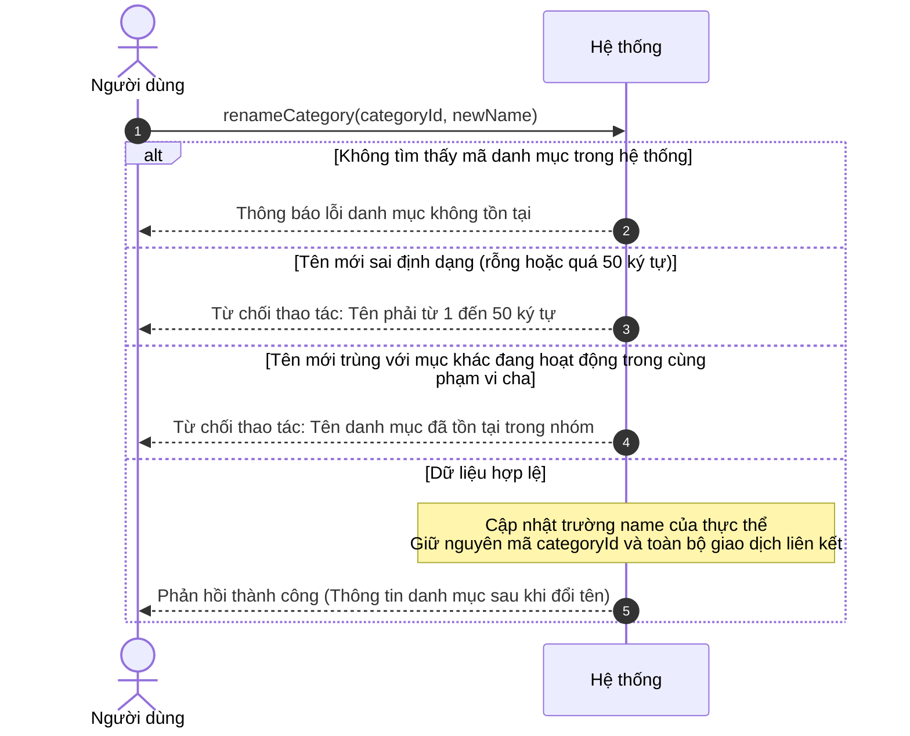

### 3.6.3 Khôi phục danh mục đã xóa

Người dùng thực hiện phục hồi trạng thái hoạt động cho một danh mục chi tiết (hoặc nhóm nhu cầu) đã bị xóa mềm trước đó để tiếp tục sử dụng trong việc ghi nhận các giao dịch thu chi mới.

- Thao tác hệ thống: `restoreCategory(categoryId)`
- Kết quả phản hồi: Hệ thống chuyển đổi trạng thái của danh mục từ đã xóa (`DELETED`) sang đang dùng (`ACTIVE`), đưa danh mục trở lại danh sách chọn trên các biểu mẫu giao dịch và phản hồi thông báo khôi phục thành công; trường hợp nhóm cha của danh mục đang ở trạng thái đã xóa, hệ thống từ chối theo `ERR-CAT-004`; trường hợp tên của danh mục khôi phục trùng với một danh mục đang hoạt động khác trong cùng nhóm, hệ thống từ chối theo `ERR-NAM-002`.

**Danh sách tham số đầu vào**

| Tham số | Ý nghĩa nghiệp vụ | Ràng buộc dữ liệu |
| :--- | :--- | :--- |
| `categoryId` | Mã định danh của danh mục hoặc nhóm nhu cầu đang ở trạng thái đã xóa cần khôi phục | Bắt buộc tồn tại trong hệ thống và hiện có trạng thái là đã xóa mềm (`isDeleted = true`, trạng thái `DELETED` / `SOFT_DELETED`). Khôi phục giữ nguyên vẹn mã định danh cũ để bảo toàn liên kết dữ liệu theo `BR-FIN-04`. |

**Sơ đồ tuần tự hệ thống**

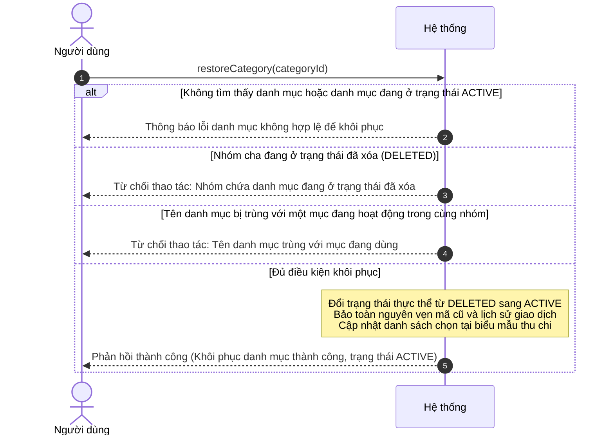

### 3.6.4 Xóa danh mục phân loại

Người dùng yêu cầu xóa một danh mục chi tiết hoặc một nhóm nhu cầu không còn sử dụng, hệ thống tự động đánh giá lịch sử phát sinh giao dịch để quyết định xóa hẳn khỏi cơ sở dữ liệu hay thực hiện xóa mềm bảo toàn số liệu.

- Thao tác hệ thống: `deleteCategory(categoryId)`
- Kết quả phản hồi: Hệ thống xóa hoàn toàn (xóa cứng) nếu mục chưa từng phát sinh giao dịch thu chi, hoặc chuyển trạng thái sang đã xóa (`DELETED` - xóa mềm) và ẩn khỏi danh sách tạo giao dịch mới nếu mục đã có giao dịch lịch sử; trường hợp người dùng xóa nhóm nhu cầu đang dùng cuối cùng của một Loại thu chi, hệ thống từ chối theo `ERR-CAT-002`.

**Danh sách tham số đầu vào**

| Tham số | Ý nghĩa nghiệp vụ | Ràng buộc dữ liệu |
| :--- | :--- | :--- |
| `categoryId` | Mã định danh của danh mục chi tiết hoặc nhóm nhu cầu cần xóa | Chuỗi định danh bắt buộc tồn tại trong hệ thống và đang ở trạng thái hoạt động (`ACTIVE`). Nếu là nhóm nhu cầu, không được là nhóm hoạt động cuối cùng của loại thu chi theo `BR-FIN-04` (vi phạm báo lỗi `ERR-CAT-002`). |

**Sơ đồ tuần tự hệ thống**

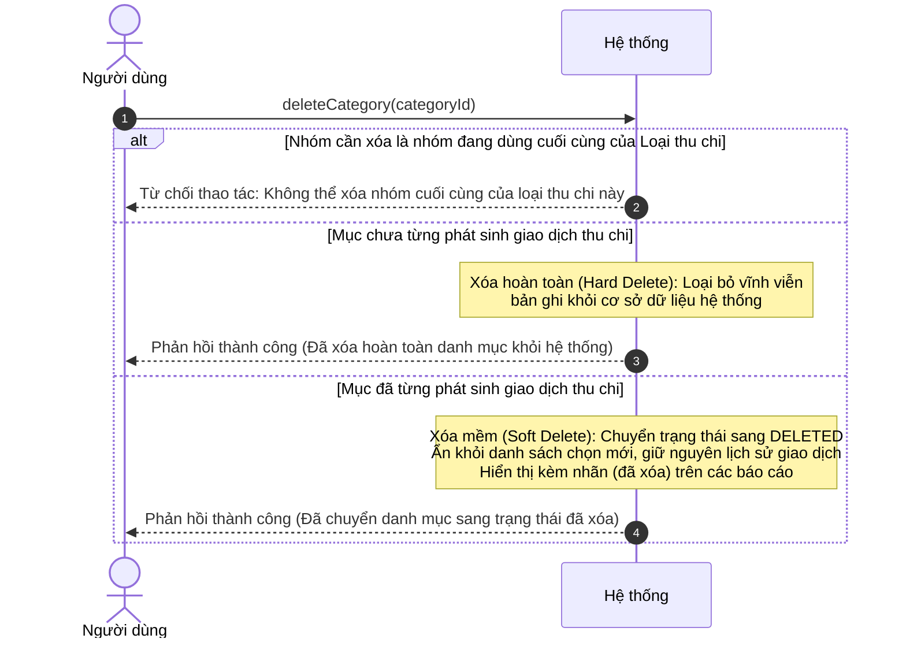

## 3.7 Nhóm Chức năng Thống kê và Báo cáo (REP)

Nhóm chức năng Thống kê và Báo cáo cung cấp các công cụ truy vấn và phân tích số liệu tài chính định kỳ cho người dùng. Các thao tác trong nhóm thực hiện trích xuất chuỗi dữ liệu 12 tháng liên tục, tính toán dòng tiền thuần và cơ cấu thu chi (`EXPENSE` gồm cả phí giao dịch, hoặc `INCOME`) theo nhóm nhu cầu và danh mục theo các quy tắc `BR-FIN-01`, `BR-FIN-02` và `BR-FIN-04` mà không làm thay đổi trạng thái dữ liệu hệ thống.

| Mã UC | Tên ca sử dụng | Thao tác hệ thống | Mục đích nghiệp vụ | Loại thao tác |
| :---: | :--- | :--- | :--- | :--- |
| `UC-REP-01` | Thống kê dòng tiền 12 tháng gần nhất | `generateCashFlowReport` | Trích xuất chuỗi dữ liệu 12 tháng liên tục, tính dòng tiền thuần và tỷ lệ tiết kiệm | Truy vấn |
| `UC-REP-02` | Phân tích cơ cấu thu chi theo nhóm và danh mục | `generateSpendingStructureReport` | Phân tích cơ cấu thu chi theo từng nhóm nhu cầu, danh mục chi tiết và biến động kỳ liền kề | Truy vấn |

### 3.7.1 Báo cáo dòng tiền 12 tháng gần nhất

Người dùng yêu cầu Hệ thống tổng hợp và phân tích chuỗi dữ liệu dòng tiền liên tục trong vòng 12 tháng tính lùi từ một mốc tháng chỉ định nhằm đánh giá xu hướng thu nhập, chi tiêu và năng lực tích lũy tài chính định kỳ.

- Thao tác hệ thống: `generateCashFlowReport(endMonth, endYear)`
- Kết quả phản hồi: Hệ thống tổng hợp và trả về bảng thống kê tài chính gồm đúng 12 dòng tháng liên tục sắp xếp theo trình tự thời gian tăng dần (gồm tổng thu nhập, tổng chi tiêu kèm phí giao dịch, dòng tiền thuần và tỷ lệ tiết kiệm từng tháng) kèm 3 chỉ số bình quân tháng trên toàn bộ chuỗi 12 tháng; thao tác hoạt động ở chế độ thuần đọc, hỗ trợ mốc thời gian tương lai mà không làm thay đổi trạng thái hay số dư tài chính của hệ thống.

**Danh sách tham số đầu vào**

| Tham số | Ý nghĩa nghiệp vụ | Ràng buộc dữ liệu |
| :--- | :--- | :--- |
| `endMonth` | Tháng kết thúc của chuỗi 12 tháng thống kê dòng tiền | Số nguyên dương từ 1 đến 12; giao diện mặc định tháng hiện tại từ đồng hồ hệ thống (`FR-REP-01`), từ chối (`ERR-REP-001`) nếu thiếu yêu cầu hoặc ngoài đoạn. |
| `endYear` | Năm kết thúc của chuỗi 12 tháng thống kê dòng tiền | Số nguyên dương hợp lệ từ năm 2000 trở đi; giao diện mặc định năm hiện tại từ đồng hồ hệ thống (`FR-REP-01`), từ chối (`ERR-REP-001`) nếu thiếu yêu cầu hoặc nhỏ hơn 2000. |

**Sơ đồ tuần tự hệ thống**

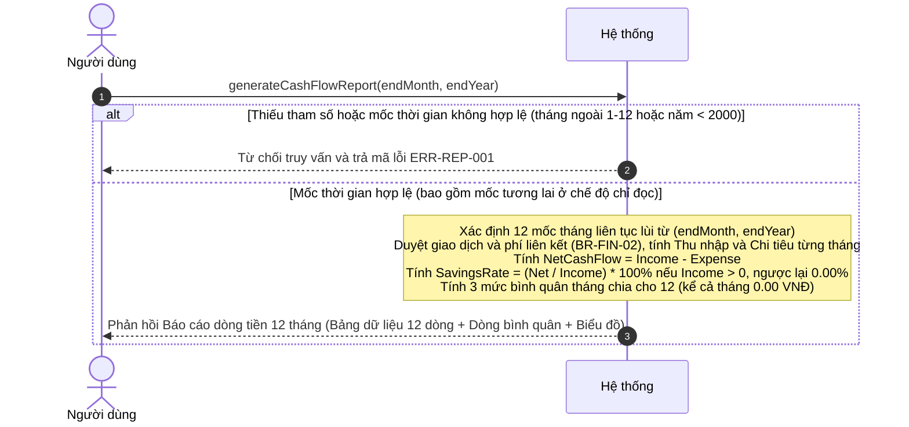

### 3.7.2 Phân tích cơ cấu thu chi theo nhóm

Người dùng yêu cầu Hệ thống phân tích tỷ trọng và cơ cấu phân bổ dòng tiền chi tiết theo từng nhóm nhu cầu và danh mục con trong một khoảng thời gian xác định, kèm đối chiếu biến động với kỳ liền trước, nhằm nhận diện thói quen chi tiêu hoặc nguồn thu nhập chính.

- Thao tác hệ thống: `generateSpendingStructureReport(startDate, endDate, transactionType)`
- Kết quả phản hồi: Hệ thống trích xuất và trả về báo cáo cơ cấu phân cấp đa tầng gồm tổng giá trị phát sinh của loại thu chi trong kỳ, biến động so với kỳ liền kề, danh sách phân bổ cho các nhóm nhu cầu (cấp 2) và danh mục chi tiết (cấp 3) có phát sinh dương kèm tỷ trọng phần trăm chính xác (theo `BR-FIN-01`, `BR-FIN-02`, `BR-FIN-04`; khi tổng kỳ bằng `0.00 VNĐ` thì tỷ trọng bằng `0.00%` và trả về danh sách rỗng); trường hợp tham số không hợp lệ, hệ thống từ chối (`ERR-REP-001`). Cho phép truy vấn khoảng thời gian tương lai ở chế độ chỉ đọc.

**Danh sách tham số đầu vào**

| Tham số | Ý nghĩa nghiệp vụ | Ràng buộc dữ liệu |
| :--- | :--- | :--- |
| `startDate` | Ngày bắt đầu khoảng thời gian phân tích | Ngày hợp lệ theo chuẩn `YYYY-MM-DD`, bắt buộc khác rỗng và thỏa mãn `startDate <= endDate` (`FR-REP-02`). |
| `endDate` | Ngày kết thúc khoảng thời gian phân tích | Ngày hợp lệ theo chuẩn `YYYY-MM-DD`, bắt buộc khác rỗng và thỏa mãn `startDate <= endDate` (`FR-REP-02`). |
| `transactionType` | Loại giao dịch tài chính cần lập báo cáo cơ cấu | Bắt buộc khác rỗng và nhận một trong hai giá trị cố định: `INCOME` (Thu nhập) hoặc `EXPENSE` (Chi tiêu, mặc định ở giao diện) theo chuẩn phân cấp (`BR-FIN-04`). |

**Sơ đồ tuần tự hệ thống**

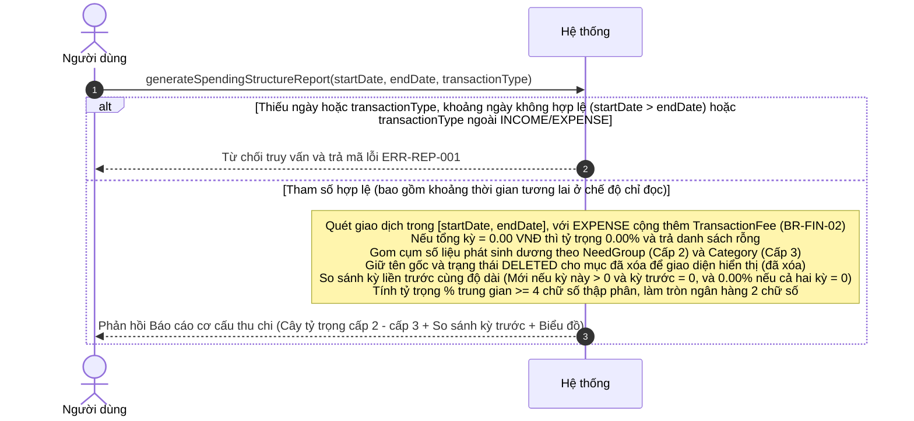

## 3.8 Nhóm Chức năng Lưu trữ và Sao lưu Dữ liệu (DAT)

Nhóm chức năng Lưu trữ và Sao lưu Dữ liệu đảm bảo an toàn và tính toàn vẹn cho dữ liệu tài chính của người dùng trên môi trường máy tính cá nhân. Các thao tác trong nhóm chịu trách nhiệm sao lưu nguyên khối dữ liệu ra tệp cục bộ, xác thực và phục hồi an toàn từ bản sao lưu, đồng thời cung cấp công cụ đối soát độc lập để phát hiện sai lệch số dư theo các quy tắc `BR-FIN-02` và `BR-FIN-03`.

| Mã UC | Tên ca sử dụng | Thao tác hệ thống | Mục đích nghiệp vụ | Loại thao tác |
| :---: | :--- | :--- | :--- | :--- |
| `UC-DAT-01` | Xuất dữ liệu tài chính | `exportBackupData` | Đóng gói toàn bộ dữ liệu tài chính của hệ thống ra tệp sao lưu an toàn | Truy vấn |
| `UC-DAT-02` | Phục hồi dữ liệu hệ thống từ bản sao lưu | `restoreBackupData` | Kiểm tra toàn vẹn tệp sao lưu và nạp lại toàn bộ dữ liệu tài chính vào bộ nhớ | Cập nhật |
| `UC-DAT-03` | Kiểm tra lại dữ liệu hệ thống | `reconcileSystemData` | Duyệt lại toàn bộ lịch sử giao dịch để đối soát độc lập tính cân bằng số dư ví | Đối soát |

### 3.8.1 Xuất dữ liệu sao lưu

Người dùng yêu cầu Hệ thống trích xuất ảnh chụp trạng thái toàn vẹn của toàn bộ dữ liệu tài chính tại một thời điểm ra tệp lưu trữ JSON trên đĩa cứng cục bộ để phòng ngừa sự cố mất mát dữ liệu hoặc phục vụ lưu trữ lâu dài.

- Thao tác hệ thống: `exportBackupData(exportPath)`
- Kết quả phản hồi: Hệ thống đóng gói toàn bộ 5 nhóm thực thể tài chính thành tệp tin JSON an toàn (mã hóa UTF-8, định dạng số học chuẩn xác theo `BR-FIN-01`), lưu trữ tại đường dẫn chỉ định và phản hồi thông báo thành công kèm đường dẫn tệp sao lưu; trường hợp đường dẫn đích không hợp lệ hoặc thiếu quyền ghi tệp, hệ thống từ chối và báo lỗi thiết bị lưu trữ.

**Danh sách tham số đầu vào**

| Tham số | Ý nghĩa nghiệp vụ | Ràng buộc dữ liệu |
| :--- | :--- | :--- |
| `exportPath` | Đường dẫn thư mục hoặc vị trí tệp đích trên máy tính cục bộ để lưu tệp sao lưu | Chuỗi ký tự biểu diễn đường dẫn hợp lệ trên hệ điều hành, thư mục phải tồn tại và ứng dụng có quyền ghi tệp (`WRITE permission`). |

**Sơ đồ tuần tự hệ thống**

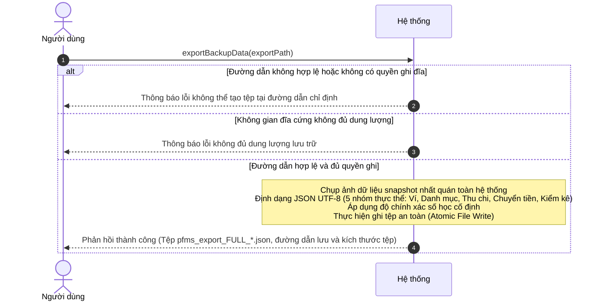

### 3.8.2 Phục hồi dữ liệu từ bản sao lưu

Người dùng yêu cầu nạp lại toàn bộ dữ liệu tài chính của hệ thống từ một tệp sao lưu JSON đã tạo trước đó, hệ thống thực hiện quy trình kiểm tra nghiêm ngặt 4 bước độc lập theo cơ chế "All-or-Nothing" trước khi ghi đè dữ liệu.

- Thao tác hệ thống: `restoreBackupData(backupFilePath)`
- Kết quả phản hồi: Hệ thống phục hồi thành công toàn bộ dữ liệu tài chính nếu tệp sao lưu vượt qua đầy đủ 4 bước kiểm định (cấu trúc JSON, phân cấp danh mục `BR-FIN-04`, liên kết chuyển tiền `BR-FIN-03`, số dư ví không âm `BR-FIN-02`), nạp lại toàn bộ vào bộ nhớ và phản hồi thông báo thành công; trường hợp phát hiện bất kỳ sai phạm nào trong 4 bước kiểm định, hệ thống hủy bỏ toàn bộ thao tác, bảo toàn 100% dữ liệu hiện tại và thông báo lý do từ chối cụ thể.

**Danh sách tham số đầu vào**

| Tham số | Ý nghĩa nghiệp vụ | Ràng buộc dữ liệu |
| :--- | :--- | :--- |
| `backupFilePath` | Đường dẫn tuyệt đối tới tệp sao lưu dữ liệu JSON trên máy tính cá nhân | Chuỗi ký tự biểu diễn đường dẫn tệp sao lưu hợp lệ trên đĩa cứng, tệp phải tồn tại, có quyền đọc (`READ permission`) và định dạng tệp là JSON theo `FR-DAT-02`. |

**Sơ đồ tuần tự hệ thống**

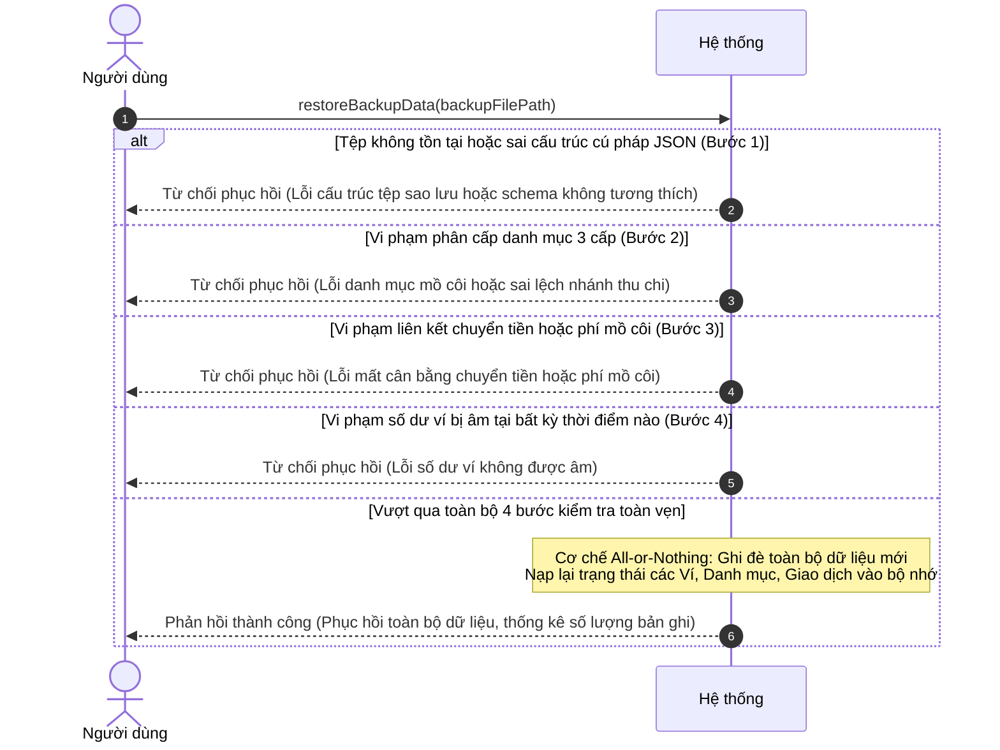

### 3.8.3 Đối soát toàn vẹn dữ liệu hệ thống

Người dùng kích hoạt tiến trình đối soát độc lập tự động của Hệ thống nhằm rà soát và kiểm chứng 4 điều kiện toàn vẹn cốt lõi của toàn bộ cơ sở dữ liệu tài chính, phát hiện kịp thời các sai lệch số dư hoặc liên kết mồ côi.

- Thao tác hệ thống: `reconcileSystemData()`
- Kết quả phản hồi: Hệ thống thực thi duyệt lại toàn bộ các bản ghi và trả về Báo cáo Kiểm tra Toàn vẹn Dữ liệu chi tiết cho cả 4 điều kiện đối soát (Số dư ví theo `BR-FIN-02`, Cân bằng nguồn - đích chuyển tiền theo `BR-FIN-03`, Toàn vẹn liên kết danh mục theo `BR-FIN-04`, và Toàn vẹn liên kết phí chuyển tiền), phân loại mức độ nghiêm trọng (`INFO`, `WARNING`, `ERROR`) kèm khuyến nghị khắc phục nếu phát hiện sai lệch; thao tác là thuần kiểm tra chỉ đọc, không làm biến động số dư hoặc sửa đổi bản ghi tài chính.

**Danh sách tham số đầu vào**

Thao tác này không yêu cầu tham số đầu vào.

**Sơ đồ tuần tự hệ thống**

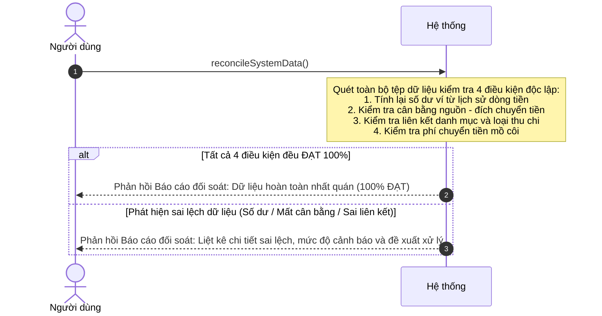
