# 3. Sơ đồ tuần tự hệ thống

Sơ đồ tuần tự hệ thống (SSD) mô tả trình tự tương tác theo thời gian giữa người dùng và hệ thống cho từng kịch bản ca sử dụng. Ở giai đoạn phân tích, sơ đồ chuyển hóa các bước nghiệp vụ thành các sự kiện đầu vào tường minh, làm cơ sở xác định hợp đồng thao tác tại mục 4 trước khi thiết kế chi tiết lớp.

## 3.1 Nguyên tắc mô hình hóa và ranh giới tương tác hệ thống

Ở tầng phân tích, hệ thống được xem như một hộp đen thống nhất, chỉ xét thông tin người dùng gửi vào và kết quả hệ thống phản hồi mà không đi vào cấu trúc nội bộ (bộ điều khiển, dịch vụ, lớp dữ liệu hay cơ sở dữ liệu).

Yêu cầu từ người dùng được chuẩn hóa thành các thao tác hệ thống dạng động từ kết hợp danh từ (như `createWallet`, `recordIncomeExpense`, `transferFunds`) với tham số mang ý nghĩa nghiệp vụ, độc lập với ngôn ngữ lập trình. Hệ thống kiểm tra các quy tắc về số dư và tính hợp lệ dữ liệu để phản hồi thành công hoặc từ chối kèm mã lỗi tương ứng.

## 3.2 Tổng hợp thao tác hệ thống theo nhóm chức năng

Hệ thống PFMS cung cấp 20 thao tác tương ứng với 20 ca sử dụng thuộc 6 nhóm chức năng nhằm truy vấn hoặc thay đổi trạng thái các thực thể tài chính:

| STT | Nhóm chức năng | Mã nhóm | Ca sử dụng | Thao tác hệ thống |
| :---: | :--- | :---: | :---: | :--- |
| 1 | Quản lý ví | `WAL` | `UC-WAL-01` – `UC-WAL-04` | `createWallet`, `getWalletsSummary`, `updateWallet`, `adjustBalance` |
| 2 | Ghi nhận thu chi | `TXN` | `UC-TXN-01` – `UC-TXN-04` | `recordIncomeExpense`, `filterTransactions`, `updateTransaction`, `deleteTransaction` |
| 3 | Chuyển tiền nội bộ | `TRF` | `UC-TRF-01` – `UC-TRF-03` | `transferFunds`, `filterTransfers`, `deleteTransfer` |
| 4 | Danh mục phân loại | `CAT` | `UC-CAT-01` – `UC-CAT-04` | `addCategory`, `renameCategory`, `restoreCategory`, `deleteCategory` |
| 5 | Thống kê và báo cáo | `REP` | `UC-REP-01`, `UC-REP-02` | `generateCashFlowReport`, `generateSpendingStructureReport` |
| 6 | Lưu trữ và sao lưu | `DAT` | `UC-DAT-01` – `UC-DAT-03` | `exportBackupData`, `restoreBackupData`, `reconcileSystemData` |

Chi tiết tham số, phản hồi và sơ đồ tuần tự của từng thao tác được trình bày từ mục 3.3 đến mục 3.8.

## 3.3 Nhóm chức năng Quản lý ví (WAL)

Nhóm chức năng Quản lý ví quản lý các nguồn tiền thanh toán, theo dõi số dư khả dụng và xử lý chênh lệch kiểm kê, tuân thủ quy tắc đặt tên duy nhất (`BR-NAM-01`) và bảo toàn số dư không âm (`BR-FIN-02`).

| Mã UC | Tên ca sử dụng | Thao tác hệ thống | Mục đích nghiệp vụ | Loại thao tác |
| :---: | :--- | :--- | :--- | :--- |
| `UC-WAL-01` | Tạo ví mới | `createWallet` | Khởi tạo nguồn tiền mới với số dư ban đầu bằng 0 | Ghi nhận |
| `UC-WAL-02` | Theo dõi số dư tính lại và cơ cấu ví | `getWalletsSummary` | Tính số dư khả dụng tức thời và tỷ lệ phân bổ ví | Truy vấn |
| `UC-WAL-03` | Cập nhật thông tin ví | `updateWallet` | Sửa tên, ghi chú hoặc chuyển đổi trạng thái lưu trữ ví | Cập nhật |
| `UC-WAL-04` | Điều chỉnh số dư ví | `adjustBalance` | Ghi nhận mốc chênh lệch kiểm kê thực tế | Ghi nhận |

### 3.3.1 Tạo ví mới

Người dùng yêu cầu khởi tạo ví mới kèm tên và ghi chú. Hệ thống kiểm tra tên ví (`BR-NAM-01`), tạo ví với số dư khởi điểm `0.00 VNĐ` (`BR-FIN-02`) và tính lại cơ cấu phân bổ ví (`FR-WAL-04`).

- **Thao tác hệ thống**: `createWallet(walletName, note)`
- **Kết quả phản hồi**: Khởi tạo ví ở trạng thái `ACTIVE` với số dư `0.00 VNĐ` (`BR-FIN-02`), cập nhật cơ cấu số dư và trả về thông tin ví mới; từ chối nếu tên sai định dạng (`ERR-NAM-001`), trùng tên (`ERR-NAM-002`) hoặc ghi chú quá 255 ký tự.

**Tham số đầu vào**

| Tham số | Ý nghĩa nghiệp vụ | Ràng buộc dữ liệu |
| :--- | :--- | :--- |
| `walletName` | Tên ví mới | Chuỗi 1–50 ký tự sau khi `trim`, không rỗng (`ERR-NAM-001`), duy nhất toàn hệ thống (cả ví `ACTIVE` và `ARCHIVED`, không phân biệt hoa thường) (`BR-NAM-01`, `ERR-NAM-002`). |
| `note` | Ghi chú ví | Chuỗi tùy chọn, tối đa 255 ký tự sau khi `trim` (`FR-WAL-01`). |

**Sơ đồ tuần tự hệ thống**

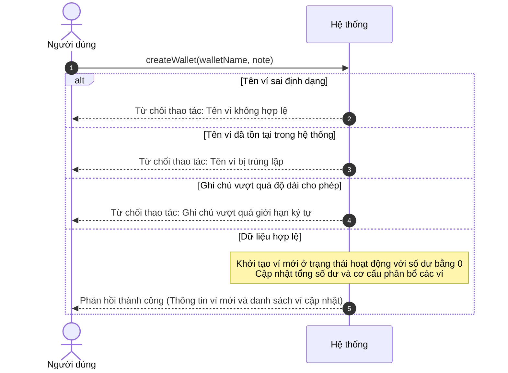

### 3.3.2 Xem tổng hợp số dư và cơ cấu ví

Người dùng truy vấn danh sách ví để xem số dư khả dụng và tỷ trọng phân bổ tài sản. Hệ thống tính lại số dư từng ví từ lịch sử dòng tiền (`BR-FIN-02`) và làm tròn tỷ lệ phân bổ (`BR-FIN-01`, `FR-WAL-04`).

- **Thao tác hệ thống**: `getWalletsSummary()` (không có tham số đầu vào)
- **Kết quả phản hồi**: Trả về danh sách ví kèm số dư tính lại (`BR-FIN-02`), tổng số dư hệ thống và tỷ lệ phân bổ từng ví làm tròn ngân hàng 2 chữ số thập phân (`BR-FIN-01`); gán `0.00%` cho mọi ví nếu tổng số dư bằng `0.00 VNĐ` (`ERR-FIN-002`). Thao tác chỉ đọc dữ liệu.

**Sơ đồ tuần tự hệ thống**

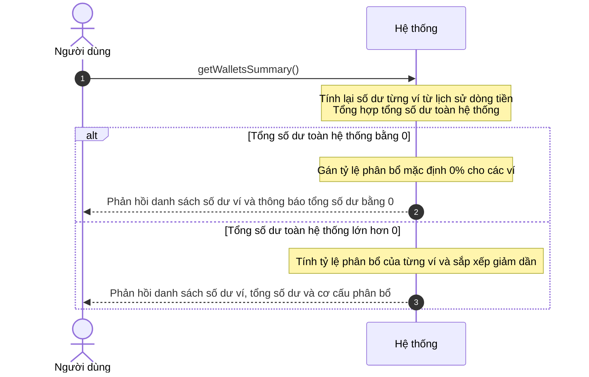

### 3.3.3 Cập nhật thông tin ví

Người dùng yêu cầu sửa tên hoặc ghi chú của ví hiện có. Hệ thống kiểm tra tính hợp lệ (`BR-NAM-01`) và cập nhật thông tin mà không làm thay đổi số dư hay lịch sử giao dịch (`BR-FIN-02`).

- **Thao tác hệ thống**: `updateWallet(walletId, walletName, note)`
- **Kết quả phản hồi**: Cập nhật tên và ghi chú mới, giữ nguyên `walletId`, số dư và giao dịch liên kết (`BR-FIN-02`); từ chối nếu không tìm thấy ví, tên sai định dạng (`ERR-NAM-001`), trùng tên (`ERR-NAM-002`) hoặc ghi chú quá 255 ký tự.

**Tham số đầu vào**

| Tham số | Ý nghĩa nghiệp vụ | Ràng buộc dữ liệu |
| :--- | :--- | :--- |
| `walletId` | Mã định danh ví | Bắt buộc tồn tại trong danh sách ví (`FR-WAL-03`). |
| `walletName` | Tên gọi mới | Chuỗi 1–50 ký tự sau khi `trim`, không rỗng (`ERR-NAM-001`), duy nhất toàn hệ thống, không phân biệt hoa thường (`BR-NAM-01`, `ERR-NAM-002`). |
| `note` | Ghi chú mới | Chuỗi tùy chọn, tối đa 255 ký tự sau khi `trim` (`FR-WAL-03`). |

**Sơ đồ tuần tự hệ thống**

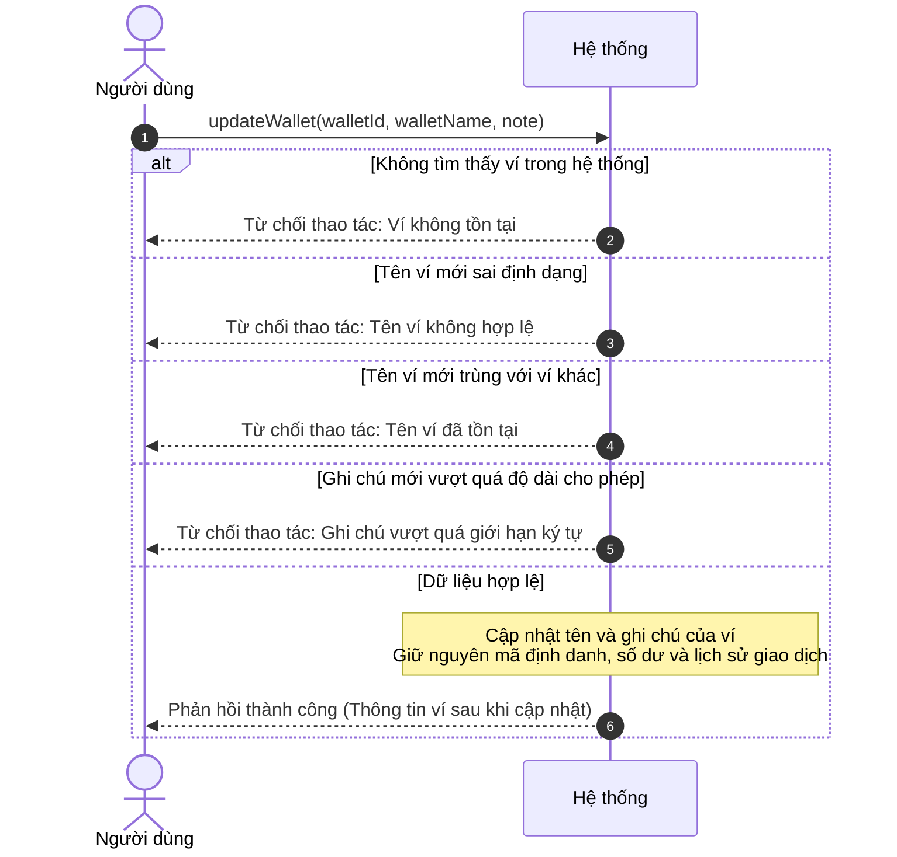

### 3.3.4 Điều chỉnh số dư ví thực tế

Người dùng đối chiếu tiền thực tế với phần mềm và yêu cầu điều chỉnh khi có chênh lệch. Hệ thống tính mức chênh lệch (`BR-FIN-01`), tạo bản ghi điều chỉnh bất biến và đồng bộ số dư ví theo giá trị thực tế (`BR-FIN-02`).

- **Thao tác hệ thống**: `adjustBalance(walletId, actualBalance, reason)`
- **Kết quả phản hồi**: Tạo bản ghi `BalanceAdjustmentRecord` bất biến, đồng bộ số dư ví bằng `actualBalance` (`BR-FIN-02`) và trả về bản ghi vừa tạo; từ chối nếu ví không `ACTIVE`, sai định dạng số (`ERR-FIN-001`), số dư thực tế âm (`ERR-WAL-001`), chênh lệch bằng `0.00 VNĐ` hoặc lý do quá 255 ký tự.

**Tham số đầu vào**

| Tham số | Ý nghĩa nghiệp vụ | Ràng buộc dữ liệu |
| :--- | :--- | :--- |
| `walletId` | Mã ví cần điều chỉnh | Tồn tại và đang ở trạng thái `ACTIVE` (`FR-WAL-05`). |
| `actualBalance` | Số dư thực tế | Số thập phân 2 chữ số (`BR-FIN-01`, `ERR-FIN-001`), ≥ 0.00 VNĐ (`BR-FIN-02`, `ERR-WAL-001`) và khác số dư hiện tại của ví (`FR-WAL-05`). |
| `reason` | Lý do chênh lệch | Chuỗi tùy chọn, tối đa 255 ký tự sau khi `trim` (`FR-WAL-05`). |

**Sơ đồ tuần tự hệ thống**

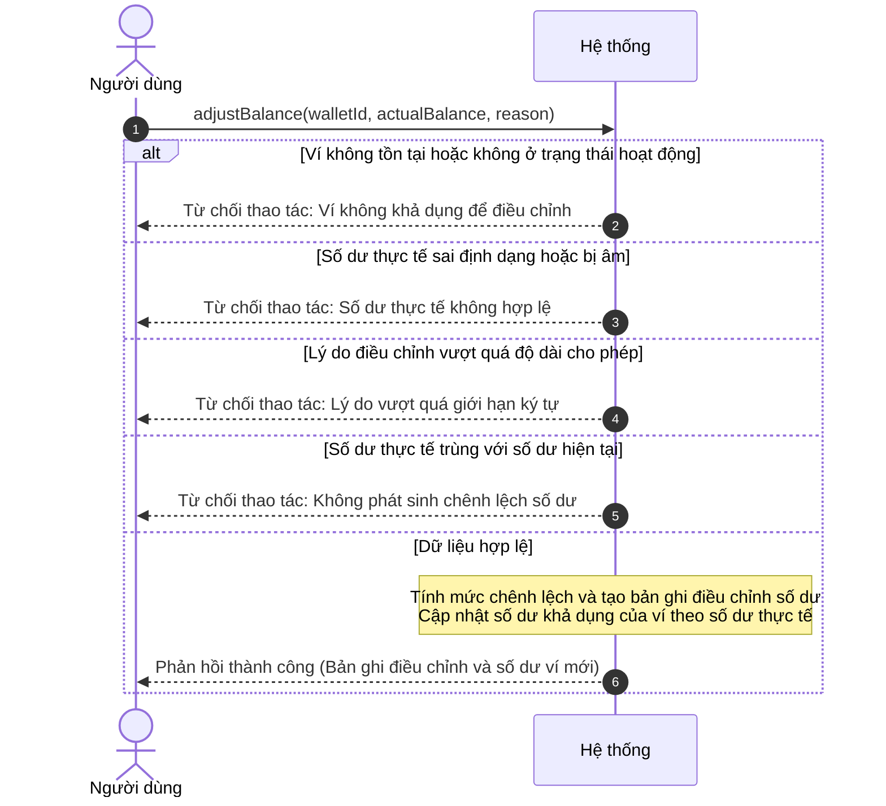

## 3.4 Nhóm chức năng Ghi nhận thu chi (TXN)

Nhóm chức năng Ghi nhận thu chi hạch toán các khoản thu nhập, chi tiêu kèm phí phát sinh, đồng thời kiểm soát việc sửa, xóa giao dịch nhằm bảo toàn số dư ví không âm (`BR-FIN-02`) và phân cấp danh mục 3 cấp (`BR-FIN-04`).

| Mã UC | Tên ca sử dụng | Thao tác hệ thống | Mục đích nghiệp vụ | Loại thao tác |
| :---: | :--- | :--- | :--- | :--- |
| `UC-TXN-01` | Ghi nhận giao dịch thu chi | `recordIncomeExpense` | Ghi nhận khoản thu/chi kèm chi phí liên kết (nếu có) | Ghi nhận |
| `UC-TXN-02` | Tra cứu và lọc lịch sử giao dịch thu chi | `filterTransactions` | Trích xuất danh sách thu chi theo thời gian, ví và danh mục | Truy vấn |
| `UC-TXN-03` | Chỉnh sửa giao dịch thu chi | `updateTransaction` | Điều chỉnh thuộc tính giao dịch, hoàn nguyên tác động cũ và kiểm soát số dư | Cập nhật |
| `UC-TXN-04` | Xóa giao dịch thu chi | `deleteTransaction` | Xóa giao dịch, hoàn nguyên số dư ví và xóa chi phí kèm theo | Xóa |

### 3.4.1 Ghi nhận giao dịch thu chi

Người dùng gửi thông tin khoản thu/chi kèm ví thanh toán, danh mục và phí phát sinh (nếu có). Hệ thống kiểm tra danh mục cấp 3 (`BR-FIN-04`), số dư ví (`BR-FIN-02`) và ghi nhận đồng thời giao dịch gốc cùng bản ghi phí liên kết.

- **Thao tác hệ thống**: `recordIncomeExpense(walletId, categoryId, amount, transactionDate, note, feeAmount, feeCategoryId)`
- **Kết quả phản hồi**: Tạo `IncomeExpenseTransaction`, tạo `TransactionFee` liên kết nếu `feeAmount > 0.00 VNĐ`, cập nhật số dư ví (`BR-FIN-02`) và trả về giao dịch vừa lưu; từ chối nếu số tiền sai định dạng hoặc ≤ 0 (`ERR-FIN-001`), phí âm (`ERR-FEE-001`), thiếu danh mục phí (`ERR-FEE-002`), danh mục phí sai loại/đã xóa (`ERR-FEE-003`), ví không đủ số dư (`ERR-WAL-001`), hoặc ví/danh mục không hợp lệ (`BR-FIN-04`).

**Tham số đầu vào**

| Tham số | Ý nghĩa nghiệp vụ | Ràng buộc dữ liệu |
| :--- | :--- | :--- |
| `walletId` | Mã ví thanh toán | Tồn tại và đang `ACTIVE` (`FR-TXN-01`, `FR-TXN-02`). Số dư sau giao dịch và phí phải ≥ 0.00 VNĐ (`BR-FIN-02`, `ERR-WAL-001`). |
| `categoryId` | Mã danh mục cấp 3 | Đang `ACTIVE`, thuộc nhánh `INCOME` hoặc `EXPENSE` (`BR-FIN-04`). |
| `amount` | Số tiền giao dịch | Số thập phân 2 chữ số, > 0.00 VNĐ (`BR-FIN-01`, `ERR-FIN-001`). |
| `transactionDate` | Ngày giao dịch | Định dạng `YYYY-MM-DD`, không vượt quá ngày hiện tại (`FR-TXN-01`, `FR-TXN-02`). |
| `note` | Ghi chú | Chuỗi tùy chọn, tối đa 255 ký tự sau khi `trim` (`FR-TXN-01`, `FR-TXN-02`). |
| `feeAmount` | Số tiền phí | Số thập phân 2 chữ số (`BR-FIN-01`), ≥ 0.00 VNĐ, mặc định `0.00 VNĐ` (`BR-FIN-02`, `ERR-FEE-001`). |
| `feeCategoryId` | Mã danh mục phí | Tùy chọn khi `feeAmount = 0.00 VNĐ`, bắt buộc khi `feeAmount > 0.00 VNĐ` (`ERR-FEE-002`); phải là danh mục cấp 3 đang `ACTIVE` thuộc nhánh `EXPENSE` (`BR-FIN-04`, `ERR-FEE-003`). |

**Sơ đồ tuần tự hệ thống**

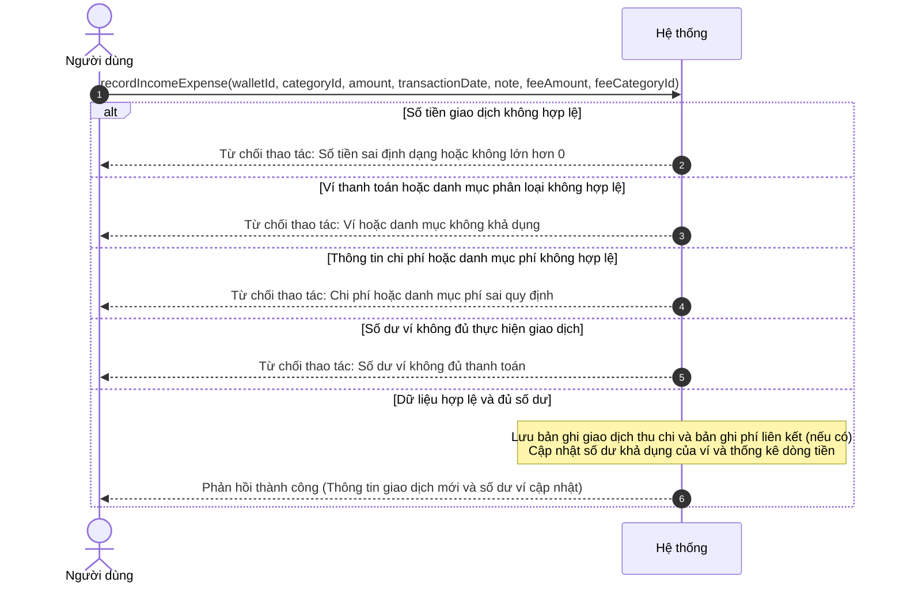

### 3.4.2 Tra cứu và lọc lịch sử giao dịch

Người dùng gửi tiêu chí lọc theo khoảng thời gian, ví và danh mục. Hệ thống lọc sổ giao dịch và tổng hợp tổng thu, tổng chi (gồm cả phí) cùng dòng tiền thuần (`BR-FIN-01`).

- **Thao tác hệ thống**: `filterTransactions(startDate, endDate, walletId, categoryId)`
- **Kết quả phản hồi**: Trả về danh sách giao dịch thu chi và phí thỏa mãn bộ lọc sắp xếp theo ngày giảm dần (kèm nhãn "(đã xóa)" nếu danh mục đã xóa mềm), cùng tổng thu, tổng chi và dòng tiền thuần (`BR-FIN-01`); từ chối nếu `startDate > endDate`. Thao tác chỉ đọc dữ liệu.

**Tham số đầu vào**

| Tham số | Ý nghĩa nghiệp vụ | Ràng buộc dữ liệu |
| :--- | :--- | :--- |
| `startDate` | Ngày bắt đầu | Định dạng `YYYY-MM-DD`, `≤ endDate` (`FR-TXN-03`). |
| `endDate` | Ngày kết thúc | Định dạng `YYYY-MM-DD`, `≥ startDate` (`FR-TXN-03`). |
| `walletId` | Mã ví cần lọc | Tùy chọn; để trống để lấy toàn bộ ví (`FR-TXN-03`). |
| `categoryId` | Mã nhóm hoặc danh mục | Tùy chọn; nhận mã `NeedGroup` hoặc `Category` (kể cả mục đã `DELETED`) (`BR-FIN-04`, `FR-TXN-03`). |

**Sơ đồ tuần tự hệ thống**

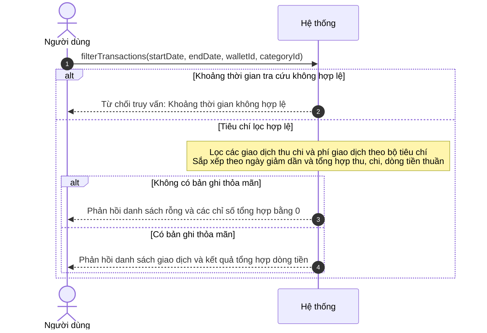

### 3.4.3 Chỉnh sửa giao dịch thu chi

Người dùng yêu cầu sửa thông tin một giao dịch thu chi đã lưu. Hệ thống hoàn nguyên tác động cũ trên ví ban đầu và áp dụng thông số mới lên ví đích trong cùng một bước nguyên tử, đảm bảo số dư các ví không âm (`BR-FIN-02`).

- **Thao tác hệ thống**: `updateTransaction(transactionId, walletId, categoryId, amount, transactionDate, note, feeAmount, feeCategoryId)`
- **Kết quả phản hồi**: Hoàn nguyên số dư ví cũ, cập nhật số dư ví mới (`BR-FIN-02`), cập nhật giao dịch gốc và đồng bộ (tạo/sửa/xóa) `TransactionFee` liên kết; từ chối và giữ nguyên dữ liệu cũ nếu sai định dạng tiền (`ERR-FIN-001`), phí âm (`ERR-FEE-001`), thiếu/sai danh mục phí (`ERR-FEE-002`, `ERR-FEE-003`), làm âm số dư ví (`ERR-WAL-001`), hoặc khi giao dịch không tồn tại, sửa trực tiếp bản ghi phí hay đổi loại thu chi (`BR-FIN-04`).

**Tham số đầu vào**

| Tham số | Ý nghĩa nghiệp vụ | Ràng buộc dữ liệu |
| :--- | :--- | :--- |
| `transactionId` | Mã giao dịch cần sửa | Giao dịch gốc tồn tại trong sổ thu chi (`FR-TXN-04`), không phải bản ghi phí độc lập (`BR-FIN-02`). |
| `walletId` | Mã ví thanh toán mới | Tồn tại và đang `ACTIVE`. Số dư ví cũ sau hoàn nguyên và ví mới sau cập nhật phải ≥ 0.00 VNĐ (`BR-FIN-02`, `ERR-WAL-001`). |
| `categoryId` | Mã danh mục cấp 3 mới | Cùng nhánh `TransactionType` với giao dịch gốc (`BR-FIN-04`). Phải đang `ACTIVE` nếu chọn mới, hoặc giữ nguyên danh mục cũ đã xóa mềm (`FR-TXN-04`). |
| `amount` | Số tiền mới | Số thập phân 2 chữ số, > 0.00 VNĐ (`BR-FIN-01`, `ERR-FIN-001`). |
| `transactionDate` | Ngày giao dịch mới | Định dạng `YYYY-MM-DD`, không vượt quá ngày hiện tại (`FR-TXN-04`). |
| `note` | Ghi chú mới | Chuỗi tùy chọn, tối đa 255 ký tự sau khi `trim` (`FR-TXN-04`). |
| `feeAmount` | Số tiền phí mới | Số thập phân 2 chữ số (`BR-FIN-01`), ≥ 0.00 VNĐ (`BR-FIN-02`, `ERR-FEE-001`). |
| `feeCategoryId` | Mã danh mục phí mới | Bắt buộc khi `feeAmount > 0.00 VNĐ` (`ERR-FEE-002`); thuộc nhánh `EXPENSE` và đang `ACTIVE` (hoặc giữ nguyên danh mục phí cũ đã xóa mềm) (`FR-TXN-04`, `ERR-FEE-003`). |

**Sơ đồ tuần tự hệ thống**

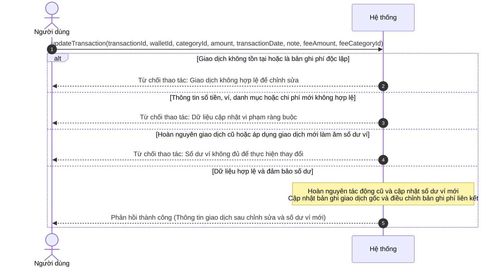

### 3.4.4 Xóa giao dịch thu chi

Người dùng yêu cầu xóa một giao dịch thu chi. Hệ thống kiểm tra số dư hoàn nguyên (`BR-FIN-02`), xóa đồng thời giao dịch gốc cùng bản ghi phí liên kết và khôi phục số dư ví.

- **Thao tác hệ thống**: `deleteTransaction(transactionId)`
- **Kết quả phản hồi**: Xóa vĩnh viễn giao dịch gốc và `TransactionFee` đi kèm, hoàn nguyên số dư ví (`BR-FIN-02`); từ chối nếu không tìm thấy giao dịch, xóa trực tiếp bản ghi phí độc lập, hoặc việc trừ lại khoản thu làm âm số dư ví (`ERR-WAL-001`).

**Tham số đầu vào**

| Tham số | Ý nghĩa nghiệp vụ | Ràng buộc dữ liệu |
| :--- | :--- | :--- |
| `transactionId` | Mã giao dịch cần xóa | Giao dịch gốc tồn tại (`FR-TXN-05`), không phải bản ghi phí độc lập. Nếu xóa giao dịch `INCOME`, số dư ví sau khi trừ khoản thu và hoàn phí phải ≥ 0.00 VNĐ (`BR-FIN-02`, `ERR-WAL-001`). |

**Sơ đồ tuần tự hệ thống**

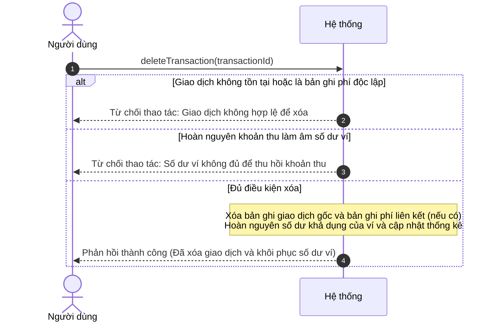

## 3.5 Nhóm chức năng Chuyển tiền nội bộ (TRF)

Nhóm chức năng Chuyển tiền nội bộ điều chuyển tiền giữa các ví của người dùng theo cơ chế ghi nhận đồng thời (trừ ví nguồn, cộng ví đích kèm phí phát sinh theo `BR-FIN-03`) và bảo toàn số dư không âm (`BR-FIN-02`).

| Mã UC | Tên ca sử dụng | Thao tác hệ thống | Mục đích nghiệp vụ | Loại thao tác |
| :---: | :--- | :--- | :--- | :--- |
| `UC-TRF-01` | Chuyển tiền nội bộ giữa hai ví | `transferFunds` | Điều chuyển tiền giữa hai ví theo cơ chế ghi nhận đồng thời kèm phí (nếu có) | Ghi nhận |
| `UC-TRF-02` | Tra cứu lịch sử chuyển tiền | `filterTransfers` | Trích xuất lịch sử chuyển tiền nội bộ và tổng chi phí phát sinh | Truy vấn |
| `UC-TRF-03` | Xóa giao dịch chuyển tiền | `deleteTransfer` | Hủy giao dịch chuyển tiền, hoàn nguyên đồng thời số dư hai ví và xóa phí | Xóa |

### 3.5.1 Chuyển tiền giữa hai ví

Người dùng yêu cầu chuyển tiền từ ví nguồn sang ví đích kèm phí chuyển tiền (nếu có). Hệ thống kiểm tra hai ví phân biệt (`BR-FIN-03`) và số dư ví nguồn (`BR-FIN-02`), sau đó trừ ví nguồn, cộng ví đích đồng thời và tạo bản ghi phí liên kết.

- **Thao tác hệ thống**: `transferFunds(sourceWalletId, destinationWalletId, amount, transferDate, note, feeAmount, feeCategoryId)`
- **Kết quả phản hồi**: Tạo `TransferTransaction`, trừ đồng thời `amount + feeAmount` ở ví nguồn, cộng `amount` vào ví đích (`BR-FIN-03`), tạo `TransactionFee` (loại `EXPENSE`) nếu `feeAmount > 0.00 VNĐ` và trả về số dư mới của hai ví; từ chối nếu trùng ví nguồn và đích (`ERR-TRF-001`), số tiền chuyển ≤ 0 (`ERR-TRF-002`), sai định dạng số (`ERR-FIN-001`), phí âm (`ERR-FEE-001`), thiếu/sai danh mục phí (`ERR-FEE-002`, `ERR-FEE-003`) hoặc ví nguồn không đủ số dư (`ERR-WAL-001`).

**Tham số đầu vào**

| Tham số | Ý nghĩa nghiệp vụ | Ràng buộc dữ liệu |
| :--- | :--- | :--- |
| `sourceWalletId` | Mã ví nguồn | Tồn tại, đang `ACTIVE` (`BR-FIN-03`) và có số dư `≥ amount + feeAmount` (`BR-FIN-02`, `ERR-WAL-001`). |
| `destinationWalletId` | Mã ví đích | Tồn tại, đang `ACTIVE` và khác `sourceWalletId` (`BR-FIN-03`, `ERR-TRF-001`). |
| `amount` | Số tiền chuyển | Số thập phân 2 chữ số (`BR-FIN-01`, `ERR-FIN-001`), > 0.00 VNĐ (`BR-FIN-03`, `ERR-TRF-002`). |
| `transferDate` | Ngày chuyển tiền | Định dạng `YYYY-MM-DD`, không vượt quá ngày hiện tại (`FR-TRF-01`). |
| `note` | Ghi chú | Chuỗi tùy chọn, tối đa 255 ký tự sau khi `trim` (`FR-TRF-01`). |
| `feeAmount` | Số tiền phí chuyển | Số thập phân 2 chữ số (`BR-FIN-01`), ≥ 0.00 VNĐ, mặc định `0.00 VNĐ` (`BR-FIN-03`, `ERR-FEE-001`). |
| `feeCategoryId` | Mã danh mục phí | Tùy chọn khi `feeAmount = 0.00 VNĐ`, bắt buộc khi `feeAmount > 0.00 VNĐ` (`ERR-FEE-002`); phải là danh mục cấp 3 đang `ACTIVE` thuộc nhánh `EXPENSE` (`BR-FIN-04`, `ERR-FEE-003`). |

**Sơ đồ tuần tự hệ thống**

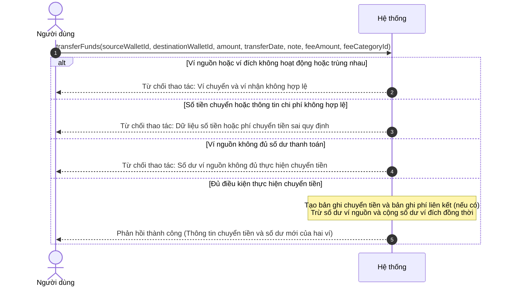

### 3.5.2 Tra cứu lịch sử chuyển tiền

Người dùng truy vấn lịch sử chuyển tiền nội bộ theo khoảng thời gian, ví nguồn hoặc ví đích. Hệ thống lọc sổ chuyển tiền kèm phí liên kết và trả về danh sách sắp xếp theo ngày giảm dần (`FR-TRF-02`).

- **Thao tác hệ thống**: `filterTransfers(startDate, endDate, sourceWalletId, destinationWalletId)`
- **Kết quả phản hồi**: Trả về danh sách bản ghi chuyển tiền thỏa mãn bộ lọc sắp xếp theo ngày giảm dần kèm tổng tiền chuyển và tổng chi phí (`BR-FIN-01`); từ chối nếu `startDate > endDate`. Thao tác chỉ đọc dữ liệu.

**Tham số đầu vào**

| Tham số | Ý nghĩa nghiệp vụ | Ràng buộc dữ liệu |
| :--- | :--- | :--- |
| `startDate` | Ngày bắt đầu | Tùy chọn, định dạng `YYYY-MM-DD`, `≤ endDate` (`FR-TRF-02`). |
| `endDate` | Ngày kết thúc | Tùy chọn, định dạng `YYYY-MM-DD`, `≥ startDate` (`FR-TRF-02`). |
| `sourceWalletId` | Mã ví nguồn | Tùy chọn; để trống để lấy toàn bộ ví nguồn (`FR-TRF-02`). |
| `destinationWalletId` | Mã ví đích | Tùy chọn; để trống để lấy toàn bộ ví đích (`FR-TRF-02`). |

**Sơ đồ tuần tự hệ thống**

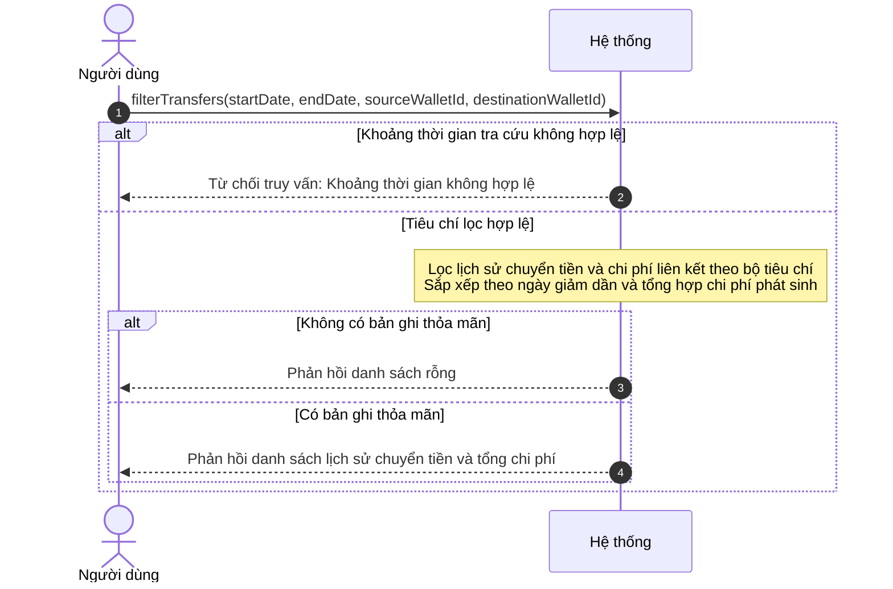

### 3.5.3 Xóa giao dịch chuyển tiền

Người dùng yêu cầu xóa một giao dịch chuyển tiền để khôi phục số dư hai ví. Hệ thống kiểm tra số dư ví đích (`BR-FIN-02`), xóa đồng thời bản ghi chuyển tiền cùng phí liên kết và hoàn nguyên số dư hai ví (`BR-FIN-03`).

- **Thao tác hệ thống**: `deleteTransfer(transferId)`
- **Kết quả phản hồi**: Xóa vĩnh viễn `TransferTransaction` và `TransactionFee` liên kết, hoàn nguyên đồng thời hai đầu ví (`BR-FIN-02`, `BR-FIN-03`); từ chối nếu giao dịch không tồn tại hoặc ví đích không đủ số dư để thu hồi (`ERR-WAL-001`).

**Tham số đầu vào**

| Tham số | Ý nghĩa nghiệp vụ | Ràng buộc dữ liệu |
| :--- | :--- | :--- |
| `transferId` | Mã chuyển tiền cần xóa | Tồn tại trong hệ thống (`FR-TRF-02`). Số dư hiện tại của ví đích phải `≥ amount` để không làm âm ví đích khi thu hồi (`BR-FIN-02`, `BR-FIN-03`, `ERR-WAL-001`). |

**Sơ đồ tuần tự hệ thống**

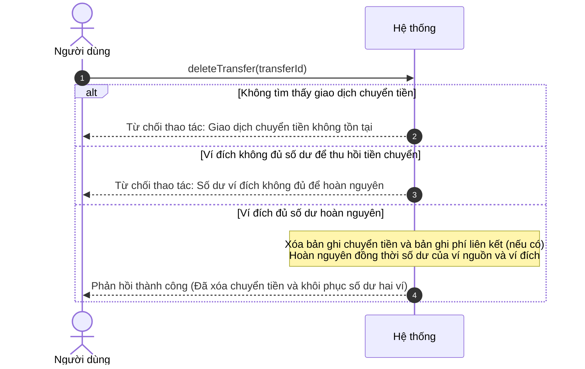

## 3.6 Nhóm chức năng Danh mục phân loại (CAT)

Nhóm chức năng Danh mục phân loại quản lý cây phân loại thu chi 3 cấp (`BR-FIN-04`), bảo đảm tính duy nhất của tên gọi (`BR-NAM-01`) và bảo toàn lịch sử giao dịch thông qua cơ chế xóa mềm.

| Mã UC | Tên ca sử dụng | Thao tác hệ thống | Mục đích nghiệp vụ | Loại thao tác |
| :---: | :--- | :--- | :--- | :--- |
| `UC-CAT-01` | Bổ sung danh mục phân loại mới | `addCategory` | Tạo mới danh mục chi tiết hoặc nhóm nhu cầu trong cây phân cấp | Ghi nhận |
| `UC-CAT-02` | Đổi tên danh mục | `renameCategory` | Đổi tên hiển thị của danh mục hoặc nhóm nhu cầu | Cập nhật |
| `UC-CAT-03` | Khôi phục hoặc tạo lại mục đã xóa | `restoreCategory` | Phục hồi trạng thái hoạt động cho mục đã xóa mềm | Cập nhật |
| `UC-CAT-04` | Xóa danh mục hoặc nhóm | `deleteCategory` | Xóa vĩnh viễn mục chưa có dữ liệu hoặc xóa mềm nếu đã có giao dịch | Xóa |

### 3.6.1 Thêm danh mục phân loại mới

Người dùng yêu cầu thêm một danh mục chi tiết (cấp 3) vào nhóm nhu cầu đang hoạt động (cấp 2), hoặc thêm một nhóm nhu cầu (cấp 2) vào nhánh loại thu chi (cấp 1).

- **Thao tác hệ thống**: `addCategory(categoryName, parentCategoryId)`
- **Kết quả phản hồi**: Khởi tạo bản ghi mới ở trạng thái `ACTIVE`, kế thừa loại thu chi từ nhánh cha và trả về cây danh mục đã cập nhật; từ chối nếu tên sai định dạng/rỗng (`ERR-NAM-001`), trùng tên trong cùng cấp cha (`ERR-NAM-002`) hoặc nhóm cha đã bị xóa (`ERR-CAT-005`).

**Tham số đầu vào**

| Tham số | Ý nghĩa nghiệp vụ | Ràng buộc dữ liệu |
| :--- | :--- | :--- |
| `categoryName` | Tên danh mục/nhóm mới | Chuỗi 1–50 ký tự sau khi `trim`, không rỗng (`ERR-NAM-001`), duy nhất trong cùng nhóm cha hoặc cùng loại thu chi (`BR-NAM-01`, `ERR-NAM-002`). |
| `parentCategoryId` | Mã nhóm cha hoặc loại thu chi | Mã hợp lệ của `NeedGroup` (khi tạo cấp 3) hoặc `TransactionType` (`INCOME`/`EXPENSE`, khi tạo cấp 2). Nhóm cha phải đang `ACTIVE` (`BR-FIN-04`, `ERR-CAT-005`). |

**Sơ đồ tuần tự hệ thống**

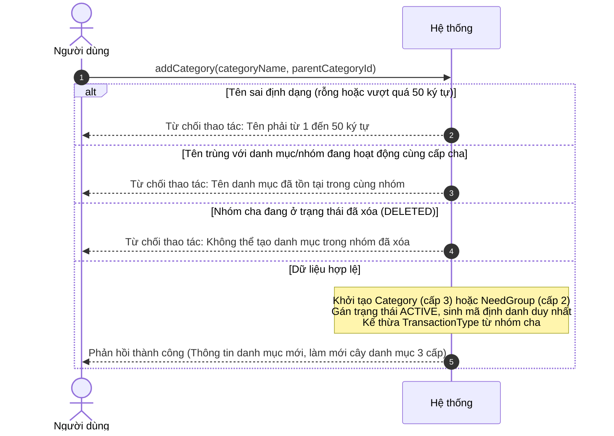

### 3.6.2 Đổi tên danh mục

Người dùng yêu cầu đổi tên hiển thị của một danh mục chi tiết hoặc nhóm nhu cầu mà không làm thay đổi các liên kết giao dịch lịch sử.

- **Thao tác hệ thống**: `renameCategory(categoryId, newName)`
- **Kết quả phản hồi**: Cập nhật tên mới, giữ nguyên ID, trạng thái và các giao dịch liên kết; từ chối nếu không tìm thấy mục, tên sai định dạng (`ERR-NAM-001`) hoặc trùng tên trong cùng phạm vi cha (`ERR-NAM-002`).

**Tham số đầu vào**

| Tham số | Ý nghĩa nghiệp vụ | Ràng buộc dữ liệu |
| :--- | :--- | :--- |
| `categoryId` | Mã danh mục/nhóm | Bắt buộc tồn tại trong cây phân cấp danh mục (`BR-FIN-04`). |
| `newName` | Tên gọi mới | Chuỗi 1–50 ký tự sau khi `trim`, không rỗng (`ERR-NAM-001`), duy nhất trong cùng nhóm cha (với cấp 3) hoặc cùng loại thu chi (với cấp 2) (`BR-NAM-01`, `ERR-NAM-002`). |

**Sơ đồ tuần tự hệ thống**

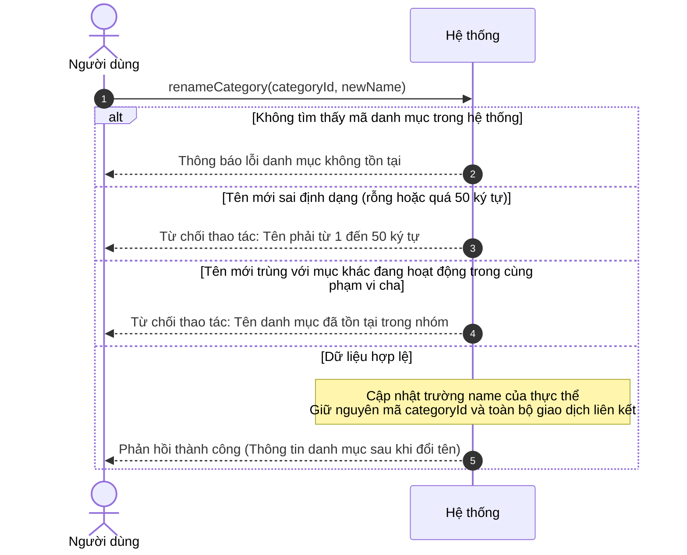

### 3.6.3 Khôi phục danh mục đã xóa

Người dùng phục hồi trạng thái hoạt động cho một danh mục chi tiết hoặc nhóm nhu cầu đã xóa mềm để tiếp tục sử dụng cho các giao dịch mới.

- **Thao tác hệ thống**: `restoreCategory(categoryId)`
- **Kết quả phản hồi**: Chuyển trạng thái từ `DELETED` sang `ACTIVE` và đưa trở lại danh sách chọn; từ chối nếu nhóm cha đang ở trạng thái đã xóa (`ERR-CAT-004`) hoặc tên mục khôi phục bị trùng với một mục đang `ACTIVE` cùng nhóm (`ERR-NAM-002`).

**Tham số đầu vào**

| Tham số | Ý nghĩa nghiệp vụ | Ràng buộc dữ liệu |
| :--- | :--- | :--- |
| `categoryId` | Mã mục cần khôi phục | Tồn tại và đang ở trạng thái xóa mềm (`DELETED`); giữ nguyên ID cũ khi khôi phục (`BR-FIN-04`). |

**Sơ đồ tuần tự hệ thống**

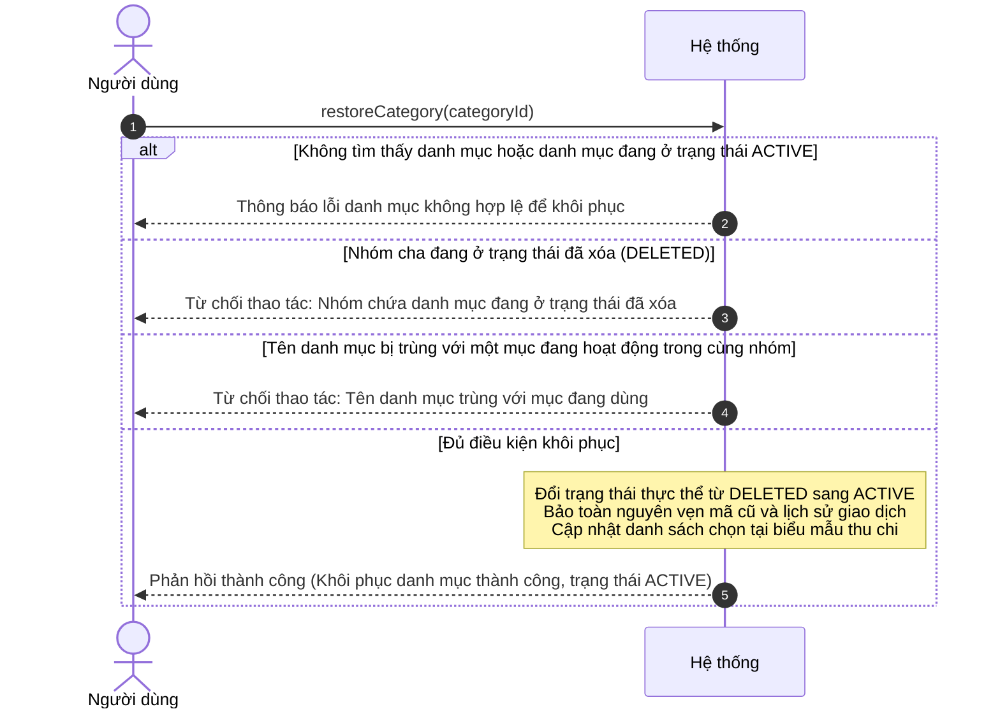

### 3.6.4 Xóa danh mục phân loại

Người dùng yêu cầu xóa một danh mục hoặc nhóm nhu cầu. Hệ thống kiểm tra lịch sử giao dịch để quyết định xóa vĩnh viễn hay xóa mềm nhằm bảo toàn số liệu lịch sử.

- **Thao tác hệ thống**: `deleteCategory(categoryId)`
- **Kết quả phản hồi**: Xóa vĩnh viễn nếu mục chưa từng phát sinh giao dịch, hoặc chuyển sang trạng thái `DELETED` (xóa mềm) nếu đã có giao dịch lịch sử; từ chối nếu xóa nhóm nhu cầu `ACTIVE` cuối cùng của một loại thu chi (`ERR-CAT-002`).

**Tham số đầu vào**

| Tham số | Ý nghĩa nghiệp vụ | Ràng buộc dữ liệu |
| :--- | :--- | :--- |
| `categoryId` | Mã mục cần xóa | Tồn tại và đang `ACTIVE`. Nếu là `NeedGroup`, không được là nhóm `ACTIVE` cuối cùng của nhánh loại thu chi (`BR-FIN-04`, `ERR-CAT-002`). |

**Sơ đồ tuần tự hệ thống**

## 3.7 Nhóm chức năng Thống kê và báo cáo (REP)

Nhóm chức năng Thống kê và báo cáo trích xuất chuỗi dữ liệu 12 tháng liên tục, tính dòng tiền thuần và phân tích cơ cấu thu chi (`EXPENSE` gồm cả phí giao dịch, hoặc `INCOME`) theo các quy tắc `BR-FIN-01`, `BR-FIN-02`, `BR-FIN-04` ở chế độ chỉ đọc.

| Mã UC | Tên ca sử dụng | Thao tác hệ thống | Mục đích nghiệp vụ | Loại thao tác |
| :---: | :--- | :--- | :--- | :--- |
| `UC-REP-01` | Thống kê dòng tiền 12 tháng gần nhất | `generateCashFlowReport` | Trích xuất chuỗi dữ liệu 12 tháng liên tục, tính dòng tiền thuần và tỷ lệ tiết kiệm | Truy vấn |
| `UC-REP-02` | Phân tích cơ cấu thu chi theo nhóm và danh mục | `generateSpendingStructureReport` | Phân tích cơ cấu thu chi theo nhóm nhu cầu, danh mục và biến động kỳ liền kề | Truy vấn |

### 3.7.1 Báo cáo dòng tiền 12 tháng gần nhất

Người dùng yêu cầu tổng hợp chuỗi dòng tiền trong 12 tháng liên tục tính lùi từ một mốc tháng chỉ định để đánh giá xu hướng thu chi và tỷ lệ tiết kiệm.

- **Thao tác hệ thống**: `generateCashFlowReport(endMonth, endYear)`
- **Kết quả phản hồi**: Trả về bảng thống kê 12 tháng liên tục theo thứ tự thời gian tăng dần (tổng thu, tổng chi kèm phí, dòng tiền thuần, tỷ lệ tiết kiệm từng tháng) cùng 3 chỉ số bình quân tháng; từ chối nếu tham số thời gian không hợp lệ (`ERR-REP-001`). Thao tác thuần đọc, hỗ trợ cả mốc thời gian tương lai.

**Tham số đầu vào**

| Tham số | Ý nghĩa nghiệp vụ | Ràng buộc dữ liệu |
| :--- | :--- | :--- |
| `endMonth` | Tháng kết thúc kỳ 12 tháng | Số nguyên từ 1 đến 12 (mặc định là tháng hiện tại, `FR-REP-01`, `ERR-REP-001`). |
| `endYear` | Năm kết thúc kỳ 12 tháng | Số nguyên ≥ 2000 (mặc định là năm hiện tại, `FR-REP-01`, `ERR-REP-001`). |

**Sơ đồ tuần tự hệ thống**

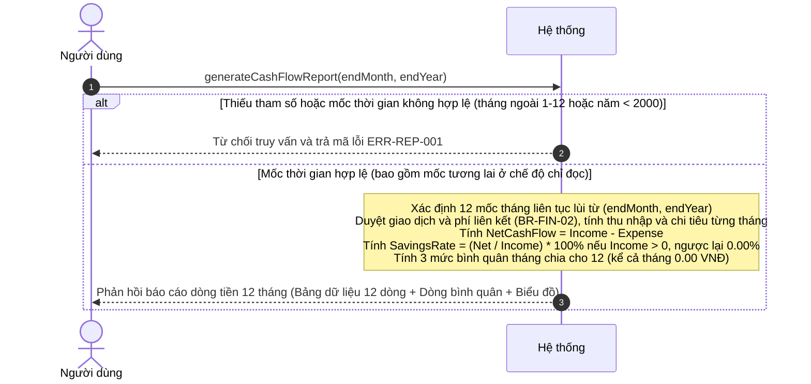

### 3.7.2 Phân tích cơ cấu thu chi theo nhóm

Người dùng yêu cầu phân tích tỷ trọng dòng tiền theo nhóm nhu cầu và danh mục chi tiết trong một khoảng thời gian kèm đối chiếu kỳ liền trước.

- **Thao tác hệ thống**: `generateSpendingStructureReport(startDate, endDate, transactionType)`
- **Kết quả phản hồi**: Trả về tổng giá trị phát sinh trong kỳ, biến động so với kỳ liền trước, và danh sách phân bổ theo `NeedGroup` (cấp 2), `Category` (cấp 3) có phát sinh dương kèm tỷ trọng phần trăm (`BR-FIN-01`, `BR-FIN-02`, `BR-FIN-04`; trả về tỷ trọng `0.00%` và danh sách rỗng nếu tổng kỳ bằng `0.00 VNĐ`); từ chối nếu tham số không hợp lệ (`ERR-REP-001`).

**Tham số đầu vào**

| Tham số | Ý nghĩa nghiệp vụ | Ràng buộc dữ liệu |
| :--- | :--- | :--- |
| `startDate` | Ngày bắt đầu kỳ phân tích | Định dạng `YYYY-MM-DD`, khác rỗng và `≤ endDate` (`FR-REP-02`). |
| `endDate` | Ngày kết thúc kỳ phân tích | Định dạng `YYYY-MM-DD`, khác rỗng và `≥ startDate` (`FR-REP-02`). |
| `transactionType` | Loại thu chi cần phân tích | Khác rỗng, nhận giá trị `INCOME` hoặc `EXPENSE` (mặc định là `EXPENSE`, `BR-FIN-04`). |

**Sơ đồ tuần tự hệ thống**

## 3.8 Nhóm chức năng Lưu trữ và sao lưu dữ liệu (DAT)

Nhóm chức năng Lưu trữ và sao lưu dữ liệu đảm bảo an toàn và toàn vẹn dữ liệu trên máy tính cá nhân thông qua việc sao lưu nguyên khối ra tệp cục bộ, xác thực phục hồi và đối soát độc lập số dư theo `BR-FIN-02`, `BR-FIN-03`.

| Mã UC | Tên ca sử dụng | Thao tác hệ thống | Mục đích nghiệp vụ | Loại thao tác |
| :---: | :--- | :--- | :--- | :--- |
| `UC-DAT-01` | Xuất dữ liệu tài chính | `exportBackupData` | Đóng gói toàn bộ dữ liệu tài chính ra tệp sao lưu an toàn | Truy vấn |
| `UC-DAT-02` | Phục hồi dữ liệu hệ thống từ bản sao lưu | `restoreBackupData` | Kiểm tra toàn vẹn tệp sao lưu và nạp lại dữ liệu vào hệ thống | Cập nhật |
| `UC-DAT-03` | Kiểm tra lại dữ liệu hệ thống | `reconcileSystemData` | Duyệt lịch sử giao dịch để đối soát độc lập tính cân bằng số dư ví | Đối soát |

### 3.8.1 Xuất dữ liệu sao lưu

Người dùng yêu cầu trích xuất toàn bộ dữ liệu tài chính hiện tại ra tệp JSON trên đĩa cứng cục bộ để sao lưu dự phòng.

- **Thao tác hệ thống**: `exportBackupData(exportPath)`
- **Kết quả phản hồi**: Đóng gói 5 nhóm thực thể tài chính thành tệp JSON (UTF-8, định dạng số chính xác theo `BR-FIN-01`), ghi tại `exportPath` và trả về đường dẫn tệp; từ chối và báo lỗi thiết bị nếu đường dẫn không hợp lệ, thiếu quyền ghi hoặc hết dung lượng đĩa.

**Tham số đầu vào**

| Tham số | Ý nghĩa nghiệp vụ | Ràng buộc dữ liệu |
| :--- | :--- | :--- |
| `exportPath` | Đường dẫn lưu tệp sao lưu | Đường dẫn thư mục/tệp hợp lệ trên hệ điều hành, tồn tại và có quyền ghi (`WRITE permission`). |

**Sơ đồ tuần tự hệ thống**

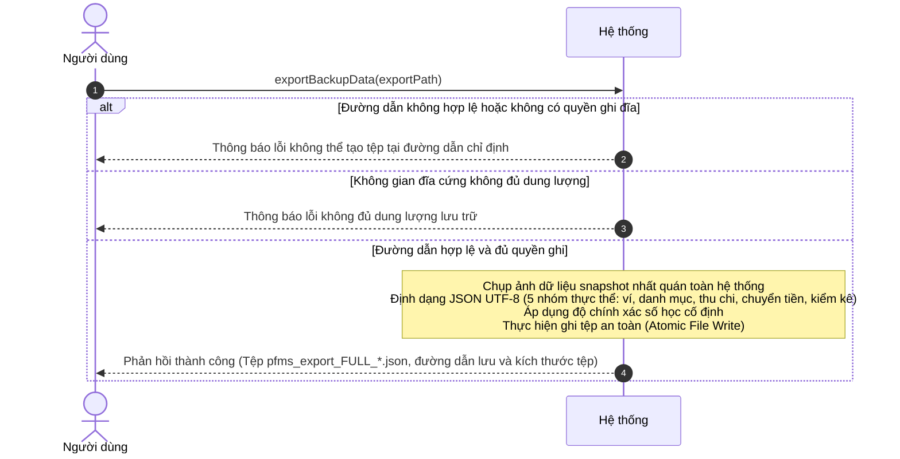

### 3.8.2 Phục hồi dữ liệu từ bản sao lưu

Người dùng yêu cầu nạp lại dữ liệu từ tệp sao lưu JSON. Hệ thống thực hiện kiểm định 4 bước độc lập theo cơ chế "All-or-Nothing" trước khi ghi đè dữ liệu.

- **Thao tác hệ thống**: `restoreBackupData(backupFilePath)`
- **Kết quả phản hồi**: Ghi đè và nạp lại toàn bộ dữ liệu nếu tệp vượt qua đủ 4 bước kiểm định (cấu trúc JSON, phân cấp danh mục `BR-FIN-04`, cân bằng chuyển tiền và phí `BR-FIN-03`, số dư ví không âm `BR-FIN-02`); nếu vi phạm bất kỳ bước nào, hủy thao tác, giữ nguyên 100% dữ liệu hiện tại và báo lỗi chi tiết.

**Tham số đầu vào**

| Tham số | Ý nghĩa nghiệp vụ | Ràng buộc dữ liệu |
| :--- | :--- | :--- |
| `backupFilePath` | Đường dẫn tệp sao lưu | Đường dẫn tệp JSON hợp lệ, tồn tại và có quyền đọc (`READ permission`, `FR-DAT-02`). |

**Sơ đồ tuần tự hệ thống**

### 3.8.3 Đối soát toàn vẹn dữ liệu hệ thống

Người dùng kích hoạt tiến trình đối soát độc lập để rà soát 4 điều kiện toàn vẹn cốt lõi của cơ sở dữ liệu tài chính, phát hiện sai lệch số dư hoặc liên kết mồ côi.

- **Thao tác hệ thống**: `reconcileSystemData()` (không có tham số đầu vào)
- **Kết quả phản hồi**: Duyệt toàn bộ bản ghi và trả về báo cáo kiểm tra toàn vẹn dữ liệu cho 4 điều kiện (số dư ví `BR-FIN-02`, cân bằng chuyển tiền `BR-FIN-03`, phân cấp danh mục `BR-FIN-04`, liên kết phí), phân loại mức độ (`INFO`, `WARNING`, `ERROR`) kèm khuyến nghị xử lý. Thao tác thuần đọc, không làm thay đổi dữ liệu.

**Sơ đồ tuần tự hệ thống**

