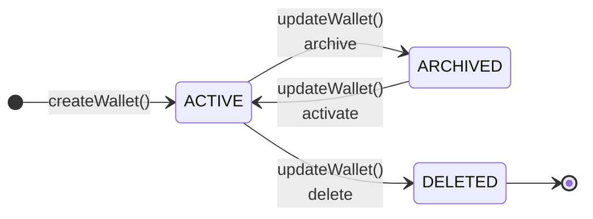
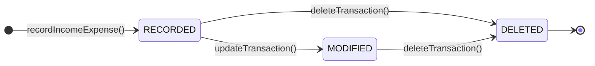
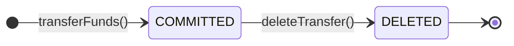

# 5. Mô hình Trạng thái Thực thể

Tài liệu này mô tả vòng đời của các thực thể có hành vi thay đổi theo trạng thái dữ liệu trong hệ thống quản lý tài chính cá nhân.

Mô hình trạng thái xác định tập hợp các trạng thái hợp lệ của thực thể, sự kiện kích hoạt chuyển đổi, điều kiện kiểm tra dữ liệu và các tác vụ cập nhật số dư đi kèm. Những thực thể không thay đổi hành vi sau khi khởi tạo như nhóm nhu cầu hay bản ghi kiểm kê số dư không thuộc phạm vi mô tả của tài liệu này.

## 5.1 Quy chuẩn Mô hình Trạng thái

Mỗi biểu đồ và bảng chuyển trạng thái trong tài liệu được chuẩn hóa theo các thành phần kỹ thuật sau:

| Thành phần | Ký hiệu quy ước | Nội dung kỹ thuật |
| :--- | :--- | :--- |
| **Trạng thái ban đầu** | Điểm đen tròn `[*]` (trái) | Điểm bắt đầu vòng đời khi thực thể được khởi tạo thành công từ một thao tác hệ thống. |
| **Khối trạng thái** | Hộp tên trạng thái IN HOA | Tình trạng tồn tại của thực thể (`ACTIVE`, `ARCHIVED`, `RECORDED`, `MODIFIED`, `COMMITTED`, `DELETED`). |
| **Mũi tên chuyển tiếp** | Tên thao tác / sự kiện | Ghi ngắn gọn thao tác hệ thống kích hoạt bước chuyển giữa hai trạng thái khác nhau (không vẽ mũi tên tự lặp cho thao tác bị từ chối). |
| **Trạng thái kết thúc** | `DELETED` $\rightarrow$ `[*]` (phải) | Thực thể chuyển sang trạng thái xóa (`DELETED`) trước khi kết thúc vòng đời tại điểm tròn có vòng bao `[*]`. |

Để biểu đồ trạng thái ngắn gọn và trực quan theo luồng ngang (`direction LR`), toàn bộ điều kiện kiểm tra và tác vụ xử lý dữ liệu của hệ thống được trình bày chi tiết tại bảng đặc tả bên dưới mỗi sơ đồ.

## 5.2 Vòng đời Thực thể Ví

Thực thể Ví (`Wallet`) quản lý trạng thái tồn tại của nguồn tiền thanh toán từ khi khởi tạo mới (`FR-WAL-01`), hạch toán dòng tiền hàng ngày cho đến khi chuyển sang lưu trữ hoặc xóa vĩnh viễn (`FR-WAL-03`). Cơ chế kiểm soát vòng đời ví duy trì tính duy nhất của tên định danh (`BR-NAM-01`), ngăn chặn việc xóa mất lịch sử giao dịch và giữ số dư khả dụng luôn không âm (`BR-FIN-02`).

- Quy chiếu chéo: `UC-WAL-01`, `UC-WAL-03`, `FR-WAL-01`, `FR-WAL-03`, `BR-NAM-01`, `BR-FIN-02`, `ERR-NAM-001`, `ERR-NAM-002`

| Giai đoạn chuyển đổi | Điều kiện kiểm tra | Xử lý hệ thống |
| :--- | :--- | :--- |
| Khởi tạo ví: Từ `[*]` sang `ACTIVE` (`createWallet`) | Tên ví dài từ 1 đến 50 ký tự và chưa tồn tại trong các ví `ACTIVE` hoặc `ARCHIVED` của hệ thống (`BR-NAM-01`); trường hợp vi phạm, báo lỗi tên sai định dạng (`ERR-NAM-001`), trùng tên ví (`ERR-NAM-002`). | Cấp mã `walletId` duy nhất, thiết lập `status = ACTIVE`, ghi nhận `createdAt` (`FR-WAL-01`) và gán số dư ban đầu `currentBalance = 0.00 VNĐ` (`BR-FIN-02`). |
| Lưu trữ ví: Từ `ACTIVE` sang `ARCHIVED` (`updateWallet`) | Thể hiện `Wallet` đang ở trạng thái `status = ACTIVE` và không phải là ví "Tiền mặt" mặc định (`FR-WAL-03`). | Chuyển `status` sang `ARCHIVED`, ngừng tiếp nhận giao dịch mới (`FR-WAL-03`); vẫn cộng `currentBalance` vào tổng số dư hệ thống nếu số dư lớn hơn 0.00 VNĐ (`BR-FIN-02`). |
| Kích hoạt lại ví: Từ `ARCHIVED` sang `ACTIVE` (`updateWallet`) | Thể hiện `Wallet` tồn tại trong hệ thống và đang có trạng thái `status = ARCHIVED` (`FR-WAL-03`). | Chuyển `status` từ `ARCHIVED` về `ACTIVE`, mở lại quyền nhận giao dịch mới (`FR-WAL-03`) và giữ nguyên số dư cùng lịch sử dòng tiền (`BR-FIN-02`). |
| Xóa vĩnh viễn ví: Từ `ACTIVE` sang `DELETED` $\rightarrow$ `[*]` (`updateWallet`) | Thể hiện `Wallet` không phải là ví "Tiền mặt" mặc định và chưa từng phát sinh giao dịch thu chi, chuyển tiền hay điều chỉnh số dư (`FR-WAL-03`). | Chuyển sang `DELETED`, xóa hoàn toàn thể hiện `Wallet` khỏi hệ thống (`FR-WAL-03`) và giải phóng tên ví khỏi phạm vi kiểm tra trùng tên (`BR-NAM-01`). |

## 5.3 Vòng đời Giao dịch Thu chi

Thực thể Giao dịch Thu chi (`IncomeExpenseTransaction`) phản ánh vòng đời của một khoản thu nhập hoặc chi tiêu từ lúc ghi nhận lần đầu (`FR-TXN-01`), qua các lần chỉnh sửa (`FR-TXN-04`) cho đến khi bị xóa khỏi sổ theo dõi (`FR-TXN-05`). Mọi bước chuyển trạng thái đều gắn với phân cấp danh mục 3 cấp (`BR-FIN-04`), đồng bộ bản ghi chi phí (`TransactionFee`) đi kèm và bảo toàn số dư ví khả dụng (`BR-FIN-02`).

- Quy chiếu chéo: `UC-TXN-01`, `UC-TXN-03`, `UC-TXN-04`, `FR-TXN-01`, `FR-TXN-02`, `FR-TXN-04`, `FR-TXN-05`, `BR-FIN-01`, `BR-FIN-02`, `BR-FIN-04`, `ERR-FIN-001`, `ERR-WAL-001`, `ERR-FEE-001`, `ERR-FEE-002`, `ERR-FEE-003`

| Giai đoạn chuyển đổi | Điều kiện kiểm tra | Xử lý hệ thống |
| :--- | :--- | :--- |
| Ghi nhận mới: Từ `[*]` sang `RECORDED` (`recordIncomeExpense`) | Ví và danh mục cấp 3 đều ở trạng thái `ACTIVE`, nếu có phí phải gắn danh mục cấp 3 nhánh `EXPENSE` (`BR-FIN-04`); `amount > 0.00 VNĐ` (`BR-FIN-01`); `feeAmount >= 0.00 VNĐ` và số dư ví sau giao dịch không âm (`BR-FIN-02`); trường hợp vi phạm, báo lỗi số tiền sai định dạng (`ERR-FIN-001`), chi phí âm (`ERR-FEE-001`), thiếu danh mục phí (`ERR-FEE-002`), danh mục phí sai loại hoặc đã xóa (`ERR-FEE-003`), không đủ số dư ví (`ERR-WAL-001`). | Khởi tạo `IncomeExpenseTransaction` ở trạng thái `RECORDED` cho khoản thu (`FR-TXN-01`) hoặc khoản chi (`FR-TXN-02`), cố định `transactionType` theo danh mục (`BR-FIN-04`); tạo `TransactionFee` liên kết nếu có phí và cập nhật `currentBalance` của ví (`BR-FIN-02`). |
| Chỉnh sửa: Từ `RECORDED` sang `MODIFIED` (`updateTransaction`) | Bản ghi tồn tại, không phải `TransactionFee` độc lập và đảm bảo số dư ví cũ/mới không âm (`BR-FIN-02`); `amount > 0.00 VNĐ` (`BR-FIN-01`); giữ nguyên `transactionType` (`BR-FIN-04`); danh mục chọn mới phải `ACTIVE` hoặc giữ nguyên danh mục cũ đã `DELETED` (`FR-TXN-04`); trường hợp vi phạm, báo lỗi số tiền sai định dạng (`ERR-FIN-001`), chi phí âm (`ERR-FEE-001`), thiếu danh mục phí (`ERR-FEE-002`), danh mục phí sai loại hoặc đã xóa (`ERR-FEE-003`), làm âm số dư ví (`ERR-WAL-001`). | Chuyển sang trạng thái `MODIFIED`, cập nhật thông tin giao dịch (`FR-TXN-04`); đồng bộ `TransactionFee` liên kết (tạo mới, cập nhật hoặc xóa phí) và tính lại `currentBalance` trên ví cũ cùng ví mới (`BR-FIN-02`). |
| Hủy bỏ giao dịch: Từ `RECORDED` hoặc `MODIFIED` sang `DELETED` $\rightarrow$ `[*]` (`deleteTransaction`) | Giao dịch gốc tồn tại trong sổ thu chi (`FR-TXN-05`), không phải bản ghi phí độc lập và khi xóa khoản thu (`INCOME`) số dư ví sau hoàn nguyên không âm (`BR-FIN-02`); trường hợp vi phạm, báo lỗi làm âm số dư ví (`ERR-WAL-001`). | Chuyển sang `DELETED`, xóa vĩnh viễn `IncomeExpenseTransaction` khỏi sổ thu chi (`FR-TXN-05`), xóa `TransactionFee` liên kết (nếu có) và hoàn nguyên `currentBalance` của ví (`BR-FIN-02`). |

## 5.4 Vòng đời Giao dịch Chuyển tiền

Thực thể Giao dịch Chuyển tiền (`TransferTransaction`) quản lý vòng đời điều chuyển tiền giữa hai ví nội bộ từ lúc khởi tạo (`FR-TRF-01`) đến khi xóa giao dịch (`FR-TRF-02`). Sau khi ghi nhận đồng thời thành công (`BR-FIN-03`), bản ghi chuyển tiền không cho phép chỉnh sửa mà chỉ cho phép xóa toàn bộ khi ví đích đủ số dư hoàn trả (`BR-FIN-02`).

- Quy chiếu chéo: `UC-TRF-01`, `UC-TRF-03`, `FR-TRF-01`, `FR-TRF-02`, `BR-FIN-01`, `BR-FIN-02`, `BR-FIN-03`, `BR-FIN-04`, `ERR-FIN-001`, `ERR-TRF-001`, `ERR-TRF-002`, `ERR-WAL-001`, `ERR-FEE-001`, `ERR-FEE-002`, `ERR-FEE-003`

| Giai đoạn chuyển đổi | Điều kiện kiểm tra | Xử lý hệ thống |
| :--- | :--- | :--- |
| Ghi nhận đồng thời: Từ `[*]` sang `COMMITTED` (`transferFunds`) | Ví nguồn và ví đích đều `ACTIVE`, khác nhau và `amount > 0.00 VNĐ` (`BR-FIN-03`); số tiền đúng định dạng (`BR-FIN-01`); danh mục phí (nếu có) thuộc cấp 3 nhánh `EXPENSE` (`BR-FIN-04`); ví nguồn đủ số dư `>= amount + feeAmount` (`BR-FIN-02`); trường hợp vi phạm, báo lỗi sai định dạng số học (`ERR-FIN-001`), trùng ví chuyển và nhận (`ERR-TRF-001`), số tiền chuyển $\le 0$ (`ERR-TRF-002`), chi phí âm (`ERR-FEE-001`), thiếu danh mục phí (`ERR-FEE-002`), danh mục phí sai loại hoặc đã xóa (`ERR-FEE-003`), ví nguồn không đủ số dư (`ERR-WAL-001`). | Khởi tạo `TransferTransaction` ở trạng thái `COMMITTED` (`FR-TRF-01`) và `TransactionFee` liên kết nếu có phí (`BR-FIN-03`); trừ `amount + feeAmount` ở ví nguồn và cộng `amount` vào ví đích đồng thời (`BR-FIN-02`). |
| Xóa và hoàn nguyên: Từ `COMMITTED` sang `DELETED` $\rightarrow$ `[*]` (`deleteTransfer`) | Giao dịch chuyển tiền tồn tại (`FR-TRF-02`) và khi hoàn nguyên đồng thời (`BR-FIN-03`), số dư khả dụng của ví đích lớn hơn hoặc bằng số tiền chuyển (`destinationWallet.currentBalance >= amount`) (`BR-FIN-02`); trường hợp vi phạm, báo lỗi ví đích không đủ số dư hoàn trả (`ERR-WAL-001`). | Chuyển sang `DELETED`, xóa vĩnh viễn `TransferTransaction` (`FR-TRF-02`) cùng `TransactionFee` liên kết (`BR-FIN-03`); cộng hoàn `amount + feeAmount` về ví nguồn và trừ `amount` khỏi ví đích (`BR-FIN-02`). |

## 5.5 Vòng đời Thực thể Danh mục

(Mô tả khoảng 1 đến 2 câu về bối cảnh nghiệp vụ và mục đích quản lý vòng đời của thực thể trong hệ thống)

- Quy chiếu chéo: `UC-CAT-01`, `UC-CAT-02`, `UC-CAT-03`, `UC-CAT-04`, `FR-CAT-01`, `FR-CAT-02`, `FR-CAT-03`, `BR-FIN-04`, `BR-NAM-01`, `ERR-NAM-001`, `ERR-NAM-002`, `ERR-CAT-001`, `ERR-CAT-003`, `ERR-CAT-004`, `ERR-CAT-005`

(Vẽ biểu đồ trạng thái mô tả các trạng thái hợp lệ và luồng chuyển đổi của thực thể)

| Giai đoạn chuyển đổi | Điều kiện kiểm tra | Xử lý hệ thống |
| :--- | :--- | :--- |
| (Nêu giai đoạn hoặc bước chuyển của thực thể) | (Nêu các điều kiện hợp lệ cần kiểm tra trước khi chuyển trạng thái) | (Nêu trạng thái mới và các tác vụ cập nhật dữ liệu đi kèm) |
