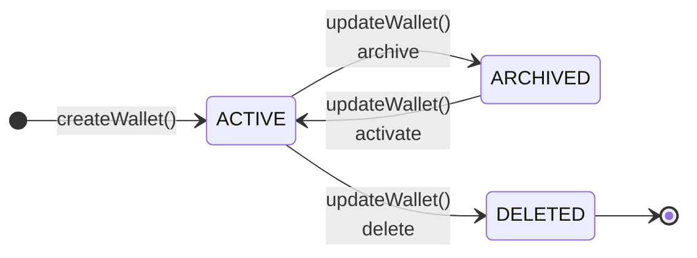
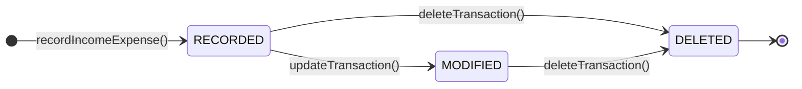
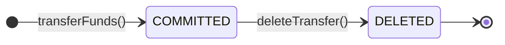
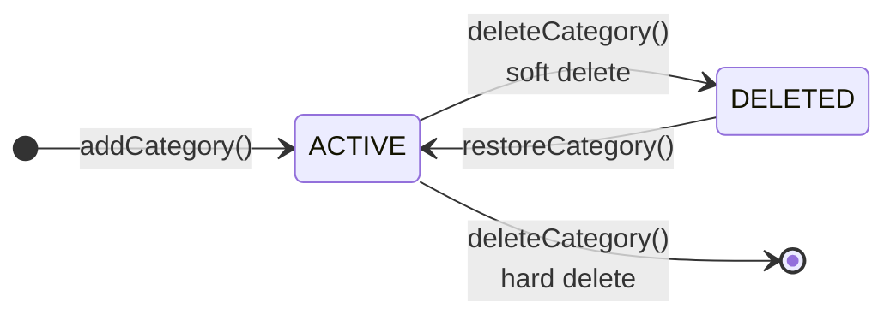

# 5. Mô hình trạng thái thực thể

Tài liệu này mô tả vòng đời của các thực thể có hành vi biến đổi theo trạng thái dữ liệu trong hệ thống quản lý tài chính cá nhân, bao gồm tập trạng thái hợp lệ, sự kiện kích hoạt, điều kiện kiểm tra và tác vụ cập nhật số dư đi kèm. Các thực thể bất biến sau khởi tạo (như bản ghi kiểm kê số dư `BalanceAdjustmentRecord`) không thuộc phạm vi tài liệu này.

## 5.1 Quy chuẩn mô hình trạng thái

Mỗi biểu đồ (`direction LR`) và bảng chuyển trạng thái trong tài liệu được chuẩn hóa theo 4 thành phần:

| Thành phần | Ký hiệu quy ước | Nội dung kỹ thuật |
| :--- | :--- | :--- |
| **Trạng thái ban đầu** | Điểm đen tròn `[*]` (trái) | Điểm bắt đầu vòng đời khi thực thể được khởi tạo thành công từ một thao tác hệ thống. |
| **Khối trạng thái** | Hộp tên trạng thái IN HOA | Tình trạng tồn tại của thực thể (`ACTIVE`, `ARCHIVED`, `RECORDED`, `MODIFIED`, `COMMITTED`, `DELETED`). |
| **Mũi tên chuyển tiếp** | Tên thao tác / sự kiện | Thao tác hệ thống kích hoạt bước chuyển giữa hai trạng thái (không vẽ mũi tên tự lặp cho thao tác bị từ chối). |
| **Trạng thái kết thúc** | `DELETED` $\rightarrow$ `[*]` (phải) | Thực thể chuyển sang trạng thái xóa (`DELETED`) trước khi kết thúc vòng đời tại `[*]`. |

## 5.2 Vòng đời thực thể Ví

Thực thể Ví (`Wallet`) quản lý trạng thái tồn tại của nguồn tiền từ khi khởi tạo (`FR-WAL-01`), hạch toán dòng tiền hàng ngày cho đến khi chuyển sang lưu trữ hoặc xóa vĩnh viễn (`FR-WAL-03`), bảo đảm tên duy nhất (`BR-NAM-01`) và số dư không âm (`BR-FIN-02`).

- **Quy chiếu chéo**: `UC-WAL-01`, `UC-WAL-03`, `FR-WAL-01`, `FR-WAL-03`, `BR-NAM-01`, `BR-FIN-02`, `ERR-NAM-001`, `ERR-NAM-002`

| Giai đoạn chuyển đổi | Điều kiện kiểm tra | Xử lý hệ thống |
| :--- | :--- | :--- |
| **Khởi tạo ví**: `[*]` $\rightarrow$ `ACTIVE` (`createWallet`) | Tên ví dài 1–50 ký tự sau khi `trim` (`ERR-NAM-001`) và duy nhất trong các ví `ACTIVE` hoặc `ARCHIVED` (`BR-NAM-01`, `ERR-NAM-002`). | Cấp `walletId` duy nhất, đặt `status = ACTIVE`, ghi nhận `createdAt` (`FR-WAL-01`) và gán `currentBalance = 0.00 VNĐ` (`BR-FIN-02`). |
| **Lưu trữ ví**: `ACTIVE` $\rightarrow$ `ARCHIVED` (`updateWallet`) | Thể hiện `Wallet` đang `ACTIVE` và không phải là ví "Tiền mặt" mặc định (`FR-WAL-03`). | Chuyển `status` sang `ARCHIVED`, ngừng nhận giao dịch mới (`FR-WAL-03`); vẫn cộng `currentBalance` vào tổng số dư hệ thống nếu $> 0.00$ VNĐ (`BR-FIN-02`). |
| **Kích hoạt lại ví**: `ARCHIVED` $\rightarrow$ `ACTIVE` (`updateWallet`) | Thể hiện `Wallet` tồn tại và đang có `status = ARCHIVED` (`FR-WAL-03`). | Chuyển `status` về `ACTIVE`, mở lại quyền nhận giao dịch mới (`FR-WAL-03`) và giữ nguyên số dư cùng lịch sử dòng tiền (`BR-FIN-02`). |
| **Xóa vĩnh viễn ví**: `ACTIVE` $\rightarrow$ `DELETED` $\rightarrow$ `[*]` (`updateWallet`) | `Wallet` không phải ví "Tiền mặt" mặc định và chưa từng phát sinh giao dịch thu chi, chuyển tiền hay điều chỉnh số dư (`FR-WAL-03`). | Chuyển sang `DELETED`, xóa vĩnh viễn thể hiện `Wallet` khỏi hệ thống (`FR-WAL-03`) và giải phóng tên ví (`BR-NAM-01`). |

## 5.3 Vòng đời Giao dịch thu chi

Thực thể Giao dịch thu chi (`IncomeExpenseTransaction`) phản ánh vòng đời của khoản thu/chi từ lúc ghi nhận (`FR-TXN-01`, `FR-TXN-02`), chỉnh sửa (`FR-TXN-04`) đến khi xóa khỏi sổ theo dõi (`FR-TXN-05`), luôn gắn với phân cấp danh mục 3 cấp (`BR-FIN-04`), đồng bộ `TransactionFee` đi kèm và bảo toàn số dư ví (`BR-FIN-02`).

- **Quy chiếu chéo**: `UC-TXN-01`, `UC-TXN-03`, `UC-TXN-04`, `FR-TXN-01`, `FR-TXN-02`, `FR-TXN-04`, `FR-TXN-05`, `BR-FIN-01`, `BR-FIN-02`, `BR-FIN-04`, `ERR-FIN-001`, `ERR-WAL-001`, `ERR-FEE-001`, `ERR-FEE-002`, `ERR-FEE-003`

| Giai đoạn chuyển đổi | Điều kiện kiểm tra | Xử lý hệ thống |
| :--- | :--- | :--- |
| **Ghi nhận mới**: `[*]` $\rightarrow$ `RECORDED` (`recordIncomeExpense`) | Ví và danh mục cấp 3 đang `ACTIVE` (`BR-FIN-04`); `amount > 0.00 VNĐ` (`BR-FIN-01`, `ERR-FIN-001`); `feeAmount >= 0.00 VNĐ` (`ERR-FEE-001`) kèm danh mục phí cấp 3 nhánh `EXPENSE` nếu có phí (`ERR-FEE-002`, `ERR-FEE-003`); số dư ví sau giao dịch $\ge 0.00$ VNĐ (`BR-FIN-02`, `ERR-WAL-001`). | Khởi tạo `IncomeExpenseTransaction` ở trạng thái `RECORDED` (`FR-TXN-01`, `FR-TXN-02`), cố định `transactionType` theo danh mục (`BR-FIN-04`); tạo `TransactionFee` liên kết (nếu có phí) và cập nhật `Wallet.currentBalance` (`BR-FIN-02`). |
| **Chỉnh sửa**: `RECORDED` $\rightarrow$ `MODIFIED` (`updateTransaction`) | Bản ghi gốc tồn tại, giữ nguyên `transactionType` (`BR-FIN-04`); `amount > 0.00 VNĐ` (`ERR-FIN-001`), phí hợp lệ (`ERR-FEE-001`–`003`); danh mục chọn mới đang `ACTIVE` (hoặc giữ nguyên danh mục cũ đã `DELETED`, `FR-TXN-04`); số dư ví cũ/mới không âm (`BR-FIN-02`, `ERR-WAL-001`). | Chuyển sang `MODIFIED`, cập nhật thông tin giao dịch (`FR-TXN-04`); đồng bộ `TransactionFee` liên kết (tạo, sửa hoặc xóa) và tính lại `currentBalance` trên ví cũ cùng ví mới (`BR-FIN-02`). |
| **Hủy bỏ giao dịch**: `RECORDED` / `MODIFIED` $\rightarrow$ `DELETED` $\rightarrow$ `[*]` (`deleteTransaction`) | Giao dịch gốc tồn tại (`FR-TXN-05`), không phải bản ghi phí độc lập; nếu xóa khoản thu (`INCOME`), số dư ví sau hoàn nguyên phải $\ge 0.00$ VNĐ (`BR-FIN-02`, `ERR-WAL-001`). | Chuyển sang `DELETED`, xóa vĩnh viễn `IncomeExpenseTransaction` (`FR-TXN-05`) cùng `TransactionFee` liên kết (nếu có) và hoàn nguyên `Wallet.currentBalance` (`BR-FIN-02`). |

## 5.4 Vòng đời Giao dịch chuyển tiền

Thực thể Giao dịch chuyển tiền (`TransferTransaction`) quản lý vòng đời điều chuyển tiền giữa hai ví nội bộ từ lúc khởi tạo (`FR-TRF-01`) đến khi xóa (`FR-TRF-02`). Sau khi ghi nhận đồng thời (`BR-FIN-03`), bản ghi không cho phép chỉnh sửa mà chỉ cho phép xóa toàn bộ khi ví đích đủ số dư hoàn trả (`BR-FIN-02`).

- **Quy chiếu chéo**: `UC-TRF-01`, `UC-TRF-03`, `FR-TRF-01`, `FR-TRF-02`, `BR-FIN-01`, `BR-FIN-02`, `BR-FIN-03`, `BR-FIN-04`, `ERR-FIN-001`, `ERR-TRF-001`, `ERR-TRF-002`, `ERR-WAL-001`, `ERR-FEE-001`, `ERR-FEE-002`, `ERR-FEE-003`

| Giai đoạn chuyển đổi | Điều kiện kiểm tra | Xử lý hệ thống |
| :--- | :--- | :--- |
| **Ghi nhận đồng thời**: `[*]` $\rightarrow$ `COMMITTED` (`transferFunds`) | Ví nguồn và ví đích đều `ACTIVE`, khác nhau (`BR-FIN-03`, `ERR-TRF-001`); `amount > 0.00 VNĐ` (`BR-FIN-01`, `ERR-FIN-001`, `ERR-TRF-002`); phí $\ge 0.00$ VNĐ kèm danh mục cấp 3 nhánh `EXPENSE` nếu có phí (`BR-FIN-04`, `ERR-FEE-001`–`003`); số dư ví nguồn $\ge amount + feeAmount$ (`BR-FIN-02`, `ERR-WAL-001`). | Khởi tạo `TransferTransaction` ở trạng thái `COMMITTED` (`FR-TRF-01`) và `TransactionFee` liên kết (nếu có phí); đồng thời trừ `amount + feeAmount` ở ví nguồn và cộng `amount` vào ví đích (`BR-FIN-02`, `BR-FIN-03`). |
| **Xóa và hoàn nguyên**: `COMMITTED` $\rightarrow$ `DELETED` $\rightarrow$ `[*]` (`deleteTransfer`) | Giao dịch chuyển tiền tồn tại (`FR-TRF-02`) và số dư hiện tại của ví đích `destinationWallet.currentBalance >= amount` (`BR-FIN-02`, `BR-FIN-03`, `ERR-WAL-001`). | Chuyển sang `DELETED`, xóa vĩnh viễn `TransferTransaction` (`FR-TRF-02`) cùng `TransactionFee` liên kết; đồng thời hoàn `amount + feeAmount` về ví nguồn và trừ `amount` khỏi ví đích (`BR-FIN-02`, `BR-FIN-03`). |

## 5.5 Vòng đời thực thể Danh mục

Thực thể Danh mục (`Category` và `NeedGroup`) quản lý vòng đời phân loại thu chi từ lúc tạo mới (`FR-CAT-01`), đổi tên (`FR-CAT-02`), xóa mềm hoặc xóa vĩnh viễn đến khôi phục (`FR-CAT-03`, `FR-CAT-04`), bảo đảm cấu trúc phân cấp 3 cấp (`BR-FIN-04`) và toàn vẹn lịch sử giao dịch.

- **Quy chiếu chéo**: `UC-CAT-01` – `UC-CAT-04`, `FR-CAT-01` – `FR-CAT-04`, `BR-FIN-04`, `BR-NAM-01`, `ERR-NAM-001`, `ERR-NAM-002`, `ERR-CAT-001` – `ERR-CAT-005`

| Giai đoạn chuyển đổi | Điều kiện kiểm tra | Xử lý hệ thống |
| :--- | :--- | :--- |
| **Khởi tạo danh mục**: `[*]` $\rightarrow$ `ACTIVE` (`addCategory`) | Nhóm nhu cầu cha (`parentCategoryId`) tồn tại và đang `ACTIVE` (`BR-FIN-04`, `ERR-CAT-005`); `categoryName` sau khi `trim` dài 1–50 ký tự, không rỗng (`BR-NAM-01`, `ERR-NAM-001`) và duy nhất trong cùng nhóm cha đang `ACTIVE` (`ERR-NAM-002`). | Cấp `categoryId` duy nhất, khởi tạo `Category` ở trạng thái `ACTIVE`, kế thừa `transactionType` từ nhóm cha và thiết lập liên kết phân cấp tới `NeedGroup` (`BR-FIN-04`, `FR-CAT-01`). |
| **Đổi tên danh mục**: Giữ nguyên `ACTIVE` (`renameCategory`) | Thể hiện `Category` tồn tại (`BR-FIN-04`); `newName` sau khi `trim` dài 1–50 ký tự, không rỗng (`BR-NAM-01`, `ERR-NAM-001`) và không trùng với mục khác đang `ACTIVE` trong cùng nhóm cha (`ERR-NAM-002`). | Cập nhật `name = newName`; giữ nguyên `categoryId`, trạng thái `status` và toàn bộ liên kết giao dịch lịch sử (`FR-CAT-02`, `BR-FIN-04`). |
| **Xóa mềm danh mục**: `ACTIVE` $\rightarrow$ `DELETED` (`deleteCategory`) | Mục đang `ACTIVE` và đã phát sinh giao dịch lịch sử (`BR-FIN-04`, `FR-CAT-03`); nếu là `NeedGroup`, không phải là nhóm `ACTIVE` cuối cùng của nhánh loại thu chi (`ERR-CAT-002`). | Chuyển `status` sang `DELETED` (xóa mềm), ẩn khỏi danh sách chọn khi tạo giao dịch mới nhưng bảo toàn liên kết phân cấp và hiển thị kèm nhãn "(đã xóa)" trên báo cáo lịch sử (`FR-CAT-03`, `BR-FIN-04`). |
| **Khôi phục danh mục**: `DELETED` $\rightarrow$ `ACTIVE` (`restoreCategory`) | Mục đang ở trạng thái `DELETED`; nhóm cha `NeedGroup` đang `ACTIVE` (`BR-FIN-04`, `ERR-CAT-004`) và tên mục không trùng với mục khác đang `ACTIVE` trong cùng nhóm cha (`BR-NAM-01`, `ERR-NAM-002`). | Chuyển `status` từ `DELETED` về `ACTIVE`, giữ nguyên `categoryId` và đưa mục hiển thị trở lại trên biểu mẫu ghi nhận giao dịch (`FR-CAT-03`, `FR-CAT-04`, `BR-FIN-04`). |
| **Xóa vĩnh viễn danh mục**: `ACTIVE` $\rightarrow$ `[*]` (`deleteCategory`) | Mục đang `ACTIVE`, chưa từng phát sinh bất kỳ giao dịch thu chi hay phí liên kết nào trong lịch sử (`FR-CAT-03`, `BR-FIN-04`), và (nếu là `NeedGroup`) không phải nhóm `ACTIVE` cuối cùng của loại thu chi (`ERR-CAT-002`). | Xóa vĩnh viễn thể hiện khỏi hệ thống lưu trữ (xóa cứng), gỡ bỏ liên kết phân cấp với nhóm cha và giải phóng tên khỏi phạm vi kiểm tra trùng tên (`BR-NAM-01`, `FR-CAT-03`). |
