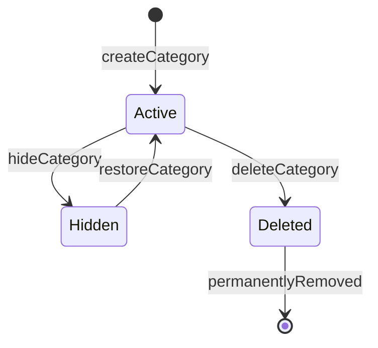

# 5. Mô hình Trạng thái Thực thể

Tài liệu này mô tả vòng đời của các thực thể có hành vi thay đổi theo trạng thái dữ liệu trong hệ thống quản lý tài chính cá nhân.

Mô hình trạng thái xác định tập hợp các trạng thái hợp lệ của thực thể, sự kiện kích hoạt chuyển đổi, điều kiện kiểm tra dữ liệu và các tác vụ cập nhật số dư đi kèm. Những thực thể không thay đổi hành vi sau khi khởi tạo như nhóm nhu cầu hay bản ghi kiểm kê số dư không thuộc phạm vi mô tả của tài liệu này.

## 5.1 Quy chuẩn Mô hình Trạng thái

Mỗi biểu đồ và bảng chuyển trạng thái trong tài liệu được chuẩn hóa theo các thành phần kỹ thuật sau:

| Thành phần | Ký hiệu quy ước | Nội dung kỹ thuật |
| :--- | :--- | :--- |
| **Trạng thái** | Khối trạng thái | Tình trạng tồn tại của thực thể, xác định các thao tác nghiệp vụ được chấp nhận hoặc bị từ chối xử lý tại thời điểm tiếp nhận. |
| **Trạng thái ban đầu** | Điểm đen tròn `[*]` | Điểm bắt đầu vòng đời khi thực thể được khởi tạo thành công từ một thao tác hệ thống. |
| **Sự kiện kích hoạt** | Tên thao tác hệ thống | Tác động từ người dùng hoặc hệ thống làm phát sinh yêu cầu chuyển đổi trạng thái của thực thể. |
| **Điều kiện bảo vệ** | `[Điều kiện]` | Ràng buộc nghiệp vụ cần thỏa mãn trước khi đổi trạng thái. Nếu điều kiện vi phạm, hệ thống từ chối thao tác và giữ nguyên trạng thái cũ. |
| **Hành động hệ thống** | `/Hành động` | Tác vụ xử lý dữ liệu được hệ thống thực thi ngay khi chuyển trạng thái, gồm cập nhật số dư hoặc điều chỉnh liên kết dữ liệu. |
| **Trạng thái kết thúc** | Điểm tròn có vòng bao `[*]` | Điểm kết thúc vòng đời khi thực thể bị xóa hoàn toàn khỏi hệ thống lưu trữ. |

Mỗi thực thể được mô tả qua biểu đồ trạng thái và bảng ràng buộc chuyển đổi gồm 3 cột: giai đoạn chuyển đổi, điều kiện kiểm tra và xử lý hệ thống.

## 5.2 Vòng đời Thực thể Ví

(Mô tả khoảng 1 đến 2 câu về bối cảnh nghiệp vụ và mục đích quản lý vòng đời của thực thể trong hệ thống)

- Quy chiếu chéo: `UC-WAL-01`, `UC-WAL-03`, `FR-WAL-01`, `FR-WAL-03`, `BR-NAM-01`, `BR-FIN-02`, `ERR-NAM-001`, `ERR-NAM-002`

(Vẽ biểu đồ trạng thái mô tả các trạng thái hợp lệ và luồng chuyển đổi của thực thể)

| Giai đoạn chuyển đổi | Điều kiện kiểm tra | Xử lý hệ thống |
| :--- | :--- | :--- |
| (Nêu giai đoạn hoặc bước chuyển của thực thể) | (Nêu các điều kiện hợp lệ cần kiểm tra trước khi chuyển trạng thái) | (Nêu trạng thái mới và các tác vụ cập nhật dữ liệu đi kèm) |

## 5.3 Vòng đời Giao dịch Thu chi

(Mô tả khoảng 1 đến 2 câu về bối cảnh nghiệp vụ và mục đích quản lý vòng đời của thực thể trong hệ thống)

- Quy chiếu chéo: `UC-TXN-01`, `UC-TXN-03`, `UC-TXN-04`, `FR-TXN-01`, `FR-TXN-02`, `FR-TXN-04`, `FR-TXN-05`, `BR-FIN-01`, `BR-FIN-02`, `BR-FIN-04`, `ERR-WAL-001`, `ERR-FEE-001`, `ERR-FEE-002`, `ERR-FEE-003`

(Vẽ biểu đồ trạng thái mô tả các trạng thái hợp lệ và luồng chuyển đổi của thực thể)

| Giai đoạn chuyển đổi | Điều kiện kiểm tra | Xử lý hệ thống |
| :--- | :--- | :--- |
| (Nêu giai đoạn hoặc bước chuyển của thực thể) | (Nêu các điều kiện hợp lệ cần kiểm tra trước khi chuyển trạng thái) | (Nêu trạng thái mới và các tác vụ cập nhật dữ liệu đi kèm) |

## 5.4 Vòng đời Giao dịch Chuyển tiền

(Mô tả khoảng 1 đến 2 câu về bối cảnh nghiệp vụ và mục đích quản lý vòng đời của thực thể trong hệ thống)

- Quy chiếu chéo: `UC-TRF-01`, `UC-TRF-03`, `FR-TRF-01`, `FR-TRF-02`, `BR-FIN-01`, `BR-FIN-02`, `BR-FIN-03`, `ERR-TRF-001`, `ERR-TRF-002`, `ERR-WAL-001`, `ERR-FEE-001`, `ERR-FEE-002`, `ERR-FEE-003`

(Vẽ biểu đồ trạng thái mô tả các trạng thái hợp lệ và luồng chuyển đổi của thực thể)

| Giai đoạn chuyển đổi | Điều kiện kiểm tra | Xử lý hệ thống |
| :--- | :--- | :--- |
| (Nêu giai đoạn hoặc bước chuyển của thực thể) | (Nêu các điều kiện hợp lệ cần kiểm tra trước khi chuyển trạng thái) | (Nêu trạng thái mới và các tác vụ cập nhật dữ liệu đi kèm) |

## 5.5 Vòng đời Thực thể Danh mục

Quản lý vòng đời của danh mục phân loại, bao gồm tạo mới, chỉnh sửa, ẩn/khôi phục và xóa, đảm bảo tính nhất quán của cấu trúc phân cấp và bảo toàn lịch sử giao dịch.

- Quy chiếu chéo: `UC-CAT-01`, `UC-CAT-02`, `UC-CAT-03`, `UC-CAT-04`, `FR-CAT-01`, `FR-CAT-02`, `FR-CAT-03`, `BR-FIN-04`, `BR-NAM-01`, `ERR-NAM-001`, `ERR-NAM-002`, `ERR-CAT-001`, `ERR-CAT-003`, `ERR-CAT-004`, `ERR-CAT-005`

| Giai đoạn chuyển đổi | Điều kiện kiểm tra | Xử lý hệ thống |
| :--- | :--- | :--- |
| **Tạo danh mục mới** (`createCategory`) | - ParentCategoryId tồn tại và ở trạng thái ACTIVE. - categoryName không rỗng, chuẩn hoá không trùng với danh mục cùng cha. - Người dùng có quyền thực hiện thao tác. | - Tạo thực thể Category mới ở trạng thái ACTIVE. - Thiết lập liên kết phân cấp tới nhóm cha. - Ghi log tạo danh mục. |
| **Đổi tên danh mục** (`renameCategory`) | - categoryId tồn tại, trạng thái ACTIVE hoặc HIDDEN. - newName không rỗng, chuẩn hoá không trùng với danh mục cùng cha. - Nếu danh mục đang được giao dịch, đổi tên vẫn được chấp nhận. | - Cập nhật thuộc tính name của Category. - Ghi log thay đổi tên. |
| **Ẩn (xóa mềm) danh mục** (`hideCategory`) | - categoryId tồn tại và ở trạng thái ACTIVE. - Danh mục không phải là danh mục duy nhất còn lại trong nhóm cha. | - Đổi trạng thái thành HIDDEN. - Giữ liên kết với các giao dịch lịch sử. - Ghi log ẩn danh mục. |
| **Khôi phục danh mục** (`restoreCategory`) | - categoryId tồn tại và ở trạng thái HIDDEN. - ParentCategoryId vẫn ACTIVE. - Không có danh mục ACTIVE cùng tên trong cùng nhóm cha. | - Đổi trạng thái thành ACTIVE. - Ghi log khôi phục. |
| **Xóa vĩnh viễn danh mục** (`permanentlyRemoved`) | - categoryId ở trạng thái DELETED và không có giao dịch liên quan. - Người dùng xác nhận xóa vĩnh viễn. | - Xóa thực thể Category khỏi hệ thống. - Gỡ bỏ liên kết với nhóm cha và các tham chiếu. - Ghi log xóa vĩnh viễn. |

