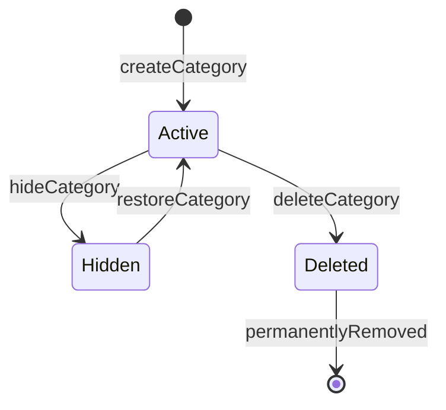

# 5. Mô hình Trạng thái Thực thể

Tài liệu này mô tả vòng đời của các thực thể có hành vi thay đổi theo trạng thái dữ liệu trong hệ thống quản lý tài chính cá nhân.

Mô hình trạng thái xác định tập hợp các trạng thái hợp lệ của thực thể, sự kiện kích hoạt chuyển đổi, điều kiện kiểm tra dữ liệu và các tác vụ cập nhật số dư đi kèm. Những thực thể không thay đổi hành vi sau khi khởi tạo như nhóm nhu cầu hay bản ghi kiểm kê số dư không thuộc phạm vi mô tả của tài liệu này.

## 5.1 Quy chuẩn Mô hình Trạng thái

Mỗi biểu đồ và bảng chuyển trạng thái trong tài liệu được chuẩn hóa theo các thành phần kỹ thuật sau:

| Thành phần | Ký hiệu quy ước | Nội dung kỹ thuật |
| :--- | :--- | :--- |
| **Trạng thái** | Khối trạng thái | Tình trạng tồn tại của thực thể, xác định các thao tác nghiệp vụ được chấp nhận hoặc bị từ chối xử lý tại thời điểm tiếp nhận. |
| **Trạng thái ban đầu** | Điểm đen tròn `[*]` | Điểm bắt đầu vòng đời khi thực thể được khởi tạo thành công từ một thao tác hệ thống. |
| **Sự kiện kích hoạt** | Tên thao tác hệ thống | Tác động từ người dùng hoặc hệ thống làm phát sinh yêu cầu chuyển đổi trạng thái của thực thể. |
| **Điều kiện bảo vệ** | `[Điều kiện]` | Ràng buộc nghiệp vụ cần thỏa mãn trước khi đổi trạng thái. Nếu điều kiện vi phạm, hệ thống từ chối thao tác và giữ nguyên trạng thái cũ. |
| **Hành động hệ thống** | `/Hành động` | Tác vụ xử lý dữ liệu được hệ thống thực thi ngay khi chuyển trạng thái, gồm cập nhật số dư hoặc điều chỉnh liên kết dữ liệu. |
| **Trạng thái kết thúc** | Điểm tròn có vòng bao `[*]` | Điểm kết thúc vòng đời khi thực thể bị xóa hoàn toàn khỏi hệ thống lưu trữ. |

Mỗi thực thể được mô tả qua biểu đồ trạng thái và bảng ràng buộc chuyển đổi gồm 3 cột: giai đoạn chuyển đổi, điều kiện kiểm tra và xử lý hệ thống.

## 5.2 Vòng đời Thực thể Ví

(Mô tả khoảng 1 đến 2 câu về bối cảnh nghiệp vụ và mục đích quản lý vòng đời của thực thể trong hệ thống)

- Quy chiếu chéo: `UC-WAL-01`, `UC-WAL-03`, `FR-WAL-01`, `FR-WAL-03`, `BR-NAM-01`, `BR-FIN-02`, `ERR-NAM-001`, `ERR-NAM-002`

(Vẽ biểu đồ trạng thái mô tả các trạng thái hợp lệ và luồng chuyển đổi của thực thể)

| Giai đoạn chuyển đổi | Điều kiện kiểm tra | Xử lý hệ thống |
| :--- | :--- | :--- |
| (Nêu giai đoạn hoặc bước chuyển của thực thể) | (Nêu các điều kiện hợp lệ cần kiểm tra trước khi chuyển trạng thái) | (Nêu trạng thái mới và các tác vụ cập nhật dữ liệu đi kèm) |

## 5.3 Vòng đời Giao dịch Thu chi

(Mô tả khoảng 1 đến 2 câu về bối cảnh nghiệp vụ và mục đích quản lý vòng đời của thực thể trong hệ thống)

- Quy chiếu chéo: `UC-TXN-01`, `UC-TXN-03`, `UC-TXN-04`, `FR-TXN-01`, `FR-TXN-02`, `FR-TXN-04`, `FR-TXN-05`, `BR-FIN-01`, `BR-FIN-02`, `BR-FIN-04`, `ERR-WAL-001`, `ERR-FEE-001`, `ERR-FEE-002`, `ERR-FEE-003`

(Vẽ biểu đồ trạng thái mô tả các trạng thái hợp lệ và luồng chuyển đổi của thực thể)

| Giai đoạn chuyển đổi | Điều kiện kiểm tra | Xử lý hệ thống |
| :--- | :--- | :--- |
| (Nêu giai đoạn hoặc bước chuyển của thực thể) | (Nêu các điều kiện hợp lệ cần kiểm tra trước khi chuyển trạng thái) | (Nêu trạng thái mới và các tác vụ cập nhật dữ liệu đi kèm) |

## 5.4 Vòng đời Giao dịch Chuyển tiền

(Mô tả khoảng 1 đến 2 câu về bối cảnh nghiệp vụ và mục đích quản lý vòng đời của thực thể trong hệ thống)

- Quy chiếu chéo: `UC-TRF-01`, `UC-TRF-03`, `FR-TRF-01`, `FR-TRF-02`, `BR-FIN-01`, `BR-FIN-02`, `BR-FIN-03`, `ERR-TRF-001`, `ERR-TRF-002`, `ERR-WAL-001`, `ERR-FEE-001`, `ERR-FEE-002`, `ERR-FEE-003`

(Vẽ biểu đồ trạng thái mô tả các trạng thái hợp lệ và luồng chuyển đổi của thực thể)

| Giai đoạn chuyển đổi | Điều kiện kiểm tra | Xử lý hệ thống |
| :--- | :--- | :--- |
| (Nêu giai đoạn hoặc bước chuyển của thực thể) | (Nêu các điều kiện hợp lệ cần kiểm tra trước khi chuyển trạng thái) | (Nêu trạng thái mới và các tác vụ cập nhật dữ liệu đi kèm) |

## 5.5 Vòng đời Thực thể Danh mục

Quản lý vòng đời của danh mục phân loại, bao gồm tạo mới, chỉnh sửa, ẩn/khôi phục và xóa, đảm bảo tính nhất quán của cấu trúc phân cấp và bảo toàn lịch sử giao dịch.

- Quy chiếu chéo: `UC-CAT-01`, `UC-CAT-02`, `UC-CAT-03`, `UC-CAT-04`, `FR-CAT-01`, `FR-CAT-02`, `FR-CAT-03`, `BR-FIN-04`, `BR-NAM-01`, `ERR-NAM-001`, `ERR-NAM-002`, `ERR-CAT-001`, `ERR-CAT-002`, `ERR-CAT-003`, `ERR-CAT-004`, `ERR-CAT-005`

| Giai đoạn chuyển đổi | Điều kiện kiểm tra | Xử lý hệ thống |
| :--- | :--- | :--- |
| **Khởi tạo danh mục**: Từ `[*]` sang `ACTIVE` (`createCategory`) | - Nhóm nhu cầu cha (`parentCategoryId`) bắt buộc tồn tại trong hệ thống và đang ở trạng thái hoạt động (`ACTIVE`), không ở trạng thái đã xóa (`BR-FIN-04`). - Nhóm nhu cầu cha (`parentCategoryId`) bắt buộc tồn tại trong hệ thống và đang ở trạng thái hoạt động (`ACTIVE`), không ở trạng thái đã xóa (`ERR-CAT-005`). - Tên danh mục (`categoryName`) không được để trống, sau khi cắt tỉa khoảng trắng ở hai đầu có độ dài từ 1 đến 50 ký tự (`BR-NAM-01`). - Tên danh mục (`categoryName`) không được để trống, sau khi cắt tỉa khoảng trắng ở hai đầu có độ dài từ 1 đến 50 ký tự (`ERR-NAM-001`). - Tên danh mục mới sau khi chuẩn hóa là duy nhất, không trùng với danh mục nào khác đang hoạt động (`ACTIVE`) trong cùng nhóm nhu cầu cha (`BR-NAM-01`). - Tên danh mục mới sau khi chuẩn hóa là duy nhất, không trùng với danh mục nào khác đang hoạt động (`ACTIVE`) trong cùng nhóm nhu cầu cha (`ERR-NAM-002`). | - Cấp mã `categoryId` duy nhất và khởi tạo thực thể `Category` mới ở trạng thái `ACTIVE` (`isDeleted = false`). - Kế thừa loại thu chi (`transactionType`) từ nhóm cha và thiết lập liên kết phân cấp 3 cấp tới `NeedGroup` (`BR-FIN-04`, `FR-CAT-01`). - Đồng bộ cấu trúc danh mục trên giao diện và ghi log tạo danh mục. |
| **Đổi tên danh mục**: Giữ nguyên `ACTIVE` → `ACTIVE` hoặc `HIDDEN` → `HIDDEN` (`renameCategory`) | - Thể hiện `Category` xác định bởi `categoryId` bắt buộc tồn tại trong hệ thống và đang ở trạng thái hoạt động (`ACTIVE`) hoặc ẩn (`HIDDEN`); hệ thống từ chối nếu danh mục không tồn tại hoặc đã bị xóa vĩnh viễn (`BR-FIN-04`). - Thể hiện `Category` xác định bởi `categoryId` bắt buộc tồn tại trong hệ thống và đang ở trạng thái hoạt động (`ACTIVE`) hoặc ẩn (`HIDDEN`); hệ thống từ chối nếu danh mục không tồn tại hoặc đã bị xóa vĩnh viễn (`ERR-CAT-001`). - Tên mới `newName` không được để trống, sau khi cắt tỉa khoảng trắng ở hai đầu có độ dài từ 1 đến 50 ký tự (`BR-NAM-01`). - Tên mới `newName` không được để trống, sau khi cắt tỉa khoảng trắng ở hai đầu có độ dài từ 1 đến 50 ký tự (`ERR-NAM-001`). - Tên mới sau khi chuẩn hóa không trùng với bất kỳ danh mục nào khác đang hoạt động trong cùng nhóm nhu cầu cha (`BR-NAM-01`). - Tên mới sau khi chuẩn hóa không trùng với bất kỳ danh mục nào khác đang hoạt động trong cùng nhóm nhu cầu cha (`ERR-NAM-002`). - Hệ thống chấp nhận đổi tên bình thường kể cả khi danh mục đã phát sinh giao dịch lịch sử; mã định danh và toàn bộ liên kết với giao dịch cũ được giữ nguyên (`FR-CAT-02`). | - Cập nhật thuộc tính `name` của thể hiện `Category` bằng giá trị `newName` đã chuẩn hóa. - Giữ nguyên mã `categoryId`, trạng thái hoạt động và bảo toàn nguyên vẹn liên kết với toàn bộ giao dịch lịch sử trong quá khứ (`FR-CAT-02`, `BR-FIN-04`). - Cập nhật giao diện và ghi log thay đổi tên danh mục. |
| **Ẩn (xóa mềm) danh mục**: Từ `ACTIVE` sang `HIDDEN` (`hideCategory`) | - Thể hiện `Category` xác định bởi `categoryId` bắt buộc tồn tại trong hệ thống và đang ở trạng thái hoạt động (`ACTIVE`); hệ thống từ chối nếu danh mục không tồn tại hoặc không đang ở trạng thái hoạt động (`ERR-CAT-001`). - Danh mục không phải là danh mục hoạt động duy nhất còn lại trong nhóm nhu cầu cha, đảm bảo duy trì tối thiểu một danh mục hoạt động cho mỗi nhóm nhu cầu (`BR-FIN-04`). - Danh mục không phải là danh mục hoạt động duy nhất còn lại trong nhóm nhu cầu cha, đảm bảo duy trì tối thiểu một danh mục hoạt động cho mỗi nhóm nhu cầu (`ERR-CAT-002`). | - Chuyển thuộc tính trạng thái của thực thể sang `HIDDEN`. - Ẩn danh mục khỏi danh sách lựa chọn khi tạo giao dịch mới. - Bảo toàn nguyên vẹn liên kết phân cấp với nhóm cha và các giao dịch lịch sử liên quan (`FR-CAT-03`, `BR-FIN-04`). - Cập nhật giao diện và ghi log ẩn danh mục. |
| **Khôi phục danh mục**: Từ `HIDDEN` hoặc `DELETED` sang `ACTIVE` (`restoreCategory`) | - Thể hiện `Category` xác định bởi `categoryId` bắt buộc tồn tại trong hệ thống và đang ở trạng thái ẩn (`HIDDEN`) hoặc đã xóa mềm (`DELETED`); hệ thống từ chối nếu không tìm thấy danh mục (`ERR-CAT-001`). - Nhóm nhu cầu cha trực thuộc (`parentCategoryId`) bắt buộc đang ở trạng thái hoạt động (`ACTIVE`), không ở trạng thái đã xóa; hệ thống yêu cầu khôi phục nhóm cha trước khi khôi phục danh mục (`BR-FIN-04`). - Nhóm nhu cầu cha trực thuộc (`parentCategoryId`) bắt buộc đang ở trạng thái hoạt động (`ACTIVE`), không ở trạng thái đã xóa; hệ thống yêu cầu khôi phục nhóm cha trước khi khôi phục danh mục (`ERR-CAT-004`). - Tên danh mục sau khi chuẩn hóa không trùng với bất kỳ danh mục nào khác đang hoạt động (`ACTIVE`) trong cùng nhóm nhu cầu cha (`BR-NAM-01`). - Tên danh mục sau khi chuẩn hóa không trùng với bất kỳ danh mục nào khác đang hoạt động (`ACTIVE`) trong cùng nhóm nhu cầu cha (`ERR-NAM-002`). | - Chuyển thuộc tính trạng thái sang `ACTIVE` (`isDeleted = false`). - Cho phép danh mục hiển thị trở lại trên các biểu mẫu ghi nhận giao dịch thu chi mới. - Giữ nguyên mã `categoryId` và nối lại toàn bộ liên kết dữ liệu lịch sử (`FR-CAT-03`, `BR-FIN-04`). - Cập nhật giao diện và ghi log khôi phục danh mục. |
| **Xóa danh mục**: Từ `ACTIVE` sang `DELETED` (`deleteCategory`) | - Thể hiện `Category` xác định bởi `categoryId` bắt buộc tồn tại trong hệ thống và đang ở trạng thái hoạt động (`ACTIVE`); hệ thống từ chối nếu không tìm thấy danh mục (`ERR-CAT-001`). - Danh mục đã từng phát sinh ít nhất một giao dịch thu chi trong lịch sử hệ thống, do đó hệ thống áp dụng xóa mềm thay vì xóa vĩnh viễn để bảo toàn lịch sử (`BR-FIN-04`). - Danh mục đã từng phát sinh ít nhất một giao dịch thu chi trong lịch sử hệ thống, do đó hệ thống áp dụng xóa mềm thay vì xóa vĩnh viễn để bảo toàn lịch sử (`ERR-CAT-003`). - Danh mục không phải là danh mục hoạt động duy nhất còn lại trong nhóm nhu cầu cha, đảm bảo duy trì tối thiểu một danh mục hoạt động cho mỗi nhóm nhu cầu (`BR-FIN-04`). - Danh mục không phải là danh mục hoạt động duy nhất còn lại trong nhóm nhu cầu cha, đảm bảo duy trì tối thiểu một danh mục hoạt động cho mỗi nhóm nhu cầu (`ERR-CAT-002`). | - Chuyển thuộc tính trạng thái sang `DELETED` (`isDeleted = true`, xóa mềm) nhằm bảo toàn dữ liệu tài chính lịch sử. - Ẩn khỏi danh sách lựa chọn khi ghi nhận giao dịch mới; hiển thị kèm nhãn "(đã xóa)" trên các báo cáo thống kê lịch sử (`FR-CAT-03`, `BR-FIN-04`). - Bảo toàn nguyên vẹn liên kết phân cấp và liên kết ngữ nghĩa với các giao dịch lịch sử (`IncomeExpenseTransaction`, `TransactionFee`). - Cập nhật giao diện và ghi log xóa danh mục. |
| **Xóa vĩnh viễn danh mục**: Từ `DELETED` hoặc `ACTIVE` sang `[*]` (`permanentlyRemoved` / `deleteCategory`) | - Thể hiện `Category` xác định bởi `categoryId` đang ở trạng thái đã xóa mềm (`DELETED`) hoặc đang hoạt động (`ACTIVE`). - Danh mục chưa từng phát sinh bất kỳ giao dịch thu chi nào trong lịch sử hệ thống; nếu đã có giao dịch, hệ thống áp dụng xóa mềm thay vì xóa vĩnh viễn (`FR-CAT-03`). - Danh mục chưa từng phát sinh bất kỳ giao dịch thu chi nào trong lịch sử hệ thống; nếu đã có giao dịch, hệ thống áp dụng xóa mềm thay vì xóa vĩnh viễn (`BR-FIN-04`). - Người dùng xác nhận thao tác xóa vĩnh viễn. | - Xóa hoàn toàn thể hiện `Category` khỏi hệ thống lưu trữ (xóa cứng vĩnh viễn). - Phá vỡ hoàn toàn liên kết phân cấp giữa `Category` với nhóm cha `NeedGroup` và giải phóng thuộc tính `name` khỏi phạm vi kiểm tra trùng tên (`BR-NAM-01`, `FR-CAT-03`). - Đồng bộ cây danh mục và ghi log xóa vĩnh viễn thực thể. |

