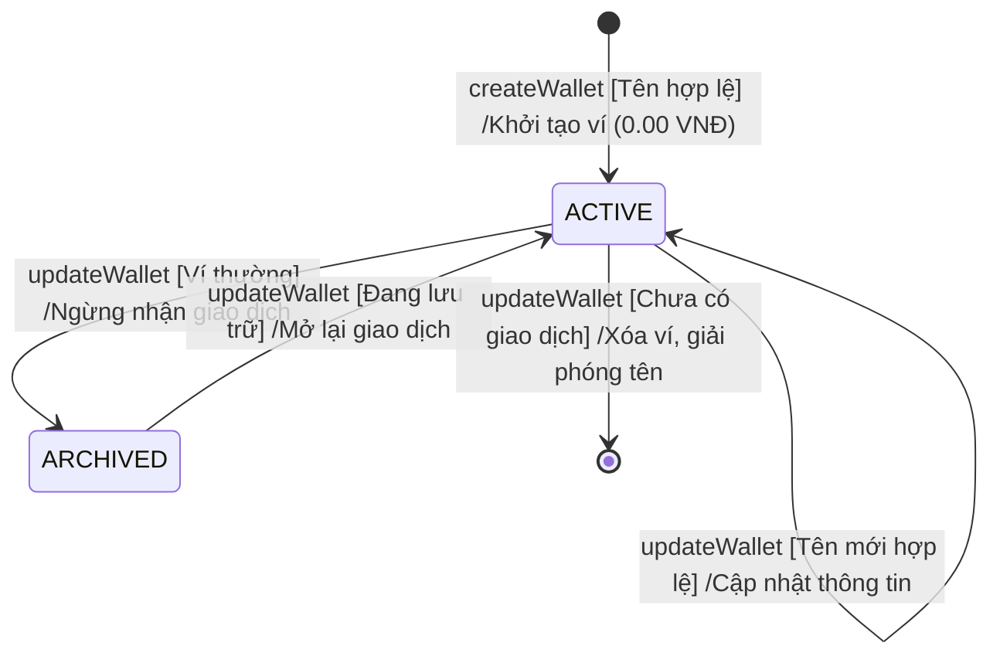
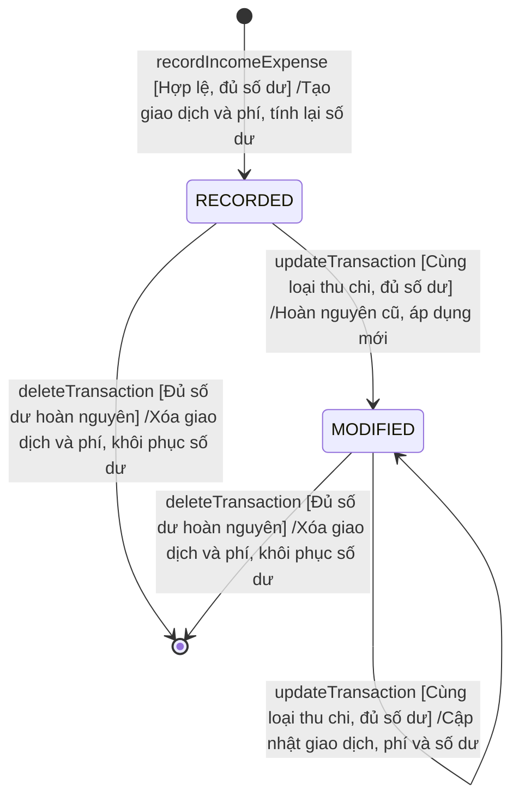
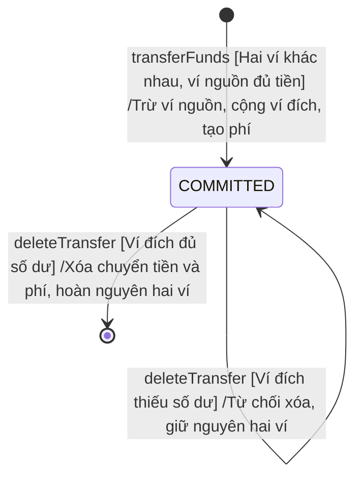

# 5. Mô hình Trạng thái Thực thể

Tài liệu này mô tả vòng đời của các thực thể có hành vi thay đổi theo trạng thái dữ liệu trong hệ thống quản lý tài chính cá nhân.

Mô hình trạng thái xác định tập hợp các trạng thái hợp lệ của thực thể, sự kiện kích hoạt chuyển đổi, điều kiện kiểm tra dữ liệu và các tác vụ cập nhật số dư đi kèm. Những thực thể không thay đổi hành vi sau khi khởi tạo như nhóm nhu cầu hay bản ghi kiểm kê số dư không thuộc phạm vi mô tả của tài liệu này.

## 5.1 Quy chuẩn Mô hình Trạng thái

Mỗi biểu đồ và bảng chuyển trạng thái trong tài liệu được chuẩn hóa theo các thành phần kỹ thuật sau:

| Thành phần | Ký hiệu quy ước | Nội dung kỹ thuật |
| :--- | :--- | :--- |
| **Trạng thái** | Khối trạng thái | Tình trạng tồn tại của thực thể, xác định các thao tác nghiệp vụ được chấp nhận hoặc bị từ chối xử lý tại thời điểm tiếp nhận. |
| **Trạng thái ban đầu** | Điểm đen tròn `[*]` | Điểm bắt đầu vòng đời khi thực thể được khởi tạo thành công từ một thao tác hệ thống. |
| **Sự kiện kích hoạt** | Tên thao tác hệ thống | Tác động từ người dùng hoặc hệ thống làm phát sinh yêu cầu chuyển đổi trạng thái của thực thể. |
| **Điều kiện bảo vệ** | `[Điều kiện]` | Ràng buộc nghiệp vụ cần thỏa mãn trước khi đổi trạng thái. Nếu điều kiện vi phạm, hệ thống từ chối thao tác và giữ nguyên trạng thái cũ. |
| **Hành động hệ thống** | `/Hành động` | Tác vụ xử lý dữ liệu được hệ thống thực thi ngay khi chuyển trạng thái, gồm cập nhật số dư hoặc điều chỉnh liên kết dữ liệu. |
| **Trạng thái kết thúc** | Điểm tròn có vòng bao `[*]` | Điểm kết thúc vòng đời khi thực thể bị xóa hoàn toàn khỏi hệ thống lưu trữ. |

Mỗi thực thể được mô tả qua biểu đồ trạng thái và bảng ràng buộc chuyển đổi gồm 3 cột: giai đoạn chuyển đổi, điều kiện kiểm tra và xử lý hệ thống.

## 5.2 Vòng đời Thực thể Ví

Thực thể Ví (`Wallet`) quản lý trạng thái tồn tại của nguồn tiền thanh toán từ khi khởi tạo, hạch toán dòng tiền hàng ngày cho đến khi chuyển sang lưu trữ hoặc xóa vĩnh viễn (`FR-WAL-01`, `FR-WAL-03`). Cơ chế kiểm soát vòng đời ví duy trì tính duy nhất của tên định danh (`BR-NAM-01`), ngăn chặn việc xóa mất lịch sử giao dịch và giữ số dư khả dụng luôn không âm (`BR-FIN-02`).

- Quy chiếu chéo: `UC-WAL-01`, `UC-WAL-03`, `FR-WAL-01`, `FR-WAL-03`, `BR-NAM-01`, `BR-FIN-02`, `ERR-NAM-001`, `ERR-NAM-002`

| Giai đoạn chuyển đổi | Điều kiện kiểm tra | Xử lý hệ thống |
| :--- | :--- | :--- |
| Khởi tạo ví: Từ `[*]` sang `ACTIVE` (`createWallet`) | Tên ví dài từ 1 đến 50 ký tự (`BR-NAM-01`, `ERR-NAM-001`) và chưa tồn tại trong tập hợp các ví `ACTIVE` hoặc `ARCHIVED` của hệ thống (`BR-NAM-01`, `ERR-NAM-002`). | Cấp mã `walletId` duy nhất, thiết lập trạng thái `status = ACTIVE`, ghi nhận `createdAt` và gán số dư ban đầu `currentBalance = 0.00 VNĐ` (`FR-WAL-01`, `BR-FIN-02`). |
| Cập nhật thông tin: Giữ nguyên `ACTIVE` (`updateWallet`) | Thể hiện `Wallet` tồn tại; tên ví mới dài từ 1 đến 50 ký tự (`ERR-NAM-001`) và không trùng với bất kỳ ví nào khác trong hệ thống (`BR-NAM-01`, `ERR-NAM-002`). | Giữ nguyên trạng thái `status = ACTIVE`, cập nhật thuộc tính `name` và `note` mới, bảo toàn số dư `currentBalance` cùng lịch sử dòng tiền (`FR-WAL-03`, `BR-FIN-02`). |
| Lưu trữ ví: Từ `ACTIVE` sang `ARCHIVED` (`updateWallet`) | Thể hiện `Wallet` đang ở trạng thái `status = ACTIVE` và không phải là ví "Tiền mặt" mặc định được tạo từ lần khởi tạo hệ thống đầu tiên (`FR-WAL-03`). | Chuyển `status` sang `ARCHIVED`, khóa không cho phép chọn ví trong các giao dịch thu chi, chuyển tiền hoặc kiểm kê mới; vẫn tính `currentBalance` vào tổng số dư toàn hệ thống nếu số dư lớn hơn 0.00 VNĐ (`FR-WAL-03`, `BR-FIN-02`). |
| Kích hoạt lại ví: Từ `ARCHIVED` sang `ACTIVE` (`updateWallet`) | Thể hiện `Wallet` tồn tại trong hệ thống và đang có trạng thái `status = ARCHIVED` (`FR-WAL-03`). | Chuyển `status` từ `ARCHIVED` về `ACTIVE`, mở lại quyền tiếp nhận giao dịch mới và giữ nguyên lịch sử dòng tiền cùng số dư hiện có (`FR-WAL-03`, `BR-FIN-02`). |
| Xóa vĩnh viễn ví: Từ `ACTIVE` sang `[*]` (`updateWallet`) | Thể hiện `Wallet` không phải là ví "Tiền mặt" mặc định và chưa từng phát sinh bản ghi nào trong sổ thu chi, sổ chuyển tiền nội bộ hoặc sổ điều chỉnh số dư (`FR-WAL-03`). | Xóa hoàn toàn thể hiện `Wallet` khỏi hệ thống lưu trữ và giải phóng thuộc tính `name` khỏi phạm vi kiểm tra trùng tên (`FR-WAL-03`, `BR-NAM-01`). |

## 5.3 Vòng đời Giao dịch Thu chi

Thực thể Giao dịch Thu chi (`IncomeExpenseTransaction`) phản ánh vòng đời của một khoản thu nhập hoặc chi tiêu từ lúc ghi nhận lần đầu, trải qua các lần điều chỉnh thông số cho đến khi bị xóa khỏi sổ theo dõi (`FR-TXN-01`, `FR-TXN-04`, `FR-TXN-05`). Mọi bước chuyển trạng thái đều gắn liền với việc tính lại số dư ví khả dụng và đồng bộ vòng đời của bản ghi chi phí giao dịch (`TransactionFee`) đi kèm (`BR-FIN-02`, `BR-FIN-04`).

- Quy chiếu chéo: `UC-TXN-01`, `UC-TXN-03`, `UC-TXN-04`, `FR-TXN-01`, `FR-TXN-02`, `FR-TXN-04`, `FR-TXN-05`, `BR-FIN-01`, `BR-FIN-02`, `BR-FIN-04`, `ERR-WAL-001`, `ERR-FEE-001`, `ERR-FEE-002`, `ERR-FEE-003`

| Giai đoạn chuyển đổi | Điều kiện kiểm tra | Xử lý hệ thống |
| :--- | :--- | :--- |
| Ghi nhận mới: Từ `[*]` sang `RECORDED` (`recordIncomeExpense`) | Ví liên kết và danh mục cấp 3 đều ở trạng thái `ACTIVE` (`BR-FIN-04`); `amount > 0.00 VNĐ` (`BR-FIN-01`); `feeAmount >= 0.00 VNĐ` (`ERR-FEE-001`), nếu `feeAmount > 0.00 VNĐ` phải gắn danh mục cấp 3 `ACTIVE` thuộc nhánh `EXPENSE` (`ERR-FEE-002`, `ERR-FEE-003`); số dư ví sau khi cộng/trừ `amount` và trừ `feeAmount` không âm (`BR-FIN-02`, `ERR-WAL-001`). | Khởi tạo `IncomeExpenseTransaction` ở trạng thái `RECORDED`, cố định `transactionType` theo danh mục chọn (`BR-FIN-04`); tạo đồng thời `TransactionFee` liên kết nếu `feeAmount > 0.00 VNĐ` và cập nhật `currentBalance` của ví (`FR-TXN-01`, `FR-TXN-02`, `BR-FIN-02`). |
| Chỉnh sửa: Từ `RECORDED` hoặc `MODIFIED` sang `MODIFIED` (`updateTransaction`) | Bản ghi tồn tại và không phải là `TransactionFee` độc lập (`BR-FIN-02`); giữ nguyên `transactionType` (`BR-FIN-04`); ví đích `ACTIVE`; danh mục mới phải `ACTIVE` nếu đổi danh mục, cho phép giữ danh mục cũ kể cả khi `DELETED` (`FR-TXN-04`); thông số `amount` và `feeAmount` hợp lệ (`ERR-FEE-001`, `ERR-FEE-002`, `ERR-FEE-003`); số dư ví cũ sau hoàn nguyên và ví mới sau áp dụng đều không âm (`BR-FIN-02`, `ERR-WAL-001`). | Chuyển hoặc duy trì trạng thái `MODIFIED`, cập nhật `walletId`, `categoryId`, `amount`, `transactionDate`, `note`; đồng bộ `TransactionFee` liên kết (tạo mới nếu phí từ 0.00 VNĐ lên dương, cập nhật nếu giữ dương, xóa hẳn nếu về 0.00 VNĐ); tính lại `currentBalance` trên ví cũ và ví mới (`FR-TXN-04`, `BR-FIN-02`). |
| Hủy bỏ giao dịch: Từ `RECORDED` hoặc `MODIFIED` sang `[*]` (`deleteTransaction`) | Thể hiện `IncomeExpenseTransaction` tồn tại và không phải bản ghi phí độc lập (`BR-FIN-02`); nếu `transactionType = INCOME`, số dư hiện tại của ví sau khi trừ lại `amount` và cộng hoàn `feeAmount` (nếu có) không âm (`>= 0.00 VNĐ`) (`BR-FIN-02`, `ERR-WAL-001`). | Xóa vĩnh viễn `IncomeExpenseTransaction` cùng `TransactionFee` liên kết (nếu có) khỏi hệ thống lưu trữ; hoàn nguyên `currentBalance` của ví về giá trị trước khi có giao dịch (`FR-TXN-05`, `BR-FIN-02`). |

## 5.4 Vòng đời Giao dịch Chuyển tiền

Thực thể Giao dịch Chuyển tiền (`TransferTransaction`) quản lý vòng đời điều chuyển tiền tệ giữa hai ví nội bộ theo cơ chế ghi nhận và hoàn nguyên đồng thời (`BR-FIN-03`, `FR-TRF-01`, `FR-TRF-02`). Sau khi hạch toán thành công, bản ghi chuyển tiền không cho phép chỉnh sửa thuộc tính mà chỉ cho phép xóa toàn bộ để bảo toàn cân bằng tổng số dư giữa ví nguồn và ví đích (`BR-FIN-02`, `BR-FIN-03`).

- Quy chiếu chéo: `UC-TRF-01`, `UC-TRF-03`, `FR-TRF-01`, `FR-TRF-02`, `BR-FIN-01`, `BR-FIN-02`, `BR-FIN-03`, `ERR-TRF-001`, `ERR-TRF-002`, `ERR-WAL-001`, `ERR-FEE-001`, `ERR-FEE-002`, `ERR-FEE-003`

| Giai đoạn chuyển đổi | Điều kiện kiểm tra | Xử lý hệ thống |
| :--- | :--- | :--- |
| Ghi nhận đồng thời: Từ `[*]` sang `COMMITTED` (`transferFunds`) | Hai ví nguồn và đích đều `ACTIVE` và khác nhau (`sourceWalletId != destinationWalletId`) (`BR-FIN-03`, `ERR-TRF-001`); `amount > 0.00 VNĐ` (`BR-FIN-01`, `ERR-TRF-002`); `feeAmount >= 0.00 VNĐ` (`ERR-FEE-001`) kèm danh mục cấp 3 `ACTIVE` nhánh `EXPENSE` nếu có phí (`ERR-FEE-002`, `ERR-FEE-003`); số dư ví nguồn `>= amount + feeAmount` (`BR-FIN-02`, `BR-FIN-03`, `ERR-WAL-001`). | Khởi tạo `TransferTransaction` ở trạng thái `COMMITTED` và `TransactionFee` liên kết (nếu `feeAmount > 0.00 VNĐ`); trừ `amount + feeAmount` khỏi `currentBalance` của ví nguồn và cộng `amount` vào `currentBalance` của ví đích trong cùng một bước xử lý (`FR-TRF-01`, `BR-FIN-02`, `BR-FIN-03`). |
| Từ chối xóa: Giữ nguyên `COMMITTED` (`deleteTransfer`) | Thể hiện `TransferTransaction` tồn tại nhưng số dư khả dụng hiện tại của ví đích nhỏ hơn số tiền đã nhận (`destinationWallet.currentBalance < amount`) (`BR-FIN-02`, `BR-FIN-03`, `ERR-WAL-001`). | Từ chối thao tác xóa, báo lỗi không đủ số dư hoàn nguyên (`ERR-WAL-001`), giữ nguyên trạng thái `COMMITTED` của `TransferTransaction`, bản ghi `TransactionFee` liên kết và số dư cả hai ví (`FR-TRF-02`, `BR-FIN-03`). |
| Xóa và hoàn nguyên: Từ `COMMITTED` sang `[*]` (`deleteTransfer`) | Thể hiện `TransferTransaction` tồn tại trong sổ chuyển tiền nội bộ và số dư khả dụng hiện tại của ví đích lớn hơn hoặc bằng số tiền chuyển (`destinationWallet.currentBalance >= amount`) (`FR-TRF-02`, `BR-FIN-02`, `BR-FIN-03`). | Xóa vĩnh viễn `TransferTransaction` cùng `TransactionFee` liên kết (nếu có); cộng hoàn `amount + feeAmount` vào `currentBalance` của ví nguồn và trừ `amount` khỏi `currentBalance` của ví đích trong cùng một bước xử lý (`FR-TRF-02`, `BR-FIN-02`, `BR-FIN-03`). |

## 5.5 Vòng đời Thực thể Danh mục

(Mô tả khoảng 1 đến 2 câu về bối cảnh nghiệp vụ và mục đích quản lý vòng đời của thực thể trong hệ thống)

- Quy chiếu chéo: `UC-CAT-01`, `UC-CAT-02`, `UC-CAT-03`, `UC-CAT-04`, `FR-CAT-01`, `FR-CAT-02`, `FR-CAT-03`, `BR-FIN-04`, `BR-NAM-01`, `ERR-NAM-001`, `ERR-NAM-002`, `ERR-CAT-001`, `ERR-CAT-003`, `ERR-CAT-004`, `ERR-CAT-005`

(Vẽ biểu đồ trạng thái mô tả các trạng thái hợp lệ và luồng chuyển đổi của thực thể)

| Giai đoạn chuyển đổi | Điều kiện kiểm tra | Xử lý hệ thống |
| :--- | :--- | :--- |
| (Nêu giai đoạn hoặc bước chuyển của thực thể) | (Nêu các điều kiện hợp lệ cần kiểm tra trước khi chuyển trạng thái) | (Nêu trạng thái mới và các tác vụ cập nhật dữ liệu đi kèm) |
