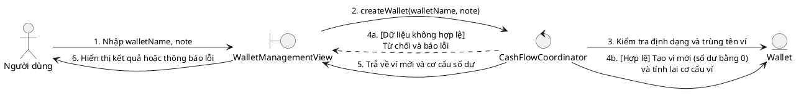
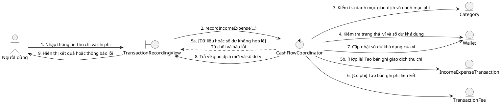
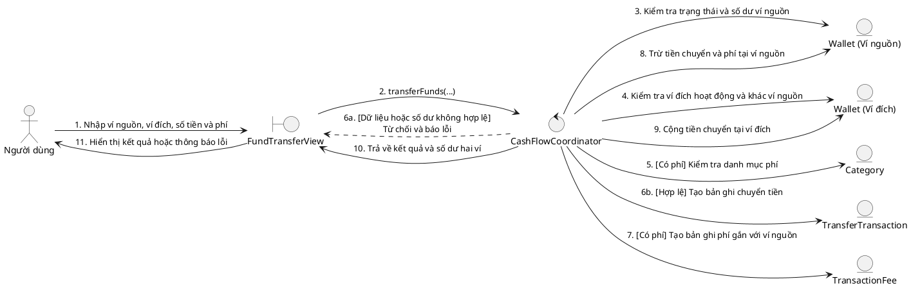

# 6. Sơ đồ Robustness và Thẻ CRC

Tài liệu này xác định cách các đối tượng bên trong phần mềm phối hợp với nhau để thực thi các ca sử dụng, chuyển từ góc nhìn tương tác bên ngoài của người dùng sang cấu trúc xử lý nội bộ của hệ thống, làm cơ sở phân bổ trách nhiệm cho các lớp đối tượng.

Mô hình phân tích giữ tính trung lập công nghệ, không phụ thuộc vào giao diện đồ họa cụ thể, cơ sở dữ liệu hay cú pháp của ngôn ngữ lập trình.

## 6.1 Sơ đồ Robustness

Mục này thiết lập các sơ đồ Robustness nhằm làm rõ cơ chế phối hợp đối tượng khi hiện thực hóa các ca sử dụng có tính chất định hình kiến trúc của hệ thống.

Để phân định rạch ròi trách nhiệm xử lý, các đối tượng tham gia được chia thành 3 nhóm:
- Đối tượng Giao diện: Tiếp nhận thao tác từ người dùng, thu thập dữ liệu đầu vào và hiển thị kết quả phản hồi từ hệ thống.
- Đối tượng Điều khiển: Điều phối quy trình xử lý, kiểm tra tính hợp lệ của dữ liệu theo các quy tắc nghiệp vụ và chỉ đạo cập nhật trạng thái giữa các đối tượng.
- Đối tượng Thực thể: Lưu giữ thông tin nghiệp vụ lâu dài và thực hiện các phép tính toán nội tại của chính mình.

Luồng tương tác giữa các thành phần tuân thủ 3 nguyên tắc:
- Mọi yêu cầu từ người dùng đều bắt đầu từ đối tượng Giao diện và chuyển giao cho đối tượng Điều khiển xử lý.
- Đối tượng Giao diện không tương tác trực tiếp với đối tượng Thực thể mà phải thông qua đối tượng Điều khiển để bảo đảm tính độc lập giữa giao diện và dữ liệu.
- Đối tượng Thực thể chỉ quản lý dữ liệu và quy tắc nội tại của chính nó, không chủ động điều phối quy trình và không phụ thuộc vào tầng giao diện.

Nhằm tối ưu hóa độ cô đọng của tài liệu, hệ thống lược bỏ việc mô hình hóa đối với các luồng truy vấn chỉ đọc và các thao tác cập nhật thứ cấp có cùng mô thức tương tác. Mỗi nhóm chức năng lựa chọn một ca sử dụng tiêu biểu làm đại diện phân tích, ưu tiên các kịch bản làm biến động trạng thái dữ liệu, tổng hợp báo cáo đa chiều hoặc yêu cầu thực thi các quy tắc bất biến tài chính với sự tham gia đồng thời của cả 3 nhóm đối tượng.

### 6.1.1 Quản lý Ví

Người dùng tạo ví mới để theo dõi số dư và hạch toán dòng tiền độc lập. Hệ thống kiểm tra quy tắc đặt tên (`BR-NAM-01`), khởi tạo ví `ACTIVE` với số dư `0.00 VNĐ` (`BR-FIN-02`) và tính lại cơ cấu phân bổ số dư (`FR-WAL-04`).

- Ca sử dụng đại diện: `UC-WAL-01` (Tạo ví mới)
- Thao tác hệ thống: `createWallet(walletName, note)`
- Quy chiếu chéo: `UC-WAL-01`, `FR-WAL-01`, `FR-WAL-04`, `BR-NAM-01`, `BR-FIN-02`, `ERR-NAM-001`, `ERR-NAM-002`

**Thành phần tham gia phân tích**

| Nhóm thành phần | Tên đối tượng | Trách nhiệm và ràng buộc |
| :--- | :--- | :--- |
| Giao diện | `WalletManagementView` | Nhận `walletName`, `note` và gửi yêu cầu tạo ví; hiển thị thông tin ví mới kèm cơ cấu số dư hoặc báo lỗi tên sai định dạng (`ERR-NAM-001`), trùng tên ví (`ERR-NAM-002`). |
| Điều khiển | `CashFlowCoordinator` | Chuẩn hóa chuỗi, kiểm tra độ dài tên từ 1 đến 50 ký tự và đối chiếu trùng tên trên cả ví `ACTIVE` lẫn `ARCHIVED` (`BR-NAM-01`), kiểm tra `note` tối đa 255 ký tự (`FR-WAL-01`); trường hợp vi phạm, báo lỗi tên sai định dạng (`ERR-NAM-001`), trùng tên ví (`ERR-NAM-002`); nếu hợp lệ, điều phối tạo ví và tính lại tỷ lệ phân bổ (`FR-WAL-04`). |
| Thực thể | `Wallet` | Cung cấp danh sách tên ví hiện có để kiểm tra trùng; lưu ví mới với `walletId` duy nhất, `status = ACTIVE`, `createdAt` (`FR-WAL-01`) và `currentBalance = 0.00 VNĐ` (`BR-FIN-02`). |

**Sơ đồ Robustness**

### 6.1.2 Ghi nhận Thu chi

Người dùng ghi nhận khoản thu nhập hoặc chi tiêu hàng ngày kèm chi phí giao dịch vào sổ theo dõi. Hệ thống kiểm tra danh mục cấp 3 (`BR-FIN-04`) và số dư khả dụng (`BR-FIN-02`), sau đó lưu nguyên khối giao dịch gốc, khoản phí đi kèm và số dư ví mới.

- Ca sử dụng đại diện: `UC-TXN-01` (Ghi nhận giao dịch thu chi)
- Thao tác hệ thống: `recordIncomeExpense(walletId, categoryId, amount, transactionDate, note, feeAmount, feeCategoryId)`
- Quy chiếu chéo: `UC-TXN-01`, `FR-TXN-01`, `FR-TXN-02`, `BR-FIN-01`, `BR-FIN-02`, `BR-FIN-04`, `ERR-FIN-001`, `ERR-WAL-001`, `ERR-FEE-001`, `ERR-FEE-002`, `ERR-FEE-003`

**Thành phần tham gia phân tích**

| Nhóm thành phần | Tên đối tượng | Trách nhiệm và ràng buộc |
| :--- | :--- | :--- |
| Giao diện | `TransactionRecordingView` | Thu thập thông tin thu chi và chi phí đi kèm; hiển thị kết quả ghi nhận cùng số dư ví mới hoặc báo lỗi số tiền sai định dạng (`ERR-FIN-001`), chi phí âm (`ERR-FEE-001`), thiếu danh mục phí (`ERR-FEE-002`), danh mục phí sai loại hoặc đã xóa (`ERR-FEE-003`), không đủ số dư ví (`ERR-WAL-001`). |
| Điều khiển | `CashFlowCoordinator` | Kiểm tra `amount > 0.00 VNĐ` (`BR-FIN-01`), trạng thái `ACTIVE` của ví cùng danh mục giao dịch và danh mục phí cấp 3 nhánh `EXPENSE` (`BR-FIN-04`), điều kiện phí không âm và số dư khả dụng của ví (`BR-FIN-02`); trường hợp vi phạm, báo lỗi số tiền sai định dạng (`ERR-FIN-001`), chi phí âm (`ERR-FEE-001`), thiếu danh mục phí (`ERR-FEE-002`), danh mục phí sai loại hoặc đã xóa (`ERR-FEE-003`), không đủ số dư ví (`ERR-WAL-001`); nếu hợp lệ, điều phối lưu giao dịch, phí và số dư ví. |
| Thực thể | `Wallet`, `Category`, `IncomeExpenseTransaction`, `TransactionFee` | `Category` xác nhận danh mục cấp 3 `ACTIVE` (`BR-FIN-04`); `Wallet` kiểm tra số dư và cập nhật `currentBalance` tức thời (`BR-FIN-02`); `IncomeExpenseTransaction` lưu khoản thu (`FR-TXN-01`) hoặc khoản chi (`FR-TXN-02`); `TransactionFee` lưu khoản phí `EXPENSE` khi `feeAmount > 0.00 VNĐ` (`BR-FIN-02`). |

**Sơ đồ Robustness**

### 6.1.3 Chuyển tiền Nội bộ

Người dùng điều chuyển tiền giữa hai ví nội bộ đang hoạt động kèm chi phí phát sinh. Hệ thống kiểm tra hai ví phân biệt (`BR-FIN-03`) và số dư khả dụng của ví nguồn (`BR-FIN-02`), sau đó trừ tiền ví nguồn, cộng tiền ví đích đồng thời và tách bản ghi phí liên kết.

- Ca sử dụng đại diện: `UC-TRF-01` (Chuyển tiền nội bộ giữa hai ví)
- Thao tác hệ thống: `transferFunds(sourceWalletId, targetWalletId, amount, transferDate, note, feeAmount, feeCategoryId)`
- Quy chiếu chéo: `UC-TRF-01`, `FR-TRF-01`, `BR-FIN-01`, `BR-FIN-02`, `BR-FIN-03`, `BR-FIN-04`, `ERR-FIN-001`, `ERR-TRF-001`, `ERR-TRF-002`, `ERR-WAL-001`, `ERR-FEE-001`, `ERR-FEE-002`, `ERR-FEE-003`

**Thành phần tham gia phân tích**

| Nhóm thành phần | Tên đối tượng | Trách nhiệm và ràng buộc |
| :--- | :--- | :--- |
| Giao diện | `FundTransferView` | Thu thập ví nguồn, ví đích, số tiền chuyển và chi phí; hiển thị kết quả cùng số dư mới của hai ví hoặc báo lỗi trùng ví chuyển và nhận (`ERR-TRF-001`), số tiền chuyển $\le 0$ (`ERR-TRF-002`), sai định dạng số học (`ERR-FIN-001`), chi phí âm (`ERR-FEE-001`), thiếu danh mục phí (`ERR-FEE-002`), danh mục phí sai loại hoặc đã xóa (`ERR-FEE-003`), ví nguồn không đủ số dư (`ERR-WAL-001`). |
| Điều khiển | `CashFlowCoordinator` | Kiểm tra hai ví `ACTIVE` phân biệt (`BR-FIN-03`), `amount > 0.00 VNĐ` (`BR-FIN-01`), danh mục phí cấp 3 nhánh `EXPENSE` (`BR-FIN-04`) và số dư ví nguồn đủ trả `amount + feeAmount` (`BR-FIN-02`); trường hợp vi phạm, báo lỗi trùng ví (`ERR-TRF-001`), số tiền chuyển $\le 0$ (`ERR-TRF-002`), sai định dạng số (`ERR-FIN-001`), chi phí âm (`ERR-FEE-001`), thiếu danh mục phí (`ERR-FEE-002`), danh mục phí sai loại hoặc đã xóa (`ERR-FEE-003`), thiếu số dư ví nguồn (`ERR-WAL-001`); nếu hợp lệ, điều phối hạch toán đồng thời hai ví và tách bản ghi phí (`BR-FIN-03`). |
| Thực thể | `Wallet`, `Category`, `TransferTransaction`, `TransactionFee` | `Wallet` nguồn và đích xác nhận trạng thái `ACTIVE`, trừ `amount + feeAmount` tại ví nguồn và cộng `amount` tại ví đích đồng thời (`BR-FIN-03`) để bảo toàn số dư không âm (`BR-FIN-02`); `Category` xác nhận danh mục phí cấp 3 `EXPENSE` (`BR-FIN-04`); `TransferTransaction` lưu giao dịch chuyển tiền (`FR-TRF-01`); `TransactionFee` lưu phí gắn với ví nguồn khi `feeAmount > 0.00 VNĐ` (`BR-FIN-03`). |

**Sơ đồ Robustness**

### 6.1.4 Danh mục Phân loại

(Mô tả từ 1 đến 2 câu về bối cảnh nghiệp vụ khi bổ sung danh mục phân loại mới vào nhóm nhu cầu)

- Ca sử dụng đại diện: `UC-CAT-01` (Bổ sung danh mục phân loại mới)
- Thao tác hệ thống: `createCategory(parentId, categoryName, icon, color)`
- Quy chiếu chéo: `UC-CAT-01`, `FR-CAT-01`, `FR-CAT-02`, `BR-FIN-04`, `BR-NAM-01`, `ERR-NAM-001`, `ERR-NAM-002`, `ERR-CAT-005`

**Thành phần tham gia phân tích**

| Nhóm thành phần | Tên đối tượng | Trách nhiệm và ràng buộc |
| :--- | :--- | :--- |
| Giao diện | (Tên đối tượng) | (Thu thập thông tin danh mục và hiển thị kết quả phản hồi) |
| Điều khiển | (Tên đối tượng) | (Kiểm tra quy tắc nghiệp vụ và điều phối luồng xử lý) |
| Thực thể | (Tên đối tượng) | (Lưu giữ thông tin danh mục và liên kết nhóm cha) |

**Sơ đồ Robustness**

(Vẽ sơ đồ Robustness bằng PlantUML với chỉ thị `left to right direction`, sử dụng 4 biểu tượng chuẩn `actor`, `boundary`, `control`, `entity`. Sơ đồ thể hiện luồng xử lý chính từ giao diện tiếp nhận đến thực thể dữ liệu và các nhánh rẽ báo lỗi khi dữ liệu không hợp lệ.)

### 6.1.5 Thống kê và Báo cáo

(Mô tả từ 1 đến 2 câu về bối cảnh nghiệp vụ khi tổng hợp chuỗi dòng tiền 12 tháng gần nhất)

- Ca sử dụng đại diện: `UC-REP-01` (Thống kê dòng tiền 12 tháng gần nhất)
- Thao tác hệ thống: `generateMonthlyCashFlowReport(endMonth, endYear)`
- Quy chiếu chéo: `UC-REP-01`, `FR-REP-01`, `BR-FIN-01`, `ERR-FIN-002`

**Thành phần tham gia phân tích**

| Nhóm thành phần | Tên đối tượng | Trách nhiệm và ràng buộc |
| :--- | :--- | :--- |
| Giao diện | (Tên đối tượng) | (Tiếp nhận tiêu chí thời gian và hiển thị bảng biểu báo cáo) |
| Điều khiển | (Tên đối tượng) | (Điều phối lọc giao dịch và tính toán các chỉ số phái sinh) |
| Thực thể | (Tên đối tượng) | (Cung cấp tập dữ liệu giao dịch thu chi để tổng hợp) |

**Sơ đồ Robustness**

(Vẽ sơ đồ Robustness bằng PlantUML với chỉ thị `left to right direction`, sử dụng 4 biểu tượng chuẩn `actor`, `boundary`, `control`, `entity`. Sơ đồ thể hiện luồng xử lý chính từ giao diện tiếp nhận đến thực thể dữ liệu và các nhánh rẽ báo lỗi khi dữ liệu không hợp lệ.)

### 6.1.6 Lưu trữ và Sao lưu

(Mô tả từ 1 đến 2 câu về bối cảnh nghiệp vụ khi xuất dữ liệu tài chính toàn phần hoặc từng phần sang định dạng tệp mở)

- Ca sử dụng đại diện: `UC-DAT-01` (Xuất dữ liệu tài chính)
- Thao tác hệ thống: `exportFinancialData(scope, format, targetDirectory)`
- Quy chiếu chéo: `UC-DAT-01`, `FR-DAT-01`, `BR-FIN-01`

**Thành phần tham gia phân tích**

| Nhóm thành phần | Tên đối tượng | Trách nhiệm và ràng buộc |
| :--- | :--- | :--- |
| Giao diện | (Tên đối tượng) | (Tiếp nhận tham số xuất dữ liệu và hiển thị tiến trình hoàn tất) |
| Điều khiển | (Tên đối tượng) | (Điều phối trích xuất và định dạng dữ liệu theo cấu trúc chuẩn) |
| Thực thể | (Tên các đối tượng) | (Cung cấp toàn bộ trạng thái dữ liệu nghiệp vụ để tuần tự hóa) |

**Sơ đồ Robustness**

(Vẽ sơ đồ Robustness bằng PlantUML với chỉ thị `left to right direction`, sử dụng 4 biểu tượng chuẩn `actor`, `boundary`, `control`, `entity`. Sơ đồ thể hiện luồng xử lý chính từ giao diện tiếp nhận đến thực thể dữ liệu và các nhánh rẽ báo lỗi khi dữ liệu không hợp lệ.)

## 6.2 Thẻ CRC

Thẻ CRC đóng vai trò chuyển tiếp từ mô hình phân tích hành vi sang cấu trúc lớp tĩnh, nhằm xác định ranh giới nhiệm vụ và mối quan hệ cộng tác giữa các đối tượng trong hệ thống.

Cơ sở xây dựng các thẻ CRC được tổng hợp trực tiếp từ các đối tượng thực thể và điều khiển đã xác định trong sơ đồ Robustness, kết hợp với các quy tắc tính toán và ràng buộc bất biến tài chính từ hồ sơ yêu cầu phần mềm. Kết quả phân bổ này là căn cứ để hình thành các thuộc tính, phương thức và mối liên kết trong biểu đồ lớp phân tích.

Trách nhiệm của mỗi lớp được phân định thành hai nhóm:
- Nhóm trách nhiệm thông tin: Lưu giữ các thuộc tính định danh, trạng thái tài chính và các liên kết tham chiếu giữa các đối tượng.
- Nhóm trách nhiệm hành vi: Thực hiện các phép tính toán nghiệp vụ, kiểm soát tính toàn vẹn dữ liệu và điều phối luồng xử lý.

Việc phân bổ trách nhiệm dựa trên nguyên tắc chuyên gia thông tin, theo đó một tác vụ được giao cho lớp nắm giữ đầy đủ dữ liệu nhất để tự hoàn thành tác vụ đó. Mọi trách nhiệm đều được mô tả bằng ngôn ngữ nghiệp vụ khái niệm, bảo đảm tính trung lập công nghệ và không phụ thuộc vào ngôn ngữ lập trình cụ thể.

Phạm vi mô hình hóa tập trung vào các lớp đối tượng phân tích trọng yếu, gồm các thực thể tài chính cốt lõi và thành phần điều phối dòng tiền. Các đối tượng giá trị chỉ đóng vai trò đóng gói dữ liệu và không tham gia điều phối tiến trình, nên không lập thẻ riêng.

### 6.2.1 Lớp Ví

Lớp `Wallet` đại diện cho nguồn tiền thanh toán của người dùng để tiếp nhận, lưu trữ và chi xuất dòng tiền. Thực thể theo dõi biến động tài sản và bảo đảm số dư khả dụng luôn không âm theo thời gian thực (`BR-FIN-02`).

- Tên lớp phân tích: `Wallet`
- Phân loại đối tượng: Lớp Thực thể
- Ca sử dụng liên quan: `UC-WAL-01`, `UC-WAL-02`, `UC-WAL-03`, `UC-WAL-04`, `UC-TXN-01`, `UC-TXN-02`, `UC-TXN-03`, `UC-TXN-04`, `UC-TRF-01`, `UC-TRF-02`, `UC-TRF-03`, `UC-DAT-01`, `UC-DAT-02`, `UC-DAT-03`

**Thẻ trách nhiệm và cộng tác**

| Nhóm trách nhiệm | Nội dung trách nhiệm cụ thể | Cộng tác viên |
| :--- | :--- | :--- |
| Thông tin | Lưu `walletId`, tên `name` duy nhất (`BR-NAM-01`), trạng thái `status` (`ACTIVE`, `ARCHIVED`), `note`, `createdAt`, số dư suy dẫn `currentBalance` khởi điểm `0.00 VNĐ` (`BR-FIN-02`) và liên kết tới các bản ghi thu chi, chuyển tiền, chi phí, điều chỉnh số dư. | `Transaction`, `Transfer`, `TransactionFee`, `BalanceAdjustment` |
| Hành vi | Kiểm tra tên ví (`BR-NAM-01`), báo lỗi tên sai định dạng (`ERR-NAM-001`), trùng tên ví (`ERR-NAM-002`); tính lại `currentBalance` tức thời từ lịch sử dòng tiền (`BR-FIN-02`) và báo lỗi không đủ số dư khi xuất quỹ hoặc hoàn nguyên gây âm quỹ (`ERR-WAL-001`); bảo vệ ví "Tiền mặt" mặc định và kiểm soát điều kiện chuyển `ARCHIVED` hoặc xóa vĩnh viễn (`FR-WAL-03`). | `CashFlowCoordinator`, `Transaction`, `Transfer`, `TransactionFee`, `BalanceAdjustment` |

### 6.2.2 Lớp Bản ghi Điều chỉnh Số dư

Lớp `BalanceAdjustment` lưu vết các lần kiểm kê thực tế để cân đối số dư ví khớp với lượng tiền bên ngoài. Bản ghi mang tính bất biến sau khởi tạo, giúp điều chỉnh số dư mà không làm lệch báo cáo thu chi (`BR-FIN-02`).

- Tên lớp phân tích: `BalanceAdjustment`
- Phân loại đối tượng: Lớp Thực thể
- Ca sử dụng liên quan: `UC-WAL-03`, `UC-WAL-04`, `UC-DAT-01`, `UC-DAT-02`, `UC-DAT-03`

**Thẻ trách nhiệm và cộng tác**

| Nhóm trách nhiệm | Nội dung trách nhiệm cụ thể | Cộng tác viên |
| :--- | :--- | :--- |
| Thông tin | Lưu `recordId`, mã ví `walletId`, số dư trước điều chỉnh `previousBalance`, số dư thực tế `actualBalance` không âm (`BR-FIN-02`), độ lệch đại số `difference` khác `0.00 VNĐ` (`BR-FIN-01`), lý do `reason` và mốc thời gian `adjustedAt` (`FR-WAL-05`). | `Wallet` |
| Hành vi | Tính `difference = actualBalance - previousBalance` (`BR-FIN-01`); từ chối tạo bản ghi khi `difference == 0.00 VNĐ` (`FR-WAL-05`), báo lỗi sai định dạng số học (`ERR-FIN-001`), số dư thực tế âm (`ERR-WAL-001`); khóa trạng thái bất biến sau khi lưu, cấm sửa hoặc xóa để bảo toàn vết kiểm toán (`BR-FIN-02`). | `CashFlowCoordinator`, `Wallet` |

### 6.2.3 Lớp Giao dịch Thu chi

Lớp `Transaction` ghi nhận sự kiện thu nhập (`INCOME`) hoặc chi tiêu (`EXPENSE`) tại một ví gắn với danh mục cấp 3 (`BR-FIN-04`). Thực thể cập nhật tức thời số dư ví (`BR-FIN-02`) và cung cấp dữ liệu gốc cho báo cáo thống kê.

- Tên lớp phân tích: `Transaction`
- Phân loại đối tượng: Lớp Thực thể
- Ca sử dụng liên quan: `UC-TXN-01`, `UC-TXN-02`, `UC-TXN-03`, `UC-TXN-04`, `UC-CAT-04`, `UC-REP-01`, `UC-REP-02`, `UC-DAT-01`, `UC-DAT-02`, `UC-DAT-03`

**Thẻ trách nhiệm và cộng tác**

| Nhóm trách nhiệm | Nội dung trách nhiệm cụ thể | Cộng tác viên |
| :--- | :--- | :--- |
| Thông tin | Lưu `transactionId`, số tiền `amount > 0.00 VNĐ` (`BR-FIN-01`), `transactionDate`, loại giao dịch `transactionType` (`INCOME`, `EXPENSE`) cố định sau khởi tạo (`BR-FIN-04`), `note`, `createdAt` cùng tham chiếu tới `Wallet` (`walletId`), `Category` cấp 3 (`categoryId`) và `TransactionFee`. | `Wallet`, `Category`, `TransactionFee` |
| Hành vi | Kiểm tra số tiền hợp lệ (`BR-FIN-01`), ngày giao dịch và tính tương thích với danh mục cấp 3 (`BR-FIN-04`); cập nhật tăng/giảm số dư ví tức thời (`BR-FIN-02`), báo lỗi số tiền sai định dạng (`ERR-FIN-001`), không đủ số dư ví (`ERR-WAL-001`); hoàn nguyên hai pha khi chỉnh sửa (`FR-TXN-04`) và đồng bộ vòng đời với `TransactionFee` đi kèm (`FR-TXN-05`). | `CashFlowCoordinator`, `Wallet`, `Category`, `TransactionFee` |

### 6.2.4 Lớp Chi phí Giao dịch

Lớp `TransactionFee` quản lý khoản phí phụ đi kèm giao dịch thu chi (`BR-FIN-02`) hoặc chuyển tiền nội bộ (`BR-FIN-03`). Thực thể mang bản chất khoản chi (`EXPENSE`) và phụ thuộc vòng đời vào giao dịch gốc để tách bạch phí vận hành khỏi dòng tiền chính.

- Tên lớp phân tích: `TransactionFee`
- Phân loại đối tượng: Lớp Thực thể
- Ca sử dụng liên quan: `UC-TXN-01`, `UC-TXN-02`, `UC-TXN-03`, `UC-TXN-04`, `UC-TRF-01`, `UC-TRF-02`, `UC-TRF-03`, `UC-REP-01`, `UC-DAT-01`, `UC-DAT-02`, `UC-DAT-03`

**Thẻ trách nhiệm và cộng tác**

| Nhóm trách nhiệm | Nội dung trách nhiệm cụ thể | Cộng tác viên |
| :--- | :--- | :--- |
| Thông tin | Lưu `feeId`, số tiền phí thập phân chính xác (`BR-FIN-01`) và không âm `amount >= 0.00 VNĐ` (`BR-FIN-02`), mã ví chịu phí `walletId`, danh mục cấp 3 `categoryId` nhánh `EXPENSE` (`BR-FIN-04`), mã giao dịch gốc `parentTransactionId` và loại giao dịch gốc `parentTransactionType` (`INCOME_EXPENSE`, `TRANSFER`). | `Wallet`, `Category`, `Transaction`, `Transfer` |
| Hành vi | Kiểm tra điều kiện phí và bắt buộc gắn danh mục cấp 3 `EXPENSE` đang `ACTIVE` khi `amount > 0.00 VNĐ` (`BR-FIN-04`), báo lỗi chi phí âm (`ERR-FEE-001`), thiếu danh mục phí (`ERR-FEE-002`), danh mục phí sai loại hoặc đã xóa (`ERR-FEE-003`); chặn tạo, sửa hoặc xóa độc lập ngoài giao dịch gốc (`BR-FIN-02`) và hạch toán vào tổng chi tiêu (`FR-REP-01`). | `CashFlowCoordinator`, `Wallet`, `Category`, `Transaction`, `Transfer` |

### 6.2.5 Lớp Giao dịch Chuyển tiền

Lớp `Transfer` ghi nhận sự kiện điều chuyển tiền nội bộ giữa hai ví theo cơ chế hạch toán đồng thời hai đầu ví. Thực thể bảo toàn tổng số dư hệ thống trước phí và loại trừ khoản tiền chuyển khỏi báo cáo thu chi (`BR-FIN-03`).

- Tên lớp phân tích: `Transfer`
- Phân loại đối tượng: Lớp Thực thể
- Ca sử dụng liên quan: `UC-TRF-01`, `UC-TRF-02`, `UC-TRF-03`, `UC-REP-01`, `UC-DAT-01`, `UC-DAT-02`, `UC-DAT-03`

**Thẻ trách nhiệm và cộng tác**

| Nhóm trách nhiệm | Nội dung trách nhiệm cụ thể | Cộng tác viên |
| :--- | :--- | :--- |
| Thông tin | Lưu `transferId`, mã ví nguồn `sourceWalletId`, mã ví đích `destinationWalletId` khác ví nguồn (`BR-FIN-03`), số tiền `amount > 0.00 VNĐ` (`BR-FIN-01`), `transactionDate`, `note`, `createdAt` và liên kết tới `TransactionFee` phát sinh. | `Wallet`, `TransactionFee` |
| Hành vi | Kiểm tra hai ví phân biệt, phối hợp trừ ví nguồn, cộng ví đích và tạo `TransactionFee` nguyên khối (`BR-FIN-03`), đảm bảo số dư các ví không âm (`BR-FIN-02`); báo lỗi trùng ví (`ERR-TRF-001`), sai định dạng số (`ERR-FIN-001`), số tiền chuyển $\le 0$ (`ERR-TRF-002`), thiếu số dư ví (`ERR-WAL-001`); kiểm tra số dư ví đích khi hủy chuyển tiền để hoàn nguyên hai ví (`FR-TRF-02`). | `CashFlowCoordinator`, `Wallet`, `TransactionFee` |

### 6.2.6 Lớp Danh mục Phân loại

(Mô tả từ 1 đến 2 câu về vai trò khái niệm của lớp đối tượng trong việc phân loại chi tiết các khoản thu chi cấp 3)

- Tên lớp phân tích: `Category`
- Phân loại đối tượng: (Lớp Thực thể hoặc Lớp Điều phối)
- Ca sử dụng liên quan: (Liệt kê các mã ca sử dụng UC-* mà lớp tham gia)

**Thẻ trách nhiệm và cộng tác**

| Nhóm trách nhiệm | Nội dung trách nhiệm cụ thể | Cộng tác viên |
| :--- | :--- | :--- |
| Thông tin | (Mô tả các thuộc tính định danh, trạng thái tài chính hoặc quan hệ cần lưu giữ) | (Không có hoặc tên các lớp liên quan) |
| Hành vi | (Mô tả các phép tính toán nghiệp vụ, kiểm tra tính hợp lệ hoặc điều phối biến động dữ liệu) | (Tên các lớp cộng tác để hoàn thành tác vụ) |

### 6.2.7 Lớp Nhóm Nhu cầu

(Mô tả từ 1 đến 2 câu về vai trò khái niệm của lớp đối tượng trong việc tổ chức các nhóm nhu cầu cấp 2 trực thuộc loại thu chi)

- Tên lớp phân tích: `CategoryGroup`
- Phân loại đối tượng: (Lớp Thực thể hoặc Lớp Điều phối)
- Ca sử dụng liên quan: (Liệt kê các mã ca sử dụng UC-* mà lớp tham gia)

**Thẻ trách nhiệm và cộng tác**

| Nhóm trách nhiệm | Nội dung trách nhiệm cụ thể | Cộng tác viên |
| :--- | :--- | :--- |
| Thông tin | (Mô tả các thuộc tính định danh, trạng thái tài chính hoặc quan hệ cần lưu giữ) | (Không có hoặc tên các lớp liên quan) |
| Hành vi | (Mô tả các phép tính toán nghiệp vụ, kiểm tra tính hợp lệ hoặc điều phối biến động dữ liệu) | (Tên các lớp cộng tác để hoàn thành tác vụ) |

### 6.2.8 Lớp Điều phối Dòng tiền

(Mô tả từ 1 đến 2 câu về vai trò khái niệm của lớp đối tượng trong việc điều phối quy trình nghiệp vụ và kiểm soát quy tắc tài chính)

- Tên lớp phân tích: `CashFlowCoordinator`
- Phân loại đối tượng: (Lớp Thực thể hoặc Lớp Điều phối)
- Ca sử dụng liên quan: (Liệt kê các mã ca sử dụng UC-* mà lớp tham gia)

**Thẻ trách nhiệm và cộng tác**

| Nhóm trách nhiệm | Nội dung trách nhiệm cụ thể | Cộng tác viên |
| :--- | :--- | :--- |
| Thông tin | (Mô tả các thuộc tính định danh, trạng thái tài chính hoặc quan hệ cần lưu giữ) | (Không có hoặc tên các lớp liên quan) |
| Hành vi | (Mô tả các phép tính toán nghiệp vụ, kiểm tra tính hợp lệ hoặc điều phối biến động dữ liệu) | (Tên các lớp cộng tác để hoàn thành tác vụ) |
