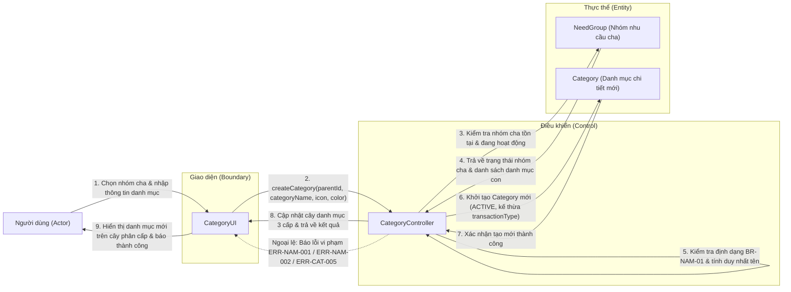
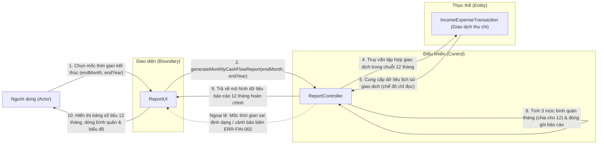
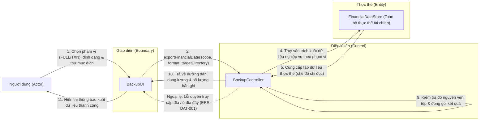

# 6. Sơ đồ Robustness và Thẻ CRC

Tài liệu này xác định cách các đối tượng bên trong phần mềm phối hợp với nhau để thực thi các ca sử dụng, chuyển từ góc nhìn tương tác bên ngoài của người dùng sang cấu trúc xử lý nội bộ của hệ thống, làm cơ sở phân bổ trách nhiệm cho các lớp đối tượng.

Mô hình phân tích giữ tính trung lập công nghệ, không phụ thuộc vào giao diện đồ họa cụ thể, cơ sở dữ liệu hay cú pháp của ngôn ngữ lập trình.

## 6.1 Sơ đồ Robustness

Mục này thiết lập các sơ đồ Robustness nhằm làm rõ cơ chế phối hợp đối tượng khi hiện thực hóa các ca sử dụng có tính chất định hình kiến trúc của hệ thống.

Để phân định rạch ròi trách nhiệm xử lý, các đối tượng tham gia được chia thành 3 nhóm:
- Đối tượng Giao diện: Tiếp nhận thao tác từ người dùng, thu thập dữ liệu đầu vào và hiển thị kết quả phản hồi từ hệ thống.
- Đối tượng Điều khiển: Điều phối quy trình xử lý, kiểm tra tính hợp lệ của dữ liệu theo các quy tắc nghiệp vụ và chỉ đạo cập nhật trạng thái giữa các đối tượng.
- Đối tượng Thực thể: Lưu giữ thông tin nghiệp vụ lâu dài và thực hiện các phép tính toán nội tại của chính mình.

Luồng tương tác giữa các thành phần tuân thủ 3 nguyên tắc:
- Mọi yêu cầu từ người dùng đều bắt đầu từ đối tượng Giao diện và chuyển giao cho đối tượng Điều khiển xử lý.
- Đối tượng Giao diện không tương tác trực tiếp với đối tượng Thực thể mà phải thông qua đối tượng Điều khiển để bảo đảm tính độc lập giữa giao diện và dữ liệu.
- Đối tượng Thực thể chỉ quản lý dữ liệu và quy tắc nội tại của chính nó, không chủ động điều phối quy trình và không phụ thuộc vào tầng giao diện.

Nhằm tối ưu hóa độ cô đọng của tài liệu, hệ thống lược bỏ việc mô hình hóa đối với các luồng truy vấn chỉ đọc và các thao tác cập nhật thứ cấp có cùng mô thức tương tác. Mỗi nhóm chức năng lựa chọn một ca sử dụng tiêu biểu làm đại diện phân tích, ưu tiên các kịch bản làm biến động trạng thái dữ liệu, tổng hợp báo cáo đa chiều hoặc yêu cầu thực thi các quy tắc bất biến tài chính với sự tham gia đồng thời của cả 3 nhóm đối tượng.

### 6.1.1 Quản lý Ví

(Mô tả từ 1 đến 2 câu về bối cảnh nghiệp vụ khi tạo ví mới)

- Ca sử dụng đại diện: `UC-WAL-01` (Tạo ví mới)
- Thao tác hệ thống: `createWallet(walletName, note)`
- Quy chiếu chéo: `UC-WAL-01`, `FR-WAL-01`, `BR-NAM-01`, `BR-FIN-02`, `ERR-NAM-001`, `ERR-NAM-002`

**Thành phần tham gia phân tích**

| Nhóm thành phần | Tên đối tượng | Trách nhiệm và ràng buộc |
| :--- | :--- | :--- |
| Giao diện | (Tên đối tượng) | (Thu thập dữ liệu đầu vào và hiển thị kết quả phản hồi) |
| Điều khiển | (Tên đối tượng) | (Kiểm tra quy tắc nghiệp vụ và điều phối luồng xử lý) |
| Thực thể | (Tên đối tượng) | (Lưu giữ dữ liệu và cập nhật trạng thái) |

**Sơ đồ Robustness**

(Vẽ sơ đồ Robustness bằng PlantUML với chỉ thị `left to right direction`, sử dụng 4 biểu tượng chuẩn `actor`, `boundary`, `control`, `entity`. Sơ đồ thể hiện luồng xử lý chính từ giao diện tiếp nhận đến thực thể dữ liệu và các nhánh rẽ báo lỗi khi dữ liệu không hợp lệ.)

### 6.1.2 Ghi nhận Thu chi

(Mô tả từ 1 đến 2 câu về bối cảnh nghiệp vụ khi ghi nhận giao dịch thu chi kèm chi phí nếu có)

- Ca sử dụng đại diện: `UC-TXN-01` (Ghi nhận giao dịch thu chi)
- Thao tác hệ thống: `recordIncomeExpense(walletId, categoryId, amount, transactionDate, note, feeAmount, feeCategoryId)`
- Quy chiếu chéo: `UC-TXN-01`, `FR-TXN-01`, `FR-TXN-02`, `BR-FIN-01`, `BR-FIN-02`, `BR-FIN-04`, `ERR-WAL-001`, `ERR-FEE-001`, `ERR-FEE-002`, `ERR-FEE-003`, `ERR-FIN-001`

**Thành phần tham gia phân tích**

| Nhóm thành phần | Tên đối tượng | Trách nhiệm và ràng buộc |
| :--- | :--- | :--- |
| Giao diện | (Tên đối tượng) | (Thu thập dữ liệu giao dịch và hiển thị kết quả phản hồi) |
| Điều khiển | (Tên đối tượng) | (Kiểm tra quy tắc nghiệp vụ và điều phối luồng xử lý) |
| Thực thể | (Tên các đối tượng) | (Lưu giữ dữ liệu giao dịch, chi phí và cập nhật số dư ví) |

**Sơ đồ Robustness**

(Vẽ sơ đồ Robustness bằng PlantUML với chỉ thị `left to right direction`, sử dụng 4 biểu tượng chuẩn `actor`, `boundary`, `control`, `entity`. Sơ đồ thể hiện luồng xử lý chính từ giao diện tiếp nhận đến thực thể dữ liệu và các nhánh rẽ báo lỗi khi dữ liệu không hợp lệ.)

### 6.1.3 Chuyển tiền Nội bộ

(Mô tả từ 1 đến 2 câu về bối cảnh nghiệp vụ khi thực hiện chuyển tiền nội bộ giữa hai ví kèm phí giao dịch nếu có)

- Ca sử dụng đại diện: `UC-TRF-01` (Chuyển tiền nội bộ giữa hai ví)
- Thao tác hệ thống: `transferFunds(sourceWalletId, targetWalletId, amount, transferDate, note, feeAmount, feeCategoryId)`
- Quy chiếu chéo: `UC-TRF-01`, `FR-TRF-01`, `BR-FIN-01`, `BR-FIN-02`, `BR-FIN-03`, `ERR-TRF-001`, `ERR-TRF-002`, `ERR-WAL-001`, `ERR-FEE-001`, `ERR-FEE-002`, `ERR-FEE-003`, `ERR-FIN-001`

**Thành phần tham gia phân tích**

| Nhóm thành phần | Tên đối tượng | Trách nhiệm và ràng buộc |
| :--- | :--- | :--- |
| Giao diện | (Tên đối tượng) | (Thu thập dữ liệu chuyển tiền và hiển thị kết quả phản hồi) |
| Điều khiển | (Tên đối tượng) | (Kiểm tra quy tắc nghiệp vụ và điều phối luồng xử lý) |
| Thực thể | (Tên các đối tượng) | (Lưu giữ dữ liệu chuyển tiền, chi phí và cập nhật số dư hai ví) |

**Sơ đồ Robustness**

(Vẽ sơ đồ Robustness bằng PlantUML với chỉ thị `left to right direction`, sử dụng 4 biểu tượng chuẩn `actor`, `boundary`, `control`, `entity`. Sơ đồ thể hiện luồng xử lý chính từ giao diện tiếp nhận đến thực thể dữ liệu và các nhánh rẽ báo lỗi khi dữ liệu không hợp lệ.)

### 6.1.4 Danh mục Phân loại

Cho phép người dùng tạo một danh mục phân loại mới dưới một nhóm nhu cầu hiện có để phân loại chi tiêu một cách chi tiết, hỗ trợ việc báo cáo và phân tích tài chính.

- Ca sử dụng đại diện: `UC-CAT-01` (Bổ sung danh mục phân loại mới)
- Thao tác hệ thống: `createCategory(parentId, categoryName, icon, color)`
- Quy chiếu chéo: `UC-CAT-01`, `FR-CAT-01`, `FR-CAT-02`, `BR-FIN-04`, `BR-NAM-01`, `ERR-NAM-001`, `ERR-NAM-002`, `ERR-CAT-005`

**Thành phần tham gia phân tích**

| Nhóm thành phần | Tên đối tượng | Trách nhiệm và ràng buộc |
| :--- | :--- | :--- |
| Giao diện | CategoryUI | Thu thập thông tin danh mục từ biểu mẫu (tên danh mục, nhóm cha, biểu tượng, màu sắc) và hiển thị kết quả phản hồi hoặc thông báo lỗi cho người dùng. |
| Điều khiển | CategoryController | Điều phối luồng xử lý tạo danh mục; kiểm tra tiền điều kiện nhóm cha tồn tại và đang hoạt động (`ERR-CAT-005`); kiểm tra định dạng tên danh mục (`ERR-NAM-001`) và tính duy nhất trong cùng nhóm cha (`ERR-NAM-002`, `BR-NAM-01`); khởi tạo thực thể `Category` mới ở trạng thái `ACTIVE` và thiết lập liên kết phân cấp 3 cấp (`BR-FIN-04`). |
| Thực thể | NeedGroup | Lưu giữ thông tin nhóm nhu cầu cha cấp 2; cung cấp trạng thái hoạt động và danh sách danh mục con phục vụ kiểm tra ràng buộc toàn vẹn. |
| Thực thể | Category | Lưu giữ thông tin danh mục cấp 3 mới tạo (mã định danh, tên gọi, biểu tượng, màu sắc, trạng thái `ACTIVE`), liên kết với nhóm cha và kế thừa thuộc tính loại thu chi. |

**Sơ đồ Robustness**

### 6.1.5 Thống kê và Báo cáo

Cho phép người dùng yêu cầu hệ thống trích xuất và tổng hợp chuỗi số liệu dòng tiền 12 tháng liên tục lùi từ mốc thời gian chỉ định (hoặc thời điểm hiện tại), tính toán thu nhập, chi tiêu, dòng tiền thuần và tỷ lệ tiết kiệm từng tháng theo chuẩn làm tròn ngân hàng, đồng thời xác định 3 giá trị bình quân tháng trong chế độ thuần đọc mà không làm biến đổi bất kỳ trạng thái dữ liệu nào.

- Ca sử dụng đại diện: `UC-REP-01` (Thống kê dòng tiền 12 tháng gần nhất)
- Thao tác hệ thống: `generateMonthlyCashFlowReport(endMonth, endYear)`
- Quy chiếu chéo: `UC-REP-01`, `FR-REP-01`, `BR-FIN-01`, `ERR-FIN-002`

**Thành phần tham gia phân tích**

| Nhóm thành phần | Tên đối tượng | Trách nhiệm và ràng buộc |
| :--- | :--- | :--- |
| Giao diện | ReportUI | Tiếp nhận tham số mốc thời gian kết thúc (`endMonth`, `endYear`) từ người dùng; gửi yêu cầu tạo báo cáo tới bộ điều khiển; hiển thị bảng số liệu 12 tháng liên tục gồm Thu nhập, Chi tiêu, Dòng tiền thuần và Tỷ lệ tiết kiệm; hiển thị dòng tổng kết 3 mức bình quân tháng kèm ghi chú giải thích; biểu diễn trực quan bằng biểu đồ kết hợp cột và đường; hiển thị thông báo lỗi hoặc cảnh báo khi tham số đầu vào không hợp lệ. Hoạt động thuần túy ở chế độ chỉ đọc. |
| Điều khiển | ReportController | Tiếp nhận yêu cầu trích xuất báo cáo từ `ReportUI`; kiểm tra tính hợp lệ của mốc thời gian kết thúc; sinh chuỗi 12 mốc tháng liên tục lùi từ mốc chỉ định; truy vấn dữ liệu từ thực thể `IncomeExpenseTransaction`; thực hiện phân loại, tổng hợp doanh số thu chi từng tháng; tính toán dòng tiền thuần (`NetCashFlow`); tính tỷ lệ tiết kiệm (`SavingsRate`) tuân thủ quy tắc làm tròn ngân hàng (`BR-FIN-01`) và xử lý biên tránh lỗi chia cho không (`ERR-FIN-002`); tính 3 mức bình quân tháng chia đều cho 12; đóng gói toàn bộ dữ liệu kết quả chuyển giao cho `ReportUI`. |
| Thực thể | IncomeExpenseTransaction | Lưu giữ thông tin lịch sử giao dịch thu chi (`transactionId`, `amount`, `transactionDate`, `transactionType`, `categoryId`, `walletId`); cung cấp tập dữ liệu giao dịch phục vụ lọc theo mốc thời gian tháng; bảo toàn nguyên vẹn trạng thái và số dư dữ liệu trong suốt quá trình xử lý báo cáo (nguyên tắc bất biến chỉ đọc). |

**Sơ đồ Robustness**

### 6.1.6 Lưu trữ và Sao lưu

Cho phép người dùng kết xuất toàn bộ dữ liệu tài chính (ví, danh mục phân loại, giao dịch thu chi, chuyển tiền nội bộ, điều chỉnh số dư) hoặc riêng sổ giao dịch ra tệp định dạng mở chuẩn JSON mã hóa UTF-8; bảo đảm chế độ hoạt động thuần đọc không làm biến đổi dữ liệu hệ thống và giữ nguyên độ chính xác số học thập phân tài chính theo `BR-FIN-01`, `CON-02`.

- Ca sử dụng đại diện: `UC-DAT-01` (Xuất dữ liệu tài chính)
- Thao tác hệ thống: `exportFinancialData(scope, format, targetDirectory)`
- Quy chiếu chéo: `UC-DAT-01`, `FR-DAT-01`, `BR-FIN-01`

**Thành phần tham gia phân tích**

| Nhóm thành phần | Tên đối tượng | Trách nhiệm và ràng buộc |
| :--- | :--- | :--- |
| Giao diện | BackupUI | Tiếp nhận tham số cấu hình xuất dữ liệu (phạm vi `FULL` hoặc `TRANSACTIONS`, định dạng `JSON`, thư mục đích); gửi yêu cầu xuất dữ liệu tới bộ điều khiển; hiển thị thanh tiến trình, kích thước tệp và số lượng bản ghi đã xuất thành công; hiển thị cảnh báo khi gặp lỗi quyền ghi đĩa. |
| Điều khiển | BackupController | Điều phối tiến trình trích xuất và tuần tự hóa dữ liệu; kiểm tra quyền truy cập hệ thống tệp và dung lượng lưu trữ thư mục đích; truy vấn toàn bộ tập thực thể dữ liệu nghiệp vụ theo phạm vi chỉ định ở chế độ chỉ đọc; chuyển đổi cấu trúc đối tượng sang định dạng JSON chuẩn (giữ nguyên độ chính xác số học thập phân, không làm tròn số mũ theo `CON-02`, `FR-DAT-01`); đặt tên tệp tự động theo mẫu thời gian; ghi tệp xuống đĩa cục bộ với mã hóa UTF-8 không BOM; trả về kết quả kiểm toán xuất tệp cho `BackupUI`. |
| Thực thể | FinancialDataStore | Đại diện tập hợp các thực thể dữ liệu tài chính (`Wallet`, `Category`, `NeedGroup`, `Transaction`, `Transfer`, `BalanceAdjustment`); cung cấp toàn bộ trạng thái dữ liệu nghiệp vụ phục vụ việc tuần tự hóa; bảo toàn nguyên vẹn tính toàn vẹn và giá trị dữ liệu trong suốt tiến trình sao lưu chỉ đọc. |

**Sơ đồ Robustness**

## 6.2 Thẻ CRC

Thẻ CRC đóng vai trò chuyển tiếp từ mô hình phân tích hành vi sang cấu trúc lớp tĩnh, nhằm xác định ranh giới nhiệm vụ và mối quan hệ cộng tác giữa các đối tượng trong hệ thống.

Cơ sở xây dựng các thẻ CRC được tổng hợp trực tiếp từ các đối tượng thực thể và điều khiển đã xác định trong sơ đồ Robustness, kết hợp với các quy tắc tính toán và ràng buộc bất biến tài chính từ hồ sơ yêu cầu phần mềm. Kết quả phân bổ này là căn cứ để hình thành các thuộc tính, phương thức và mối liên kết trong biểu đồ lớp phân tích.

Trách nhiệm của mỗi lớp được phân định thành hai nhóm:
- Nhóm trách nhiệm thông tin: Lưu giữ các thuộc tính định danh, trạng thái tài chính và các liên kết tham chiếu giữa các đối tượng.
- Nhóm trách nhiệm hành vi: Thực hiện các phép tính toán nghiệp vụ, kiểm soát tính toàn vẹn dữ liệu và điều phối luồng xử lý.

Việc phân bổ trách nhiệm dựa trên nguyên tắc chuyên gia thông tin, theo đó một tác vụ được giao cho lớp nắm giữ đầy đủ dữ liệu nhất để tự hoàn thành tác vụ đó. Mọi trách nhiệm đều được mô tả bằng ngôn ngữ nghiệp vụ khái niệm, bảo đảm tính trung lập công nghệ và không phụ thuộc vào ngôn ngữ lập trình cụ thể.

Phạm vi mô hình hóa tập trung vào các lớp đối tượng phân tích trọng yếu, gồm các thực thể tài chính cốt lõi và thành phần điều phối dòng tiền. Các đối tượng giá trị chỉ đóng vai trò đóng gói dữ liệu và không tham gia điều phối tiến trình, nên không lập thẻ riêng.

### 6.2.1 Lớp Ví

(Mô tả từ 1 đến 2 câu về vai trò khái niệm của lớp đối tượng trong việc quản trị tài sản và theo dõi biến động số dư)

- Tên lớp phân tích: `Wallet`
- Phân loại đối tượng: (Lớp Thực thể hoặc Lớp Điều phối)
- Ca sử dụng liên quan: (Liệt kê các mã ca sử dụng UC-* mà lớp tham gia)

**Thẻ trách nhiệm và cộng tác**

| Nhóm trách nhiệm | Nội dung trách nhiệm cụ thể | Cộng tác viên |
| :--- | :--- | :--- |
| Thông tin | (Mô tả các thuộc tính định danh, trạng thái tài chính hoặc quan hệ cần lưu giữ) | (Không có hoặc tên các lớp liên quan) |
| Hành vi | (Mô tả các phép tính toán nghiệp vụ, kiểm tra tính hợp lệ hoặc điều phối biến động dữ liệu) | (Tên các lớp cộng tác để hoàn thành tác vụ) |

### 6.2.2 Lớp Bản ghi Điều chỉnh Số dư

(Mô tả từ 1 đến 2 câu về vai trò khái niệm của lớp đối tượng trong việc lưu vết các khoản điều chỉnh và thiết lập số dư ban đầu)

- Tên lớp phân tích: `BalanceAdjustment`
- Phân loại đối tượng: (Lớp Thực thể hoặc Lớp Điều phối)
- Ca sử dụng liên quan: (Liệt kê các mã ca sử dụng UC-* mà lớp tham gia)

**Thẻ trách nhiệm và cộng tác**

| Nhóm trách nhiệm | Nội dung trách nhiệm cụ thể | Cộng tác viên |
| :--- | :--- | :--- |
| Thông tin | (Mô tả các thuộc tính định danh, trạng thái tài chính hoặc quan hệ cần lưu giữ) | (Không có hoặc tên các lớp liên quan) |
| Hành vi | (Mô tả các phép tính toán nghiệp vụ, kiểm tra tính hợp lệ hoặc điều phối biến động dữ liệu) | (Tên các lớp cộng tác để hoàn thành tác vụ) |

### 6.2.3 Lớp Giao dịch Thu chi

(Mô tả từ 1 đến 2 câu về vai trò khái niệm của lớp đối tượng trong việc ghi nhận các giao dịch thu nhập và chi tiêu)

- Tên lớp phân tích: `Transaction`
- Phân loại đối tượng: (Lớp Thực thể hoặc Lớp Điều phối)
- Ca sử dụng liên quan: (Liệt kê các mã ca sử dụng UC-* mà lớp tham gia)

**Thẻ trách nhiệm và cộng tác**

| Nhóm trách nhiệm | Nội dung trách nhiệm cụ thể | Cộng tác viên |
| :--- | :--- | :--- |
| Thông tin | (Mô tả các thuộc tính định danh, trạng thái tài chính hoặc quan hệ cần lưu giữ) | (Không có hoặc tên các lớp liên quan) |
| Hành vi | (Mô tả các phép tính toán nghiệp vụ, kiểm tra tính hợp lệ hoặc điều phối biến động dữ liệu) | (Tên các lớp cộng tác để hoàn thành tác vụ) |

### 6.2.4 Lớp Chi phí Giao dịch

(Mô tả từ 1 đến 2 câu về vai trò khái niệm của lớp đối tượng trong việc quản lý chi phí phát sinh kèm theo giao dịch)

- Tên lớp phân tích: `TransactionFee`
- Phân loại đối tượng: (Lớp Thực thể hoặc Lớp Điều phối)
- Ca sử dụng liên quan: (Liệt kê các mã ca sử dụng UC-* mà lớp tham gia)

**Thẻ trách nhiệm và cộng tác**

| Nhóm trách nhiệm | Nội dung trách nhiệm cụ thể | Cộng tác viên |
| :--- | :--- | :--- |
| Thông tin | (Mô tả các thuộc tính định danh, trạng thái tài chính hoặc quan hệ cần lưu giữ) | (Không có hoặc tên các lớp liên quan) |
| Hành vi | (Mô tả các phép tính toán nghiệp vụ, kiểm tra tính hợp lệ hoặc điều phối biến động dữ liệu) | (Tên các lớp cộng tác để hoàn thành tác vụ) |

### 6.2.5 Lớp Giao dịch Chuyển tiền

(Mô tả từ 1 đến 2 câu về vai trò khái niệm của lớp đối tượng trong việc điều chuyển giá trị tiền tệ giữa hai ví nội bộ)

- Tên lớp phân tích: `Transfer`
- Phân loại đối tượng: (Lớp Thực thể hoặc Lớp Điều phối)
- Ca sử dụng liên quan: (Liệt kê các mã ca sử dụng UC-* mà lớp tham gia)

**Thẻ trách nhiệm và cộng tác**

| Nhóm trách nhiệm | Nội dung trách nhiệm cụ thể | Cộng tác viên |
| :--- | :--- | :--- |
| Thông tin | (Mô tả các thuộc tính định danh, trạng thái tài chính hoặc quan hệ cần lưu giữ) | (Không có hoặc tên các lớp liên quan) |
| Hành vi | (Mô tả các phép tính toán nghiệp vụ, kiểm tra tính hợp lệ hoặc điều phối biến động dữ liệu) | (Tên các lớp cộng tác để hoàn thành tác vụ) |

### 6.2.6 Lớp Danh mục Phân loại

Lớp Thực thể đại diện cho đơn vị phân loại chi tiết ở cấp 3 trong cấu trúc cây danh mục 3 cấp, chịu trách nhiệm lưu giữ định danh, tên gọi, trạng thái hoạt động và liên kết trực tiếp với các giao dịch thu chi cũng như chi phí phát sinh.

- Tên lớp phân tích: `Category`
- Phân loại đối tượng: Lớp Thực thể (Entity)
- Ca sử dụng liên quan: `UC-CAT-01`, `UC-CAT-02`, `UC-CAT-03`, `UC-CAT-04`, `UC-TXN-01`, `UC-TXN-02`, `UC-TXN-03`, `UC-TRF-01`, `UC-TRF-02`, `UC-TRF-03`, `UC-REP-02`

**Thẻ trách nhiệm và cộng tác**

| Nhóm trách nhiệm | Nội dung trách nhiệm cụ thể | Cộng tác viên |
| :--- | :--- | :--- |
| Thông tin | - Lưu giữ mã định danh duy nhất của danh mục (`categoryId`). - Lưu giữ tên gọi danh mục chi tiết (`name`), ràng buộc từ 1 đến 50 ký tự (`BR-NAM-01`). - Lưu giữ liên kết tham chiếu tới nhóm nhu cầu cha cấp 2 (`needGroupId`). - Lưu giữ trạng thái hoạt động của danh mục (`status`: `ACTIVE` hoặc `DELETED`). - Lưu giữ biểu tượng nhận diện (`icon`) và mã màu hiển thị trực quan (`color`). - Kế thừa và xác định loại thu chi (`transactionType`: `INCOME` hoặc `EXPENSE`) thông qua nhóm nhu cầu cha (`BR-FIN-04`). | `CategoryGroup` |
| Hành vi | - Kiểm tra định dạng tên danh mục không được để trống và có từ 1 đến 50 ký tự sau khi cắt tỉa khoảng trắng ở hai đầu (`BR-NAM-01`, `ERR-NAM-001`). - Cung cấp tên danh mục và nhóm cha để kiểm tra tính duy nhất trong phạm vi nhóm cha (`BR-NAM-01`, `ERR-NAM-002`). - Cập nhật tên hiển thị mới khi người dùng đổi tên mà không làm ảnh hưởng đến các giao dịch lịch sử (`UC-CAT-02`). - Cập nhật nhóm nhu cầu cha mới khi chuyển nhóm (yêu cầu nhóm đích cùng loại thu chi và đang hoạt động, `BR-FIN-04`, `ERR-CAT-001`). - Cập nhật trạng thái xóa mềm (`DELETED`) nếu danh mục đã từng có giao dịch lịch sử, hoặc cho phép xóa vĩnh viễn nếu chưa phát sinh giao dịch (`UC-CAT-04`, `BR-FIN-04`). - Khôi phục trạng thái hoạt động (`ACTIVE`) khi nhóm cha đang hoạt động và không trùng tên (`UC-CAT-03`, `ERR-CAT-004`). - Cung cấp thông tin phân loại cho các giao dịch thu chi và hỗ trợ kết xuất báo cáo cơ cấu chi tiêu (`UC-REP-02`). | `CategoryGroup`, `Transaction`, `TransactionFee`, `CategoryController` |

### 6.2.7 Lớp Nhóm Nhu cầu

Lớp Thực thể đại diện cho đơn vị phân loại trung gian ở cấp 2 trực thuộc Loại thu chi gốc (cấp 1), chịu trách nhiệm gom cụm các danh mục chi tiết cùng mục đích tài chính và quản lý phân cấp danh mục con phục vụ phân tích cơ cấu chi tiêu.

- Tên lớp phân tích: `CategoryGroup` (NeedGroup)
- Phân loại đối tượng: Lớp Thực thể (Entity)
- Ca sử dụng liên quan: `UC-CAT-01`, `UC-CAT-02`, `UC-CAT-03`, `UC-CAT-04`, `UC-REP-02`

**Thẻ trách nhiệm và cộng tác**

| Nhóm trách nhiệm | Nội dung trách nhiệm cụ thể | Cộng tác viên |
| :--- | :--- | :--- |
| Thông tin | - Lưu giữ mã định danh duy nhất của nhóm nhu cầu (`needGroupId` / `groupId`). - Lưu giữ tên gọi của nhóm nhu cầu (`name`), ràng buộc từ 1 đến 50 ký tự (`BR-NAM-01`). - Lưu giữ loại thu chi gốc cấp 1 mà nhóm trực thuộc (`transactionType`: `INCOME` hoặc `EXPENSE`), có tính bất biến vĩnh viễn sau khởi tạo (`BR-FIN-04`). - Lưu giữ trạng thái hoạt động của nhóm (`status`: `ACTIVE` hoặc `DELETED`). - Lưu giữ tập hợp liên kết tới các danh mục con chi tiết (cấp 3) trực thuộc nhóm. - Lưu giữ biểu tượng nhận diện (`icon`) và mã màu hiển thị (`color`) phục vụ vẽ biểu đồ cơ cấu tài chính. | `Category` |
| Hành vi | - Kiểm tra định dạng tên nhóm không được để trống và có từ 1 đến 50 ký tự sau khi cắt tỉa khoảng trắng ở hai đầu (`BR-NAM-01`, `ERR-NAM-001`). - Cung cấp tên và loại thu chi để kiểm tra tính duy nhất trong cùng nhánh loại thu chi (`BR-NAM-01`, `ERR-NAM-002`). - Cập nhật tên nhóm mới khi có yêu cầu đổi tên (`UC-CAT-02`). - Quản lý tập hợp danh mục con: tiếp nhận thêm danh mục mới (`UC-CAT-01`), cho phép chuyển danh mục ra khỏi hoặc nhập vào nhóm (`UC-CAT-02`). - Thực thi cơ chế xóa phân tầng: khi nhóm bị xóa, kích hoạt xử lý xóa đồng bộ các danh mục con; chuyển sang xóa mềm nếu nhóm hoặc danh mục con đã có giao dịch, xóa vĩnh viễn nếu chưa có giao dịch (`UC-CAT-04`). - Kiểm soát quy tắc bất biến duy trì tối thiểu 1 nhóm nhu cầu hoạt động cho mỗi nhánh loại thu chi; từ chối xóa nếu là nhóm hoạt động cuối cùng (`BR-FIN-04`). - Khôi phục trạng thái hoạt động độc lập (`ACTIVE`) cho nhóm đã xóa mà không tự động khôi phục các danh mục con (`UC-CAT-03`). - Cung cấp dữ liệu gom cụm và danh sách danh mục con phục vụ phân tích cơ cấu thu chi 2 tầng phân cấp (`UC-REP-02`). | `Category`, `CategoryController`, `ReportController` |

### 6.2.8 Lớp Điều phối Dòng tiền

(Mô tả từ 1 đến 2 câu về vai trò khái niệm của lớp đối tượng trong việc điều phối quy trình nghiệp vụ và kiểm soát quy tắc tài chính)

- Tên lớp phân tích: `CashFlowCoordinator`
- Phân loại đối tượng: (Lớp Thực thể hoặc Lớp Điều phối)
- Ca sử dụng liên quan: (Liệt kê các mã ca sử dụng UC-* mà lớp tham gia)

**Thẻ trách nhiệm và cộng tác**

| Nhóm trách nhiệm | Nội dung trách nhiệm cụ thể | Cộng tác viên |
| :--- | :--- | :--- |
| Thông tin | (Mô tả các thuộc tính định danh, trạng thái tài chính hoặc quan hệ cần lưu giữ) | (Không có hoặc tên các lớp liên quan) |
| Hành vi | (Mô tả các phép tính toán nghiệp vụ, kiểm tra tính hợp lệ hoặc điều phối biến động dữ liệu) | (Tên các lớp cộng tác để hoàn thành tác vụ) |
