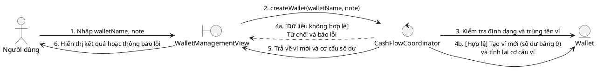
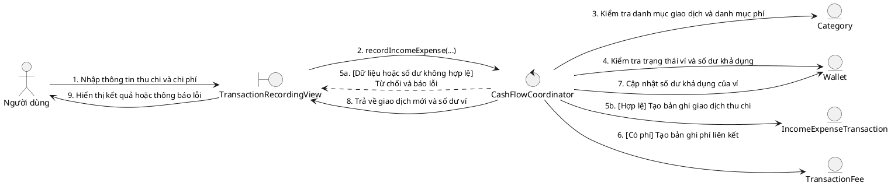
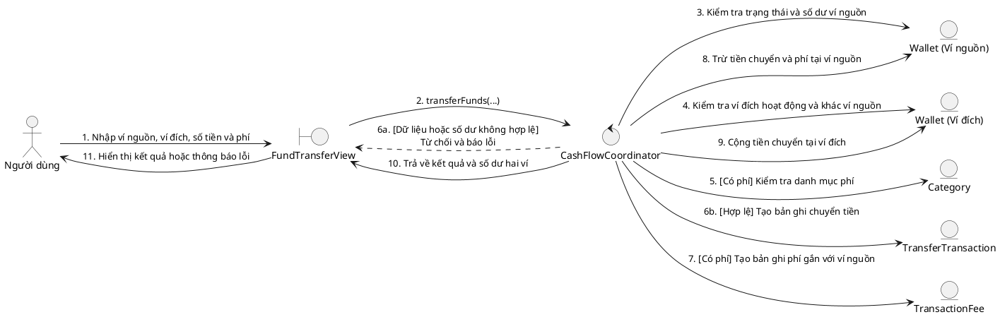
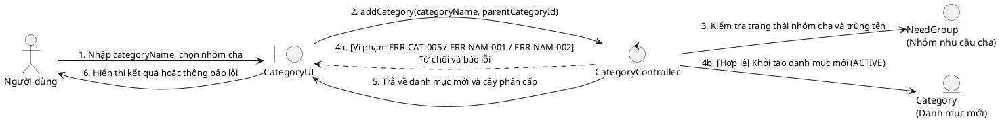
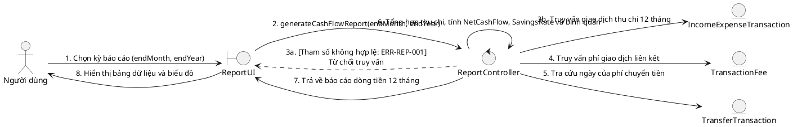
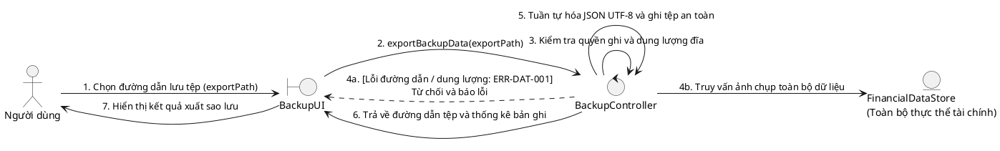

# 6. Sơ đồ Robustness và thẻ CRC

Tài liệu này xác định cách các đối tượng bên trong phần mềm phối hợp để thực thi các ca sử dụng, chuyển từ góc nhìn tương tác hộp đen bên ngoài sang cấu trúc xử lý nội bộ và làm cơ sở phân bổ trách nhiệm cho các lớp đối tượng. Mô hình giữ tính trung lập công nghệ, độc lập với giao diện đồ họa, cơ sở dữ liệu hay ngôn ngữ lập trình.

## 6.1 Sơ đồ Robustness

Mục này thiết lập các sơ đồ Robustness nhằm làm rõ cơ chế phối hợp giữa 3 nhóm đối tượng phân tích:
- **Đối tượng giao diện (`Boundary`)**: Tiếp nhận thao tác của người dùng, thu thập dữ liệu đầu vào và hiển thị kết quả phản hồi.
- **Đối tượng điều khiển (`Control`)**: Điều phối quy trình xử lý, kiểm tra tính hợp lệ dữ liệu theo quy tắc nghiệp vụ và chỉ đạo cập nhật trạng thái.
- **Đối tượng thực thể (`Entity`)**: Lưu giữ thông tin nghiệp vụ lâu dài và thực hiện các phép tính nội tại của chính mình.

Luồng tương tác tuân thủ 3 nguyên tắc:
- Mọi yêu cầu từ người dùng đều đi qua đối tượng giao diện và chuyển giao cho đối tượng điều khiển xử lý.
- Đối tượng giao diện không tương tác trực tiếp với đối tượng thực thể mà phải thông qua đối tượng điều khiển.
- Đối tượng thực thể chỉ quản lý dữ liệu và quy tắc nội tại, không chủ động điều phối quy trình và không phụ thuộc vào tầng giao diện.

Mỗi nhóm chức năng lựa chọn một ca sử dụng tiêu biểu làm đại diện phân tích (ưu tiên kịch bản làm biến động trạng thái dữ liệu, tổng hợp báo cáo đa chiều hoặc thực thi quy tắc bất biến tài chính với sự tham gia của cả 3 nhóm đối tượng).

### 6.1.1 Quản lý ví

Người dùng tạo ví mới để theo dõi số dư và hạch toán dòng tiền độc lập. Hệ thống kiểm tra quy tắc đặt tên (`BR-NAM-01`), khởi tạo ví `ACTIVE` với số dư `0.00 VNĐ` (`BR-FIN-02`) và tính lại cơ cấu phân bổ số dư (`FR-WAL-04`).

- **Ca sử dụng đại diện**: `UC-WAL-01` (Tạo ví mới)
- **Thao tác hệ thống**: `createWallet(walletName, note)`
- **Quy chiếu chéo**: `UC-WAL-01`, `FR-WAL-01`, `FR-WAL-04`, `BR-NAM-01`, `BR-FIN-02`, `ERR-NAM-001`, `ERR-NAM-002`

**Thành phần tham gia phân tích**

| Nhóm thành phần | Tên đối tượng | Trách nhiệm và ràng buộc |
| :--- | :--- | :--- |
| Giao diện | `WalletManagementView` | Nhận `walletName`, `note` và gửi yêu cầu tạo ví; hiển thị thông tin ví mới kèm cơ cấu số dư hoặc báo lỗi tên sai định dạng (`ERR-NAM-001`), trùng tên ví (`ERR-NAM-002`). |
| Điều khiển | `CashFlowCoordinator` | Chuẩn hóa chuỗi (`trim`), kiểm tra tên dài 1–50 ký tự và đối chiếu trùng tên trên cả ví `ACTIVE` lẫn `ARCHIVED` (`BR-NAM-01`, `ERR-NAM-001`, `ERR-NAM-002`), kiểm tra `note` tối đa 255 ký tự (`FR-WAL-01`); điều phối tạo ví và tính lại tỷ lệ phân bổ (`FR-WAL-04`). |
| Thực thể | `Wallet` | Cung cấp danh sách tên ví hiện có để kiểm tra trùng; lưu ví mới với `walletId` duy nhất, `status = ACTIVE`, `createdAt` (`FR-WAL-01`) và `currentBalance = 0.00 VNĐ` (`BR-FIN-02`). |

**Sơ đồ Robustness**

### 6.1.2 Ghi nhận thu chi

Người dùng ghi nhận khoản thu nhập hoặc chi tiêu kèm chi phí giao dịch vào sổ theo dõi. Hệ thống kiểm tra danh mục cấp 3 (`BR-FIN-04`) và số dư khả dụng (`BR-FIN-02`), sau đó lưu nguyên khối giao dịch gốc, khoản phí đi kèm và số dư ví mới.

- **Ca sử dụng đại diện**: `UC-TXN-01` (Ghi nhận giao dịch thu chi)
- **Thao tác hệ thống**: `recordIncomeExpense(walletId, categoryId, amount, transactionDate, note, feeAmount, feeCategoryId)`
- **Quy chiếu chéo**: `UC-TXN-01`, `FR-TXN-01`, `FR-TXN-02`, `BR-FIN-01`, `BR-FIN-02`, `BR-FIN-04`, `ERR-FIN-001`, `ERR-WAL-001`, `ERR-FEE-001`, `ERR-FEE-002`, `ERR-FEE-003`

**Thành phần tham gia phân tích**

| Nhóm thành phần | Tên đối tượng | Trách nhiệm và ràng buộc |
| :--- | :--- | :--- |
| Giao diện | `TransactionRecordingView` | Thu thập thông tin thu chi và chi phí đi kèm; hiển thị kết quả ghi nhận cùng số dư ví mới hoặc thông báo mã lỗi tương ứng (`ERR-FIN-001`, `ERR-FEE-001`–`003`, `ERR-WAL-001`). |
| Điều khiển | `CashFlowCoordinator` | Kiểm tra `amount > 0.00 VNĐ` (`BR-FIN-01`, `ERR-FIN-001`), trạng thái `ACTIVE` của ví cùng danh mục giao dịch và danh mục phí cấp 3 nhánh `EXPENSE` (`BR-FIN-04`, `ERR-FEE-002`, `ERR-FEE-003`), phí $\ge 0.00$ VNĐ (`ERR-FEE-001`) và số dư khả dụng của ví (`BR-FIN-02`, `ERR-WAL-001`); điều phối lưu giao dịch, phí và cập nhật số dư ví. |
| Thực thể | `Wallet`, `Category`, `IncomeExpenseTransaction`, `TransactionFee` | `Category` xác nhận danh mục cấp 3 `ACTIVE` (`BR-FIN-04`); `Wallet` kiểm tra số dư và cập nhật `currentBalance` tức thời (`BR-FIN-02`); `IncomeExpenseTransaction` lưu khoản thu/chi (`FR-TXN-01`, `FR-TXN-02`); `TransactionFee` lưu khoản phí `EXPENSE` khi `feeAmount > 0.00 VNĐ` (`BR-FIN-02`). |

**Sơ đồ Robustness**

### 6.1.3 Chuyển tiền nội bộ

Người dùng điều chuyển tiền giữa hai ví nội bộ đang hoạt động kèm chi phí phát sinh. Hệ thống kiểm tra hai ví phân biệt (`BR-FIN-03`) và số dư ví nguồn (`BR-FIN-02`), sau đó trừ tiền ví nguồn, cộng tiền ví đích đồng thời và tách bản ghi phí liên kết.

- **Ca sử dụng đại diện**: `UC-TRF-01` (Chuyển tiền nội bộ giữa hai ví)
- **Thao tác hệ thống**: `transferFunds(sourceWalletId, destinationWalletId, amount, transferDate, note, feeAmount, feeCategoryId)`
- **Quy chiếu chéo**: `UC-TRF-01`, `FR-TRF-01`, `BR-FIN-01`, `BR-FIN-02`, `BR-FIN-03`, `BR-FIN-04`, `ERR-FIN-001`, `ERR-TRF-001`, `ERR-TRF-002`, `ERR-WAL-001`, `ERR-FEE-001`, `ERR-FEE-002`, `ERR-FEE-003`

**Thành phần tham gia phân tích**

| Nhóm thành phần | Tên đối tượng | Trách nhiệm và ràng buộc |
| :--- | :--- | :--- |
| Giao diện | `FundTransferView` | Thu thập ví nguồn, ví đích, số tiền chuyển và chi phí; hiển thị kết quả cùng số dư mới của hai ví hoặc báo lỗi tương ứng (`ERR-TRF-001`, `ERR-TRF-002`, `ERR-FIN-001`, `ERR-FEE-001`–`003`, `ERR-WAL-001`). |
| Điều khiển | `CashFlowCoordinator` | Kiểm tra hai ví `ACTIVE` phân biệt (`BR-FIN-03`, `ERR-TRF-001`), `amount > 0.00 VNĐ` (`BR-FIN-01`, `ERR-FIN-001`, `ERR-TRF-002`), danh mục phí cấp 3 nhánh `EXPENSE` (`BR-FIN-04`, `ERR-FEE-001`–`003`) và số dư ví nguồn $\ge amount + feeAmount$ (`BR-FIN-02`, `ERR-WAL-001`); điều phối hạch toán đồng thời hai ví và tách bản ghi phí (`BR-FIN-03`). |
| Thực thể | `Wallet`, `Category`, `TransferTransaction`, `TransactionFee` | `Wallet` nguồn và đích xác nhận trạng thái `ACTIVE`, trừ `amount + feeAmount` tại ví nguồn và cộng `amount` tại ví đích đồng thời (`BR-FIN-02`, `BR-FIN-03`); `Category` xác nhận danh mục phí cấp 3 `EXPENSE` (`BR-FIN-04`); `TransferTransaction` lưu giao dịch chuyển tiền (`FR-TRF-01`); `TransactionFee` lưu phí gắn với ví nguồn khi `feeAmount > 0.00 VNĐ`. |

**Sơ đồ Robustness**

### 6.1.4 Danh mục phân loại

Người dùng bổ sung một danh mục phân loại mới vào nhóm nhu cầu hiện có để phân loại giao dịch thu chi chi tiết, phục vụ báo cáo và phân tích tài chính.

- **Ca sử dụng đại diện**: `UC-CAT-01` (Bổ sung danh mục phân loại mới)
- **Thao tác hệ thống**: `addCategory(categoryName, parentCategoryId)`
- **Quy chiếu chéo**: `UC-CAT-01`, `FR-CAT-01`, `FR-CAT-02`, `BR-FIN-04`, `BR-NAM-01`, `ERR-NAM-001`, `ERR-NAM-002`, `ERR-CAT-005`

**Thành phần tham gia phân tích**

| Nhóm thành phần | Tên đối tượng | Trách nhiệm và ràng buộc |
| :--- | :--- | :--- |
| Giao diện | `CategoryUI` | Thu thập thông tin danh mục từ biểu mẫu (tên danh mục, nhóm cha) và hiển thị kết quả phản hồi hoặc thông báo lỗi (`ERR-CAT-005`, `ERR-NAM-001`, `ERR-NAM-002`). |
| Điều khiển | `CategoryController` | Kiểm tra nhóm nhu cầu cha tồn tại và đang `ACTIVE` (`BR-FIN-04`, `ERR-CAT-005`); kiểm tra tên danh mục dài 1–50 ký tự sau khi `trim` (`ERR-NAM-001`) và duy nhất trong cùng nhóm cha (`BR-NAM-01`, `ERR-NAM-002`); khởi tạo thực thể `Category` ở trạng thái `ACTIVE` và thiết lập liên kết phân cấp 3 cấp (`BR-FIN-04`). |
| Thực thể | `NeedGroup`, `Category` | `NeedGroup` cung cấp trạng thái hoạt động và danh sách danh mục con để kiểm tra trùng tên; `Category` lưu danh mục cấp 3 mới tạo (`categoryId`, `name`, `status = ACTIVE`), liên kết với `NeedGroup` cha và kế thừa `transactionType`. |

**Sơ đồ Robustness**

### 6.1.5 Thống kê và báo cáo

Người dùng yêu cầu trích xuất chuỗi số liệu dòng tiền 12 tháng liên tục lùi từ mốc thời gian chỉ định, tính thu nhập, chi tiêu (gồm phí giao dịch), dòng tiền thuần, tỷ lệ tiết kiệm từng tháng theo chuẩn làm tròn ngân hàng và 3 mức bình quân tháng ở chế độ chỉ đọc.

- **Ca sử dụng đại diện**: `UC-REP-01` (Thống kê dòng tiền 12 tháng gần nhất)
- **Thao tác hệ thống**: `generateCashFlowReport(endMonth, endYear)`
- **Quy chiếu chéo**: `UC-REP-01`, `FR-REP-01`, `BR-FIN-01`, `BR-FIN-02`, `ERR-REP-001`

**Thành phần tham gia phân tích**

| Nhóm thành phần | Tên đối tượng | Trách nhiệm và ràng buộc |
| :--- | :--- | :--- |
| Giao diện | `ReportUI` | Nhận mốc kết thúc (`endMonth`, `endYear`), gửi yêu cầu tạo báo cáo; hiển thị bảng 12 tháng liên tục, dòng 3 mức bình quân tháng và biểu đồ kết hợp cột - đường, hoặc hiển thị lỗi `ERR-REP-001` khi tham số không hợp lệ. |
| Điều khiển | `ReportController` | Kiểm tra `endMonth` thuộc `[1, 12]` và `endYear >= 2000` (`ERR-REP-001`); sinh chuỗi 12 tháng liên tục; truy vấn chỉ đọc `IncomeExpenseTransaction`, `TransactionFee` và `TransferTransaction` (chỉ đọc ngày của phí chuyển khoản); tổng hợp thu chi (`BR-FIN-02`), tính `NetCashFlow`, `SavingsRate` (trung gian $\ge 4$ chữ số thập phân, làm tròn ngân hàng 2 chữ số, `0.00%` khi thu nhập $\le 0$ theo `BR-FIN-01`) và 3 mức bình quân tháng chia cho 12. |
| Thực thể | `IncomeExpenseTransaction`, `TransactionFee`, `TransferTransaction` | Cung cấp lịch sử giao dịch thu chi, chi phí liên kết (`EXPENSE`) và ngày giao dịch gốc của phí chuyển tiền phục vụ lọc theo tháng; bảo toàn nguyên vẹn trạng thái và số dư dữ liệu (bất biến chỉ đọc). |

**Sơ đồ Robustness**

### 6.1.6 Lưu trữ và sao lưu

Người dùng kết xuất toàn bộ dữ liệu tài chính ra tệp JSON mã hóa UTF-8 trên đĩa cứng cục bộ ở chế độ chỉ đọc, giữ nguyên độ chính xác số học thập phân theo `BR-FIN-01`, `CON-02`.

- **Ca sử dụng đại diện**: `UC-DAT-01` (Xuất dữ liệu tài chính)
- **Thao tác hệ thống**: `exportBackupData(exportPath)`
- **Quy chiếu chéo**: `UC-DAT-01`, `FR-DAT-01`, `BR-FIN-01`, `CON-02`, `ERR-DAT-001`

**Thành phần tham gia phân tích**

| Nhóm thành phần | Tên đối tượng | Trách nhiệm và ràng buộc |
| :--- | :--- | :--- |
| Giao diện | `BackupUI` | Nhận đường dẫn xuất dữ liệu (`exportPath`), gửi yêu cầu tới bộ điều khiển; hiển thị đường dẫn tệp, dung lượng và số bản ghi đã xuất hoặc cảnh báo khi lỗi quyền ghi đĩa (`ERR-DAT-001`). |
| Điều khiển | `BackupController` | Kiểm tra quyền truy cập tệp và dung lượng đĩa tại `exportPath`; truy vấn chỉ đọc toàn bộ thực thể tài chính; tuần tự hóa sang chuẩn JSON UTF-8 (giữ nguyên độ chính xác thập phân 2 chữ số theo `BR-FIN-01`, `CON-02`, `FR-DAT-01`); thực hiện ghi tệp an toàn (`Atomic File Write`) và trả kết quả cho `BackupUI`. |
| Thực thể | `FinancialDataStore` | Đại diện tập hợp các thực thể tài chính (`Wallet`, `NeedGroup`, `Category`, `IncomeExpenseTransaction`, `TransferTransaction`, `TransactionFee`, `BalanceAdjustmentRecord`); cung cấp ảnh chụp dữ liệu nhất quán ở chế độ chỉ đọc. |

**Sơ đồ Robustness**

## 6.2 Thẻ CRC

Thẻ CRC (Class – Responsibility – Collaborator) chuyển tiếp từ mô hình phân tích hành vi sang cấu trúc lớp tĩnh, xác định ranh giới nhiệm vụ và quan hệ cộng tác giữa các lớp đối tượng dựa trên nguyên tắc chuyên gia thông tin (*Information Expert*):
- **Trách nhiệm thông tin (`Knows`)**: Lưu giữ thuộc tính định danh, trạng thái tài chính và các liên kết tham chiếu.
- **Trách nhiệm hành vi (`Does`)**: Thực hiện phép tính nghiệp vụ, kiểm soát toàn vẹn dữ liệu và điều phối luồng xử lý.

Phạm vi lập thẻ tập trung vào 7 lớp thực thể cốt lõi và lớp điều phối dòng tiền trung tâm (các đối tượng giá trị chỉ đóng gói dữ liệu bất biến nên không lập thẻ riêng).

### 6.2.1 Lớp Ví - Wallet

Lớp `Wallet` đại diện cho nguồn tiền thanh toán của người dùng để tiếp nhận, lưu trữ và chi xuất dòng tiền, bảo đảm số dư khả dụng luôn không âm theo thời gian thực (`BR-FIN-02`).

- **Tên lớp phân tích**: `Wallet`
- **Phân loại đối tượng**: Lớp thực thể (`Entity`)
- **Ca sử dụng liên quan**: `UC-WAL-01` – `UC-WAL-04`, `UC-TXN-01` – `UC-TXN-04`, `UC-TRF-01` – `UC-TRF-03`, `UC-DAT-01` – `UC-DAT-03`

| Nhóm trách nhiệm | Nội dung trách nhiệm cụ thể | Cộng tác viên |
| :--- | :--- | :--- |
| Thông tin | Lưu `walletId`, `name` duy nhất (`BR-NAM-01`), `status` (`ACTIVE`, `ARCHIVED`), `note`, `createdAt`, số dư dẫn xuất `currentBalance` khởi điểm `0.00 VNĐ` (`BR-FIN-02`) và liên kết tới các bản ghi thu chi, chuyển tiền, chi phí, điều chỉnh số dư. | `IncomeExpenseTransaction`, `TransferTransaction`, `TransactionFee`, `BalanceAdjustmentRecord` |
| Hành vi | Kiểm tra định dạng và tính duy nhất của tên ví (`BR-NAM-01`, `ERR-NAM-001`, `ERR-NAM-002`); tính lại `currentBalance` tức thời từ lịch sử dòng tiền (`BR-FIN-02`) và từ chối thao tác gây âm quỹ (`ERR-WAL-001`); bảo vệ ví "Tiền mặt" mặc định và kiểm soát điều kiện chuyển `ARCHIVED` hoặc xóa vĩnh viễn (`FR-WAL-03`). | `CashFlowCoordinator`, `IncomeExpenseTransaction`, `TransferTransaction`, `TransactionFee`, `BalanceAdjustmentRecord` |

### 6.2.2 Lớp Bản ghi điều chỉnh số dư - BalanceAdjustmentRecord

Lớp `BalanceAdjustmentRecord` lưu vết các lần kiểm kê thực tế để cân đối số dư ví khớp với lượng tiền bên ngoài, mang tính bất biến sau khởi tạo và không làm lệch báo cáo thu chi (`BR-FIN-02`).

- **Tên lớp phân tích**: `BalanceAdjustmentRecord`
- **Phân loại đối tượng**: Lớp thực thể (`Entity`)
- **Ca sử dụng liên quan**: `UC-WAL-03`, `UC-WAL-04`, `UC-DAT-01` – `UC-DAT-03`

| Nhóm trách nhiệm | Nội dung trách nhiệm cụ thể | Cộng tác viên |
| :--- | :--- | :--- |
| Thông tin | Lưu `recordId`, `walletId`, `previousBalance`, `actualBalance >= 0.00 VNĐ` (`BR-FIN-02`), chênh lệch đại số `difference != 0.00 VNĐ` (`BR-FIN-01`), `reason` và `adjustedAt` (`FR-WAL-05`). | `Wallet` |
| Hành vi | Tính `difference = actualBalance - previousBalance` (`BR-FIN-01`); từ chối tạo bản ghi khi `difference == 0.00 VNĐ` (`FR-WAL-05`), sai định dạng số (`ERR-FIN-001`) hoặc số dư thực tế âm (`ERR-WAL-001`); khóa bất biến sau khi lưu để bảo toàn vết kiểm toán (`BR-FIN-02`). | `CashFlowCoordinator`, `Wallet` |

### 6.2.3 Lớp Giao dịch thu chi - IncomeExpenseTransaction

Lớp `IncomeExpenseTransaction` ghi nhận sự kiện thu nhập (`INCOME`) hoặc chi tiêu (`EXPENSE`) tại một ví gắn với danh mục cấp 3 (`BR-FIN-04`), cập nhật tức thời số dư ví (`BR-FIN-02`) và cung cấp dữ liệu cho báo cáo thống kê.

- **Tên lớp phân tích**: `IncomeExpenseTransaction`
- **Phân loại đối tượng**: Lớp thực thể (`Entity`)
- **Ca sử dụng liên quan**: `UC-TXN-01` – `UC-TXN-04`, `UC-CAT-04`, `UC-REP-01`, `UC-REP-02`, `UC-DAT-01` – `UC-DAT-03`

| Nhóm trách nhiệm | Nội dung trách nhiệm cụ thể | Cộng tác viên |
| :--- | :--- | :--- |
| Thông tin | Lưu `transactionId`, `amount > 0.00 VNĐ` (`BR-FIN-01`), `transactionDate`, `transactionType` (`INCOME`, `EXPENSE`) bất biến sau khởi tạo (`BR-FIN-04`), `note`, `createdAt` cùng tham chiếu tới `Wallet` (`walletId`), `Category` cấp 3 (`categoryId`) và `TransactionFee`. | `Wallet`, `Category`, `TransactionFee` |
| Hành vi | Kiểm tra số tiền hợp lệ (`BR-FIN-01`, `ERR-FIN-001`), ngày giao dịch và tính tương thích với danh mục cấp 3 (`BR-FIN-04`); cập nhật tăng/giảm số dư ví tức thời (`BR-FIN-02`, `ERR-WAL-001`); hoàn nguyên hai pha khi chỉnh sửa (`FR-TXN-04`) và đồng bộ vòng đời với `TransactionFee` đi kèm (`FR-TXN-05`). | `CashFlowCoordinator`, `Wallet`, `Category`, `TransactionFee` |

### 6.2.4 Lớp Chi phí giao dịch - TransactionFee

Lớp `TransactionFee` quản lý khoản phí phụ đi kèm giao dịch thu chi (`BR-FIN-02`) hoặc chuyển tiền nội bộ (`BR-FIN-03`), mang bản chất khoản chi (`EXPENSE`) và phụ thuộc sinh tử vào giao dịch gốc.

- **Tên lớp phân tích**: `TransactionFee`
- **Phân loại đối tượng**: Lớp thực thể (`Entity`)
- **Ca sử dụng liên quan**: `UC-TXN-01` – `UC-TXN-04`, `UC-TRF-01` – `UC-TRF-03`, `UC-REP-01`, `UC-REP-02`, `UC-DAT-01` – `UC-DAT-03`

| Nhóm trách nhiệm | Nội dung trách nhiệm cụ thể | Cộng tác viên |
| :--- | :--- | :--- |
| Thông tin | Lưu `feeId`, `amount >= 0.00 VNĐ` (`BR-FIN-01`, `BR-FIN-02`), mã ví chịu phí `walletId`, danh mục cấp 3 `categoryId` nhánh `EXPENSE` (`BR-FIN-04`), `parentTransactionId` và `parentTransactionType` (`INCOME_EXPENSE`, `TRANSFER`). | `Wallet`, `Category`, `IncomeExpenseTransaction`, `TransferTransaction` |
| Hành vi | Kiểm tra phí không âm (`ERR-FEE-001`) và bắt buộc gắn danh mục cấp 3 `EXPENSE` đang `ACTIVE` khi `amount > 0.00 VNĐ` (`BR-FIN-04`, `ERR-FEE-002`, `ERR-FEE-003`); chặn tạo, sửa, xóa độc lập ngoài giao dịch gốc (`BR-FIN-02`) và hạch toán vào tổng chi tiêu cũng như cơ cấu chi tiêu (`FR-REP-01`, `FR-REP-02`). | `CashFlowCoordinator`, `Wallet`, `Category`, `IncomeExpenseTransaction`, `TransferTransaction` |

### 6.2.5 Lớp Giao dịch chuyển tiền - TransferTransaction

Lớp `TransferTransaction` ghi nhận sự kiện điều chuyển tiền nội bộ giữa hai ví theo cơ chế hạch toán đồng thời, bảo toàn tổng số dư hệ thống trước phí và loại trừ khoản chuyển gốc khỏi báo cáo thu chi (`BR-FIN-03`).

- **Tên lớp phân tích**: `TransferTransaction`
- **Phân loại đối tượng**: Lớp thực thể (`Entity`)
- **Ca sử dụng liên quan**: `UC-TRF-01` – `UC-TRF-03`, `UC-REP-01`, `UC-REP-02`, `UC-DAT-01` – `UC-DAT-03`

| Nhóm trách nhiệm | Nội dung trách nhiệm cụ thể | Cộng tác viên |
| :--- | :--- | :--- |
| Thông tin | Lưu `transferId`, `sourceWalletId`, `destinationWalletId` khác ví nguồn (`BR-FIN-03`), `amount > 0.00 VNĐ` (`BR-FIN-01`), `transactionDate`, `note`, `createdAt` và liên kết tới `TransactionFee` phát sinh. | `Wallet`, `TransactionFee` |
| Hành vi | Kiểm tra hai ví phân biệt (`ERR-TRF-001`), `amount > 0.00 VNĐ` (`ERR-FIN-001`, `ERR-TRF-002`) và đủ số dư ví nguồn (`ERR-WAL-001`); phối hợp trừ ví nguồn, cộng ví đích và tạo `TransactionFee` nguyên khối (`BR-FIN-02`, `BR-FIN-03`); kiểm tra số dư ví đích khi hủy chuyển tiền để hoàn nguyên đồng thời hai ví (`FR-TRF-02`). | `CashFlowCoordinator`, `Wallet`, `TransactionFee` |

### 6.2.6 Lớp Danh mục phân loại - Category

Lớp `Category` đại diện cho đơn vị phân loại chi tiết cấp 3 trong cây danh mục 3 cấp, trực tiếp gán nhãn mục đích tài chính cho các giao dịch thu chi và chi phí phát sinh (`BR-FIN-04`).

- **Tên lớp phân tích**: `Category`
- **Phân loại đối tượng**: Lớp thực thể (`Entity`)
- **Ca sử dụng liên quan**: `UC-CAT-01` – `UC-CAT-04`, `UC-TXN-01` – `UC-TXN-03`, `UC-TRF-01` – `UC-TRF-03`, `UC-REP-02`, `UC-DAT-01` – `UC-DAT-03`

| Nhóm trách nhiệm | Nội dung trách nhiệm cụ thể | Cộng tác viên |
| :--- | :--- | :--- |
| Thông tin | Lưu `categoryId`, `name` dài 1–50 ký tự (`BR-NAM-01`), tham chiếu nhóm nhu cầu cha `needGroupId`, `status` (`ACTIVE`, `DELETED`), `icon`, `color` và `transactionType` (`INCOME`, `EXPENSE`) suy dẫn từ `NeedGroup` cha (`BR-FIN-04`). | `NeedGroup` |
| Hành vi | Kiểm tra định dạng và tính duy nhất của tên trong cùng `NeedGroup` cha (`BR-NAM-01`, `ERR-NAM-001`, `ERR-NAM-002`); cập nhật tên hiển thị (`UC-CAT-02`) hoặc chuyển nhóm cha cùng loại thu chi (`BR-FIN-04`, `ERR-CAT-001`, `ERR-CAT-003`); thực hiện xóa mềm (`DELETED`) nếu đã có giao dịch hoặc xóa vĩnh viễn nếu chưa có giao dịch (`UC-CAT-04`); khôi phục về `ACTIVE` khi nhóm cha đang hoạt động (`UC-CAT-03`, `ERR-CAT-004`). | `NeedGroup`, `IncomeExpenseTransaction`, `TransactionFee`, `CategoryController` |

### 6.2.7 Lớp Nhóm nhu cầu - NeedGroup

Lớp `NeedGroup` đại diện cho đơn vị phân loại trung gian cấp 2 trực thuộc loại thu chi gốc (cấp 1), gom cụm các danh mục chi tiết cùng tính chất tài chính phục vụ quản lý và phân tích cơ cấu thu chi (`BR-FIN-04`).

- **Tên lớp phân tích**: `NeedGroup`
- **Phân loại đối tượng**: Lớp thực thể (`Entity`)
- **Ca sử dụng liên quan**: `UC-CAT-01` – `UC-CAT-04`, `UC-REP-02`, `UC-DAT-01` – `UC-DAT-03`

| Nhóm trách nhiệm | Nội dung trách nhiệm cụ thể | Cộng tác viên |
| :--- | :--- | :--- |
| Thông tin | Lưu `needGroupId`, `name` dài 1–50 ký tự (`BR-NAM-01`), `transactionType` (`INCOME`, `EXPENSE`) bất biến sau khởi tạo (`BR-FIN-04`), `status` (`ACTIVE`, `DELETED`), `icon`, `color` và tập liên kết tới các `Category` cấp 3 trực thuộc. | `Category` |
| Hành vi | Kiểm tra định dạng và tính duy nhất của tên nhóm trong cùng nhánh `TransactionType` (`BR-NAM-01`, `ERR-NAM-001`, `ERR-NAM-002`); quản lý tập danh mục con (`UC-CAT-01`, `UC-CAT-02`); chặn xóa nhóm `ACTIVE` cuối cùng của một loại thu chi (`BR-FIN-04`, `ERR-CAT-002`); thực thi xóa kéo theo (`cascade`) các danh mục con (`UC-CAT-04`) và khôi phục độc lập trạng thái `ACTIVE` của nhóm (`UC-CAT-03`). | `Category`, `CategoryController`, `ReportController` |

### 6.2.8 Lớp Điều phối dòng tiền - CashFlowCoordinator

Lớp `CashFlowCoordinator` đóng vai trò bộ điều khiển trung tâm điều phối các luồng nghiệp vụ quản lý ví, ghi nhận thu chi và chuyển tiền nội bộ, đảm bảo thực thi nguyên tử các quy tắc bất biến về số dư và chi phí giao dịch (`BR-FIN-01` – `BR-FIN-04`).

- **Tên lớp phân tích**: `CashFlowCoordinator`
- **Phân loại đối tượng**: Lớp điều khiển (`Control`)
- **Ca sử dụng liên quan**: `UC-WAL-01` – `UC-WAL-04`, `UC-TXN-01` – `UC-TXN-04`, `UC-TRF-01` – `UC-TRF-03`

| Nhóm trách nhiệm | Nội dung trách nhiệm cụ thể | Cộng tác viên |
| :--- | :--- | :--- |
| Thông tin | Không lưu trữ trạng thái dữ liệu nghiệp vụ lâu dài; giữ tham chiếu điều phối trong phiên giao dịch tới các thực thể `Wallet`, `Category`, `IncomeExpenseTransaction`, `TransferTransaction`, `TransactionFee` và `BalanceAdjustmentRecord`. | `Wallet`, `Category`, `IncomeExpenseTransaction`, `TransferTransaction`, `TransactionFee`, `BalanceAdjustmentRecord` |
| Hành vi | Tiếp nhận yêu cầu từ tầng giao diện, kiểm tra tiền điều kiện về định dạng tên (`BR-NAM-01`), độ chính xác số học (`BR-FIN-01`), phân cấp danh mục cấp 3 (`BR-FIN-04`) và khả năng chi trả của ví (`BR-FIN-02`); điều phối thực thi nguyên tử (`Atomic Execution`) việc tạo/sửa/xóa giao dịch thu chi, chuyển tiền hai đầu ví (`BR-FIN-03`), đồng bộ `TransactionFee` đi kèm và ghi nhận `BalanceAdjustmentRecord` khi kiểm kê số dư. | `Wallet`, `Category`, `IncomeExpenseTransaction`, `TransferTransaction`, `TransactionFee`, `BalanceAdjustmentRecord` |
