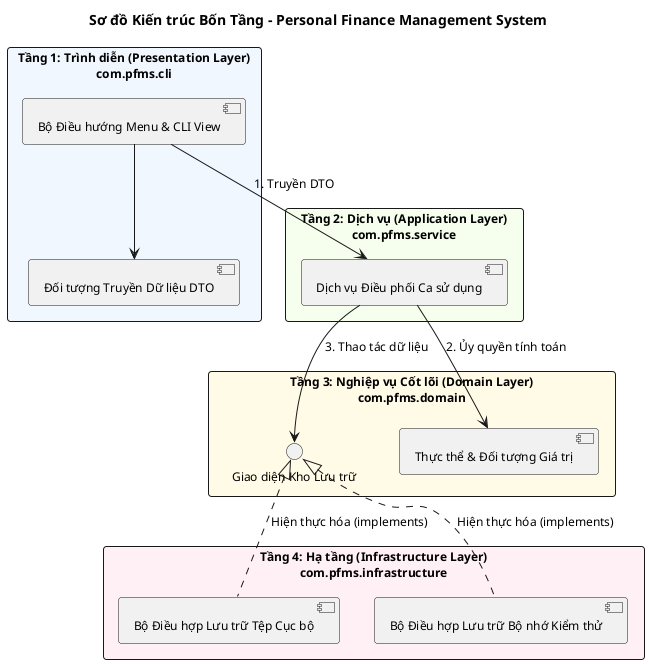
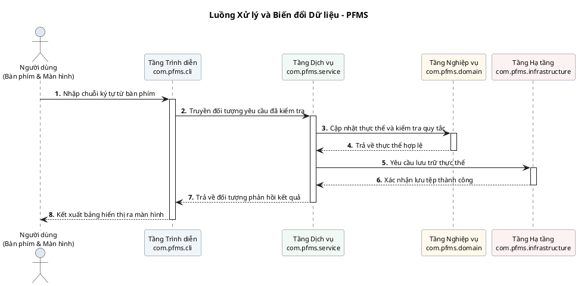

# 01. Kiến trúc Hệ thống và Phân tầng Mã nguồn

Tài liệu này xác lập cấu trúc kiến trúc tổng thể cho Hệ thống Quản lý Tài chính Cá nhân PFMS vận hành trên môi trường dòng lệnh Java Console. Văn bản định hình mô hình tổ chức phần mềm thành bốn tầng chức năng độc lập gồm tầng trình diễn dòng lệnh, tầng dịch vụ điều phối, tầng nghiệp vụ cốt lõi và tầng hạ tầng lưu trữ.

Kiến trúc giải quyết ba yêu cầu kỹ thuật cốt lõi: bảo vệ tính toàn vẹn của các quy tắc tài chính trước sự thay đổi của giao diện và lưu trữ thông qua nguyên lý Nghịch đảo Phụ thuộc; chuẩn hóa cấu trúc phân cấp gói mã nguồn `com.pfms` theo nguyên tắc không chu trình phụ thuộc; và xác lập luồng xử lý và biến đổi dữ liệu hai chiều khép kín từ chuỗi ký tự bàn phím đến bản ghi lưu trữ bền vững trên hệ thống tệp cục bộ.

## 1.1 Tổng quan Kiến trúc Phân tầng

Mục này xác lập cơ sở lý thuyết và mô hình hóa trực quan cấu trúc phân tầng của hệ thống. Nội dung tập trung vào việc so sánh định lượng giữa kiến trúc phân tầng với mô hình kịch bản giao dịch, đồng thời đặc tả sơ đồ bốn tầng thể hiện chiều phụ thuộc thời gian biên dịch và luồng gọi hàm thời gian chạy.

### 1.1.1 Lý do Lựa chọn Kiến trúc Phân tầng

Hệ thống Quản lý Tài chính Cá nhân PFMS vận hành trên môi trường dòng lệnh Java Console, thực thi đơn tiến trình cục bộ trên máy tính cá nhân. Hệ thống quản lý toàn diện các hoạt động tài chính bao gồm quản lý nguồn tiền, ghi nhận thu chi, chuyển khoản nội bộ và thiết lập ngân sách. Các nghiệp vụ này đòi hỏi việc duy trì các ràng buộc tài chính khắt khe: tính toán số học chính xác tuyệt đối, bảo toàn số dư khả dụng không âm và bảo đảm tính toàn vẹn của dòng tiền.

Để định hình cấu trúc phần mềm, hệ thống đánh giá bốn mô hình kiến trúc tiêu biểu nhằm xác định giải pháp phù hợp:

| Tiêu chí kỹ thuật | Mô hình Kịch bản Giao dịch | **Mô hình Kiến trúc Phân tầng** | Mô hình Kiến trúc Vi dịch vụ | Mô hình Kiến trúc Hướng sự kiện |
| :--- | :--- | :--- | :--- | :--- |
| Mức độ ghép nối | Rất cao: Giao diện gắn chặt với logic tính toán và tệp. | Rất thấp: Các tầng tương tác qua giao diện trừu tượng và DTO. | Rất thấp: Các dịch vụ độc lập hoàn toàn theo tiến trình mạng. | Rất thấp: Ghép nối lỏng giữa thành phần phát và nhận sự kiện. |
| Mức độ gắn kết | Rất thấp: Một hàm xử lý đồng thời nhập xuất, nghiệp vụ và tệp. | Cao: Mỗi lớp đảm nhiệm duy nhất một nhóm trách nhiệm. | Cao: Mỗi dịch vụ bao bọc trọn vẹn một miền nghiệp vụ. | Cao: Mỗi thành phần chỉ tập trung xử lý một loại sự kiện. |
| Tính nhất quán dữ liệu | Kém: Dễ sai lệch số dư nếu phát sinh lỗi giữa quy trình thủ tục. | Rất cao: Giao dịch nguyên tử trong bộ nhớ, nhất quán tức thời. | Thấp: Đòi hỏi giao dịch phân tán, chỉ đạt nhất quán cuối cùng. | Thấp: Phụ thuộc luồng bất đồng bộ, chỉ đạt nhất quán cuối cùng. |
| Khả năng kiểm thử độc lập | Rất kém: Bắt buộc gắn liền với giao diện console và tệp vật lý. | Rất tốt: Kiểm thử tự động độc lập từng tầng bằng Unit Test. | Kém: Đòi hỏi khởi tạo môi trường mạng và dịch vụ phụ thuộc. | Kém: Khó kiểm soát và tái hiện các kịch bản kiểm thử bất đồng bộ. |
| Khả năng thay đổi công nghệ | Rất kém: Đổi giao diện hoặc cơ chế tệp làm vỡ toàn bộ mã nguồn. | Rất tốt: Cho phép tráo đổi giao diện hoặc cơ chế lưu trữ độc lập. | Rất tốt: Cho phép áp dụng công nghệ riêng cho từng dịch vụ. | Tốt: Dễ bổ sung thành phần xử lý mới mà không sửa mã cũ. |
| Chi phí vận hành và hạ tầng | Rất thấp: Thực thi trực tiếp trên một tiến trình, không phụ trợ. | Thấp: Vận hành trên một máy ảo Java, không tốn tài nguyên mạng. | Rất cao: Đòi hỏi quản lý mạng, dịch vụ phát hiện và container. | Rất cao: Đòi hỏi máy chủ trung chuyển sự kiện và quản lý luồng. |
| Mức độ phù hợp với hệ thống | Không phù hợp: Dễ phát sinh sai lệch khi mở rộng nghiệp vụ tài chính. | Tối ưu: Đảm bảo toàn vẹn dữ liệu và kiểm thử trên môi trường cục bộ. | Không phù hợp: Phức tạp quá mức cần thiết cho ứng dụng đơn máy. | Không phù hợp: Tính chất bất đồng bộ không cần thiết cho dòng lệnh. |

Việc áp dụng kiến trúc phân tầng chấp nhận đánh đổi kỹ thuật về việc gia tăng số lượng lớp trung gian và chi phí ánh xạ dữ liệu qua các tầng. Đổi lại, hệ thống đạt được tính độc lập hoàn toàn của các quy tắc tài chính và năng lực kiểm thử tự động toàn diện. Ranh giới giữa các tầng được thiết lập theo nguyên tắc đóng kín nghiêm ngặt, ngăn chặn việc giao tiếp vượt cấp giữa tầng trình diễn và tầng lưu trữ.

### 1.1.2 Sơ đồ Kiến trúc Bốn Tầng

Hệ thống được tổ chức thành bốn tầng chức năng độc lập theo nguyên tắc đóng kín và hướng tâm:
1. Tầng Trình diễn (Presentation Layer): Tiếp nhận chuỗi ký tự từ bàn phím, điều hướng luồng màn hình menu dòng lệnh, đóng gói dữ liệu vào các đối tượng DTO và kết xuất bảng dữ liệu hiển thị ra màn hình console.
2. Tầng Dịch vụ (Application Layer): Quản lý vòng đời thực thi các ca sử dụng, điều phối giao dịch tài chính, nạp dữ liệu từ kho lưu trữ và ủy quyền xử lý tính toán cho tầng miền.
3. Tầng Nghiệp vụ cốt lõi (Domain Layer): Trung tâm của toàn bộ hệ thống, chứa các thực thể tài chính, đối tượng giá trị bất biến, quy tắc nghiệp vụ bất biến và các giao diện kho lưu trữ trừu tượng.
4. Tầng Hạ tầng (Infrastructure Layer): Nằm ở rìa ngoài hệ thống, cài đặt cụ thể các giao diện kho lưu trữ bằng cơ chế đọc ghi tệp tin cục bộ hoặc cơ chế lưu trữ bộ nhớ phục vụ kiểm thử tự động.

Sơ đồ khối dưới đây mô tả cấu trúc bốn tầng cùng ranh giới phụ thuộc mã nguồn và luồng gọi hàm thời gian chạy:



Nguyên tắc phụ thuộc và luồng thực thi:
- Phụ thuộc mã nguồn: Mọi chiều phụ thuộc đều hướng tâm về Tầng Nghiệp vụ cốt lõi. Tầng Hạ tầng phụ thuộc ngược vào các giao diện kho lưu trữ được định nghĩa trong Tầng Nghiệp vụ, bảo đảm nghiệp vụ tài chính độc lập hoàn toàn khỏi hệ thống tệp.
- Luồng thực thi thời gian chạy: Lệnh điều khiển đi từ giao diện dòng lệnh xuống Tầng Dịch vụ, ủy quyền tính toán cho Tầng Nghiệp vụ và thực thi lưu trữ dữ liệu thông qua bộ điều hợp của Tầng Hạ tầng.

> [!NOTE]
> **Tệp sơ đồ nguồn đính kèm:** [`01-so-do-kien-truc-bon-tang.drawio`](01-so-do-kien-truc-bon-tang.drawio)
> Đây là bản vẽ phác thảo sơ bộ phục vụ định hình bố cục không gian ban đầu, mang tính chất tham khảo nội bộ và **chưa phải bản vẽ chốt chính thức (baseline)**. Các thành viên dự án và các hệ thống hỗ trợ tự động tuyệt đối không sử dụng các chi tiết đồ họa trong tệp này làm nguồn đối chiếu chân lý. Toàn bộ sơ đồ đồ họa sẽ được rà soát và chuẩn hóa đồng bộ sau khi nội dung kỹ thuật của hồ sơ được đóng khóa hoàn toàn.

## 1.2 Trách nhiệm và Ranh giới của các Tầng

Để bảo đảm tính gắn kết cao và ngăn chặn hiện tượng rò rỉ logic giữa các thành phần, hệ thống xác lập bảng phân định trách nhiệm và ràng buộc ranh giới cho bốn tầng kiến trúc:

| Tầng kiến trúc | Trách nhiệm chính | Ràng buộc ranh giới |
| :--- | :--- | :--- |
| **Tầng Trình diễn** | Tiếp nhận chuỗi ký tự từ bàn phím, phân giải lệnh menu dòng lệnh, đóng gói dữ liệu vào DTO và kết xuất bảng dữ liệu hiển thị ra console. | Không chứa logic tính toán tài chính; không truy xuất trực tiếp kho lưu trữ; không tham chiếu trực tiếp thực thể nghiệp vụ. |
| **Tầng Dịch vụ** | Quản lý vòng đời thực thi ca sử dụng, điều phối giao dịch, nạp thực thể từ kho lưu trữ và ủy quyền xử lý tính toán cho tầng nghiệp vụ. | Không chứa quy tắc kiểm tra logic tài chính chuyên sâu; không phụ thuộc vào cơ chế lưu trữ tệp cụ thể. |
| **Tầng Nghiệp vụ** | Thực thi các quy tắc bất biến tài chính, tính toán số học chính xác, kiểm soát số dư không âm và khai báo giao diện kho lưu trữ trừu tượng. | Không phụ thuộc vào bất kỳ thành phần nào bên ngoài; không tham chiếu đến mã nguồn giao diện dòng lệnh hay cơ chế đọc ghi tệp. |
| **Tầng Hạ tầng** | Hiện thực hóa các giao diện kho lưu trữ bằng cơ chế đọc ghi tệp tin cục bộ; cung cấp bộ điều hợp lưu trữ bộ nhớ phục vụ kiểm thử tự động. | Không can thiệp hoặc thay đổi quy tắc tính toán tài chính; chỉ thực hiện chuyển đổi giữa dữ liệu thô và đối tượng nghiệp vụ. |

## 1.3 Cấu trúc Gói Mã nguồn

Cấu trúc gói định hình không gian tên vật lý trong mã nguồn Java, ánh xạ trực tiếp từ bốn tầng kiến trúc sang hệ thống thư mục và bảo đảm nguyên tắc không tồn tại chu trình phụ thuộc vòng giữa các gói. Toàn bộ mã nguồn hệ thống được đặt dưới gói gốc `com.pfms` gồm đúng bốn gói con tương ứng với bốn tầng logic.

**Phân cấp gói mã nguồn:**

```text
com.pfms
├── cli                     # Tầng Trình diễn: Giao diện dòng lệnh
│   ├── controller          # Điều phối luồng màn hình và tiếp nhận lệnh
│   ├── view                # Định dạng bảng biểu và kết xuất hiển thị
│   └── dto                 # Đối tượng truyền dữ liệu giữa giao diện và dịch vụ
├── service                 # Tầng Dịch vụ: Điều phối ca sử dụng nghiệp vụ
├── domain                  # Tầng Nghiệp vụ: Thực thể, quy tắc và hợp đồng kho lưu trữ
│   ├── model               # Thực thể và đối tượng giá trị bất biến
│   ├── repository          # Giao diện kho lưu trữ trừu tượng được đặt trong miền nghiệp vụ
│   ├── service             # Dịch vụ miền xử lý quy tắc đa thực thể
│   └── exception           # Ngoại lệ nghiệp vụ tài chính
└── infrastructure          # Tầng Hạ tầng: Bộ điều hợp tệp cục bộ và bộ nhớ kiểm thử
    ├── file                # Hiện thực hóa kho lưu trữ bằng đọc ghi tệp
    └── memory              # Hiện thực hóa kho lưu trữ trong RAM phục vụ kiểm thử
```

**Ma trận quyền truy cập và phụ thuộc gói:**

Bảng ma trận xác lập các gói được phép tham chiếu và phạm vi truy cập hợp lệ giữa các thành phần mã nguồn:

| Gói nguồn | Gói đích được phép import | Phạm vi truy cập | Thành phần được phép sử dụng |
| :--- | :--- | :--- | :--- |
| `cli` | `service`, `cli.dto` | `public` | Chỉ gọi các phương thức công khai trên giao diện dịch vụ; không import trực tiếp gói `domain` hoặc `infrastructure`. |
| `service` | `domain`, `cli.dto` | `public` | Thao tác trên thực thể, đối tượng giá trị và gọi các giao diện thuộc `domain.repository`; không import gói `cli` hoặc `infrastructure`. |
| `domain` | Thư viện Java chuẩn | `public` | Độc lập tuyệt đối; chỉ sử dụng `java.time`, `java.math`, `java.util`; không import bất kỳ gói nào khác trong hệ thống. |
| `infrastructure` | `domain` | `public` | Hiện thực hóa các giao diện từ gói `domain.repository`; không import ngược lên gói `service` hoặc `cli`. |

**Quy tắc kiểm soát phạm vi lớp nội bộ:**

Nhằm tối thiểu hóa khả năng tiếp cận của các lớp theo nguyên lý đóng gói hướng đối tượng:
1. Các giao diện dịch vụ, giao diện kho lưu trữ, đối tượng truyền dữ liệu DTO và thực thể nghiệp vụ được khai báo ở mức `public` để phục vụ tương tác liên tầng.
2. Các lớp cài đặt dịch vụ cụ thể, lớp điều phối tệp tin và các phương thức trợ giúp kỹ thuật được giới hạn ở phạm vi nội bộ gói (`package-private`), ngăn chặn việc các gói bên ngoài tự ý khởi tạo hoặc phụ thuộc trực tiếp vào chi tiết cài đặt.

## 1.4 Luồng Xử lý và Biến đổi Dữ liệu

Hệ thống chuyển đổi dữ liệu qua từng tầng theo quy trình khép kín nhằm ngăn không cho giao diện dòng lệnh tiếp xúc trực tiếp với thực thể nghiệp vụ hoặc cấu trúc tệp tin.

**Sơ đồ luồng dữ liệu hai chiều:**



**Bảng đặc tả xử lý tại các ranh giới:**

| Ranh giới | Chiều đi | Chiều về | Trách nhiệm xử lý |
| :--- | :--- | :--- | :--- |
| **Bàn phím $\leftrightarrow$ Trình diễn** | `String` $\rightarrow$ `Request DTO` | `Response DTO` $\rightarrow$ `String` | Kiểm tra chuỗi nhập không rỗng, đúng kiểu số; định dạng tiền tệ và ngày tháng khi in ra màn hình. |
| **Trình diễn $\leftrightarrow$ Dịch vụ** | `Request DTO` $\rightarrow$ Phương thức dịch vụ | Kết quả xử lý $\rightarrow$ `Response DTO` | Nhận DTO từ giao diện để gọi ca sử dụng; đóng gói kết quả trả về thành DTO thay vì trả trực tiếp thực thể. |
| **Dịch vụ $\leftrightarrow$ Nghiệp vụ** | Tham số dịch vụ $\rightarrow$ Thực thể & Đối tượng giá trị | Thực thể sau xử lý $\rightarrow$ Dịch vụ | Tính toán số học tiền tệ, kiểm tra số dư không âm và cập nhật trạng thái thực thể. |
| **Nghiệp vụ $\leftrightarrow$ Hạ tầng** | Thực thể $\rightarrow$ Bản ghi tệp | Bản ghi tệp $\rightarrow$ Thực thể | Chuyển thuộc tính thực thể thành dòng văn bản để lưu tệp; đọc tệp để nạp lại thực thể vào bộ nhớ. |
