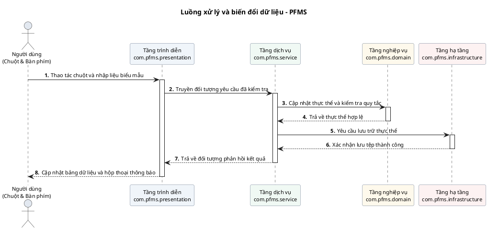

# 01. Kiến trúc hệ thống và phân tầng mã nguồn

Tài liệu này xác lập kiến trúc tổng thể cho Hệ thống quản lý tài chính cá nhân (PFMS) giao diện đồ họa (GUI), thực thi đơn tiến trình cục bộ trên máy tính cá nhân. Hệ thống được tổ chức theo mô hình kiến trúc phân tầng gồm 4 tầng chức năng độc lập và 1 tầng nền tảng kỹ thuật dùng chung (`com.pfms.common`).

Kiến trúc giải quyết ba mục tiêu cốt lõi: bảo vệ tính toàn vẹn của quy tắc tài chính thông qua nguyên lý nghịch đảo phụ thuộc (DIP); chuẩn hóa phân cấp gói `com.pfms` không chu trình phụ thuộc; và bảo đảm luồng xử lý dữ liệu hai chiều khép kín giữa biểu mẫu đồ họa và hệ thống tệp lưu trữ.

## 1.1 Tổng quan kiến trúc phân tầng

Mục này so sánh kiến trúc phân tầng với các mô hình kiến trúc khác và đặc tả sơ đồ phân tầng thể hiện chiều phụ thuộc lúc biên dịch cùng luồng gọi hàm lúc thực thi.

### 1.1.1 Lý do lựa chọn kiến trúc phân tầng

Hệ thống quản lý các nguồn tiền, ghi nhận thu chi, chuyển khoản nội bộ và ngân sách. Nghiệp vụ đòi hỏi số học chính xác tuyệt đối, số dư không âm và bảo toàn dòng tiền.

Bảng so sánh định lượng giữa các mô hình kiến trúc:

| Tiêu chí kỹ thuật | Mô hình kịch bản giao dịch | **Mô hình kiến trúc phân tầng** | Mô hình kiến trúc vi dịch vụ | Mô hình kiến trúc hướng sự kiện |
| :--- | :--- | :--- | :--- | :--- |
| Mức độ ghép nối | Rất cao: Giao diện gắn chặt logic và tệp. | Rất thấp: Tương tác qua interface và DTO. | Rất thấp: Độc lập qua tiến trình mạng. | Rất thấp: Ghép nối lỏng phát/nhận sự kiện. |
| Mức độ gắn kết | Rất thấp: Một hàm xử lý I/O, nghiệp vụ và tệp. | Cao: Mỗi lớp đảm nhiệm một trách nhiệm. | Cao: Mỗi dịch vụ bao trọn một miền. | Cao: Mỗi thành phần xử lý một loại sự kiện. |
| Tính nhất quán dữ liệu | Kém: Dễ sai lệch số dư khi lỗi quy trình. | Rất cao: Giao dịch nguyên tử, nhất quán tức thời. | Thấp: Cần giao dịch phân tán, nhất quán cuối. | Thấp: Bất đồng bộ, chỉ đạt nhất quán cuối. |
| Khả năng kiểm thử | Rất kém: Phụ thuộc GUI và tệp vật lý. | Rất tốt: Kiểm thử tự động độc lập bằng Unit Test. | Kém: Cần môi trường mạng và dịch vụ phụ thuộc. | Kém: Khó tái hiện kịch bản bất đồng bộ. |
| Thay đổi công nghệ | Rất kém: Đổi GUI hoặc tệp làm vỡ toàn bộ mã. | Rất tốt: Tráo đổi GUI hoặc lưu trữ độc lập. | Rất tốt: Công nghệ riêng cho từng dịch vụ. | Tốt: Dễ thêm thành phần mà không sửa mã cũ. |
| Chi phí vận hành | Rất thấp: Đơn tiến trình, không hạ tầng phụ. | Thấp: Chạy trên một JVM, không tốn tài nguyên mạng. | Rất cao: Cần quản lý mạng, service discovery, container. | Rất cao: Cần message broker và quản lý luồng. |
| Mức độ phù hợp | Không phù hợp: Dễ sai lệch khi mở rộng nghiệp vụ. | **Tối ưu**: Bảo đảm toàn vẹn dữ liệu, dễ kiểm thử cục bộ. | Không phù hợp: Quá phức tạp cho ứng dụng đơn máy. | Không phù hợp: Bất đồng bộ không cần thiết cho desktop app. |

Áp dụng kiến trúc phân tầng chấp nhận chi phí ánh xạ DTO qua các lớp trung gian để đổi lấy tính độc lập của quy tắc tài chính và năng lực kiểm thử tự động toàn diện. Ranh giới giữa các tầng tuân thủ nguyên tắc đóng kín, ngăn giao tiếp vượt cấp giữa tầng trình diễn và tầng lưu trữ.

### 1.1.2 Sơ đồ kiến trúc phân tầng

Hệ thống gồm 4 tầng chức năng độc lập (hướng tâm, đóng kín) và 1 tầng nền tảng dùng chung:
0. **Tầng nền tảng dùng chung (Common Layer)**: Chứa tiện ích tiền điều kiện (`Preconditions`) và hàm bổ trợ phi nghiệp vụ, không phụ thuộc tầng nào.
1. **Tầng trình diễn (Presentation Layer)**: Tiếp nhận sự kiện người dùng, điều hướng màn hình, đóng gói DTO và kết xuất bảng dữ liệu hiển thị.
2. **Tầng dịch vụ (Application Layer)**: Điều phối ca sử dụng, quản lý giao dịch tài chính, nạp dữ liệu và ủy quyền tính toán cho tầng nghiệp vụ.
3. **Tầng nghiệp vụ cốt lõi (Domain Layer)**: Trung tâm hệ thống, chứa thực thể, đối tượng giá trị bất biến, quy tắc tài chính và giao diện repository trừu tượng.
4. **Tầng hạ tầng (Infrastructure Layer)**: Cài đặt cụ thể các giao diện repository bằng tệp JSON cục bộ hoặc lưu trữ bộ nhớ (in-memory) phục vụ kiểm thử.

Sơ đồ khối cấu trúc phân tầng và luồng thực thi:


Nguyên tắc phụ thuộc và luồng thực thi:
- **Phụ thuộc mã nguồn (Compile-time)**: Hướng tâm về tầng nghiệp vụ. Tầng hạ tầng phụ thuộc ngược vào interface repository của tầng nghiệp vụ (DIP), giúp nghiệp vụ độc lập hoàn toàn với hệ thống tệp. Tầng nền tảng dùng chung (`com.pfms.common`) độc lập tuyệt đối (zero internal dependency), dùng chung cho cả 4 tầng mà không tạo phụ thuộc vòng.
- **Luồng thực thi (Runtime)**: Đi từ tầng trình diễn $\rightarrow$ tầng dịch vụ $\rightarrow$ tầng nghiệp vụ $\rightarrow$ bộ điều hợp tầng hạ tầng.

## 1.2 Trách nhiệm và ranh giới của các tầng

Bảng phân định trách nhiệm và ràng buộc ranh giới giữa các tầng kiến trúc:

| Tầng kiến trúc | Trách nhiệm chính | Ràng buộc ranh giới |
| :--- | :--- | :--- |
| **Tầng trình diễn** | Tiếp nhận sự kiện, điều hướng màn hình, đóng gói DTO và kết xuất giao diện đồ họa. | Không chứa logic tính toán tài chính; không gọi trực tiếp repository; không tham chiếu thực thể domain. |
| **Tầng dịch vụ** | Điều phối ca sử dụng, quản lý giao dịch, nạp thực thể từ repository và ủy quyền tính toán cho domain. | Không chứa quy tắc kiểm tra tài chính chuyên sâu; không phụ thuộc cơ chế lưu trữ tệp cụ thể. |
| **Tầng nghiệp vụ** | Thực thi quy tắc bất biến tài chính, tính toán số học chính xác, kiểm soát số dư không âm và khai báo interface repository. | Độc lập hoàn toàn với 3 tầng còn lại; không tham chiếu GUI hay tệp tin; chỉ dùng thư viện Java chuẩn và `com.pfms.common`. |
| **Tầng hạ tầng** | Hiện thực hóa interface repository bằng đọc/ghi tệp cục bộ hoặc lưu trữ bộ nhớ phục vụ kiểm thử. | Không thay đổi quy tắc tài chính; chỉ chuyển đổi giữa dữ liệu lưu trữ thô và đối tượng nghiệp vụ. |
| **Tầng nền tảng dùng chung** | Cung cấp tiện ích tiền điều kiện (`Preconditions`) và hàm bổ trợ kỹ thuật phi nghiệp vụ. | Tuyệt đối không chứa logic nghiệp vụ; không import bất kỳ lớp nào thuộc 4 tầng chức năng trên. |

## 1.3 Cấu trúc gói mã nguồn

Cấu trúc gói định hình không gian tên vật lý trong mã nguồn Java, bảo đảm không tồn tại chu trình phụ thuộc vòng giữa các gói. Toàn bộ mã nguồn đặt dưới gói gốc `com.pfms`:

```text
com.pfms
├── common                  # Tầng nền tảng dùng chung: Tiện ích kỹ thuật phi nghiệp vụ
│   └── util                # Tiền điều kiện kỹ thuật (Preconditions)
├── presentation            # Tầng trình diễn: Giao diện đồ họa (GUI)
│   ├── controller          # Điều phối luồng màn hình và xử lý sự kiện giao diện
│   ├── view                # Cửa sổ chính, biểu mẫu và bảng hiển thị
│   └── dto                 # Đối tượng truyền dữ liệu (DTO) giữa giao diện và dịch vụ
├── service                 # Tầng dịch vụ: Interface điều phối ca sử dụng nghiệp vụ
│   └── impl                # Cài đặt dịch vụ và lớp hỗ trợ điều phối nội bộ
├── domain                  # Tầng nghiệp vụ: Thực thể, quy tắc và hợp đồng repository
│   ├── model               # Thực thể và đối tượng giá trị bất biến
│   ├── repository          # Giao diện kho lưu trữ trừu tượng
│   ├── service             # Dịch vụ miền xử lý quy tắc đa thực thể
│   └── exception           # Ngoại lệ nghiệp vụ tài chính
└── infrastructure          # Tầng hạ tầng: Bộ điều hợp tệp cục bộ và bộ nhớ kiểm thử
    ├── file                # Hiện thực hóa repository bằng đọc/ghi tệp JSON
    └── memory              # Hiện thực hóa repository trong RAM phục vụ kiểm thử
```

**Ma trận quyền truy cập và phụ thuộc gói:**

| Gói nguồn | Gói đích được phép import | Phạm vi truy cập | Thành phần được phép sử dụng |
| :--- | :--- | :--- | :--- |
| `presentation` | `service`, `presentation.dto`, `common.util` | `public` | Gọi phương thức công khai của service interface và tiện ích kiểm tra; không import `domain` hoặc `infrastructure`. |
| `service` | `domain`, `presentation.dto`, `common.util` | `public` | Thao tác trên entity, value object, gọi interface `domain.repository`; không import `presentation` hoặc `infrastructure`. |
| `domain` | `common.util`, Thư viện Java chuẩn | `public` | Độc lập khỏi các tầng ngoài; chỉ dùng `common.util` và thư viện chuẩn (`java.time`, `java.math`, `java.util`). |
| `infrastructure` | `domain`, `common.util` | `public` | Hiện thực hóa interface từ `domain.repository` và dùng tiện ích kỹ thuật; không import `service` hoặc `presentation`. |
| `common` | Thư viện Java chuẩn | `public` | Độc lập tuyệt đối (zero internal dependency); không import bất kỳ gói nào trong `com.pfms`. |

**Quy tắc kiểm soát phạm vi lớp nội bộ:**
1. **Phạm vi `public`**: Khai báo cho service interface, lớp cài đặt service trong `service.impl` (phục vụ tiêm phụ thuộc), lớp tiện ích dùng chung liên tầng (`EntityLookupSupport`, `RollbackSupport`), interface repository, DTO và thực thể domain.
2. **Phạm vi `package-private`**: Giới hạn cho các lớp hỗ trợ nội bộ phân hệ dịch vụ (`FileStorageSupport`, `SystemDataReconciler`, `TransactionPersistenceCoordinator`, `TransferPersistenceCoordinator`, `CategoryHierarchySupport`, `WalletSummaryCalculator`, `SpendingPeriodAccumulator`) để tránh phơi bày chi tiết nội bộ ra ngoài gói.
3. **Lớp tiện ích `common.util`**: Thiết kế theo chuẩn Utility Class (phương thức `public static`, constructor `private` ném ngoại lệ ngăn khởi tạo đối tượng).

## 1.4 Luồng xử lý và biến đổi dữ liệu

Hệ thống chuyển đổi dữ liệu qua từng tầng theo quy trình khép kín, ngăn giao diện đồ họa tiếp xúc trực tiếp với thực thể nghiệp vụ hoặc cấu trúc tệp tin.

**Sơ đồ luồng dữ liệu hai chiều:**



**Bảng đặc tả xử lý tại các ranh giới:**

| Ranh giới | Chiều đi | Chiều về | Trách nhiệm xử lý |
| :--- | :--- | :--- | :--- |
| **Người dùng $\leftrightarrow$ Trình diễn** | Biểu mẫu nhập $\rightarrow$ `Request DTO` | `Response DTO` $\rightarrow$ Hiển thị `JTable` / Hộp thoại | Kiểm tra dữ liệu biểu mẫu không rỗng, đúng kiểu số; định dạng tiền tệ và ngày tháng khi hiển thị. |
| **Trình diễn $\leftrightarrow$ Dịch vụ** | `Request DTO` $\rightarrow$ Phương thức dịch vụ | Kết quả xử lý $\rightarrow$ `Response DTO` | Nhận DTO từ giao diện để thực thi ca sử dụng; đóng gói kết quả trả về thành DTO, không trả trực tiếp thực thể. |
| **Dịch vụ $\leftrightarrow$ Nghiệp vụ** | Tham số dịch vụ $\rightarrow$ Thực thể & Đối tượng giá trị | Thực thể sau xử lý $\rightarrow$ Dịch vụ | Tính toán số học tiền tệ, kiểm tra số dư không âm và cập nhật trạng thái thực thể. |
| **Nghiệp vụ $\leftrightarrow$ Hạ tầng** | Thực thể $\rightarrow$ Bản ghi tệp | Bản ghi tệp $\rightarrow$ Thực thể | Chuyển thuộc tính thực thể thành dòng văn bản/JSON lưu tệp; đọc tệp để nạp lại thực thể vào bộ nhớ. |
