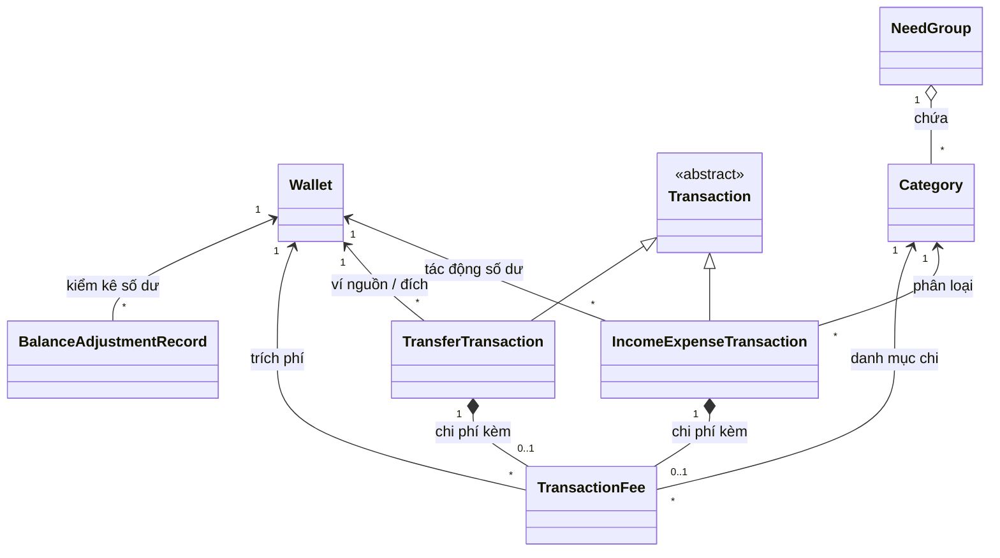

# 02. Thiết kế Lớp Thực thể và Đối tượng Giá trị

Tài liệu này xác lập bản vẽ thiết kế chi tiết cho toàn bộ các lớp nghiệp vụ thuộc Tầng Nghiệp vụ cốt lõi của Hệ thống Quản lý Tài chính Cá nhân PFMS. Nội dung văn bản thực hiện chuyển đổi các thực thể miền và đối tượng giá trị đã được xác thực trong hồ sơ Phân tích Hướng đối tượng sang cấu trúc lớp cài đặt hoàn chỉnh trên nền tảng ngôn ngữ Java.

Bản vẽ thiết kế tập trung giải quyết ba mục tiêu kỹ thuật trọng tâm: bảo toàn độ chính xác số học thông qua việc xây dựng đối tượng giá trị tiền tệ bất biến kèm quy tắc làm tròn ngân hàng; kiểm soát chặt chẽ tính đóng gói nhằm bảo vệ trạng thái nội tại và duy trì số dư khả dụng không âm tại mọi thời điểm; và tổ chức cấu trúc phân cấp giao dịch kế thừa từ lớp cơ sở trừu tượng nhằm hiện thực hóa tính đa hình trong luồng hạch toán dòng tiền mà không cần sử dụng các cấu trúc điều kiện rẽ nhánh thủ công.

## 2.1 Sơ đồ Lớp Tổng quan

Mục này cung cấp góc nhìn toàn cảnh về cấu trúc tĩnh của Tầng Nghiệp vụ cốt lõi trước khi đi vào đặc tả chi tiết từng thành phần. Bản vẽ trực quan hóa mối quan hệ cấu trúc giữa các lớp thực thể quản trị trạng thái và các lớp đối tượng giá trị bất biến, làm nổi bật các liên kết kế thừa, hợp thành, kết tập và phụ thuộc trong toàn bộ không gian miền tài chính.

Đi kèm với sơ đồ lớp, bảng danh mục lớp và kiểu dữ liệu xác lập bản chỉ mục định danh hoàn chỉnh, tổng hợp đầy đủ trách nhiệm kỹ thuật của từng thành phần và bảo đảm tính truy vết hai chiều nhất quán giữa mô hình phân tích nghiệp vụ và cấu trúc mã nguồn phần mềm.

### 2.1.1 Sơ đồ Cấu trúc các Lớp Thực thể

Sơ đồ dưới đây mô hình hóa cấu trúc tĩnh của 8 lớp thực thể cốt lõi thuộc Tầng Nghiệp vụ. Sơ đồ tập trung thể hiện bốn loại quan hệ cấu trúc hướng đối tượng then chốt gồm kế thừa, hợp thành, kết tập và liên kết, định hình xương sống dòng tiền và phân cấp danh mục của toàn bộ hệ thống:

Bản vẽ thiết lập bốn loại quan hệ cấu trúc hướng đối tượng cốt lõi trong mô hình miền:

1. Quan hệ Kế thừa: Áp dụng để trừu tượng hóa các thuộc tính và hành vi chung của dòng tiền, cho phép các lớp giao dịch cụ thể đa hình hóa việc hạch toán số dư mà không phụ thuộc vào các cấu trúc điều kiện rẽ nhánh thủ công.
2. Quan hệ Hợp thành: Áp dụng cho các thành phần tài chính có sự ràng buộc sinh tử, bảo đảm các khoản chi phí liên kết luôn gắn liền với vòng đời của giao dịch gốc và loại trừ hoàn toàn nguy cơ phát sinh dữ liệu mồ côi.
3. Quan hệ Kết tập: Áp dụng để tổ chức cấu trúc phân cấp danh mục nhiều cấp, cho phép nhóm phân loại cấp trên gom cụm các danh mục chi tiết cấp dưới mà vẫn duy trì tính độc lập của từng phần tử.
4. Quan hệ Liên kết: Thể hiện sự tương tác nghiệp vụ giữa các thực thể có định danh và vòng đời độc lập, bảo đảm mọi biến động tài chính luôn truy nguyên được nguồn tiền chịu tác động và mục đích phân loại.

Các đối tượng giá trị bất biến và kiểu liệt kê nghiệp vụ đóng vai trò là kiểu dữ liệu cấu thành trạng thái của các thực thể trên, được tra cứu tổng hợp tại bảng danh mục ở Mục 2.1.2 và đặc tả chi tiết tại Mục 2.3.

### 2.1.2 Danh mục Lớp và Kiểu Dữ liệu

Bảng dưới đây tổng hợp danh mục toàn bộ các lớp thực thể, lớp khởi tạo, đối tượng giá trị và kiểu liệt kê trong Tầng Nghiệp vụ cốt lõi. Toàn bộ các thành phần này được định vị vật lý trong gói mã nguồn `com.pfms.domain.model` và được phân loại theo các nhóm nghiệp vụ tương ứng của hệ thống:

| Tên lớp / Kiểu dữ liệu | Phân loại OOP | Trách nhiệm kỹ thuật chính |
| :--- | :--- | :--- |
| **1. Nhóm Quản lý Ví (WAL)** |  |  |
| `Wallet` | Thực thể | Quản lý nguồn tiền khả dụng, bảo toàn bất biến số dư không âm và tiếp nhận các biến động dòng tiền. |
| `BalanceAdjustmentRecord` | Thực thể | Bản ghi kiểm kê thực tế bất biến, ghi nhận chênh lệch kiểm kê để cân đối số dư ví về đúng thực tế quan sát. |
| `WalletStatus` | Kiểu liệt kê | Trạng thái vòng đời của ví gồm Đang hoạt động (`ACTIVE`) hoặc Đã lưu trữ (`ARCHIVED`). |
| **2. Nhóm Ghi nhận Thu chi (TXN)** |  |  |
| `Transaction` | Thực thể trừu tượng | Lớp cơ sở trừu tượng định nghĩa các thuộc tính chung và hợp đồng phương thức đa hình cho giao dịch thu chi cùng chuyển tiền nội bộ. |
| `IncomeExpenseTransaction` | Thực thể | Hiện thực hóa giao dịch thu nhập hoặc chi tiêu tại một ví, liên kết phân loại trực tiếp với danh mục cấp 3. |
| `TransactionFee` | Thực thể | Quản lý khoản chi phí phát sinh phụ thuộc sinh tử kèm theo giao dịch thu chi hoặc chuyển tiền nội bộ. |
| `TransactionFactory` | Lớp khởi tạo | Đóng gói quy trình khởi tạo đa hình `IncomeExpenseTransaction`, `TransferTransaction` kèm bản ghi `TransactionFee` hợp thành. |
| `TransactionType` | Kiểu liệt kê | Xác định chiều tác động của dòng tiền gồm Thu nhập (`INCOME`) hoặc Chi tiêu (`EXPENSE`). |
| **3. Nhóm Chuyển tiền Nội bộ (TRF)** |  |  |
| `TransferTransaction` | Thực thể | Hiện thực hóa giao dịch điều chuyển tiền nội bộ giữa hai ví độc lập theo cơ chế bảo toàn tổng tài sản. |
| **4. Nhóm Danh mục Phân loại (CAT)** |  |  |
| `NeedGroup` | Thực thể | Quản lý nhóm nhu cầu cấp 2 gom cụm các danh mục chi tiết, trực thuộc một nhánh loại thu chi cố định. |
| `Category` | Thực thể | Quản lý danh mục chi tiết cấp 3 gán nhãn mục đích cho giao dịch thu chi, áp dụng cơ chế xóa mềm bảo toàn lịch sử. |
| `GroupStatus` | Kiểu liệt kê | Trạng thái vòng đời của nhóm nhu cầu gồm Đang hoạt động (`ACTIVE`) hoặc Đã xóa mềm (`DELETED`). |
| `CategoryStatus` | Kiểu liệt kê | Trạng thái vòng đời của danh mục gồm Đang hoạt động (`ACTIVE`) hoặc Đã xóa mềm (`DELETED`). |
| **5. Nhóm Thống kê và Báo cáo (REP)** |  |  |
| `Money` | Đối tượng giá trị | Bọc giá trị tiền tệ bằng `BigDecimal` kèm quy tắc làm tròn nửa chẵn, loại trừ hoàn toàn sai số dấu chấm động. |
| `TransactionDate` | Đối tượng giá trị | Bọc mốc ngày phát sinh giao dịch, kiểm soát tính hợp lệ lịch pháp và ràng buộc thời gian không vượt quá hiện tại. |
| `NetCashFlow` | Đối tượng giá trị | Đo lường dòng tiền thuần ròng bằng tổng thu nhập trừ tổng chi tiêu trong một kỳ quan sát định kỳ. |
| `SavingsRate` | Đối tượng giá trị | Đo lường tỷ lệ phần trăm tiền tiết kiệm tích lũy được so với tổng thu nhập tạo ra trong kỳ phân tích. |
| `SpendingStructureShare` | Đối tượng giá trị | Đo lường tỷ trọng phần trăm đóng góp của từng nhóm nhu cầu hoặc danh mục chi tiết trên tổng quy mô chi tiêu. |

> [!NOTE]
> **Nhóm Lưu trữ và Quản trị Dữ liệu (DAT):** Các chức năng sao lưu dữ liệu, khôi phục và nạp dữ liệu mẫu được hiện thực hóa thông qua các dịch vụ thuộc Tầng Dịch vụ (`com.pfms.service`) và các bộ điều hợp tệp thuộc Tầng Hạ tầng (`com.pfms.infrastructure`). Tầng Nghiệp vụ cốt lõi không định nghĩa lớp thực thể riêng cho nhóm này nhằm bảo đảm tính độc lập hoàn toàn khỏi hệ thống tệp cục bộ theo nguyên lý Nghịch đảo Phụ thuộc.

## 2.2 Thiết kế các Lớp Thực thể

Mục này đặc tả chi tiết cấu trúc phần mềm cho các lớp thực thể thuộc Tầng Nghiệp vụ cốt lõi. Toàn bộ các lớp thực thể trong mục này được tổ chức thống nhất trong gói `com.pfms.domain.model`. Mỗi thực thể đại diện cho một đối tượng nghiệp vụ có mã định danh duy nhất và duy trì vòng đời biến đổi trạng thái xuyên suốt quá trình vận hành của hệ thống.

Để bảo đảm tính chặt chẽ trong thiết kế hướng đối tượng, mỗi lớp thực thể được quy chuẩn cấu trúc đồng nhất qua ba nội dung:
1. Cấu trúc thuộc tính: Xác định tên trường dữ liệu, kiểu dữ liệu cụ thể, phạm vi truy cập nội bộ và ràng buộc hợp lệ.
2. Phương thức nghiệp vụ: Đặc tả chữ ký phương thức gồm tên hàm, danh sách tham số, kiểu dữ liệu trả về, ngoại lệ ném ra và tóm tắt mô tả nghiệp vụ.
3. Cơ chế đóng gói và quy tắc bất biến: Làm rõ logic kiểm soát tính toàn vẹn dữ liệu, kiểm tra điều kiện tiên quyết trong phương thức khởi tạo và loại bỏ hoàn toàn các hàm gán giá trị tự do nhằm bảo vệ trạng thái nội tại của đối tượng.

### 2.2.1 Lớp Ví

Lớp `Wallet` đại diện cho nguồn tiền thanh toán của người dùng, tiếp nhận biến động dòng tiền và giữ số dư khả dụng không âm. Hệ thống dùng lớp này cho ví tiền mặt mặc định cùng các ví tạo thêm để tính cơ cấu phân bổ tài sản.

**Quy chiếu yêu cầu:**
- Ca sử dụng: `UC-WAL-01`, `UC-WAL-02`, `UC-WAL-03`, `UC-WAL-04`
- Yêu cầu chức năng: `FR-WAL-01`, `FR-WAL-02`, `FR-WAL-03`, `FR-WAL-04`, `FR-WAL-05`
- Quy tắc nghiệp vụ: `BR-FIN-01`, `BR-FIN-02`, `BR-NAM-01`
- Mã lỗi: `ERR-NAM-001`, `ERR-NAM-002`, `ERR-WAL-001`, `ERR-FIN-001`

**Cấu trúc thuộc tính**

| Thuộc tính | Kiểu dữ liệu | Phạm vi truy cập | Ràng buộc |
| :--- | :--- | :--- | :--- |
| `walletId` | `UUID` | `private final` | Mã định danh duy nhất sinh tự động khi tạo mới, giữ cố định và không tái sử dụng. |
| `name` | `String` | `private` | Chuỗi từ 1 đến 50 ký tự sau khi cắt khoảng trắng hai đầu, duy nhất toàn hệ thống không phân biệt hoa thường. |
| `currentBalance` | `Money` | `private` | Số dư khả dụng có đúng 2 chữ số thập phân, khởi tạo bằng `0.00 VNĐ` và luôn không âm. |
| `status` | `WalletStatus` | `private` | Trạng thái vòng đời nhận giá trị `ACTIVE` khi tạo mới hoặc chuyển sang `ARCHIVED` khi ngừng giao dịch. |
| `isDefault` | `boolean` | `private final` | Cờ đánh dấu ví "Tiền mặt" mặc định; mang giá trị `true` cố định ở ví mặc định để chặn thao tác xóa hoặc lưu trữ. |
| `note` | `String` | `private` | Chuỗi ghi chú tùy chọn, dài tối đa 255 ký tự sau khi cắt khoảng trắng hai đầu. |
| `createdAt` | `LocalDateTime` | `private final` | Mốc thời gian tạo ví bất biến, dùng để sắp xếp danh sách ví. |

**Phương thức nghiệp vụ**

| Phương thức | Tham số | Kiểu trả về | Ngoại lệ | Mô tả nghiệp vụ |
| :--- | :--- | :--- | :--- | :--- |
| `Wallet` | `UUID walletId, String name, String note, boolean isDefault` | `Wallet` | `ValidationException` | Kiểm tra `walletId` khác `null`, cắt khoảng trắng hai đầu, kiểm tra tên dài 1 đến 50 ký tự và ghi chú tối đa 255 ký tự, gán `status = ACTIVE`, `currentBalance = Money.ZERO` và `createdAt` hiện tại. |
| `credit` | `Money amount` | `void` | `ValidationException`, `BusinessRuleException` | Kiểm tra ví đang `ACTIVE` và `amount` lớn hơn `0.00 VNĐ`, sau đó cộng `amount` vào `currentBalance`. |
| `debit` | `Money amount` | `void` | `ValidationException`, `BusinessRuleException` | Kiểm tra ví đang `ACTIVE`, `amount` lớn hơn `0.00 VNĐ` và `currentBalance` đủ chi trả, sau đó trừ `amount` khỏi `currentBalance`. |
| `adjustBalance` | `Money actualBalance, TransactionDate adjustedAt, String reason` | `BalanceAdjustmentRecord` | `ValidationException`, `BusinessRuleException` | Kiểm tra ví đang `ACTIVE`, khởi tạo và xác thực bản ghi `BalanceAdjustmentRecord` trước để bảo đảm `actualBalance` không âm, độ lệch khác không và `reason` hợp lệ, sau đó mới cập nhật `currentBalance = actualBalance` rồi trả về bản ghi. |
| `updateInfo` | `String newName, String newNote` | `void` | `ValidationException` | Cắt khoảng trắng hai đầu, kiểm tra `newName` dài 1 đến 50 ký tự và `newNote` tối đa 255 ký tự, cập nhật tên cùng ghi chú mà giữ nguyên số dư. |
| `archive` | `Không` | `void` | `BusinessRuleException` | Kiểm tra `isDefault == false` và ví đang `ACTIVE`, sau đó chuyển `status` sang `ARCHIVED`. |
| `activate` | `Không` | `void` | `BusinessRuleException` | Kiểm tra ví đang `ARCHIVED` rồi chuyển `status` về `ACTIVE` để ví tiếp nhận lại giao dịch mới. |
| `getWalletId` | `Không` | `UUID` | `Không` | Trả về mã định danh duy nhất của ví để làm khóa lưu trữ trên kho dữ liệu và đối chiếu giao dịch liên kết. |
| `getName` | `Không` | `String` | `Không` | Trả về tên ví hiện tại phục vụ kiểm tra trùng tên không phân biệt hoa thường tại kho lưu trữ và hiển thị. |
| `getStatus` | `Không` | `WalletStatus` | `Không` | Trả về trạng thái vòng đời hiện tại của ví để lọc danh sách và thống kê số lượng ví theo trạng thái. |
| `isDefault` | `Không` | `boolean` | `Không` | Trả về `true` nếu đây là ví tiền mặt mặc định, giúp tầng dịch vụ chặn thao tác xóa hoặc lưu trữ ví mặc định. |
| `isActive` | `Không` | `boolean` | `Không` | Trả về `true` khi `status` bằng `WalletStatus.ACTIVE`, phục vụ kiểm tra trạng thái hoạt động trước khi hạch toán giao dịch. |
| `getCurrentBalance` | `Không` | `Money` | `Không` | Trả về số dư khả dụng hiện tại phục vụ hiển thị và tính cơ cấu phân bổ tài sản mà không mở hàm gán trực tiếp. |
| `hasSufficientBalance` | `Money amount` | `boolean` | `ValidationException` | Kiểm tra tham số khác `null` và trả về `true` khi `currentBalance` lớn hơn hoặc bằng `amount`. |

**Cơ chế đóng gói và quy tắc bất biến**

- Hàm khởi tạo cắt khoảng trắng tên ví, kiểm tra độ dài 1 đến 50 ký tự, gán trạng thái `ACTIVE` và đặt `currentBalance` bằng `0.00 VNĐ`. Thực thể kiểm tra định dạng tên nội bộ, còn tầng dịch vụ kiểm tra tính duy nhất của tên trên toàn hệ thống.
- Lớp `Wallet` đóng kín các trường nội tại, chỉ mở các phương thức đọc chỉ đọc và loại bỏ mọi phương thức gán giá trị tự do như `setCurrentBalance`. Số dư chỉ thay đổi qua `credit`, `debit` hoặc `adjustBalance` để duy trì số dư khả dụng không âm và chặn mọi khoản chi vượt số dư.
- Từ khóa `final` khóa cố định thuộc tính `isDefault` ngay khi tạo ví "Tiền mặt" mặc định, giúp phương thức `archive` và tầng dịch vụ chặn thao tác lưu trữ hoặc xóa nguồn tiền mặc định.

### 2.2.2 Lớp Giao dịch Cơ sở và Giao dịch Thu Chi

Lớp trừu tượng `Transaction` định nghĩa các thuộc tính chung và cặp phương thức đa hình cho mọi biến động dòng tiền. Lớp con `IncomeExpenseTransaction` biểu diễn giao dịch thu hoặc chi gắn với danh mục cấp 3, cập nhật số dư ví cùng phí đi kèm.

**Quy chiếu yêu cầu:**
- Ca sử dụng: `UC-TXN-01`, `UC-TXN-02`, `UC-TXN-03`, `UC-TXN-04`
- Yêu cầu chức năng: `FR-TXN-01`, `FR-TXN-02`, `FR-TXN-03`, `FR-TXN-04`, `FR-TXN-05`
- Quy tắc nghiệp vụ: `BR-FIN-01`, `BR-FIN-02`, `BR-FIN-04`
- Mã lỗi: `ERR-FIN-001`, `ERR-WAL-001`, `ERR-CAT-001`, `ERR-FEE-001`, `ERR-FEE-002`, `ERR-FEE-003`

**Cấu trúc thuộc tính**

| Thuộc tính | Kiểu dữ liệu | Phạm vi truy cập | Ràng buộc |
| :--- | :--- | :--- | :--- |
| `transactionId` | `UUID` | `protected final` | Mã định danh duy nhất khai báo tại `Transaction`, sinh tự động khi tạo mới và giữ cố định suốt vòng đời. |
| `amount` | `Money` | `protected` | Số tiền giao dịch khai báo tại `Transaction`, lớn hơn `0.00 VNĐ` với đúng 2 chữ số thập phân. |
| `transactionDate` | `TransactionDate` | `protected` | Ngày phát sinh giao dịch khai báo tại `Transaction`, không vượt quá ngày hiện tại và dùng để lọc lịch sử. |
| `fee` | `TransactionFee` | `protected` | Thực thể chi phí giao dịch hợp thành (`0..1`) khai báo tại `Transaction`, gắn liền vòng đời với giao dịch gốc. |
| `note` | `String` | `protected` | Ghi chú diễn giải khai báo tại `Transaction`, tùy chọn, tối đa 255 ký tự sau khi cắt khoảng trắng hai đầu. |
| `createdAt` | `LocalDateTime` | `protected final` | Mốc thời gian tạo bản ghi bất biến tại `Transaction`, dùng làm tiêu chí sắp xếp phụ khi các giao dịch trùng ngày. |
| `transactionType` | `TransactionType` | `private final` | Chiều dòng tiền (`INCOME` hoặc `EXPENSE`) tại `IncomeExpenseTransaction`, cố định theo nhánh danh mục và không đổi khi chỉnh sửa. |
| `wallet` | `Wallet` | `private` | Tham chiếu thực thể `Wallet` đang `ACTIVE` chịu tác động dòng tiền tại `IncomeExpenseTransaction`. |
| `category` | `Category` | `private` | Tham chiếu thực thể `Category` cấp 3 tại `IncomeExpenseTransaction`, bắt buộc cùng `transactionType`. |

**Phương thức nghiệp vụ**

| Phương thức | Tham số | Kiểu trả về | Ngoại lệ | Mô tả nghiệp vụ |
| :--- | :--- | :--- | :--- | :--- |
| `Transaction` | `UUID transactionId, Money amount, TransactionDate transactionDate, String note, TransactionFee fee` | `Transaction` | `ValidationException` | Hàm khởi tạo `protected` của lớp cha kiểm tra `transactionId` cùng `transactionDate` khác `null`, `amount` lớn hơn `0.00 VNĐ`, cắt khoảng trắng và kiểm tra `note` tối đa 255 ký tự, đồng thời gán `createdAt` hiện tại. |
| `IncomeExpenseTransaction` | `UUID transactionId, TransactionType transactionType, Wallet wallet, Category category, Money amount, TransactionDate date, String note, TransactionFee fee` | `IncomeExpenseTransaction` | `ValidationException`, `BusinessRuleException` | Gọi `super(...)`, kiểm tra `transactionType`, `wallet`, `category` khác `null`, `wallet.isActive()`, `category` cấp 3 đang `ACTIVE` khớp `transactionType` và nếu có `fee` thì khớp `transactionId` cùng `wallet`. |
| `applyToWallet` | `Không` | `void` | `BusinessRuleException` | Khai báo trừu tượng tại `Transaction`; lớp con kiểm tra `wallet.isActive()` và số dư `wallet` sau khi tính cả `amount` cùng `fee` không bị âm, cộng `amount` nếu `INCOME` hoặc trừ `amount` nếu `EXPENSE` rồi gọi `fee.applyFee()` nếu có phí. |
| `revertFromWallet` | `Không` | `void` | `BusinessRuleException` | Khai báo trừu tượng tại `Transaction`; lớp con kiểm tra `wallet.isActive()` và số dư `wallet` đủ hoàn nguyên, gọi `fee.revertFee()` nếu có phí, rồi trừ `amount` nếu `INCOME` hoặc cộng lại `amount` nếu `EXPENSE`. |
| `updateDetails` | `Wallet newWallet, Category newCategory, Money newAmount, TransactionDate newDate, String newNote, TransactionFee newFee` | `void` | `ValidationException`, `BusinessRuleException` | Kiểm tra `newWallet` cùng `newCategory` khác `null`, `newWallet.isActive()`, `newAmount` dương, `newDate` khác `null`, `newCategory` cùng `transactionType` và đang `ACTIVE` nếu đổi danh mục mới, `newFee` nếu có khớp `transactionId` cùng `newWallet`; kiểm tra trước số dư sau hoàn nguyên và sau áp dụng mới đều không âm, rồi gọi `revertFromWallet()`, cập nhật thuộc tính và gọi `applyToWallet()`. |
| `getTransactionId` | `Không` | `UUID` | `Không` | Trả về mã định danh duy nhất tại lớp `Transaction` để làm khóa lưu trữ đa hình và đối chiếu `parentTransactionId` của chi phí. |
| `getAmount` | `Không` | `Money` | `Không` | Trả về số tiền giao dịch bất biến tại lớp `Transaction` để tổng hợp dòng tiền và báo cáo định kỳ. |
| `getTransactionDate` | `Không` | `TransactionDate` | `Không` | Trả về ngày phát sinh giao dịch tại lớp `Transaction` phục vụ lọc theo khoảng thời gian và báo cáo chuỗi 12 tháng. |
| `getCreatedAt` | `Không` | `LocalDateTime` | `Không` | Trả về mốc thời gian tạo bản ghi tại lớp `Transaction` dùng làm tiêu chí sắp xếp thứ cấp khi các giao dịch trùng ngày. |
| `getFee` | `Không` | `Optional<TransactionFee>` | `Không` | Bọc trường `fee` trong `Optional` tại lớp `Transaction` để truy xuất an toàn khi giao dịch không kèm chi phí. |
| `getWallet` | `Không` | `Wallet` | `Không` | Trả về thực thể ví liên kết tại lớp `IncomeExpenseTransaction` phục vụ lọc giao dịch theo ví và đối soát số dư. |
| `getCategory` | `Không` | `Category` | `Không` | Trả về thực thể danh mục cấp 3 tại lớp `IncomeExpenseTransaction` phục vụ lọc lịch sử và thống kê cơ cấu chi tiêu. |
| `getTransactionType` | `Không` | `TransactionType` | `Không` | Trả về chiều thu chi cố định tại lớp `IncomeExpenseTransaction` phục vụ tổng hợp dòng tiền thuần và báo cáo cơ cấu. |

**Cơ chế đóng gói và quy tắc bất biến**

- Lớp `IncomeExpenseTransaction` khởi tạo qua `TransactionFactory` và hàm `super(...)`, khóa `transactionId`, `createdAt` cùng `transactionType` bằng từ khóa `final`, ngăn việc đổi mã định danh hoặc đảo chiều thu chi khi chỉnh sửa giao dịch.
- Hai phương thức `applyToWallet` và `revertFromWallet` kiểm tra trước điều kiện số dư không âm trên tổng tiền gốc lẫn phí rồi mới cập nhật `Wallet` và `TransactionFee` hợp thành, bảo đảm số dư ví không bị biến đổi dở dang.
- Thực thể đối chiếu nhánh của `Category` cấp 3 với `transactionType` trong suốt vòng đời; khi sửa giao dịch, lớp cho phép giữ danh mục cũ đã xóa mềm nhưng yêu cầu danh mục mới chọn phải đang `ACTIVE` và cùng loại thu chi.

### 2.2.3 Lớp Giao dịch Chuyển tiền

Lớp `TransferTransaction` kế thừa `Transaction` để điều chuyển tiền nội bộ giữa hai ví độc lập. Mọi lượt chuyển đều trừ ví nguồn và cộng ví đích cùng lúc, bảo toàn tổng tài sản trước chi phí phát sinh.

**Quy chiếu yêu cầu:**
- Ca sử dụng: `UC-TRF-01`, `UC-TRF-02`, `UC-TRF-03`
- Yêu cầu chức năng: `FR-TRF-01`, `FR-TRF-02`
- Quy tắc nghiệp vụ: `BR-FIN-01`, `BR-FIN-02`, `BR-FIN-03`
- Mã lỗi: `ERR-FIN-001`, `ERR-TRF-001`, `ERR-TRF-002`, `ERR-WAL-001`, `ERR-FEE-001`, `ERR-FEE-002`, `ERR-FEE-003`

**Cấu trúc thuộc tính**

| Thuộc tính | Kiểu dữ liệu | Phạm vi truy cập | Ràng buộc |
| :--- | :--- | :--- | :--- |
| `transactionId` | `UUID` | `protected final` | Mã định danh giao dịch chuyển tiền kế thừa từ `Transaction`, sinh tự động khi tạo mới và giữ cố định. |
| `sourceWallet` | `Wallet` | `private final` | Tham chiếu thực thể `Wallet` nguồn trích tiền, bắt buộc đang `ACTIVE` và khác `destinationWallet`. |
| `destinationWallet` | `Wallet` | `private final` | Tham chiếu thực thể `Wallet` đích nhận tiền, bắt buộc đang `ACTIVE` và khác `sourceWallet`. |
| `amount` | `Money` | `protected` | Số tiền điều chuyển kế thừa từ `Transaction`, có 2 chữ số thập phân và lớn hơn `0.00 VNĐ`. |
| `transactionDate` | `TransactionDate` | `protected` | Ngày thực hiện chuyển tiền kế thừa từ `Transaction`, không vượt quá ngày hiện tại. |
| `fee` | `TransactionFee` | `protected` | Thực thể chi phí chuyển tiền hợp thành (`0..1`) kế thừa từ `Transaction`, trích từ `sourceWallet` khi có phát sinh phí. |
| `note` | `String` | `protected` | Ghi chú mục đích chuyển tiền kế thừa từ `Transaction`, tùy chọn, tối đa 255 ký tự sau khi cắt khoảng trắng hai đầu. |
| `createdAt` | `LocalDateTime` | `protected final` | Mốc thời gian tạo bản ghi bất biến kế thừa từ `Transaction`, phục vụ tra cứu và sắp xếp lịch sử. |

**Phương thức nghiệp vụ**

| Phương thức | Tham số | Kiểu trả về | Ngoại lệ | Mô tả nghiệp vụ |
| :--- | :--- | :--- | :--- | :--- |
| `TransferTransaction` | `UUID transactionId, Wallet sourceWallet, Wallet destinationWallet, Money amount, TransactionDate date, String note, TransactionFee fee` | `TransferTransaction` | `ValidationException`, `BusinessRuleException` | Gọi `super(...)`, kiểm tra hai ví khác `null`, cùng thỏa mãn `isActive()`, có mã định danh khác nhau và nếu có `fee` thì khớp `transactionId` cùng ví trích phí trùng `sourceWallet`. |
| `applyToWallet` | `Không` | `void` | `BusinessRuleException` | Ghi đè phương thức lớp cha: kiểm tra hai ví đang `ACTIVE` và `sourceWallet` đủ trả tổng `amount` cùng phí, trừ `sourceWallet`, gọi `fee.applyFee()` nếu có và cộng `amount` vào `destinationWallet`. |
| `revertFromWallet` | `Không` | `void` | `BusinessRuleException` | Ghi đè phương thức lớp cha khi xóa giao dịch: kiểm tra hai ví đang `ACTIVE` và `destinationWallet` có số dư tối thiểu bằng `amount`, trừ `amount` ở `destinationWallet`, gọi `fee.revertFee()` nếu có phí và cộng trả `amount` về `sourceWallet`. |
| `getTotalSourceDeduction` | `Không` | `Money` | `Không` | Tính tổng số tiền trích từ `sourceWallet` bằng `amount` cộng số tiền của `fee` nếu có. |
| `getSourceWallet` | `Không` | `Wallet` | `Không` | Trả về thực thể ví nguồn để đối soát và hiển thị lịch sử chuyển tiền. |
| `getDestinationWallet` | `Không` | `Wallet` | `Không` | Trả về thực thể ví đích để đối soát và hiển thị lịch sử chuyển tiền. |

**Cơ chế đóng gói và quy tắc bất biến**

- Lớp được khởi tạo qua `TransactionFactory`, khóa cố định `sourceWallet` và `destinationWallet` bằng từ khóa `final`, yêu cầu cả hai ví đang ở trạng thái `ACTIVE` và có mã định danh khác nhau.
- Trước khi biến đổi số dư, `applyToWallet` kiểm tra `sourceWallet` đủ chi trả tổng `amount` cộng `fee`, sau đó trừ tiền ví nguồn và cộng tiền ví đích trong cùng một khối lệnh.
- Lớp `TransferTransaction` không cung cấp phương thức chỉnh sửa thuộc tính sau khi tạo; khi xóa giao dịch, `revertFromWallet` chỉ hoàn nguyên khi `destinationWallet` có số dư tối thiểu bằng `amount`.

### 2.2.4 Lớp Chi phí Giao dịch

Lớp `TransactionFee` đại diện cho khoản phụ phí phát sinh kèm theo giao dịch thu chi hoặc chuyển tiền nội bộ. Khoản phí này mang bản chất chi tiêu và gắn kết hợp thành với giao dịch gốc để ngăn bản ghi phí mồ côi.

**Quy chiếu yêu cầu:**
- Ca sử dụng: `UC-TXN-01`, `UC-TXN-03`, `UC-TXN-04`, `UC-TRF-01`, `UC-TRF-03`
- Yêu cầu chức năng: `FR-TXN-01`, `FR-TXN-02`, `FR-TXN-04`, `FR-TXN-05`, `FR-TRF-01`, `FR-TRF-02`
- Quy tắc nghiệp vụ: `BR-FIN-01`, `BR-FIN-02`, `BR-FIN-04`
- Mã lỗi: `ERR-FEE-001`, `ERR-FEE-002`, `ERR-FEE-003`, `ERR-WAL-001`

**Cấu trúc thuộc tính**

| Thuộc tính | Kiểu dữ liệu | Phạm vi truy cập | Ràng buộc |
| :--- | :--- | :--- | :--- |
| `feeId` | `UUID` | `private final` | Mã định danh duy nhất của bản ghi chi phí, sinh tự động khi tạo mới và giữ cố định. |
| `parentTransactionId` | `UUID` | `private final` | Mã định danh tham chiếu cố định tới giao dịch gốc (`Transaction`), dùng để ràng buộc vòng đời và ngăn chi phí mồ côi. |
| `amount` | `Money` | `private` | Số tiền chi phí có 2 chữ số thập phân và lớn hơn `0.00 VNĐ` khi khởi tạo bản ghi phí. |
| `wallet` | `Wallet` | `private` | Tham chiếu thực thể `Wallet` đang `ACTIVE` trích trả chi phí. |
| `category` | `Category` | `private` | Tham chiếu thực thể `Category` cấp 3 đang `ACTIVE` thuộc nhánh `EXPENSE`. |

**Phương thức nghiệp vụ**

| Phương thức | Tham số | Kiểu trả về | Ngoại lệ | Mô tả nghiệp vụ |
| :--- | :--- | :--- | :--- | :--- |
| `TransactionFee` | `UUID feeId, UUID parentTransactionId, Money amount, Wallet wallet, Category category` | `TransactionFee` | `ValidationException`, `BusinessRuleException` | Kiểm tra các tham số bắt buộc khác `null`, `amount` lớn hơn `0.00 VNĐ`, `wallet.isActive()` và `category` cấp 3 thuộc nhánh `EXPENSE` đang `ACTIVE`. |
| `applyFee` | `Không` | `void` | `BusinessRuleException` | Gọi `wallet.debit(amount)` để trích khoản phí khỏi số dư ví thanh toán. |
| `revertFee` | `Không` | `void` | `BusinessRuleException` | Gọi `wallet.credit(amount)` để hoàn lại khoản phí vào ví thanh toán khi chỉnh sửa hoặc xóa giao dịch gốc. |
| `updateFee` | `Money newAmount, Category newCategory, Wallet newWallet` | `void` | `ValidationException`, `BusinessRuleException` | Kiểm tra `newAmount`, `newCategory`, `newWallet` khác `null`, `newAmount` lớn hơn `0.00 VNĐ`, `newWallet.isActive()` và `newCategory` đang `ACTIVE` thuộc nhánh `EXPENSE` trước khi cập nhật thông tin phí. |
| `getFeeId` | `Không` | `UUID` | `Không` | Trả về mã định danh duy nhất của bản ghi chi phí phục vụ lưu trữ và đối soát lịch sử. |
| `getParentTransactionId` | `Không` | `UUID` | `Không` | Trả về mã định danh giao dịch gốc để kiểm tra ràng buộc hợp thành và ngăn bản ghi phí mồ côi. |
| `getFeeAmount` | `Không` | `Money` | `Không` | Trả về số tiền phí để tính tổng dòng tiền ra và tổng chi tiêu. |
| `getWallet` | `Không` | `Wallet` | `Không` | Trả về thực thể ví trích trả chi phí để kiểm tra khớp với ví của giao dịch gốc. |
| `getCategory` | `Không` | `Category` | `Không` | Trả về danh mục chi phí cấp 3 thuộc nhánh `EXPENSE` phục vụ thống kê cơ cấu chi tiêu. |

**Cơ chế đóng gói và quy tắc bất biến**

- Lớp khóa cố định trường `parentTransactionId` bằng từ khóa `final`, và được `TransactionFactory` khởi tạo chỉ khi giao dịch phát sinh mức phí lớn hơn `0.00 VNĐ`, bảo đảm vòng đời bản ghi phí luôn đi liền và tự động hủy theo giao dịch gốc.
- Hàm khởi tạo và `updateFee` yêu cầu mức phí dương, đồng thời bắt buộc gắn với một `Category` cấp 3 đang `ACTIVE` thuộc nhánh `EXPENSE`.
- Giao dịch gốc gọi nội bộ `applyFee` và `revertFee` trong chu trình `applyToWallet` và `revertFromWallet` để đồng bộ việc trích thu và hoàn phí trực tiếp trên số dư ví.

### 2.2.5 Lớp Danh mục Chi tiết

(Mô tả khoảng 1 đến 2 câu về vai trò của lớp Category trong việc phân loại dòng tiền cấp 3 và duy trì tính toàn vẹn cây danh mục)

**Quy chiếu yêu cầu:**
- Ca sử dụng: `UC-CAT-01`, `UC-CAT-02`, `UC-CAT-03`, `UC-CAT-04`
- Yêu cầu chức năng: `FR-CAT-01`, `FR-CAT-02`, `FR-CAT-03`
- Quy tắc nghiệp vụ: `BR-NAM-01`, `BR-FIN-04`
- Mã lỗi: `ERR-NAM-001`, `ERR-NAM-002`, `ERR-CAT-001`, `ERR-CAT-003`, `ERR-CAT-004`, `ERR-CAT-005`

**Cấu trúc thuộc tính**

| Thuộc tính | Kiểu dữ liệu | Phạm vi truy cập | Ràng buộc |
| :--- | :--- | :--- | :--- |
| (Tên thuộc tính) | (Kiểu dữ liệu) | (Phạm vi truy cập) | (Điều kiện hợp lệ, tính bất biến hoặc giá trị mặc định) |

**Phương thức nghiệp vụ**

| Phương thức | Tham số | Kiểu trả về | Ngoại lệ | Mô tả nghiệp vụ |
| :--- | :--- | :--- | :--- | :--- |
| (Tên phương thức) | (Kiểu và tên tham số) | (Kiểu trả về) | (Ngoại lệ ném ra nếu có) | (Quy tắc kiểm tra và logic xử lý trạng thái) |

**Cơ chế đóng gói và quy tắc bất biến**

- (Nêu ràng buộc bắt buộc phải liên kết với một nhóm nhu cầu cha hợp lệ, cùng loại thu chi)
- (Nêu quy tắc đặt tên không trùng lặp trong phạm vi cùng nhóm nhu cầu cha)
- (Nêu cơ chế xóa mềm để bảo toàn lịch sử giao dịch và điều kiện khôi phục trạng thái)

### 2.2.6 Lớp Nhóm Nhu cầu

(Mô tả khoảng 1 đến 2 câu về vai trò của lớp NeedGroup trong việc quản lý phân cấp nhóm nhu cầu cấp 2 và điều phối danh mục con)

**Quy chiếu yêu cầu:**
- Ca sử dụng: `UC-CAT-01`, `UC-CAT-02`, `UC-CAT-03`, `UC-CAT-04`
- Yêu cầu chức năng: `FR-CAT-01`, `FR-CAT-02`, `FR-CAT-03`
- Quy tắc nghiệp vụ: `BR-NAM-01`, `BR-FIN-04`
- Mã lỗi: `ERR-NAM-001`, `ERR-NAM-002`, `ERR-CAT-001`, `ERR-CAT-002`, `ERR-CAT-005`

**Cấu trúc thuộc tính**

| Thuộc tính | Kiểu dữ liệu | Phạm vi truy cập | Ràng buộc |
| :--- | :--- | :--- | :--- |
| (Tên thuộc tính) | (Kiểu dữ liệu) | (Phạm vi truy cập) | (Điều kiện hợp lệ, tính bất biến hoặc giá trị mặc định) |

**Phương thức nghiệp vụ**

| Phương thức | Tham số | Kiểu trả về | Ngoại lệ | Mô tả nghiệp vụ |
| :--- | :--- | :--- | :--- | :--- |
| (Tên phương thức) | (Kiểu và tên tham số) | (Kiểu trả về) | (Ngoại lệ ném ra nếu có) | (Quy tắc kiểm tra và logic xử lý trạng thái) |

**Cơ chế đóng gói và quy tắc bất biến**

- (Nêu tính bất biến của loại thu chi gắn liền với nhóm nhu cầu sau khi khởi tạo)
- (Nêu quy tắc bảo vệ nhóm nhu cầu duy nhất còn lại của một loại thu chi không bị xóa)
- (Nêu cơ chế quản lý danh sách danh mục con và hiệu ứng xóa lan truyền)

### 2.2.7 Lớp Bản ghi Điều chỉnh Số dư

Lớp `BalanceAdjustmentRecord` lưu lại sự kiện kiểm kê nhằm đưa số dư khả dụng của ví về khớp với số tiền thực tế quan sát được. Bản ghi giữ trạng thái bất biến sau khi tạo để bảo vệ vết kiểm toán và không tính khoản chênh lệch vào thu chi.

**Quy chiếu yêu cầu:**
- Ca sử dụng: `UC-WAL-04`
- Yêu cầu chức năng: `FR-WAL-05`
- Quy tắc nghiệp vụ: `BR-FIN-01`, `BR-FIN-02`
- Mã lỗi: `ERR-FIN-001`, `ERR-WAL-001`

**Cấu trúc thuộc tính**

| Thuộc tính | Kiểu dữ liệu | Phạm vi truy cập | Ràng buộc |
| :--- | :--- | :--- | :--- |
| `recordId` | `UUID` | `private final` | Mã định danh duy nhất của bản ghi kiểm kê, sinh tự động khi tạo mới và giữ cố định. |
| `walletId` | `UUID` | `private final` | Mã định danh tham chiếu cố định tới thực thể `Wallet` được kiểm kê, bắt buộc khác `null`. |
| `previousBalance` | `Money` | `private final` | Số dư khả dụng của ví ngay trước thời điểm kiểm kê, lưu 2 chữ số thập phân và giữ cố định. |
| `actualBalance` | `Money` | `private final` | Số dư thực tế quan sát được, lưu 2 chữ số thập phân và bắt buộc từ `0.00 VNĐ` trở lên. |
| `difference` | `Money` | `private final` | Giá trị chênh lệch đại số tính bằng `actualBalance` trừ `previousBalance`, bắt buộc khác `0.00 VNĐ`. |
| `adjustedAt` | `TransactionDate` | `private final` | Mốc ngày ghi nhận kiểm kê bất biến, không vượt quá ngày hiện tại. |
| `reason` | `String` | `private final` | Chuỗi diễn giải lý do điều chỉnh số dư, tùy chọn, dài tối đa 255 ký tự sau khi cắt khoảng trắng hai đầu. |

**Phương thức nghiệp vụ**

| Phương thức | Tham số | Kiểu trả về | Ngoại lệ | Mô tả nghiệp vụ |
| :--- | :--- | :--- | :--- | :--- |
| `BalanceAdjustmentRecord` | `UUID recordId, UUID walletId, Money previousBalance, Money actualBalance, TransactionDate adjustedAt, String reason` | `BalanceAdjustmentRecord` | `ValidationException`, `BusinessRuleException` | Kiểm tra `recordId`, `walletId`, `previousBalance`, `actualBalance`, `adjustedAt` khác `null`, `actualBalance` không âm, cắt khoảng trắng và kiểm tra `reason` tối đa 255 ký tự, tính `difference = actualBalance.subtract(previousBalance)` và yêu cầu giá trị chênh lệch khác `0.00 VNĐ`. |
| `getRecordId` | `Không` | `UUID` | `Không` | Trả về mã định danh duy nhất của bản ghi kiểm kê để lưu trữ và tra cứu vết kiểm toán. |
| `getWalletId` | `Không` | `UUID` | `Không` | Trả về mã định danh của ví được kiểm kê phục vụ lọc lịch sử điều chỉnh theo ví. |
| `getAdjustedAt` | `Không` | `TransactionDate` | `Không` | Trả về mốc ngày ghi nhận kiểm kê phục vụ sắp xếp và tìm bản ghi điều chỉnh gần nhất của ví. |
| `isSurplus` | `Không` | `boolean` | `Không` | Trả về `true` khi `difference` lớn hơn `0.00 VNĐ`, xác định khoản điều chỉnh làm tăng dòng tiền vào của ví. |
| `getAbsoluteDifference` | `Không` | `Money` | `Không` | Trả về trị tuyệt đối của `difference` để đưa vào công thức tính tổng dòng tiền vào hoặc ra trên ví. |
| `getDifference` | `Không` | `Money` | `Không` | Trả về giá trị chênh lệch có dấu đại số để đối soát biến động tổng tài sản. |
| `getActualBalance` | `Không` | `Money` | `Không` | Trả về số dư thực tế sau kiểm kê để đồng bộ với số dư khả dụng của ví. |

**Cơ chế đóng gói và quy tắc bất biến**

- Lớp `BalanceAdjustmentRecord` khai báo `private final` cho cả 7 thuộc tính và không mở bất kỳ phương thức sửa đổi hay xóa bỏ nào, giữ nguyên bản ghi kiểm kê sau khi tạo để bảo toàn vết kiểm toán.
- Hàm khởi tạo tự động tính `difference = actualBalance.subtract(previousBalance)`, đồng thời kiểm tra điều kiện `actualBalance` không âm và `difference` khác `0.00 VNĐ`.
- Khoản chênh lệch `difference` chỉ cộng hoặc trừ trực tiếp vào số dư khả dụng của `Wallet` liên kết và tách biệt hoàn toàn với `IncomeExpenseTransaction`, giúp báo cáo thu nhập và chi tiêu định kỳ không bị biến dạng.

## 2.3 Thiết kế các Đối tượng Giá trị

Mục này đặc tả chi tiết cấu trúc phần mềm cho các đối tượng giá trị và kiểu liệt kê thuộc Tầng Nghiệp vụ cốt lõi. Toàn bộ các lớp trong mục này được tổ chức thống nhất trong gói `com.pfms.domain.model`. Khác với thực thể, đối tượng giá trị không có mã định danh độc lập, được định danh duy nhất dựa trên giá trị của các thuộc tính thành phần và duy trì tính bất biến tuyệt đối xuyên suốt vòng đời.

Để bảo đảm tính chặt chẽ trong thiết kế hướng đối tượng, mỗi đối tượng giá trị được quy chuẩn cấu trúc đồng nhất qua ba nội dung:
1. Cấu trúc thuộc tính: Xác định các trường dữ liệu nội bộ được đóng gói cố định (`private final`), kiểu dữ liệu Java bọc bên trong và điều kiện ràng buộc hợp lệ.
2. Phương thức nghiệp vụ: Đặc tả chữ ký phương thức tính toán số học, phép so sánh logic, hàm định dạng kết xuất và cơ chế luôn trả về một thể hiện mới thay vì thay đổi trạng thái hiện tại.
3. Tính bất biến và cơ chế so sánh: Làm rõ logic tự kiểm tra tính hợp lệ ngay khi khởi tạo, loại bỏ hoàn toàn các hàm sửa đổi giá trị và quy tắc ghi đè các phương thức so sánh bình đẳng theo giá trị.

### 2.3.1 Tiền tệ

Lớp `Money` bọc kiểu `BigDecimal` để lưu giá trị tiền tệ bất biến với 2 chữ số thập phân và làm tròn nửa chẵn `RoundingMode.HALF_EVEN`, loại bỏ sai số dấu chấm động. Đối tượng thực hiện các phép toán số học và kiểm tra biên giá trị cho số dư ví, giao dịch thu chi, chuyển tiền cùng kiểm kê đối soát.

**Quy chiếu yêu cầu:**
- Ca sử dụng: `UC-WAL-01`, `UC-TXN-01`, `UC-TRF-01`, `UC-WAL-04`
- Yêu cầu chức năng: `FR-WAL-01`, `FR-TXN-01`, `FR-TRF-01`, `FR-WAL-05`
- Quy tắc nghiệp vụ: `BR-FIN-01`, `BR-FIN-02`
- Mã lỗi: `ERR-FIN-001`, `ERR-WAL-001`

**Cấu trúc thuộc tính**

| Thuộc tính | Kiểu dữ liệu | Phạm vi truy cập | Ràng buộc |
| :--- | :--- | :--- | :--- |
| `ZERO` | `Money` | `public static final` | Hằng số tiền tệ mang giá trị `0.00 VNĐ`, làm mốc số dư ban đầu của ví mới và mốc so sánh dấu đại số. |
| `amount` | `BigDecimal` | `private final` | Số thập phân chuẩn hóa cố định 2 chữ số thập phân bằng `RoundingMode.HALF_EVEN`, cấm khởi tạo từ `float` hoặc `double`. |
| `currency` | `String` | `private final` | Mã đơn vị tiền tệ bất biến, cố định là `"VNĐ"` trên toàn hệ thống để đồng nhất các phép tính tài chính. |

**Phương thức nghiệp vụ**

| Phương thức | Tham số | Kiểu trả về | Ngoại lệ | Mô tả nghiệp vụ |
| :--- | :--- | :--- | :--- | :--- |
| `of` | `String rawAmount` | `Money` | `ValidationException` | Phân tích chuỗi thập phân hợp lệ, chuẩn hóa 2 chữ số thập phân bằng `RoundingMode.HALF_EVEN` và gán đơn vị `"VNĐ"`. |
| `of` | `BigDecimal value` | `Money` | `ValidationException` | Kiểm tra `value` khác `null`, chuẩn hóa `setScale(2, RoundingMode.HALF_EVEN)` và trả về thể hiện `Money` mới. |
| `add` | `Money other` | `Money` | `ValidationException` | Kiểm tra `other` khác `null`, cộng `this.amount` với `other.amount` và trả về thể hiện `Money` mới, dùng khi ghi nhận khoản thu hoặc nhận chuyển tiền. |
| `subtract` | `Money other` | `Money` | `ValidationException` | Kiểm tra `other` khác `null`, trừ `other.amount` khỏi `this.amount` và trả về thể hiện `Money` mới, dùng khi trừ số dư ví hoặc tính chênh lệch kiểm kê. |
| `abs` | `Không` | `Money` | `Không` | Trả về thể hiện `Money` mới mang giá trị tuyệt đối không âm, dùng để tách dòng tiền vào hoặc ra từ khoản chênh lệch kiểm kê. |
| `requireNonNegative` | `Không` | `Money` | `BusinessRuleException` | Kiểm tra `amount` từ `0.00 VNĐ` trở lên để bảo đảm số dư ví và số dư kiểm kê không âm. |
| `isPositive` | `Không` | `boolean` | `Không` | Trả về `true` khi `amount` lớn hơn `0.00`, dùng để kiểm tra số tiền giao dịch thu chi và chuyển tiền phải dương. |
| `isNegative` | `Không` | `boolean` | `Không` | Trả về `true` khi `amount` nhỏ hơn `0.00`, dùng để phát hiện và chặn thao tác làm âm số dư ví. |
| `isZero` | `Không` | `boolean` | `Không` | Trả về `true` khi `amount` bằng `0.00`, dùng để kiểm tra chênh lệch kiểm kê bằng không hoặc mẫu số bằng không khi tính tỷ lệ. |
| `getAmount` | `Không` | `BigDecimal` | `Không` | Trả về giá trị `BigDecimal` bất biến chuẩn 2 chữ số thập phân để tính tỷ trọng báo cáo và tuần tự hóa lưu trữ JSON. |
| `compareTo` | `Money other` | `int` | `ValidationException` | Kiểm tra `other` khác `null` và so sánh thứ tự đại số qua `this.amount.compareTo(other.amount)`, trả về số âm, `0` hoặc số dương. |
| `formatDisplay` | `Không` | `String` | `Không` | Định dạng số tiền thành chuỗi số nguyên đồng (0 chữ số thập phân) có dấu phân cách hàng nghìn kèm đơn vị `"VNĐ"` để hiển thị trên dòng lệnh. |

**Tính bất biến và cơ chế so sánh**

- Lớp `Money` khai báo `public final`, khóa toàn bộ thuộc tính bằng `private final` và bỏ mọi phương thức sửa đổi trạng thái; các phép toán `add`, `subtract` và `abs` luôn trả về một thể hiện `Money` mới độc lập.
- Phương thức `equals` và `hashCode` so sánh trực tiếp trên cặp thuộc tính `amount` (đã chuẩn hóa `scale = 2` khi khởi tạo) và `currency`, bảo đảm hai đối tượng `Money` có cùng giá trị đại số thực luôn bằng nhau và sinh cùng mã băm.
- Lớp cài đặt giao diện `Comparable<Money>` và hiện thực hóa `compareTo` bằng phép so sánh đại số của `BigDecimal`, giúp các thực thể miền kiểm tra điều kiện đủ số dư ví và sắp xếp danh sách theo quy mô tiền tệ.

### 2.3.2 Ngày Giao dịch

(Mô tả khoảng 1 đến 2 câu về vai trò của lớp TransactionDate trong việc bọc LocalDate, kiểm soát lịch pháp và ràng buộc mốc thời gian không vượt quá hiện tại)

**Quy chiếu yêu cầu:**
- Ca sử dụng: `UC-TXN-01`, `UC-TRF-01`, `UC-REP-01`
- Yêu cầu chức năng: `FR-TXN-01`, `FR-TXN-03`, `FR-TRF-01`, `FR-REP-01`
- Quy tắc nghiệp vụ: `BR-FIN-01`
- Mã lỗi: `ERR-FIN-001`

**Cấu trúc thuộc tính**

| Thuộc tính | Kiểu dữ liệu | Phạm vi truy cập | Ràng buộc |
| :--- | :--- | :--- | :--- |
| (Tên thuộc tính) | (Kiểu dữ liệu) | (Phạm vi truy cập) | (Điều kiện hợp lệ, tính bất biến hoặc giá trị mặc định) |

**Phương thức nghiệp vụ**

| Phương thức | Tham số | Kiểu trả về | Ngoại lệ | Mô tả nghiệp vụ |
| :--- | :--- | :--- | :--- | :--- |
| (Tên phương thức) | (Kiểu và tên tham số) | (Kiểu trả về) | (Ngoại lệ ném ra nếu có) | (Quy tắc kiểm tra lịch pháp, so sánh ngày hoặc trích xuất chu kỳ báo cáo) |

**Tính bất biến và cơ chế so sánh**

- (Nêu tính bất biến sau khi khởi tạo và logic kiểm tra ngày không vượt quá hiện tại)
- (Nêu cơ chế so sánh bằng nhau qua equals và hashCode)
- (Nêu việc cài đặt giao diện Comparable để so sánh thứ tự thời gian)

### 2.3.3 Kiểu Liệt kê Loại Giao dịch

(Mô tả khoảng 1 đến 2 câu về vai trò của enum TransactionType trong việc xác lập hai chiều thu chi cố định và ranh giới phân cấp danh mục cấp 1)

**Quy chiếu yêu cầu:**
- Ca sử dụng: `UC-TXN-01`, `UC-CAT-01`, `UC-CAT-03`
- Yêu cầu chức năng: `FR-TXN-01`, `FR-TXN-02`, `FR-CAT-01`
- Quy tắc nghiệp vụ: `BR-FIN-04`
- Mã lỗi: `ERR-CAT-001`

**Cấu trúc thuộc tính**

| Thuộc tính | Kiểu dữ liệu | Phạm vi truy cập | Ràng buộc |
| :--- | :--- | :--- | :--- |
| (Tên giá trị hằng số) | (Kiểu dữ liệu) | (Phạm vi truy cập) | (Mô tả giá trị hằng số và quy ước hạch toán dòng tiền) |

**Phương thức nghiệp vụ**

| Phương thức | Tham số | Kiểu trả về | Ngoại lệ | Mô tả nghiệp vụ |
| :--- | :--- | :--- | :--- | :--- |
| (Tên phương thức) | (Kiểu và tên tham số) | (Kiểu trả về) | (Ngoại lệ ném ra nếu có) | (Quy tắc kiểm tra hoặc ánh xạ nhãn hiển thị) |

**Tính bất biến và cơ chế so sánh**

- (Nêu tính đóng và bất biến tuyệt đối của các hằng số liệt kê)
- (Nêu cơ chế so sánh bằng nhau qua toán tử so sánh hoặc equals)
- (Nêu vai trò định hướng kiểm tra tính tương thích giữa giao dịch và danh mục)

### 2.3.4 Dòng Tiền Thuần

(Mô tả khoảng 1 đến 2 câu về vai trò của lớp NetCashFlow trong việc đại diện cho dòng tiền ròng có dấu và đo lường thặng dư tài chính theo chu kỳ)

**Quy chiếu yêu cầu:**
- Ca sử dụng: `UC-REP-01`
- Yêu cầu chức năng: `FR-REP-01`
- Quy tắc nghiệp vụ: `BR-FIN-01`
- Mã lỗi: `ERR-FIN-001`

**Cấu trúc thuộc tính**

| Thuộc tính | Kiểu dữ liệu | Phạm vi truy cập | Ràng buộc |
| :--- | :--- | :--- | :--- |
| (Tên thuộc tính) | (Kiểu dữ liệu) | (Phạm vi truy cập) | (Điều kiện hợp lệ, tính bất biến hoặc giá trị mặc định) |

**Phương thức nghiệp vụ**

| Phương thức | Tham số | Kiểu trả về | Ngoại lệ | Mô tả nghiệp vụ |
| :--- | :--- | :--- | :--- | :--- |
| (Tên phương thức) | (Kiểu và tên tham số) | (Kiểu trả về) | (Ngoại lệ ném ra nếu có) | (Quy tắc tính toán hiệu số thu chi, kiểm tra thâm hụt hoặc định dạng hiển thị) |

**Tính bất biến và cơ chế so sánh**

- (Nêu tính bất biến và khả năng hỗ trợ cả giá trị âm, dương và bằng không)
- (Nêu cơ chế so sánh bằng nhau qua equals và hashCode dựa trên giá trị số học)
- (Nêu việc cài đặt Comparable để đánh giá và so sánh mức thặng dư qua các kỳ)

### 2.3.5 Tỷ lệ Tiết kiệm

(Mô tả khoảng 1 đến 2 câu về vai trò của lớp SavingsRate trong việc đo lường tỷ lệ phần trăm tiền tích lũy và xử lý an toàn mẫu số bằng không)

**Quy chiếu yêu cầu:**
- Ca sử dụng: `UC-REP-01`
- Yêu cầu chức năng: `FR-REP-01`
- Quy tắc nghiệp vụ: `BR-FIN-01`
- Mã lỗi: `ERR-FIN-002`

**Cấu trúc thuộc tính**

| Thuộc tính | Kiểu dữ liệu | Phạm vi truy cập | Ràng buộc |
| :--- | :--- | :--- | :--- |
| (Tên thuộc tính) | (Kiểu dữ liệu) | (Phạm vi truy cập) | (Điều kiện hợp lệ, tính bất biến hoặc giá trị mặc định) |

**Phương thức nghiệp vụ**

| Phương thức | Tham số | Kiểu trả về | Ngoại lệ | Mô tả nghiệp vụ |
| :--- | :--- | :--- | :--- | :--- |
| (Tên phương thức) | (Kiểu và tên tham số) | (Kiểu trả về) | (Ngoại lệ ném ra nếu có) | (Quy tắc tính toán tỷ lệ, xử lý biên khi thu nhập bằng không và định dạng phần trăm) |

**Tính bất biến và cơ chế so sánh**

- (Nêu tính bất biến và xử lý an toàn để tránh lỗi chia cho không khi thu nhập bằng không)
- (Nêu cơ chế so sánh bằng nhau qua equals và hashCode)
- (Nêu việc cài đặt Comparable để so sánh hiệu quả tiết kiệm giữa các kỳ)

### 2.3.6 Tỷ trọng Cơ cấu Chi tiêu

(Mô tả khoảng 1 đến 2 câu về vai trò của lớp SpendingStructureShare trong việc đo lường tỷ trọng đóng góp của từng nhóm chi tiêu và giới hạn khoảng giá trị)

**Quy chiếu yêu cầu:**
- Ca sử dụng: `UC-REP-02`
- Yêu cầu chức năng: `FR-REP-02`
- Quy tắc nghiệp vụ: `BR-FIN-01`
- Mã lỗi: `ERR-FIN-002`

**Cấu trúc thuộc tính**

| Thuộc tính | Kiểu dữ liệu | Phạm vi truy cập | Ràng buộc |
| :--- | :--- | :--- | :--- |
| (Tên thuộc tính) | (Kiểu dữ liệu) | (Phạm vi truy cập) | (Điều kiện hợp lệ, tính bất biến hoặc giá trị mặc định) |

**Phương thức nghiệp vụ**

| Phương thức | Tham số | Kiểu trả về | Ngoại lệ | Mô tả nghiệp vụ |
| :--- | :--- | :--- | :--- | :--- |
| (Tên phương thức) | (Kiểu và tên tham số) | (Kiểu trả về) | (Ngoại lệ ném ra nếu có) | (Quy tắc tính toán tỷ trọng, xử lý biên khi chi tiêu bằng không và định dạng phần trăm) |

**Tính bất biến và cơ chế so sánh**

- (Nêu tính bất biến và ràng buộc giá trị tỷ trọng nằm trong khoảng từ không đến một trăm phần trăm)
- (Nêu cơ chế so sánh bằng nhau qua equals và hashCode)
- (Nêu việc cài đặt Comparable để sắp xếp tỷ trọng chi tiêu giảm dần)
