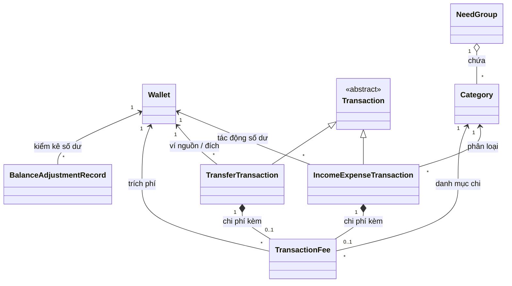

# 02. Thiết kế Lớp Thực thể và Đối tượng Giá trị

Tài liệu này xác lập bản vẽ thiết kế chi tiết cho toàn bộ các lớp nghiệp vụ thuộc Tầng Nghiệp vụ cốt lõi của Hệ thống Quản lý Tài chính Cá nhân PFMS. Nội dung văn bản thực hiện chuyển đổi các thực thể miền và đối tượng giá trị đã được xác thực trong hồ sơ Phân tích Hướng đối tượng sang cấu trúc lớp cài đặt hoàn chỉnh trên nền tảng ngôn ngữ Java.

Bản vẽ thiết kế tập trung giải quyết ba mục tiêu kỹ thuật trọng tâm: bảo toàn độ chính xác số học thông qua việc xây dựng đối tượng giá trị tiền tệ bất biến kèm quy tắc làm tròn ngân hàng; kiểm soát chặt chẽ tính đóng gói nhằm bảo vệ trạng thái nội tại và duy trì số dư khả dụng không âm tại mọi thời điểm; và tổ chức cấu trúc phân cấp giao dịch kế thừa từ lớp cơ sở trừu tượng nhằm hiện thực hóa tính đa hình trong luồng hạch toán dòng tiền mà không cần sử dụng các cấu trúc điều kiện rẽ nhánh thủ công.

## 2.1 Sơ đồ Lớp Tổng quan

Mục này cung cấp góc nhìn toàn cảnh về cấu trúc tĩnh của Tầng Nghiệp vụ cốt lõi trước khi đi vào đặc tả chi tiết từng thành phần. Bản vẽ trực quan hóa mối quan hệ cấu trúc giữa các lớp thực thể quản trị trạng thái và các lớp đối tượng giá trị bất biến, làm nổi bật các liên kết kế thừa, hợp thành, kết tập và phụ thuộc trong toàn bộ không gian miền tài chính.

Đi kèm với sơ đồ lớp, bảng danh mục lớp và kiểu dữ liệu xác lập bản chỉ mục định danh hoàn chỉnh, tổng hợp đầy đủ trách nhiệm kỹ thuật của từng thành phần và bảo đảm tính truy vết hai chiều nhất quán giữa mô hình phân tích nghiệp vụ và cấu trúc mã nguồn phần mềm.

### 2.1.1 Sơ đồ Cấu trúc các Lớp Thực thể

Sơ đồ dưới đây mô hình hóa cấu trúc tĩnh của 8 lớp thực thể cốt lõi thuộc Tầng Nghiệp vụ. Sơ đồ tập trung thể hiện bốn loại quan hệ cấu trúc hướng đối tượng then chốt gồm kế thừa, hợp thành, kết tập và liên kết, định hình xương sống dòng tiền và phân cấp danh mục của toàn bộ hệ thống:

Bản vẽ thiết lập bốn loại quan hệ cấu trúc hướng đối tượng cốt lõi trong mô hình miền:

1. Quan hệ Kế thừa: Áp dụng để trừu tượng hóa các thuộc tính và hành vi chung của dòng tiền, cho phép các lớp giao dịch cụ thể đa hình hóa việc hạch toán số dư mà không phụ thuộc vào các cấu trúc điều kiện rẽ nhánh thủ công.
2. Quan hệ Hợp thành: Áp dụng cho các thành phần tài chính có sự ràng buộc sinh tử, bảo đảm các khoản chi phí liên kết luôn gắn liền với vòng đời của giao dịch gốc và loại trừ hoàn toàn nguy cơ phát sinh dữ liệu mồ côi.
3. Quan hệ Kết tập: Áp dụng để tổ chức cấu trúc phân cấp danh mục nhiều cấp, cho phép nhóm phân loại cấp trên gom cụm các danh mục chi tiết cấp dưới mà vẫn duy trì tính độc lập của từng phần tử.
4. Quan hệ Liên kết: Thể hiện sự tương tác nghiệp vụ giữa các thực thể có định danh và vòng đời độc lập, bảo đảm mọi biến động tài chính luôn truy nguyên được nguồn tiền chịu tác động và mục đích phân loại.

Các đối tượng giá trị bất biến và kiểu liệt kê nghiệp vụ đóng vai trò là kiểu dữ liệu cấu thành trạng thái của các thực thể trên, được tra cứu tổng hợp tại bảng danh mục ở Mục 2.1.2 và đặc tả chi tiết tại Mục 2.3.

### 2.1.2 Danh mục Lớp và Kiểu Dữ liệu

Bảng dưới đây tổng hợp danh mục toàn bộ các lớp thực thể, đối tượng giá trị và kiểu liệt kê trong Tầng Nghiệp vụ cốt lõi. Toàn bộ các thành phần này được định vị vật lý trong gói mã nguồn `com.pfms.domain.model` và được phân loại theo các nhóm nghiệp vụ tương ứng của hệ thống:

| Tên lớp / Kiểu dữ liệu | Phân loại OOP | Trách nhiệm kỹ thuật chính |
| :--- | :--- | :--- |
| **1. Nhóm Quản lý Ví (WAL)** |  |  |
| `Wallet` | Thực thể | Quản lý nguồn tiền khả dụng, bảo toàn bất biến số dư không âm và tiếp nhận các biến động dòng tiền. |
| `BalanceAdjustmentRecord` | Thực thể | Bản ghi kiểm kê thực tế bất biến, ghi nhận chênh lệch kiểm kê để cân đối số dư ví về đúng thực tế quan sát. |
| `WalletStatus` | Kiểu liệt kê | Trạng thái vòng đời của ví gồm Đang hoạt động (`ACTIVE`) hoặc Đã lưu trữ (`ARCHIVED`). |
| **2. Nhóm Ghi nhận Thu chi (TXN)** |  |  |
| `IncomeExpenseTransaction` | Thực thể | Hiện thực hóa giao dịch thu nhập hoặc chi tiêu tại một ví, liên kết phân loại trực tiếp với danh mục cấp 3. |
| `TransactionFee` | Thực thể | Quản lý khoản chi phí phát sinh phụ thuộc sinh tử kèm theo giao dịch thu chi hoặc chuyển tiền nội bộ. |
| `TransactionType` | Kiểu liệt kê | Xác định chiều tác động của dòng tiền gồm Thu nhập (`INCOME`) hoặc Chi tiêu (`EXPENSE`). |
| **3. Nhóm Chuyển tiền Nội bộ (TRF)** |  |  |
| `Transaction` | Thực thể trừu tượng | Lớp cơ sở trừu tượng định nghĩa các thuộc tính chung và hợp đồng phương thức đa hình cho các biến động dòng tiền. |
| `TransferTransaction` | Thực thể | Hiện thực hóa giao dịch điều chuyển tiền nội bộ giữa hai ví độc lập theo cơ chế bảo toàn tổng tài sản. |
| **4. Nhóm Danh mục Phân loại (CAT)** |  |  |
| `NeedGroup` | Thực thể | Quản lý nhóm nhu cầu cấp 2 gom cụm các danh mục chi tiết, trực thuộc một nhánh loại thu chi cố định. |
| `Category` | Thực thể | Quản lý danh mục chi tiết cấp 3 gán nhãn mục đích cho giao dịch thu chi, áp dụng cơ chế xóa mềm bảo toàn lịch sử. |
| `GroupStatus` | Kiểu liệt kê | Trạng thái vòng đời của nhóm nhu cầu gồm Đang hoạt động (`ACTIVE`) hoặc Đã xóa mềm (`DELETED`). |
| `CategoryStatus` | Kiểu liệt kê | Trạng thái vòng đời của danh mục gồm Đang hoạt động (`ACTIVE`) hoặc Đã xóa mềm (`DELETED`). |
| **5. Nhóm Thống kê và Báo cáo (REP)** |  |  |
| `Money` | Đối tượng giá trị | Bọc giá trị tiền tệ bằng `BigDecimal` kèm quy tắc làm tròn nửa chẵn, loại trừ hoàn toàn sai số dấu chấm động. |
| `TransactionDate` | Đối tượng giá trị | Bọc mốc ngày phát sinh giao dịch, kiểm soát tính hợp lệ lịch pháp và ràng buộc thời gian không vượt quá hiện tại. |
| `NetCashFlow` | Đối tượng giá trị | Đo lường dòng tiền thuần ròng bằng tổng thu nhập trừ tổng chi tiêu trong một kỳ quan sát định kỳ. |
| `SavingsRate` | Đối tượng giá trị | Đo lường tỷ lệ phần trăm tiền tiết kiệm tích lũy được so với tổng thu nhập tạo ra trong kỳ phân tích. |
| `SpendingStructureShare` | Đối tượng giá trị | Đo lường tỷ trọng phần trăm đóng góp của từng nhóm nhu cầu hoặc danh mục chi tiết trên tổng quy mô chi tiêu. |

> [!NOTE]
> **Nhóm Lưu trữ và Quản trị Dữ liệu (DAT):** Các chức năng sao lưu dữ liệu, khôi phục và nạp dữ liệu mẫu được hiện thực hóa thông qua các dịch vụ thuộc Tầng Dịch vụ (`com.pfms.service`) và các bộ điều hợp tệp thuộc Tầng Hạ tầng (`com.pfms.infrastructure`). Tầng Nghiệp vụ cốt lõi không định nghĩa lớp thực thể riêng cho nhóm này nhằm bảo đảm tính độc lập hoàn toàn khỏi hệ thống tệp cục bộ theo nguyên lý Nghịch đảo Phụ thuộc.

## 2.2 Thiết kế các Lớp Thực thể

Mục này đặc tả chi tiết cấu trúc phần mềm cho các lớp thực thể thuộc Tầng Nghiệp vụ cốt lõi. Toàn bộ các lớp thực thể trong mục này được tổ chức thống nhất trong gói `com.pfms.model.entity`. Mỗi thực thể đại diện cho một đối tượng nghiệp vụ có mã định danh duy nhất và duy trì vòng đời biến đổi trạng thái xuyên suốt quá trình vận hành của hệ thống.

Để bảo đảm tính chặt chẽ trong thiết kế hướng đối tượng, mỗi lớp thực thể được quy chuẩn cấu trúc đồng nhất qua ba nội dung:
1. Cấu trúc thuộc tính: Xác định tên trường dữ liệu, kiểu dữ liệu cụ thể, phạm vi truy cập nội bộ và ràng buộc hợp lệ.
2. Phương thức nghiệp vụ: Đặc tả chữ ký phương thức gồm tên hàm, danh sách tham số, kiểu dữ liệu trả về, ngoại lệ ném ra và tóm tắt mô tả nghiệp vụ.
3. Cơ chế đóng gói và quy tắc bất biến: Làm rõ logic kiểm soát tính toàn vẹn dữ liệu, kiểm tra điều kiện tiên quyết trong phương thức khởi tạo và loại bỏ hoàn toàn các hàm gán giá trị tự do nhằm bảo vệ trạng thái nội tại của đối tượng.

### 2.2.1 Lớp Ví

(Mô tả khoảng 1 đến 2 câu về vai trò của lớp Ví trong việc quản lý nguồn tiền và kiểm soát số dư)

**Quy chiếu yêu cầu:**
- Ca sử dụng: `UC-WAL-01`, `UC-WAL-02`, `UC-WAL-03`, `UC-WAL-04`
- Yêu cầu chức năng: `FR-WAL-01`, `FR-WAL-02`, `FR-WAL-03`, `FR-WAL-04`, `FR-WAL-05`
- Quy tắc nghiệp vụ: `BR-FIN-01`, `BR-FIN-02`, `BR-NAM-01`
- Mã lỗi: `ERR-NAM-001`, `ERR-NAM-002`, `ERR-WAL-001`, `ERR-FIN-001`

**Cấu trúc thuộc tính**

| Thuộc tính | Kiểu dữ liệu | Phạm vi truy cập | Ràng buộc |
| :--- | :--- | :--- | :--- |
| (Tên thuộc tính) | (Kiểu dữ liệu) | (Phạm vi truy cập) | (Điều kiện hợp lệ, tính bất biến hoặc giá trị mặc định) |

**Phương thức nghiệp vụ**

| Phương thức | Tham số | Kiểu trả về | Ngoại lệ | Mô tả nghiệp vụ |
| :--- | :--- | :--- | :--- | :--- |
| (Tên phương thức) | (Kiểu và tên tham số) | (Kiểu trả về) | (Ngoại lệ ném ra nếu có) | (Quy tắc kiểm tra và logic xử lý trạng thái) |

**Cơ chế đóng gói và quy tắc bất biến**

- (Nêu logic kiểm tra tính hợp lệ trong phương thức khởi tạo)
- (Nêu cơ chế bảo vệ số dư khả dụng, không mở setter tự do và duy trì số dư không âm)
- (Nêu quy tắc bảo vệ ví tiền mặt mặc định không bị xóa hoặc lưu trữ)

### 2.2.2 Lớp Giao dịch Cơ sở và Giao dịch Thu Chi

(Mô tả khoảng 1 đến 2 câu về vai trò của lớp trừu tượng Transaction và lớp con IncomeExpenseTransaction trong việc quản lý và hạch toán các khoản thu chi phát sinh)

**Quy chiếu yêu cầu:**
- Ca sử dụng: `UC-TXN-01`, `UC-TXN-02`, `UC-TXN-03`, `UC-TXN-04`
- Yêu cầu chức năng: `FR-TXN-01`, `FR-TXN-02`, `FR-TXN-03`, `FR-TXN-04`, `FR-TXN-05`
- Quy tắc nghiệp vụ: `BR-FIN-01`, `BR-FIN-02`, `BR-FIN-04`
- Mã lỗi: `ERR-FIN-001`, `ERR-WAL-001`, `ERR-CAT-001`

**Cấu trúc thuộc tính**

| Thuộc tính | Kiểu dữ liệu | Phạm vi truy cập | Ràng buộc |
| :--- | :--- | :--- | :--- |
| (Tên thuộc tính) | (Kiểu dữ liệu) | (Phạm vi truy cập) | (Điều kiện hợp lệ, tính bất biến hoặc giá trị mặc định) |

**Phương thức nghiệp vụ**

| Phương thức | Tham số | Kiểu trả về | Ngoại lệ | Mô tả nghiệp vụ |
| :--- | :--- | :--- | :--- | :--- |
| (Tên phương thức) | (Kiểu và tên tham số) | (Kiểu trả về) | (Ngoại lệ ném ra nếu có) | (Quy tắc kiểm tra và logic xử lý trạng thái) |

**Cơ chế đóng gói và quy tắc bất biến**

- (Nêu cơ chế kế thừa từ Transaction, hàm khởi tạo và tính bất biến của mã giao dịch, ngày giao dịch)
- (Nêu cơ chế đa hình qua các phương thức thực thi và hoàn nguyên dòng tiền tác động lên số dư ví)
- (Nêu quy tắc kiểm soát tính tương thích giữa loại giao dịch và danh mục thu chi)

### 2.2.3 Lớp Giao dịch Chuyển tiền

(Mô tả khoảng 1 đến 2 câu về vai trò của lớp TransferTransaction trong việc điều chuyển dòng tiền giữa hai ví và bảo toàn tổng tài sản)

**Quy chiếu yêu cầu:**
- Ca sử dụng: `UC-TRF-01`, `UC-TRF-02`, `UC-TRF-03`
- Yêu cầu chức năng: `FR-TRF-01`, `FR-TRF-02`
- Quy tắc nghiệp vụ: `BR-FIN-01`, `BR-FIN-02`, `BR-FIN-03`
- Mã lỗi: `ERR-TRF-001`, `ERR-TRF-002`, `ERR-WAL-001`, `ERR-FEE-001`

**Cấu trúc thuộc tính**

| Thuộc tính | Kiểu dữ liệu | Phạm vi truy cập | Ràng buộc |
| :--- | :--- | :--- | :--- |
| (Tên thuộc tính) | (Kiểu dữ liệu) | (Phạm vi truy cập) | (Điều kiện hợp lệ, tính bất biến hoặc giá trị mặc định) |

**Phương thức nghiệp vụ**

| Phương thức | Tham số | Kiểu trả về | Ngoại lệ | Mô tả nghiệp vụ |
| :--- | :--- | :--- | :--- | :--- |
| (Tên phương thức) | (Kiểu và tên tham số) | (Kiểu trả về) | (Ngoại lệ ném ra nếu có) | (Quy tắc kiểm tra và logic xử lý trạng thái) |

**Cơ chế đóng gói và quy tắc bất biến**

- (Nêu điều kiện kiểm tra ví nguồn khác ví đích và cả hai ví đều ở trạng thái hoạt động)
- (Nêu cơ chế hạch toán đồng thời trừ ví nguồn và cộng ví đích để bảo toàn tổng tài sản)
- (Nêu quy tắc hoàn nguyên số dư khi hủy bỏ giao dịch chuyển tiền)

### 2.2.4 Lớp Chi phí Giao dịch

(Mô tả khoảng 1 đến 2 câu về vai trò của lớp TransactionFee trong việc ghi nhận phụ phí phát sinh và quan hệ sinh tử với giao dịch gốc)

**Quy chiếu yêu cầu:**
- Ca sử dụng: `UC-TXN-01`, `UC-TXN-03`, `UC-TRF-01`, `UC-TRF-03`
- Yêu cầu chức năng: `FR-TXN-01`, `FR-TXN-04`, `FR-TRF-01`, `FR-TRF-02`
- Quy tắc nghiệp vụ: `BR-FIN-01`, `BR-FIN-02`, `BR-FIN-04`
- Mã lỗi: `ERR-FEE-001`, `ERR-FEE-002`, `ERR-FEE-003`, `ERR-WAL-001`

**Cấu trúc thuộc tính**

| Thuộc tính | Kiểu dữ liệu | Phạm vi truy cập | Ràng buộc |
| :--- | :--- | :--- | :--- |
| (Tên thuộc tính) | (Kiểu dữ liệu) | (Phạm vi truy cập) | (Điều kiện hợp lệ, tính bất biến hoặc giá trị mặc định) |

**Phương thức nghiệp vụ**

| Phương thức | Tham số | Kiểu trả về | Ngoại lệ | Mô tả nghiệp vụ |
| :--- | :--- | :--- | :--- | :--- |
| (Tên phương thức) | (Kiểu và tên tham số) | (Kiểu trả về) | (Ngoại lệ ném ra nếu có) | (Quy tắc kiểm tra và logic xử lý trạng thái) |

**Cơ chế đóng gói và quy tắc bất biến**

- (Nêu quan hệ hợp thành phụ thuộc hoàn toàn vào vòng đời của giao dịch chủ)
- (Nêu quy tắc bắt buộc số tiền phí không âm và danh mục hạch toán phải thuộc loại chi tiêu)
- (Nêu cơ chế trích xuất phí tác động đến số dư ví thanh toán)

### 2.2.5 Lớp Danh mục Chi tiết

(Mô tả khoảng 1 đến 2 câu về vai trò của lớp Category trong việc phân loại dòng tiền cấp 3 và duy trì tính toàn vẹn cây danh mục)

**Quy chiếu yêu cầu:**
- Ca sử dụng: `UC-CAT-01`, `UC-CAT-02`, `UC-CAT-03`, `UC-CAT-04`
- Yêu cầu chức năng: `FR-CAT-01`, `FR-CAT-02`, `FR-CAT-03`
- Quy tắc nghiệp vụ: `BR-NAM-01`, `BR-FIN-04`
- Mã lỗi: `ERR-NAM-001`, `ERR-NAM-002`, `ERR-CAT-001`, `ERR-CAT-002`, `ERR-CAT-003`, `ERR-CAT-004`

**Cấu trúc thuộc tính**

| Thuộc tính | Kiểu dữ liệu | Phạm vi truy cập | Ràng buộc |
| :--- | :--- | :--- | :--- |
| (Tên thuộc tính) | (Kiểu dữ liệu) | (Phạm vi truy cập) | (Điều kiện hợp lệ, tính bất biến hoặc giá trị mặc định) |

**Phương thức nghiệp vụ**

| Phương thức | Tham số | Kiểu trả về | Ngoại lệ | Mô tả nghiệp vụ |
| :--- | :--- | :--- | :--- | :--- |
| (Tên phương thức) | (Kiểu và tên tham số) | (Kiểu trả về) | (Ngoại lệ ném ra nếu có) | (Quy tắc kiểm tra và logic xử lý trạng thái) |

**Cơ chế đóng gói và quy tắc bất biến**

- (Nêu ràng buộc bắt buộc phải liên kết với một nhóm nhu cầu cha hợp lệ, cùng loại thu chi)
- (Nêu quy tắc đặt tên không trùng lặp trong phạm vi cùng nhóm nhu cầu cha)
- (Nêu cơ chế xóa mềm để bảo toàn lịch sử giao dịch và điều kiện khôi phục trạng thái)

### 2.2.6 Lớp Nhóm Nhu cầu

(Mô tả khoảng 1 đến 2 câu về vai trò của lớp NeedGroup trong việc quản lý phân cấp nhóm nhu cầu cấp 2 và điều phối danh mục con)

**Quy chiếu yêu cầu:**
- Ca sử dụng: `UC-CAT-01`, `UC-CAT-02`, `UC-CAT-03`, `UC-CAT-04`
- Yêu cầu chức năng: `FR-CAT-01`, `FR-CAT-02`, `FR-CAT-03`
- Quy tắc nghiệp vụ: `BR-NAM-01`, `BR-FIN-04`
- Mã lỗi: `ERR-NAM-001`, `ERR-NAM-002`, `ERR-CAT-002`, `ERR-CAT-005`

**Cấu trúc thuộc tính**

| Thuộc tính | Kiểu dữ liệu | Phạm vi truy cập | Ràng buộc |
| :--- | :--- | :--- | :--- |
| (Tên thuộc tính) | (Kiểu dữ liệu) | (Phạm vi truy cập) | (Điều kiện hợp lệ, tính bất biến hoặc giá trị mặc định) |

**Phương thức nghiệp vụ**

| Phương thức | Tham số | Kiểu trả về | Ngoại lệ | Mô tả nghiệp vụ |
| :--- | :--- | :--- | :--- | :--- |
| (Tên phương thức) | (Kiểu và tên tham số) | (Kiểu trả về) | (Ngoại lệ ném ra nếu có) | (Quy tắc kiểm tra và logic xử lý trạng thái) |

**Cơ chế đóng gói và quy tắc bất biến**

- (Nêu tính bất biến của loại thu chi gắn liền với nhóm nhu cầu sau khi khởi tạo)
- (Nêu quy tắc bảo vệ nhóm nhu cầu duy nhất còn lại của một loại thu chi không bị xóa)
- (Nêu cơ chế quản lý danh sách danh mục con và hiệu ứng xóa lan truyền)

### 2.2.7 Lớp Bản ghi Điều chỉnh Số dư

(Mô tả khoảng 1 đến 2 câu về vai trò của lớp BalanceAdjustmentRecord trong việc lưu vết kiểm kê đối soát và điều chỉnh số dư thực tế)

**Quy chiếu yêu cầu:**
- Ca sử dụng: `UC-WAL-04`
- Yêu cầu chức năng: `FR-WAL-05`
- Quy tắc nghiệp vụ: `BR-FIN-01`, `BR-FIN-02`
- Mã lỗi: `ERR-FIN-001`, `ERR-WAL-001`

**Cấu trúc thuộc tính**

| Thuộc tính | Kiểu dữ liệu | Phạm vi truy cập | Ràng buộc |
| :--- | :--- | :--- | :--- |
| (Tên thuộc tính) | (Kiểu dữ liệu) | (Phạm vi truy cập) | (Điều kiện hợp lệ, tính bất biến hoặc giá trị mặc định) |

**Phương thức nghiệp vụ**

| Phương thức | Tham số | Kiểu trả về | Ngoại lệ | Mô tả nghiệp vụ |
| :--- | :--- | :--- | :--- | :--- |
| (Tên phương thức) | (Kiểu và tên tham số) | (Kiểu trả về) | (Ngoại lệ ném ra nếu có) | (Quy tắc kiểm tra và logic xử lý trạng thái) |

**Cơ chế đóng gói và quy tắc bất biến**

- (Nêu tính bất biến tuyệt đối của bản ghi sau khi khởi tạo, không hỗ trợ chỉnh sửa hay xóa bỏ)
- (Nêu công thức tính độ chênh lệch kiểm kê và ràng buộc số dư quan sát không âm)
- (Nêu nguyên tắc ghi nhận đối soát trực tiếp vào ví mà không sinh ra doanh thu hay chi phí)

## 2.3 Thiết kế các Đối tượng Giá trị

Mục này đặc tả chi tiết cấu trúc phần mềm cho các đối tượng giá trị và kiểu liệt kê thuộc Tầng Nghiệp vụ cốt lõi. Toàn bộ các lớp trong mục này được tổ chức thống nhất trong gói `com.pfms.domain.model`. Khác với thực thể, đối tượng giá trị không có mã định danh độc lập, được định danh duy nhất dựa trên giá trị của các thuộc tính thành phần và duy trì tính bất biến tuyệt đối xuyên suốt vòng đời.

Để bảo đảm tính chặt chẽ trong thiết kế hướng đối tượng, mỗi đối tượng giá trị được quy chuẩn cấu trúc đồng nhất qua ba nội dung:
1. Cấu trúc thuộc tính: Xác định các trường dữ liệu nội bộ được đóng gói cố định (`private final`), kiểu dữ liệu Java bọc bên trong và điều kiện ràng buộc hợp lệ.
2. Phương thức nghiệp vụ: Đặc tả chữ ký phương thức tính toán số học, phép so sánh logic, hàm định dạng kết xuất và cơ chế luôn trả về một thể hiện mới thay vì thay đổi trạng thái hiện tại.
3. Tính bất biến và cơ chế so sánh: Làm rõ logic tự kiểm tra tính hợp lệ ngay khi khởi tạo, loại bỏ hoàn toàn các hàm sửa đổi giá trị và quy tắc ghi đè các phương thức so sánh bình đẳng theo giá trị.

### 2.3.1 Tiền tệ

(Mô tả khoảng 1 đến 2 câu về vai trò của lớp Money trong việc bọc số học BigDecimal, quy chuẩn làm tròn ngân hàng và loại trừ sai số dấu chấm động)

**Quy chiếu yêu cầu:**
- Ca sử dụng: `UC-WAL-01`, `UC-TXN-01`, `UC-TRF-01`, `UC-WAL-04`
- Yêu cầu chức năng: `FR-WAL-01`, `FR-TXN-01`, `FR-TRF-01`, `FR-WAL-05`
- Quy tắc nghiệp vụ: `BR-FIN-01`, `BR-FIN-02`
- Mã lỗi: `ERR-FIN-001`, `ERR-WAL-001`

**Cấu trúc thuộc tính**

| Thuộc tính | Kiểu dữ liệu | Phạm vi truy cập | Ràng buộc |
| :--- | :--- | :--- | :--- |
| (Tên thuộc tính) | (Kiểu dữ liệu) | (Phạm vi truy cập) | (Điều kiện hợp lệ, tính bất biến hoặc giá trị mặc định) |

**Phương thức nghiệp vụ**

| Phương thức | Tham số | Kiểu trả về | Ngoại lệ | Mô tả nghiệp vụ |
| :--- | :--- | :--- | :--- | :--- |
| (Tên phương thức) | (Kiểu và tên tham số) | (Kiểu trả về) | (Ngoại lệ ném ra nếu có) | (Quy tắc tính toán số học, so sánh hoặc định dạng kết xuất) |

**Tính bất biến và cơ chế so sánh**

- (Nêu kỷ luật bất biến, từ khóa final, loại trừ setter và cơ chế luôn trả về thể hiện mới)
- (Nêu cơ chế so sánh bằng nhau qua equals và hashCode dựa trên giá trị thuộc tính)
- (Nêu việc cài đặt giao diện Comparable để so sánh thứ tự tự nhiên phục vụ sắp xếp)

### 2.3.2 Ngày Giao dịch

(Mô tả khoảng 1 đến 2 câu về vai trò của lớp TransactionDate trong việc bọc LocalDate, kiểm soát lịch pháp và ràng buộc mốc thời gian không vượt quá hiện tại)

**Quy chiếu yêu cầu:**
- Ca sử dụng: `UC-TXN-01`, `UC-TRF-01`, `UC-REP-01`
- Yêu cầu chức năng: `FR-TXN-01`, `FR-TXN-03`, `FR-TRF-01`, `FR-REP-01`
- Quy tắc nghiệp vụ: `BR-FIN-01`
- Mã lỗi: `ERR-FIN-001`

**Cấu trúc thuộc tính**

| Thuộc tính | Kiểu dữ liệu | Phạm vi truy cập | Ràng buộc |
| :--- | :--- | :--- | :--- |
| (Tên thuộc tính) | (Kiểu dữ liệu) | (Phạm vi truy cập) | (Điều kiện hợp lệ, tính bất biến hoặc giá trị mặc định) |

**Phương thức nghiệp vụ**

| Phương thức | Tham số | Kiểu trả về | Ngoại lệ | Mô tả nghiệp vụ |
| :--- | :--- | :--- | :--- | :--- |
| (Tên phương thức) | (Kiểu và tên tham số) | (Kiểu trả về) | (Ngoại lệ ném ra nếu có) | (Quy tắc kiểm tra lịch pháp, so sánh ngày hoặc trích xuất chu kỳ báo cáo) |

**Tính bất biến và cơ chế so sánh**

- (Nêu tính bất biến sau khi khởi tạo và logic kiểm tra ngày không vượt quá hiện tại)
- (Nêu cơ chế so sánh bằng nhau qua equals và hashCode)
- (Nêu việc cài đặt giao diện Comparable để so sánh thứ tự thời gian)

### 2.3.3 Kiểu Liệt kê Loại Giao dịch

(Mô tả khoảng 1 đến 2 câu về vai trò của enum TransactionType trong việc xác lập hai chiều thu chi cố định và ranh giới phân cấp danh mục cấp 1)

**Quy chiếu yêu cầu:**
- Ca sử dụng: `UC-TXN-01`, `UC-CAT-01`, `UC-CAT-03`
- Yêu cầu chức năng: `FR-TXN-01`, `FR-TXN-02`, `FR-CAT-01`
- Quy tắc nghiệp vụ: `BR-FIN-04`
- Mã lỗi: `ERR-CAT-003`

**Cấu trúc thuộc tính**

| Thuộc tính | Kiểu dữ liệu | Phạm vi truy cập | Ràng buộc |
| :--- | :--- | :--- | :--- |
| (Tên giá trị hằng số) | (Kiểu dữ liệu) | (Phạm vi truy cập) | (Mô tả giá trị hằng số và quy ước hạch toán dòng tiền) |

**Phương thức nghiệp vụ**

| Phương thức | Tham số | Kiểu trả về | Ngoại lệ | Mô tả nghiệp vụ |
| :--- | :--- | :--- | :--- | :--- |
| (Tên phương thức) | (Kiểu và tên tham số) | (Kiểu trả về) | (Ngoại lệ ném ra nếu có) | (Quy tắc kiểm tra hoặc ánh xạ nhãn hiển thị) |

**Tính bất biến và cơ chế so sánh**

- (Nêu tính đóng và bất biến tuyệt đối của các hằng số liệt kê)
- (Nêu cơ chế so sánh bằng nhau qua toán tử so sánh hoặc equals)
- (Nêu vai trò định hướng kiểm tra tính tương thích giữa giao dịch và danh mục)

### 2.3.4 Dòng Tiền Thuần

(Mô tả khoảng 1 đến 2 câu về vai trò của lớp NetCashFlow trong việc đại diện cho dòng tiền ròng có dấu và đo lường thặng dư tài chính theo chu kỳ)

**Quy chiếu yêu cầu:**
- Ca sử dụng: `UC-REP-01`
- Yêu cầu chức năng: `FR-REP-01`
- Quy tắc nghiệp vụ: `BR-FIN-01`
- Mã lỗi: `ERR-FIN-001`

**Cấu trúc thuộc tính**

| Thuộc tính | Kiểu dữ liệu | Phạm vi truy cập | Ràng buộc |
| :--- | :--- | :--- | :--- |
| (Tên thuộc tính) | (Kiểu dữ liệu) | (Phạm vi truy cập) | (Điều kiện hợp lệ, tính bất biến hoặc giá trị mặc định) |

**Phương thức nghiệp vụ**

| Phương thức | Tham số | Kiểu trả về | Ngoại lệ | Mô tả nghiệp vụ |
| :--- | :--- | :--- | :--- | :--- |
| (Tên phương thức) | (Kiểu và tên tham số) | (Kiểu trả về) | (Ngoại lệ ném ra nếu có) | (Quy tắc tính toán hiệu số thu chi, kiểm tra thâm hụt hoặc định dạng hiển thị) |

**Tính bất biến và cơ chế so sánh**

- (Nêu tính bất biến và khả năng hỗ trợ cả giá trị âm, dương và bằng không)
- (Nêu cơ chế so sánh bằng nhau qua equals và hashCode dựa trên giá trị số học)
- (Nêu việc cài đặt Comparable để đánh giá và so sánh mức thặng dư qua các kỳ)

### 2.3.5 Tỷ lệ Tiết kiệm

(Mô tả khoảng 1 đến 2 câu về vai trò của lớp SavingsRate trong việc đo lường tỷ lệ phần trăm tiền tích lũy và xử lý an toàn mẫu số bằng không)

**Quy chiếu yêu cầu:**
- Ca sử dụng: `UC-REP-01`
- Yêu cầu chức năng: `FR-REP-01`
- Quy tắc nghiệp vụ: `BR-FIN-01`
- Mã lỗi: `ERR-FIN-002`

**Cấu trúc thuộc tính**

| Thuộc tính | Kiểu dữ liệu | Phạm vi truy cập | Ràng buộc |
| :--- | :--- | :--- | :--- |
| (Tên thuộc tính) | (Kiểu dữ liệu) | (Phạm vi truy cập) | (Điều kiện hợp lệ, tính bất biến hoặc giá trị mặc định) |

**Phương thức nghiệp vụ**

| Phương thức | Tham số | Kiểu trả về | Ngoại lệ | Mô tả nghiệp vụ |
| :--- | :--- | :--- | :--- | :--- |
| (Tên phương thức) | (Kiểu và tên tham số) | (Kiểu trả về) | (Ngoại lệ ném ra nếu có) | (Quy tắc tính toán tỷ lệ, xử lý biên khi thu nhập bằng không và định dạng phần trăm) |

**Tính bất biến và cơ chế so sánh**

- (Nêu tính bất biến và xử lý an toàn để tránh lỗi chia cho không khi thu nhập bằng không)
- (Nêu cơ chế so sánh bằng nhau qua equals và hashCode)
- (Nêu việc cài đặt Comparable để so sánh hiệu quả tiết kiệm giữa các kỳ)

### 2.3.6 Tỷ trọng Cơ cấu Chi tiêu

(Mô tả khoảng 1 đến 2 câu về vai trò của lớp SpendingStructureShare trong việc đo lường tỷ trọng đóng góp của từng nhóm chi tiêu và giới hạn khoảng giá trị)

**Quy chiếu yêu cầu:**
- Ca sử dụng: `UC-REP-02`
- Yêu cầu chức năng: `FR-REP-02`
- Quy tắc nghiệp vụ: `BR-FIN-01`
- Mã lỗi: `ERR-FIN-002`

**Cấu trúc thuộc tính**

| Thuộc tính | Kiểu dữ liệu | Phạm vi truy cập | Ràng buộc |
| :--- | :--- | :--- | :--- |
| (Tên thuộc tính) | (Kiểu dữ liệu) | (Phạm vi truy cập) | (Điều kiện hợp lệ, tính bất biến hoặc giá trị mặc định) |

**Phương thức nghiệp vụ**

| Phương thức | Tham số | Kiểu trả về | Ngoại lệ | Mô tả nghiệp vụ |
| :--- | :--- | :--- | :--- | :--- |
| (Tên phương thức) | (Kiểu và tên tham số) | (Kiểu trả về) | (Ngoại lệ ném ra nếu có) | (Quy tắc tính toán tỷ trọng, xử lý biên khi chi tiêu bằng không và định dạng phần trăm) |

**Tính bất biến và cơ chế so sánh**

- (Nêu tính bất biến và ràng buộc giá trị tỷ trọng nằm trong khoảng từ không đến một trăm phần trăm)
- (Nêu cơ chế so sánh bằng nhau qua equals và hashCode)
- (Nêu việc cài đặt Comparable để sắp xếp tỷ trọng chi tiêu giảm dần)
