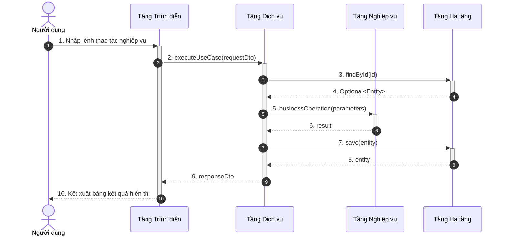
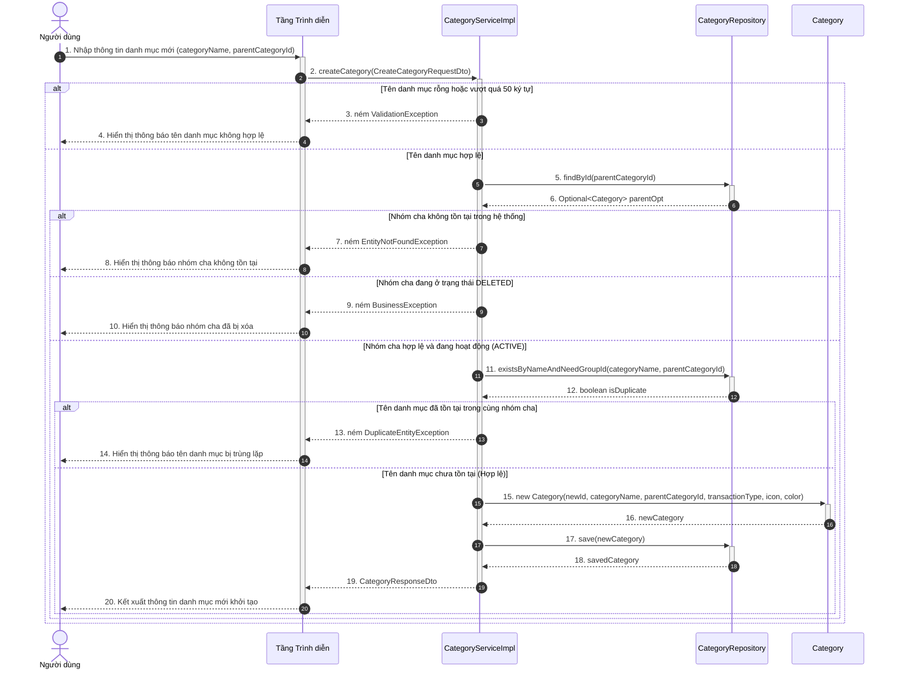
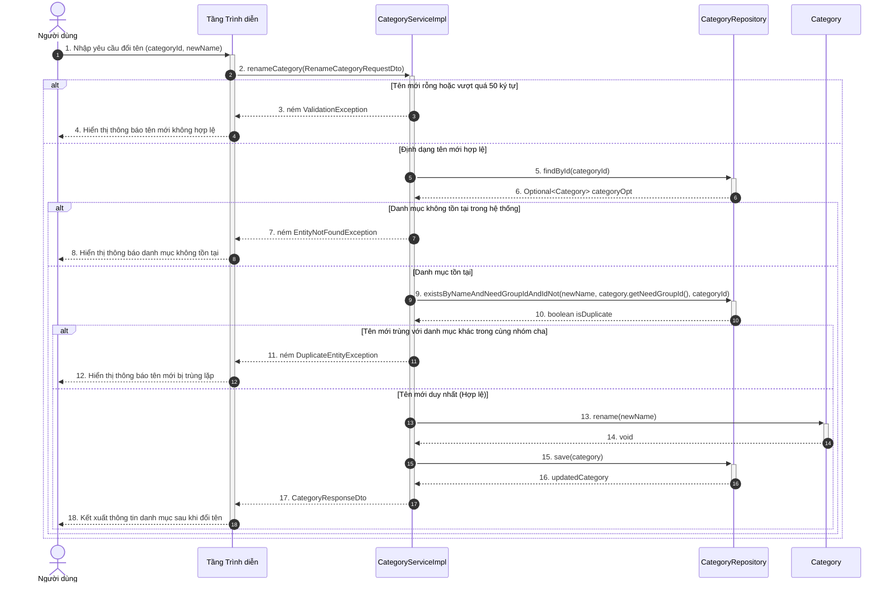
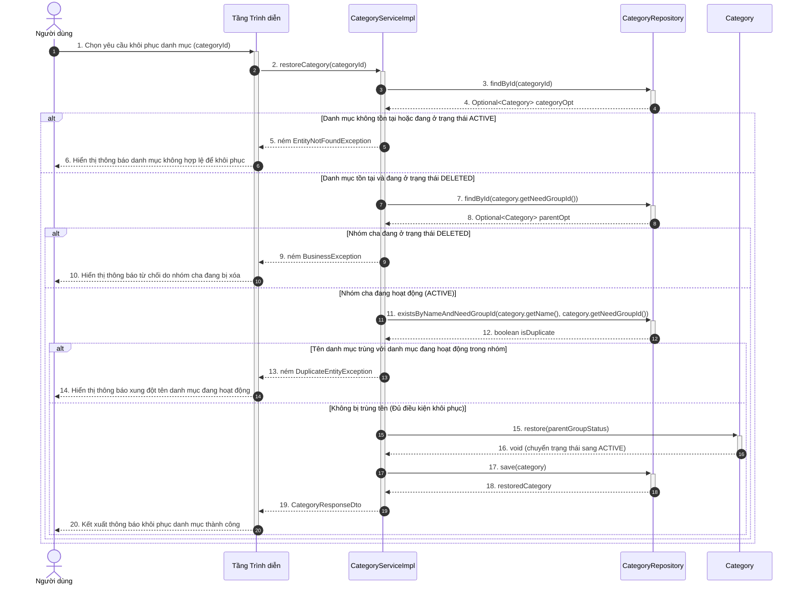
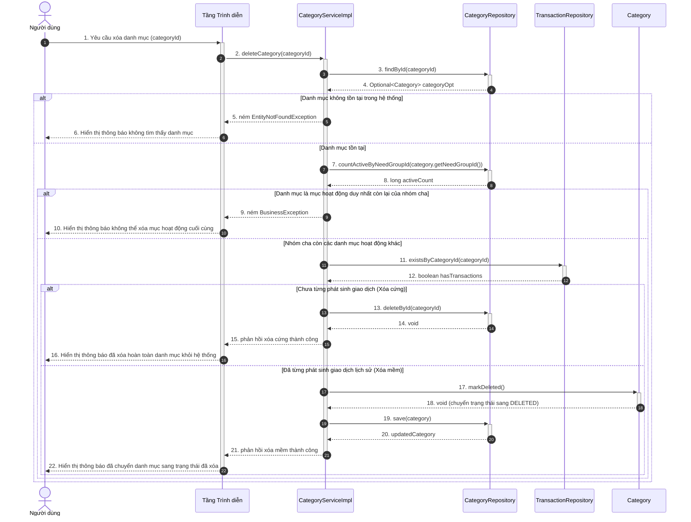
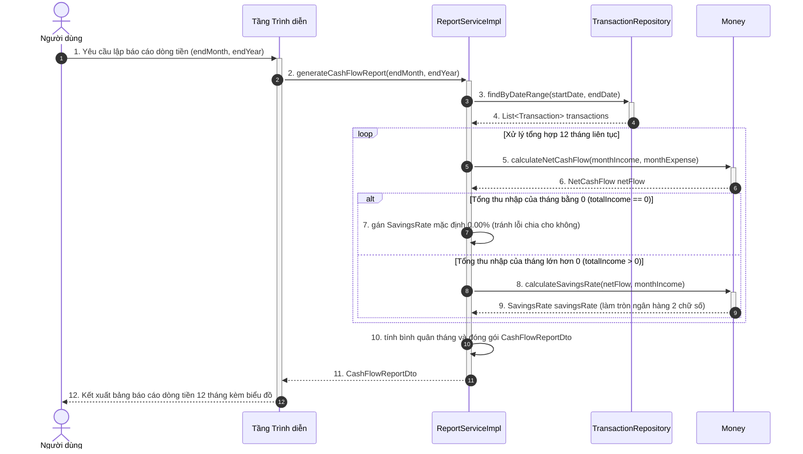
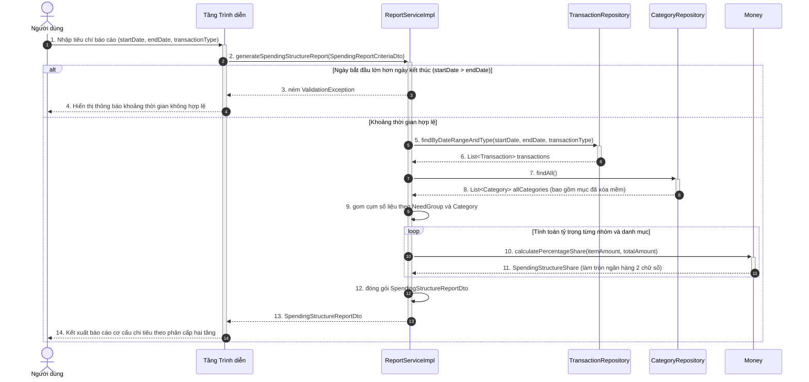
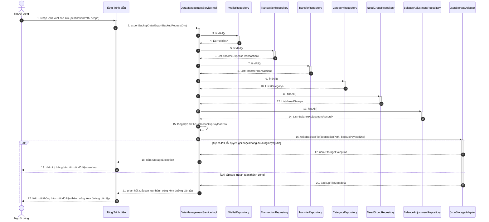
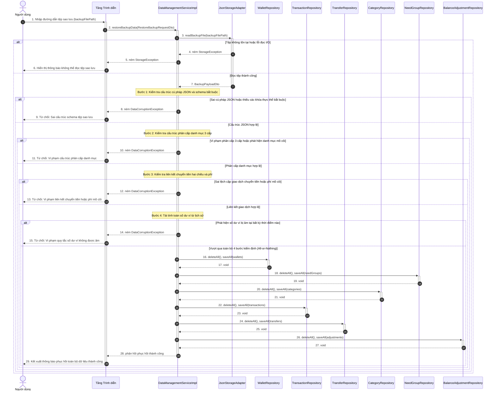
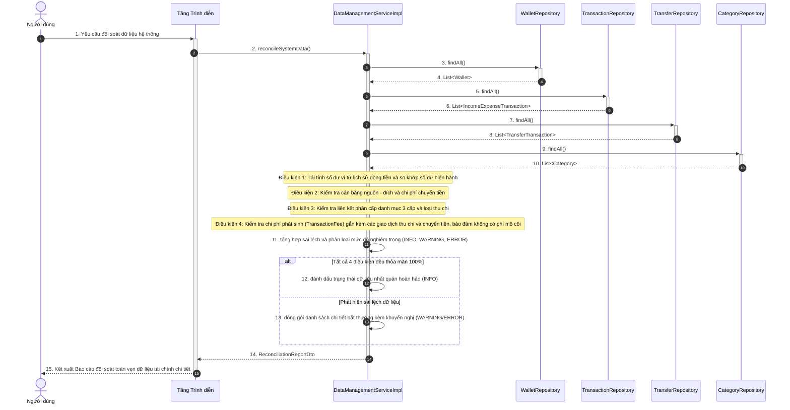

# 05. Sơ đồ Tuần tự Thiết kế

Tài liệu này đặc tả luồng tương tác động giữa các đối tượng trong hệ thống nhằm hiện thực hóa các ca sử dụng trên môi trường dòng lệnh Java. Các kịch bản tương tác phân rã luồng xử lý từ sự kiện đầu vào của người dùng qua các tầng kiến trúc: tiếp nhận lệnh tại tầng trình diễn, điều phối nghiệp vụ tại tầng dịch vụ, thực thi quy tắc nghiệp vụ tại tầng miền và ghi nhận dữ liệu bền vững tại tầng hạ tầng.

Các sơ đồ tuần tự xác định trình tự gọi phương thức đồng bộ, quy chuẩn truyền nhận đối tượng truyền dữ liệu và cơ chế biến đổi trạng thái nội tại của thực thể. Mọi thông điệp trao đổi trên sơ đồ đều khớp với cấu trúc lớp tĩnh đã thiết kế, đồng thời mô hình hóa đầy đủ các nhánh ngoại lệ nghiệp vụ phát sinh trong quá trình vận hành để duy trì tính nhất quán của dữ liệu tài chính.

## 5.1 Nguyên tắc Thiết kế Sơ đồ Tuần tự Chi tiết

Mục này xác lập các nguyên tắc thiết kế và quy chuẩn mô hình hóa tương tác động cho toàn bộ hệ thống. Các quy định tại đây thiết lập khung kỹ thuật thống nhất, bảo đảm tính nhất quán trong cách biểu diễn luồng dữ liệu và lời gọi phương thức xuyên suốt các ca sử dụng.

Trong giai đoạn phân tích, sơ đồ tuần tự hệ thống mô tả phần mềm dưới dạng hộp đen: toàn bộ hệ thống được xem như một đối tượng duy nhất, chỉ thể hiện sự kiện người dùng gửi vào và phản hồi nhận lại mà không bộc lộ cấu trúc bên trong. Khi chuyển sang giai đoạn thiết kế, sơ đồ tuần tự chi tiết mở rộng hộp đen thành chuỗi tương tác cụ thể giữa các đối tượng phân bổ trên bốn tầng kiến trúc: tầng trình diễn tiếp nhận dữ liệu và điều hướng hiển thị, tầng dịch vụ điều phối luồng nghiệp vụ và quản lý giao dịch, tầng miền thực thi các quy tắc nghiệp vụ và biến đổi trạng thái, tầng hạ tầng đảm nhận việc lưu trữ dữ liệu bền vững.

Bảng so sánh đặc điểm giữa sơ đồ tuần tự hệ thống và sơ đồ tuần tự thiết kế:

| Tiêu chí | Sơ đồ tuần tự hệ thống | Sơ đồ tuần tự thiết kế |
| :--- | :--- | :--- |
| **Góc nhìn tương tác** | Hộp đen: Xem xét hệ thống là một thành phần nguyên khối duy nhất. | Hộp trắng: Phân rã luồng thực thi chi tiết qua các đối tượng thuộc bốn tầng kiến trúc. |
| **Mục đích sử dụng** | Xác định ranh giới chức năng và nắm bắt sự kiện đầu vào của người dùng. | Định hình cấu trúc gọi hàm, phân bổ trách nhiệm và hướng dẫn cài đặt mã nguồn. |
| **Thành phần tham gia** | Người dùng và đối tượng hệ thống trừu tượng. | Người dùng, lớp điều phối giao diện, dịch vụ ứng dụng, thực thể miền và kho lưu trữ. |
| **Bản chất thông điệp** | Thao tác hệ thống trừu tượng mô tả nghiệp vụ cần thực hiện. | Lời gọi phương thức đồng bộ khớp chính xác chữ ký hàm của các lớp mã nguồn. |
| **Xử lý ngoại lệ** | Mô tả thông báo từ chối tổng quát ở mức giao diện người dùng. | Ném ngoại lệ nghiệp vụ cụ thể kèm mã lỗi định danh và điều hướng luồng xử lý lỗi. |
| **Bảo toàn trạng thái** | Ghi nhận điều kiện tiên quyết và kết quả thay đổi sau thao tác. | Kiểm soát biến đổi trạng thái nội tại của thực thể và duy trì tính toàn vẹn dữ liệu. |

Các cột đối tượng tham gia tương tác trên sơ đồ được sắp xếp theo thứ tự cố định từ trái qua phải, phản ánh chiều phụ thuộc và luồng điều khiển của kiến trúc:

1. Tác nhân ngoài: Người dùng thực hiện thao tác trên bàn phím.
2. Tầng Trình diễn: Lớp giao diện dòng lệnh đọc dữ liệu nhập, kiểm tra định dạng và đóng gói đối tượng truyền dữ liệu.
3. Tầng Dịch vụ: Lớp dịch vụ ứng dụng tiếp nhận yêu cầu, nạp dữ liệu và điều phối quy trình xử lý ca sử dụng.
4. Tầng Nghiệp vụ: Các thực thể và đối tượng giá trị thực hiện tính toán, kiểm tra ràng buộc và cập nhật trạng thái.
5. Tầng Hạ tầng: Kho lưu trữ dữ liệu thực hiện các thao tác truy xuất hoặc lưu trữ bền vững.

Sơ đồ dưới đây minh họa luồng tương tác tổng quát qua bốn tầng kiến trúc:

Mọi thông điệp trao đổi trên sơ đồ tuần tự bắt buộc phải khớp chính xác với chữ ký phương thức đã công bố trong các giao diện dịch vụ, thực thể miền và kho lưu trữ dữ liệu.

Bên cạnh luồng thực thi chuẩn, mọi sơ đồ tuần tự trong tài liệu bắt buộc phải mô hình hóa tường minh các nhánh ngoại lệ nghiệp vụ thông qua khung rẽ nhánh điều kiện `alt`. Thiết kế phải bao phủ đầy đủ các điểm kiểm tra ràng buộc tài chính kèm mã lỗi định danh tương ứng, loại bỏ các sơ đồ chỉ biểu diễn kịch bản thành công đơn lẻ. Đối với các giao dịch tác động đồng thời lên nhiều nguồn tiền như chuyển tiền nội bộ, luồng tương tác được bao bọc trong khung thực thi cô lập `critical` nhằm bảo đảm nguyên tắc toàn vẹn: toàn bộ thao tác cập nhật số dư các ví phải cùng thành công hoặc hoàn tác về trạng thái ban đầu nếu phát sinh sự cố.

## 5.2 Sơ đồ Tuần tự Nhóm Quản lý Ví

Mục này mô hình hóa các luồng tương tác thực thi nghiệp vụ quản lý nguồn tiền trong hệ thống. Chuỗi tương tác mô tả quy trình điều phối vòng đời của ví thanh toán: khởi tạo nguồn tiền, cập nhật thông tin nhận diện, chuyển đổi trạng thái lưu trữ và ghi nhận chênh lệch kiểm kê thực tế.

Các kịch bản làm rõ sự phối hợp giữa lớp dịch vụ điều phối với thực thể ví và kho lưu trữ dữ liệu, bảo đảm thực thi quy tắc kiểm tra tính duy nhất của tên ví, kiểm soát điều kiện số dư không âm và lưu vết kiểm toán đối soát khi phát sinh chênh lệch kiểm kê.

### 5.2.1 Sơ đồ Tạo Mới Ví

(Mô tả khoảng 1 đến 2 câu về luồng điều phối khởi tạo ví mới, kiểm tra tính duy nhất của tên ví tại tầng dịch vụ, khởi tạo thực thể ví với số dư ban đầu bằng không và lưu trữ bản ghi vào kho dữ liệu)

**Quy chiếu yêu cầu:**
- Ca sử dụng: `UC-WAL-01`
- Thao tác hệ thống: `createWallet(walletName, note)`
- Yêu cầu chức năng: `FR-WAL-01`, `FR-WAL-02`
- Quy tắc nghiệp vụ: `BR-NAM-01`, `BR-FIN-02`
- Mã lỗi xử lý: `ERR-NAM-001`, `ERR-NAM-002`

**Sơ đồ tuần tự tương tác:**

(Vẽ sơ đồ tuần tự chi tiết mô tả luồng tương tác qua bốn tầng kiến trúc: User -> CLI -> WalletServiceImpl -> Wallet -> WalletRepository; kích hoạt đầy đủ thanh thực thi; sử dụng khung alt phân tách các nhánh ném ngoại lệ ValidationException với mã ERR-NAM-001 khi tên ví không hợp lệ, DuplicateEntityException với mã ERR-NAM-002 khi tên ví trùng lặp, và luồng thành công khởi tạo thực thể Wallet ở trạng thái ACTIVE với số dư ban đầu bằng không, lưu qua WalletRepository và phản hồi WalletResponseDto)

(Mô tả khoảng 1 câu về việc bảo đảm tính toàn vẹn: ví mới luôn được khởi tạo với số dư bằng không thông qua đối tượng tiền tệ bất biến, loại trừ việc gán số dư tùy tiện khi chưa kiểm kê)

### 5.2.2 Sơ đồ Xem Tổng hợp Số dư và Cơ cấu Ví

(Mô tả khoảng 1 đến 2 câu về luồng truy vấn danh sách ví, tính lại số dư khả dụng tức thời và xác định tỷ trọng phân bổ tài sản toàn hệ thống ở chế độ chỉ đọc)

**Quy chiếu yêu cầu:**
- Ca sử dụng: `UC-WAL-02`
- Thao tác hệ thống: `getWalletsSummary()`
- Yêu cầu chức năng: `FR-WAL-04`
- Quy tắc nghiệp vụ: `BR-FIN-01`, `BR-FIN-02`
- Mã lỗi xử lý: `ERR-FIN-002`

**Sơ đồ tuần tự tương tác:**

(Vẽ sơ đồ tuần tự chi tiết mô tả luồng tương tác qua bốn tầng kiến trúc: User -> CLI -> WalletServiceImpl -> WalletRepository -> Money; không có tham số đầu vào; WalletServiceImpl gọi WalletRepository.findAll nạp danh sách ví, tính tổng số dư toàn hệ thống; sử dụng khung alt xử lý trường hợp tổng tài sản bằng không thì gán tỷ trọng 0.00% cho mọi ví tránh lỗi chia cho không ERR-FIN-002, trường hợp tổng tài sản dương thì tính tỷ trọng phân bổ từng ví làm tròn ngân hàng hai chữ số thập phân, đóng gói kết quả và phản hồi WalletsSummaryDto)

(Mô tả khoảng 1 câu về việc bảo đảm tính toàn vẹn: thao tác vận hành hoàn toàn ở chế độ chỉ đọc, không làm biến đổi trạng thái của bất kỳ thực thể ví nào trong hệ thống)

### 5.2.3 Sơ đồ Cập nhật Thông tin Ví

(Mô tả khoảng 1 đến 2 câu về luồng cập nhật tên gọi và ghi chú mô tả của ví hiện có, bảo đảm kiểm soát tính duy nhất của tên mới mà không làm xáo trộn số dư tài chính)

**Quy chiếu yêu cầu:**
- Ca sử dụng: `UC-WAL-03`
- Thao tác hệ thống: `updateWallet(walletId, walletName, note)`
- Yêu cầu chức năng: `FR-WAL-03`
- Quy tắc nghiệp vụ: `BR-NAM-01`, `BR-FIN-02`
- Mã lỗi xử lý: `ERR-WAL-001`, `ERR-NAM-001`, `ERR-NAM-002`

**Sơ đồ tuần tự tương tác:**

(Vẽ sơ đồ tuần tự chi tiết mô tả luồng tương tác qua bốn tầng kiến trúc: User -> CLI -> WalletServiceImpl -> Wallet -> WalletRepository; tiếp nhận UpdateWalletRequestDto; WalletServiceImpl gọi WalletRepository.findById, sử dụng khung alt ném EntityNotFoundException với mã ERR-WAL-001 nếu không tìm thấy ví; kiểm tra định dạng tên ném ValidationException với mã ERR-NAM-001; nếu đổi tên mới thì gọi WalletRepository.existsByName ném DuplicateEntityException với mã ERR-NAM-002 khi bị trùng; nạp thực thể Wallet, cập nhật tên và ghi chú qua phương thức nội tại, gọi WalletRepository.save lưu thay đổi và phản hồi WalletResponseDto)

(Mô tả khoảng 1 câu về việc bảo đảm tính toàn vẹn: việc cập nhật thông tin định danh giữ nguyên mã định danh và số dư hiện hành, không làm đứt gãy lịch sử liên kết giao dịch)

### 5.2.4 Sơ đồ Điều chỉnh Số dư Ví Thực tế

(Mô tả khoảng 1 đến 2 câu về luồng điều chỉnh số dư ví khớp với kết quả kiểm kê thực tế, ghi nhận chênh lệch kiểm kê và lưu vết kiểm toán cố định)

**Quy chiếu yêu cầu:**
- Ca sử dụng: `UC-WAL-04`
- Thao tác hệ thống: `adjustBalance(walletId, actualBalance, reason)`
- Yêu cầu chức năng: `FR-WAL-05`
- Quy tắc nghiệp vụ: `BR-FIN-01`, `BR-FIN-02`
- Mã lỗi xử lý: `ERR-WAL-001`, `ERR-FIN-001`

**Sơ đồ tuần tự tương tác:**

(Vẽ sơ đồ tuần tự chi tiết mô tả luồng tương tác qua bốn tầng kiến trúc: User -> CLI -> WalletServiceImpl -> Wallet -> WalletRepository -> BalanceAdjustmentRepository; tiếp nhận AdjustBalanceRequestDto; WalletServiceImpl kiểm tra số dư thực tế không âm ném ValidationException với mã ERR-FIN-001 nếu vi phạm; gọi WalletRepository.findById ném EntityNotFoundException với mã ERR-WAL-001 nếu ví không tồn tại hoặc không ở trạng thái ACTIVE; từ chối nếu số dư thực tế trùng số dư hiện tại; ủy quyền Wallet tính chênh lệch và cập nhật số dư, khởi tạo bản ghi BalanceAdjustmentRecord bất biến, lưu đồng thời qua WalletRepository và BalanceAdjustmentRepository, phản hồi BalanceAdjustmentResponseDto)

(Mô tả khoảng 1 câu về việc bảo đảm tính toàn vẹn: mọi chênh lệch kiểm kê bắt buộc tạo bản ghi điều chỉnh bất biến để lưu vết kiểm toán, số dư khả dụng mới luôn duy trì không âm)

## 5.3 Sơ đồ Tuần tự Nhóm Ghi nhận Thu Chi

Mục này mô hình hóa các luồng tương tác thực thi nghiệp vụ ghi nhận biến động dòng tiền thu chi hàng ngày trong hệ thống. Chuỗi tương tác mô tả quy trình tiếp nhận sự kiện tài chính, phân loại theo danh mục chi tiết, kiểm soát chi phí giao dịch liên kết và điều phối cập nhật số dư ví tức thời.

Các kịch bản làm rõ sự phối hợp giữa lớp dịch vụ điều phối với các thực thể giao dịch, thực thể ví và các kho lưu trữ tương ứng, bảo đảm thực thi quy tắc kiểm tra số dư khả dụng không âm, kiểm soát tính hợp lệ của cây danh mục phân loại và thực hiện cơ chế hoàn nguyên hai pha khi chỉnh sửa hoặc xóa giao dịch.

### 5.3.1 Sơ đồ Ghi nhận Giao dịch Thu Chi

(Mô tả khoảng 1 đến 2 câu về luồng điều phối ghi nhận giao dịch thu nhập hoặc chi tiêu kèm chi phí phát sinh, xác thực danh mục hợp lệ và cập nhật số dư ví)

**Quy chiếu yêu cầu:**
- Ca sử dụng: `UC-TXN-01`
- Thao tác hệ thống: `recordIncomeExpense(walletId, categoryId, amount, transactionDate, note, feeAmount, feeCategoryId)`
- Yêu cầu chức năng: `FR-TXN-01`, `FR-TXN-02`
- Quy tắc nghiệp vụ: `BR-FIN-01`, `BR-FIN-02`, `BR-FIN-04`
- Mã lỗi xử lý: `ERR-FIN-001`, `ERR-WAL-001`, `ERR-CAT-001`, `ERR-FEE-001`, `ERR-FEE-002`, `ERR-FEE-003`

**Sơ đồ tuần tự tương tác:**

(Vẽ sơ đồ tuần tự chi tiết mô tả luồng tương tác qua bốn tầng kiến trúc: User -> CLI -> TransactionServiceImpl -> WalletRepository -> CategoryRepository -> Wallet -> IncomeExpenseTransaction -> TransactionRepository; tiếp nhận RecordTransactionRequestDto; TransactionServiceImpl kiểm tra số tiền hợp lệ ném ValidationException với mã ERR-FIN-001; nạp ví từ WalletRepository ném EntityNotFoundException với mã ERR-WAL-001 nếu ví không tồn tại hoặc không ở trạng thái ACTIVE; nạp danh mục từ CategoryRepository ném ValidationException với mã ERR-CAT-001 nếu danh mục sai cấp hoặc đã xóa; kiểm tra chi phí phát sinh nếu có ném ERR-FEE-001 đến ERR-FEE-003; kiểm tra số dư ví khả dụng ném BusinessRuleException với mã ERR-WAL-001 nếu chi tiêu vượt quá số dư; khởi tạo thực thể IncomeExpenseTransaction kèm TransactionFee nếu có, ủy quyền Wallet cập nhật số dư, lưu đồng thời qua TransactionRepository và WalletRepository, phản hồi TransactionResponseDto)

(Mô tả khoảng 1 câu về việc bảo đảm tính toàn vẹn: mọi giao dịch chi tiêu và chi phí liên kết bắt buộc kiểm soát số dư khả dụng không âm trước khi ghi nhận lưu trữ)

### 5.3.2 Sơ đồ Tra cứu và Lọc Lịch sử Giao dịch

(Mô tả khoảng 1 đến 2 câu về luồng truy vấn danh sách lịch sử giao dịch thu chi theo các tiêu chí thời gian, nguồn tiền và danh mục phân loại ở chế độ chỉ đọc)

**Quy chiếu yêu cầu:**
- Ca sử dụng: `UC-TXN-02`
- Thao tác hệ thống: `filterTransactions(filterCriteria)`
- Yêu cầu chức năng: `FR-TXN-03`
- Quy tắc nghiệp vụ: `BR-FIN-01`, `BR-FIN-04`
- Mã lỗi xử lý: `ERR-FIN-001`

**Sơ đồ tuần tự tương tác:**

(Vẽ sơ đồ tuần tự chi tiết mô tả luồng tương tác qua bốn tầng kiến trúc: User -> CLI -> TransactionServiceImpl -> TransactionRepository; tiếp nhận FilterTransactionsRequestDto; TransactionServiceImpl kiểm tra tính hợp lệ của khoảng thời gian lọc ném ValidationException với mã ERR-FIN-001 nếu ngày bắt đầu sau ngày kết thúc; chuyển đổi tiêu chí lọc và gọi TransactionRepository.findByCriteria nạp danh sách giao dịch thỏa mãn; sắp xếp kết quả theo thứ tự ngày phát sinh giảm dần, đóng gói và phản hồi TransactionListResponseDto về tầng trình diễn)

(Mô tả khoảng 1 câu về việc bảo đảm tính toàn vẹn: thao tác tra cứu vận hành thuần túy ở chế độ chỉ đọc, không làm biến đổi dữ liệu hay trạng thái của các thực thể giao dịch)

### 5.3.3 Sơ đồ Chỉnh sửa Giao dịch Thu Chi

(Mô tả khoảng 1 đến 2 câu về luồng điều chỉnh thông tin giao dịch đã ghi nhận, áp dụng cơ chế hoàn nguyên hai pha để kiểm soát số dư ví an toàn)

**Quy chiếu yêu cầu:**
- Ca sử dụng: `UC-TXN-03`
- Thao tác hệ thống: `updateTransaction(transactionId, newAmount, newDate, newCategoryId, newNote, newFeeAmount, newFeeCategoryId)`
- Yêu cầu chức năng: `FR-TXN-04`
- Quy tắc nghiệp vụ: `BR-FIN-01`, `BR-FIN-02`, `BR-FIN-04`
- Mã lỗi xử lý: `ERR-FIN-001`, `ERR-WAL-001`, `ERR-CAT-001`, `ERR-FEE-001`, `ERR-FEE-002`, `ERR-FEE-003`

**Sơ đồ tuần tự tương tác:**

(Vẽ sơ đồ tuần tự chi tiết mô tả luồng tương tác qua bốn tầng kiến trúc: User -> CLI -> TransactionServiceImpl -> TransactionRepository -> WalletRepository -> CategoryRepository -> Wallet -> IncomeExpenseTransaction; tiếp nhận UpdateTransactionRequestDto; TransactionServiceImpl nạp giao dịch cũ từ TransactionRepository ném EntityNotFoundException với mã ERR-WAL-001 nếu không tìm thấy; nạp ví liên kết; thực hiện hoàn nguyên số tiền và phí cũ về ví; kiểm tra điều kiện áp dụng số tiền và danh mục mới, ném ngoại lệ tương ứng nếu vi phạm hoặc không đủ số dư ví sau khi sửa với mã ERR-WAL-001; cập nhật thuộc tính giao dịch, hạch toán số dư ví mới, lưu đồng thời qua TransactionRepository và WalletRepository, phản hồi TransactionResponseDto)

(Mô tả khoảng 1 câu về việc bảo đảm tính toàn vẹn: cơ chế hoàn nguyên hai pha bảo đảm giao dịch chỉ được cập nhật khi số dư ví sau điều chỉnh thỏa mãn ràng buộc không âm)

### 5.3.4 Sơ đồ Xóa Giao dịch Thu Chi

(Mô tả khoảng 1 đến 2 câu về luồng loại bỏ giao dịch khỏi hệ thống, phục hồi trạng thái số dư ví gốc và giải phóng các chi phí phụ thuộc liên kết)

**Quy chiếu yêu cầu:**
- Ca sử dụng: `UC-TXN-04`
- Thao tác hệ thống: `deleteTransaction(transactionId)`
- Yêu cầu chức năng: `FR-TXN-05`
- Quy tắc nghiệp vụ: `BR-FIN-01`, `BR-FIN-02`
- Mã lỗi xử lý: `ERR-WAL-001`

**Sơ đồ tuần tự tương tác:**

(Vẽ sơ đồ tuần tự chi tiết mô tả luồng tương tác qua bốn tầng kiến trúc: User -> CLI -> TransactionServiceImpl -> TransactionRepository -> WalletRepository -> Wallet; tiếp nhận transactionId; TransactionServiceImpl gọi TransactionRepository.findById ném EntityNotFoundException với mã ERR-WAL-001 nếu không tìm thấy; nạp ví liên kết; kiểm tra ràng buộc hoàn tác nếu là giao dịch thu nhập thì trừ tiền ví, ném BusinessRuleException với mã ERR-WAL-001 nếu số dư ví hiện tại không đủ để hoàn tác; ủy quyền Wallet phục hồi số dư, gọi TransactionRepository.deleteById xóa bản ghi giao dịch và chi phí liên kết, gọi WalletRepository.save lưu số dư ví đã phục hồi, phản hồi thông báo xóa thành công)

(Mô tả khoảng 1 câu về việc bảo đảm tính toàn vẹn: việc xóa giao dịch loại bỏ hoàn toàn các bản ghi chi phí phụ thuộc nhằm chống phát sinh dữ liệu mồ côi và bảo toàn số dư không âm)

## 5.4 Sơ đồ Tuần tự Nhóm Chuyển tiền Nội bộ

Mục này mô hình hóa các luồng tương tác thực thi nghiệp vụ điều chuyển tiền giữa các ví trong hệ thống. Chuỗi tương tác mô tả quy trình tiếp nhận sự kiện chuyển tiền, kiểm tra tính phân biệt giữa ví nguồn và ví đích, hạch toán chi phí phát sinh liên kết và điều phối cập nhật đồng thời số dư của cả hai ví.

Các kịch bản làm rõ sự phối hợp giữa lớp dịch vụ điều phối với các thực thể giao dịch chuyển tiền, thực thể ví và các kho lưu trữ tương ứng, bảo đảm thực thi quy tắc bảo toàn tổng tài sản trừ chi phí phát sinh, kiểm soát số dư ví nguồn và ví đích luôn không âm và thực hiện cơ chế hoàn nguyên hai pha khi xóa giao dịch chuyển tiền.

### 5.4.1 Sơ đồ Chuyển tiền giữa Hai Ví

(Mô tả khoảng 1 đến 2 câu về luồng điều phối chuyển tiền từ ví nguồn sang ví đích, kiểm tra điều kiện hai ví phân biệt, kiểm tra số dư khả dụng ví nguồn đủ chi trả khoản chuyển cùng chi phí, trừ tiền ví nguồn, cộng tiền ví đích và lưu vết giao dịch)

**Quy chiếu yêu cầu:**
- Ca sử dụng: `UC-TRF-01`
- Thao tác hệ thống: `transferFunds(sourceWalletId, destinationWalletId, amount, transferDate, note, feeAmount, feeCategoryId)`
- Yêu cầu chức năng: `FR-TRF-01`
- Quy tắc nghiệp vụ: `BR-FIN-01`, `BR-FIN-02`, `BR-FIN-03`, `BR-FIN-04`
- Mã lỗi xử lý: `ERR-TRF-001`, `ERR-TRF-002`, `ERR-WAL-001`, `ERR-FIN-001`, `ERR-FEE-001`, `ERR-FEE-002`, `ERR-FEE-003`

**Sơ đồ tuần tự tương tác:**

(Vẽ sơ đồ tuần tự chi tiết mô tả luồng tương tác qua bốn tầng kiến trúc: User -> CLI -> TransferServiceImpl -> WalletRepository -> TransferRepository -> TransactionFeeRepository -> Wallet; tiếp nhận TransferRequestDto; TransferServiceImpl kiểm tra hai ví phân biệt ném BusinessRuleException với mã ERR-TRF-001 nếu trùng; kiểm tra số tiền dương ném ValidationException với mã ERR-TRF-002 nếu nhỏ hơn hoặc bằng không; gọi WalletRepository.findById nạp ví nguồn và ví đích, ném EntityNotFoundException với mã ERR-WAL-001 nếu không tìm thấy ví hoặc ví không ở trạng thái ACTIVE; kiểm tra chi phí giao dịch ném ValidationException với mã ERR-FEE-001 nếu âm hoặc ERR-FEE-002 nếu thiếu danh mục chi phí khi feeAmount lớn hơn không; kiểm tra số dư ví nguồn ném BusinessRuleException với mã ERR-WAL-001 nếu không đủ thanh toán tổng số tiền chuyển và phí; thực thi chuyển tiền nguyên tử bằng cách trừ tiền ví nguồn, cộng tiền ví đích; khởi tạo TransferTransaction và TransactionFee liên kết nếu có; gọi WalletRepository.save lưu cập nhật hai ví, TransferRepository.save lưu giao dịch chuyển tiền và TransactionFeeRepository.save lưu chi phí; phản hồi TransferResponseDto)

(Mô tả khoảng 1 câu về việc bảo đảm tính toàn vẹn: giao dịch chuyển tiền được thực hiện theo cơ chế nguyên tử bảo đảm tổng tài sản toàn hệ thống được bảo toàn ngoại trừ phần chi phí phát sinh thực tế và số dư ví nguồn luôn duy trì không âm)

### 5.4.2 Sơ đồ Tra cứu Lịch sử Chuyển tiền

(Mô tả khoảng 1 đến 2 câu về luồng truy vấn và lọc danh sách giao dịch chuyển tiền theo khoảng thời gian và ví liên quan ở chế độ chỉ đọc)

**Quy chiếu yêu cầu:**
- Ca sử dụng: `UC-TRF-02`
- Thao tác hệ thống: `filterTransfers(startDate, endDate, sourceWalletId, destinationWalletId)`
- Yêu cầu chức năng: `FR-TRF-02`
- Quy tắc nghiệp vụ: `BR-FIN-01`
- Mã lỗi xử lý: `ERR-FIN-001`

**Sơ đồ tuần tự tương tác:**

(Vẽ sơ đồ tuần tự chi tiết mô tả luồng tương tác qua bốn tầng kiến trúc: User -> CLI -> TransferServiceImpl -> TransferRepository -> WalletRepository; tiếp nhận TransferFilterCriteriaDto; TransferServiceImpl kiểm tra tính hợp lệ của khoảng thời gian, sử dụng khung alt ném ValidationException với mã ERR-FIN-001 nếu ngày bắt đầu lớn hơn ngày kết thúc; gọi TransferRepository.findByCriteria truy vấn danh sách giao dịch thỏa mãn điều kiện lọc kèm chi phí liên kết; sắp xếp kết quả theo ngày giao dịch giảm dần; nạp tên các ví liên quan qua WalletRepository nếu cần hiển thị trực quan; tính tổng tiền chuyển và tổng phí phát sinh; đóng gói và phản hồi TransferHistoryResponseDto)

(Mô tả khoảng 1 câu về việc bảo đảm tính toàn vẹn: thao tác vận hành hoàn toàn ở chế độ chỉ đọc, không làm thay đổi trạng thái của các thực thể giao dịch hay số dư của bất kỳ ví nào trong hệ thống)

### 5.4.3 Sơ đồ Xóa và Hoàn tác Giao dịch Chuyển tiền

(Mô tả khoảng 1 đến 2 câu về luồng hủy giao dịch chuyển tiền, hoàn nguyên đồng thời số dư của hai ví liên quan và xóa bản ghi chi phí phát sinh)

**Quy chiếu yêu cầu:**
- Ca sử dụng: `UC-TRF-03`
- Thao tác hệ thống: `deleteTransfer(transferId)`
- Yêu cầu chức năng: `FR-TRF-02`
- Quy tắc nghiệp vụ: `BR-FIN-01`, `BR-FIN-02`, `BR-FIN-03`
- Mã lỗi xử lý: `ERR-WAL-001`

**Sơ đồ tuần tự tương tác:**

(Vẽ sơ đồ tuần tự chi tiết mô tả luồng tương tác qua bốn tầng kiến trúc: User -> CLI -> TransferServiceImpl -> TransferRepository -> WalletRepository -> TransactionFeeRepository -> Wallet; tiếp nhận transferId; TransferServiceImpl gọi TransferRepository.findById ném EntityNotFoundException với mã ERR-WAL-001 nếu không tìm thấy giao dịch; nạp ví nguồn và ví đích qua WalletRepository; kiểm tra ràng buộc hoàn tác: số dư khả dụng hiện tại của ví đích phải lớn hơn hoặc bằng số tiền chuyển, ném BusinessRuleException với mã ERR-WAL-001 nếu ví đích không đủ số dư để hoàn trả tránh làm âm ví; thực hiện hoàn nguyên hai pha: cộng hoàn trả số tiền chuyển cùng phí vào ví nguồn, trừ số tiền chuyển khỏi ví đích; gọi TransferRepository.deleteById xóa bản ghi chuyển tiền và xóa bản ghi TransactionFee liên kết nếu có; gọi WalletRepository.save lưu cập nhật trạng thái hai ví; phản hồi thông báo xóa thành công)

(Mô tả khoảng 1 câu về việc bảo đảm tính toàn vẹn: cơ chế hoàn nguyên hai pha bảo đảm thu hồi đồng thời số dư cả hai ví và xóa sạch các bản ghi chi phí phụ thuộc, ngăn chặn tuyệt đối tình trạng âm số dư ví đích)

## 5.5 Sơ đồ Tuần tự Nhóm Danh mục Phân loại

Mục này mô hình hóa các luồng tương tác thực thi nghiệp vụ quản lý hệ thống danh mục phân loại thu chi trong hệ thống. Chuỗi tương tác mô tả quy trình tiếp nhận thao tác bổ sung danh mục mới, đổi tên hiển thị, khôi phục danh mục đã ẩn và thực hiện cơ chế xóa mềm nhằm bảo đảm tính liên tục của dữ liệu tài chính.

Các kịch bản làm rõ sự phối hợp giữa lớp dịch vụ điều phối với thực thể danh mục, kho lưu trữ danh mục và kho lưu trữ giao dịch, bảo đảm tuân thủ nghiêm ngặt quy tắc cấu trúc phân cấp ba tầng, kiểm soát tính duy nhất của tên gọi trong cùng phạm vi cha và bảo toàn toàn vẹn tham chiếu cho các giao dịch lịch sử đã ghi nhận.

### 5.5.1 Sơ đồ Thêm mới Danh mục Chi tiết

Luồng tương tác mô tả quá trình tiếp nhận yêu cầu bổ sung danh mục chi tiết cấp ba vào một nhóm nhu cầu cha đang hoạt động, thực hiện kiểm tra tính hợp lệ của định danh và tính khả dụng của nhóm cha trước khi khởi tạo thực thể. Dịch vụ ứng dụng kiểm soát tính duy nhất của tên trong phạm vi nhóm cha và lưu trữ thực thể danh mục mới vào kho dữ liệu.

**Quy chiếu yêu cầu:**
- Ca sử dụng: `UC-CAT-01`
- Thao tác hệ thống: `addCategory(categoryName, parentCategoryId)`
- Yêu cầu chức năng: `FR-CAT-01`, `FR-CAT-02`
- Quy tắc nghiệp vụ: `BR-NAM-01`, `BR-FIN-04`
- Mã lỗi xử lý: `ERR-NAM-001`, `ERR-NAM-002`, `ERR-CAT-001`, `ERR-CAT-005`

**Sơ đồ tuần tự tương tác:**

Danh mục mới luôn được gắn kết vào một nhóm cha hợp lệ đang hoạt động và kế thừa loại giao dịch cố định, bảo đảm tính toàn vẹn của cấu trúc phân cấp ba tầng.

### 5.5.2 Sơ đồ Đổi tên Danh mục

Luồng tương tác mô tả quy trình tiếp nhận yêu cầu cập nhật tên hiển thị của danh mục hiện có, kiểm tra định dạng tên mới và kiểm soát tính duy nhất trong phạm vi nhóm cha trực thuộc. Dịch vụ ứng dụng nạp thực thể danh mục, cập nhật tên mới và lưu trữ vào kho dữ liệu mà không làm biến động mã định danh hay lịch sử giao dịch liên kết.

**Quy chiếu yêu cầu:**
- Ca sử dụng: `UC-CAT-02`
- Thao tác hệ thống: `renameCategory(categoryId, newName)`
- Yêu cầu chức năng: `FR-CAT-02`, `FR-CAT-03`
- Quy tắc nghiệp vụ: `BR-NAM-01`
- Mã lỗi xử lý: `ERR-NAM-001`, `ERR-NAM-002`, `ERR-CAT-001`

**Sơ đồ tuần tự tương tác:**

Việc đổi tên bảo toàn tuyệt đối mã định danh và loại thu chi của danh mục, không làm đứt gãy hoặc sai lệch dữ liệu lịch sử của các giao dịch đã ghi nhận trong quá khứ theo quy tắc đặt tên bất biến của định danh.

### 5.5.3 Sơ đồ Khôi phục Danh mục Đã xóa

Luồng tương tác mô tả quy trình phục hồi danh mục đã xóa mềm trở lại trạng thái hoạt động, đồng thời xác thực trạng thái hoạt động của nhóm cha và kiểm soát xung đột tên gọi trong nhóm. Dịch vụ ứng dụng cập nhật trạng thái của thực thể sang hoạt động và lưu vào kho dữ liệu, đưa danh mục tái xuất hiện trên các biểu mẫu giao dịch.

**Quy chiếu yêu cầu:**
- Ca sử dụng: `UC-CAT-03`
- Thao tác hệ thống: `restoreCategory(categoryId)`
- Yêu cầu chức năng: `FR-CAT-02`, `FR-CAT-03`
- Quy tắc nghiệp vụ: `BR-NAM-01`, `BR-FIN-04`
- Mã lỗi xử lý: `ERR-CAT-001`, `ERR-CAT-004`, `ERR-NAM-002`

**Sơ đồ tuần tự tương tác:**

Thao tác khôi phục chỉ được phép khi nhóm cha đang hoạt động và không xảy ra xung đột định danh, đưa danh mục trở lại danh sách lựa chọn mà không làm xáo trộn số liệu báo cáo lịch sử.

### 5.5.4 Sơ đồ Xóa Danh mục (Xóa cứng và Xóa mềm)

Luồng tương tác mô tả quy trình tiếp nhận yêu cầu loại bỏ danh mục phân loại, kiểm tra ràng buộc duy trì tối thiểu nhóm nhu cầu hoạt động và kiểm tra lịch sử giao dịch tham chiếu. Dịch vụ ứng dụng tự động phân nhánh thực hiện xóa cứng nếu danh mục chưa từng phát sinh giao dịch hoặc xóa mềm chuyển trạng thái để bảo toàn tính toàn vẹn dòng tiền.

**Quy chiếu yêu cầu:**
- Ca sử dụng: `UC-CAT-04`
- Thao tác hệ thống: `deleteCategory(categoryId)`
- Yêu cầu chức năng: `FR-CAT-03`
- Quy tắc nghiệp vụ: `BR-FIN-04`
- Mã lỗi xử lý: `ERR-CAT-001`, `ERR-CAT-002`, `ERR-CAT-003`

**Sơ đồ tuần tự tương tác:**

Cơ chế xóa mềm bảo toàn tuyệt đối tính toàn vẹn tham chiếu lịch sử của mọi giao dịch liên kết và duy trì tối thiểu một nhóm nhu cầu hoạt động cho mỗi loại thu chi theo quy định tài chính.

## 5.6 Sơ đồ Tuần tự Nhóm Báo cáo và Quản trị Dữ liệu

Mục này mô hình hóa các luồng tương tác thực thi nghiệp vụ kết xuất báo cáo phân tích tài chính và quản trị dữ liệu an toàn của hệ thống. Chuỗi tương tác mô tả quy trình tổng hợp dòng tiền đa chiều, đo lường cơ cấu chi tiêu, trích xuất tệp sao lưu định dạng chuẩn, phục hồi dữ liệu có kiểm định bốn bước và đối soát độc lập các điều kiện cân bằng tài chính.

Các kịch bản làm rõ sự phối hợp giữa lớp dịch vụ điều phối báo cáo và quản trị dữ liệu với toàn bộ các kho lưu trữ thực thể trong hệ thống, bảo đảm nguyên tắc vận hành chỉ đọc đối với các luồng thống kê đối soát, kiểm soát tính toàn vẹn của tệp JSON sao lưu và duy trì tính nhất quán tuyệt đối của sổ cái tài chính.

### 5.6.1 Sơ đồ Lập Báo cáo Dòng tiền Định kỳ

Luồng tương tác mô tả quy trình truy vấn và tổng hợp dòng tiền định kỳ trong chuỗi 12 tháng liên tục lùi tính từ mốc tháng/năm kết thúc ở chế độ chỉ đọc, tính toán dòng tiền ròng và tỷ lệ tiết kiệm từng tháng. Dịch vụ ứng dụng nạp các giao dịch từ kho lưu trữ theo khoảng ngày, tính toán các chỉ số tài chính, áp dụng tỷ lệ tiết kiệm mặc định khi tổng thu bằng không để tránh lỗi số học và đóng gói kết quả báo cáo.

**Quy chiếu yêu cầu:**
- Ca sử dụng: `UC-REP-01`
- Thao tác hệ thống: `generateCashFlowReport(endMonth, endYear)`
- Yêu cầu chức năng: `FR-REP-01`
- Quy tắc nghiệp vụ: `BR-FIN-01`
- Mã lỗi xử lý: `ERR-FIN-002`

**Sơ đồ tuần tự tương tác:**

Thao tác vận hành hoàn toàn ở chế độ chỉ đọc, không làm biến đổi trạng thái của bất kỳ thực thể hay số dư tài chính nào trong hệ thống.

### 5.6.2 Sơ đồ Lập Báo cáo Cơ cấu Chi tiêu

Luồng tương tác mô tả quy trình trích xuất và phân tích cơ cấu chi tiêu theo nhóm nhu cầu và danh mục chi tiết trong khoảng thời gian xác định ở chế độ chỉ đọc. Dịch vụ ứng dụng kiểm tra tính hợp lệ của mốc thời gian, truy vấn giao dịch và thông tin phân cấp danh mục, gom cụm số liệu và tính toán tỷ trọng phân bổ chính xác.

**Quy chiếu yêu cầu:**
- Ca sử dụng: `UC-REP-02`
- Thao tác hệ thống: `generateSpendingStructureReport(startDate, endDate, transactionType)`
- Yêu cầu chức năng: `FR-REP-02`
- Quy tắc nghiệp vụ: `BR-FIN-01`, `BR-FIN-04`
- Mã lỗi xử lý: `ERR-FIN-001`

**Sơ đồ tuần tự tương tác:**

Thao tác trích xuất và tính toán tỷ trọng phân bổ chi tiêu ở chế độ chỉ đọc, bảo toàn tính toàn vẹn của dữ liệu danh mục và số liệu lịch sử.

### 5.6.3 Sơ đồ Xuất Dữ liệu Sao lưu Hệ thống

Luồng tương tác mô tả quy trình trích xuất toàn bộ dữ liệu tài chính trong hệ thống và đóng gói thành tệp sao lưu JSON chuẩn hóa theo cấu trúc đã định. Dịch vụ ứng dụng nạp toàn bộ thực thể từ tất cả các kho lưu trữ dữ liệu, tổng hợp vào đối tượng dữ liệu sao lưu và ủy quyền cho bộ điều hợp tệp ghi an toàn xuống đĩa cục bộ.

**Quy chiếu yêu cầu:**
- Ca sử dụng: `UC-DAT-01`
- Thao tác hệ thống: `exportBackupData(destinationPath)`
- Yêu cầu chức năng: `FR-DAT-01`
- Quy tắc nghiệp vụ: `BR-FIN-01`
- Mã lỗi xử lý: `StorageException`

**Sơ đồ tuần tự tương tác:**

Việc xuất dữ liệu sao lưu là thao tác chỉ đọc dữ liệu nghiệp vụ, tạo bản chụp trạng thái nhất quán và giữ nguyên độ chính xác số học của mọi giá trị tiền tệ.

### 5.6.4 Sơ đồ Phục hồi Dữ liệu Hệ thống

Luồng tương tác mô tả quy trình nạp dữ liệu từ tệp sao lưu JSON, thực thi tuần tự quy trình kiểm định bốn bước nghiêm ngặt theo nguyên tắc tất cả hoặc không trước khi ghi đè dữ liệu vào các kho lưu trữ. Toàn bộ dữ liệu hiện tại được bảo lưu nguyên vẹn nếu phát hiện bất kỳ sai phạm nào trong các bước kiểm định.

**Quy chiếu yêu cầu:**
- Ca sử dụng: `UC-DAT-02`
- Thao tác hệ thống: `restoreBackupData(backupFilePath)`
- Yêu cầu chức năng: `FR-DAT-02`
- Quy tắc nghiệp vụ: `BR-FIN-02`, `BR-FIN-03`, `BR-FIN-04`
- Mã lỗi xử lý: `ERR-DAT-001`, `ERR-DAT-002`, `StorageException`

**Sơ đồ tuần tự tương tác:**

Hệ thống bảo lưu nguyên vẹn dữ liệu hiện tại nếu phát hiện bất kỳ sai phạm nào trong bốn bước kiểm định và chỉ ghi đè khi toàn bộ tệp sao lưu hợp lệ 100%.

### 5.6.5 Sơ đồ Đối soát Toàn vẹn Dữ liệu Tài chính

Luồng tương tác mô tả quy trình quét kiểm tra độc lập bốn điều kiện cân bằng tài chính của toàn bộ hệ thống và xuất báo cáo đối soát chi tiết ở chế độ chỉ đọc. Dịch vụ ứng dụng nạp dữ liệu từ các kho lưu trữ, đánh giá tính nhất quán của số dư ví, cân bằng chuyển tiền, phân cấp danh mục và kiểm tra tính toàn vẹn của các khoản chi phí gắn liền với giao dịch chứa phí (theo quan hệ hợp thành mà không cần kho lưu trữ phí riêng biệt), phân loại cảnh báo theo các cấp độ mà không làm biến đổi dữ liệu.

**Quy chiếu yêu cầu:**
- Ca sử dụng: `UC-DAT-03`
- Thao tác hệ thống: `reconcileSystemData()`
- Yêu cầu chức năng: `FR-DAT-03`
- Quy tắc nghiệp vụ: `BR-FIN-01`, `BR-FIN-02`, `BR-FIN-03`, `BR-FIN-04`
- Mã lỗi xử lý: Không ném ngoại lệ chặn, phân loại kết quả kiểm tra theo các mức INFO, WARNING, ERROR

**Sơ đồ tuần tự tương tác:**

Thao tác đối soát vận hành thuần túy ở chế độ chỉ đọc, không làm biến đổi bất kỳ bản ghi tài chính nào và cung cấp báo cáo minh bạch về mức độ nhất quán của sổ cái.
