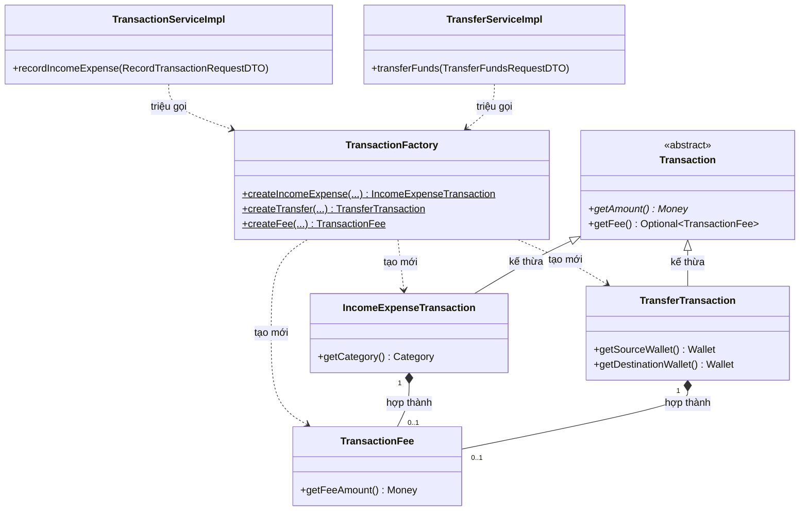
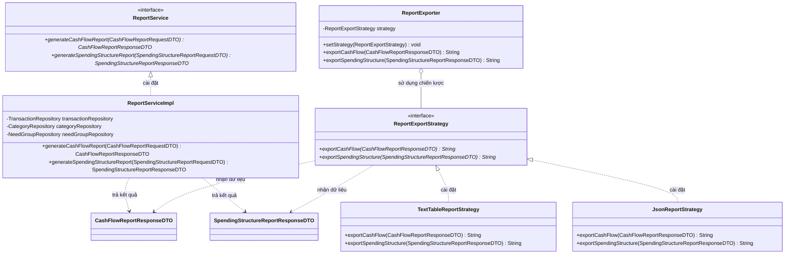
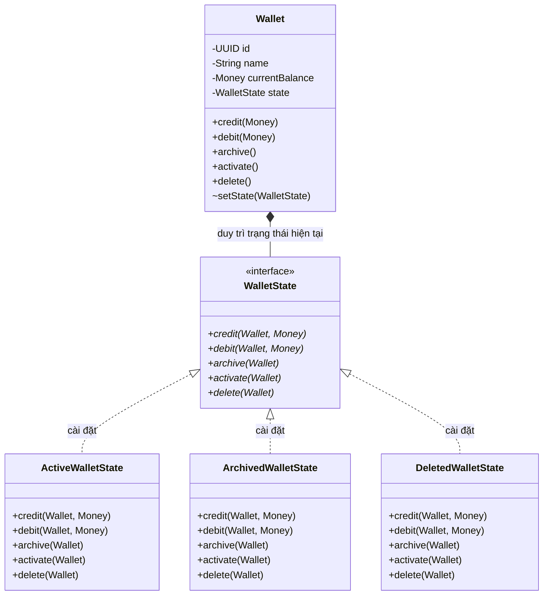
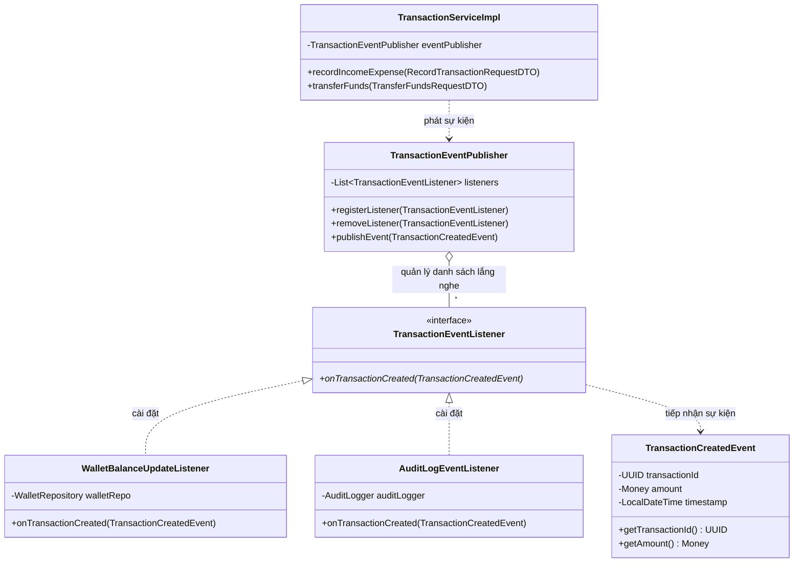

# 06. Áp dụng nguyên lý SOLID và mẫu thiết kế hướng đối tượng

Tài liệu này đánh giá chất lượng kiến trúc và đặc tả các mẫu thiết kế hướng đối tượng trong hệ thống Quản lý Tài chính Cá nhân (PFMS), đảm bảo hệ thống tuân thủ các nguyên lý phần mềm sạch.

Tài liệu tập trung vào ba mục tiêu kỹ thuật trọng tâm: đối chiếu định lượng mức độ tuân thủ 5 nguyên lý SOLID trên các lớp và giao diện thực tế, xác định điểm cân bằng kỹ thuật tránh thiết kế quá mức (over-engineering); đặc tả 4 mẫu thiết kế GoF cốt lõi (Factory Method, Strategy, State, Observer) nhằm triệt tiêu rẽ nhánh thủ công và tách biệt tác vụ phụ trợ; và đảm bảo mã nguồn đạt độ ghép nối lỏng, tính gắn kết cao cùng khả năng kiểm thử độc lập với JUnit 5.

## 6.1 Đánh giá tuân thủ năm nguyên lý SOLID

Mục này đánh giá mức độ tuân thủ năm nguyên lý SOLID trong kiến trúc của hệ thống Quản lý Tài chính Cá nhân PFMS. Mọi minh chứng kỹ thuật đều được đối chiếu trực tiếp từ các lớp thực thể, dịch vụ và kho lưu trữ thực tế của hệ thống, không dùng các ví dụ trừu tượng ngoài phạm vi dự án.

**Đối chiếu cài đặt năm nguyên lý trong hệ thống:**

Hệ thống tuân thủ trọn vẹn năm nguyên lý thiết kế thông qua việc phân tách cấu trúc bốn tầng hướng tâm và thiết lập các hợp đồng giao diện nghiêm ngặt:

| Nguyên lý thiết kế | Quy tắc cốt lõi | Minh chứng cài đặt trong hệ thống PFMS |
| :--- | :--- | :--- |
| **Đơn trách nhiệm** (Single Responsibility Principle - SRP) | Mỗi lớp chỉ đảm nhiệm một lý do duy nhất để thay đổi; tách biệt giữa quy tắc nghiệp vụ, điều phối ca sử dụng và lưu trữ tệp. | Phân tách rõ ràng giữa: thực thể `Wallet` (quy tắc tính số dư), dịch vụ `WalletServiceImpl` (điều phối ca sử dụng) và kho lưu trữ `WalletRepository` (đọc/ghi tệp). Mỗi lớp chỉ có một lý do duy nhất để thay đổi, không gây ảnh hưởng chéo. |
| **Đóng mở** (Open/Closed Principle - OCP) | Thực thể phần mềm mở rộng cho việc phát triển thêm hành vi mới nhưng đóng kín trước việc sửa đổi mã nguồn sẵn có. | Lớp trừu tượng `Transaction` và hai lớp con `IncomeExpenseTransaction`, `TransferTransaction`. Khi bổ sung loại giao dịch mới, chỉ cần tạo lớp con mới kế thừa `Transaction` mà không cần sửa đổi mã nguồn lớp cha hay cấu trúc rẽ nhánh trong tầng dịch vụ. |
| **Thay thế Liskov** (Liskov Substitution Principle - LSP) | Các đối tượng của lớp con có thể thay thế hoàn toàn cho đối tượng của lớp cha mà không làm thay đổi tính đúng đắn của chương trình. | `IncomeExpenseTransaction` và `TransferTransaction` có thể thay thế hoàn toàn cho `Transaction` trong `TransactionRepository.save(Transaction)` và các luồng trích xuất ngày, phí của `ReportServiceImpl` mà không làm sai lệch tính đúng đắn của chương trình. |
| **Phân tách Giao diện** (Interface Segregation Principle - ISP) | Không ép buộc các thành phần phụ thuộc vào các giao diện chứa phương thức mà chúng không có nhu cầu sử dụng. | Chia nhỏ thành 6 giao diện dịch vụ độc lập: `WalletService`, `TransactionService`, `TransferService`, `CategoryService`, `ReportService`, `DataManagementService`. Mỗi Controller tầng trình diễn chỉ phụ thuộc vào đúng giao diện cần dùng (ví dụ: `WalletGUIController` chỉ phụ thuộc `WalletService`). |
| **Nghịch đảo Phụ thuộc** (Dependency Inversion Principle - DIP) | Mô đun cấp cao không phụ thuộc mô đun cấp thấp; cả hai phụ thuộc vào sự trừu tượng hóa; trừu tượng hóa không phụ thuộc chi tiết cài đặt. | Tầng dịch vụ (`WalletServiceImpl`) không phụ thuộc vào lớp lưu tệp cụ thể (`JsonWalletRepository`) mà phụ thuộc vào interface `WalletRepository` của tầng nghiệp vụ. Cài đặt cụ thể được tiêm qua constructor, cho phép dễ dàng tráo đổi sang `MemoryWalletRepository` khi chạy unit test. |

**Phân tích đánh đổi kỹ thuật và giới hạn áp dụng:**

Việc tuân thủ nghiêm ngặt năm nguyên lý thiết kế giúp mã nguồn có độ ghép nối lỏng và dễ kiểm thử độc lập, nhưng đòi hỏi sự cân nhắc kỹ lưỡng về chi phí đánh đổi trong bối cảnh ứng dụng máy tính để bàn Java chạy cục bộ:

**Chi phí kỹ thuật phát sinh:**
- Gia tăng số lượng tệp mã nguồn: Việc phân tách giao diện và lớp cài đặt làm tăng số lượng tệp cần quản lý trong dự án (mỗi giao diện đều đi kèm ít nhất một lớp cài đặt tương ứng).
- Chi phí chuyển đổi dữ liệu giữa các tầng: Dữ liệu từ người dùng phải chuyển đổi qua lại nhiều lần từ DTO sang thực thể nghiệp vụ, rồi từ thực thể sang bản ghi tệp JSON làm tăng số lượng dòng mã trung gian.
- Đòi hỏi thời gian làm quen kiến trúc: Thành viên phát triển cần nắm vững mô hình phân tầng và cách tương tác qua giao diện thay vì lối viết mã kịch bản thủ tục đơn giản.

**Điểm cân bằng thực tế trong PFMS nhằm tránh thiết kế quá mức:**
- Tiêm phụ thuộc thủ công qua hàm khởi tạo: Hệ thống sử dụng cơ chế Dependency Injection thuần Java tại điểm khởi động chương trình (`Main`), không đưa các khung công nghệ nặng như Spring Framework hay Google Guice vào ứng dụng.
- Tái sử dụng giao diện kho lưu trữ cơ sở: Áp dụng `GenericRepository<E, ID>` với 5 phương thức CRUD chuẩn để loại bỏ trùng lặp mã nguồn, chỉ khai báo thêm các phương thức truy vấn thực sự cần thiết theo ca sử dụng.
- Tách biệt giao diện và cài đặt theo gói con: Đặt các lớp cài đặt dịch vụ công khai trong các gói con theo phân hệ thuộc `com.pfms.service.impl` để hỗ trợ tiêm phụ thuộc rõ ràng, chia sẻ tiện ích dùng chung qua `com.pfms.service.impl.common` (`EntityLookupSupport`, `RollbackSupport`), đồng thời giữ các lớp hỗ trợ và điều phối đặc thù trong từng phân hệ ở phạm vi `package-private` nhằm bảo vệ tính đóng gói.

## 6.2 Áp dụng các mẫu thiết kế trong hệ thống

Mục này đặc tả việc áp dụng các mẫu thiết kế hướng đối tượng vào cấu trúc phần mềm của hệ thống Quản lý Tài chính Cá nhân PFMS. Hệ thống chọn lọc bốn giải pháp cấu trúc và hành vi cốt lõi nhằm chuẩn hóa quá trình tạo đối tượng, đóng gói thuật toán kết xuất dữ liệu, kiểm soát vòng đời thực thể và phân tách sự kiện kiểm toán; loại trừ việc áp dụng hình thức các mẫu thiết kế gây phức tạp hóa không cần thiết cho ứng dụng.

Bốn mẫu thiết kế gồm Factory Method, Strategy, State và Observer được đặc tả chi tiết dưới đây theo cấu trúc đồng nhất: động lực áp dụng và bài toán thực tế, cấu trúc lớp và phân định vai trò, quy trình thực thi và lợi ích kỹ thuật thu được khi bảo trì hệ thống.

### 6.2.1 Mẫu Factory Method khởi tạo giao dịch

**Bài toán thực tế và động lực áp dụng:**

Trong hệ thống PFMS, các thực thể đơn lẻ như `Wallet` hay `Category` có cấu trúc khởi tạo đơn giản nên được tạo trực tiếp qua hàm khởi tạo (Constructor). Mẫu Factory Method được áp dụng chuyên biệt cho cây phân cấp `Transaction` nhằm giải quyết bài toán khởi tạo đa hình phức tạp:

- Phân tách cấu trúc đa hình: Hệ thống quản lý hai loại biến động tài chính có thuộc tính khác biệt gồm giao dịch thu chi tại một ví (`IncomeExpenseTransaction`) và giao dịch chuyển tiền giữa hai ví (`TransferTransaction`).
- Quản lý ràng buộc hợp thành sinh tử: Cả hai loại giao dịch đều có thể phát sinh chi phí giao dịch (`TransactionFee`). Bản ghi phí này phải được khởi tạo đồng thời và gắn liền với vòng đời của giao dịch gốc.
- Tránh ô nhiễm tầng dịch vụ: Nếu không có Factory, `TransactionServiceImpl` và `TransferServiceImpl` sẽ phải trực tiếp gọi lệnh `new` cho từng lớp con và tự xử lý logic tạo phí, khiến tầng dịch vụ bị ghép nối chặt với chi tiết cài đặt của tầng nghiệp vụ.

Lớp `TransactionFactory` được định vị tại tầng nghiệp vụ (`com.pfms.domain.model`) để đóng gói toàn bộ quy trình tiếp nhận tham số, khởi tạo đúng lớp con cụ thể kèm chi phí đi kèm, và trả về kiểu tham chiếu trừu tượng `Transaction`.

**Cấu trúc lớp và sơ đồ thiết kế:**

Sơ đồ lớp dưới đây mô tả cấu trúc lớp `TransactionFactory` cùng mối quan hệ giữa tầng dịch vụ và các lớp thực thể giao dịch:

**Cơ chế khởi tạo và giá trị kỹ thuật:**

Lớp `TransactionFactory` cung cấp các phương thức tĩnh nhằm chuẩn hóa quy trình sinh đối tượng và mang lại các giá trị kỹ thuật thực tế:

- Tự động đóng gói chi phí hợp thành: Khi tham số phí hợp lệ (`feeAmount > 0`), Factory tự động khởi tạo thể hiện `TransactionFee` liên kết và nạp vào thực thể giao dịch tương ứng; ngược lại, trường phí nhận giá trị rỗng. Toàn bộ logic ràng buộc này nằm trọn trong Factory, loại trừ nguy cơ phát sinh bản ghi phí mồ côi.
- Tách biệt trách nhiệm điều phối: tầng dịch vụ chỉ tập trung điều phối luồng nghiệp vụ ca sử dụng, hoàn toàn giải phóng khỏi chi tiết khởi tạo và ràng buộc cấu trúc của các lớp thực thể con.
- Khả năng mở rộng không xâm lấn: Khi hệ thống cần mở rộng loại giao dịch mới trong tương lai (như giao dịch định kỳ tự động), lập trình viên chỉ cần tạo lớp kế thừa mới từ `Transaction` và bổ sung phương thức tạo trên `TransactionFactory` mà không phải chỉnh sửa bất kỳ dòng mã nào trong tầng dịch vụ.
- Bảo đảm tính toàn vẹn dữ liệu: Mọi kiểm tra bất biến về số tiền dương, ngày phát sinh hợp lệ và danh mục phí đều được đóng gói tập trung tại Factory, bảo đảm mọi thực thể `Transaction` ra đời luôn ở trạng thái hoàn chỉnh và hợp lệ.

### 6.2.2 Mẫu Strategy định dạng báo cáo tài chính

**Bài toán thực tế và động lực áp dụng:**

Phân hệ Báo cáo (`REP`) chịu trách nhiệm tổng hợp dữ liệu thu chi theo kỳ quan sát (`UC-REP-01`) và phân tích cơ cấu thu chi theo nhóm nhu cầu và danh mục (`UC-REP-02`). Sau khi tầng dịch vụ tính toán xong số liệu và trả về các DTO phản hồi chuẩn (`CashFlowReportResponseDTO`, `SpendingStructureReportResponseDTO`), tầng trình diễn cần kết xuất kết quả theo nhiều định dạng khác nhau cho người dùng:
- Hiển thị trực quan trên giao diện đồ họa: Dữ liệu được định dạng thành bảng đồ họa `JTable`, có căn lề chuẩn và hiển thị dấu phân cách hàng nghìn.
- Kết xuất tệp phẳng bền vững: Dữ liệu được chuyển đổi thành cấu trúc JSON lưu xuống đĩa cục bộ phục vụ lưu trữ lâu dài hoặc tái sử dụng cho các công cụ phân tích khác.

Nếu bộ điều khiển giao diện (`ReportGUIController`) hoặc dịch vụ nghiệp vụ tự ôm toàn bộ logic định dạng cho từng đầu ra:
- tầng dịch vụ (`ReportServiceImpl`) bị vi phạm nguyên lý Đơn trách nhiệm nếu phải trộn lẫn logic tổng hợp tài chính với định dạng bảng hay xuất JSON, đồng thời làm rò rỉ chi tiết trình bày vào tầng ứng dụng.
- Mỗi khi cần bổ sung định dạng kết xuất mới (như định dạng CSV cho bảng tính) hoặc thay đổi bố cục hiển thị, lập trình viên buộc phải sửa mã điều khiển hoặc mã dịch vụ đang ổn định.

Giải pháp là tách hẳn trách nhiệm định dạng ra khỏi `ReportService` và áp dụng mẫu Strategy tại thành phần kết xuất thuộc tầng trình diễn (`ReportExporter`). Giao diện chiến lược `ReportExportStrategy` đóng gói các thuật toán định dạng độc lập dựa trên dữ liệu DTO mà `ReportService` trả về, cho phép tầng trình diễn tráo đổi định dạng kết xuất linh hoạt tại thời điểm chạy.

**Cấu trúc lớp và sơ đồ thiết kế:**

Sơ đồ lớp dưới đây mô tả cấu trúc tách biệt giữa `ReportServiceImpl` (tổng hợp số liệu thuần) và mẫu Strategy tại `ReportExporter` (kết xuất định dạng):

**Cơ chế chuyển đổi và giá trị kỹ thuật:**

Mẫu Strategy kết hợp với ranh giới tách biệt khỏi `ReportService` mang lại các giá trị kỹ thuật trực tiếp:

- Bảo toàn ranh giới sạch cho `ReportService`: `ReportServiceImpl` chỉ phụ thuộc ba kho lưu trữ (`TransactionRepository`, `CategoryRepository`, `NeedGroupRepository`) và trả về DTO phản hồi bất biến, không phụ thuộc vào giao diện hay chiến lược kết xuất.
- Tráo đổi định dạng tại thời điểm chạy: Bộ điều khiển tại tầng trình diễn (`presentation.controller`) nhận DTO từ `ReportService`, chọn chiến lược tương ứng (`TextTableReportStrategy` xuất văn bản dạng bảng hoặc `JsonReportStrategy` xuất JSON) cho `ReportExporter` để định dạng hiển thị hoặc xuất dữ liệu.
- Khả năng mở rộng không xâm lấn: Khi bổ sung định dạng xuất mới trong tương lai (như `CsvReportStrategy`), lập trình viên chỉ cần thêm một lớp cài đặt `ReportExportStrategy` mà không phải sửa bất kỳ dòng mã nào trong `ReportServiceImpl` hay `ReportExporter`.
- Năng lực kiểm thử độc lập: Quy trình tính toán tài chính trong `ReportServiceImpl` được kiểm thử độc lập trên DTO thuần, còn từng chiến lược kết xuất được kiểm thử chuỗi đầu ra riêng biệt theo đúng DTO đầu vào.

### 6.2.3 Mẫu State quản lý vòng đời ví tiền

**Bài toán thực tế và động lực áp dụng:**

Trong phân hệ Quản lý Ví (`WAL`), thực thể Ví tiền (`Wallet`) trải qua một vòng đời biến đổi trạng thái chặt chẽ gồm ba trạng thái: Đang hoạt động (`ACTIVE`), Đã lưu trữ (`ARCHIVED`) và Đã xóa (`DELETED`). Hành vi tài chính của ví thay đổi căn bản tùy theo trạng thái hiện tại:
- Trạng thái `ACTIVE`: Tiếp nhận bình thường mọi biến động dòng tiền gồm nạp tiền, chi tiêu, chuyển tiền đi và nhận tiền chuyển đến.
- Trạng thái `ARCHIVED`: Ví được tạm ngừng sử dụng, số dư vẫn được tính vào tổng tài sản của người dùng nhưng từ chối tuyệt đối mọi giao dịch thu chi hoặc điều chuyển tiền mới (`FR-WAL-03`). Ví chỉ cho phép thao tác kích hoạt lại (`activate`).
- Trạng thái `DELETED`: Ví đã bị xóa khỏi hệ thống, từ chối mọi thao tác nghiệp vụ và chuyển đổi.

Nếu quản lý trạng thái bằng biến cờ liệt kê (`enum`) thông thường:
- Các phương thức biến động số dư (`credit`, `debit`) và phương thức chuyển trạng thái của `Wallet` sẽ ngập tràn các khối lệnh kiểm tra điều kiện lặp lại: `if (this.status == ARCHIVED) throw ...; else if (this.status == DELETED) throw ...`.
- Logic kiểm soát vòng đời bị phân mảnh rải rác trong nhiều hàm; khi hệ thống bổ sung trạng thái mới (như tạm khóa để kiểm kê), lập trình viên buộc phải rà soát và sửa đổi toàn bộ các câu lệnh rẽ nhánh trong thực thể.

Giải pháp là áp dụng mẫu State: đóng gói các quy tắc hành vi của từng trạng thái vòng đời vào các lớp trạng thái độc lập kế thừa từ giao diện chung `WalletState`. thực thể `Wallet` giữ vai trò là ngữ cảnh (Context), ủy quyền toàn bộ các hành vi tài chính cho đối tượng trạng thái hiện tại xử lý thông qua tính đa hình.

**Cấu trúc lớp và sơ đồ thiết kế:**

Sơ đồ lớp dưới đây mô tả cấu trúc mẫu State áp dụng cho thực thể Ví tiền:

**Cơ chế chuyển đổi và giá trị kỹ thuật:**

Mẫu State thiết lập cơ chế kiểm soát vòng đời chặt chẽ và an toàn cho nguồn tiền:

- Khóa thao tác không hợp lệ qua tính đa hình: Thay vì phải viết các câu lệnh điều kiện rẽ nhánh thủ công, mỗi lớp trạng thái tự kiểm soát các hành vi hợp lệ và từ chối các hành vi trái phép. Ví dụ: `ArchivedWalletState` tự động ném ngoại lệ nghiệp vụ khi phương thức `credit()` hoặc `debit()` được triệu gọi, bảo đảm ví đã lưu trữ không bao giờ bị phát sinh giao dịch mới ngoài ý muốn.
- Cô lập logic chuyển đổi trạng thái: Toàn bộ điều kiện tiên quyết để chuyển từ trạng thái này sang trạng thái khác (như từ `ACTIVE` sang `ARCHIVED` hoặc chuyển ngược lại về `ACTIVE`) được gói gọn bên trong các lớp trạng thái cụ thể thông qua lời gọi `wallet.setState(...)`. Trạng thái nội tại của ví luôn được bảo vệ toàn vẹn.
- Khả năng mở rộng trạng thái mới: Khi hệ thống cần bổ sung trạng thái vòng đời mới trong tương lai, lập trình viên chỉ cần tạo thêm một lớp mới cài đặt giao diện `WalletState` và định nghĩa các bước chuyển tương ứng mà không làm xáo trộn mã nguồn của các trạng thái đã chạy ổn định.

### 6.2.4 Mẫu Observer xử lý sự kiện giao dịch

**Bài toán thực tế và động lực áp dụng:**

Trong hệ thống PFMS, mỗi khi một giao dịch tài chính (thu chi hoặc điều chuyển tiền) được ghi nhận thành công, hệ thống cần lập tức kích hoạt hai tác vụ phụ trợ độc lập:
- Cập nhật số dư tức thời của ví: Phản ánh biến động tiền tệ lên trường `currentBalance` của các ví liên quan (cộng tiền vào ví thu, trừ tiền khỏi ví chi hoặc chuyển khoản đồng thời giữa hai ví theo quy tắc `BR-FIN-02`).
- Ghi nhận vết kiểm toán tài chính: Ghi lại thông tin giao dịch gồm mốc thời gian, loại giao dịch, số tiền biến động và mã định danh vào tệp `audit.log` phục vụ việc đối soát và khôi phục dữ liệu ở phân hệ `DAT`.

Nếu `TransactionServiceImpl` và `TransferServiceImpl` trực tiếp gọi tuần tự các dịch vụ phụ trợ:
- tầng dịch vụ bị ghép nối chặt với các hệ thống ghi log kiểm toán và dịch vụ cập nhật ví, dẫn đến hiện tượng dịch vụ bị phình to và ôm đồm quá nhiều trách nhiệm ngoài luồng nghiệp vụ chính.
- Khi hệ thống cần bổ sung thêm một hành động mới sau giao dịch trong tương lai (như kiểm tra đối soát số dư tức thời hoặc hiển thị thông báo ra màn hình), lập trình viên buộc phải can thiệp và sửa đổi trực tiếp mã nguồn của dịch vụ giao dịch.

Giải pháp là áp dụng mẫu Observer theo cơ chế hướng sự kiện nội bộ: dịch vụ giao dịch đóng vai trò là nguồn phát sự kiện; khi giao dịch được xác nhận thành công, dịch vụ chỉ phát ra sự kiện `TransactionCreatedEvent`. Các bộ lắng nghe đăng ký nhận sự kiện sẽ tự động đón bắt và thực thi tác vụ riêng biệt.

**Cấu trúc lớp và sơ đồ thiết kế:**

Sơ đồ lớp dưới đây mô tả cấu trúc mẫu Observer trong luồng xử lý sự kiện giao dịch:

**Cơ chế phát sự kiện và giá trị kỹ thuật:**

Mẫu Observer thiết lập cơ chế liên kết lỏng lẻo và mang lại các giá trị kiến trúc thực tế:

- Liên kết lỏng lẻo giữa nguồn phát và bên tiếp nhận: `TransactionServiceImpl` hoàn toàn không phụ thuộc vào chi tiết cài đặt của các bộ lắng nghe. Dịch vụ chỉ phát đi thông điệp `TransactionCreatedEvent` thông qua bộ điều phối `TransactionEventPublisher`, loại bỏ hoàn toàn các lời gọi hàm trực tiếp sang lớp kiểm toán.
- Phân tách luồng nghiệp vụ chính khỏi tác vụ phụ trợ: tầng dịch vụ chỉ tập trung vào việc xác thực và hạch toán dòng tiền của ca sử dụng. Toàn bộ logic ghi vết nhật ký tệp và tính toán số dư được chuyển giao sang các listener độc lập, giúp mã nguồn tầng dịch vụ luôn ngắn gọn và sáng rõ.
- Khả năng mở rộng không giới hạn: Khi hệ thống cần bổ sung tác vụ mới sau giao dịch (như tự động kiểm tra toàn vẹn tài chính sau mỗi lần chuyển khoản), lập trình viên chỉ cần tạo thêm lớp mới cài đặt giao diện `TransactionEventListener` và đăng ký vào bộ phát sự kiện mà không phải sửa đổi bất kỳ dòng mã nào trong `TransactionServiceImpl`.
- Độc lập kiểm thử: Năng lực kiểm thử đơn vị của `TransactionServiceImpl` được tối ưu hóa tối đa; kiểm thử viên có thể kiểm tra tính đúng đắn của quy trình giao dịch mà không cần khởi tạo hệ thống tệp ghi nhật ký kiểm toán thực tế.
