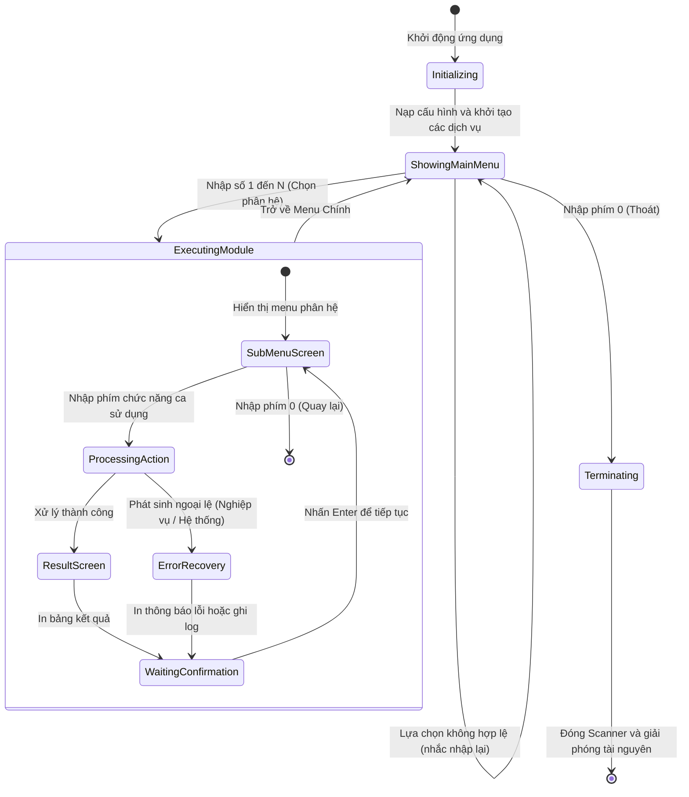

# 07. Thiết kế Giao diện Dòng lệnh

Tài liệu này đặc tả thiết kế Tầng Trình diễn (Giao diện dòng lệnh - CLI) cho Hệ thống Quản lý Tài chính Cá nhân PFMS viết bằng Java. Nội dung tập trung vào cấu trúc các gói giao diện, luồng điều hướng của vòng lặp chính, kiểm tra dữ liệu đầu vào và các lớp DTO kết nối với Tầng Dịch vụ.

## 7.1 Cấu trúc Tầng Giao diện Người dùng

Mục này trình bày cấu trúc các gói nội bộ của Tầng Trình diễn, bảng phân định trách nhiệm và vòng lặp tiếp nhận lệnh của ứng dụng.

### 7.1.1 Nguyên lý Phân tách Giao diện và Xử lý Lệnh

Tầng Trình diễn tuân thủ nguyên lý phân tách giao diện: các thành phần giao diện chỉ tương tác với người dùng qua bàn phím và màn hình console, không chứa quy tắc tính toán số dư hay lưu trữ dữ liệu.

Mã nguồn tầng trình diễn nằm trong không gian tên `com.pfms.presentation`, gồm ba gói:

- Gói Khung nhìn (`com.pfms.presentation.view`): Đọc lệnh từ bàn phím, kiểm tra cú pháp chuỗi nhập liệu, in menu và kết xuất bảng dữ liệu ASCII ra màn hình.
- Gói Điều phối (`com.pfms.presentation.controller`): Xử lý lựa chọn từ menu, điều hướng màn hình, đóng gói tham số vào DTO và gọi phương thức tương ứng trên Tầng Dịch vụ qua giao diện trừu tượng.
- Gói Truyền Dữ liệu (`com.pfms.presentation.dto`): Chứa các đối tượng dữ liệu thô bất biến (`RequestDTO` và `ResponseDTO`) dùng để trao đổi dữ liệu hai chiều giữa Tầng Trình diễn và Tầng Dịch vụ.

Bảng phân định trách nhiệm nội bộ Tầng Trình diễn:

| Thành phần | Trách nhiệm cho phép | Ranh giới cấm đoán |
| :--- | :--- | :--- |
| **Gói Khung nhìn**<br/>(`presentation.view`) | Đọc ký tự từ bàn phím, kiểm tra cú pháp chuỗi thô, in menu chức năng, căn lề bảng biểu văn bản, hiển thị thông báo kết quả hoặc lỗi. | Không tính toán số dư, không kiểm tra quy tắc nghiệp vụ tài chính, không tự điều hướng màn hình, không gọi trực tiếp Tầng Dịch vụ, Tầng Miền hay Kho lưu trữ. |
| **Gói Điều phối**<br/>(`presentation.controller`) | Nhận lựa chọn menu, điều hướng màn hình, đóng gói tham số vào DTO yêu cầu, gọi Giao diện Tầng Dịch vụ, nhận DTO phản hồi và chuyển cho View hiển thị. | Không tính toán tài chính, không sửa đổi số liệu nghiệp vụ, không in trực tiếp ra console, không phụ thuộc vào lớp cài đặt cụ thể của dịch vụ hay kho lưu trữ. |
| **Gói Truyền Dữ liệu**<br/>(`presentation.dto`) | Đóng gói tham số nhập thành `RequestDTO`, nhận kết quả ca sử dụng thành `ResponseDTO`, bảo đảm tính bất biến của dữ liệu trung chuyển giữa CLI và Service. | Không chứa logic tính toán tài chính hoặc quy tắc nghiệp vụ, không tham chiếu thực thể miền (`Domain Entity`), không sửa đổi dữ liệu sau khi khởi tạo. |

> [!NOTE]
> **Tệp sơ đồ nguồn đính kèm:** [`07-so-do-kien-truc-tang-trinh-dien.drawio`](07-so-do-kien-truc-tang-trinh-dien.drawio)
> Sơ đồ kiến trúc mô hình hóa tương tác giữa các gói nội bộ của Tầng Trình diễn (`presentation.view`, `presentation.controller`, `presentation.dto`) và điểm kết nối với Tầng Dịch vụ qua giao diện trừu tượng (`Service Interfaces`).

Lợi ích kỹ thuật của việc phân tách:
1. Độc lập công nghệ: Khi thay đổi giao diện từ dòng lệnh sang giao diện đồ họa hoặc Web API, Tầng Dịch vụ và Tầng Nghiệp vụ phía sau được giữ nguyên.
2. Dễ kiểm thử: Tầng Dịch vụ có thể kiểm thử tự động bằng JUnit 5 qua các đối tượng DTO mà không cần giả lập bàn phím hay màn hình console.

### 7.1.2 Vòng lặp Tiếp nhận Lệnh và Điều hướng Chương trình

Ứng dụng dòng lệnh PFMS vận hành theo mô hình đơn tiến trình điều khiển bởi vòng lặp sự kiện tuần tự tại bộ điều phối chính. Vòng lặp kiểm soát toàn bộ vòng đời ứng dụng qua ba giai đoạn khép kín:

- Giai đoạn Khởi tạo: Nạp cấu hình, thiết lập tiêm phụ thuộc các tầng qua hàm khởi tạo, khởi tạo thiết bị nhập xuất chuẩn và hiển thị biểu trưng chào mừng.
- Giai đoạn Vòng lặp Điều phối: Liên tục hiển thị menu điều hướng, tiếp nhận và chuẩn hóa mã lệnh từ bàn phím, phân giải và ủy quyền cho bộ điều khiển phân hệ tương ứng thực thi ca sử dụng, sau đó tạm dừng màn hình chờ người dùng xác nhận trước khi làm mới giao diện.
- Giai đoạn Thoát An toàn: Khi tiếp nhận mã lệnh kết thúc (mã 0), hệ thống đóng các luồng dữ liệu ngoại vi, giải phóng tài nguyên và kết thúc tiến trình thực thi sạch sẽ.

Nhằm bảo đảm ứng dụng không bao giờ bị dừng đột ngột trước các lỗi nhập liệu hoặc sự cố hệ thống, vòng lặp chính áp dụng cơ chế bắt ngoại lệ đa tầng: các lỗi cú pháp được xử lý cục bộ ngay tại màn hình nhập liệu; các vi phạm quy tắc tài chính được hiển thị bằng mã lỗi chuẩn hóa; các ngoại lệ hệ thống không lường trước được bắt giữ tại vòng lặp ngoài cùng để ghi nhật ký kiểm toán và an toàn đưa người dùng quay lại Menu Chính.

Sơ đồ máy trạng thái dưới đây mô tả chu trình vận hành và cơ chế bắt ngoại lệ của vòng lặp trung tâm:



## 7.2 Cấu trúc Cây Menu Phân cấp

Mục này xác lập cấu trúc điều hướng phân tầng của hệ thống giao diện dòng lệnh, chuẩn hóa quy tắc gán phím điều khiển, ánh xạ chi tiết các lựa chọn màn hình đến từng ca sử dụng nghiệp vụ và xác lập quy chuẩn kết xuất bảng dữ liệu văn bản.

### 7.2.1 Cấu trúc Phân cấp và Ánh xạ Menu Chức năng

Hệ thống giao diện dòng lệnh PFMS tổ chức cấu trúc điều hướng theo mô hình cây hai cấp tinh gọn nhằm tối ưu hóa trải nghiệm thao tác trên bàn phím:
- Cấp 1 (Menu Chính): Hiển thị danh mục sáu nhóm chức năng nghiệp vụ tương ứng với sáu phân hệ của hệ thống.
- Cấp 2 (Menu Phân hệ): Hiển thị chi tiết các thao tác chức năng cụ thể của từng phân hệ.

Quy tắc gán phím điều khiển được chuẩn hóa thống nhất trên toàn bộ hệ thống:
- Các phím số nguyên dương từ 1 đến N: Dùng để kích hoạt chức năng nghiệp vụ tương ứng.
- Phím số 0: Mang ngữ nghĩa quay lui thống nhất; tại Menu Phân hệ phím 0 đưa người dùng trở về Menu Chính, tại Menu Chính phím 0 kích hoạt quy trình thoát chương trình an toàn.
- Ký tự không hợp lệ hoặc ngoài dải lựa chọn: Hệ thống in thông báo lỗi và giữ nguyên menu hiện hành để người dùng thao tác lại.

Bảng ánh xạ chi tiết các lựa chọn menu đến ca sử dụng nghiệp vụ:

| Phân hệ Menu | Phím chọn | Tên thao tác màn hình | Mã ca sử dụng | Controller điều phối |
| :--- | :--- | :--- | :--- | :--- |
| **Quản lý Ví** | 1 | Xem danh sách và số dư các ví | `UC-WAL-04` | `WalletController` |
| **Quản lý Ví** | 2 | Thêm ví tài chính mới | `UC-WAL-01` | `WalletController` |
| **Quản lý Ví** | 3 | Cập nhật tên và thông tin ví | `UC-WAL-02` | `WalletController` |
| **Quản lý Ví** | 4 | Kiểm kê và điều chỉnh số dư thực tế | `UC-WAL-03` | `WalletController` |
| **Quản lý Ví** | 0 | Quay lại Menu Chính | Điều hướng | `MainController` |
| **Ghi nhận Thu Chi** | 1 | Thêm giao dịch thu hoặc chi | `UC-TXN-01` | `TransactionController` |
| **Ghi nhận Thu Chi** | 2 | Tra cứu và lọc lịch sử giao dịch | `UC-TXN-02` | `TransactionController` |
| **Ghi nhận Thu Chi** | 3 | Cập nhật thông tin giao dịch | `UC-TXN-03` | `TransactionController` |
| **Ghi nhận Thu Chi** | 4 | Xóa giao dịch và hoàn nguyên số dư | `UC-TXN-04` | `TransactionController` |
| **Ghi nhận Thu Chi** | 0 | Quay lại Menu Chính | Điều hướng | `MainController` |
| **Chuyển tiền Nội bộ** | 1 | Thực hiện chuyển tiền giữa hai ví | `UC-TRF-01` | `TransferController` |
| **Chuyển tiền Nội bộ** | 2 | Tra cứu lịch sử các lần chuyển tiền | `UC-TRF-02` | `TransferController` |
| **Chuyển tiền Nội bộ** | 3 | Hủy chuyển tiền và hoàn trả số dư | `UC-TRF-03` | `TransferController` |
| **Chuyển tiền Nội bộ** | 0 | Quay lại Menu Chính | Điều hướng | `MainController` |
| **Quản lý Danh mục** | 1 | Xem cấu trúc cây danh mục thu chi | `UC-CAT-04` | `CategoryController` |
| **Quản lý Danh mục** | 2 | Thêm danh mục phân loại mới | `UC-CAT-01` | `CategoryController` |
| **Quản lý Danh mục** | 3 | Cập nhật tên và nhóm danh mục | `UC-CAT-02` | `CategoryController` |
| **Quản lý Danh mục** | 4 | Xóa mềm danh mục thu chi | `UC-CAT-03` | `CategoryController` |
| **Quản lý Danh mục** | 0 | Quay lại Menu Chính | Điều hướng | `MainController` |
| **Báo cáo Thống kê** | 1 | Tổng hợp dòng tiền thu chi theo kỳ | `UC-REP-01` | `ReportController` |
| **Báo cáo Thống kê** | 2 | Phân tích cơ cấu và tỷ trọng chi tiêu | `UC-REP-02` | `ReportController` |
| **Báo cáo Thống kê** | 0 | Quay lại Menu Chính | Điều hướng | `MainController` |
| **Quản trị Dữ liệu** | 1 | Xuất dữ liệu sao lưu ra tệp JSON | `UC-DAT-01` | `DataManagementController` |
| **Quản trị Dữ liệu** | 2 | Khôi phục dữ liệu hệ thống từ tệp JSON | `UC-DAT-02` | `DataManagementController` |
| **Quản trị Dữ liệu** | 3 | Kiểm tra đối soát toàn vẹn dữ liệu | `UC-DAT-03` | `DataManagementController` |
| **Quản trị Dữ liệu** | 0 | Quay lại Menu Chính | Điều hướng | `MainController` |

### 7.2.2 Quy chuẩn Hiển thị Bảng Dữ liệu và Hộp Thoại

Giao diện dòng lệnh PFMS áp dụng quy chuẩn kết xuất văn bản hiện đại tương tự các công cụ dòng lệnh chuyên nghiệp, kết hợp bộ ký tự vẽ hộp Unicode, mã màu điều khiển ANSI và biểu tượng trạng thái trực quan nhằm tối ưu hóa trải nghiệm thị giác.

Quy tắc Định dạng Bảng Tổng quát:
Mọi bảng dữ liệu trên toàn hệ thống tuân thủ nghiêm ngặt ba nguyên tắc bất biến:
1. Nguyên tắc căn lề theo ngữ nghĩa: Căn trái cho dữ liệu chuỗi văn bản và diễn giải; căn giữa cho mã định danh, ngày tháng và trạng thái; căn phải cho số tiền và giá trị số học để bảo đảm thẳng hàng các hàng đơn vị.
2. Nguyên tắc hiển thị tiền tệ: Số tiền bắt buộc định dạng có dấu phẩy phân tách hàng nghìn kèm đơn vị tiền tệ (`#,##0 VND`), tuyệt đối không in số thực thô hoặc dạng ký hiệu khoa học.
3. Nguyên tắc bảo toàn khung bảng: Sử dụng khung bo góc Unicode (`╭─╮`, `│`, `╰─╯`) trên môi trường hỗ trợ UTF-8 (tự động chuyển sang ASCII `+`, `-`, `|` trên terminal cũ); chuỗi dài vượt quá độ rộng cột được tự động cắt tỉa kèm dấu ba chấm (`...`).

Mẫu kết xuất bảng dữ liệu hiện đại:

Bảng danh sách ví tài chính:

```text
╭───┬────────────┬────────────────────────┬────────┬────────────────────┬───────────╮
│ # │   MÃ VÍ    │        TÊN VÍ          │ ĐƠN VỊ │   SỐ DƯ KHẢ DỤNG   │ TRẠNG THÁI│
├───┼────────────┼────────────────────────┼────────┼────────────────────┼───────────┤
│ 1 │ WAL-000001 │ Tiền mặt sinh hoạt     │  VND   │      4,500,000 VND │  ● Active │
│ 2 │ WAL-000002 │ Tài khoản MB Bank      │  VND   │     28,350,000 VND │  ● Active │
│ 3 │ WAL-000003 │ Quỹ dự phòng sự cố     │  VND   │     50,000,000 VND │  ● Active │
├───┴────────────┴────────────────────────┴────────┼────────────────────┴───────────┤
│ TỔNG CỘNG TÀI SẢN KHẢ DỤNG                       │                 82,850,000 VND │
╰──────────────────────────────────────────────────┴────────────────────────────────╯
```

Bảng lịch sử giao dịch thu chi:

```text
╭────────────┬─────────────┬──────────┬───────────────────┬───────────────────┬───────────────╮
│  NGÀY GD   │ MÃ GIAO DỊCH│ PHÂN LOẠI│ DANH MỤC THU CHI  │      SỐ TIỀN      │ VÍ PHÁT SINH  │
├────────────┼─────────────┼──────────┼───────────────────┼───────────────────┼───────────────┤
│ 2026-11-01 │ TXN-000105  │ Chi tiêu │ Ăn uống hàng ngày │       150,000 VND │ Tiền mặt sinh │
│ 2026-11-02 │ TXN-000106  │ Chi tiêu │ Hóa đơn điện nước │     1,250,000 VND │ Tài khoản MB  │
│ 2026-11-05 │ TXN-000107  │ Thu nhập │ Tiền lương tháng  │    25,000,000 VND │ Tài khoản MB  │
╰────────────┴─────────────┴──────────┴───────────────────┴───────────────────┴───────────────╯
```

Quy chuẩn Hộp Thoại và Dấu Nhắc Lệnh:
Mọi tương tác phản hồi trên hệ thống tuân thủ cấu trúc thống nhất gồm biểu tượng, thẻ nhận diện và màu sắc ANSI:
- Dấu nhắc nhập lệnh: `❯ Nhập lựa chọn [1-N, 0 để quay lại/thoát]: _`
- Phản hồi thành công (màu xanh lá): `✔ [THÀNH CÔNG] Đã ghi nhận giao dịch chi tiêu TXN-000107 thành công.`
- Phản hồi cảnh báo (màu vàng): `⚠ [CẢNH BÁO] Số dư khả dụng của ví hiện còn dưới 500,000 VND sau giao dịch này.`
- Phản hồi sự cố (màu đỏ): `✖ [LỖI: ERR-FIN-001] Số dư khả dụng trong ví không đủ để thực hiện giao dịch.`

## 7.3 Thiết kế Bộ Xác thực Dữ liệu Đầu vào

Mục này đặc tả lớp tiện ích kiểm tra tính hợp lệ của dữ liệu thô tiếp nhận từ bàn phím, xác lập các quy tắc kiểm tra cú pháp an toàn và thiết kế cơ chế nhập liệu phòng thủ chống dừng ứng dụng đột ngột.

### 7.3.1 Xác thực Cú pháp Chuỗi Ký tự và Số học

Toàn bộ dữ liệu nhập từ thiết bị nhập chuẩn thông qua `Scanner` ban đầu đều ở dạng chuỗi ký tự thô. Để ngăn chặn việc lan truyền dữ liệu rác xuống Tầng Dịch vụ và phòng ngừa các ngoại lệ chuyển đổi kiểu dữ liệu, hệ thống thiết kế lớp tiện ích dùng chung `InputValidator` đặt trong gói `com.pfms.presentation.view`.

Lớp `InputValidator` chịu trách nhiệm làm sạch và kiểm tra cú pháp trước khi dữ liệu được chuyển đổi sang các kiểu dữ liệu nghiệp vụ:
- Chuẩn hóa chuỗi văn bản: Tự động loại bỏ khoảng trắng thừa ở hai đầu chuỗi (`trim`) và rút gọn các khoảng trắng liên tiếp bên trong chuỗi.
- Kiểm tra chuỗi bắt buộc: Kiểm tra độ dài tối thiểu, không được để trống hoặc chỉ chứa ký tự khoảng trắng.
- Kiểm tra định dạng ngày tháng: Hỗ trợ định dạng ngày tháng thân thiện Việt Nam (`dd/MM/yyyy`) làm chuẩn nhập liệu chính (đồng thời chấp nhận chuẩn quốc tế `yyyy-MM-dd`), kiểm tra tính hợp lệ trên lịch thiên văn trước khi phân giải an toàn sang `java.time.LocalDate`.
- Kiểm tra giá trị tiền tệ: Kiểm tra chuỗi số nguyên dương, cấm nhập số âm hoặc số 0 (đối với giao dịch), kiểm soát ngưỡng giá trị cho phép và chuyển đổi an toàn sang `java.math.BigDecimal` với quy tắc làm tròn rõ ràng. Tuyệt đối không dùng kiểu `double` hoặc `float` để tránh sai số dấu phẩy động.

Bảng đặc tả các phương thức xác thực của `InputValidator`:

| Phương thức | Tham số đầu vào | Kiểu trả về | Ràng buộc và Quy tắc Xác thực |
| :--- | :--- | :--- | :--- |
| `readNonEmptyString(String prompt)` | Dòng nhắc nhập | `String` | Chuỗi không được rỗng sau khi cắt tỉa; độ dài từ 1 đến 100 ký tự. |
| `readValidName(String prompt)` | Dòng nhắc nhập | `String` | Tên ví hoặc danh mục: không chứa ký tự điều khiển lạ, độ dài từ 2 đến 50 ký tự. |
| `readPositiveAmount(String prompt)` | Dòng nhắc nhập | `BigDecimal` | Chuỗi phải là số học hợp lệ; giá trị phải lớn hơn 0; không vượt quá 100 tỷ VND. |
| `readNonNegativeAmount(String prompt)` | Dòng nhắc nhập | `BigDecimal` | Dùng cho số dư ban đầu hoặc điều chỉnh: giá trị phải lớn hơn hoặc bằng 0. |
| `readLocalDate(String prompt)` | Dòng nhắc nhập | `LocalDate` | Định dạng nhập `dd/MM/yyyy` (hoặc `yyyy-MM-dd`); kiểm tra ngày tồn tại thực tế. |
| `readMenuOption(int min, int max)` | Dải phím [min, max] | `int` | Phải là số nguyên nằm trong đoạn [min, max]; chấp nhận phím 0 để quay lại. |

### 7.3.2 Cơ chế Nhắc Lại và Xử lý Lỗi Thân thiện

Nhằm bảo đảm trải nghiệm sử dụng liền mạch trên môi trường dòng lệnh và triệt tiêu hoàn toàn nguy cơ dừng ứng dụng đột ngột do ngoại lệ phân giải kiểu dữ liệu, hệ thống thiết lập hai cơ chế tương tác phòng thủ tại lớp `InputValidator`:

Cơ chế Vòng lặp Nhập lại Cục bộ:
Mọi phương thức nhập liệu trong `InputValidator` được triển khai dưới dạng một vòng lặp tuần tự khép kín (`while-loop`):
- Khi người dùng nhập sai kiểu dữ liệu (ví dụ: nhập chữ vào ô số tiền, nhập ngày không tồn tại trên thực tế như `31/02/2026`), khối lệnh phân giải sẽ chủ động bắt giữ ngoại lệ cục bộ (`NumberFormatException`, `DateTimeParseException`).
- Hệ thống không đẩy ngoại lệ lên tầng trên, không làm gián đoạn tiến trình và không yêu cầu người dùng phải nhập lại từ đầu toàn bộ các trường dữ liệu trước đó.
- Thay vào đó, hệ thống in cảnh báo lỗi trực tiếp kèm hướng dẫn định dạng mẫu ngay bên dưới và duy trì dấu nhắc lệnh tại đúng vị trí trường dữ liệu đang nhập dở để người dùng thử lại.

Cơ chế Hủy bỏ Thao tác An toàn:
Trong quá trình điền biểu mẫu đa bước (như tạo ví mới hoặc ghi nhận giao dịch tài chính), người dùng có thể đổi ý và muốn hủy bỏ thao tác đang thực hiện:
- Hệ thống quy định từ khóa hủy thống nhất: Tại bất kỳ dấu nhắc nhập liệu nào, người dùng có thể nhập ký tự `q` hoặc từ khóa `cancel` (không phân biệt chữ hoa hay chữ thường) để hủy bỏ thao tác.
- Khi tiếp nhận tín hiệu hủy, hệ thống chủ động giải phóng dữ liệu nhập tạm thời, in thông báo xác nhận hủy bỏ và đưa người dùng quay trở lại Menu Phân hệ an toàn mà không lưu lại bất kỳ dữ liệu rác nào vào hệ thống.

## 7.4 Thiết kế các Đối tượng Truyền Dữ liệu

Mục này đặc tả kiến trúc các đối tượng truyền dữ liệu đóng vai trò cầu nối trung chuyển thông tin giữa Tầng Trình diễn và Tầng Dịch vụ, xác lập nguyên tắc đóng gói bất biến và danh mục các lớp dữ liệu phục vụ toàn bộ các ca sử dụng của hệ thống.

### 7.4.1 Mục đích và Tính Đóng gói của Đối tượng Truyền Dữ liệu

Trong kiến trúc phân tầng sạch của hệ thống PFMS, việc phân tách rạch ròi giữa dữ liệu hiển thị ngoại vi và mô hình nghiệp vụ cốt lõi được bảo đảm thông qua mẫu thiết kế Đối tượng Truyền Dữ liệu (DTO).

Mục đích kỹ thuật cốt lõi của mẫu thiết kế DTO trong hệ thống:
- Ngăn chặn rò rỉ Thực thể miền: Tầng Trình diễn tuyệt đối không được tiếp xúc trực tiếp với các Thực thể miền (`Wallet`, `Transaction`, `Category`). Việc truyền trực tiếp thực thể lên giao diện sẽ tạo nguy cơ tầng giao diện tự ý gọi các phương thức thay đổi trạng thái số dư mà không thông qua dịch vụ điều phối.
- Tối ưu hóa dữ liệu truyền tải: Thay vì truyền toàn bộ cây đối tượng phức tạp, DTO chỉ chắt lọc đúng các trường dữ liệu thô (chuỗi, số, ngày tháng) mà màn hình cần hiển thị hoặc người dùng vừa nhập vào từ bàn phím.
- Độc lập tiến hóa mã nguồn: Cho phép cấu trúc bảng hiển thị trên console có thể thay đổi linh hoạt mà không làm ảnh hưởng đến cấu trúc bảng dữ liệu lưu trữ bền vững bên dưới tầng miền.

Nguyên tắc đóng gói và thiết kế bất biến:
- Cấu trúc dữ liệu thuần túy: Mỗi lớp DTO chỉ bao gồm các trường dữ liệu riêng tư (`private`), hàm khởi tạo đầy đủ tham số và các phương thức lấy giá trị (`getter`). Lớp DTO hoàn toàn không chứa bất kỳ logic tính toán tài chính hay quy tắc kiểm tra nghiệp vụ nào.
- Tính bất biến của dữ liệu: Mọi trường thuộc tính trong DTO được khai báo với từ khóa `final` để bảo đảm trạng thái dữ liệu không bị sửa đổi tùy tiện trong suốt quá trình vận chuyển qua ranh giới các tầng.
- Phân tách hai chiều truyền nhận: Hệ thống tách biệt hoàn toàn thành hai nhóm lớp DTO độc lập gồm DTO Yêu cầu (`Request DTO` - chiều gửi từ Giao diện xuống Dịch vụ) và DTO Phản hồi (`Response DTO` - chiều trả về từ Dịch vụ lên Giao diện).

### 7.4.2 Danh mục các Lớp Truyền Dữ liệu Chi tiết

Toàn bộ các lớp DTO trong hệ thống được định vị trong gói `com.pfms.presentation.dto` và phân định rạch ròi thành hai nhóm chính:
- Nhóm DTO Yêu cầu (`Request DTO`): Đóng gói dữ liệu đầu vào người dùng đã được `InputValidator` kiểm tra tính hợp lệ trước khi gửi xuống Giao diện Tầng Dịch vụ.
- Nhóm DTO Phản hồi (`Response DTO`): Đóng gói dữ liệu kết quả nghiệp vụ từ Tầng Dịch vụ trả về để Tầng Trình diễn kết xuất ra màn hình console.

Bảng Danh mục các Lớp DTO Yêu cầu:

| Phân hệ nghiệp vụ | Tên lớp DTO Yêu cầu | Danh sách Thuộc tính và Kiểu dữ liệu | Mô tả Mục đích Dữ liệu |
| :--- | :--- | :--- | :--- |
| Quản lý Danh mục (CAT) | `CreateCategoryRequestDTO` | `parentGroupId: UUID, name: String` | Đóng gói dữ liệu đầu vào để tạo danh mục chi tiết cấp 3 thuộc nhóm nhu cầu cha đang hoạt động. |
| Quản lý Danh mục (CAT) | `RenameCategoryRequestDTO` | `categoryId: UUID, name: String, newParentGroupId: UUID` | Đóng gói dữ liệu đầu vào để đổi tên hiển thị hoặc chuyển đổi nhóm nhu cầu cha trực thuộc của danh mục cấp 3. |
| Quản lý Danh mục (CAT) | `RestoreCategoryRequestDTO` | `categoryId: UUID` | Đóng gói định danh danh mục đã xóa mềm cần khôi phục trạng thái hoạt động. |
| Quản lý Danh mục (CAT) | `DeleteCategoryRequestDTO` | `categoryId: UUID` | Đóng gói định danh danh mục cần xóa; hệ thống tự động kiểm tra lịch sử giao dịch để xóa vĩnh viễn hoặc xóa mềm. |
| Báo cáo Thống kê (REP) | `CashFlowReportRequestDTO` | `endMonth: int, endYear: int` | Đóng gói mốc thời gian tháng và năm kết thúc để yêu cầu truy vấn chuỗi dòng tiền 12 tháng liên tục lùi. |
| Báo cáo Thống kê (REP) | `SpendingStructureRequestDTO` | `startDate: LocalDate, endDate: LocalDate, transactionType: String` | Đóng gói khoảng ngày phân tích và loại luồng tiền (`EXPENSE` hoặc `INCOME`) để yêu cầu phân tích cơ cấu tỷ trọng thu chi 2 cấp. |
| Quản trị Dữ liệu (DAT) | `ExportBackupRequestDTO` | `destinationPath: String, scope: String` | Đóng gói đường dẫn tệp xuất và phạm vi sao lưu (`FULL` toàn hệ thống hoặc `TRANSACTIONS` riêng sổ giao dịch) để trích xuất dữ liệu an toàn. |
| Quản trị Dữ liệu (DAT) | `RestoreBackupRequestDTO` | `backupFilePath: String` | Đóng gói đường dẫn tệp sao lưu JSON cần nạp để phục hồi dữ liệu qua quy trình kiểm định toàn vẹn 4 bước. |
| Quản trị Dữ liệu (DAT) | `ReconcileDataRequestDTO` | `triggerMode: String` | Đóng gói chế độ kích hoạt đối soát độc lập 4 điều kiện toàn vẹn sổ cái. |

Bảng Danh mục các Lớp DTO Phản hồi:

| Phân hệ nghiệp vụ | Tên lớp DTO Phản hồi | Danh sách Thuộc tính và Kiểu dữ liệu | Mô tả Dữ liệu Kết xuất |
| :--- | :--- | :--- | :--- |
| Quản lý Danh mục (CAT) | `CategoryResponseDTO` | `categoryId: UUID, name: String, parentGroupId: UUID, parentGroupName: String, transactionType: String, status: String, createdAt: LocalDateTime` | Thông tin chi tiết một danh mục phân loại cấp 3 kèm thông tin nhóm cha và loại thu chi; phục vụ hiển thị kết quả thao tác và danh sách lựa chọn thu chi. |
| Quản lý Danh mục (CAT) | `CategoryHierarchyResponseDTO` | `transactionType: String, needGroupId: UUID, needGroupName: String, needGroupStatus: String, categories: List<CategoryResponseDTO>` | Cấu trúc phân cấp 3 cấp theo từng nhóm nhu cầu kèm danh sách các danh mục con trực thuộc ở cả hai trạng thái hoạt động và đã xóa mềm; phục vụ kết xuất màn hình cây danh mục. |
| Báo cáo Thống kê (REP) | `MonthlyCashFlowResponseDTO` | `yearMonth: String, totalIncome: BigDecimal, totalExpense: BigDecimal, netCashFlow: BigDecimal, savingsRate: BigDecimal` | Dữ liệu tài chính tổng hợp của một tháng trong chuỗi 12 tháng, bao gồm tổng thu, tổng chi kèm phí, dòng tiền thuần và tỷ lệ tiết kiệm; phục vụ hiển thị từng dòng trong bảng báo cáo dòng tiền. |
| Báo cáo Thống kê (REP) | `CashFlowReportResponseDTO` | `months: List<MonthlyCashFlowResponseDTO>, avgIncome: BigDecimal, avgExpense: BigDecimal, avgNetCashFlow: BigDecimal` | Bảng tổng hợp số liệu chuỗi 12 tháng liên tục kèm các chỉ số bình quân năm; phục vụ kết xuất bảng thống kê dòng tiền trên màn hình console. |
| Báo cáo Thống kê (REP) | `CategoryShareResponseDTO` | `categoryId: UUID, name: String, status: String, totalAmount: BigDecimal, share: BigDecimal` | Số liệu chi tiết một danh mục cấp 3 gồm tổng tiền và tỷ trọng phần trăm trong kỳ phân tích; phục vụ hiển thị dòng chi tiết cấp 3. |
| Báo cáo Thống kê (REP) | `NeedGroupShareResponseDTO` | `needGroupId: UUID, name: String, status: String, totalAmount: BigDecimal, share: BigDecimal, categories: List<CategoryShareResponseDTO>` | Số liệu nhóm nhu cầu cấp 2 gồm tổng tiền, tỷ trọng phần trăm và danh sách danh mục con trực thuộc; phục vụ hiển thị nhóm cấp 2. |
| Báo cáo Thống kê (REP) | `SpendingStructureReportResponseDTO` | `transactionType: String, startDate: LocalDate, endDate: LocalDate, totalAmount: BigDecimal, groups: List<NeedGroupShareResponseDTO>` | Báo cáo phân tích cơ cấu dòng tiền 2 cấp hoàn chỉnh kèm tổng giá trị toàn kỳ; phục vụ kết xuất bảng cơ cấu chi tiêu trên màn hình console. |
| Quản trị Dữ liệu (DAT) | `BackupResponseDTO` | `backupPath: String, fileSize: long, recordCount: int, exportedAt: LocalDateTime` | Kết quả xuất tệp sao lưu JSON gồm đường dẫn lưu trữ, kích thước tệp, số lượng bản ghi và mốc thời gian thực hiện. |
| Quản trị Dữ liệu (DAT) | `RestoreResultResponseDTO` | `success: boolean, recordCount: int, message: String, restoredAt: LocalDateTime` | Kết quả phục hồi dữ liệu hệ thống từ bản sao lưu gồm trạng thái thành công, tổng số thực thể tái tạo và thời điểm hoàn tất. |
| Quản trị Dữ liệu (DAT) | `ReconciliationReportResponseDTO` | `allPassed: boolean, balancePassed: boolean, transferPassed: boolean, categoryPassed: boolean, feePassed: boolean, details: List<String>, checkedAt: LocalDateTime` | Báo cáo chi tiết kết quả đối soát độc lập 4 điều kiện toàn vẹn tài chính kèm danh sách cảnh báo sai lệch; phục vụ hiển thị bảng kết quả đối soát. |
