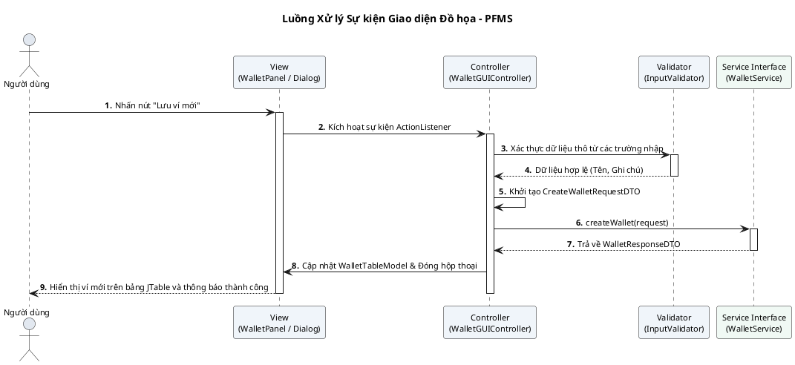

# 07. Thiết kế giao diện người dùng

Tài liệu này đặc tả thiết kế tầng trình diễn đồ họa (GUI) cho hệ thống Quản lý Tài chính Cá nhân (PFMS): cấu trúc gói giao diện, mô hình MVC hướng sự kiện trên Event Dispatch Thread (EDT), bố cục màn hình chính, biểu mẫu nhập liệu, xử lý ngoại lệ và danh mục đối tượng truyền dữ liệu (DTO) kết nối với tầng dịch vụ.

## 7.1 Cấu trúc tầng giao diện người dùng

Mục này trình bày cấu trúc phân rã các gói nội bộ của tầng trình diễn, bảng phân định trách nhiệm thành phần, vòng đời ứng dụng đồ họa và luồng xử lý sự kiện giao diện.

### 7.1.1 Nguyên lý phân tách giao diện và xử lý sự kiện

Tầng trình diễn tuân thủ nguyên lý phân tách trách nhiệm: các thành phần giao diện chỉ tương tác với người dùng qua chuột, bàn phím và màn hình đồ họa, hoàn toàn không chứa quy tắc tính toán số dư hay logic lưu trữ dữ liệu.

Mã nguồn tầng trình diễn nằm trong không gian tên `com.pfms.presentation`, gồm ba gói:

- Gói Khung nhìn (`com.pfms.presentation.view`): Chứa cửa sổ chính (`MainFrame`), thanh điều hướng bên (`SidebarPanel`), các bảng điều khiển phân hệ (`DashboardPanel`, `WalletPanel`, `TransactionPanel`, `TransferPanel`, `CategoryPanel`, `ReportPanel`, `DataManagementPanel`) và các hộp thoại nhập liệu chuyên biệt (`JDialog`).
- Gói Điều phối (`com.pfms.presentation.controller`): Chứa các bộ điều khiển giao diện (`MainController`, `WalletGUIController`, `TransactionGUIController`, `TransferGUIController`, `CategoryGUIController`, `ReportGUIController`, `DataManagementGUIController`). Các lớp này đăng ký lắng nghe sự kiện (`ActionListener`, `DocumentListener`), thực hiện kiểm tra sơ bộ dữ liệu biểu mẫu qua lớp tiện ích, đóng gói dữ liệu vào DTO yêu cầu và gọi phương thức tương ứng trên tầng dịch vụ qua giao diện trừu tượng.
- Gói Truyền Dữ liệu (`com.pfms.presentation.dto`): Chứa các đối tượng dữ liệu thô bất biến (`RequestDTO` và `ResponseDTO`) dùng để trao đổi dữ liệu hai chiều giữa tầng trình diễn và tầng dịch vụ.

Bảng phân định trách nhiệm nội bộ tầng trình diễn:

| Thành phần | Trách nhiệm cho phép | Ranh giới cấm đoán |
| :--- | :--- | :--- |
| **Gói Khung nhìn**<br/>(`presentation.view`) | Xây dựng bố cục giao diện đồ họa, hiển thị bảng dữ liệu `JTable`, thu thập dữ liệu thô từ các ô nhập liệu, kích hoạt hộp thoại xác nhận hoặc thông báo kết quả. | Không tính toán số dư, không kiểm tra quy tắc nghiệp vụ tài chính, không gọi trực tiếp tầng dịch vụ, tầng nghiệp vụ hay kho lưu trữ dữ liệu. |
| **Gói Điều phối**<br/>(`presentation.controller`) | Nhận sự kiện từ giao diện người dùng, điều hướng màn hình hiển thị qua `CardLayout`, đóng gói tham số vào DTO yêu cầu, gọi Giao diện tầng dịch vụ, nhận DTO phản hồi và cập nhật lại mô hình dữ liệu (`TableModel`) của Khung nhìn. | Không tính toán tài chính, không sửa đổi số liệu nghiệp vụ, không trực tiếp thao tác các thành phần đồ họa cấp thấp, không phụ thuộc vào lớp cài đặt cụ thể của dịch vụ hay kho lưu trữ. |
| **Gói Truyền Dữ liệu**<br/>(`presentation.dto`) | Đóng gói tham số nhập thành `RequestDTO`, nhận kết quả ca sử dụng thành `ResponseDTO`, bảo đảm tính bất biến của dữ liệu trung chuyển giữa GUI và Service. | Không chứa logic tính toán tài chính hoặc quy tắc nghiệp vụ, không tham chiếu thực thể miền (`Domain Entity`), không sửa đổi dữ liệu sau khi khởi tạo. |

Lợi ích kỹ thuật của kiến trúc phân tách:
1. Độc lập công nghệ hiển thị: tầng dịch vụ và tầng nghiệp vụ phía sau hoàn toàn không phụ thuộc vào công nghệ giao diện đồ họa cụ thể, cho phép kiểm thử tự động 100% bằng JUnit 5 qua các đối tượng DTO.
2. Dễ bảo trì và nâng cấp: Việc thay đổi bố cục màu sắc, phông chữ hoặc cấu trúc màn hình đồ họa chỉ giới hạn trong gói `view` và `controller`, không gây ảnh hưởng dây chuyền đến các tầng còn lại.

### 7.1.2 Vòng đời ứng dụng đồ họa và luồng bắt sự kiện

Ứng dụng đồ họa PFMS vận hành trên nền tảng luồng giao diện người dùng chuyên biệt Event Dispatch Thread (EDT), bảo đảm tính an toàn luồng và giao diện mượt mà:

- Giai đoạn khởi động: Nạp cấu hình hệ thống, khởi tạo các dịch vụ nghiệp vụ và hiển thị cửa sổ chính `MainFrame` trên luồng giao diện người dùng EDT.
- Giai đoạn xử lý sự kiện: Người dùng tương tác bằng chuột hoặc phím trên các nút bấm (`JButton`), bảng dữ liệu (`JTable`) hoặc ô nhập liệu (`JTextField`). Bộ điều khiển tiếp nhận sự kiện, xác thực dữ liệu qua `InputValidator`, đóng gói DTO và ủy quyền thực thi cho tầng dịch vụ.
- Giai đoạn cập nhật khung nhìn: Sau khi tầng dịch vụ xử lý thành công, bộ điều khiển nhận `ResponseDTO`, chuyển đổi thành dữ liệu hiển thị và cập nhật lại `DefaultTableModel` trên luồng EDT. Nếu phát sinh lỗi nghiệp vụ hoặc ngoại lệ hệ thống, bộ điều khiển hiển thị hộp thoại cảnh báo `JOptionPane.showMessageDialog` với thông điệp rõ ràng bằng tiếng Việt.

Sơ đồ tuần tự xử lý sự kiện giao diện:



## 7.2 Bố cục cửa sổ chính và màn hình phân hệ

Mục này xác lập cấu trúc bố cục phân vùng của cửa sổ chính `MainFrame`, bảng ánh xạ từ các nút điều hướng màn hình đến ca sử dụng nghiệp vụ và quy chuẩn hiển thị bảng dữ liệu `JTable`.

### 7.2.1 Cấu trúc phân vùng cửa sổ chính

Cửa sổ chính `MainFrame` áp dụng bố cục vùng `BorderLayout` chia thành ba phân khu trực quan:

- Phân khu điều hướng bên trái (`BorderLayout.WEST`): Chiếm chiều rộng cố định 220 pixel, chứa biểu trưng ứng dụng PFMS và danh sách các nút điều hướng phân hệ xếp theo chiều dọc (`GridLayout`).
- Phân khu nội dung trung tâm (`BorderLayout.CENTER`): Sử dụng cơ chế quản lý bố cục thẻ (`CardLayout`) để chuyển đổi linh hoạt giữa bảy màn hình phân hệ mà không phải mở nhiều cửa sổ con độc lập.
- Phân khu trạng thái phía dưới (`BorderLayout.SOUTH`): Hiển thị dòng trạng thái gồm đường dẫn tệp dữ liệu đang làm việc, thời gian đồng bộ gần nhất và tổng số dư khả dụng toàn hệ thống.

Sơ đồ phân vùng không gian cửa sổ chính:

```text
┌────────────────────────────────────────────────────────────────────────┐
│ Cửa sổ chính: Personal Finance Management System (MainFrame: 1024x680) │
├─────────────────┬──────────────────────────────────────────────────────┤
│  SIDEBAR PANEL  │                    CONTENT PANEL                     │
│  (Width: 220px) │              (CardLayout: 7 Phân hệ)                 │
│                 │                                                      │
│  [PFMS Logo]    │  ┌────────────────────────────────────────────────┐  │
│                 │  │ Tiêu đề màn hình phân hệ                       │  │
│  [Tổng quan]    │  ├────────────────────────────────────────────────┤  │
│  [Ví tài chính] │  │ Thanh công cụ: [Thêm mới] [Sửa] [Xóa] [Lọc...] │  │
│  [Thu & Chi]    │  ├────────────────────────────────────────────────┤  │
│  [Chuyển tiền]  │  │                                                │  │
│  [Danh mục]     │  │       Bảng dữ liệu JTable hiển thị danh sách   │  │
│  [Báo cáo]      │  │                                                │  │
│  [Quản trị]     │  │                                                │  │
│                 │  └────────────────────────────────────────────────┘  │
├─────────────────┴──────────────────────────────────────────────────────┤
│ Thanh trạng thái: Tệp dữ liệu: active_data.json | Tổng số dư: 82,850,000│
└────────────────────────────────────────────────────────────────────────┘
```

### 7.2.2 Ánh xạ màn hình chức năng và ca sử dụng

Bảng ánh xạ chi tiết các thao tác giao diện người dùng đến từng ca sử dụng nghiệp vụ:

| Màn hình phân hệ | Nút bấm thao tác | Tên thao tác nghiệp vụ | Mã ca sử dụng | Controller điều phối |
| :--- | :--- | :--- | :--- | :--- |
| **Tổng quan** | Xem tự động | Nạp tổng quan tài sản và giao dịch gần đây | `UC-WAL-02`, `UC-TXN-02` | `MainController` |
| **Quản lý Ví** | Thêm ví | Mở hộp thoại nhập tên và ghi chú tạo ví mới | `UC-WAL-01` | `WalletGUIController` |
| **Quản lý Ví** | Sửa ví | Mở hộp thoại cập nhật tên và ghi chú ví | `UC-WAL-03` | `WalletGUIController` |
| **Quản lý Ví** | Điều chỉnh số dư | Mở hộp thoại kiểm kê số dư thực tế | `UC-WAL-04` | `WalletGUIController` |
| **Quản lý Ví** | Lưu trữ / Kích hoạt | Chuyển đổi trạng thái hoạt động của ví | `UC-WAL-03` | `WalletGUIController` |
| **Ghi nhận Thu Chi** | Thêm giao dịch | Mở hộp thoại ghi nhận thu hoặc chi | `UC-TXN-01` | `TransactionGUIController` |
| **Ghi nhận Thu Chi** | Lọc dữ liệu | Lọc danh sách giao dịch theo ví, ngày, loại | `UC-TXN-02` | `TransactionGUIController` |
| **Ghi nhận Thu Chi** | Sửa giao dịch | Mở hộp thoại sửa thông tin giao dịch | `UC-TXN-03` | `TransactionGUIController` |
| **Ghi nhận Thu Chi** | Xóa giao dịch | Xóa giao dịch và hoàn nguyên số dư ví | `UC-TXN-04` | `TransactionGUIController` |
| **Chuyển tiền Nội bộ** | Chuyển tiền | Mở hộp thoại chuyển tiền giữa hai ví | `UC-TRF-01` | `TransferGUIController` |
| **Chuyển tiền Nội bộ** | Xem lịch sử | Nạp danh sách các lần chuyển tiền | `UC-TRF-02` | `TransferGUIController` |
| **Chuyển tiền Nội bộ** | Hủy chuyển tiền | Hủy giao dịch chuyển và hoàn trả số dư | `UC-TRF-03` | `TransferGUIController` |
| **Quản lý Danh mục** | Thêm danh mục | Mở hộp thoại tạo danh mục con cấp 3 | `UC-CAT-01` | `CategoryGUIController` |
| **Quản lý Danh mục** | Sửa danh mục | Mở hộp thoại đổi tên hoặc chuyển nhóm cha | `UC-CAT-02` | `CategoryGUIController` |
| **Quản lý Danh mục** | Xóa danh mục | Xóa mềm danh mục thu chi | `UC-CAT-03` | `CategoryGUIController` |
| **Quản lý Danh mục** | Xem cây danh mục | Hiển thị cấu trúc cây 3 cấp bằng JTree | `UC-CAT-04` | `CategoryGUIController` |
| **Báo cáo Thống kê** | Báo cáo dòng tiền | Biểu diễn chuỗi dòng tiền 12 tháng liên tục | `UC-REP-01` | `ReportGUIController` |
| **Báo cáo Thống kê** | Cơ cấu thu chi | Phân tích cơ cấu và tỷ trọng thu chi theo nhóm nhu cầu và danh mục | `UC-REP-02` | `ReportGUIController` |
| **Quản trị Dữ liệu** | Xuất sao lưu | Mở hộp thoại chọn thư mục lưu dữ liệu sao lưu | `UC-DAT-01` | `DataManagementGUIController` |
| **Quản trị Dữ liệu** | Phục hồi dữ liệu | Mở hộp thoại chọn tệp JSON để phục hồi | `UC-DAT-02` | `DataManagementGUIController` |
| **Quản trị Dữ liệu** | Kiểm tra đối soát | Kích hoạt quy trình đối soát toàn vẹn | `UC-DAT-03` | `DataManagementGUIController` |

### 7.2.3 Quy chuẩn hiển thị bảng dữ liệu và hộp thoại

Giao diện đồ họa PFMS áp dụng chuẩn kết xuất bảng dữ liệu `JTable` hiện đại thông qua các bộ vẽ ô tùy biến (`Custom TableCellRenderer`):

1. Căn lề dữ liệu theo ngữ nghĩa: Căn trái cho dữ liệu chuỗi văn bản, tên ví, tên danh mục và ghi chú; căn giữa cho mã định danh, ngày tháng và trạng thái; căn phải cho số tiền và giá trị số học.
2. Định dạng số tiền và màu sắc trực quan: Số tiền được định dạng theo mẫu phân tách hàng nghìn chuẩn Việt Nam (`#,##0 VNĐ`). Các khoản thu nhập được hiển thị với màu xanh lá cây kèm tiền tố dấu cộng, các khoản chi tiêu hiển thị với màu đỏ hoặc cam kèm tiền tố dấu trừ.
3. Hộp thoại nhập liệu modal (`JDialog`): Mọi thao tác thêm mới hoặc sửa đổi dữ liệu đều mở cửa sổ hộp thoại có tính năng khóa màn hình cha (`setModal(true)`), giúp người dùng tập trung hoàn thành tác vụ nhập liệu trước khi quay lại màn hình chính.

Mẫu giao diện bảng danh sách ví:

| # | Mã ví | Tên ví | Đơn vị | Số dư khả dụng | Trạng thái |
| :---: | :---: | :--- | :---: | ---: | :---: |
| 1 | WAL-000001 | Tiền mặt sinh hoạt | VND | 4,500,000 VNĐ | Hoạt động |
| 2 | WAL-000002 | Tài khoản MB Bank | VND | 28,350,000 VNĐ | Hoạt động |
| 3 | WAL-000003 | Quỹ dự phòng sự cố | VND | 50,000,000 VNĐ | Hoạt động |

## 7.3 Thiết kế biểu mẫu nhập liệu và bắt sự kiện

Mục này đặc tả lớp tiện ích kiểm tra tính hợp lệ của dữ liệu biểu mẫu đồ họa, xác lập cơ chế phản hồi lỗi tại chỗ và xử lý xác nhận an toàn cho các tác vụ nhạy cảm.

### 7.3.1 Xác thực biểu mẫu đồ họa

Toàn bộ dữ liệu nhập từ các trường `JTextField`, `JComboBox` và `JTextArea` ban đầu đều ở dạng chuỗi ký tự thô. Để bảo vệ tầng dịch vụ khỏi dữ liệu rác, hệ thống thiết kế lớp tiện ích `InputValidator` đặt trong gói `com.pfms.presentation.util`.

Lớp `InputValidator` thực hiện kiểm tra dữ liệu trước khi bộ điều khiển tạo DTO:
- Kiểm tra chuỗi bắt buộc: Kiểm tra độ dài và loại bỏ khoảng trắng thừa hai đầu chuỗi, bảo đảm các trường tên ví, tên giao dịch không bị để trống.
- Kiểm tra định dạng ngày tháng: Hỗ trợ chuyển đổi chuỗi ngày tháng từ định dạng thân thiện Việt Nam (`dd/MM/yyyy`) hoặc chuẩn quốc tế (`yyyy-MM-dd`) sang đối tượng `java.time.LocalDate`.
- Kiểm tra giá trị tiền tệ: Kiểm tra chuỗi số hợp lệ, từ chối số âm hoặc số 0 đối với số tiền giao dịch, chuyển đổi an toàn sang `java.math.BigDecimal` với quy tắc làm tròn rõ ràng.

Bảng đặc tả các phương thức xác thực của `InputValidator`:

| Phương thức | Tham số đầu vào | Kiểu trả về | Ràng buộc và Quy tắc Xác thực |
| :--- | :--- | :--- | :--- |
| `validateNonEmpty(String text, String fieldName)` | Chuỗi nhập, Tên trường | `String` | Chuỗi không được rỗng sau khi cắt tỉa; ném ngoại lệ kiểm tra kèm tên trường nếu vi phạm. |
| `validatePositiveAmount(String text, String fieldName)` | Chuỗi nhập, Tên trường | `BigDecimal` | Chuỗi phải là số học hợp lệ; giá trị phải lớn hơn 0; không vượt quá 100 tỷ VNĐ. |
| `validateNonNegativeAmount(String text, String fieldName)` | Chuỗi nhập, Tên trường | `BigDecimal` | Dùng cho số dư khởi điểm hoặc kiểm kê số dư: giá trị phải lớn hơn hoặc bằng 0. |
| `validateDate(String text, String fieldName)` | Chuỗi nhập, Tên trường | `LocalDate` | Định dạng nhập `dd/MM/yyyy` hoặc `yyyy-MM-dd`; kiểm tra ngày tồn tại thực tế trên lịch. |
| `validateTextLength(String text, int maxLength, String fieldName)` | Chuỗi nhập, Độ dài tối đa, Tên trường | `String` | Độ dài chuỗi sau cắt tỉa không vượt quá ngưỡng cho phép (tên ví tối đa 50 ký tự, ghi chú 255 ký tự). |

### 7.3.2 Phản hồi người dùng và hộp thoại xác nhận

Nhằm bảo đảm trải nghiệm sử dụng an toàn và tuân thủ nghiêm ngặt yêu cầu phi chức năng về khả năng sử dụng:

1. Hộp thoại xác nhận thao tác nhạy cảm: Đối với các thao tác có nguy cơ làm thay đổi cấu trúc dữ liệu hoặc tác động tài chính lớn (xóa ví, xóa giao dịch, hủy chuyển tiền, khôi phục sao lưu dữ liệu), hệ thống bắt buộc mở hộp thoại xác nhận `JOptionPane.showConfirmDialog` với mức cảnh báo `WARNING_MESSAGE`. Thao tác chỉ được thực thi khi người dùng nhấn nút đồng ý (`JOptionPane.YES_OPTION`).
2. Thông báo lỗi chuẩn hóa và thân thiện: Khi phát sinh lỗi vi phạm quy tắc tài chính từ tầng dịch vụ (như số dư không đủ, tên ví bị trùng lặp), bộ điều khiển bắt giữ ngoại lệ và hiển thị hộp thoại `JOptionPane.showMessageDialog` với mã lỗi nghiệp vụ chuẩn hóa (`ERR-...`) kèm hướng dẫn xử lý cụ thể, không để lộ vết ngăn xếp lỗi hệ thống ra màn hình đồ họa.

## 7.4 Thiết kế các đối tượng truyền dữ liệu (DTO)

Mục này đặc tả cấu trúc các đối tượng truyền dữ liệu đóng vai trò cầu nối thông tin giữa tầng trình diễn và tầng dịch vụ, xác lập tính đóng gói bất biến và danh mục các lớp dữ liệu phục vụ các ca sử dụng.

### 7.4.1 Mục đích và tính đóng gói của đối tượng truyền dữ liệu

Trong kiến trúc phân tầng của PFMS, việc phân tách rạch ròi giữa các thành phần giao diện người dùng và mô hình nghiệp vụ cốt lõi được bảo đảm thông qua mẫu thiết kế đối tượng truyền dữ liệu (DTO).

Mục đích kỹ thuật của mẫu thiết kế DTO:
- Ngăn chặn rò rỉ thực thể miền: tầng trình diễn đồ họa không tiếp xúc trực tiếp với các thực thể miền (`Wallet`, `Transaction`, `Category`), loại bỏ nguy cơ giao diện tự ý gọi các phương thức thay đổi trạng thái số dư mà không thông qua dịch vụ điều phối.
- Tối ưu hóa dữ liệu hiển thị: DTO chỉ chắt lọc các trường dữ liệu thô (chuỗi, số, ngày tháng) mà các bảng `JTable` hoặc biểu mẫu nhập liệu cần sử dụng.
- Độc lập tiến hóa mã nguồn: Cho phép cấu trúc giao diện đồ họa có thể thay đổi linh hoạt mà không làm ảnh hưởng đến cấu trúc lưu trữ và quy tắc nghiệp vụ tầng miền.

Nguyên tắc đóng gói và thiết kế bất biến:
- Cấu trúc dữ liệu thuần túy: Mỗi lớp DTO chỉ bao gồm các trường dữ liệu riêng tư (`private`), hàm khởi tạo đầy đủ tham số và các phương thức lấy giá trị (`getter`), hoàn toàn không chứa logic tính toán tài chính.
- Tính bất biến của dữ liệu: Mọi trường thuộc tính trong DTO được khai báo với từ khóa `final` để bảo đảm dữ liệu không bị thay đổi trong quá trình trung chuyển giữa các tầng.
- Phân tách hai chiều: Hệ thống phân định thành hai nhóm độc lập gồm DTO yêu cầu (`RequestDTO` gửi từ GUI xuống Dịch vụ) và DTO phản hồi (`ResponseDTO` trả về từ Dịch vụ lên GUI).

### 7.4.2 Danh mục các lớp truyền dữ liệu chi tiết

Toàn bộ các lớp DTO trình diễn trong hệ thống được đặt trong gói `com.pfms.presentation.dto` (tách biệt với lớp đóng gói nội bộ `BackupPayload` thuộc `com.pfms.service.impl.data`) và phân định thành hai nhóm chính gồm DTO yêu cầu và DTO phản hồi:

Bảng Danh mục các Lớp DTO yêu cầu:

| Tên lớp DTO yêu cầu | Danh sách Thuộc tính và Kiểu dữ liệu | Mô tả Mục đích Dữ liệu |
| :--- | :--- | :--- |
| **Phân hệ Quản lý Ví (WAL)** |  |  |
| `CreateWalletRequestDTO` | `name: String, note: String` | Dữ liệu tạo ví tài chính mới (tên ví và ghi chú). |
| `UpdateWalletRequestDTO` | `walletId: UUID, name: String, note: String` | Dữ liệu cập nhật tên và ghi chú ví, bảo toàn số dư hiện có. |
| `AdjustBalanceRequestDTO` | `walletId: UUID, actualBalance: BigDecimal, reason: String, adjustedAt: LocalDate` | Dữ liệu kiểm kê số dư thực tế (mã ví, số dư quan sát, lý do, ngày kiểm kê). |
| **Phân hệ Ghi nhận Thu Chi (TXN)** |  |  |
| `RecordTransactionRequestDTO` | `walletId: UUID, categoryId: UUID, amount: BigDecimal, transactionDate: LocalDate, note: String, feeAmount: BigDecimal, feeCategoryId: UUID` | Dữ liệu ghi nhận giao dịch thu chi kèm phụ phí và danh mục phí liên kết. |
| `UpdateTransactionRequestDTO` | `transactionId: UUID, newWalletId: UUID, newAmount: BigDecimal, newDate: LocalDate, newCategoryId: UUID, newNote: String, newFeeAmount: BigDecimal, newFeeCategoryId: UUID` | Dữ liệu cập nhật giao dịch thu chi (ví mới, số tiền, ngày, danh mục, ghi chú, phụ phí). |
| `FilterTransactionsRequestDTO` | `startDate: LocalDate, endDate: LocalDate, walletIds: Set<UUID>, transactionType: String, categoryIds: Set<UUID>, keyword: String, pageNumber: int, pageSize: int` | Bộ tiêu chí lọc sổ giao dịch (khoảng ngày, tập ví, loại thu chi, danh mục, từ khóa) và phân trang. |
| **Phân hệ Chuyển tiền Nội bộ (TRF)** |  |  |
| `TransferFundsRequestDTO` | `sourceWalletId: UUID, destinationWalletId: UUID, amount: BigDecimal, transferDate: LocalDate, note: String, feeAmount: BigDecimal, feeCategoryId: UUID` | Dữ liệu chuyển tiền giữa hai ví kèm phụ phí và danh mục phí liên kết. |
| `FilterTransfersRequestDTO` | `startDate: LocalDate, endDate: LocalDate, sourceWalletId: UUID, destinationWalletId: UUID, pageNumber: int, pageSize: int` | Tiêu chí lọc lịch sử chuyển tiền (khoảng ngày, ví gửi, ví nhận) và phân trang. |
| **Phân hệ Quản lý Danh mục (CAT)** |  |  |
| `CreateNeedGroupRequestDTO` | `transactionType: String, name: String, icon: String, color: String` | Dữ liệu tạo nhóm nhu cầu cấp 2 (loại thu chi, tên, biểu tượng, mã màu). |
| `RenameNeedGroupRequestDTO` | `needGroupId: UUID, name: String, icon: String, color: String` | Dữ liệu đổi tên hoặc cập nhật biểu tượng, mã màu nhóm nhu cầu cấp 2. |
| `CreateCategoryRequestDTO` | `parentGroupId: UUID, name: String` | Dữ liệu tạo danh mục chi tiết cấp 3 thuộc nhóm nhu cầu cha. |
| `RenameCategoryRequestDTO` | `categoryId: UUID, name: String, newParentGroupId: UUID` | Dữ liệu đổi tên hoặc chuyển nhóm nhu cầu cha của danh mục cấp 3. |
| **Phân hệ Báo cáo Thống kê (REP)** |  |  |
| `CashFlowReportRequestDTO` | `endMonth: int, endYear: int` | Mốc tháng và năm kết thúc để truy vấn chuỗi dòng tiền 12 tháng liên tục. |
| `SpendingStructureReportRequestDTO` | `startDate: LocalDate, endDate: LocalDate, transactionType: String` | Khoảng ngày và loại luồng tiền (`EXPENSE`/`INCOME`) để phân tích cơ cấu tỷ trọng 2 cấp. |
| **Phân hệ Quản trị Dữ liệu (DAT)** |  |  |
| `ExportBackupRequestDTO` | `destinationPath: String, scope: String` | Đường dẫn thư mục đích và phạm vi sao lưu (`FULL` hoặc `TRANSACTIONS`). |
| `RestoreBackupRequestDTO` | `backupFilePath: String` | Đường dẫn tệp sao lưu JSON để phục hồi dữ liệu (All-or-Nothing). |

Bảng Danh mục các Lớp DTO phản hồi:

| Tên lớp DTO phản hồi | Danh sách Thuộc tính và Kiểu dữ liệu | Mô tả Dữ liệu Kết xuất |
| :--- | :--- | :--- |
| **Phân hệ Quản lý Ví (WAL)** |  |  |
| `WalletResponseDTO` | `walletId: UUID, name: String, balance: BigDecimal, currency: String, defaultWallet: boolean, status: String, note: String, createdAt: LocalDateTime` | Thông tin chi tiết một ví tài chính phục vụ hiển thị kết quả hoặc dòng bảng `JTable`. |
| `WalletsSummaryResponseDTO` | `wallets: List<WalletResponseDTO>, totalBalance: BigDecimal, currency: String, walletShares: Map<UUID, BigDecimal>` | Bảng tổng hợp các ví khả dụng, tổng số dư toàn hệ thống, đơn vị tiền tệ và tỷ trọng phân bổ (%). |
| `BalanceAdjustmentResponseDTO` | `recordId: UUID, walletId: UUID, previousBalance: BigDecimal, actualBalance: BigDecimal, difference: BigDecimal, currency: String, reason: String, adjustedAt: LocalDate, createdAt: LocalDateTime` | Kết quả điều chỉnh số dư: mã bản ghi, số dư trước/sau, chênh lệch và ngày kiểm kê lưu vết kiểm toán. |
| **Phân hệ Ghi nhận Thu Chi (TXN)** |  |  |
| `TransactionResponseDTO` | `transactionId: UUID, walletId: UUID, walletName: String, categoryId: UUID, categoryName: String, amount: BigDecimal, transactionType: String, transactionDate: LocalDate, note: String, hasFee: boolean, feeAmount: BigDecimal, feeCategoryId: UUID, feeCategoryName: String, walletBalanceAfter: BigDecimal, createdAt: LocalDateTime` | Kết xuất chi tiết giao dịch thu chi sau khi tạo/cập nhật, kèm chi tiết phụ phí và số dư ví sau biến động. |
| `TransactionListResponseDTO` | `items: List<TransactionResponseDTO>, totalIncome: BigDecimal, totalExpense: BigDecimal, netCashFlow: BigDecimal, pageNumber: int, pageSize: int, totalRecords: long, totalPages: int` | Danh sách phân trang giao dịch thu chi kèm 3 chỉ số tổng hợp (thu nhập, chi tiêu gồm phí, dòng tiền thuần). |
| **Phân hệ Chuyển tiền Nội bộ (TRF)** |  |  |
| `TransferResponseDTO` | `transferId: UUID, sourceWalletId: UUID, sourceWalletName: String, destinationWalletId: UUID, destinationWalletName: String, amount: BigDecimal, transferDate: LocalDate, note: String, feeAmount: BigDecimal, feeCategoryId: UUID, feeCategoryName: String, sourceBalanceAfter: BigDecimal, destinationBalanceAfter: BigDecimal, createdAt: LocalDateTime` | Kết quả chuyển khoản nguyên tử: mã giao dịch, cặp ví, số tiền chuyển, phụ phí và số dư cập nhật hai ví. |
| `TransferListResponseDTO` | `items: List<TransferResponseDTO>, totalTransferredAmount: BigDecimal, totalFees: BigDecimal, pageNumber: int, pageSize: int, totalRecords: long, totalPages: int` | Danh sách phân trang lịch sử chuyển tiền nội bộ kèm tổng tiền điều chuyển và tổng phụ phí phát sinh. |
| **Phân hệ Quản lý Danh mục (CAT)** |  |  |
| `NeedGroupResponseDTO` | `needGroupId: UUID, name: String, transactionType: String, status: String, icon: String, color: String, createdAt: LocalDateTime` | Thông tin chi tiết nhóm nhu cầu cấp 2 (trạng thái, biểu tượng, mã màu, thời điểm tạo). |
| `CategoryResponseDTO` | `categoryId: UUID, name: String, parentGroupId: UUID, parentGroupName: String, transactionType: String, status: String, createdAt: LocalDateTime` | Thông tin chi tiết danh mục cấp 3 kèm nhóm cha và loại thu chi hiển thị trên bảng/hộp chọn. |
| `CategoryHierarchyResponseDTO` | `transactionType: String, needGroupId: UUID, needGroupName: String, needGroupStatus: String, categories: List<CategoryResponseDTO>` | Cấu trúc phân cấp 3 cấp theo từng nhóm nhu cầu kèm danh sách danh mục con trực thuộc (`JTree`). |
| **Phân hệ Báo cáo Thống kê (REP)** |  |  |
| `MonthlyCashFlowResponseDTO` | `yearMonth: String, totalIncome: BigDecimal, totalExpense: BigDecimal, netCashFlow: BigDecimal, savingsRate: BigDecimal` | Dữ liệu dòng tiền một tháng: tổng thu, tổng chi gồm phí, dòng tiền thuần và tỷ lệ tiết kiệm. |
| `CashFlowReportResponseDTO` | `months: List<MonthlyCashFlowResponseDTO>, avgIncome: BigDecimal, avgExpense: BigDecimal, avgNetCashFlow: BigDecimal` | Bảng tổng hợp chuỗi 12 tháng liên tục kèm các chỉ số bình quân năm. |
| `CategoryShareResponseDTO` | `categoryId: UUID, name: String, status: String, totalAmount: BigDecimal, share: BigDecimal, shareInGroup: BigDecimal, previousTotalAmount: BigDecimal, differenceAmount: BigDecimal, percentageChange: BigDecimal, isNew: boolean` | Số liệu danh mục cấp 3: tổng tiền, tỷ trọng (`share`, `shareInGroup`), trạng thái và biến động kỳ liền kề (`isNew`). |
| `NeedGroupShareResponseDTO` | `needGroupId: UUID, name: String, status: String, totalAmount: BigDecimal, share: BigDecimal, previousTotalAmount: BigDecimal, differenceAmount: BigDecimal, percentageChange: BigDecimal, isNew: boolean, categories: List<CategoryShareResponseDTO>` | Số liệu nhóm nhu cầu cấp 2: tổng tiền, tỷ trọng toàn kỳ, trạng thái, biến động kỳ liền kề (`isNew`) và danh mục con. |
| `SpendingStructureReportResponseDTO` | `transactionType: String, startDate: LocalDate, endDate: LocalDate, totalAmount: BigDecimal, previousTotalAmount: BigDecimal, differenceAmount: BigDecimal, percentageChange: BigDecimal, isNew: boolean, groups: List<NeedGroupShareResponseDTO>` | Báo cáo cơ cấu thu chi 2 cấp hoàn chỉnh, đối chiếu biến động so với kỳ liền kề và danh sách nhóm nhu cầu. |
| **Phân hệ Quản trị Dữ liệu (DAT)** |  |  |
| `ExportBackupResponseDTO` | `filePath: String, fileSizeBytes: long, exportedAt: LocalDateTime, scope: String, walletCount: int, categoryCount: int, transactionCount: int, adjustmentCount: int` | Kết quả xuất sao lưu: đường dẫn tệp, kích thước (byte), mốc thời gian, phạm vi và số lượng bản ghi. |
| `RestoreBackupResponseDTO` | `success: boolean, message: String, restoredAt: LocalDateTime, restoredWallets: int, restoredCategories: int, restoredTransactions: int, restoredAdjustments: int` | Kết quả phục hồi dữ liệu: trạng thái thành công, thông điệp, thời điểm hoàn tất và số lượng bản ghi phục hồi. |
| `ReconciliationIssueResponseDTO` | `severity: String, ruleCode: String, issueType: String, message: String, affectedEntityId: String, recommendation: String` | Chi tiết từng sai lệch hoặc bất thường phát hiện trong quá trình đối soát toàn vẹn. |
| `ReconciliationReportResponseDTO` | `walletBalanceConsistent: boolean, transferConsistent: boolean, categoryHierarchyConsistent: boolean, feeConsistent: boolean, scannedWallets: int, scannedTransactions: int, scannedCategories: int, scannedAdjustments: int, issues: List<ReconciliationIssueResponseDTO>` | Báo cáo đối soát độc lập 4 điều kiện toàn vẹn, số lượng bản ghi quét và danh sách cảnh báo sai lệch. |
