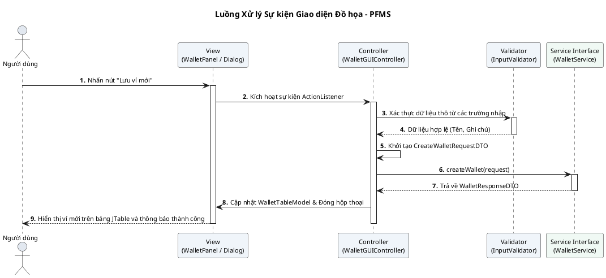

# 07. Thiết kế Giao diện Người dùng

Tài liệu này đặc tả thiết kế Tầng Trình diễn đồ họa (GUI) cho Hệ thống Quản lý Tài chính Cá nhân PFMS. Nội dung tập trung vào cấu trúc các gói giao diện, mô hình kiến trúc MVC hướng sự kiện, bố cục màn hình chính, thiết kế biểu mẫu nhập liệu, cơ chế bắt ngoại lệ hiển thị và danh mục các lớp đối tượng truyền dữ liệu (DTO) kết nối với Tầng Dịch vụ.

## 7.1 Cấu trúc Tầng Giao diện Người dùng

Mục này trình bày cấu trúc phân rã các gói nội bộ của Tầng Trình diễn, bảng phân định trách nhiệm thành phần, vòng đời ứng dụng đồ họa và luồng xử lý sự kiện giao diện.

### 7.1.1 Nguyên lý Phân tách Giao diện và Xử lý Sự kiện

Tầng Trình diễn tuân thủ nguyên lý phân tách trách nhiệm: các thành phần giao diện chỉ tương tác với người dùng qua chuột, bàn phím và màn hình đồ họa, hoàn toàn không chứa quy tắc tính toán số dư hay logic lưu trữ dữ liệu.

Mã nguồn tầng trình diễn nằm trong không gian tên `com.pfms.presentation`, gồm ba gói:

- Gói Khung nhìn (`com.pfms.presentation.view`): Chứa cửa sổ chính (`MainFrame`), thanh điều hướng bên (`SidebarPanel`), các bảng điều khiển phân hệ (`DashboardPanel`, `WalletPanel`, `TransactionPanel`, `TransferPanel`, `CategoryPanel`, `ReportPanel`, `DataManagementPanel`) và các hộp thoại nhập liệu chuyên biệt (`JDialog`).
- Gói Điều phối (`com.pfms.presentation.controller`): Chứa các bộ điều khiển giao diện (`MainController`, `WalletGUIController`, `TransactionGUIController`, `TransferGUIController`, `CategoryGUIController`, `ReportGUIController`, `DataManagementGUIController`). Các lớp này đăng ký lắng nghe sự kiện (`ActionListener`, `DocumentListener`), thực hiện kiểm tra sơ bộ dữ liệu biểu mẫu qua lớp tiện ích, đóng gói dữ liệu vào DTO yêu cầu và gọi phương thức tương ứng trên Tầng Dịch vụ qua giao diện trừu tượng.
- Gói Truyền Dữ liệu (`com.pfms.presentation.dto`): Chứa các đối tượng dữ liệu thô bất biến (`RequestDTO` và `ResponseDTO`) dùng để trao đổi dữ liệu hai chiều giữa Tầng Trình diễn và Tầng Dịch vụ.

Bảng phân định trách nhiệm nội bộ Tầng Trình diễn:

| Thành phần | Trách nhiệm cho phép | Ranh giới cấm đoán |
| :--- | :--- | :--- |
| **Gói Khung nhìn**<br/>(`presentation.view`) | Xây dựng bố cục giao diện đồ họa, hiển thị bảng dữ liệu `JTable`, thu thập dữ liệu thô từ các ô nhập liệu, kích hoạt hộp thoại xác nhận hoặc thông báo kết quả. | Không tính toán số dư, không kiểm tra quy tắc nghiệp vụ tài chính, không gọi trực tiếp Tầng Dịch vụ, Tầng Miền hay Kho lưu trữ dữ liệu. |
| **Gói Điều phối**<br/>(`presentation.controller`) | Nhận sự kiện từ giao diện người dùng, điều hướng màn hình hiển thị qua `CardLayout`, đóng gói tham số vào DTO yêu cầu, gọi Giao diện Tầng Dịch vụ, nhận DTO phản hồi và cập nhật lại mô hình dữ liệu (`TableModel`) của Khung nhìn. | Không tính toán tài chính, không sửa đổi số liệu nghiệp vụ, không trực tiếp thao tác các thành phần đồ họa cấp thấp, không phụ thuộc vào lớp cài đặt cụ thể của dịch vụ hay kho lưu trữ. |
| **Gói Truyền Dữ liệu**<br/>(`presentation.dto`) | Đóng gói tham số nhập thành `RequestDTO`, nhận kết quả ca sử dụng thành `ResponseDTO`, bảo đảm tính bất biến của dữ liệu trung chuyển giữa GUI và Service. | Không chứa logic tính toán tài chính hoặc quy tắc nghiệp vụ, không tham chiếu thực thể miền (`Domain Entity`), không sửa đổi dữ liệu sau khi khởi tạo. |

Lợi ích kỹ thuật của kiến trúc phân tách:
1. Độc lập công nghệ hiển thị: Tầng Dịch vụ và Tầng Nghiệp vụ phía sau hoàn toàn không phụ thuộc vào công nghệ giao diện đồ họa cụ thể, cho phép kiểm thử tự động 100% bằng JUnit 5 qua các đối tượng DTO.
2. Dễ bảo trì và nâng cấp: Việc thay đổi bố cục màu sắc, phông chữ hoặc cấu trúc màn hình đồ họa chỉ giới hạn trong gói `view` và `controller`, không gây ảnh hưởng dây chuyền đến các tầng còn lại.

### 7.1.2 Vòng đời Ứng dụng Đồ họa và Luồng Bắt Sự kiện

Ứng dụng đồ họa PFMS vận hành trên nền tảng luồng giao diện người dùng chuyên biệt Event Dispatch Thread (EDT), bảo đảm tính an toàn luồng và giao diện mượt mà:

- Giai đoạn Khởi động: Nạp cấu hình hệ thống, khởi tạo các dịch vụ nghiệp vụ và hiển thị cửa sổ chính `MainFrame` trên luồng giao diện người dùng EDT.
- Giai đoạn Xử lý Sự kiện: Người dùng tương tác bằng chuột hoặc phím trên các nút bấm (`JButton`), bảng dữ liệu (`JTable`) hoặc ô nhập liệu (`JTextField`). Bộ điều khiển tiếp nhận sự kiện, xác thực dữ liệu qua `InputValidator`, đóng gói DTO và ủy quyền thực thi cho Tầng Dịch vụ.
- Giai đoạn Cập nhật Khung nhìn: Sau khi Tầng Dịch vụ xử lý thành công, bộ điều khiển nhận `ResponseDTO`, chuyển đổi thành dữ liệu hiển thị và cập nhật lại `DefaultTableModel` trên luồng EDT. Nếu phát sinh lỗi nghiệp vụ hoặc ngoại lệ hệ thống, bộ điều khiển hiển thị hộp thoại cảnh báo `JOptionPane.showMessageDialog` với thông điệp rõ ràng bằng tiếng Việt.

Sơ đồ tuần tự xử lý sự kiện giao diện:



## 7.2 Bố cục Cửa sổ Chính và Màn hình Phân hệ

Mục này xác lập cấu trúc bố cục phân vùng của cửa sổ chính `MainFrame`, bảng ánh xạ từ các nút điều hướng màn hình đến ca sử dụng nghiệp vụ và quy chuẩn hiển thị bảng dữ liệu `JTable`.

### 7.2.1 Cấu trúc Phân vùng Cửa sổ Chính

Cửa sổ chính `MainFrame` áp dụng bố cục vùng `BorderLayout` chia thành ba phân khu trực quan:

- Phân khu Điều hướng bên trái (`BorderLayout.WEST`): Chiếm chiều rộng cố định 220 pixel, chứa biểu trưng ứng dụng PFMS và danh sách các nút điều hướng phân hệ xếp theo chiều dọc (`GridLayout`).
- Phân khu Nội dung trung tâm (`BorderLayout.CENTER`): Sử dụng cơ chế quản lý bố cục thẻ (`CardLayout`) để chuyển đổi linh hoạt giữa bảy màn hình phân hệ mà không phải mở nhiều cửa sổ con độc lập.
- Phân khu Trạng thái phía dưới (`BorderLayout.SOUTH`): Hiển thị dòng trạng thái gồm đường dẫn tệp dữ liệu đang làm việc, thời gian đồng bộ gần nhất và tổng số dư khả dụng toàn hệ thống.

Sơ đồ phân vùng không gian cửa sổ chính:

```text
┌────────────────────────────────────────────────────────────────────────┐
│ Cửa sổ chính: Personal Finance Management System (MainFrame: 1024x680) │
├─────────────────┬──────────────────────────────────────────────────────┤
│  SIDEBAR PANEL  │                    CONTENT PANEL                     │
│  (Width: 220px) │              (CardLayout: 7 Phân hệ)                 │
│                 │                                                      │
│  [PFMS Logo]    │  ┌────────────────────────────────────────────────┐  │
│                 │  │ Tiêu đề màn hình phân hệ                       │  │
│  [Tổng quan]    │  ├────────────────────────────────────────────────┤  │
│  [Ví tài chính] │  │ Thanh công cụ: [Thêm mới] [Sửa] [Xóa] [Lọc...] │  │
│  [Thu & Chi]    │  ├────────────────────────────────────────────────┤  │
│  [Chuyển tiền]  │  │                                                │  │
│  [Danh mục]     │  │       Bảng dữ liệu JTable hiển thị danh sách   │  │
│  [Báo cáo]      │  │                                                │  │
│  [Quản trị]     │  │                                                │  │
│                 │  └────────────────────────────────────────────────┘  │
├─────────────────┴──────────────────────────────────────────────────────┤
│ Thanh trạng thái: Tệp dữ liệu: active_data.json | Tổng số dư: 82,850,000│
└────────────────────────────────────────────────────────────────────────┘
```

### 7.2.2 Ánh xạ Màn hình Chức năng và Ca Sử dụng

Bảng ánh xạ chi tiết các thao tác giao diện người dùng đến từng ca sử dụng nghiệp vụ:

| Màn hình phân hệ | Nút bấm thao tác | Tên thao tác nghiệp vụ | Mã ca sử dụng | Controller điều phối |
| :--- | :--- | :--- | :--- | :--- |
| **Tổng quan** | Xem tự động | Nạp tổng quan tài sản và giao dịch gần đây | `UC-WAL-02`, `UC-TXN-02` | `MainController` |
| **Quản lý Ví** | Thêm ví | Mở hộp thoại nhập tên và ghi chú tạo ví mới | `UC-WAL-01` | `WalletGUIController` |
| **Quản lý Ví** | Sửa ví | Mở hộp thoại cập nhật tên và ghi chú ví | `UC-WAL-03` | `WalletGUIController` |
| **Quản lý Ví** | Điều chỉnh số dư | Mở hộp thoại kiểm kê số dư thực tế | `UC-WAL-04` | `WalletGUIController` |
| **Quản lý Ví** | Lưu trữ / Kích hoạt | Chuyển đổi trạng thái hoạt động của ví | `UC-WAL-03` | `WalletGUIController` |
| **Ghi nhận Thu Chi** | Thêm giao dịch | Mở hộp thoại ghi nhận thu hoặc chi | `UC-TXN-01` | `TransactionGUIController` |
| **Ghi nhận Thu Chi** | Lọc dữ liệu | Lọc danh sách giao dịch theo ví, ngày, loại | `UC-TXN-02` | `TransactionGUIController` |
| **Ghi nhận Thu Chi** | Sửa giao dịch | Mở hộp thoại sửa thông tin giao dịch | `UC-TXN-03` | `TransactionGUIController` |
| **Ghi nhận Thu Chi** | Xóa giao dịch | Xóa giao dịch và hoàn nguyên số dư ví | `UC-TXN-04` | `TransactionGUIController` |
| **Chuyển tiền Nội bộ** | Chuyển tiền | Mở hộp thoại chuyển tiền giữa hai ví | `UC-TRF-01` | `TransferGUIController` |
| **Chuyển tiền Nội bộ** | Xem lịch sử | Nạp danh sách các lần chuyển tiền | `UC-TRF-02` | `TransferGUIController` |
| **Chuyển tiền Nội bộ** | Hủy chuyển tiền | Hủy giao dịch chuyển và hoàn trả số dư | `UC-TRF-03` | `TransferGUIController` |
| **Quản lý Danh mục** | Thêm danh mục | Mở hộp thoại tạo danh mục con cấp 3 | `UC-CAT-01` | `CategoryGUIController` |
| **Quản lý Danh mục** | Sửa danh mục | Mở hộp thoại đổi tên hoặc chuyển nhóm cha | `UC-CAT-02` | `CategoryGUIController` |
| **Quản lý Danh mục** | Xóa danh mục | Xóa mềm danh mục thu chi | `UC-CAT-03` | `CategoryGUIController` |
| **Quản lý Danh mục** | Xem cây danh mục | Hiển thị cấu trúc cây 3 cấp bằng JTree | `UC-CAT-04` | `CategoryGUIController` |
| **Báo cáo Thống kê** | Báo cáo dòng tiền | Biểu diễn chuỗi dòng tiền 12 tháng liên tục | `UC-REP-01` | `ReportGUIController` |
| **Báo cáo Thống kê** | Cơ cấu thu chi | Phân tích cơ cấu và tỷ trọng thu chi theo nhóm nhu cầu và danh mục | `UC-REP-02` | `ReportGUIController` |
| **Quản trị Dữ liệu** | Xuất sao lưu | Mở hộp thoại chọn thư mục lưu dữ liệu sao lưu | `UC-DAT-01` | `DataManagementGUIController` |
| **Quản trị Dữ liệu** | Phục hồi dữ liệu | Mở hộp thoại chọn tệp JSON để phục hồi | `UC-DAT-02` | `DataManagementGUIController` |
| **Quản trị Dữ liệu** | Kiểm tra đối soát | Kích hoạt quy trình đối soát toàn vẹn | `UC-DAT-03` | `DataManagementGUIController` |

### 7.2.3 Quy chuẩn Hiển thị Bảng Dữ liệu và Hộp Thoại

Giao diện đồ họa PFMS áp dụng chuẩn kết xuất bảng dữ liệu `JTable` hiện đại thông qua các bộ vẽ ô tùy biến (`Custom TableCellRenderer`):

1. Căn lề dữ liệu theo ngữ nghĩa: Căn trái cho dữ liệu chuỗi văn bản, tên ví, tên danh mục và ghi chú; căn giữa cho mã định danh, ngày tháng và trạng thái; căn phải cho số tiền và giá trị số học.
2. Định dạng số tiền và màu sắc trực quan: Số tiền được định dạng theo mẫu phân tách hàng nghìn chuẩn Việt Nam (`#,##0 VNĐ`). Các khoản thu nhập được hiển thị với màu xanh lá cây kèm tiền tố dấu cộng, các khoản chi tiêu hiển thị với màu đỏ hoặc cam kèm tiền tố dấu trừ.
3. Hộp thoại nhập liệu modal (`JDialog`): Mọi thao tác thêm mới hoặc sửa đổi dữ liệu đều mở cửa sổ hộp thoại có tính năng khóa màn hình cha (`setModal(true)`), giúp người dùng tập trung hoàn thành tác vụ nhập liệu trước khi quay lại màn hình chính.

Mẫu giao diện bảng danh sách ví:

| # | Mã ví | Tên ví | Đơn vị | Số dư khả dụng | Trạng thái |
| :---: | :---: | :--- | :---: | ---: | :---: |
| 1 | WAL-000001 | Tiền mặt sinh hoạt | VND | 4,500,000 VNĐ | Hoạt động |
| 2 | WAL-000002 | Tài khoản MB Bank | VND | 28,350,000 VNĐ | Hoạt động |
| 3 | WAL-000003 | Quỹ dự phòng sự cố | VND | 50,000,000 VNĐ | Hoạt động |

## 7.3 Thiết kế Biểu mẫu Nhập liệu và Bắt Sự kiện

Mục này đặc tả lớp tiện ích kiểm tra tính hợp lệ của dữ liệu biểu mẫu đồ họa, xác lập cơ chế phản hồi lỗi tại chỗ và xử lý xác nhận an toàn cho các tác vụ nhạy cảm.

### 7.3.1 Xác thực Biểu mẫu Đồ họa

Toàn bộ dữ liệu nhập từ các trường `JTextField`, `JComboBox` và `JTextArea` ban đầu đều ở dạng chuỗi ký tự thô. Để bảo vệ Tầng Dịch vụ khỏi dữ liệu rác, hệ thống thiết kế lớp tiện ích `InputValidator` đặt trong gói `com.pfms.presentation.util`.

Lớp `InputValidator` thực hiện kiểm tra dữ liệu trước khi bộ điều khiển tạo DTO:
- Kiểm tra chuỗi bắt buộc: Kiểm tra độ dài và loại bỏ khoảng trắng thừa hai đầu chuỗi, bảo đảm các trường tên ví, tên giao dịch không bị để trống.
- Kiểm tra định dạng ngày tháng: Hỗ trợ chuyển đổi chuỗi ngày tháng từ định dạng thân thiện Việt Nam (`dd/MM/yyyy`) hoặc chuẩn quốc tế (`yyyy-MM-dd`) sang đối tượng `java.time.LocalDate`.
- Kiểm tra giá trị tiền tệ: Kiểm tra chuỗi số hợp lệ, từ chối số âm hoặc số 0 đối với số tiền giao dịch, chuyển đổi an toàn sang `java.math.BigDecimal` với quy tắc làm tròn rõ ràng.

Bảng đặc tả các phương thức xác thực của `InputValidator`:

| Phương thức | Tham số đầu vào | Kiểu trả về | Ràng buộc và Quy tắc Xác thực |
| :--- | :--- | :--- | :--- |
| `validateNonEmpty(String text, String fieldName)` | Chuỗi nhập, Tên trường | `String` | Chuỗi không được rỗng sau khi cắt tỉa; ném ngoại lệ kiểm tra kèm tên trường nếu vi phạm. |
| `validatePositiveAmount(String text, String fieldName)` | Chuỗi nhập, Tên trường | `BigDecimal` | Chuỗi phải là số học hợp lệ; giá trị phải lớn hơn 0; không vượt quá 100 tỷ VNĐ. |
| `validateNonNegativeAmount(String text, String fieldName)` | Chuỗi nhập, Tên trường | `BigDecimal` | Dùng cho số dư khởi điểm hoặc kiểm kê số dư: giá trị phải lớn hơn hoặc bằng 0. |
| `validateDate(String text, String fieldName)` | Chuỗi nhập, Tên trường | `LocalDate` | Định dạng nhập `dd/MM/yyyy` hoặc `yyyy-MM-dd`; kiểm tra ngày tồn tại thực tế trên lịch. |
| `validateTextLength(String text, int maxLength, String fieldName)` | Chuỗi nhập, Độ dài tối đa, Tên trường | `String` | Độ dài chuỗi sau cắt tỉa không vượt quá ngưỡng cho phép (tên ví tối đa 50 ký tự, ghi chú 255 ký tự). |

### 7.3.2 Phản hồi Người dùng và Hộp Thoại Xác nhận

Nhằm bảo đảm trải nghiệm sử dụng an toàn và tuân thủ nghiêm ngặt yêu cầu phi chức năng về khả năng sử dụng:

1. Hộp thoại xác nhận thao tác nhạy cảm: Đối với các thao tác có nguy cơ làm thay đổi cấu trúc dữ liệu hoặc tác động tài chính lớn (xóa ví, xóa giao dịch, hủy chuyển tiền, khôi phục sao lưu dữ liệu), hệ thống bắt buộc mở hộp thoại xác nhận `JOptionPane.showConfirmDialog` với mức cảnh báo `WARNING_MESSAGE`. Thao tác chỉ được thực thi khi người dùng nhấn nút đồng ý (`JOptionPane.YES_OPTION`).
2. Thông báo lỗi chuẩn hóa và thân thiện: Khi phát sinh lỗi vi phạm quy tắc tài chính từ Tầng Dịch vụ (như số dư không đủ, tên ví bị trùng lặp), bộ điều khiển bắt giữ ngoại lệ và hiển thị hộp thoại `JOptionPane.showMessageDialog` với mã lỗi nghiệp vụ chuẩn hóa (`ERR-...`) kèm hướng dẫn xử lý cụ thể, không để lộ vết ngăn xếp lỗi hệ thống ra màn hình đồ họa.

## 7.4 Thiết kế các Đối tượng Truyền Dữ liệu

Mục này đặc tả cấu trúc các đối tượng truyền dữ liệu đóng vai trò cầu nối thông tin giữa Tầng Trình diễn và Tầng Dịch vụ, xác lập tính đóng gói bất biến và danh mục các lớp dữ liệu phục vụ các ca sử dụng.

### 7.4.1 Mục đích và Tính Đóng gói của Đối tượng Truyền Dữ liệu

Trong kiến trúc phân tầng của PFMS, việc phân tách rạch ròi giữa các thành phần giao diện người dùng và mô hình nghiệp vụ cốt lõi được bảo đảm thông qua mẫu thiết kế Đối tượng Truyền Dữ liệu (DTO).

Mục đích kỹ thuật của mẫu thiết kế DTO:
- Ngăn chặn rò rỉ Thực thể miền: Tầng Trình diễn đồ họa không tiếp xúc trực tiếp với các Thực thể miền (`Wallet`, `Transaction`, `Category`), loại bỏ nguy cơ giao diện tự ý gọi các phương thức thay đổi trạng thái số dư mà không thông qua dịch vụ điều phối.
- Tối ưu hóa dữ liệu hiển thị: DTO chỉ chắt lọc các trường dữ liệu thô (chuỗi, số, ngày tháng) mà các bảng `JTable` hoặc biểu mẫu nhập liệu cần sử dụng.
- Độc lập tiến hóa mã nguồn: Cho phép cấu trúc giao diện đồ họa có thể thay đổi linh hoạt mà không làm ảnh hưởng đến cấu trúc lưu trữ và quy tắc nghiệp vụ tầng miền.

Nguyên tắc đóng gói và thiết kế bất biến:
- Cấu trúc dữ liệu thuần túy: Mỗi lớp DTO chỉ bao gồm các trường dữ liệu riêng tư (`private`), hàm khởi tạo đầy đủ tham số và các phương thức lấy giá trị (`getter`), hoàn toàn không chứa logic tính toán tài chính.
- Tính bất biến của dữ liệu: Mọi trường thuộc tính trong DTO được khai báo với từ khóa `final` để bảo đảm dữ liệu không bị thay đổi trong quá trình trung chuyển giữa các tầng.
- Phân tách hai chiều: Hệ thống phân định thành hai nhóm độc lập gồm DTO Yêu cầu (`RequestDTO` gửi từ GUI xuống Dịch vụ) và DTO Phản hồi (`ResponseDTO` trả về từ Dịch vụ lên GUI).

### 7.4.2 Danh mục các Lớp Truyền Dữ liệu Chi tiết

Toàn bộ các lớp DTO trình diễn trong hệ thống được đặt trong gói `com.pfms.presentation.dto` (tách biệt với lớp đóng gói nội bộ `BackupPayload` thuộc `com.pfms.service.impl.data`) và phân định thành hai nhóm chính gồm DTO Yêu cầu và DTO Phản hồi:

Bảng Danh mục các Lớp DTO Yêu cầu:

| Tên lớp DTO Yêu cầu | Danh sách Thuộc tính và Kiểu dữ liệu | Mô tả Mục đích Dữ liệu |
| :--- | :--- | :--- |
| **Phân hệ Quản lý Ví (WAL)** |  |  |
| `CreateWalletRequestDTO` | `name: String, note: String` | Đóng gói dữ liệu đầu vào (tên ví và ghi chú mô tả) để tạo ví tài chính mới ở trạng thái hoạt động với số dư khởi điểm bằng 0. |
| `UpdateWalletRequestDTO` | `walletId: UUID, name: String, note: String` | Đóng gói dữ liệu đầu vào gồm mã định danh ví, tên ví mới và ghi chú mới cần cập nhật mà giữ nguyên số dư hiện hành. |
| `AdjustBalanceRequestDTO` | `walletId: UUID, actualBalance: BigDecimal, reason: String, adjustedAt: LocalDate` | Đóng gói dữ liệu kiểm kê thực tế gồm mã ví, số dư quan sát được, lý do điều chỉnh và ngày kiểm kê để đối soát và cân đối số dư sổ cái. |
| **Phân hệ Ghi nhận Thu Chi (TXN)** |  |  |
| `RecordTransactionRequestDTO` | `walletId: UUID, categoryId: UUID, amount: BigDecimal, transactionDate: LocalDate, note: String, feeAmount: BigDecimal, feeCategoryId: UUID` | Đóng gói dữ liệu đầu vào ghi nhận giao dịch thu nhập hoặc chi tiêu, kèm mức phí phát sinh và danh mục chi phí phụ thuộc trích từ cùng ví. |
| `UpdateTransactionRequestDTO` | `transactionId: UUID, newWalletId: UUID, newAmount: BigDecimal, newDate: LocalDate, newCategoryId: UUID, newNote: String, newFeeAmount: BigDecimal, newFeeCategoryId: UUID` | Đóng gói dữ liệu cập nhật khoản thu chi đã ghi nhận gồm ví nguồn mới, số tiền, ngày giao dịch, danh mục, ghi chú và phụ phí mới để thực hiện hoàn nguyên và hạch toán lại an toàn. |
| `FilterTransactionsRequestDTO` | `startDate: LocalDate, endDate: LocalDate, walletIds: Set<UUID>, transactionType: String, categoryIds: Set<UUID>, keyword: String, pageNumber: int, pageSize: int` | Đóng gói bộ tiêu chí tra cứu và lọc sổ giao dịch (khoảng ngày, tập ví, loại thu chi, danh mục, từ khóa ghi chú) kèm thông số phân trang phục vụ kết xuất dữ liệu bảng. |
| **Phân hệ Chuyển tiền Nội bộ (TRF)** |  |  |
| `TransferFundsRequestDTO` | `sourceWalletId: UUID, destinationWalletId: UUID, amount: BigDecimal, transferDate: LocalDate, note: String, feeAmount: BigDecimal, feeCategoryId: UUID` | Đóng gói dữ liệu đầu vào điều chuyển tiền giữa hai ví phân biệt, kèm chi phí giao dịch và danh mục phí trích từ ví nguồn. |
| `FilterTransfersRequestDTO` | `startDate: LocalDate, endDate: LocalDate, sourceWalletId: UUID, destinationWalletId: UUID, pageNumber: int, pageSize: int` | Đóng gói tiêu chí tra cứu lịch sử chuyển tiền theo khoảng ngày, ví gửi, ví nhận và thông số phân trang. |
| **Phân hệ Quản lý Danh mục (CAT)** |  |  |
| `CreateNeedGroupRequestDTO` | `transactionType: String, name: String, icon: String, color: String` | Đóng gói dữ liệu đầu vào tạo mới nhóm nhu cầu cấp 2 thuộc loại thu chi xác định kèm biểu tượng và mã màu hiển thị. |
| `RenameNeedGroupRequestDTO` | `needGroupId: UUID, name: String, icon: String, color: String` | Đóng gói dữ liệu đầu vào đổi tên hiển thị hoặc cập nhật biểu tượng, mã màu cho nhóm nhu cầu cấp 2. |
| `CreateCategoryRequestDTO` | `parentGroupId: UUID, name: String` | Đóng gói dữ liệu đầu vào để tạo danh mục chi tiết cấp 3 thuộc nhóm nhu cầu cha đang hoạt động. |
| `RenameCategoryRequestDTO` | `categoryId: UUID, name: String, newParentGroupId: UUID` | Đóng gói dữ liệu đầu vào để đổi tên hiển thị hoặc chuyển đổi nhóm nhu cầu cha trực thuộc của danh mục cấp 3. |
| **Phân hệ Báo cáo Thống kê (REP)** |  |  |
| `CashFlowReportRequestDTO` | `endMonth: int, endYear: int` | Đóng gói mốc thời gian tháng và năm kết thúc để yêu cầu truy vấn chuỗi dòng tiền 12 tháng liên tục lùi. |
| `SpendingStructureReportRequestDTO` | `startDate: LocalDate, endDate: LocalDate, transactionType: String` | Đóng gói khoảng ngày phân tích và loại luồng tiền (`EXPENSE` hoặc `INCOME`) để yêu cầu phân tích cơ cấu tỷ trọng thu chi 2 cấp. |
| **Phân hệ Quản trị Dữ liệu (DAT)** |  |  |
| `ExportBackupRequestDTO` | `destinationPath: String, scope: String` | Đóng gói đường dẫn thư mục đích và phạm vi sao lưu (`FULL` toàn hệ thống hoặc `TRANSACTIONS` riêng sổ giao dịch) để trích xuất dữ liệu an toàn. |
| `RestoreBackupRequestDTO` | `backupFilePath: String` | Đóng gói đường dẫn tệp sao lưu JSON cần nạp để phục hồi dữ liệu qua quy trình kiểm định toàn vẹn 4 bước. |

Bảng Danh mục các Lớp DTO Phản hồi:

| Tên lớp DTO Phản hồi | Danh sách Thuộc tính và Kiểu dữ liệu | Mô tả Dữ liệu Kết xuất |
| :--- | :--- | :--- |
| **Phân hệ Quản lý Ví (WAL)** |  |  |
| `WalletResponseDTO` | `walletId: UUID, name: String, balance: BigDecimal, currency: String, defaultWallet: boolean, status: String, note: String, createdAt: LocalDateTime` | Thông tin chi tiết một ví tài chính phục vụ hiển thị kết quả thao tác hoặc từng dòng trong bảng `JTable` danh sách ví. |
| `WalletsSummaryResponseDTO` | `wallets: List<WalletResponseDTO>, totalBalance: BigDecimal, currency: String, walletShares: Map<UUID, BigDecimal>` | Bảng tổng hợp toàn bộ các ví khả dụng gồm danh sách ví, tổng số dư toàn hệ thống, đơn vị tiền tệ và tỷ trọng phân bổ tài sản (%) của từng ví. |
| `BalanceAdjustmentResponseDTO` | `recordId: UUID, walletId: UUID, previousBalance: BigDecimal, actualBalance: BigDecimal, difference: BigDecimal, currency: String, reason: String, adjustedAt: LocalDate, createdAt: LocalDateTime` | Kết quả điều chỉnh số dư gồm mã bản ghi kiểm kê, số dư trước kiểm kê, số dư thực tế, giá trị chênh lệch và thời điểm kiểm kê phục vụ lưu vết kiểm toán. |
| **Phân hệ Ghi nhận Thu Chi (TXN)** |  |  |
| `TransactionResponseDTO` | `transactionId: UUID, walletId: UUID, walletName: String, categoryId: UUID, categoryName: String, amount: BigDecimal, transactionType: String, transactionDate: LocalDate, note: String, hasFee: boolean, feeAmount: BigDecimal, feeCategoryId: UUID, feeCategoryName: String, walletBalanceAfter: BigDecimal, createdAt: LocalDateTime` | Kết xuất dữ liệu chi tiết một giao dịch thu chi sau khi tạo hoặc cập nhật, bao gồm chi tiết khoản phí phụ thuộc hợp thành và số dư ví sau khi biến động dòng tiền. |
| `TransactionListResponseDTO` | `items: List<TransactionResponseDTO>, totalIncome: BigDecimal, totalExpense: BigDecimal, netCashFlow: BigDecimal, pageNumber: int, pageSize: int, totalRecords: long, totalPages: int` | Bảng kết xuất phân trang danh sách giao dịch thu chi kèm 3 chỉ số dòng tiền tổng hợp (tổng thu nhập, tổng chi tiêu gồm cả phí, dòng tiền thuần) phục vụ hiển thị bảng `JTable` và thanh tổng hợp số liệu. |
| **Phân hệ Chuyển tiền Nội bộ (TRF)** |  |  |
| `TransferResponseDTO` | `transferId: UUID, sourceWalletId: UUID, sourceWalletName: String, destinationWalletId: UUID, destinationWalletName: String, amount: BigDecimal, transferDate: LocalDate, note: String, feeAmount: BigDecimal, feeCategoryId: UUID, feeCategoryName: String, sourceBalanceAfter: BigDecimal, destinationBalanceAfter: BigDecimal, createdAt: LocalDateTime` | Kết quả giao dịch chuyển khoản nguyên tử hai chiều gồm mã giao dịch, cặp ví liên quan, số tiền chuyển, phụ phí phát sinh và số dư cập nhật tức thời của cả hai ví. |
| `TransferListResponseDTO` | `items: List<TransferResponseDTO>, totalTransferredAmount: BigDecimal, totalFees: BigDecimal, pageNumber: int, pageSize: int, totalRecords: long, totalPages: int` | Bảng kết xuất phân trang lịch sử các lần chuyển tiền nội bộ thỏa mãn bộ lọc kèm hai chỉ số tài chính tổng hợp (tổng tiền điều chuyển và tổng phụ phí phát sinh). |
| **Phân hệ Quản lý Danh mục (CAT)** |  |  |
| `NeedGroupResponseDTO` | `needGroupId: UUID, name: String, transactionType: String, status: String, icon: String, color: String, createdAt: LocalDateTime` | Thông tin chi tiết một nhóm nhu cầu cấp 2 gồm trạng thái hoạt động, biểu tượng, mã màu và thời điểm tạo phục vụ quản lý và hiển thị cây phân cấp. |
| `CategoryResponseDTO` | `categoryId: UUID, name: String, parentGroupId: UUID, parentGroupName: String, transactionType: String, status: String, createdAt: LocalDateTime` | Thông tin chi tiết một danh mục phân loại cấp 3 kèm thông tin nhóm cha và loại thu chi phục vụ hiển thị trên bảng hoặc hộp chọn. |
| `CategoryHierarchyResponseDTO` | `transactionType: String, needGroupId: UUID, needGroupName: String, needGroupStatus: String, categories: List<CategoryResponseDTO>` | Cấu trúc phân cấp 3 cấp theo từng nhóm nhu cầu kèm danh sách các danh mục con trực thuộc phục vụ kết xuất cây danh mục `JTree`. |
| **Phân hệ Báo cáo Thống kê (REP)** |  |  |
| `MonthlyCashFlowResponseDTO` | `yearMonth: String, totalIncome: BigDecimal, totalExpense: BigDecimal, netCashFlow: BigDecimal, savingsRate: BigDecimal` | Dữ liệu tài chính tổng hợp một tháng gồm tổng thu, tổng chi kèm phí, dòng tiền thuần và tỷ lệ tiết kiệm phục vụ hiển thị bảng báo cáo dòng tiền. |
| `CashFlowReportResponseDTO` | `months: List<MonthlyCashFlowResponseDTO>, avgIncome: BigDecimal, avgExpense: BigDecimal, avgNetCashFlow: BigDecimal` | Bảng tổng hợp số liệu chuỗi 12 tháng liên tục kèm các chỉ số bình quân năm phục vụ kết xuất bảng thống kê dòng tiền. |
| `CategoryShareResponseDTO` | `categoryId: UUID, name: String, status: String, totalAmount: BigDecimal, share: BigDecimal, shareInGroup: BigDecimal, previousTotalAmount: BigDecimal, differenceAmount: BigDecimal, percentageChange: BigDecimal, isNew: boolean` | Số liệu chi tiết một danh mục cấp 3 gồm tổng tiền, tỷ trọng trên tổng toàn kỳ (`share`), tỷ trọng trên tổng nhóm cha (`shareInGroup`), trạng thái (`"ACTIVE"` hoặc `"DELETED"` để gắn nhãn `"(đã xóa)"`) và biến động so với kỳ liền kề (`isNew` bật để hiển thị `"Mới"`). |
| `NeedGroupShareResponseDTO` | `needGroupId: UUID, name: String, status: String, totalAmount: BigDecimal, share: BigDecimal, previousTotalAmount: BigDecimal, differenceAmount: BigDecimal, percentageChange: BigDecimal, isNew: boolean, categories: List<CategoryShareResponseDTO>` | Số liệu nhóm nhu cầu cấp 2 gồm tổng tiền, tỷ trọng phần trăm trên tổng kỳ, trạng thái (`"ACTIVE"` hoặc `"DELETED"` để gắn nhãn `"(đã xóa)"`), biến động kỳ liền kề (`isNew`) và danh sách danh mục con trực thuộc. |
| `SpendingStructureReportResponseDTO` | `transactionType: String, startDate: LocalDate, endDate: LocalDate, totalAmount: BigDecimal, previousTotalAmount: BigDecimal, differenceAmount: BigDecimal, percentageChange: BigDecimal, isNew: boolean, groups: List<NeedGroupShareResponseDTO>` | Báo cáo phân tích cơ cấu thu chi 2 cấp hoàn chỉnh gồm tổng kỳ hiện tại, đối chiếu biến động tổng kỳ so với kỳ liền kề (tổng kỳ trước, chênh lệch, tỷ lệ biến động, `isNew`) và danh sách nhóm nhu cầu phục vụ hiển thị bảng và biểu đồ cơ cấu thu chi. |
| **Phân hệ Quản trị Dữ liệu (DAT)** |  |  |
| `ExportBackupResponseDTO` | `filePath: String, fileSizeBytes: long, exportedAt: LocalDateTime, scope: String, walletCount: int, categoryCount: int, transactionCount: int, adjustmentCount: int` | Kết quả xuất tệp sao lưu JSON gồm đường dẫn tệp, kích thước tệp (byte), mốc thời gian xuất, phạm vi sao lưu và số lượng bản ghi của từng thực thể. |
| `RestoreBackupResponseDTO` | `success: boolean, message: String, restoredAt: LocalDateTime, restoredWallets: int, restoredCategories: int, restoredTransactions: int, restoredAdjustments: int` | Kết quả phục hồi dữ liệu hệ thống từ bản sao lưu gồm trạng thái thành công, thông điệp, thời điểm hoàn tất và số lượng bản ghi đã phục hồi theo từng thực thể. |
| `ReconciliationIssueResponseDTO` | `severity: String, ruleCode: String, issueType: String, message: String, affectedEntityId: String, recommendation: String` | Đóng gói chi tiết từng sai lệch hoặc bất thường phát hiện trong quá trình đối soát toàn vẹn dữ liệu hệ thống. |
| `ReconciliationReportResponseDTO` | `walletBalanceConsistent: boolean, transferConsistent: boolean, categoryHierarchyConsistent: boolean, feeConsistent: boolean, scannedWallets: int, scannedTransactions: int, scannedCategories: int, scannedAdjustments: int, issues: List<ReconciliationIssueResponseDTO>` | Báo cáo chi tiết kết quả đối soát độc lập 4 điều kiện toàn vẹn tài chính, số lượng bản ghi quét qua và danh sách cảnh báo sai lệch. |
