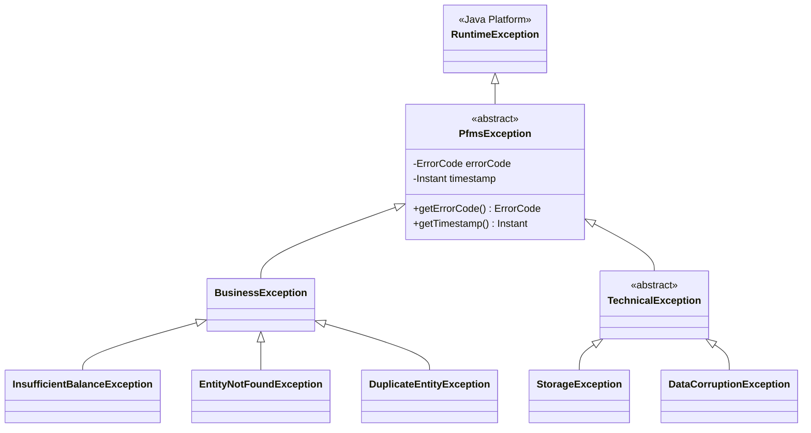

# 08. Thiết kế Xử lý Ngoại lệ

Tài liệu này xác lập thiết kế kiểm soát ngoại lệ và bảng từ điển mã lỗi chuẩn hóa cho Hệ thống Quản lý Tài chính Cá nhân PFMS trên nền tảng Java Console. Nội dung tập trung vào quy tắc phân tách ngoại lệ kỹ thuật với ngoại lệ nghiệp vụ, cơ chế bọc lỗi xuyên tầng kiến trúc và bảo vệ giao diện dòng lệnh trước các sự cố dữ liệu.

Thiết kế tập trung giải quyết các trọng tâm kỹ thuật: cô lập ngoại lệ kỹ thuật không để rò rỉ lên tầng trình diễn, gán mã định danh duy nhất cho từng vi phạm nghiệp vụ và bảo đảm tính toàn vẹn trạng thái ứng dụng trước các tình huống bất thường.

## 8.1 Chiến lược Quản lý Ngoại lệ Toàn hệ thống

Mục này xác lập nguyên tắc quản lý sai số và kiểm soát ngoại lệ xuyên suốt bốn tầng kiến trúc của hệ thống PFMS. Nội dung định hình cơ chế phân loại lỗi, căn cứ lựa chọn kiểu ngoại lệ trong Java và quy tắc bọc lỗi bảo đảm tính toàn vẹn của dữ liệu tài chính.

### 8.1.1 Phân loại Ngoại lệ Kỹ thuật và Ngoại lệ Nghiệp vụ

Hệ thống phân tách toàn bộ các tình huống bất thường thành hai nhóm ngoại lệ:

| Tiêu chí | Ngoại lệ Nghiệp vụ (Business Exception) | Ngoại lệ Kỹ thuật (Technical Exception) |
| :--- | :--- | :--- |
| **Bản chất lỗi** | Vi phạm quy tắc tài chính do thao tác người dùng (ví dụ: không đủ số dư, vượt hạn mức). | Sự cố hệ thống, đọc ghi tệp đĩa cứng hoặc hỏng dữ liệu lưu trữ. |
| **Nơi phát sinh** | Tầng Nghiệp vụ cốt lõi (`domain`) và Tầng Dịch vụ (`service`). | Tầng Hạ tầng lưu trữ (`infrastructure`). |
| **Xử lý hiển thị** | Trích xuất thông điệp tiếng Việt thân thiện ra màn hình dòng lệnh. | Thông báo lỗi hệ thống và an toàn đưa người dùng quay lại menu chính. |

Toàn bộ các lớp ngoại lệ của hệ thống đều kế thừa từ `java.lang.RuntimeException` (Unchecked Exception) nhằm:
- Loại bỏ từ khóa `throws` cồng kềnh trên chữ ký phương thức, tránh rò rỉ chi tiết cài đặt giữa các tầng.
- Đảm bảo tính đóng gói của Clean Architecture: Tầng Trình diễn và Tầng Dịch vụ giao tiếp qua Interface mà không bị ràng buộc bởi ngoại lệ kiểm tra (Checked Exception).
- Phù hợp với cơ chế tương tác Console: khi có lỗi, giao dịch bị hủy và điều hướng người dùng quay lại vòng lặp menu chính một cách an toàn.

### 8.1.2 Nguyên tắc Bắt và Chuyển đổi Ngoại lệ Xuyên tầng

Hệ thống áp dụng kỹ thuật bọc ngoại lệ (*Exception Chaining*) để bảo vệ ranh giới phân tầng. Khi phát sinh lỗi kỹ thuật ở tầng dưới, tầng đó không để rò rỉ chi tiết công nghệ (như `java.io.IOException`) lên các tầng trên mà phải đóng gói vào một ngoại lệ có ngữ nghĩa phù hợp, lưu giữ tham chiếu nguyên nhân gốc qua hàm khởi tạo `super(message, cause)`.

Bảng phân định trách nhiệm bắt và ném ngoại lệ giữa bốn tầng kiến trúc:

| Tầng kiến trúc | Trách nhiệm ném ngoại lệ | Trách nhiệm bắt và chuyển đổi ngoại lệ |
| :--- | :--- | :--- |
| **Tầng Trình diễn** (`com.pfms.presentation`) | Ném ngoại lệ định dạng đầu vào khi chuỗi nhập liệu sai cú pháp. | Điểm chốt chặn cuối cùng: Bắt toàn bộ ngoại lệ tại vòng lặp menu chính, hiển thị thông báo thân thiện và an toàn đưa người dùng quay lại menu. |
| **Tầng Dịch vụ** (`com.pfms.service`) | Ném Ngoại lệ Nghiệp vụ kèm mã lỗi khi điều kiện ca sử dụng không thỏa mãn. | Không nuốt lỗi; cho phép ngoại lệ từ Tầng Miền và Tầng Hạ tầng lan truyền tự nhiên lên Tầng Trình diễn. |
| **Tầng Nghiệp vụ cốt lõi** (`com.pfms.domain`) | Ném Ngoại lệ Nghiệp vụ ngay tại thực thể khi vi phạm ràng buộc số dư hoặc ngân sách. | Không bắt giữ lỗi; tuyệt đối không tiếp xúc với các thư viện I/O hoặc Console. |
| **Tầng Hạ tầng lưu trữ** (`com.pfms.infrastructure`) | Ném ngoại lệ hạ tầng (`StorageException`). | Bắt giữ toàn bộ `IOException`, chuyển đổi và đóng gói nguyên nhân gốc vào `StorageException` trước khi ném ra ngoài. |

## 8.2 Cây Phân cấp Lớp Ngoại lệ Hệ thống

Mục này thiết lập cấu trúc phân cấp các lớp ngoại lệ theo nguyên lý kế thừa và đa hình trong lập trình hướng đối tượng, cung cấp khung bẫy lỗi có cấu trúc và khả năng mở rộng cho toàn bộ ứng dụng.

### 8.2.1 Sơ đồ Phân cấp Lớp Ngoại lệ Hướng đối tượng

Cây phân cấp ngoại lệ của hệ thống bắt đầu từ lớp trừu tượng gốc `PfmsException`, kế thừa trực tiếp từ `java.lang.RuntimeException`. Cấu trúc được phân nhánh thành hai họ ngoại lệ độc lập gồm ngoại lệ nghiệp vụ và ngoại lệ kỹ thuật:

Đặc điểm kiến trúc của cây phân cấp:
- Lớp cơ sở `PfmsException` đóng gói thuộc tính `errorCode` (mã định danh nghiệp vụ) và `timestamp` (thời điểm phát sinh lỗi UTC), bảo đảm mọi ngoại lệ khi được ném ra đều mang đầy đủ ngữ cảnh phục vụ việc hiển thị và kiểm toán.
- Lớp `BusinessException` là lớp ngoại lệ cụ thể (*concrete class*), đóng vai trò ngoại lệ nghiệp vụ chung (*General Business Exception*). Lớp này có thể được khởi tạo trực tiếp với `ErrorCode` (`new BusinessException(errorCode)`) cho các vi phạm nghiệp vụ tiêu chuẩn mà không đòi hỏi thuộc tính mở rộng, đồng thời làm lớp cha cho các ngoại lệ nghiệp vụ chuyên biệt mang trạng thái mở rộng (`InsufficientBalanceException`, `DuplicateEntityException`, `EntityNotFoundException`). Nhánh này không mang theo tham chiếu `Throwable cause` kỹ thuật.
- Nhánh `TechnicalException` luôn bắt buộc tiếp nhận tham chiếu `Throwable cause` qua hàm khởi tạo để bảo lưu trọn vẹn vết ngăn xếp gốc của hệ thống máy ảo Java.

### 8.2.2 Danh mục các Lớp Ngoại lệ Nghiệp vụ Chi tiết

Bảng dưới đây đặc tả chi tiết toàn bộ các lớp ngoại lệ cụ thể trong hệ thống PFMS, làm căn cứ cài đặt mã nguồn Java cho gói `com.pfms.domain.exception`:

| Tên lớp ngoại lệ | Lớp cha trực tiếp | Tham số hàm khởi tạo | Điều kiện kích hoạt nghiệp vụ |
| :--- | :--- | :--- | :--- |
| **`InsufficientBalanceException`** | `BusinessException` | `ErrorCode code, String walletId, Money balance, Money amount` | Ném ra khi người dùng thực hiện rút tiền hoặc chuyển khoản với số tiền lớn hơn số dư khả dụng hiện có của ví nguồn. |
| **`EntityNotFoundException`** | `BusinessException` | `ErrorCode code, String entityType, String identifier` | Ném ra khi tra cứu một thực thể (Ví, Danh mục, Giao dịch) theo mã định danh hoặc tên nhưng không tồn tại trong hệ thống. |
| **`DuplicateEntityException`** | `BusinessException` | `ErrorCode code, String entityType, String name` | Ném ra khi tạo mới hoặc cập nhật Ví, Danh mục có tên bị trùng lặp với một bản ghi đang hoạt động khác. |
| **`StorageException`** | `TechnicalException` | `ErrorCode code, String message, Throwable cause` | Ném ra tại Tầng Hạ tầng khi xảy ra lỗi I/O đọc ghi tệp cục bộ (`.csv` hoặc `.dat`), bọc trọn vẹn ngoại lệ gốc `java.io.IOException`. |
| **`DataCorruptionException`** | `TechnicalException` | `ErrorCode code, String fileName, int line, Throwable cause` | Ném ra khi tệp lưu trữ bị hỏng cấu trúc dòng, thiếu trường dữ liệu hoặc sai lệch định dạng không thể phân tích cú pháp. |

## 8.3 Bảng Mã Lỗi Nghiệp vụ Chuẩn hóa

Mục này xác lập hệ thống mã định danh lỗi chuẩn hóa cho PFMS, bảo đảm tính duy nhất toàn cục, hỗ trợ việc đối chiếu hai chiều giữa tài liệu yêu cầu, giao diện người dùng và mã nguồn Java.

### 8.3.1 Cấu trúc Định danh Mã Lỗi Hệ thống

Toàn bộ các mã lỗi trong hệ thống được định nghĩa qua kiểu liệt kê `com.pfms.domain.exception.ErrorCode` theo cấu trúc:

`ERR-[PHÂN_HỆ]-[SỐ_THỨ_TỰ]`

Quy ước các thành phần định danh:
- Tiền tố `ERR`: Ký hiệu cố định biểu thị mã lỗi của hệ thống.
- Tiền tố quy tắc: Gồm 3 ký tự in hoa đại diện cho miền quy tắc nghiệp vụ hoặc phân hệ phát sinh lỗi, kế thừa trực tiếp từ hồ sơ yêu cầu SRS.
- Số thứ tự: Gồm 3 chữ số từ `001` đến `999` đại diện cho nguyên nhân lỗi cụ thể.

Bảng phân nhóm tiền tố mã lỗi chuẩn hóa hệ thống:

| Tiền tố | Miền quy tắc nghiệp vụ | Phạm vi trách nhiệm kỹ thuật |
| :--- | :--- | :--- |
| **`FIN`** | Quy tắc tài chính chung | Lỗi số tiền giao dịch không hợp lệ nhỏ hơn hoặc bằng không, lỗi làm tròn số học tiền tệ. |
| **`NAM`** | Định danh và tính duy nhất | Lỗi tên để trống, tên dài quá 50 ký tự hoặc trùng tên Ví, trùng tên Danh mục. |
| **`WAL`** | Ràng buộc số dư ví | Lỗi số dư khả dụng không đủ chi trả, thao tác xuất quỹ làm âm số dư ví. |
| **`TRF`** | Chuyển khoản nội bộ | Lỗi ví nguồn trùng ví đích, số tiền chuyển không hợp lệ. |
| **`FEE`** | Chi phí giao dịch | Lỗi chi phí âm, giao dịch có chi phí nhưng chưa chọn danh mục chi tiêu cho phí. |
| **`CAT`** | Cây danh mục ba cấp | Lỗi đổi loại khi đã có giao dịch, xóa nhóm cuối cùng, thao tác trên nhóm đã xóa. |
| **`DAT`** | Quản trị và sao lưu tệp | Lỗi cấu trúc tệp sao lưu JSON, vi phạm liên kết chuyển tiền hoặc phí mồ côi khi phục hồi. |
| **`SYS`** | Hạ tầng hệ thống | Lỗi I/O đọc ghi tệp cục bộ trên đĩa cứng hệ thống. |

### 8.3.2 Danh mục Mã Lỗi và Thông điệp Phản hồi

Bảng dưới đây xác lập từ điển mã lỗi chuẩn hóa của hệ thống PFMS, bảo đảm tính truy vết hai chiều nhất quán với tài liệu Yêu cầu SRS, đồng thời định rõ lớp ngoại lệ Java tương ứng và thông điệp hiển thị trên giao diện dòng lệnh:

| Mã lỗi Enum | Lớp Ngoại lệ Java phụ trách | Nguyên nhân kích hoạt nghiệp vụ | Thông điệp phản hồi Console |
| :--- | :--- | :--- | :--- |
| **`ERR_FIN_001`** | `BusinessException` | Dữ liệu số tiền không đúng định dạng số học hoặc nhỏ hơn hoặc bằng 0. | Dữ liệu số tiền không đúng định dạng số học hợp lệ. |
| **`ERR_FIN_002`** | `BusinessException` | Phép toán chia không xác định quy tắc làm tròn gây số thập phân vô hạn. | Lỗi số học: Phép toán chia không xác định quy tắc làm tròn. |
| **`ERR_NAM_001`** | `BusinessException` | Tên để trống sau khi cắt khoảng trắng, hoặc dài quá 50 ký tự. | Tên phải có từ 1 đến 50 ký tự, không tính khoảng trắng ở hai đầu. |
| **`ERR_NAM_002`** | `DuplicateEntityException` | Tên ví hoặc tên danh mục bị trùng lặp trong cùng phạm vi duy nhất. | Tên đã tồn tại trong hệ thống. Vui lòng chọn tên khác. |
| **`ERR_WAL_001`** | `InsufficientBalanceException` | Giao dịch làm số dư ví âm hoặc không đủ thanh toán số tiền và chi phí. | Giao dịch bị từ chối: Số dư ví không đủ để thực hiện thao tác. |
| **`ERR_TRF_001`** | `BusinessException` | Ví nguồn chuyển tiền trùng với ví đích nhận tiền. | Giao dịch không hợp lệ: Ví chuyển và ví nhận phải khác nhau. |
| **`ERR_TRF_002`** | `BusinessException` | Số tiền yêu cầu chuyển khoản nhỏ hơn hoặc bằng 0. | Số tiền chuyển phải là một số dương lớn hơn 0. |
| **`ERR_FEE_001`** | `BusinessException` | Chi phí giao dịch được nhập giá trị nhỏ hơn 0. | Chi phí không hợp lệ. |
| **`ERR_FEE_002`** | `BusinessException` | Chi phí lớn hơn 0 nhưng chưa chọn danh mục chi tiêu cho khoản phí. | Vui lòng chọn danh mục cho phí giao dịch. |
| **`ERR_FEE_003`** | `BusinessException` | Danh mục phí đã bị xóa hoặc không thuộc loại chi tiêu (`EXPENSE`). | Danh mục phí không hợp lệ hoặc không tương thích với loại chi tiêu. |
| **`ERR_CAT_001`** | `BusinessException` | Chuyển danh mục sang nhóm khác loại, hoặc đổi loại khi đã có giao dịch. | Không được phép đổi loại thu chi hoặc chuyển danh mục sang nhóm khác loại. |
| **`ERR_CAT_002`** | `BusinessException` | Thực hiện xóa nhóm nhu cầu đang dùng cuối cùng của một loại thu chi. | Không thể xóa nhóm cuối cùng của loại thu chi này. |
| **`ERR_CAT_003`** | `BusinessException` | Chuyển danh mục chi tiết sang một nhóm nhu cầu đã bị xóa. | Không thể chuyển danh mục sang nhóm đã xóa. |
| **`ERR_CAT_004`** | `BusinessException` | Khôi phục danh mục khi nhóm nhu cầu của nó còn ở trạng thái đã xóa. | Nhóm chứa danh mục này đang ở trạng thái đã xóa. Hãy khôi phục nhóm trước. |
| **`ERR_CAT_005`** | `BusinessException` | Tạo danh mục mới vào một nhóm nhu cầu đang ở trạng thái đã xóa. | Không thể tạo danh mục trong nhóm đã xóa. Hãy chọn nhóm đang dùng. |
| **`ERR_DAT_001`** | `DataCorruptionException` | Tệp sao lưu JSON sai cấu trúc schema hoặc vi phạm phân cấp 3 cấp. | Tệp sao lưu không hợp lệ hoặc cấu trúc dữ liệu JSON bị hỏng. |
| **`ERR_DAT_002`** | `DataCorruptionException` | Tệp sao lưu JSON vi phạm liên kết chuyển tiền hoặc làm âm số dư ví. | Dữ liệu sao lưu vi phạm ràng buộc toàn vẹn số dư ví hoặc dòng tiền. |
| **`ERR_SYS_001`** | `StorageException` | Lỗi I/O đọc ghi tệp cục bộ trên đĩa cứng hệ thống. | Lỗi hệ thống: Không thể truy xuất hoặc lưu trữ tệp dữ liệu cục bộ. |
| **`ERR_NOT_FOUND`** | `EntityNotFoundException` | Tra cứu thực thể (Ví, Danh mục, Giao dịch) theo định danh nhưng không tồn tại trong hệ thống. | Không tìm thấy thực thể yêu cầu trong hệ thống. |
