## Accounting Patterns

Perhaps it's just the way my career has worked out, but accounting systems of one kind or another have been an overriding theme for me. From my first project as a consultant, through to projects as I'm involved with now now twelve years on, I've taken part in laying out accounting systems.

By accounting system I don't mean necessarily the classical accounting systems such as General Lendger, Accounts Recievable, or Accounts Payable. Rather I mean any system that responds to business events by figuring out the financial consequences of the event. So my examples have included utility billing and payroll.

But the patterns I've seen and described here don't just apply to money. These patterns can apply to things other than money. You can see this in utility billing and payroll where kilowatt hours of electricity or hours of people's time are accounted for with the same patterns that track and manipulate the money. One associate of mine used several of these patterns building a system to track gas in a large gas pipeline.

Over those years I've tried hard to understand better what the patterns are and how they relate to each other. At this point in time I see the fundamental picture as reacting to an event to produce accounting entries.

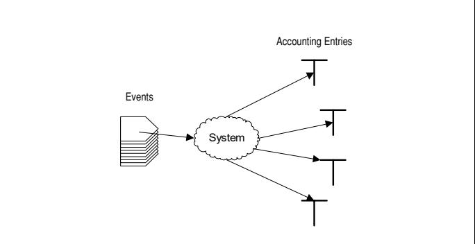

Figure 0.1 A meaningless, but hopefully suggestive cartoon indicating that the role of accounting is to take business events and produce appropriate accounting entries.

The boundaries are, in essence, fairly simple things. An Event (11) describes something that happens that is interesting to the business. This may be a sale, the recognition that a customer has used 52 kwh of electricity, or that an employee has been promoted. The Accounting Entry (15) records the consequences of this event for the thing that we are tracking. For most of my examples these are financial consequences, but they might be something else. So a customer using 52 kwh of electricity leads to a charge where they owe us money, as well as a charge indicating that we owe a tax authority some money. There might also be a non-financial entries as we record the usage of that 52 kwh, which was bought in from some generating company leading to a separate set of financial entries.

## Posting Rules

For most people who've written about structures for accounting, it is the structure of the accounting entries that is the biggest interest. This is where the patterns of Account (39) and Accounting Transaction (44) come in. These patterns are interesting and I'll discuss them later, but actually it is the process of turning the events into entries which interests me most, and therefore this is where I'll start.

In its simplest form the process might work like this. Read in the event, see that Spiny Norman worked ten hours last Wednesday, look up his hourly rate, multiply by ten and create an accounting entry for the money in his paycheck.

We can think of this a processor class that reads events and creates accounting entries (Figure 0.2)

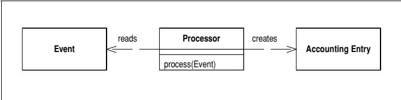

Figure 0.2 Simple Event Processor

Of course there are variations in this scenario, and that's where the devil is.

The first variation is based on the person we are paying. Not all people are paid the same way. A company may not have different agreements for each of its employees, but it will have many tens or hundreds of agreements to cover everyone. These agreements will include such issues as how many hours you work before you get overtime,

how the overtime is calculated, what you get on a Sunday, and whether Sunday falls on Sunday or Saturday.

So one way to split up our process is split it by agreement. When we take an event we figure out which agreement we need to use to process the event, and use that agreement. Since we are thinking in terms of objects, we could do this by making an object out of the agreement. The processor would need to be able to find the right agreement for an event and then use it to actually do the processing (Figure 0.3). Indeed we can think of the event as something active that is able to find the agreement that should process it. With that scheme we don't have a processor.

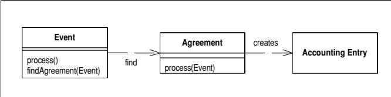

Figure 0.3 Separating out the agreement

Separating the agreements has advantages but also disadvantages. The advantage lies in the fact that all the policies in a single agreement are separated from other agreements. This works well when the policies are different, but often policies are held in common. So we would like to be able to change a policy once, and that changes for all the agreements that use it. However we also have to be wary of changing a policy in one place and not realizing it has ramifications elsewhere. For the moment we'll assume each agreement is completely separate and shares no policies, but we'll see how we can deal with that later.

So now we have agreements that handle events, but even so these agreements can be quite complicated things, because there are many events that must be dealt with. A customer can use electricity, have a service call, connect service, disconnect service, uprate a service, transfer from one service to another. Each kind of event needs to be dealt with in its own way.

We can consider this by introducing an event type, allowing us to separate the processing for each kind of event into its own Posting Rule (19). This way way each posting rule takes a single kind of event and generates the entries just for that. The processor finds the agreement, the agreement gets the rule for the event type of the event, and then that rule processes the event and creates the entries.

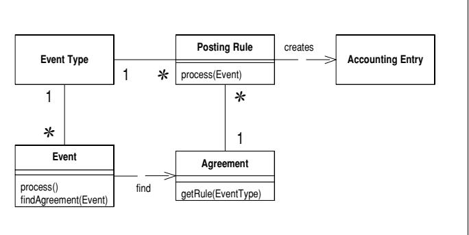

Figure 0.4 Adding event types and posting rules to the picture.

Separating the posting rules as separate objects within the agreement also gives us a mechanism to cope with where rules should be shared between agreements. By making the role from posting rule to agreement multi-valued, we can allow sharing of posting rules. We could then implement a mechanism that would allow us to see which posting rules were on which agreements and decide how changes should affect multiple agreements.

Separating by agreement and event type gives us a logical way to break down the processing of events, however it fails to deal with the greatest cause of variation in rules: time. Here I'm not talking about such matters as a different electricity rate for summer as opposed to winter, that is actually simple to deal with. Instead I'm talking about dealing with the fact that the rules themselves change. These may be as simple as rates changing, but can be as complex as any aspect of an algorithm. It may be that on May 1st instead of creating all hours over eight as overtime, we treat all hours over six as long as all hours over 9 as overtime: where overtime involves calculations far more complicated than they were back in April.

Dealing with this is not simply a case of swapping out one posting rule and replacing it with another. We often hear about events much later than when they occur. If we hear in August about some overtime worked in February then we must pay that overtime according to the rules that were in effect in February, not the rules in effect in August.

Once we have the posting rules separated from the agreement, handling time is actually not that complicated. We can use Effectivity Period (52) on the posting rules.

to handle the time dependent behavior. The agreement now needs to be able to select a rule according to both event type and date.

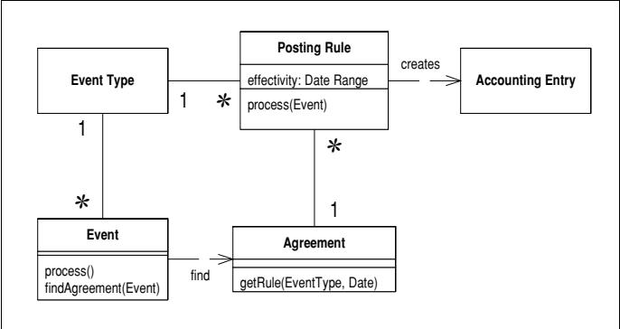

Figure 0.5 Allowing rules to vary by date.

## Procedural Decomposition and Object Structures

It's worth pausing at this point to consider where using objects to separate the different aspects of processing is an advantage compared to using procedural techniques. We could imagine a procedural processor which would have logic of the form:

process(Event e) // procedural pseudo-code
if (e.getAgreement() .equals(agreement1) {
    if (e.type() .equals(eventType1) {
        if (e.date() .laterThan(aug21) {
            multiplyByRate(e, e.getCustomer().getRate()); // do processing logic by subroutine
        else if ...
        else if (e.type() .equals(eventType1) {
            ...
        } else
        else if (e.getAgreement() .equals(agreement1) {
            ...
        } else ...
    }
}

The point of using objects is that it replaces a great deal of in-line conditional logic with data structure navigation. One reason why this is better is that it doesn't require so much programming to make changes. Posting rules can be parameterized so that adding a new rule can be as simple as�anstating a new object and hooking it up into

the data structure in the right way. If you do need a new posting rule it's no more complicated than building a subroutine in the procedural approach.

So if you compare an object approach to a well-structured procedural approach the major gain is that if you change the selection logic frequently, you can make changes to that selection logic without changing the source code. Since time-dependent changes occur very frequently, this is a big gain.

But it isn't the biggest gain. The biggest gain comes from the fact it is very hard to keep a procedural solution well-structured. There is nothing the in the design of a procedural approach that enforces a structure that organizes the conditionals by agreement, event type and date. Given discipline you can keep this up, but few can keep the discipline, particularly since there are many 'exceptions' where it is simpler to use another structure. It doesn't take many of these exceptions before you lose all sight of the structure and program becomes very hard to modify.

By separating the processing into objects you have to keep the to the structure because the navigation logic forces the structure upon you. The shape of the system forces you to stick with a single way to organize your logic.

So as a result the objects are less likely to have their structure deteriorate.

This is the heart of the difference between the object and procedural approaches. The object approach seeks to replace a lot of conditional logic with navigation based on the structure of objects. This replacement underlies polymorphism, and it also underlies this mechanism. It works well when the conditional logic has a regular underlying structure that can be replaced by some form of class relationship.

Thinking about this isn't just a matter for the objects vs procedural debate. It's also worth thinking about in a purely OO design to answer the question of when to use conditionals and when to use something more fancy. Conditional logic is good when it's not too complicated. As it gets more complicated you need to find a regular structure and then use class relationships to represent this structure and replace the conditional logic. Posting Rule (19) is just one example of this.

## Correcting mistakes

Business is a form of life, so in business things go wrong just as they do in any other form of human endeavour. But when we are dealing with accounts, we soon discover that dealing with errors is one of the most awkward and complicated parts of the process. This is because we cannot just fix the error. We have to fix the error in such a way that the original events and financial transactions are still present, because usually we cannot change them.

The adjustment patterns rely on the immutable event log you have when using Event (11). We record a new event as adjusting the old event, either by a direct link (Figure 0.6) between the events, or with a separate adjustment event (Figure 0.7).

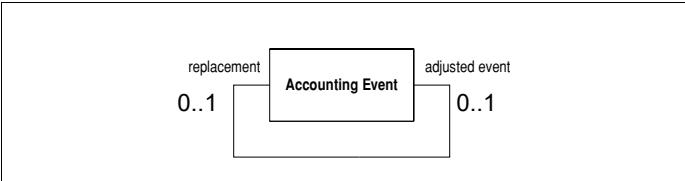

Figure 0.6 Adjusting an erroneous event directly

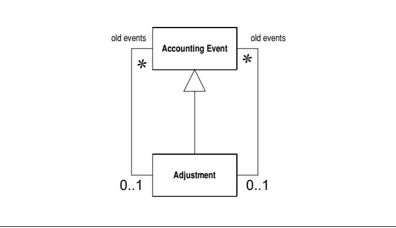

Figure 0.7 Separate adjustment event

That much is simple, however we also need to ensure two other things. Firstly we need to ensure that we have a mechanism of adjusting the entries correctly when we adjust the event. As part of doing this we need to be able to find which entries are affected by an adjustment. Secondly we need to ensure that any future processing uses the new event and not the old one.

## Finding the Entries Affected by an Adjustment

The key to finding the entries affected by an adjustment is to keep a trail between the event, and the entries which the event creates.

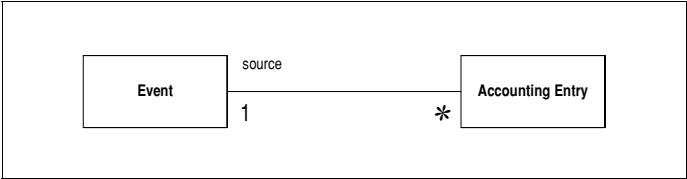

Figure 0.8 Keeping a link between an event and its resulting entries

The basic trail can be kept with an association along the lines of Figure 0.8. In the simplest case this means that whenever you create an entry, you make a link between the entry and the event that created it. If you use Secondary Posting Rule (33), then you'll need to extend the trail to include them as well, as suggested in its pattern description.

## Ways of Adjusting the entries

There are three ways we can adjust entries: Replacement Adjustment (69), Reversal Adjustment (53) or Difference Adjustment (59).

Of the three Replacement Adjustment (69) is the easiest. It simply means that we find all the entries affected by the adjustment and change them to what they should have been with the new event, either by editing their values or by replacing them with new ones. It's easy but it's rarely possible. This is not just because entries are usually immutable as part of the financial audit trail. It is also because other financial processes will have been kicked off, such as sending out a bill. Such things cannot just be edited, so we need a form of adjustment that makes the alteration an explicit part of the financial record.

The second technique is Reversal Adjustment (53). Here we find all the entries that were affected by the adjustment, and post a reversing entry. This is an entry which will have the same occurred date, an amount which is equal but opposite to the original, and a recording date of the day the reversal was done. This reversing entry effectively cancels out the original entry. Once you've reversed the old entry, you can then process the new event as usual and the correct entries will be created.

The problem with reversing the entries is that it creates a lot of extra entries. If an adjustment affects ten entries, we have to create twenty new entries (ten reversing and ten corrected entries). Although we can do some things to filter out reversed entries, it can still be annoying when someone needs to peruse the records.

So the third technique is Difference Adjustment (59). With this approach we figure out what the correct entries should have been, and then create a new entries which

are the difference between the old entries and the new entries. Our ten entry adjustment can now be reduced to no more than ten compensating entries. Indeed we may even reduce it further by combining several erroneous entries and their replacements into a single adjustment.

Sometimes you can use a combination of these techniques. Up to a certain point it may be possible to use Replacement Adjustment (69), perhaps until a closing of a period or the sending out of a statement. After that point you need to use one of the other techniques.

# Event

Captures the memory of something interesting which affects the domain

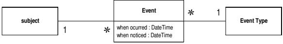

Example: I go to Babur's for a meal on Tuesday, and pay by credit card. This might be modeled as an event, whose event type is "make purchase", whose subject is my credit card, and whose occurred date is Tuesday. If Babur's uses an old manual system and doesn't transmit the transaction until Friday, the noticed date would be Friday.

Things happen. Not all of them are interesting, some may be worth recording but don't provoke a reaction. The most interesting ones cause a reaction. Many domains react to events, so in order to understand why certain things happen, you need to keep a record of the events.

This is the primary purpose of having events in a domain, they provide a log all everything that happens. The idea of an event is therefore absolutely central to audit logs - which are essentially just a list of events.

## Making it work

The audit trail role of events suggests one of the most vital properties, that events are immutable objects. Once an event is created its source data can never be changed. It may be true that later on we might discover that our record of the event was flawed, but to change the original event breaks the integrity of the log. Therefore the source data of must be immutable, and we need a different mechanism, such as Reversal Adjustment (53), to deal with cases where events later prove to be inaccurate.

You'll notice I've used the term "source data" a couple times in a weasly way. By source data I mean information about the source of the event. The other kind of event data is the processing data - which records what a system has done with it.

Source data on a credit card charge would include how much the charge was for, who the vendor was, etc. Processing data might include which statement it appeared on. It's worth considering whether to split the source and the processing data into separate objects.

Events need dates, and there are two dates that are needed. Firstly there is the time the event occurred, secondly there is the time the event was noted.

Of course you don't always need both dates, but you should always consider whether you need both dates. The danger is picking one date, and not being clear which date you picked, either at the time or later. So I also suggest you name the date clearly to indicate which one it is.

If your time granularity is shorter, like a telephone company, you'll need DateTimes rather than dates

Occasionally you need more than two dates. This occurs if there is more than one body doing the noticing. In this case you may need a date for each body that can notice the event.

My choice of a subject and an event type is fairly arbitrary. Events usually have all sorts of references. However I find it makes sense to divide them into these roles when I discuss further patterns later on, in particular Posting Rule (19). In particular you may find you get multiple subjects, multiple event types, or both.

## When to use it

Events are valuable whenever you want to keep a log of all the things that cause a change to your system. Each thing needs an event to trigger it, with all the relevant information. While this is quite a bit of work to put together, the result is a very solid audit trail of everything that causes a change. The trade-off is the cost of building the events versus the benefit of having the audit trail.

## Sample Code

Events at the core are pretty simple things, although later patterns can make them more involved. The basic pattern, applied to a bank card, or something along those lines, might yield an interface like this.

interface Event {
    Event newEvent (EventType type, AccountNumber account,
                                Date whenOccurred, Date whenNoticed);
    EventType getType();
    AccountNumber getAccount();
    Date getWhenOccurred();
    Date getWhenNoticed();
}

Although this is not the most exciting interface the world has ever seen, it does yield a couple of interesting points. Firstly the complete lack of any way to change the base data once created. Secondly the fact that the interface is somewhat incomplete. Different events often require different bits of information, so it's time to usher in a subtype.

interface Sale extends Event {
    Sale newSale (AccountNumber account,
                Date whenOccurred, Date whenNoticed,
                Vendor vendor, Money amount);
    Vendor getVendor();
    Money getAmount();
}

If you're a sharp reader, and not dozing off in the rocking chair, you'll notice that the event type is missing from the factory method. This would be because the event type, in this case, would be assigned directly by the subtype. Not always the case, but not uncommon.

Often it is useful to record information about the processing of the event.

boolean isProcessed();

Set getResultingEntries();

void addResultingEntry(Entry arg);

Processing information is mutable, so you'll get the ability to change these values.

Since some of the event's information is mutable and some immutable, it may be useful to separate the parts. You might consider doing this if your environment can mark an object as immutable and thus prevent any code from changing one of its attributes. Another case is where you have concurrency: immutability helps a lot with concurrent design.

Figure 0.9 shows an example of doing this. You'll notice that the event and sale classes are immutable, but hold a reference to a mutable process log. The event and sale are still mutable, in that we create the process log when we instantiate the event. Changing the attributes of the log does not affect the immutability of the event.

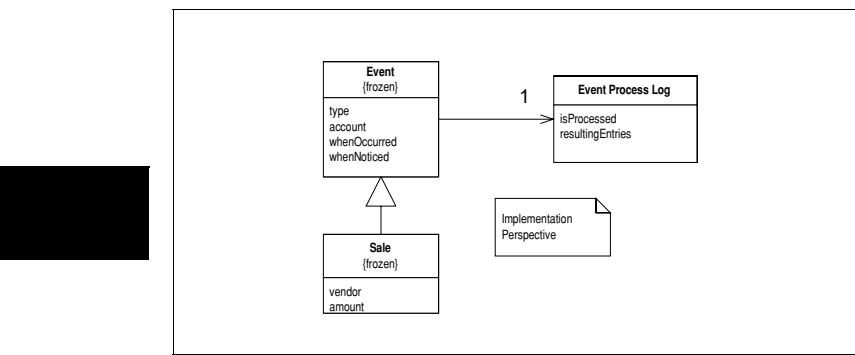

Figure 0.9 One way of separating the mutable and immutable parts of an event

You can also do it the other way round, letting the immutable data be an object referenced by the mutable part. This way round has the advantage that the immutable part that is usually subclassed, so it's easier to make the mutable part the delegate. You can also have a third object that has one reference to the mutable part and one to the immutable part. The best way to arrange the mutable and immutable parts will depend on how your environment enforces immutability. You only want to do this if your environment can help you, so you should arrange the objects to make it as easy as possible to get the aid you'd like.

Remember you don't absolutely need to do this. You can communicate effectively which attributes are read-only by the absence of a setting method. Most of the time that is all you need.

# Accounting Entry

An allocation of a sum of money

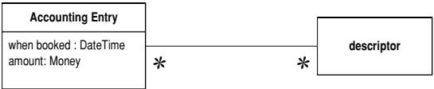

Example: I withdraw $100 from my checking account on Tuesday. This would be an accounting entry whose amount is $100, whose date is Tuesday, and whose descriptor is my checking account.

Example: A contractor spends $300 on electrical supplies for work on my house on Saturday. This would be an accounting entry whose date is Saturday, amount is $300 and descriptors are the project for the work on my house, and the cost category of electrical supplies.

Example: Three barrels of Old Peculier are delivered to the Square and Compass. This would be an accounting entry whose amount is a three barrels (a quantity) and whose descriptors were Old Peculier and the Square and Compass.

Accounting revolves around money, and is essentially about the classification of money: where it comes from, what it is used for, even what it should be used for. From renaissance days the way of recording this is the entry in a ledger, in those days a physical book. Such entries record money coming and money coming out. They also record things that don't actually result in any handover of money at all, such as transfers.

## Making it work

The pages of the ledger corresponds to a particular classification of money, these days they would be called accounts, so Account (39) often goes with Accounting Entry (15). Indeed in Analysis Patterns I put them in the same pattern. But this is not always

the case. Some see entries without accounts, some all entries as just parts of accounts. I'll talk about the case where they are closely joined in Account (39), until then just think of accounts as one possible descriptor for an entry.

It's not a stretch to think of an entry as something interesting that affects the domain, so it may well be that Event (11) applies to Accounting Entry (15). Sometimes I see this, sometimes I see the two separated. The important thing is that you need to ask the questions raised by Event (11) when you are using Accounting Entry (15). (Should the entries be immutable? Which dates should they have?)

Often there are specific rules for when an entry can be changed. It may be allowed to change entries when they are in an open state, but not to change them when they are closed, or booked.

In a particular model, you will usually model the descriptors as separate classes with separate relationships to the entry. So if we are doing job costing, we might want to mark each entry with a project and a cost type. The project and cost type are the descriptors for the entry. In our model we would show these as separate relationships as in Figure 0.10.

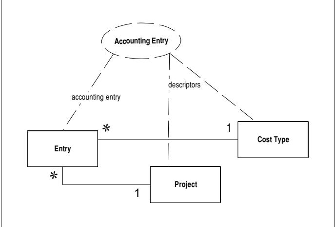

Figure 0.10 Project and cost type as descriptors.

## When to use it

You should use entries whenever you need to record each change in some quantitative value. The most obvious case is record all changes in a monetary value, and indeed this is the common case as money is sufficiently central to most businesses to require this level of tracking.

The pattern suggests the most common case, where entries are made for monetary amounts. However you can use this pattern whenever you want to classify quantities of something or indeed anything that contains differences, such as diffs in source code control system. Doing this sounds dangerously like using some over-generic model to model anything. Such over-generic models are a dangerous mermaid, whose beauties lure many many an analyst to an annoying, if not exactly fatal, variation on drowning. But the value of the abstraction lies in whether other patterns that build on Accounting Entry (15) make sense. So bear it in mind as a possibility, just make sure you can swim first.

## Sample Code

In its simple state, Accounting Entry (15) is mostly a simple data holder.
interface Entry {
    Entry newEntry (CostType costType, Project project, Money amount, Date date);
    CostType getCostType();
    Project getProject();
    Money getAmount();
    Date getBookingDate();
}

The descriptors will usually appear as explicit types in any particular application of the pattern.

Entries may often be immutable at all times or they may be mutable until they are booked. This would lead to setting methods along the lines of:

void setCostType (CostType arg) {
    if (isOpen())
        costType = arg
    else
        throw newImmutableEntryException();
}

## Linking to Events

If you are using Event (11) and Accounting Entry (15), you may well find you need to link the two together. In the passive sense, you'll do this to provide an audit trail, so

people can ask "why was this entry added". If you are using Reversal Adjustment (53) you'll need this kind of link for more than just reporting purposes.

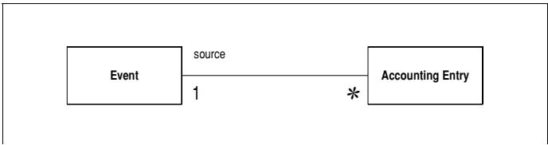

Figure 0.11 Ensuring that you can tell which entries were created by a particular event

## Posting Rule

Determines what accounting entries to make in response to an event

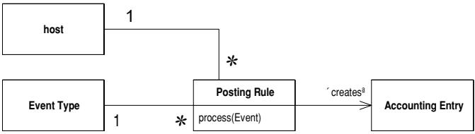

Example: When we get a meter reading, we bill the customer by multiplying the amount of electricity used by the rate defined for the service that the meter is measuring. This would be modeled as a posting rule whose event type would be meter reading, whose host would be the service, and would create entries which would be the line items on the bill.

Business events happen, and money moves. One leads to the other with an inevitability that keeps millions of accountants and MBAs gainfully employed. Much of that employment comes in figuring how that connection should occur, and making sure that it does.

## Making it work

The rules that make the connection are complicated for several reasons. Firstly, they are complicated because different rules exist for different kinds of events. More complexity comes as rules vary for the different business units that operate.

Example: An electricity company may charge differently according to different service plans. Each one has a different rate, but has different rules addressing the availability of the supply. In this case each service agreement would be a different host, and contain different pointing rules to handle the charges.

Another important area where rules change is over time. Therefore posting rules usually use Effectivity Period (52) for each period that a rule is in effect. This implies that the posting rules are immutable.

## When to use it

Posting rules are a very flexible way in which to organize the logic that reacts to events, and are best used when you have several volatile factors that alter this logic. If you only have a couple of variations, and they don't change much, then a simple procedure with some conditional logic will do the trick. As the amount of variations increase, then the benefits of this pattern will kick in and offset the costs of setting it up.

## Sample Code: Posting Rules

It's not very controversial to say that accounting systems use posting rules to generate accounting entries in response to events. I'm everyone would come up with different words for these concepts, but the basic ideas remain. The key question is how these rules should be organized. The essence of the pattern, as I have it here, is to make a posting rule class that encapsulates the application of the rule.

For our example we'll use an electricity utility. The utility responds to various events. I'll focus on usage in this case, but others might include a service call, late payment fee, or installation of new equipment. I'll assume there are several service plans available. Some of these may vary due to local legislation, others due to signing a contract with agreed levels of service.

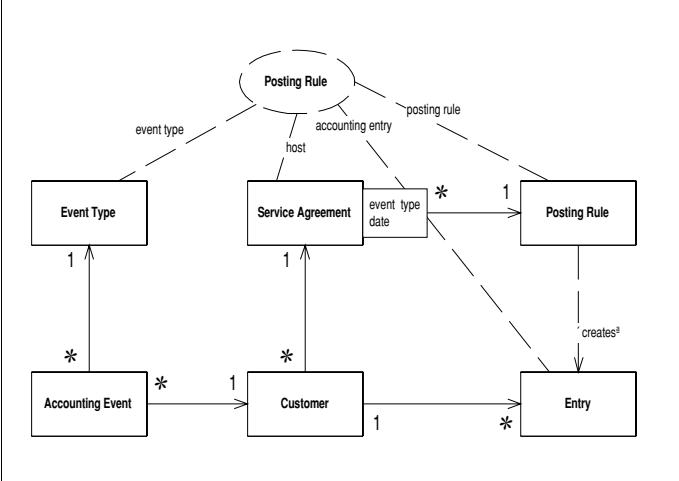

Figure 0.12 Classes for electricity billing

In this example the service agreement is the host. We also have Event (11), and Accounting Entry (15) present.

## Setting up the structure

We'll start looking at the code with the simple aspects. We have accounting event and event type.

class AccountingEvent {
    private EventType _type;
    private MfDate _whenOccurred;
    private MfDate _whenNoticed;
    private Customer _customer;
    private Set resultingEntries = new HashSet();
}

private MfDate _whenOccurred;
private MfDate _whenNoticed;
private Customer _customer;
private Set resultingEntries = new HashSet();

AccountingEvent (EventType type, MfDate whenOccurred,
                MfDate whenNoticed, Customer customer)
{
    this.type = type;
    this.whenOccurred = whenOccurred;
    this.whenNoticed = whenNoticed;
    this.customer = customer;
}

Customer getCustomer() {
    return customer;
}

EventType getEventType(){
    return type;
}

MfDate getWhenNoticed() {
    return whenNoticed;
}

MfDate getWhenOccurred() {
    return whenOccurred;
}

void addResultingEntry (Entry arg) {
    resultingEntries.add(arg);
}

PostingRule findRule() { /*discussed later*/}

void process() { /*discussed later*/}
}

class EventType extends NamedObject{
    public static EventType USAGE = new EventType("usage");
    public static EventType SERVICE_CALL = new EventType("service call");

    public EventType (String name) {
        super(name);
    }
}

So far we're just looking at the data aspects, we'll come back to the interesting behavior in a moment.

Next up is the accounting entry, a simple data class, and Entry Type.

class Entry {
    private MfDate date;
    private EntryType type;
    private Money amount;
    public Entry (Money amount, MfDate date, EntryType type) {
        this.amount = amount;
        this.date = date;
        this.type = type;
    }
    public Money getAmount() {
        return amount;
    }
    public MfDate getDate() {
        return date;
    }
    public EntryType getType() {
        return type;
    }
}
class EntryType extends NamedObject {
    static EntryType BASE_USAGE = new EntryType("Base Usage");
    static EntryType SERVICE = new EntryType("Service Fee");
    public EntryType(String name) {
        super(name);
    }
}

Customer is also pretty simple
class Customer extends NamedObject {
    private ServiceAgreement serviceAgreement;
    private List entries = new ArrayList();
    Customer (String name) {
        super(name);
    }
    public void addEntry (Entry arg) {
        entries.add(arg);
    }
    public List getEntries() {
        return Collections.unขึལ(entries);
    }
    public ServiceAgreement getServiceAgreement() {
        return serviceAgreement;
    }
    public void setServiceAgreement(ServiceAgreement arg) {
        serviceAgreement = arg;
    }
}

The service agreement acts as the host for the posting that particular agreement. This means that individual ag rates and different combinations of posting rules.

The service agreement acts as the host for the posting rules. It also holds a rate for that particular agreement. This means that individual agreements can have different rates and different combinations of posting rules.

class ServiceAgreement {
    private double rate;
    private Map postingRules = new HashMap();
    void addPostingRule(EventType eventType, PostingRule rule, MfDate date) {
        if (postingRules.get(eventType) == null)
            postingRules.put(eventType, new TemporalCollection());
        temporalCollection(eventType).put(date, rule);
    }
    PostingRule getPostingRule(EventType eventType, MfDate when) {
        return (PostingRule) temporalCollection(eventType).get(when);
    }
    private TemporalCollection temporalCollection(EventType eventType) {
        TemporalCollection result = (TemporalCollection) postingRules.get(eventType);
        Assert.notNull(result);
        return result;
    }
    public double getRate() {
        return rate;
    }
    public void setRate(double newRate) {
        rate = newRate;
    }
}

The trickiest element here is the fact that the posting rule collection is important as a map of Temporal Property (52). So when we add a posting rule we need the temporal collection for that key in the map. For this simple example, I can error to ask for a rule for an event type that hasn't been set up.

    The service agreement uses the abstract posting rule.

    abstract class PostingRule {
        protected EntryType type;
        protected PostingRule(EntryType type) {
            this.type = type;
        }
        private void makeEntry(AccountingEvent event, Money amount) {
            Entry newEntry = new Entry(amount, event.getWhenNoticed(), type);
            evt.getCustomer().addEntry(newEntry);
            evt.addResultingEntry(newEntry);
        }
        public void process(AccountingEvent event) {
            makeEntry(evt, calculateAmount(evt));
        }
        abstract protected Money calculateAmount(AccountingEvent event);
    }
}

## How the classes behave

These classes form the skeleton of the framework. To show it in action we'll consider two different events that we want to process. Firstly we want to record usage: that is a

customer used so many kwh of electricity. Secondly we'll have a service call that generates a fixed charge. We'll start with the usage calculation.

To calculate usage we need to store usage in the event, and then use an appropriate rule to process that event. As we have no place for the usage in our base event, we'll define a subclass.

public class Usage extends AccountingEvent
{
    private Quantity amount;
    public Usage(Quantity amount, MfDate whenOccurred, MfDate whenNoticed, Customer customer) {
        super(EventType.USAGE, whenOccurred, whenNoticed, customer);
        this.amount = amount;
    }
    public mf.Quantity getAmount() {
        return amount;
    }
    double getRate() {
        return getCustomer().getServiceAgreement().getRate();
    }
}
Making subclasses of Accounting Event is quite common when we need additional data. We don't always need a subclass, but when we do we define an appropriate one as needed.

Notice that I make the link the the usage event type in the constructor. I need the subclass for the appropriate data, but I need the event type to connect properly to the posting rule. Here I only expect on event type for this subclass, this is not always the case. If I might have several event types, I would pass them in through the constructor.

The second subclass I need is a posting rule. This posting rule needs to take the usage from the event and multiply it by the rate defined on the service agreement. So I'll make a subclass of posting rule that multiplies by rate.

class MultiplyByRatePR extends PostingRule{
    public MultiplyByRatePR (EntryType type) {
        super(type);
    }
    protected Money calculateAmount(AccountingEvent evt) {
        Usage usageEvent = (Usage)evt;
        return Money.dollars(usageEvent.getAmount().getAmount() * usageEvent.getRate());
    }
}

So now we have the event and the posting rule (Figure 0.13), how do we wire it all together? The process begins with the event, which can be told to process itself (Figure 0.14). Processing involves finding the right rule and then asking the rule to do the processing.

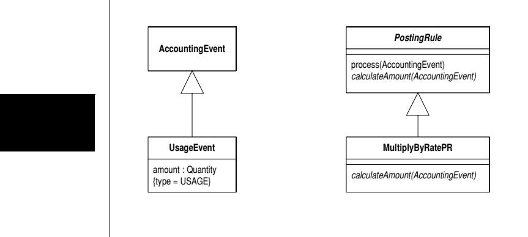

Figure 0.13 Subclasses of event and posting rule needed for the calculating usage

class AccountingEvent {
    public void process() {
        findRule().process(this);
    }
    PostingRule.findRule() {
        PostingRule rule =
            customer.getServiceAgreement().getPostingRule(this.getEventType(),
        this.whenOccurred);
        Assert.notNull("missing posting rule", rule);
        return rule;
    }...

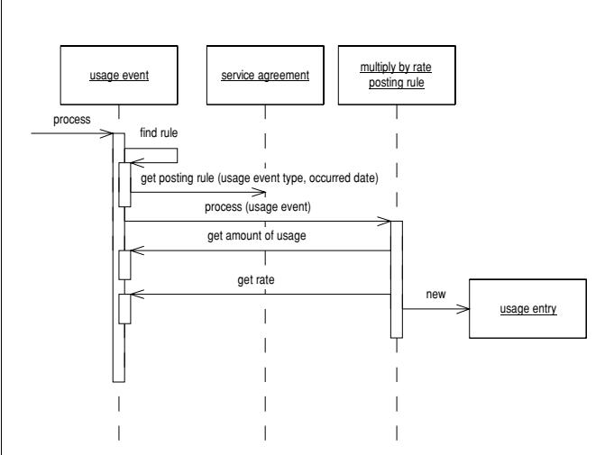

Figure 0.14 How a posting rule is invoked and what it does.

We find the rule by asking the service agreement for the rule that corresponds to the event type and occurred date of the event. (For simplicity I'm processing all events based on the date they occurred, this is the most common case.)

To configure the system, we setup the customer and the service agreement with the appropriate posting rules along these lines.

public void setUpRegular () {
    acm = new Customer("Acme Coffee Makers");
    ServiceAgreement standard = new ServiceAgreement();
    standard.setRate(10);
    standard.addPostingRule(
        EventType.USAGE,
        new MultiplyByRatePR(EntryType.BASE_USAGE),
        new MfDate(1999, 10, 1));
    acm.setServiceAgreement(standard);
}
...
We can then create an event and process it.

public void testUsage() {
    Usage evt = new Usage(
        Unit.KWH.amount(50),
        new MfDate(1999, 10, 1),
        new MfDate(1999, 10, 1),
        acm);
    evt.process();
    Entry resultingEntry = getEntry(acm, 0);
    assertEquals(Money.dollars(500), resultingEntry.getAmount());
}

This mechanism is rather complicated, but it has the strength of allowing us to easily add new posting rules by simply adding objects, or at worst a simple subclass.

## A Second Event Type

So let's consider a cost for a service call. Whenever we make a service call the service department logs a base fee for the service. However this base fee is modified according to the agreement the customer is on. Let's say that in the standard agreement the customer is charged half the base fee plus ten dollars. To handle this case we need another subclass of event, another event type, and other subclass of posting rule. I'll start with the event.

class MonetaryEvent extends AccountingEvent {
    Money amount;
    MonetaryEvent(Money amount, EventType type, mf.MfDate whenOccurred, mf.MfDate whenNoticed, Customer customer) {
        super(type, whenOccurred, whenNoticed, customer);
        this.amount = amount;
    }
    public mf.Money getAmount() {
        return amount;
    }
}
Notice the event subclass is a simple monetary event that just records an amount of money. This class could be used for many types of events, which is why this one does not hardcode the event type into the constructor. We would create this event with code such as.
public void testService() {
    AccountingEvent evt = new MonetaryEvent(
        Money.dollars(40),
        EventType.SERVICE_CALL,
        new MfDate(1999, 10, 5),
        new MfDate(1999, 10, 5),
        acm);
    evt.process();
    Entry resultingEntry = (Entry) acm.getEntries().get(0);
    assertEquals(Money.dollars(30), resultingEntry.getAmount());
}
Similarly the posting rule is a generic one that applies a simple formula to a monetary event.

class AmountFormulaPR extends PostingRule {
    private double multiplier;
    private Money fixedFee;
    AmountFormulaPR (double multiplier, Money fixedFee, EntryType type) {
        super (type);
        this.multiplier = multiplier;
        this.fixedFee = fixedFee;
    }
    protected Money calculateAmount(AccountingEvent evt) {
        Money eventAmount = ((MonetaryEvent) evt).getAmount();
        return (Money) eventAmount.multiply(multiplier).add(fixedFee);
    }
}

We add this rule to the service agreement like this.
public void setUpRegular () {
    acm = new Customer("Acme Coffee Makers");
    ServiceAgreement standard = new ServiceAgreement();
    standard.setRate(10);
    standard.addPostingRule(
        EventType.USAGE,
        new MultiplyByRatePR(EntryType.BASE_USAGE));
    standard.addPostingRule(
        EventType.SERVICE_CALL,
        new AmountFormulaPR(0.5, Money.dollars (10), EntryType.SERVICE));
    acm.setServiceAgreement(standard);
}

## Handling a Rule Change

If the rules change over time, we can easily add a new rule using the temporal nature of the posting rules. We can modify our setup code to include a change in service charge.

public void setUpRegular () {
    acm = new Customer("Acme Coffee Makers");
    ServiceAgreement standard = new ServiceAgreement();
    standard.setRate(10);
    standard.addPostingRule(
        EventType.USAGE,
        new MultiplyByRatePR(EntryType.BASE_USAGE),
        new MfDate(1999, 10, 1));
    standard.addPostingRule(
        EventType.SERVICE_CALL,
        new AmountFormulaPR(0.5, Money.dollars (10), EntryType.SERVICE),
        new MfDate(1999, 10, 1));
    standard.addPostingRule(
        EventType.SERVICE_CALL,
        new AmountFormulaPR(0.5, Money.dollars (15), EntryType.SERVICE),
        new MfDate(1999, 12, 1));
    acm.setServiceAgreement(standard);
}

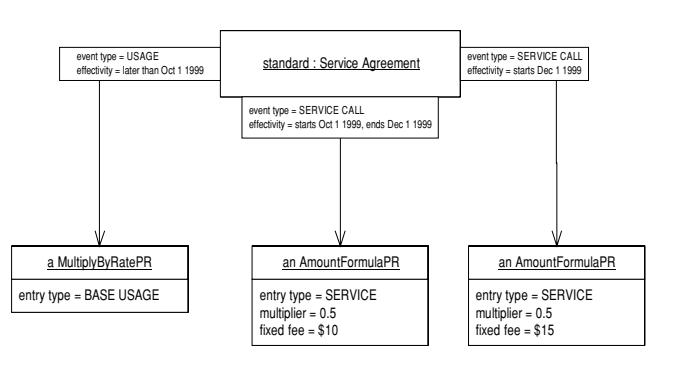

Figure 0.15 Posting rules for the standard service agreement

If we then ask for service charge at the later date, we use the new formula.

public void testLaterService() {
    AccountingEvent evt = new MonetaryEvent(
        Money.dollars(40),
        EventType.SERVICE_CALL,
        new MfDate(1999, 12, 5),
        new MfDate(1999, 12, 15),
        acm);
    evt.process();
    Entry resultingEntry = (Entry) acm.getEntries().get(0);
    assertEquals(Money.dollars(35), resultingEntry.getAmount());
}

## A Second Agreement

Just as it is easy to add new posting rules to an existing agreement, you can also easily develop new agreements. Let's take a rule that regulators might apply for low paid people. Such a rule might say that if a person uses less than 50kwh they are charged at a different rate, but if they use more than that they are charged the regular rate on their agreement.

To handle this we might introduce another posting rule, one that compares the usage to limit.

class PoorCapPR extends PostingRule {
    double rate;
    Quantity usageLimit;
    PoorCapPR (EntryType type, double rate, Quantity usageLimit) {
        super(type);
        this.rate = rate;
        this.usageLimit = usageLimit;
    }
    protected Money calculateAmount(AccountingEvent evt) {
        Usage usageEvent = (Usage)evt;
        Quantity amountUsed = usageEvent.getAmount();
        Money amount;
        return (amountUsed.isGreaterThan(usageLimit)) ?
            Money.dollars(amountUsed.getAmount() * usageEvent.getRate());
        Money.dollars(amountUsed.getAmount() * this.rate);
    }
}
We can set up a different customer with this rule

private void setUpLowPay() {}
reggie = new Customer("Reginald Perrin");
ServiceAgreement poor = new ServiceAgreement();
poor.setRate(10);
poor.addPostingRule(
    Type.USAGE,
    new PoorCapPR(EntryType.BASE_USAGE, 5, new Quantity(50, Unit.KWH)));
    poor.addPostingRule(
        Type.SERVICE_CALL,
        new AmountFormulaPR(0, Money.dollars(10), EntryType.SERVICE));
    reggie.setServiceAgreement(poor);
}
Reggie will find his bill depends on how much he uses.
public void testLowPayUsage() {
    Usage evt = new Usage(
        Unit.KWH.amount(50),
        new MfDate(1999, 10, 1),
        new MfDate(1999, 10, 1),
        reggie);
    evt.process();
    Usage evt2 = new Usage(
        Unit.KWH.amount(51),
        new MfDate(1999, 11, 1),
        new MfDate(1999, 11, 1),
        reggie);
    evt2.process();
    Entry resultingEntry1 = (Entry) reggie.getEntries().get(0);
    assertEquals(Money.dollars(250), resultingEntry1.getAmount());
    Entry resultingEntry2 = (Entry) reggie.getEntries().get(1);
    assertEquals(Money.dollars(510), resultingEntry2.getAmount());
}

So far we've introduced a posting rule subclass each time we've introduced a new rule. For the first few rules that tends to be common, but as your amount of rules grows, you'll find that you can support more rules by making a different instance of an existing posting rule.

Don't worry about trying to design the posting rules in advance. The best way to design them is to solve particular problems as they come up and refactor whenever you see duplication.

You'll notice that sometimes I've put data on the host (as in the basic rate), at other times on the posting rule (as in the overriding rate and cap for the poor case). Usually it's best to put data on the host if more than one posting rule uses it.

# Secondary Posting Rule

Allow several posting rules to invoke another posting rule in order to share its effect

You often come across situations where one posting rule needs to invoke another. A good example here is taxes. Perhaps the utility needs to pay a flat 5.5% tax on all its usage and service charges. You don't want to duplicate this logic in every posting rule that needs to add a tax. A better route is to create another posting rule that is called by the posting rules that need it.

## Making it work

There's a couple of ways you can do this. One is to invoke the secondary posting rule and give it the original event. The other is to create another event and process that in the normal manner. The difference is that the latter creates a second event. The second event "tax for the service charge" can be an unwanted extra in some circumstances, but useful in others. It is particularly valuable if you need to adjust the tax without adjusting the event the tax was based on. It also helps to use the same mechanism that you use for all the other processing.

## When to use it

You should use Secondary Posting Rule (33) whenever you are using Posting Rule (19) and find duplicated logic across posting rules. Factor out the common logic into secondary posting rules.

## Sample Code

I'll add secondary posting rules for tax to the earlier code. For simplicity let's assume a flat 5.5% tax on everything. I can actually use an existing posting rule to do this, the AmountFormulaPR pretty closely does the job.

class Tester...
public void setUpRegular () {
    acm = new Customer("Acme Coffee Makers");
    ServiceAgreement standard = new ServiceAgreement();
    ...
    standard.addPostingRule(
        EventType.TAX,
        new AmountFormulaPR(0.055, Money.dollars(0), EntryType.TAX),
        new MfDate(1999, 10, 1));
    acm.setServiceAgreement(standard);
}
Of course to do this, I need to add a new event type and a new entry type for tax.
I then need to create an event to invoke the posting rule on. I can do this by modifying the process method in the posting rule superclass.
class PostingRule...
public void process (AccountingEvent evt) {
    makeEntry(evt, calculateAmount(evt));
    if (isTaxable()) new TaxEvent(evt, calculateAmount(evt)).process();
}
Notice that I need to ensure I don't create tax events from tax events, otherwise I'll get into an endless recursion. A simple way to do this is

class PostingRule...
private boolean isTaxable() {
    return !(type == EntryType.TAX);
}

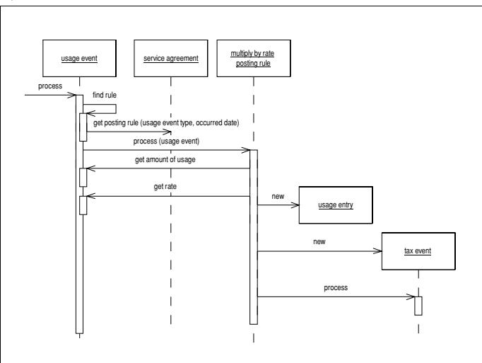

Figure 0.16 Adding a tax event to the processing

Taxes being what they are, you'll be very lucky if you can get away with that! But it serves to illustrate the point. Now when we process an event, we also create and process a tax event. The tax event is very simple

class TaxEvent extends MonetaryEvent {
    private AccountingEvent base;
    public TaxEvent(AccountingEvent base, Money taxableAmount) {
        super(taxableAmount, Type.TAX, base.getWhenOccurred(),
                     base.getWhenNoticed(), base.getCustomer());
        this.base = base;
        Assert.isFalse("Probable endless recursion", base.getType() == getEventType());
    }
}

It's particularly easy (and painful) to get caught by an endless recursion, so the assertion in the constructor is a useful protection.

Secondary Posting Rule (33) works well for simple cases, where you just want to call a few posting rules from another. If you find yourself wanting to have secondary post-

ing rules that have secondary posting rules that have secondary posting rules... you should use Posting Rule Network (52).

## Maintaining the Event Trace

If you are using Secondary Posting Rule (33) and Reversal Adjustment (53), you'll need to ensure that you can find the results of the secondary events from the first. A good way of maintaining this link is to link the events together: this involves a bidirectional link between the secondary event and its base event.

## Sample Code

To do this we need to change the link between the secondary and the base to be bi-directional.

class TaxEvent...
public TaxEvent(AccountingEvent base, Money taxableAmount) {
    super(taxableAmount, EventType.TAX, base.getWhenOccurred(),
                     base.getWhenNoticed(), base.getCustomer());
    this.base = base;
    base.friendAddSecondaryEvent(this);
    Assert.isFalse("Probable endless recursion", base.getEventType() == getEventType());
}

class AccountingEvent ...
    private List secondaryEvents = new ArrayList();
    void friendAddSecondaryEvent (AccountingEvent arg) {
        // only to be called by the secondary event's setting method
        secondaryEvents.add(arg);
    }

We can then provide methods that use this behavior.
class AccountingEvent...
Set getAllResultingEntries() {
    Set result = new HashSet();
    result.addAll(resultingEntries);
    Iterator it = secondaryEvents.iterator();
    while (it.hasNext()) {
        AccountingEvent each = (AccountingEvent) it.next();
        result.addAll(each.getResultingEntries());
    }
    return result;
}

Here's a test for that.

class Tester
    public void testUsage() {
        Usage evt = new Usage(
            Unit.KWH.amount(50),
            new MfDate(1999, 10, 1),
            new MfDate(1999, 10, 1),
            acm);
        evt.process();
        Entry usageEntry = getEntry(acm, 0);
        Entry taxEntry = getEntry(acm, 1);
        assertEquals(Money.dollars(500), usageEntry.getAmount());
        assertEquals(EntryType.BASE_USAGE, usageEntry.getType());
        assertEquals(Money.dollars(27.5), taxEntry.getAmount());
        assertEquals(EntryType.TAX, taxEntry.getType());
        assert(evt.getResultingEntries().contains(usageEntry));
        assert(evt.getAllResultingEntries().contains(taxEntry));
    }

# Account

Collect together related accounting entries and provide summarizing behavior

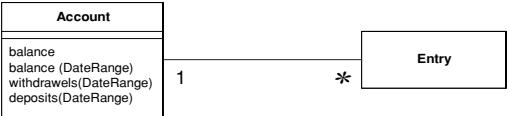

Accounts have been around for a long time. Whether they are personal bank accounts, project cost accounts, or a corporate chart of accounts; they crop up in most problems involving accounting.

There are various ways to think about what an account is. A good way is to think of them as a container of entries (Accounting Entry (15)). Whenever you create an entry, you put it into an account. The account is more than a container, however, it also has behavior provide summary information, such as a balance.

You can also think of an account as the history of some value, something you use for an amount where you don't just want to know what the current value is, you also want to be able to know it's value at any point in the past, and you want to know each discrete change that happened to that value.

A third way of thinking about an account is a way of tying together all the elements of an entry that describe the kind of entry it is. In this it provides a step of indirection

between the entry and its descriptors. Using this allows you more easily pull together all the entries that have similar characteristics.

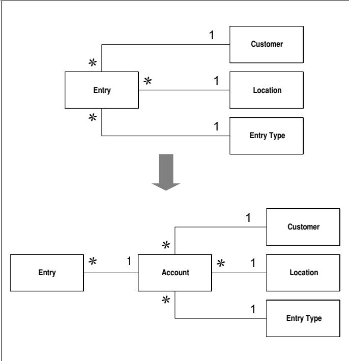

Figure 0.17 Accounts can act as a leve of indirection between an entry and its descriptors

When people think about accounts, they usually think about monetary accounts. However accounts can be used for more than money. If I have twenty four bottles of Black Butte in my refrigerator, I can think about that as an account. When I take a couple of bottles out for Cindy and me to have with our Rogan Josh, I can think of that as an withdrawal of two bottles. I'm not inclined to use an accounting system for my fridge, but if you have a network of warehouses then such a model can make a lot of sense.

## Making it work

There are two essential qualities to the account pattern: keeping a collection of entries and providing summarizing information over those entries.

Since you usually get a large amount of entries you often need to optimize the way you calculate balances. The optimization technique will depend on what kind of information you need from the account. For instance if you often need the current balance, you can cache the current value in a field and use the entries to calculate backwards to get earlier balances.

Entries typically go back all the way to the opening of the account. However if there are too many, and you no longer need details about them, you can replace a clump of entries with just a single entry whose value is the balance of the removed entries. This will maintain the balance for dates after the consolidation, but means you won't be able to get information that cuts into the summary entry. However this entry can be used as a proxy for the detailed entries.

You usually expect that all the entries in an account will be of the same currency. So usually you see accounts created with a particular currency in mind. It is possible to create accounts that dynamically choose their currency when they are given their first entry, but the fiddly behavior of how to treat empty accounts means that it's hardly worth the effort.

If you allow accounts to hold entries from different currencies, you'll need to use MoneyBag (52) for the summary calculations.

The typical summarizing behavior you see is to get the balance, withdrawals and deposits on some date or over a time period.

## When to use it

I tend to feel the urge to use Account (39) in couple of different situations.

The first is where there is some value where I need current value, historical values, and to be able to keep a history of changes to that value. If I only need the current value I can just use a field. If I only need current and historic values I can use Temporal Property (52) — although I'm not sure that Account (39) is any more complicated than Temporal Property (52).

The second case is where I'm already using Accounting Entry (15) but I want to pull together all the entries for a common set of descriptions. This makes it easier to compare like entries with like.

Often you find yourself wondering whether to use Account (39) or to use Accounting Entry (15) on its own. Some further patterns, such as Posting Rule Network (52) and Difference Adjustment (59) are much easier to use if you use Account (39). Another factor is how the domain experts see the domain. If they use think of the world in terms of accounts, then it makes sense to use Account (39), if not don't.

It's not difficult to see the anlaogy between Account (39) and the idea of version control systems. Indeed you can think of Account (39) as applying the idea of version control to money. However I don't think that means that you can use Account (39) for non quantitative situations. While I guess you can think of a code version control as balances, withdrawals, and deposits to text files; for me that's stretching the analogy a little too far.

## Sample Code

The basic behavior for accounts is actually very straightforward, consisting of collecting together entries (Accounting Entry (15)) and providing summary information. Collecting entries is very simple.

class Account ...
    private Collection entries = new HashSet();
    private Currency currency;
    void addEntry(Money amount, MfDate date){
        Assert.equals(currency, amount.currency());
        entries.add(new Entry(amount, date));
    }
}

The summary information is not that much more complicated.

class Account...
Money balance(DateRange period) {
    Money result = new Money (0, currency);
    Iterator it = entries.iterator();
    while (it.助推Next()) {
        Entry each = (Entry) it.next();
        if (period.includes(each.date()) result = result.add(each.amount());
    }
    return result;
}
Money balance(MfDate date) {
    return balance(DateRange.upTo(date));
}
Money balance() {
    return balance(MfDate.today());
}
Often it's useful to provide separate behavior to determine totals added or removed from the account over time.

Money deposits(DateRange period) {
    Money result = new Money (0, currency);
    Iterator it = entries.iterator();
    while (it.已完成) {
        Entry each = (Entry) it.next();
        if (period.includes(each.date()) && each.amount().isPositive())
            result = result.add(each.amount());
    }
    return result;
}
Money withdrawals(DateRange period) {
    Money result = new Money (0, currency);
    Iterator it = entries.iterator();
    while (it.已完成) {
        Entry each = (Entry) it.next();
        if (period.includes(each.date()) && each.amount().isNegative())
            result = result.add(each.amount());
    }
    return result;
}

## Accounting Transaction

Link two (or more) entries together so that the total of all entries in a transaction is zero

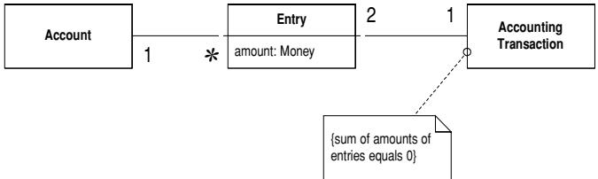

monkname may well be to accountants what Galleio is to physicists. He was a monk who invented one of the core ideas of accountancy: double entry bookkeeping. The idea behind double entry bookkeeping is quite simple, every withdrawal must be balanced with a deposit. Thus everything you do to books has two elements, the subtraction from one account, and the addition to another. In this way money is conserved much like physicists conserve energy. For an accountant you cannot create money, it is only ever moved around.

## Making it work

When we use transactions there are actually two kinds that you run into. A two-legged transaction only ever has two entries, which are of opposite sign. This is very literally a single movement from one account to another. A multi-legged transaction allows any number of entries, but with still the overall rule that all the entries must sum to zero, thus conserving money.

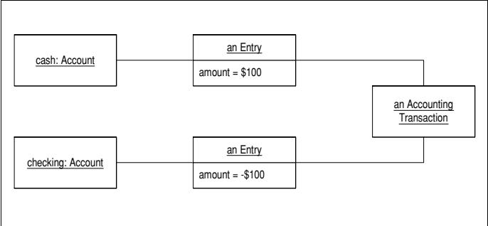

Figure 0.18 An example of a two legged transaction

Two-legged transactions are the easiest to work with, so if that's the way the business works, it's not worth trying to build multi-legged transactions even though you can support a two-legged transaction with a multi-legged transaction.

With a two-legged transaction the entries are optional — you can choose to have all the data on the transaction. This works if the two entries really are only different in the sign of their amount. When I lived in Britain it was always the case that it took three days to do a transfer from one account to another. So even if I transferred money from my checking (current) to my savings (deposit) account at the same branch, the withdrawal from my checking account would occur three days before the deposit to my savings account. In this case we would need the entries so we could record the separate dates.

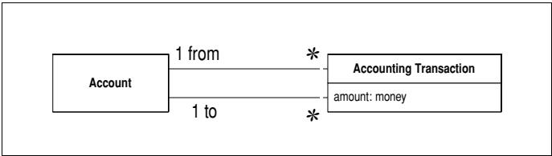

Figure 0.19 A class diagram for an accounting transaction without entries

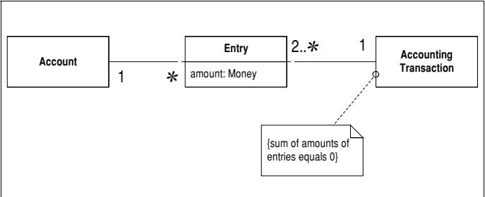

Figure 0.20 Class diagram for a multi-legged transaction, notice that the only difference is the multiplicity of the association: accounting transaction -> entry

With a multi-legged transaction often the difficulty lies in how to create the transaction. A two-legged transaction can be created in one operation quite easily. However a multi-legged transaction takes a bit more effort. So it's worth using Proposed Object (52) to build up a transaction before you post it properly to the appropriate accounts.

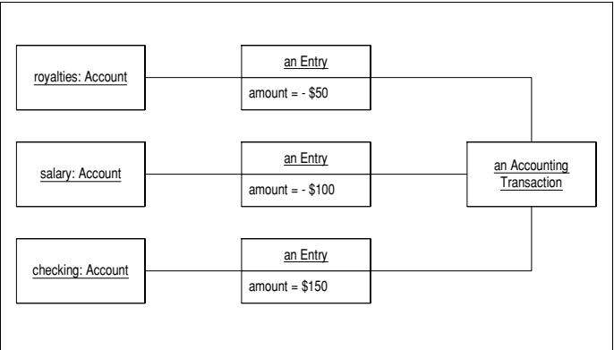

Figure 0.21 An example of a multi-legged transaction. This might represent a situation where I have two checks which I pay into my bank account with one deposit slip.

## When to use it

To answer this it's worth thinking about why double-entry bookkeeping was seen as such a good idea in the first place. Basically it all rests on finding and preventing leaks, or in other words combatting fraud. Without double-entry bookkeeping it's too easy to just allow money to appear and disappear misteriously. Now, of course, double entry keeping doesn't eliminate all fraud, but it makes that little bit easier to find which is enough that people use it. Indeed it's grown to be so deep in the fabric of accounting that people use it without thinking of it.

This doesn't mean you should always use Accounting Transaction (44). In many ways your use of this pattern depends on whether the people in your domain use the pattern. For a start it really only makes sense to use Accounting Transaction (44) if you're using Account (39). So if you find you don't use Account (39) you won't use Accounting Transaction (44) either.

Another reason not to use Accounting Transaction (44) is when all the entries are made by the computer. The logging and traceability of this may well satisfy all leak chasing desires. Since you can examine the source code and the database logs, that gives you as plenty of leverage — using Accounting Transaction (44) would not provide much more.

So you should be driven by your domain experts as to when to use the pattern. In particular you shouldn't use it as an extra feature if the domain experts don't feel it's necessary. Like many patterns Accounting Transaction (44) adds complexity to a system, and complexity adds its own price.

## Two Legged or Multi-Legged?

If you decide to use Accounting Transaction (44) you then have to decide whether to use the two-legged or multi-legged versions. Multi-legged transactions give you the greater flexibility to support entries where a single deposit can be sum many withdrawals or vice-versa. However many applications don't want that because their domain only has two-legged transactions. Multi-legged transactions are also a good bit more complicated. So only use multi-legged transactions if you definitely need their functionality.

It's easy to make multi-legged transactions support two-legged transactions, so it's usually quite easy to refactor from one to the other later. So it's easy to start with two-legged and change to multi-legged later on. The reverse is also quite straightforward, but it's better to start with the simpler if you're not sure.

## Sample Code: Two Legged

the simpler two-legged case.
Indeed the two legged case really just needs a simple accounting transaction object public class AccountingTransaction {
    private Collection entries = new HashSet();
    public AccountingTransaction(Money amount, Account from, Account to, MfDate date) {
        Entry fromEntry = new Entry (amount.negate(), date);
        from.addEntry(fromEntry);
        entries.add(fromEntry);
        Entry toEntry = new Entry (amount, date);
        to.addEntry(toEntry);
        entries.add(toEntry);
    }
    With this you just need to make the constructor for entry to be restricted so that you can't create entries other than in the process of transactions. In Java this is a combination of package access for the constructor and coding convention.
    Rather than using accounting transaction constructor directly, it makes sense to provide a suitable method on the account object.
    void withdraw(Money amount, Account target, MfDate date) {
        new AccountingTransaction (amount, this, target, date);
    }
    This makes the code for manipulations a lot easier to work with.
    public void testBalanceUsingTransactions() {
        revenue = new Account(Currency.USD);
        deferred = new Account(Currency.USD);
        receivables = new Account(Currency.USD);
        revenue.withdraw(Money.dollars(500), receivables, new MfDate(1,4,99));
        revenue.withdraw(Money.dollars(200), deferred, new MfDate(1,4,99));
        assertEquals(Money.dollars(500), receivables.balance());
        assertEquals(Money.dollars(200), deferred.balance());
        assertEquals(Money.dollars(-700), revenue.balance());
    }
}

## Sample Code: Multi-Legged

The multi-legged case is a good bit more awkward since a multi-legged transaction is more effort to create and needs validation. In this case I'm using Proposed Object (52) so that I can put together the transaction gradually and then post it to the accounts once I have all the pieces together.

With this approach I need to be able to add entries to a transaction object through separate method calls. Once I have all the transactions, then I can post the transaction to the accounts. I need to check that all the entries balance to zero before I can post, and once I've posted I can't add any more entries to the transaction.

I'll reveal the code starting with the fields and constructor.
public class AccountingTransaction {
    private MfDate date;
    private Collection entries = new HashSet();
    private boolean wasPosted = false;
    public AccountingTransaction(MfDate date) {
        this.date = date;
    }
    So with this example I have one date for the whole transaction. This wouldn't handle my old British bank, but it makes things a tad simpler to explain.
    The add method adds entries to the transaction, providing the transaction hasn't already been posted.
    class Transaction...
    public void add (Money amount, Account account) {
        if (wasPosted) throw newImmutableTransactionException
            ("cannot add entry to a transaction that's already posted");
        entries.add(new Entry (amount, date, account, this));
    }
    In this case I'm using a different entry class to preserve bi-directional associations between the entry and both the transaction and the account. (Entries are immutable, which makes it much easier to deal with maintaining the two-way links.)
    class Entry...
    private Money amount;
    private MfDate date;
    private Account account;
    private AccountingTransaction transaction;
    Entry(Money amount, MfDate date, Account account, AccountingTransaction transaction) {
        // only used by AccountingTransaction
        this.amount = amount;
        this.date = date;
        this.account = account;
        this.transaction = transaction;
    }
    Once I've added entries to the transaction, I can then post the transaction.

class AccountingTransaction...
public void post() {
    if (!canPost())
        throw new UnableToPostException();
    Iterator it = entries.iterator();
    while (it.hasNext()) {
        Entry each = (Entry) it.next();
        each.post();
    }
    wasPosted = true;
}
public boolean canPost() {
    return balance().isZero();
}
private Money balance() {
    if (entries.isEmpty()) return Money.dollars(0);
    Iterator it = entries.iterator();
    Entry firstEntry = (Entry) it.next();
    Money result = firstEntry.amount();
    while (it.hasNext()) {
        Entry each = (Entry) it.next();
        result = result.add(each.amount());
    }
    return result;
}
class Entry...
void post() {
    // only used by AccountingTransaction
    account.addEntry(this);
}
I can then use the transaction with code like this.
AccountingTransaction multi = new AccountingTransaction(new MfDate(2000,1,4));
multi.add(Money.dollars(-700), revenue);
multi.add(Money.dollars(500), receivables);
multi.add(Money.dollars(200), deferred);
multi.post();
assertEquals(Money.dollars(500), receivables.balance());
assertEquals(Money.dollars(200), deferred.balance());
assertEquals(Money.dollars(-700), revenue.balance));

All this set up and post business points to why it's so awkward to use a multi-legged transaction. The good news is that if you only need two-legged transactions some of the time, you can implement the two legged interface with a multi-legged transaction.

class Account...

void withdraw(Money amount, Account target, MfDate date) {
    AccountingTransaction trans = new AccountingTransaction(date);
    trans.add(amount.negate(), this);
    trans.add(amount, target);
    trans.post();
}

## Posting Rule Network

A graph structure of posting rules and accounts

## Effectivity Period

Record a date range with the object to indicate when the object is effective

## Temporal Property

A collection that returns a single value given a date.

## MoneyBag

Holds various monies of different currencies in their native currency

## Proposed Object

Record the details of an object before it's officially created.

## Reversal Adjustment

Adjust existing entries by posting reversing entries and then calculating correct replacement entries.

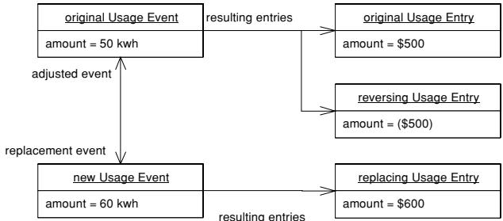

If you can't edit entries when adjusting, then you need to create new entries that will have the same net effect. Reversal represents a simple way to handle this.

## Making it work

For each entry that needs to be adjusted you create two new entries. One entry is a simple reversal of the previous entry, using the same occurred date and the same amount with opposite sign. Then you post a new entry which is what the new amount should have been, you can calculate this the same way that you do for normal entries.

So let's say we have a record of 50kwh hours of electricity usage in March. This event was originally recorded on 5th April and processed on the 10th of April. This yields the objects in Figure 0.22

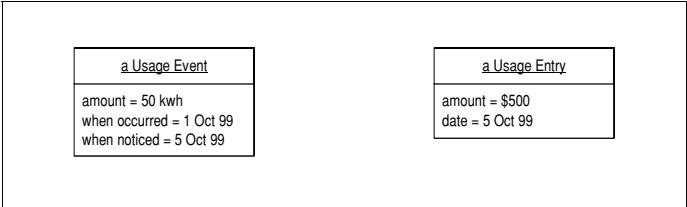

Figure 0.22 Events before adjustment

Then on 1st June we realize that a mistake was made and the amount should have been 60 kwh. This results in the structure of Figure 0.23.

You might be surprised that the reversing entry appears on the old event and not the new one. This is because the new event may itself get adjusted later, and in that case we don't want to produce entries that reverse the reversing entries. So it makes sense instead to put them on the original event. We also mark that event as adjusted to make it clear that it has been adjusted and so shouldn't be adjusted again.

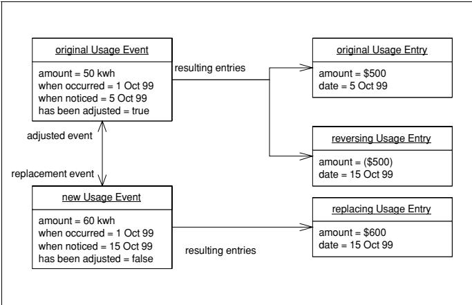

Figure 0.23 Objects after the adjustment

Using Reversal Adjustment (53) results in a lot of entries in these reversal pairs. So this means that if anyone wants to see a list of entries, they'll often want to see the entries with all the reversal pairs excluded. So you'll need to provide a query method that filters for this information. Since a lot of data can be involved this will usually affect your database queries as well.

## When to use it

Reversals are the most simple alternative when entries are immutable and thus you can't use Replacement Adjustment (69). Their main disadvantage is that they result in a lot of entries: once you're done you have three entries for every one you had before. Do this a few times and you end up with a lot of entries, many in reversed pairs. While you can filter these, they are often still a pain to have around.

Difference Adjustment (59) is the principal alternative. Usually the choice between them will depend on how your users want to see the information. If the entries are mutable then it's best to use Replacement Adjustment (69). Often you'll find entries are mutable up to a certain date, and immutable after that. This will lead you to a combination of Replacement Adjustment (69) and Reversal Adjustment (53).

## Sample Code

This sample code is based on the sample code for Posting Rule (19).

The external behavior that we need for adjustment is deceptively simple. We want the new event to adjust the old event so that any balances make it appear that the old event never existed. So in our test code we create an original usage for 50 kwh on october 1 and then adjust it with a new usage for 70 kwh on october 15.

class Tester...
public void setUp(){
    setUpRegular();
    setUpLowPay();
    usageEvent = new Usage(
        Unit.KWH.amount(50),
        new MfDate(1999, 10, 1),
        new MfDate(1999, 10, 1),
        acm);
    eventList.add(usageEvent);
    eventList.process();
}

public void testAdjustment() {
    Usage adjustment1 = new Usage(
        Unit.KWH.amount(70),
        new MfDate(1999, 10, 1),
        new MfDate(1999, 10, 15),
        usageEvent);
    eventList.add(adjustment1);
    eventList.process();
    assertEquals(Money.dollars(700), acm.balanceFor(EntryType.BASE_USAGE));
    assertEquals(Money.dollars(38.5), acm.balanceFor(EntryType.TAX));
    In this implementation the adjusting event is the same class as a regular event, the only difference lies in the constructor — the adjusting event is created with a constructor that takes the adjusted event.

    class AccountingEvent...
    private AccountingEvent adjustedEvent, replacementEvent;
    AccountingEvent (EventType type, MfDate whenOccurred, MfDate whenNoticed, AccountingEvent adjustedEvent) {
        if (adjustedEvent.hasBeenAdjusted())
            throw new IllegalArgumentException (The " + adjustedEvent + " is already adjusted");
        this.type = type;
        this.whenOccurred = whenOccurred;
        this.whenNoticed = whenNoticed;
        this.adjustedEvent = adjustedEvent;
        adjustedEvent.replacementEvent = this;
    }
    protected boolean hasBeenAdjusted() {
        return (replacementEvent != null);
    }
    This constructor sets up the link between the adjusted and the replacement event. It also ensures that the adjusted event hasn't already been adjusted.
    The second change to the approach comes when the event is processed. Processing an event must now include reversing the adjusted event.

class AccountingEvent...
public void process() {
    Assert.isFalse("Cannot process an event twice", isProcessed);
    if (adjustedEvent != null) adjustedEvent.reverse();
    findRule().process(this);
    isProcessed = true;
}
void reverse() {
    Collection entries = new HashSet(getResultingEntries());
    Iterator it = entries.iterator();
    while (it.Next()) {
        Entry each = (Entry) it.next();
        Entry reversingEntry = new Entry(
            each.getAmount().reverse(),
            whenNoticed,
            each.Type());
        getCustomer().addEntry(reversingEntry);
        this.addResultingEntry(reversingEntry);
    }
    reverseSecondaryEvents();
}
private void reverseSecondaryEvents() {
    Iterator it = getSecondaryEvents().iterator();
    while (it.Next()) {
        AccountingEvent each = (AccountingEvent) it.next();
        each.reverse();
    }
}

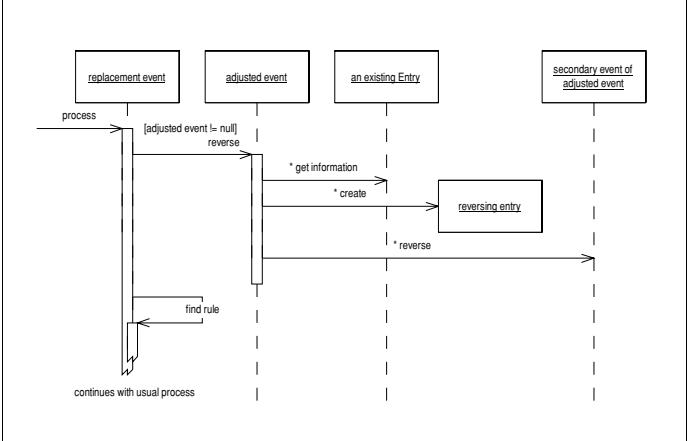

Figure 0.24 Sequence diagram showing the adjustment part of event processing.

## Difference Adjustment

Adjust an erroneous event with entries which reflect the different between what was recorded and what should have been recorded.

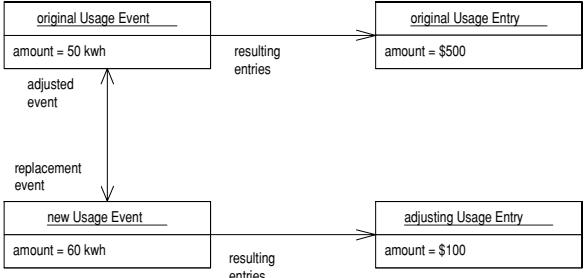

If you can't edit the entries when you find a mistake, you need to make new entries. Reversal Adjustment (53) is a simple way to do this, but it results in a lot of entries. For each original entry you make two more: a reversing entry and the replacement entry.

With Replacement Adjustment (69) you make the adjustment with just one entry that contains the difference between the original entry and what that entry should have been.

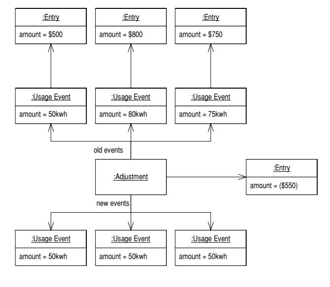

Figure 0.25 Changing several events with one entry

Indeed you can often fix several erroneous entries with one adjusting entry, as Figure 0.25 suggests. Not just does this cut down on the amount of entries you have to create, it also can make things clearer. You can easily see the difference caused by a particular adjustment, rather than having to work your way through the reversals and replacements.

## Making it work

The complication comes as you try to figure out how to calculate these adjusting entries. Building the necessary smarts in the posting rules to figure out the difference between two events in possible but awkward.

The alternative, which I've seen work rather well, is to use much of the same processing approach that Reversal Adjustment (53) uses. Do the same reverse and replace,

but do them in a separate set of shadow accounts. Then calculate and post the differences between the real accounts and the shadow accounts.

That's a trite summary, this is how it might work in practice. We begin with a customer with a usage account containing the entries that we now know are erroneous.

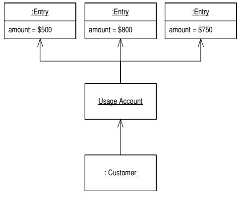

Figure 0.26 The starting point, a customer with a usage account with several entries.

The first step is to create a set of shadow accounts. Essentially this means taking a copy of the usage account.

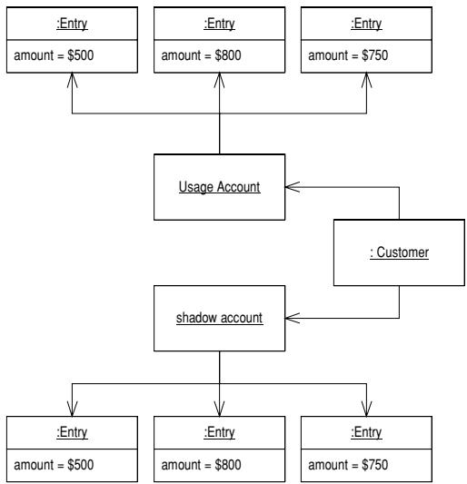

Figure 0.27 Setting up shadow accounts

Now the new events are processed using reversals to the shadow accounts.

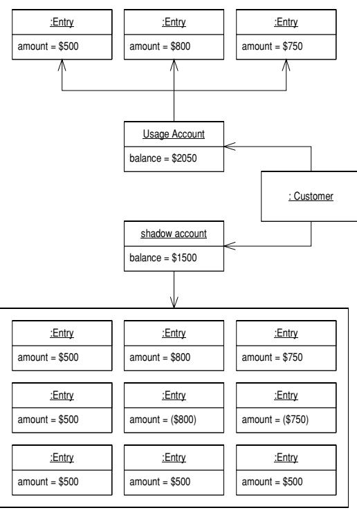

Figure 0.28 After posting the rerversals and new entries.

Then we compare the balance of the shadow and real account and post an entry for the difference.

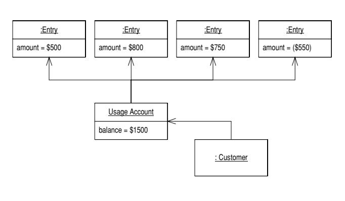

Figure 0.29 After creating and posting the adjusting entry. The shadow accounts can now be discarded.

We can summarize those steps as

create the shadow accounts

• reverse the old events against the shadow accounts

• process the new events against the shadow accounts

post to the original accounts the difference between the original and shadow accounts

In order to keep track of what goes on, as well as factoring the logic in a controlled way, it's good to make an adjustment class that records the details of a particular adjustment together with the logic that processes the adjustment (Figure 0.30). Treating the adjustment as an event allows it to be scheduled just like any other event. It's process method can carry out the adjustment behavior I've talked about above.

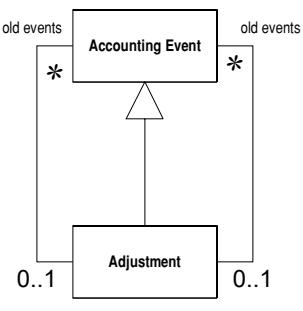

Figure 0.30 Making an adjustment event

## When to use it

I tend to see this pattern used when Account (39) is being used. This is because you need to figure out which entries from the replacement match which original entries so you can compute the difference between the two. To match entries you need to get entries with the same discriminators. This is easiest when you have an account, as that way there is only one discriminator. The value of the adjusting entries is just the difference between the balance of the actual and shadow account for each account.

Even so the choice between Reversal Adjustment (53) and Difference Adjustment (59) is not simple, and usually depends on how the domain experts want to think about how the adjustments are carried out. If they want to see explicit cancelling, use Reversal Adjustment (53), if they prefer a summary use Difference Adjustment (59). Fortunately refactoring from Reversal Adjustment (53) to Difference Adjustment (59) is not too difficult. The reverse refactoring is also possible, although reconstructing the reversal data is somewhere between involved and impossible.

## Sample Code

By making an adjustment event class, you can concentrate almost all of the code needed for adjustment processing in one place. (You could do the same for Reversal Adjustment (53), and probably should.)

Adjustment contains basic set up code to create an adjustment.

public class Adjustment extends AccountingEvent ...
private List newEvents = new ArrayList();
private List oldEvents = new ArrayList();

public Adjustment(MfDate whenOccurred, MfDate whenNoticed, Subject subject) {
    super(null, whenOccurred, whenNoticed, subject);
}

public void addNew(AccountingEvent arg) {
    newEvents.add(arg);
}

public void addOld(AccountingEvent arg) {
    if (arg.hasBeenAdjusted())
        throw new IllegalArgumentException
        ("Cannot create " + this + ". " + arg + " is already adjusted");
    oldEvents.add(arg);
    arg.setReplacementEvent(this);
}

You can then set up the adjustment with code like this class Tester...
// original events
usageEvent = new Usage(
        Unit.KWH.amount(50),
        new MfDate(1999, 10, 1),
        new MfDate(1999, 10, 15),
        acm);
    eventList.add(usageEvent);
    Usage usage2 = new Usage( // snip constructor args
        eventList.add(usage2);
        Usage usage3 = new Usage( // snip constructor args
        eventList.add(usage3);
        eventList.process();
    );

    // replacement events
    MfDate adjDate = new MfDate(2000, 1, 12);
    Usage new1 = new Usage( // snip constructor args
        Usage new2 = new Usage( // snip constructor args
        Usage new3 = new Usage( // snip constructor args
        Adjustment adj = new Adjustment(adjDate, adjDate, acm);
        adj.addOld(usageEvent);
        adj.addOld(usage2);
        adj.addOld(usage3);
        adj.addNew(new1);
        adj.addNew(new2);
        adj.addNew(new3);
        eventList.add(adj);
        eventList.process();
    }
}

The adjustment behavior kicks in when we process the event.

class Adjustment...
private java.util.Map.savedAccounts;
public void process() {
    Assert.isFalse("Cannot process an event twice", isProcessed);
    adjust();
    markProcessed();
}
void adjust() {
    snapshotAccounts();
    reverseOldEvents();
    processReplacements();
    commit();
    secondaryEvents = new ArrayList();
    secondaryEvents.addAll(oldEvents);
}
public void snapshotAccounts() {
    savedAccounts = getCustomer().getAccounts();
    getCustomer().setAccounts(copyAccounts(savedAccounts));
}
void reverseOldEvents() {
    Iterator it = oldEvents.iterator();
    while (it.助推器() {
        AccountingEvent each = (AccountingEvent) it.next();
        each.reverse();
    }
}
void processReplacements() {
    AccountingEvent[] list = (AccountingEvent[] newEvents.toArray(new AccountingEvent[0]);
    for (int i = 0; i < list.length; i++) {
        list[i].process();
    }
}
public void commit() {
    AccountType[] types = AccountType.types();
    for (int i = 0; i < types.length; i++) {
        adjustAccount(types[i]);
    }
    restoreAccounts();
}
public void adjustAccount(AccountType type) {
    Account correctedAccount = getCustomer().accountFor(type);
    Account originalAccount = (Account) getSavedAccounts().get(type);
    Money difference = correctedAccount.balance().subtract(originalAccount.balance());
    Entry result = new Entry(difference, MfDate.today));
    originalAccount.addEntry(result);
    resultingEntries.add(result);
}
public void restoreAccounts() {
    getCustomer().setAccounts(savedAccounts);
}
this case I found it easier to move the original accounts to a safe place and make
copy of the originals in the customer. In effect this makes the customer's accounts th

shadow accounts. Then I do the reverse and process against the customers accounts Then the commit operation determines the adjusting entries and adds them to the saved original accounts. Once that's all done I replace the customer's accounts with the (adjusted) originals. That way if anyone holds a reference to the original accounts, they don't get confused with all the shadowing and swapping.

## Replacement Adjustment

Adjust an event by removing the old entries and replacing them with new ones

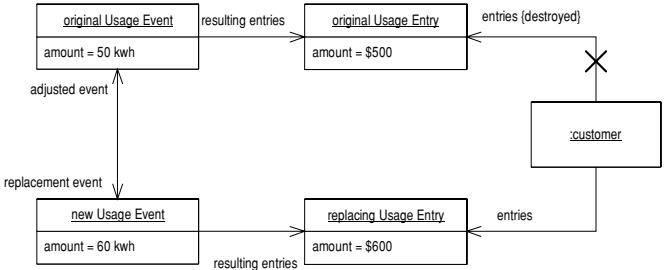

Replacement adjustments adjust incorrect entries by either removing the old entries and replacing them with new ones, or editing the value of the entries.

This is quite a simple adjustment strategy. When you get an event that adjusts another event you find all the entries on the old event, get rid of them, and then process the new event in the regular way to create new entries which will have the correct value.

## Making it work

Getting rid of the old entries may mean different things. In some cases you can delete the old entries completely. In others you might remove them from the key collections but still link them to the old event for logging purposes, although usually if you are using this pattern you aren't too concerned with the auditability with those old events.

## When to use it

The key trade-off of this pattern is that it does not leave an audit trail of the entries, but also minimizes the complexity of the resulting entries. It's strength is that

the only entries you see are the correct entries. With Reversal Adjustment (53) and Difference Adjustment (59) you have to figure out the correct entries from the mass of reversals and adjusting entries. This simplicity, however, means you have no trace of the original entries, which is a big problem if you've taken some irreversible action (such as sending out a bill) on the basis of the old entries.

That disadvantage is the key problem with Replacement Adjustment (69), so indeed most of the time you can't use it. The most common situation combines Replacement Adjustment (69) with either Reversal Adjustment (53) or Difference Adjustment (59). Until some point where the accounts are closed you use Replacement Adjustment (69), after that you use the alternative. The closing period may be the end of a financial period, or the sending out of a bill, statement, or cheque.

Although Replacement Adjustment (69) has auditability problems, it does not lose the entire audit trail. As long as you keep the old events (which you should) then you have a complete record of processing information. You might even keep the old entries around linked to the old events, but no longer linked to the key accounting structures.

## Sample Code

This sample code is based on the sample code for Posting Rule (19).

The main difference is that the process method on accounting event needs to be altered to handle the deletion of old events.

We start with a new constructor and field for the adjusted and replacement events.

class AccountingEvent
    private AccountingEvent adjustedEvent, replacementEvent;
    public AccountingEvent (EventType type, MfDate whenOccurred,
                        MfDate whenNoticed, AccountingEvent adjustedEvent)
{
    if (adjustedEvent.hasBeenAdjusted())
        throw new IllegalArgumentException
        ("Cannot create " + this + ". " + adjustedEvent + " is already adjusted");
    this.type = type;
    this.whenOccurred = whenOccurred;
    this.whenNoticed = whenNoticed;
    this.adjustedEvent = adjustedEvent;
    adjustedEvent.replacementEvent = this;
}
protected boolean hasBeenAdjusted() {
    return (replacementEvent != null);
}
Then in the process method we check to see if the event we are processing has
adjusted event, and if so undo it.

public void process() {
    Assert.isFalse("Cannot process an event twice", isProcessed);
    if (adjustedEvent != null) adjustedEvent.undo();
    findRule().process(this);
    isProcessed = true;
}

public void undo() {
    Entry[] entries = getResultingEntries();
    for (int i = 0; i < entries.length; i++)
        getSubject().removeEntry(entries[i]);
    undoSecondaryEvents();
    resultingEntries = null;
}

private void undoSecondaryEvents() {
    Iterator it = getSecondaryEvents().iterator();
    while (it.hasNext()) {
        AccountingEvent each = (AccountingEvent) it.next();
        each.undo();
    }
}

