## The Object Primer Second Edition

# The Application Developer's Guide to Object Orientation and the UML

Scott W. Ambler

PUBLISHED BY THE PRESS SYNDICATE OF THE UNIVERSITY OF CAMBRIDGE

The Pitt Building, Trumpington Street, Cambridge, United Kingdom

CAMBRIDGE UNIVERSITY PRESS

The Edinburgh Building, Cambridge CB2 2RU, UK

40 West 20th Street, New York, NY 10011-4211, USA

10 Stamford Road, Oakleigh, VIC 3166, Australia

Ruiz de Alarcón 13, 28014 Madrid, Spain

Dock House, The Waterfront, Capt Town 8001, South Africa

http://www.cambridge.org

Published in association with SIGS Books

© Cambridge University Press 2001

All rights reserved.

This book is in copyright. Subject to statutory exception and to the provisions of relevant collective licensing agreements, no reproduction of any part may take place without the written permission of Cambridge University Press.

Any product mentioned in this book may be a trademark of its company.

First edition published by SIGS Books and Multimedia in 1995

First edition published by Cambridge University Press in 1998

Reprinted 1998, 1999

Second edition published 2001

Design by Kevin Callahan and Andrea Cammarata

Composition by Andrea Cammarata

Cover design by Jean Cohn and Andrea Cammarata

Printed in the United States of America

A catalog record for this book is available from the British Library.

Library of Congress Cataloging in Publication data available.

ISBN 0 521 78519 7 paperback

## Contents

Foreword xvii  
Preface xix  
Acknowledgments xxiii  
Chapter 1 · Introduction 1  
1.1 The Structured Paradigm versus the Object-Oriented Paradigm 2  
1.2 How Is This Book Organized? 3  
1.3 How to Read This Book 5  
1.4 What You Have Learned 7  
Chapter 2 · Object Orientation: A New Software Paradigm 9  
2.1 The Potential Benefits of Object Orientation 10  
2.1.1 Increased Reusability 10  
2.1.2 Increased Extensibility 10  
2.1.3 Improved Quality 11  
2.1.4 Financial Benefits 12  
2.1.5 Increased Chance of Project Success 12  
2.1.6 Reduced Maintenance Burden 15  
2.1.7 Reduced Application Backlog 17  
2.1.8 Managed Complexity 19  
2.2 The Potential Drawbacks of OO 20  
2.3 Objects Are Here to Stay 22

## The Object Primer

2.4 Object Standards 23  
2.5 The Object-Oriented Software Process 23  
2.6 What You Have Learned 26  
2.7 Review Questions 28  
  
Chapter 3 · Gathering User Requirements 31  
3.1 Putting Together a Requirements Modeling Team 34  
3.1.1 Choosing Good Subject-Matter Experts 38  
3.1.2 Choosing Good Facilitators 39  
3.1.3 Choosing Good Scribes 40  
3.2 Fundamental Requirements Gathering Techniques 40  
3.2.1 Interviewing 40  
3.2.2 Brainstorming 42  
3.3 Essential Use Case Modeling 44  
3.3.1 A Picture Says 1,000 Words: Drawing Use Case Diagrams 45  
3.3.2 Identifying Actors 48  
3.3.3 Documenting a Use Case 50  
3.3.4 Use Cases: Essential versus System 52  
3.3.5 Identifying Use Cases 56  
3.3.6 Modeling Different Logic Flows: Alternate Courses of Action 61  
3.4 Essential User Interface Prototyping 63  
3.4.1 An Example Essential User-Interface Model 67  
3.4.2 Ensuring System Usability 71  
3.4.3 User Interface-Flow Diagramming 72  
3.5 Domain Modeling with Class Responsibility Collaborator (CRC) Cards 74  
3.5.1 Preparing to CRC Model 77  
3.5.2 Finding Classes 77  
3.5.3 Finding Responsibilities 82  
3.5.4 Defining Collaborators 85  
3.5.5 Arranging the CRC Cards 89  
3.5.6 The Advantages and Disadvantages of CRC Modeling 91  
3.6 Developing a Supplementary Specification 95  
3.6.1 Identifying Business Rules 95  
3.6.2 Identifying Nonfunctional Requirements and Constraints 97  
3.7 Identifying Change Cases 98  
3.7.1 Documenting Change Cases 99  
3.7.2 The Advantages of Change Cases 100  
3.8 Tips for Organizing a Modeling Room 101  
3.9 Requirements Tips and Techniques 102  
3.10 What You Have Learned 105  
3.10.1 The ABC Bank Case Study 105  
3.11 Review Questions 108  
  
Chapter 4 · Ensuring Your Requirements Are Correct: Requirements Validation Techniques 109  
4.1 Testing Early and Often 111  
4.2 Use Case Scenario Testing 114  
4.2.1 The Steps of the Use Case Scenario Testing Process 114

## Contents

4.2.2 Creating Use Case Scenarios 116  
4.2.3 Acting Out Scenarios 119  
4.2.4 The Advantages of Use Case Scenario Testing 126  
4.2.5 The Disadvantages of Use Case Scenario Testing 127  
4.3 User Interface Walkthroughs 128  
4.4 Requirements Reviews 128  
4.5 What You Have Learned 131  
4.6 Review Questions 131  
  
Chapter 5 • Understanding The Basics: Object-Oriented Concepts 133  
5.1 New and Old Concepts Together 134  
5.2 OO Concepts from a Structured Point-of-View 136  
5.3 Objects and Classes 138  
5.4 Attributes and Methods 140  
5.5 Abstraction, Encapsulation, and Information Hiding 143  
5.5.1 Abstraction 143  
5.5.2 Encapsulation 144  
5.5.3 Information Hiding 144  
5.5.4 An Example 145  
5.5.5 Why This Is Important 145  
5.6 Inheritance 146  
5.6.1 Modeling Inheritance 147  
5.6.2 Inheritance Tips and Techniques 148  
5.6.3 Single and Multiple Inheritance 150  
5.6.4 Abstract and Concrete Classes 152  
5.7 Association 152  
5.7.1 Modeling Associations 153  
5.7.2 How Associations Are Implemented 157  
5.8 Aggregation 158  
5.8.1 Modeling Aggregation 158  
5.8.2 Aggregation Tips and Techniques 160  
5.9 Collaboration 160  
5.9.1 Messages 161  
5.9.2 Collaboration Tips and Techniques 163  
5.10 Persistence 165  
5.10.1 Persistence Tips and Techniques 166  
5.10.2 Persistent Memory: The Object Space 167  
5.10.3 Object Databases (ODBs) 167  
5.11 Persistent versus Transitory Associations 168  
5.11.1 Persistent Associations 169  
5.11.2 Transitory Associations: Dependencies 169  
5.12 Coupling 170  
5.12.1 Coupling Tips and Techniques 171  
5.13 Cohesion 172  
5.14 Polymorphism 173  
5.14.1 An Example: The Poker Game 173  
5.14.2 Polymorphism at the University 174  
5.15 Interfaces 175

## The Object Primer

5.16 Components 176  
5.17 Patterns 178  
5.18 What You Have Learned 179  
5.19 Review Questions 180  
  
Chapter 6 • Determining What to Build: Object-Oriented Analysis 181  
6.1 System Use Case Modeling 185  
6.1.1 Writing System Use Cases 186  
6.1.2 Reuse in Use Case Models: <<extend>>, <<include>>, and Inheritance 190  
6.1.3 Good Things to Know About Use Case Modeling 193  
6.1.4 Use Case Modeling Tips and Techniques 195  
6.2 Sequence Diagrams: From Use Cases to Classes 197  
6.2.1 How to Draw Sequence Diagrams 204  
6.2.2 Why and When Should You Draw Sequence Diagrams? 207  
6.2.3 How to Document Sequence Diagrams 207  
6.2.4 A Good Thing to Know About Sequence Diagrams 207  
6.3 Conceptual Modeling: Class Diagrams 208  
6.3.1 Modeling Classes, Attributes, and Methods 213  
6.3.2 Modeling Associations 216  
6.3.3 Modeling Dependencies 220  
6.3.4 Introducing Reuse Between Classes via Inheritance 220  
6.3.5 Modeling Aggregation Associations 222  
6.3.6 Modeling Association Classes 224  
6.3.7 Documenting Class Models 225  
6.3.8 Conceptual Class Modeling Tips 227  
6.4 Activity Diagramming 229  
6.4.1 How to Draw Activity Diagrams 230  
6.4.2 How to Document Activity Diagrams 232  
6.5 User Interface Prototyping 232  
6.5.1 Determining the Needs of Your Users 232  
6.5.2 Building the Prototype 234  
6.5.3 Evaluating the Prototype 234  
6.5.4 Determining If You Are Finished 234  
6.5.5 Good Things to Understand About Prototyping 235  
6.5.6 Prototyping Tips and Techniques 235  
6.6 Evolving Your Supplementary Specification 237  
6.6.1 The Object Constraint Language 237  
6.7 Applying Analysis Patterns Effectively 238  
6.7.1 The Business Entity Analysis Pattern 238  
6.7.2 The Contact Point Analysis Pattern 239  
6.7.3 The Advantages and Disadvantages of Patterns 240  
6.8 User Documentation 242  
6.8.1 Types of User Documentation 242  
6.8.2 How to Write User Documentation 243  
6.9 Organizing Your Models with Packages 245  
6.10 What You Have Learned 246  
6.11 Review Questions 246

## Contents

Chapter 7 • Determining How to Build Your System: Object-Oriented Design 249  
  
7.1 Layering Your Models—Class Type Architecture 254  
7.1.1 The User-Interface Layer 256  
7.1.2 The Controller/Process Layer 256  
7.1.3 The Business/Domain Layer 260  
7.1.4 The Persistence Layer 260  
7.1.5 The System Layer 261  
  
7.2 Class Modeling 262  
7.2.1 Inheritance Techniques 263  
7.2.2 Association and Dependency Techniques 266  
7.2.3 Aggregation and Composition Techniques 270  
7.2.4 Modeling Methods During Design 272  
7.2.5 Modeling Attributes During Design 281  
7.2.6 Introducing Interfaces Into Your Model 286  
7.2.7 Class Modeling Design Tips 289  
  
7.3 Applying Design Patterns Effectively 293  
7.3.1 The Singleton Design Pattern 294  
7.3.2 The Façade Design Pattern 295  
7.3.3 Tips for Applying Patterns Effectively 295  
  
7.4 State Chart Modeling 296  
7.4.1 How to Draw a State Diagram 299  
7.4.2 When and Why Should You Draw State Diagrams? 300  
7.4.3 State Diagrams and Inheritance 301  
  
7.5 Collaboration Modeling 301  
7.5.1 Drawing Collaboration Diagrams 303  
7.5.2 Collaboration and Inheritance 304  
7.5.3 When Should You Draw Collaboration Diagrams? 305  
  
7.6 Component Modeling 306  
7.6.1 How to Develop a Component Model 306  
7.6.2 Implementing a Component 312  
  
7.7 Deployment Modeling 312  
7.7.1 How to Develop a Deployment Model 313  
7.7.2 When Should You Create Deployment Models? 315  
  
7.8 Relational Persistence Modeling 316  
7.8.1 Keys and Object Identifiers 316  
7.8.2 The Basics of Mapping Objects to RDBs 324  
7.8.3 Mapping Associations, Aggregation, and Composition 329  
7.8.4 Drawing Persistence Models 333  
7.8.5 When Should You Develop Persistence Models? 334  
  
7.9 User Interface Design 335  
7.9.1 User-Interface Design Principles 335  
7.9.2 Techniques for Improving Your User-Interface Design 336  
7.9.3 User-Interface Flow Diagramming 339  
7.9.4 User-Interface Design Standards and Guidelines 340  
  
7.10 Design Tips 341  
7.11 What You Have Learned 344  
  
7.12 Review Questions 344  
7.12.1 The Bank Case Study Six Months Later 346

Chapter 8 • Object-Oriented Testing 347  
8.1 What Is Programming? 350  
8.2 From Design to Java Code 352  
8.2.1 Implementing a Class In Java 354  
8.2.2 Declaring Instance Attributes In Java 356  
8.2.3 Implementing Instance Methods In Java 358  
8.2.4 Implementing Static Methods and Attributes in Java 360  
8.2.5 Implementing Constructors 364  
8.2.6 Encapsulating Attributes with Accessors 366  
8.2.7 Implementing Inheritance In Java 372  
8.2.8 Implementing Interfaces In Java 372  
8.2.9 Implementing Associations, Aggregation, and Composition In Java 377  
8.2.10 Implementing Dependencies 384  
8.2.11 Implementing Collaboration in Java 385  
8.2.12 Implementing Business Rules 385  
8.3 From Design to Persistence Code 386  
8.3.1 Strategies for Implementing Persistence Code 387  
8.3.2 Defining and Modifying Your Persistence Schema 389  
8.3.3 Creating, Retrieving, Updating, and Deleting Data 389  
8.3.4 Implementing Behavior in a Relational Database 391  
8.4 Programming Tips 393  
8.4.1 Techniques for Writing Clean Code 393  
8.4.2 Techniques for Writing Effective Documentation 396  
8.4.3 Miscellaneous 398  
8.5 What You Have Learned 401  
8.6 Review Questions 401  
Chapter 9 • Object-Oriented Testing 403  
9.1 Overcoming Misconceptions About Object-Oriented Testing 404  
9.1.1 Misconception #1: With Objects You Do Less Testing 405  
9.1.2 Misconception #2: Structured Testing Techniques Are Sufficient 406  
9.1.3 Misconception #3: Testing the User Interface Is Sufficient 406  
9.2 Full Lifecycle Object-Oriented Testing (FLOOT) 406  
9.2.1 Regression Testing 407  
9.2.2 Quality Assurance 408  
9.2.3 Testing Your Requirements, Analysis, and Design Models 409  
9.2.4 Testing Your Source Code 412  
9.2.5 Testing Your System in its Ent�iety 418  
9.2.6 Testing by Users 420  
9.3 From Test Cases to Defects 422  
9.4 What You Have Learned 424  
9.5 Review Questions 425  
Chapter 10 • Putting It All Together: Software Process 427  
10.1 What Is So Different About Object-Oriented Development? 429  
10.2 What Is a Software Process? 430  
10.3 Why Do You Need a Software Process? 431

## Contents

10.4 From Waterfall/Serial Development... 432  
10.5 ...to Iterative Development... 433  
10.6 ...and Incremental Development 435  
10.7 The Development Process Presented in This Book 437  
10.8 Process Patterns of the Object-Oriented Software Process (OOSP) 438  
10.9 The Unified Process 442  
10.10 Other Processes 444  
10.10.1 eXtreme Programming (XP) 444  
10.10.2 The Microsoft Solutions Framework (MSF) 448  
10.10.3 The OPEN Process 449  
10.10.4 Catalysis 449  
10.11 When to Use Objects 450  
10.12 When Not to Use Objects 451  
10.13 What You Have Learned 452  
10.14 Review Questions 453  
  
Chapter 11 • Where to Go From Here 455  
11.1 The Post-2000 (P2K) Environment 456  
11.1.1 New Software Strategies 456  
11.1.2 Enabling Technologies 457  
11.1.3 Leading-Edge Development Techniques 459  
11.1.4 Modern Software Processes 461  
11.1.5 Object Programming Languages 462  
11.1.6 Internet Development Languages 465  
11.2 Skills for Specific Positions 466  
11.2.1 Business Analyst 466  
11.2.2 IT Senior Manager 466  
11.2.3 Object Modeler 467  
11.2.4 Persistence Modeler 467  
11.2.5 Persistence Administrator 468  
11.2.6 Programmer 468  
11.2.7 Project Manager 468  
11.2.8 Quality Assurance Engineer 469  
11.2.9 Software Architect 469  
11.2.10 Test Engineer 470  
11.3 Continuing Your Learning Process 470  
11.3.1 Take General Introductory Training 471  
11.3.2 Gain Hands-on Experience 471  
11.3.3 Obtain Mentoring 471  
11.3.4 Work in a Learning Team 473  
11.3.5 Read, Read, Read 473  
11.3.6 Take Advanced Training 474  
11.4 What You Have Learned 474  
11.5 Parting Words 474  
  
Glossary 475  
References and Recommended Reading 499  
Index 505

Developers are good at building systems right.

What we're not good at is building the right system.

# Chapter 1 Introduction

What You Will Learn in This Chapter

What is object orientation?

The difficulties encountered with traditional development methods

How this book is organized

How to read this book

## Why You Need to Read This Chapter

To understand why you should consider embracing object-oriented techniques, you need to understand the challenges of the structured paradigm and how the object paradigm addresses them.

This book describes the object-oriented (OO) paradigm, a development strategy based on the concept that systems should be built from a collection of reusable components called objects. Instead of separating data and functionality, as is done in the structured paradigm, objects encompass both. While the object-oriented paradigm sounds similar to the structured paradigm, as you will see in this book, it is actually quite different. A common mistake that many experienced developers make is to assume they have been “doing objects” all along, just because they have been applying similar software-engineering principles. The reality is you must recognize that objects are different so you can start your learning experience successfully.

### 1.1 The Structured Paradigm versus the Object-Oriented Paradigm

The structured paradigm is a development strategy based on the concept that a system should be separated into two parts: data (modeled using a data/persistence model) and functionality (modeled using a process model). In short, using the structured approach, you develop applications in which data is separate from behavior in both the design model and in the system implementation (that is, the program).

On the other hand, as you see in Figure 1-1, the main concept behind the object-oriented paradigm is that instead of defining systems as two separate parts (data and functionality), you now define systems as a collection of interacting objects. Objects do things (that is, they have functionality) and they know things (they have data). While this sounds similar to the structured paradigm, it really isn't.

Consider the design of an information system for a university. Taking the structured approach, you would define the layout of a database and the design of a program to access that data. In the database would be information about students, professors, rooms, and courses. The program would enable users to enroll students in courses, assign professors to teach courses, schedule courses in certain rooms, and so on. The program would access and update the database, in effect supporting the daily business of the school.

Now consider the university information system from an object-oriented perspective. In the real world, there are students, professors, rooms, and courses. All of these things would be considered objects. In

## DEFINITION

Paradigm. (pronounced para-dime) An overall strategy or viewpoint for doing things. A paradigm is a specific mindset.

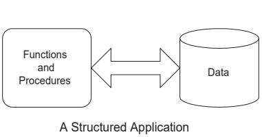

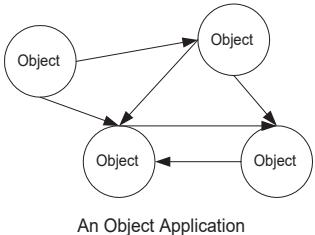

An Object Application

the real world, students know things (they have names, addresses, birth dates, telephone numbers, and so on) and they do things (enroll in courses, drop courses, and pay tuition). Professors also know things (the courses they teach and their names) and they do things (input marks and make schedule requests). From a systems perspective, rooms know things (the building they're in and their room number) and should be able to do things, too (such as tell you when they are available and enable you to reserve them for a certain period of time). Courses also know things (their title, description, and who is taking the course) and should be able to do things (such as letting students enroll in them or drop them).

To implement this system, we would define a collection of classes (a class is a generic representation of similar objects) that interact with each other. For example, we would have “Course,” “Student,” “Professor,” and “Room” classes. The collection of these classes would make up our application, which would include both the functionality (the program) and the data.

As you can see, the OO approach results in a completely different view of what an application is all about. Rather than having a program that accesses a database, we have an application that exists in what is called an object space. The object space is where both the program and the data for the application reside. I discuss this concept in further detail in Chapter 5 but, for now, think of the object space as virtual memory.

### 1.2 How Is This Book Organized?

The Object Primer covers leading-edge OO techniques and concepts that have been proven in the development of real-world applications. It covers in detail why you should learn this new approach called object orientation, requirements techniques, such as use cases and CRC modeling, OO

Figure 1-1. Comparing the structured and object-oriented paradigms

For individuals,

OO is a whole new way to think.

For organizations,

OO requires a complete change in its system development culture.

<table border=1 style='margin: auto; word-wrap: break-word;'><tr><td style='text-align: center; word-wrap: break-word;'>DEFINITIONS</td></tr><tr><td style='text-align: center; word-wrap: break-word;'>Class. A template from which objects are created (instantiated). Although in the real world Doug, Wayne, and Bill are all “student objects,” we would model the class “Student” instead.</td></tr><tr><td style='text-align: center; word-wrap: break-word;'>Object space. The memory space, including all accessible permanent storage, in which objects exist and interact with one another.</td></tr><tr><td style='text-align: center; word-wrap: break-word;'>Object. A person, place, thing, concept, event, screen, or report. Objects both know things (that is, they have data) and they do things (that is, they have functionality).</td></tr><tr><td style='text-align: center; word-wrap: break-word;'>Object-oriented paradigm. A development strategy based on the concept of building systems from reusable components called objects.</td></tr><tr><td style='text-align: center; word-wrap: break-word;'>OO. An acronym used interchangeably for two terms: Object-oriented and object orientation. For example, when we say OO programming, we really mean object-oriented programming. When we say this is a book that describes OO, we really mean this it is a book that describes object orientation.</td></tr></table>

concepts, OO analysis and design using the UML modeling techniques, OO programming, OO testing, and the OO software process. The book ends with a discussion of how to continue your learning process, including descriptions of common object-oriented technologies and techniques you might want to consider applying on software projects.

Figure 1-2 depicts the organization of The Object Primer, showing the individual chapters and the relationships between them. Table 1-1 summarizes the contents of each chapter. On the left side of the diagram are the chapters that describe the fundamental activities of the software process, such as gathering requirements, object-oriented analysis, and object-oriented programming. The arrows between the boxes represent the general relationships between the chapters: you see the chapters describing gathering requirements, validating requirements, and object-oriented analysis are closely related to one another. Chapter 9 covers object-oriented testing and describes testing techniques that should be used to validate your analysis, design, and programming efforts. Along the right-hand side of Figure 1-2 are listed several “supporting” chapters, chapters that present material that is critical to your understanding of the object-oriented paradigm.

## DEFINITION

Unified Modeling Language (UML). The definition of a standard modeling language for object-oriented software, including the definition of a modeling notation and the semantics for applying it as defined by the Object Management Group (OMG).

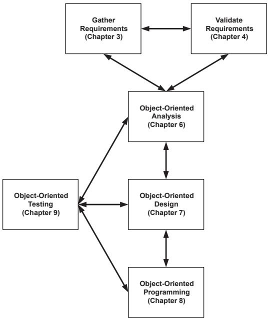

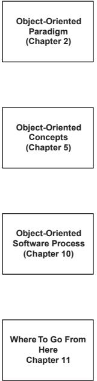

### 1.3 How to Read This Book

Chapters 3 and 4 are written specifically for you, describing in detail the techniques for gathering and validating the user requirements for an OO application. Business analysts should also read Chapter 5, which

Figure 1-2. The organization of this book

## Business Analysts and User Representatives

## Programmers, Designers, and Project Managers

Read the entire book, cover to cover. It's tempting to skip to Chapter 5, which overviews object-oriented concepts, and start reading from there, but that would be a major mistake. Chapter 5 builds on many of the ideas presented in the first four chapters; therefore, reading ahead is not to your advantage.

Table 1-1. The material contained in each chapter

<table border=1 style='margin: auto; word-wrap: break-word;'><tr><td style='text-align: center; word-wrap: break-word;'>Chapter</td><td style='text-align: center; word-wrap: break-word;'>Description</td></tr><tr><td style='text-align: center; word-wrap: break-word;'>2: A New Software Paradigm</td><td style='text-align: center; word-wrap: break-word;'>Discussion of the advantages and disadvantages of object orientation, why objects are here to stay, and an overview of the software process.</td></tr><tr><td style='text-align: center; word-wrap: break-word;'>3: Gathering Requirements</td><td style='text-align: center; word-wrap: break-word;'>Description of requirements gathering techniques, including use cases, change cases, CRC modeling, interviewing, and user interface prototyping. A discussion of how the techniques work together is included.</td></tr><tr><td style='text-align: center; word-wrap: break-word;'>4: Validating Requirements</td><td style='text-align: center; word-wrap: break-word;'>Description of requirements validation techniques such as use case scenario testing and requirements walkthroughs.</td></tr><tr><td style='text-align: center; word-wrap: break-word;'>5: Object-Oriented Concepts</td><td style='text-align: center; word-wrap: break-word;'>Description of the fundamental concepts of object orientation, including inheritance, polymorphism, aggregation, and encapsulation.</td></tr><tr><td style='text-align: center; word-wrap: break-word;'>6: Object-Oriented Analysis</td><td style='text-align: center; word-wrap: break-word;'>Description of common object-oriented analysis techniques such as sequence diagrams and class diagrams. A description of how to make the transition from requirements to analysis is presented, as well as how all the techniques fit together.</td></tr><tr><td style='text-align: center; word-wrap: break-word;'>7: Object-Oriented Design</td><td style='text-align: center; word-wrap: break-word;'>Description of common object-oriented design techniques such as class diagrams, state chart diagrams, collaboration diagrams, and persistence models. A description of how to make the transition from analysis to design is presented, as well as how the techniques fit together.</td></tr><tr><td style='text-align: center; word-wrap: break-word;'>8: Object-Oriented Programming</td><td style='text-align: center; word-wrap: break-word;'>Overview of common object-oriented programming tips and techniques. A discussion of how to make the transition from design to coding is presented.</td></tr><tr><td style='text-align: center; word-wrap: break-word;'>9: Object-Oriented Testing</td><td style='text-align: center; word-wrap: break-word;'>Overview of the Full Lifecycle Object-Oriented Testing (FLOOT) methodology and techniques.</td></tr><tr><td style='text-align: center; word-wrap: break-word;'>10: Object-Oriented Software Process</td><td style='text-align: center; word-wrap: break-word;'>Overview of the Object-Oriented Software Process (OOSP) and the enhanced lifecycle of the Unified Process.</td></tr><tr><td style='text-align: center; word-wrap: break-word;'>11: Where to Go From Here</td><td style='text-align: center; word-wrap: break-word;'>Discussion of what you need to do to continue your OO learning process, including a description of leading object technologies and techniques such as Java, Enterprise Java-Beans (EJB), C++, and component-based development.</td></tr></table>

## DEFINITION

Full lifecycle object-oriented testing (FLOOT). A testing methodology for object-oriented development that comprises testing techniques that, taken together, provide methods to verify that your application works correctly at each stage of development.

describes the fundamental concepts of object orientation, and Chapter 6, which describes OO analysis techniques. Both groups should also read Chapter 10, which describes the overall software process for object-oriented software—this will help put the overall effort into context for you and give you a greater appreciation of how software is developed, maintained, and supported.

## Students

Like the first group of people, you should also read this book from cover to cover. Furthermore, you should read this book two or three weeks before your midterm test on object orientation, and not the night before the exam. This stuff takes a while to sink in (actually it takes much longer than a few weeks, but there's only so much time in a school term).

### 1.4 What You Have Learned

The object-oriented paradigm is a software development strategy based on the idea of building systems from reusable components called objects. As you saw in Figure 1-1, the primary concept behind the object-oriented paradigm is, instead of defining systems as two separate parts (data and functionality), you now define systems as a collection of interacting objects. Objects do things (that is, they have functionality) and they know things (that is, they have data).

Your requirements define what is requested to be built.

Your analysis defines what will be built.

Chapter 6

# Determining What to Build: Object-Oriented Analysis

## What You Will Learn In This Chapter

How to develop a system use case model from an essential use case model

How to develop sequence diagrams

How to develop a conceptual class model from a domain model

How to develop activity diagrams

How to develop a user interface prototype

How to evolve your supplementary specification

How to apply the Object Constraint Language (OCL)

How to apply analysis patterns

How to write user documentation

How to apply packages on your diagrams

## Why You Need to Read This Chapter

Your requirements model, although effective for understanding what your users want to have built, is not as effective at understanding what will be built. Object-oriented analysis techniques, such as system use case modeling, sequence diagramming, class modeling, activity diagramming, and user interface prototyping are used to bridge the gap between requirements and system design.

The purpose of analysis is to understand what will be built. This is similar to requirements gathering, described in Chapter 3, the purpose of which is to determine what your users want to have built. The main difference is that the focus of requirements gathering is on understanding your users and their potential usage of the system, whereas the focus of analysis shifts to understanding the system itself.

Figure 6-1 depicts the main artifacts of your analysis efforts and the relationships between them. The solid boxes indicate major analysis artifacts, whereas the dashed boxes represent your major requirements artifacts. As with the previous Figure 3-1, the arrows represent “drives” relationships; for example, you see that information contained in your CRC model affects information in your class model and vice versa. Figure 6-1 has three important implications. First, analysis is an iterative process.

Figure 6-1. Overview of analysis artifacts and their relationships

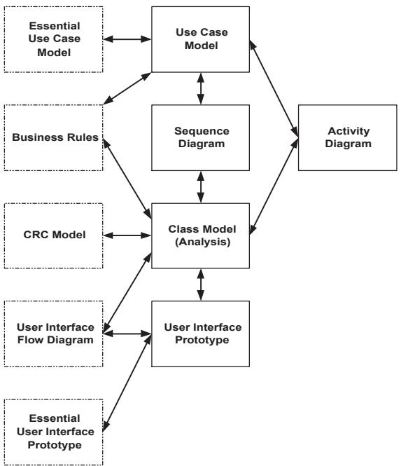

Second, taken together, requirements gathering and analysis are highly interrelated and iterative. As you see in Chapter 7, which describes object-oriented design techniques, analysis and design are similarly interrelated and iterative. Third, the “essential” models, your essential use case model and your essential user interface prototype, evolve into corresponding analysis artifacts—respectively, your use case model and user interface prototype. What isn’t as obvious is that your Class Responsibility Collaborator (CRC) model evolves into your analysis class model.

Your use case model describes how your users work with your system, reflecting the business rules pertinent to your system, as well as aspects of your user interface model. You can use either Unified Modeling Language (UML) sequence diagrams or UML activity diagrams to flesh out and verify the logic contained in your use cases. Furthermore, you see that sequence diagrams act as a bridge to your class model, which depicts the static structure of the classes from which your system will be built. Your user interface model, including your user interface prototype and your user interface flow diagram (see Chapter 3), also drives changes to your class model.

An important concept to note about Figure 6-1, and similarly Figures 7-1 and 8-1, is that every possible "drives" relationship is not shown. For example, as you are developing your use case model, most likely you will realize you are missing a feature in your user interface, yet a relationship doesn't exist between these two artifacts. From a pure/academic point of view, when you realize your use case model conflicts with your user-interface model, you should first consider what the problem is, update your use case model appropriately, propagate the change to your essential use case model, and then to your essential user interface model, and, finally, into your user interface model. Yes, you may, in fact, take this route. Just as likely, and probably more so, is that you will, instead, update both your use case model and user interface model together, and then propagate the changes to the corresponding requirements artifacts. This is an important aspect of iterative development. You don't necessarily work in a defined order; instead, your work reflects the relationships between the artifacts you evolve over time.

A second important concept is the difference between a model and a diagram. A diagram is a picture—typically consisting of bubbles connected by lines documented with labels—that depicts an abstraction of a portion or an aspect of a system. A model is also an abstraction, although it is more robust because it consists of zero or more diagrams, plus associated documentation. For example, a class model is composed of a UML class diagram and the specifications of the classes and associations depicted on that diagram, whereas a CRC model is a collection of CRC cards.

<table border=1 style='margin: auto; word-wrap: break-word;'><tr><td colspan="2">DEFINITIONS</td></tr><tr><td colspan="2">Activity diagram. A UML diagram used to model high-level business processes or the transitions between states of a class (in this respect, activity diagrams are effectively specializations of state chart diagrams).</td></tr><tr><td colspan="2">Class diagram. Shows the classes of a system and the associations between them.</td></tr><tr><td colspan="2">Class model. A class diagram and its associated documentation.</td></tr><tr><td colspan="2">Class Responsibility Collaborator (CRC) card. A standard index card that has been divided into three sections: one indicating the name of the class the card represents, one listing the responsibilities of the class, and the third listing the names of the other classes with which this one collaborates to fulfill its responsibilities.</td></tr><tr><td colspan="2">Class Responsibility Collaborator (CRC) model. A collection of CRC cards that model all or part of a system.</td></tr><tr><td colspan="2">Diagram. A visual representation of a problem or solution to a problem.</td></tr><tr><td colspan="2">Essential use case. A simplified, abstract, generalized use case that captures the intentions of a user in a technology and implementation independent manner.</td></tr><tr><td colspan="2">Essential use case model. A use case model comprised of essential use cases.</td></tr><tr><td colspan="2">Essential user interface prototype. A low-fidelity prototype of a system&#x27;s user interface that models the fundamental, abstract characteristics of a user interface.</td></tr><tr><td colspan="2">Model. An abstraction describing a problem domain and/or a solution to a problem domain. Traditionally models are thought of as diagrams plus their corresponding documentation, although non-diagrams, such as interview results and collections of CRC cards, are also considered to be models.</td></tr><tr><td colspan="2">Project stakeholder. Anyone who could be materially affected by the implementation of a new system or application.</td></tr><tr><td colspan="2">Prototype. A simulation of an item, such as a user interface or a system architecture, the purpose of which is to communicate your approach to others before significant resources are invested in the approach.</td></tr><tr><td colspan="2">Sequence diagram. A diagram that models the sequential logic, in effect, the time ordering of messages.</td></tr><tr><td colspan="2">Use case. A sequence of actions that provide a measurable value to an actor.</td></tr><tr><td colspan="2">Use case diagram. A diagram that shows use cases, actors, and their interrelationships.</td></tr><tr><td colspan="2">Use case model. A model comprised of a use case diagram, use case definitions, and actor definitions. Use case models are used to document the behavior requirements of a system.</td></tr><tr><td colspan="2">User interface (UI). The user interface of software is the portion the user directly interacts with, including the screens, reports, documentation, and software support (via telephone, electronic mail, and so on).</td></tr><tr><td colspan="2">User interface flow diagram. A diagram that models the interface objects of your system and the relationships between them. Also known as an interface-flow diagram, a windows navigation diagram, or an interface navigation diagram.</td></tr><tr><td colspan="2">User interface prototype. A prototype of the user interface (UI) of a system. User interface prototypes could be as simple as a hand-drawn picture or a collection of programmed screens, pages, or reports.</td></tr></table>

### 6.1 System Use Case Modeling

During analysis, your main goal is to evolve your essential use cases into system use cases. The main difference between an essential use case and a system use case is, in the system use case, you include high-level implementation decisions. For example, a system use case refers to specific user-interface components—such as screens, HTML pages, or reports—something you wouldn't do in an essential use case. During analysis, you make decisions regarding what will be built, information reflected in your use cases, and, arguably, even how it will be built (effectively design). Because your use cases refer to user interface components, and because your user interface is worked on during design, inevitably design issues will creep into your use cases. For example, a design decision is whether your user interface is implemented using browser-based technology, such as HTML pages or graphical user interface (GUI) technology such as Windows. Because your user interface will work differently depending on the implementation technology, the logic of your system use cases, which reflect the flow of your user interface, will also be affected.

What is a system use case model? Similar to essential use case models described in Chapter 3, a system use case model is composed of a use case diagram (Rumbaugh, Jacobson, and Booch, 1999) and the accompanying documentation describing the use cases, actors, and associations. Figure 6-4, which provides an example of a use case diagram, depicts a collection of use cases, actors, their associations, a system boundary box (optional), and packages (optional). A use case describes a sequence of actions that provide a measurable value to an actor and is drawn as a horizontal ellipse. An actor is a person, organization, or external system that plays a role in one or more interactions with your system. Actors are drawn as stick figures. Associations between actors and classes are indicated in use case diagrams, a relationship exists whenever an actor is involved with an interaction described by a use case. Associations also exist between use cases in system use case models, a topic discussed in the following section, something that didn't occur in essential use case models. Associations are modeled as lines connecting use cases and actors to one another, with an optional arrowhead on one end of the line indicating the direction of the initial invocation of the relationship. The rectangle around the use cases is called the system boundary box and, as the name suggests, it delimits the scope of your system—the use cases inside the rectangle represent the functionality you intend to implement. Finally, packages are UML constructs that enable you to organize model elements (such as use cases) into groups. Packages are depicted as file folders that can be used on any of the UML diagrams, including both use case diagrams and class diagrams. Section 6.9 presents strategies to apply packages effectively in your UML models.

#### 6.1.1 Writing System Use Cases

Two common styles exist for writing use cases: narrative style and action-response style. Choose one style and stick to it.

Writing system use cases is fairly straightforward. You begin with your essential use cases and modify them to reflect the information captured within your UML sequence diagrams (Section 6-2), your UML activity diagrams (Section 6-7), your user interface prototype (Section 6-5), and the contents of your evolved supplementary specification (Section 6-6). You will also rework your use cases to reflect opportunities for reuse, applying the UML stereotypes of <<extend>> and <<include>>, as well as the object-oriented concept of inheritance, techniques covered next in Section 6.1.2.

Consider the system use case presented in Figure 6-4. Notice how it is similar to the essential use cases of Chapter 3, with the main exceptions being the references to user interface elements and references to other use cases. The use case has a basic course of action, which is the main start-to-finish path the user will follow. It also has three alternate courses of action, representing infrequently used paths through the use case, exceptions, or error conditions. Notice how I have added an identifier, something I could have done for the essential use cases depicted in Chapter 3. It also has sections labeled "Extends," "Includes," and "Inherits From" indicating the use cases, if any, with which this use case is associated. I discuss what you need to put here in Section 6.1.1.

Until now, I have presented use cases in what is called narrative style—the use case of Figure 6-2 is written this way—where the basic and alternate courses of action are written one step at a time. A second style, called the action-response style, presents use case steps in columns, one column for each actor and a second column for the system. Figure 6-3 presents the basic course of action for Figure 6-4 rewritten using this style. For the sake of brevity, I didn't include rewritten versions of the alternate courses. Of the two columns, one is for the Student actor and one for the system, because only one actor is involved in this use case.

## DEFINITIONS

Extend association. A generalization relationship where an extending use case continues the behavior of a base use case. The extending use case accomplishes this by inserting additional action sequences into the base use case sequence. This is modeled using a use case association with the <<extend>> stereotype.

Include association. A generalization relationship denoting the inclusion of the behavior described by a use case within another use case. This is modeled using a use case association with the <<include>> stereotype Also known as a "uses" or a "has-a" relationship.

Name: Enroll in Seminar

Identifier: UC 17

Description: Enroll an existing student in a seminar for which he is eligible.

Preconditions: The Student is registered at the University.

Postconditions: The Student will be enrolled in the course he wants if he is eligible and room is available.

Extends: —

Includes: —

Inherits From: —

## Basic Course of Action:

1. The student wants to enroll in a seminar.

2. The student inputs his name and student number into the system via "UI23 Security Login Screen."

3. The system verifies the student is eligible to enroll in seminars at the university, according to business rule "BR129 Determine Eligibility to Enroll."

4. The system displays "UI32 Seminar Selection Screen," which indicates the list of available seminars.

5. The student indicates the seminar in which he wants to enroll.

6. The system validates the student is eligible to enroll in the seminar, according to the business rule "BR130 Determine Student Eligibility to Enroll in a Seminar."

7. The system validates the seminar fits into the existing schedule of the student, according to the business rule "BR143 Validate Student Seminar Schedule."

8. The system calculates the fees for the seminar based on the fee published in the course catalog, applicable student fees, and applicable taxes. Apply business rules "BR 180 Calculate Student Fees" and "BR45 Calculate Taxes for Seminar."

9. The system displays the fees via “UI33 Display Seminar Fees Screen.”

10. The system asks the student whether he still wants to enroll in the seminar.

11. The student indicates he wants to enroll in the seminar.

12. The system enrolls the student in the seminar.

14. The system bills the student for the seminar, according to business rule 'BR100 Bill Student for Seminar.'

13. The system informs the student the enrollment was successful via “UI88 Seminar Enrollment Summary Screen.”

15. The system asks the student if he wants a printed statement of the enrollment.

16. The student indicates he wants a printed statement.

17. The system prints the enrollment statement "UI89 Enrollment Summary Report."

18. The use case ends when the student takes the printed statement.

Figure 6-2.

"Enroll in seminar"

written in narrative style

Alternate Course A: The Student is Not Eligible to Enroll in Seminars

A.3. The system determines the student is not eligible to enroll in seminars.

A.4. The system informs the student he is not eligible to enroll.

A.5. The use case ends.

Alternate Course B: The Student Does Not Have the Prerequisites

B.6. The system determines the student is not eligible to enroll in the seminar he has chosen.

B.7. The system informs the student he does not have the prerequisites.

B.8. The system informs the student of the prerequisites he needs.

B.9. The use case continues at Step 4 in the basic course of action.

Alternate Course C: The Student Decides Not to Enroll in an Available Seminar

C.4. The student views the list of seminars and doesn't see one in which he wants to enroll.

C 5. The use case ends

C.5. The use case ends.

The advantage of the action-response style is it is easier to see how actors interact with the system and how the system responds. The disadvantage is, in my opinion, it is a little harder to understand the flow of logic of the use case. This is particularly true for alternate courses and their references to other courses of action. The style you choose is a matter of preference. What's important is that your team and, ideally, your organization selects one style and sticks to it.

I want to point out an important style issue pertaining to Steps 2 and 3 of the use case of Figure 6-2. I could just as easily have defined a precondition that the student has already logged in to the system and has been verified as an eligible student. Actually, this should be two preconditions: one for being logged in and one for being eligible (this way, the preconditions are cohesive). To support the first precondition, being logged in, I would be tempted to write a "Log Into System" use case that would describe the process of logging in and validating the user, perhaps including alternate courses for obtaining a login identifier. This use case would be a candidate for inclusion in your common, enterprise model because it is a feature that should belong to your organization's shared technical architecture. Cross-project issues such as this are among the topics I cover in Process Patterns (Ambler, 1998b) and More Process Patterns (Ambler, 1999), the third and fourth books in this series. The second precondition, the one for being eligible to enroll, likely doesn't need its own use case, but I would still reference the appropriate business rule.

## Student

<table border=1 style='margin: auto; word-wrap: break-word;'><tr><td style='text-align: center; word-wrap: break-word;'>1. The student wants to enroll in a seminar.\n2. The student inputs his name and student number into the system via “UI23 Security Login Screen.”\n3. The system verifies the student is eligible to enroll in seminars at the university, according to business rule “BR129 Determine Eligibility to Enroll.”\n4. The system displays “UI32 Seminar Selection Screen,” which indicates the list of available seminars.\n5. The system indicates the seminar in which she wants to enroll.\n6. The system validates the student is eligible to enroll in the seminar, according to the business rule “BR130 Determine Student Eligibility to Enroll in a Seminar.”\n7. The system validates the seminar fits into the existing schedule of the student, according to the business rule “BR143 Validate Student Seminar Schedule.”\n8. The system calculates the fees for the seminar based on the fee published in the course catalog, applicable student fees, and applicable taxes. Apply business rules “BR 180 Calculate Student Fees” and “BR45 Calculate Taxes for Seminar.”\n9. The system displays the fees via “UI33 Display Seminar Fees Screen.”\n10. The system asks the student whether she still wants to enroll in the seminar.\n11. The student indicates she wants to enroll in the seminar.\n12. The system enrolls the student in the seminar.\n13. The system informs the student the enrollment was successful via “UI88 Seminar Enrollment Summary Screen.”\n14. The system bills the student for the seminar, according to business rule “BR100 Bill Student for Seminar.”\n15. The system asks the student if she wants a printed statement of the enrollment.\n16. The student indicates she wants a printed statement.\n17. The system prints the enrollment statement “UI89 Enrollment Summary Report.”</td></tr><tr><td style='text-align: center; word-wrap: break-word;'>18. The use case ends when the student takes the printed statement.</td></tr></table>

## System

Figure 6-3.

Basic course of action for “Enroll in Seminar” written in action-response style

#### 6.1.2 Reuse in Use Case Models: <<extend>>, <<include>>, and Inheritance

One of your goals during analysis is to identify potential opportunities for reuse, a goal you can work toward as you are developing your use case model. Potential reuse can be modeled through four generalization relationships supported by the UML use case models: extend relationships between use cases, include relationships between use cases, inheritance between use cases, and inheritance between actors.

##### 6.1.2.1 Extend Associations Between Use Cases

An extend association, formerly called an extends relationship in the UML v1.2 and earlier, is a generalization relationship where an extending use case continues the behavior of a base use case. The extending use case accomplishes this by conceptually inserting additional action sequences into the base use case sequence. This enables an extending use case to continue the activity sequence of a base use case when the appropriate extension point is reached in the base use case and the extension condition is fulfilled. When the extending use case activity sequence is completed, the base use case continues. In Figure 6-4, you see that the use case "Enroll International Student in University" extends the use case "Enroll in University;" the notation for doing so is simply a normal use case association with the stereotype of <<extend>>. In this case, "Enroll in University" is the base use case and "Enroll International Student in University" is the extending use case.

An extending use case is, effectively, an alternate course of the base use case. In fact, a good rule of thumb is you should introduce an extending use case whenever the logic for an alternate course of action is at a complexity level similar to that of your basic course of action. I also like to introduce an extending use case whenever I need an alternate course for an alternate course; in this case, the extending use case would encapsulate both alternate courses. Many use case modelers avoid the use of extend associations as this technique has a tendency to make use case diagrams difficult to understand. My preference is to use extend associations sparingly. Note that the extending use case—in this case “Enroll International Student in University”—would list “UC33 Enroll in University,” the base use case, in its “Extends” list.

Just as you indicate the point at which the logic of an alternate course replaces the logic of a portion of the basic course of action for a use case, you need to be able to do the same thing for an extending use case. This is accomplished through the use of an extension point, which is simply a marker in the logic of a base use case indicating where extension is allowed. Figure 6-5 presents an example of how an extension point would be indicated in the basic course of action of the “Enroll in University” use.

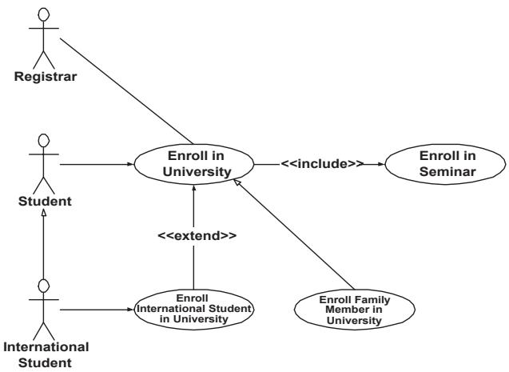

case. Notice how the identifier and the name of the use case is indicated. If several use cases extended this one from the same point, then each one would need to be listed. A condition statement, such as "Condition: Enrollee is an international student," could have been indicated immediately following the name of the use but, in this example, it was fairly obvious what was happening.

##### 6.1.2.2 Include Associations Between Use Cases

A second way to indicate potential reuse within use case models exists in the form of include associations. An include association, formerly known as a uses relationship in the UML v1.2 and earlier, is a generalization relationship denoting the inclusion of the behavior described by another use case. The best way to think of an include association is that it is the invocation of a use case by another one. In Figure 6-4, notice that the use case

4. The system displays "UI43 Student Information Entry." [Extension Point: UC34 Enroll International Student In University.]

5. The student...

Figure 6-4. The opportunities for reuse in use case models

Figure 6-5.

Documenting an extension point within a use case

<table border=1 style='margin: auto; word-wrap: break-word;'><tr><td style='text-align: center; word-wrap: break-word;'>DEFINITIONS</td></tr><tr><td style='text-align: center; word-wrap: break-word;'>Base use case. A use case extended by another via an extend association.</td></tr><tr><td style='text-align: center; word-wrap: break-word;'>Extending use case. A use case that extends another use case via an extend association.</td></tr><tr><td style='text-align: center; word-wrap: break-word;'>Extension point. A marker in a use case where extension is allowed.</td></tr></table>

“Enroll in University” includes the use case “Enroll in Seminar”; the notation for doing so is simply a normal use case association with the stereotype of <<include>>. Figure 6-6 presents an example of how you would indicate where the use case is included in the logic of the including use case. Similar to calling a function or invoking an operation within source code, isn't it? Object-oriented programming is covered in Chapter 8.

You use include associations whenever one use case needs the behavior of another. Introducing a new use case that encapsulates similar logic that occurs in several use cases is quite common. For example, you may discover that several use cases need the behavior to search for and then update information about students, indicating the potential need for an "Update Student Record" use case included by the other use cases.

As you would expect, the use case “Enroll in University” should list “UC17 Enroll in Seminar” in its “Includes” list. Why should you bother maintaining an “Includes” and an “Extends” list in your use cases? The answer is simple: Your use cases should stand on their own; you shouldn’t expect people to have your use case diagram in front of them. Yes, it would be nice if everyone has access to the use case diagram because it also contains this information, but the reality is that sometimes you use different tools to document each part of your model. For example, your diagrams could be drawn using a drawing package and your use cases documented in a word processor. Some of your project stakeholders may have access to the word processor you are using, but not the drawing package. The main disadvantage of this approach is you need to maintain these two lists in parallel with the diagram, the danger being they may become unsynchronized.

Figure 6-6.

Indicating the inclusion of a use case

##### 6.1.2.3 Inheritance

Use cases can inherit from other use cases, offering a third opportunity to indicate potential reuse. Figure 6-4 depicts an example of this, showing that “Enroll Family Member in University” inherits from the “Enroll In University” use case. Inheritance between use cases is not as common as either the use of extend or include associations, but it is still possible. The inheriting use case would completely replace one or more of the courses of action of the inherited use case. In this case, the basic course of action is completely rewritten to reflect that new business rules are applied when the family member of a professor is enrolling at the university. Family members are allowed to enroll in the school, regardless of the marks they earned in high school; they don't have to pay any enrollment fees, and they are given top priority for enrollment in the university.

Inheritance between use cases should be applied whenever a single condition, in this case, the student is a family member of a professor, would result in the definition of several alternate courses. Without the option to define an inheriting use case, you need to introduce an alternate course to rework the check of the student's high-school marks, the charging of enrollment fees, and for prioritization of who is allowed to enroll in the given semester.

The inheriting use case is much simpler than the use case from which it inherits. It should have a name, description, and identifier, and it should also indicate from which use case it inherits in the “Inherits From” section. In sections that you replace, you may need to rewrite the preconditions, postconditions, or courses of action. If something is not replaced, then leave that section blank, assuming it is inherited from the parent use case (you might want to put text, such as “see parent use case,” in the section).

The fourth opportunity for indicating potential reuse within use case models occurs between actors: An actor on a use case diagram can inherit from another actor. An example of this is shown in Figure 6-4, where the “International Student” actor inherits from “Student.” An international student is a student, the only difference being he or she is subject to different rules and policies (for instance, the international student pays more in tuition). The standard UML notation for inheritance, the open-headed arrow, is used and the advice presented about the appropriate use of inheritance still applies: It should make sense to say the inheriting actor is or is like the inherited actor.

#### 6.1.3 Good Things to Know About Use Case Modeling

An important thing to understand about use case models is that the associations between actors and use cases indicate the need for interfaces. When the actor is a person, then to support the association, you need to develop user interface components, such as screens and reports. When

the actor is an external system, then you need to develop a system interface, perhaps a data file transfer or a real-time online link to the external system. For example, in the "Enroll in Seminar" use case of Figure 6-2, the Student actor interacts with the system via several major UI components, particularly "UI23 Security Login Screen," "UI32 Seminar Selection Screen," "UI33 Display Seminar Fees Screen," "UI88 Seminar Enrollment Summary Screen," and "UI89 Enrollment Summary Report."

Second, use cases are often written under the assumption that you can exit at any time. For example, in the middle of the “Enroll in Seminar” use case, the student may decide to give up and try again later or the system may crash because the load on it is too great. The description of the use case doesn’t include these as alternate courses because it would greatly increase the complexity of the use case without adding much value. Instead, it is assumed, if one of these events occurs, that the use case simply ends and the right thing will happen. However, your subject matter experts (SMEs) may want to define nonfunctional requirements that describe how situations such as this should be handled.

Third, in my opinion, use case modeling has received far more attention than it actually deserves. Yes, it is a useful technique but no, it isn't the be-all-and-end-all of requirements and analysis modeling. You saw in Chapter 3 that essential use case modeling is one technique of several you can use to gather requirements and, as you see in this chapter, it is also one of several techniques to perform object-oriented analysis. Don't let the marketing hype of CASE tool vendors and object-oriented consultants deceive you into thinking everything should be "use case driven." Use case modeling is merely one of many important techniques you should have in your modeling toolkit.

Fourth, although the reuse techniques—extend associations, include associations, and inheritance—are useful, don't overuse them. Include associations and, to a lesser degree, extend associations, lead to functional decomposition within your use case model. The problem is use cases are not meant to describe functions within your source code; they are meant to describe series of actions that offer value to actors. A good rule of thumb to use is if you are able to describe a use case with a single sentence, then you have likely decomposed it too much, something that occurs when you apply include associations too often. Another rule of thumb is, if you have more than two levels of include associations, for example, if use case A includes use case B, which includes use case C, then two levels of include exist, and then you are in danger of functional decomposition. The same can be said of extend associations between use cases, as well as inheritance.

#### 6.1.4 Use Case Modeling Tips and Techniques

In this section, I want to share a collection of tips and techniques I have found useful over the years to improve the quality of my system use case models.

1. Write from the point-of-view of the actor in the active voice. Use cases should be written in the active voice: “The student indicates the seminar,” instead of in the passive voice, “The seminar is indicated by the student.” Furthermore, use cases should be written from the point-of-view of the actor. After all, the purpose of use cases is to understand how your users will work with your system.

2. Write scenario text, not functional requirements. A use case describes a series of actions that provide value to an actor; it doesn't describe a collection of features. For example, the use case of Figure 6-2 describes how a student interacts with the system to enroll in a seminar. It doesn't describe what the user interface looks like or how it works. You have other models to describe this important information, such as your user interface model and your supplementary specifications. Object-oriented analysis is complex, which is why you have several models to work with, and you should apply each model appropriately.

3. A use case is neither a class specification nor a data specification. This is the sort of information that should be captured by your conceptual model, described in Section 6.3, which in the object world is modeled via a UML class model. You are likely to refer to classes described in your conceptual model; for example, the "Enroll in Seminar" use case includes concepts, such as seminars and students, both of which would be described by your conceptual model. Once again, use each model appropriately.

4. Don't forget the user interface. System use cases often refer to major user interface (UI) elements, often called boundary or simply user interface items, and sometimes minor UI elements as appropriate.

5. Create a use case template. As you can see in Figure 6-2, use cases include a fair amount of information, information that can easily be documented in a common format. You should consider either developing your own template based on what you have learned in this book or adopting an existing one you have either purchased with an object modeling tool or downloaded from the Internet.

6. Organize your use case diagrams consistently. Common practice is to draw inheritance and extend associations vertically, with the inheriting/extending use case drawn below the parent/base use case. Similarly, include associations are typically drawn horizontally. Note that these are simple rules of thumb, rules that, when followed consistently, result in diagrams that are easier to read.

7. Don't forget the system responses to the actions of actors. Your use cases should describe both how your actors interact with your system and how your system responds to those interactions. With the "Enroll in Seminar" use case, had the system not responded when the student indicated she wanted to enroll in a seminar, I suspect the student would soon become discouraged and walk away. The system wasn't doing anything to help the student fulfill her goals.

8. Alternate courses of action are important. Start with the happy path, the basic course of action, but don't forget the alternate courses as well. Alternates courses will be introduced to describe potential usage errors, as well as business logic errors and exceptions. This important information is needed to drive the design of your system, so don't forget to model it in your use cases.

9. Don't get hung up on <include> and <<extend>> associations. I'm not quite sure what happened, but I've always thought the proper use of include and extend associations, as well as uses and extends associations in older versions of the Unified Modeling Language (UML), were never described well. As a result, use case modeling teams had a tendency to argue about the proper application of these associations, wasting an incredible amount of time on an interesting, but minor, portion of the overall modeling technique. I even worked at one organization that went so far as to outlaw the use of the <<include>> and <<extend>> stereotypes, an extreme solution that had to be reversed after a few weeks when the organization realized it still needed these concepts, even though the organization hadn't come to a full agreement as to their proper use. Anyway, I believe Section 6.1.2 does a good job explaining how to apply these associations effectively.

10. Use cases drive user documentation. The purpose of user documentation is to describe how to work with your system. Each use case describes a series of actions taken by actors using your system. In short, use cases contain the information from which you can start writing your user documentation. For example, the

“how to enroll in a seminar” section of your system's user documentation could be written using the “Enroll in Seminar” use case as its base.

11. Use cases drive presentations. Part of software development is communicating your work efforts with project stakeholders, resulting in the occasional need to give presentations. Because use cases are written from the point-of-view of your users, they contain valuable insight into the type of things your users are likely to want to hear about in your presentations. In other words, use cases often contain the logic from which to develop presentation scripts.

### 6.2 Sequence Diagrams: From Use Cases to Classes

Sequence diagrams (Rumbaugh, Jacobson, and Booch, 1999) are used to model the logic of usage scenarios. A usage scenario is exactly what its name indicates—the description of a potential way your system is used. The logic of a usage scenario may be part of a use case, perhaps an alternate course. It may also be one entire pass through a use case, such as the logic described by the basic course of action or a portion of the basic course of action, plus one or more alternate scenarios. The logic of a usage scenario may also be a pass through the logic contained in several use cases. For example, a student enrolls in the university, and then immediately enrolls in three seminars. Figure 6-7 models the basic course of action for the “Enroll in Seminar” use case. Sequence diagrams model the flow of logic within your system in a visual manner, enabling you both to document and validate your logic, and are commonly used for both analysis and design purposes.

The boxes across the top of the diagram represent classifiers or their instances, typically use cases, objects, classes, or actors. Because you can send messages to both objects and classes, objects respond to messages through the invocation of an operation, and classes do so through the invocation of static operations, it makes sense to include both on

## DEFINITIONS

Major user interface element. A large-grained item, such as a screen, HTML page, or report.

Minor user interface element. A small-grained item, such as a user input field, menu item, list, or static text field.

Supplementary specification. An artifact where all requirements not contained in your use case model, user interface model, or domain model are documented.

sequence diagrams. Because actors initiate and take an active part in usage scenarios, they are also included in sequence diagrams. Objects have labels in the standard UML format “name: ClassName,” where “name” is optional (objects that haven’t been given a name on the diagram are called anonymous objects). Classes have labels in the format “ClassName,” and actors have names in the format “Actor Name”—both UML standards as well. For example, in Figure 6-7, you see the Student actor has the name “A Student” and is labeled with the stereotype <<actor>>. The instance of the major UI element representing “UI32 Seminar Selection Screen,” is an anonymous object with the name “:SeminarSelector” and the stereotype <<UI>>. The “Student” class is indicated on the diagram, the box with the name “Student,” because the static message “isEligible(name, studentNumber)” is sent to it. More on this later. The instance of “Student” was given a name “theStudent” because it is used in several places as a parameter in a message, whereas the instance of the “StudentsFees” class didn’t need to be referenced anywhere else in the diagram and, thus, could be anonymous.

Messages are indicated by labeled arrows, and return values by dashed and labeled arrows.

The dashed lines hanging from the boxes are called object lifelines, representing the life span of the object during the scenario being modeled. The long, thin boxes on the lifelines are method-invocation boxes indicating that processing is being performed by the target object/class to fulfill a message. The X at the bottom of a method-invocation box is a UML convention to indicate that an object has been removed from memory, typically the result of receiving a message with the stereotype of <<destroy>.

Messages are indicated as labeled arrows, when the source and target of a message is an object or class the label is the signature of the method invoked in response to the message. However, if either the source or target is a human actor, then the message is labeled with brief text describing the information being communicated. For example, the “ $ \underline{\text{EnrollInSeminar}} $” object sends the message “isEligibleToEnroll(theStudent)” to the instance of “Seminar.” Notice how I include both the method's name and the name of the parameters, if any, passed into it. Figure 6-7 also indicates that the Student actor provides information to the “ $ \underline{\text{SecurityLogon}} $” object via the messages labeled “name” and “student number” (these really aren't messages; they are actually user interactions). Return values are optionally indicated as using a dashed arrow with a label indicating the return value. For example, the return value “theStudent” is indicated coming back from the “Student” class as the result of invoking a message, whereas no return value is indicated as the result of sending the message “isEligibleToEnroll(theStudent)” to “ $ \underline{\text{seminar}} $.” My style is not to indicate the return values when it's obvious what is being returned, so I don't clutter my sequence diagrams (as you can see, sequence diagrams get complicated fairly quickly).

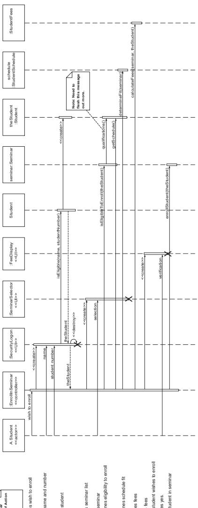

Figure 6-7.

A UML sequence diagram for the basic course of action for Figure 6-2

Messages fulfill the logic of the steps of the use case, summarized down the left-hand side of the diagram. Notice how the exact wording of the use case steps isn't used because the steps are often too wordy to fit nicely on a diagram. What is critical is that the step numbers correspond to those in the use case and that the general idea of the step is apparent to the reader of the diagram.

Notice the use of stereotypes throughout the diagram. For the boxes, I applied the stereotypes <<actor>,, <<controller>>, and <<UI>> indicating that they represent an actor, a controller class, or a user interface (UI) class, respectively. For now, a controller class is a placeholder for one or more classes that would be fleshed out during design (Chapter 7) to implement the business logic of your system. As you see in Chapter 7, you want to layer your system, separating your user interface logic, business logic, system logic, and persistence logic away from each other. Stereotypes are also used on messages. Common practice on UML diagrams is to indicate creation and destruction messages with the stereotypes of <<create>> and <<destroy>>, respectively. For example, you see that the "<SecurityLogon> object is created in this manner (actually, this message would likely be sent to the class that would then result in a return value of the created object, so I cheated a bit). This object later

## DEFINITIONS

<table border=1 style='margin: auto; word-wrap: break-word;'><tr><td style='text-align: center; word-wrap: break-word;'>Anonymous object. An object appearing on the diagram that hasn&#x27;t been given a name; instead, the label is simply an indication of the class, such as “: Invoice.”</td></tr><tr><td style='text-align: center; word-wrap: break-word;'>Classifier. A mechanism that describes behavioral or structural features. Classifiers include use cases, classes, interfaces, and components.</td></tr><tr><td style='text-align: center; word-wrap: break-word;'>Lifeline. Represents, in a sequence diagram, the life span of an object during an interaction.</td></tr><tr><td style='text-align: center; word-wrap: break-word;'>Method. Something a class or object does. A method is similar to a function or procedure in structured programming and is often referred to as an operation or member function in object development.</td></tr><tr><td style='text-align: center; word-wrap: break-word;'>Message-invocation box. The long, thin, vertical boxes that appear on sequence diagrams, which represent invocation of an operation on an object or class.</td></tr><tr><td style='text-align: center; word-wrap: break-word;'>Signature. The combination of the name, parameter names (in order), and name of the return value (if any) of a method.</td></tr><tr><td style='text-align: center; word-wrap: break-word;'>Static method. A method that operates at the class level, potentially on all instances of that class.</td></tr><tr><td style='text-align: center; word-wrap: break-word;'>Stereotype. A stereotype denotes a common usage of a modeling element. Stereotypes are used to extend the UML in a consistent manner.</td></tr></table>

destroys itself in a similar manner, presumably when the window is closed. In Java and C++, methods that create objects are called constructors, and in C++, methods that destroy objects are called destructors (Java automatically manages memory, whereas C++ doesn't, so Java doesn't require destructor methods).

I used a UML note; notes are basically free-form text that can be placed on any UML diagram, to provide a header for the diagram, indicating its title and identifier (as you may have noticed, I give unique identifiers to everything). Notes are depicted as a piece of paper with the top-right corner folded over. I also used a note to indicate future work that needs to be done, either during analysis or design; in this diagram, the "qualifications)" message likely represents a series of messages sent to the student object. Common UML practice is to anchor a note to another model element with a dashed line when appropriate, as you see in Figure 6-7, with the note attached to the message.

When I developed the sequence diagram of Figure 6-7, I made several decisions that could potentially affect my other models. For example, as I modeled Step 10, I made the assumption (arguably, a design decision) that the fee display screen also handled the verification by the student that the fees were acceptable. This decision should be reflected by the user interface prototype, the topic of Section 6.5, and verified by my SMEs. Sequence diagramming is something you should be doing together with your SMEs, particularly sophisticated ones who understand how to develop models such as this. Also, as I was modeling Steps 2 and 3, I came to the realization that students should probably have passwords to get into the system. I brought this concept up with my SMEs and discovered I was wrong: the combination of name and student number is unique enough for our purposes and the university didn't want the added complexity of password management. This is an interesting decision that would be documented in the supplementary specification, likely as a business rule, because it is an operating policy of the university. By verifying this idea with my SMEs, instead of assuming I knew better than everyone else, I avoided an opportunity for goldplating and, thus, reduced the work my team would need to do to develop this system.

Regarding style issues for sequence diagramming, I prefer to draw messages going from left-to-right and return values from right-to-left, although that doesn't always work with complex objects/classes. I justify the label on messages and return values, so they are closest to the arrowhead. As mentioned earlier, I prefer not to indicate return values on sequence diagrams to simplify the diagrams whenever possible. However, equally valid is to decide always to indicate return values, particularly when your sequence diagram is used for design instead of analysis (I like my analysis diagrams to be as simple as possible and my design diagrams

<table border=1 style='margin: auto; word-wrap: break-word;'><tr><td colspan="2">DEFINITIONS</td></tr><tr><td colspan="2">C++. A hybrid object-oriented programming language that adds object-oriented features to the C programming language.</td></tr><tr><td colspan="2">Constructor. A method, typically a static one, whose purpose is to instantiate and, optionally, initialize an object.</td></tr><tr><td colspan="2">Controller. A class that implements business/domain logic, coordinating several objects to perform a task.</td></tr><tr><td colspan="2">Destructor. A method whose purpose is to remove an object completely from memory.</td></tr><tr><td colspan="2">Goldplating. The addition of extraneous features to a system.</td></tr><tr><td colspan="2">Java. An object-oriented programming language based on the concept of “write once, run anywhere.”</td></tr><tr><td colspan="2">Note. A modeling construct for adding free-form text to the UML diagrams.</td></tr></table>

to be as thorough as possible). During analysis, my goal is to understand the logic and to ensure I have it right. During design, I then flesh out the exact details, as the note reminds me to do with the “qualifications()” message in Figure 6-7. I also prefer to layer the sequence diagrams from left-to-right. I indicate the actors, then the controller class(es), and then the user interface class(es), and, finally, the business class(es). During design, you probably need to add system and persistence classes, which I usually put on the right-most side of sequence diagrams. Laying your sequence diagrams in this manner often makes them easier to read and also makes it easier to find layering logic problems, such as user interface classes directly accessing persistence classes (more on this in Chapter 7).

Interesting to note is the style of logic changed part way through the sequence diagram of Figure 6-7. The user interface was handling some of the basic logic at first—particularly the login—yet for selecting the seminar, and then verifying it, the controller class did the work. This is actually a design issue. I wouldn't get too worked up over this but, as always, I suggest choosing one style for now and sticking to it.

Although Figure 6-7 models the logic, the basic course of action for the "Enroll in Seminar" use case, how would you go about modeling alternate courses? The most common way to do so is to create a single sequence diagram for each alternate course, as you see depicted in Figure 6-8. This diagram models only the logic of the alternate course, as you can tell by the numbering of the steps on the left-hand side of the diagram. The header note for the diagram indicates that it is an alternate course of action. Also notice how the ID of this diagram includes that this is alternate course B, yet another modeling rule of thumb I have found useful over the years.

## TIP

You may have heard terms such as dynamic modeling and static modeling bantered about by other developers familiar with object-oriented modeling techniques. You may even have heard arguments about the merits of each style. Dynamic modeling techniques focus on identifying the behavior within your system. These techniques include sequence diagramming and activity diagramming (both of which are described in this chapter) and collaboration diagramming, described in Chapter 7. Static modeling focuses on the static aspects of your system, including the classes, their attributes, and the associations between classes. Class models, described in this chapter, are the main artifact of static modeling, as are persistence models, which are described in Chapter 7. Both dynamic and static modeling techniques are required to specify an object-oriented system adequately, which makes the "dynamic modeling versus static modeling" debates questionable at best.

Sequence Diagrams Are Dynamic

The sequence diagram of Figure 6-8 is simpler than that of Figure 6-7; this is generally the case of alternate courses. I modeled the return value from the "isEligibleToEnroll(theStudent)" message because this is what causes the alternate course to occur in the first place. This arguably points to the need always to model return values in your sequence diagrams. I still prefer to keep my diagrams as simple as possible, though, so I model them only when the information is vital to my understanding of the logic. I also chose to show the ineligibility notice as its own user-interface element, once again bordering on a design decision that would need to be reflected in the user interface prototype. I also modeled that the prerequisites list is displayed as part of the seminar details user interface element, which is more than the use case currently calls for. This implies that I should verify the change with my SMEs because I have effectively increased the requirements although, by doing so, I have likely indicated an opportunity for both reuse and an overall simplification of the potential.

Figure 6-8.

A UML sequence diagram for an alternate course

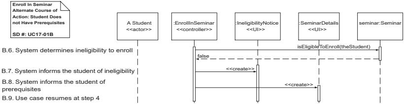

tial design. As you can see with this example, the line between analysis and design is fuzzy with object-oriented development; experienced developers new to objects can take time to get used to this. Finally, I left the "Student" actor in the diagram, even though no direct interaction occurs at this point because this actor is referred to in the steps of the use case.

#### 6.2.1 How to Draw Sequence Diagrams

The following steps describe the fundamental tasks of sequence diagram-ming, tasks you perform in an iterative manner.

1. Identify the scope of the sequence diagram. Begin by identifying what you are modeling. Is it the basic course of action for a single use case? A single alternate course? The combination of the basic course of action and one or more alternate courses? Logic from several use cases? Once you identify the scope of your diagram, you should add a label at the top, using a note, indicating an appropriate title for the diagram and a unique identifier for it. You may also want to include the date and also the names of the authors of the diagram.

2. List the use case steps down the left-hand side. I like to start a sequence diagram by writing a summary of the original use case text in the left-hand margin, as you saw in Figure 6-7 and Figure 6-8. This logic is what you are modeling, so you might as well have it on your diagram from the start. Rosenberg and Scott (1999) point out this also provides valuable traceability information between your use cases and sequence diagrams.

3. Introduce boxes for each actor. Introduce a box for each actor across the top of your diagram. I prefer to put actors that represent humans and organizations on the left-hand side and those that represent external systems on the right-hand side. Label each box with the <<actor>> stereotype.

4. Introduce controller class(es). My style is to introduce at least one controller class whose purpose is to mediate the logic described by the use case steps. This business logic typically doesn't belong in your user interface classes. Instead, it should be encapsulated by business classes (a controller class is a type of business class). Later, during design, you will likely refactor this logic into one or more classes to reflect issues with your chosen implementation technologies. Label each box with the <<controller>> stereotype.

5. Introduce a box for each major UI element. Major user interface elements, and minor ones for that matter, are implemented as classes in object-oriented systems. Therefore, they should be modeled as a box in a sequence diagram. My style is to list the UI elements to the immediate right of the controller class(es). Label each box with the <<UI>> stereotype. $ ^{1} $

6. Introduce a box for each included use case. Although I didn't include this in an example, included use cases are treated just like objects. Mark them with the stereotype <<use case>> and give them a name in the format "id:Use case name," such as "UC17:Enroll in Seminar." To indicate that the use case is being invoked by a step, I simply send it a message with the stereotype of <<uses>>.

7. Identify appropriate messages for each use case step. Going one step at a time, walk through the process logic for the scenario, identifying each message that needs to be sent and its destination. The sequencing of the messages is implied on the diagram by the order of the messages themselves, starting at the top-left corner of the diagram. When you are drawing sequence diagrams, the important task is to get the logic right; you effectively flesh out your logic as you identify messages for each step. Also, don't forget that an object or class can send a message to itself, as you saw in Figure 6-7.

8. Add a method- invocation box for each invocation of a method. Every time an object or class receives a message, a method is invoked. To represent this, you should include a method- invocation box to the lifeline of the target. The incoming message will be received at the top of the box and, to fulfill the logic of the step, you may find the target needs to send messages to other objects and classes, which, in turn, invoke methods on those new targets. From the box, messages may be sent to other objects that, in turn, invoke methods within those targets. Eventually, this method will complete; therefore, the method invocation box "stops" and, possibly, a value is returned to the original sender of the message.

9. Add destruction messages where appropriate. At the end of a method invocation, the target object may be destroyed. This is common for transitory objects such as user interface elements and for business objects deleted as the result of an operation. Therefore, a message with the stereotype <<destroy>> should be sent to the object and the method-invocation box labeled with an X at its bottom. Sometimes an object will destroy itself, as you saw in Figure 6-7.

10. Add your business classes and objects. As you identify messages you also need to identify targets for those messages, targets that will inevitably be classes or objects. The appropriate classes (objects are instances of classes) should be in your conceptual model (if not, then you need to add them). Use the class names from your conceptual model for the names of the classes in your sequence diagrams (any business class that appears on a sequence diagram should also appear in your conceptual model). For now, don't worry too much whether an object or a class should be the target of a message. You can always rework your diagram if you get it wrong at first. The important thing is to get the fundamental idea correct, and then you can go back to perfect it later. Remember to layer your classes and objects as described in previous steps. Also, you may find you need several instances of the same class on a single sequence diagram. For example, had I modeled a scenario in which a student enrolled in three different seminars, then I would have included three seminar objects in the diagram.

11. Update your class model. Because you are sequence diagram-ming, you will identify new responsibilities for classes and objects, and, sometimes, even for new classes. Remember, each message sent to a class invokes a static method/operation on that class, an operation that should appear on your class model. Similarly, each message sent to an object invokes an operation on that object, an operation that should also appear on your class model. Sequence diagramming is a significant source for identifying behavior to be modeled on your class model, the subject of Section 6.3.

12. Update your user interface model. As you work through the logic of each scenario, you may discover you are missing features in your user interface or you have modeled some features inappropriately. When you discover this, you should work together with your SMEs to identify the proper way for your user interface to work, the topic of Section 6.5.

13. Update your use case model. As you are sequence diagramming, you may find errors in your original use case logic, errors that need to be fixed on both your sequence diagram(s) and in your use case(s). As always, validate any use case changes with your SMEs first.

#### 6.2.2 Why and When Should You Draw Sequence Diagrams?

You want to draw sequence diagrams for several reasons. First and foremost, sequence diagrams are a great way to validate and flesh out your logic (not that this should stop you from use case scenario testing, as described in Chapter 4). Second, sequence diagrams are a great way to document your design, at least from the point-of-view of use cases. Third, sequence diagrams are a great mechanism for detecting bottlenecks in your design. By looking at what messages are being sent to an object, and by looking at roughly how long it takes to run the invoked method, you quickly get an understanding of where you need to change your design to distribute the load within your system. In fact, some CASE tools even enable you to simulate this aspect of your software. Finally, sequence diagrams often give you a feel for which classes in your application are going to be complex, which, in turn, is an indication you may need to draw state chart diagrams for those classes (UML state chart diagrams are described in Chapter 8).

#### 6.2.3 How to Document Sequence Diagrams

I generally don't develop documentation specific to sequence diagrams. Sequence diagrams provide a bridge between your use cases and your class model. Everything that is shown in a sequence diagram is documented in these models. For example, the steps depicted by the sequence diagram are documented by your use cases. The boxes across the top of the diagram are documented.

#### 6.2.4 A Good Thing to Know About Sequence Diagrams

You need to do at least one sequence diagram for each use case and, often, you will create several for each use case. Because the diagram should match the narrative flow of the use case, Rosenberg and Scott

<table border=1 style='margin: auto; word-wrap: break-word;'><tr><td style='text-align: center; word-wrap: break-word;'>DEFINITION</td></tr><tr><td style='text-align: center; word-wrap: break-word;'>Transitory object. An object that is not saved to permanent storage.</td></tr></table>

<table border=1 style='margin: auto; word-wrap: break-word;'><tr><td style='text-align: center; word-wrap: break-word;'>DEFINITION</td></tr><tr><td style='text-align: center; word-wrap: break-word;'>Computer-aided system engineering (CASE) tool. Software that supports the creation of models of software-oriented systems.</td></tr></table>

(1999) point out that if you are having problems getting started drawing sequence diagrams for a use case, then you likely wrote the use case incorrectly and should reconsider its logic. They also point out that sequence diagramming is the primary vehicle for allocating behavior.

During analysis, you will begin to add solution-space objects to the problem-domain objects (from your CRC model), including controller and user interface objects. Furthermore, during design, Rosenberg and Scott (1999) also point out that you will infrastructure objects such as system and persistence objects, scaffolding, and other helper objects into your models.

### 6.3 Conceptual Modeling: Class Diagrams

Class models (Rumbaugh, Jacobson, and Booch, 1999) are the mainstay of object-oriented analysis and design. Before the UML, most methodologies called them object models instead of class models. $ ^{2} $ Class models are created by using many of the modeling concepts and notations discussed in Chapter 5. Class models show the classes of the system, their interrelationships (including inheritance, aggregation, and association), and the operations and attributes of the classes. During analysis, you use class models to represent your conceptual model, an expansion of the domain model described in Chapter 3, because it shows greater detail and a wider range of detail. Conceptual models are used to depict your detailed understanding of the problem space for your system. During design, this model is evolved further to include classes that address the solution space, as well as the problem space.

The easiest way to begin conceptual modeling is to use your domain model as a base. In this case, you will take your Class Responsibility Collaborator (CRC) model (Beck and Cunningham, 1989) and convert it directly into a UML class diagram. CRC models show the initial classes of a system, their responsibilities, and the basic relationships (in the form of a list of collaborators) between those classes. While a CRC model provides an excellent overview of a system, it doesn't provide the details.

## DEFINITIONS

<table border=1 style='margin: auto; word-wrap: break-word;'><tr><td style='text-align: center; word-wrap: break-word;'>Problem space. The scope of your business domain being addressed by your system.</td></tr><tr><td style='text-align: center; word-wrap: break-word;'>Solution space. The problem space being addressed by your system plus the nondomain functionality required to implement your system.</td></tr></table>

needed to actually build it. Luckily, those details have been captured in the notes taken down by the scribe(s) during CRC modeling. Figure 6-9 depicts the CRC model we developed in Chapter 3, the “SecurityLogon” class identified in the sequence diagrams earlier has been introduced to CRC model, and Figure 6-10 depicts the UML class diagram that would be created based on that CRC model.

For each card in the CRC model, you create a concrete class in the class diagram, with the exception of cards that represent actors (actors exist in the real world). Notice how the names stayed the same (spaces were removed

<table border=1 style='margin: auto; word-wrap: break-word;'><tr><td colspan="2">Student &lt;&lt;Actor&gt;&gt;</td></tr><tr><td style='text-align: center; word-wrap: break-word;'>Provide information about self Request to enroll in seminar Request Transcript</td><td style='text-align: center; word-wrap: break-word;'>Enroll in Seminar Transcript</td></tr></table>

<table border=1 style='margin: auto; word-wrap: break-word;'><tr><td colspan="2">Transcript &lt;&lt;UI&gt;&gt;</td></tr><tr><td style='text-align: center; word-wrap: break-word;'>**See the prototype** Get student info Get seminars student took Determine average mark Output self</td><td style='text-align: center; word-wrap: break-word;'>Student Seminar Professor Enrollment Record</td></tr></table>

<table border=1 style='margin: auto; word-wrap: break-word;'><tr><td colspan="2">Enroll in Seminar &lt;&lt;UI&gt;&gt;</td></tr><tr><td style='text-align: center; word-wrap: break-word;'>**See the prototype** Enable seminar search Display seminar list Display seminar fees Display professor info</td><td style='text-align: center; word-wrap: break-word;'>Seminar Professor</td></tr></table>

<table border=1 style='margin: auto; word-wrap: break-word;'><tr><td colspan="2">SecurityLogon &lt;&lt;UI&gt;&gt;</td></tr><tr><td style='text-align: center; word-wrap: break-word;'>**See the prototype** Request identifying info for student</td><td style='text-align: center; word-wrap: break-word;'>Student</td></tr></table>

<table border=1 style='margin: auto; word-wrap: break-word;'><tr><td colspan="2">Professor</td></tr><tr><td style='text-align: center; word-wrap: break-word;'>NameAddressPhone numberEmail addressSalaryProvide informationSeminars instructing</td><td style='text-align: center; word-wrap: break-word;'>Seminar</td></tr></table>

<table border=1 style='margin: auto; word-wrap: break-word;'><tr><td colspan="2">Seminar</td></tr><tr><td style='text-align: center; word-wrap: break-word;'>NameSeminar numberFeesWaiting listEnrolled studentsInstructorAdd studentDrop student</td><td style='text-align: center; word-wrap: break-word;'>StudentProfessor</td></tr></table>

<table border=1 style='margin: auto; word-wrap: break-word;'><tr><td colspan="2">Student</td></tr><tr><td style='text-align: center; word-wrap: break-word;'>Name Address Phone number Email address Student number Average mark received Validate identifying info Provide list of seminars taken</td><td style='text-align: center; word-wrap: break-word;'>Enrollment Record</td></tr></table>

<table border=1 style='margin: auto; word-wrap: break-word;'><tr><td colspan="2">Enrollment Record</td></tr><tr><td style='text-align: center; word-wrap: break-word;'>Mark(s) receivedAverage to dateFinal gradeStudentSeminar</td><td style='text-align: center; word-wrap: break-word;'>Seminar</td></tr></table>

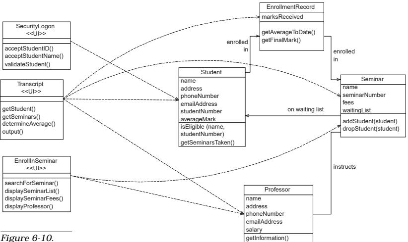

Figure 6-10. A UML class diagram based on the CRC model

Collaborations from a user interface class implies a dependency, whereas collaborations from business/domain classes imply either association or aggregation between the classes.

from the names to follow the naming convention of ClassName). Next, the collaborators on CRC cards indicate the need for an association, aggregation association, or dependency between classes. I modeled dependencies between user interface classes and the business classes with which they collaborate because user interface classes are transitory in nature, implying the associations they are involved with are transitory and, hence, should be modeled as dependencies. Whenever a collaboration occurred between two business classes, I modeled an association for now. As you see later, these associations may, in fact, prove to be aggregation associations but, for now, it is good enough simply to have modeled the line.

Consider the associations modeled in Figure 6-10. The “waiting list” association between “Seminar” and “Student” was added, modeling the similarly named responsibility on the “Seminar” CRC card. I could have added an attribute in the “Seminar” class called “waitingList” but, instead, chose to model it as an association because that is what it actually represents: that seminar objects maintain a waiting list of zero or more student objects. In Chapter 5, I showed that associations are implemented as a combination of attributes and operations so, frankly, you may as well add the attribute to the model now and get it over with. The “waiting list” association is unidirectional because there was neither a

## DEFINITION

Concrete class. A class that has objects instantiated from it.

corresponding collaborator indicated by the “Student” card nor did a responsibility indicate that the “Student” card had knowledge of being on a waiting list. I modeled an “enrolled in” association between the “Student” and “EnrollmentRecord” classes to support the similarly named responsibility on the “Student” CRC card. For this association, it appears student objects know what enrollment records they are involved with, recording the seminars they have taken in the past, as well as the seminars in which they are currently involved. This association would be traversed to calculate their student object's average mark and to provide information about seminars taken. There is also an “enrolled in” association between “EnrollmentRecord” and “Seminar” to support the capability for student objects to produce a list of seminars taken. The “instructs” association between the “Professor” class and the “Seminar” class is bidirectional because professor objects know what seminars they instruct (the Seminar's instructing responsibility) and seminar objects know who instructs them (the Instructor responsibility).

Other than the previously noted exceptions, the responsibilities on the CRC cards were modeled either as attributes or methods of the corresponding classes. The “Student” class is interesting because I chose to model the “Average mark received” responsibility as an attribute and not a method. How this responsibility is actually implemented is a design decision, one I don’t need to make now. I have made a good guess as to how to implement this responsibility and moved on to other issues. It is too early in the modeling process to worry about nitpicky issues like this: The “Student” class could go away, based on another design decision (unlikely, but...), so why invest a lot of effort getting the details right when close enough works just as well? My style is to name attributes and methods using the formats attributeName and methodName(parameterName), respectively, which happen to be the common naming conventions for both Java (Vermeulen et al., 2000) and C++.

Also notice, in Figure 6-10, how I haven't modeled the visibility of the attributes and methods to any great extent. Visibility is an important issue during design but, for now, it can be ignored. Also notice, I haven't defined the full method signatures for the classes. Yes, I have indicated the parameters, but not their type. And I haven't indicated the return value from each method either, another task I typically leave to design.

Now consider the user interface classes. I didn't bother to list the attributes because they are modeled well enough by the prototype and

<table border=1 style='margin: auto; word-wrap: break-word;'><tr><td style='text-align: center; word-wrap: break-word;'>DEFINITIONS</td></tr><tr><td style='text-align: center; word-wrap: break-word;'>Bidirectional association. An association that may be traversed in both directions.</td></tr><tr><td style='text-align: center; word-wrap: break-word;'>Unidirectional association. An association that may be traversed in only one direction.</td></tr><tr><td style='text-align: center; word-wrap: break-word;'>Visibility. The level of access external objects have to an item, such as an object&#x27;s attributes or methods, or even to a class itself.</td></tr></table>

Modeling user interface classes on class diagrams often add a lot of clutter without adding much useful information.

eventual user interface design. The purpose of models is to describe your system adequately, rarely to describe it thoroughly. Yes, I could create detailed classes for each UI class in my model, but what value would that be? It sounds like a lot of work for little return, particularly when more than enough details are in the user interface model already. Also, as you can see in Figure 6-10, the UI classes have made quite a mess of the diagram, requiring the modeling of a lot of dependencies that add significant clutter without communicating much valuable information. This information could be better recorded as part of your user interface model; a simple spreadsheet listing each major UI element and the business classes on which they are dependent should be sufficient.

Figure 6-11 presents a revised version of Figure 6-10; the user interface classes have been removed and the multiplicity of the associations have been modeled. Based on what the SMEs tell you and on the information contained in the notes your scribe(s) took as part of requirements gathering, you should be able to make educated guesses at the multiplicities of each association. In Figure 6-11, I was able to determine with certainty, based on this information, the multiplicities for all but one association and, for that one, I marked it with a note to myself. Notice my use of question marks in the note. As mentioned in Chapter 5, my style is to mark unknown information on my diagrams this way to remind myself that I need to look into it.

In Figure 6-11, I also modeled a UML constraint, in this case “{ordered FIFO},” on the association between “Seminar” and “Student.” The basic idea is that students are put on the waiting list on a first-come, first-out (FIFO) basis. In other words, the students are put on the waiting list in order. UML constraints are used to model complex and/or important information accurately in your UML diagrams. UML constraints are modeled using the format “{constraint description}” format, where the constraint description may be in any format, including predicate calculus. Fowler and Scott (1997) suggest that you focus on readability and understandability and, therefore, suggest using an informal description. Constraints are described in further detail in Section 6.6.1.

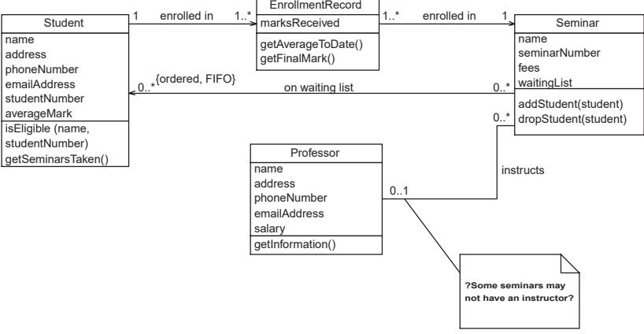

Once you have converted the information contained in your CRC model into an initial UML class model, you are then ready to continue fleshing out your model with added detail. Class models contain a wealth of information and can be used for both the analysis and design of systems. To create and evolve a class model, you need to model:

• Classes

• Methods

• Attributes

• Associations

Figure 6-11.

The revised class diagram

• Dependencies

• Inheritance relationships

• Aggregation associations

• Association classes

#### 6.3.1 Modeling Classes, Attributes, and Methods

An object, as defined previously, is any person, place, thing, concept, event, screen, or report applicable to your system. Objects both know things (they have attributes) and they do things (they have methods). A class is a representation of an object and, in many ways, it is simply a template from

which objects are created. Classes form the main building blocks of an object-oriented application. Two of the steps of CRC modeling included the finding of classes and the finding of responsibilities. Classes represent a collection of similar objects. For example, although thousands of students attend the university, you would only model one class, called “Student,” which would represent the entire collection of students.

Classes are modeled as rectangles with three sections: the top section for the name of the class, the middle section for the attributes of the class, and the bottom section for the methods of the class. The initial classes of your model will be identified when you convert from your CRC model, as will the initial attributes and methods. To describe a class, you define its attributes and methods. Attributes are the information stored about an object (or at least information temporarily maintained about an object), while methods are the things an object or class does. For example, students have student numbers, names, addresses, and phone numbers. Those are all examples of the attributes of a student. Students also enroll in courses, drop courses, and request transcripts. Those are all examples of the things a student does, which get implemented (coded) as methods. You should think of methods as the object-oriented equivalent of functions and procedures.

An important aspect of analysis is to model your classes to the appropriate level of detail. Consider the "Student" class modeled in Figure 6-11, which has an attribute called "address." When you stop and think about it, addresses are complicated things. They have complex data, containing street and city information for example, and they potentially have behavior. An arguably better way to model this is depicted in Figure 6-12. Notice how the "Address" class has been modeled to include an attribute for each piece of data it comprises and two methods have been added: one to verify it is a valid address and one to output it as a label (perhaps for an envelope). By introducing the "Address" class, the "Student" class has become more cohesive. It no longer contains logic (such as validation) that is pertinent to addresses. The "Address" class could now be reused in other places, such as the "Professor" class, reducing your overall development costs. Furthermore, if the need arises to support students with several addresses—during the school term, a student may live in a different location than his permanent mailing address, such as a dorm—this is information the system may

<table border=1 style='margin: auto; word-wrap: break-word;'><tr><td style='text-align: center; word-wrap: break-word;'>TIP\nUse the Terminology of Your Users</td><td style='text-align: center; word-wrap: break-word;'>Use the terminology of your users in all your models. The purpose of analysis is to understand the world of your users, not to foist your artificial, technical terms on them. Remember, they&#x27;re the experts, not you. In short, avoid geek-speak.</td></tr></table>

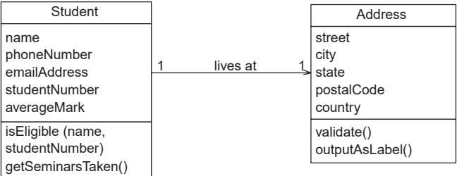

need to track. Having a separate class to implement addresses should make the addition of this behavior easier to implement.

Similarly, the “Seminar” class of Figure 6-11 is refactored into the classes depicted in Figure 6-13. Refactoring such as this is called class normalization (Ambler, 1998a), a process in which you refactor the behavior of classes to increase their cohesion and/or to reduce the coupling between classes. A seminar is an offering of a course; for example, there could be five seminar offerings of the course “CSC 148 Introduction to Computer Science.” The attributes “name” and “fees” were moved to the “Course” class and “courseNumber” was introduced. The “getFullName()” method concatenates the course number, “CSC 148,” and the course name, “Introduction to Computer Science,” to give the full name of the course. This is called a getter method, an operation that returns a data value pertinent to an object. Although getter methods, and the corresponding setter methods, need to be developed for a class, they are typically assumed to exist and are therefore not modeled (particularly on conceptual class diagrams) so they do not clutter your models. Figure 6-14 depicts “Course” from Figure 6-13 as it would appear with its getter and setter methods modeled. Setters and getters are described in detail in Chapter 7.

Figure 6-12.

The “Student” and “Address” classes

<table border=1 style='margin: auto; word-wrap: break-word;'><tr><td style='text-align: center; word-wrap: break-word;'>Seminar</td><td style='text-align: center; word-wrap: break-word;'>0.. $ ^{{*}} $ offering of ▶ 1</td><td style='text-align: center; word-wrap: break-word;'>Course</td></tr><tr><td style='text-align: center; word-wrap: break-word;'>seminarNumber waitingList</td><td rowspan="2"></td><td style='text-align: center; word-wrap: break-word;'>name courseNumber fees</td></tr><tr><td style='text-align: center; word-wrap: break-word;'>addStudent(student) dropStudent(student)</td><td style='text-align: center; word-wrap: break-word;'>getFullName()</td></tr></table>

Figure 6-13. Normalizing the “Seminar” class

Figure 6-14. “Seminar” with all its getter and setter methods modeled

Identifying the

multiplicities of

an association is

an important part

of modeling it.

<table border=1 style='margin: auto; word-wrap: break-word;'><tr><td style='text-align: center; word-wrap: break-word;'>Course</td></tr><tr><td style='text-align: center; word-wrap: break-word;'>name\ncourseNumber\nfees</td></tr><tr><td style='text-align: center; word-wrap: break-word;'>getFullName()\ngetCourseNumber()\nsetCourseNumber(number)\ngetFees()\nsetFees(amount)\ngetName()\nsetName(name)</td></tr></table>

Figure 6-15 presents the class diagram that results $ ^{3} $ when Figures 6-11, 6-12, and 6-13 are combined. Notice how “Professor” now references the “Address” class, taking advantage of the work we did to improve the “Student” class.

#### 6.3.2 Modeling Associations

Objects are often associated with, or related to, other objects. For example, as you see in Figure 6-15, several associations are between objects: Students are on waiting list for seminars, professors instruct seminars, seminars are an offering of courses, a professor lives at an address, and so on. Associations are modeled as lines connecting the two classes whose instances (objects) are involved in the relationship.

When you model associations in UML class diagrams, you show them as a thin line connecting two classes, which was illustrated in Figure 5-9. Associations can become quite complex; consequently, you can depict some things about them on your diagrams. Figure 5-9 demonstrated the common items to model for an association. You may want to refer to The Unified Modeling Language Reference Manual (Rumbaugh, Jacobson, and Booch, 1999) for a detailed discussion, including the role and cardinality on each end of the association, as well as a label for the association. The label, which is optional, although highly recommended, is typically one or two words describing the association. For example, in Figure 6-15, you see professors instruct seminars. However, it is not enough simply to know professors instruct seminars. How many seminars do professors instruct? None, one, or several? Furthermore,

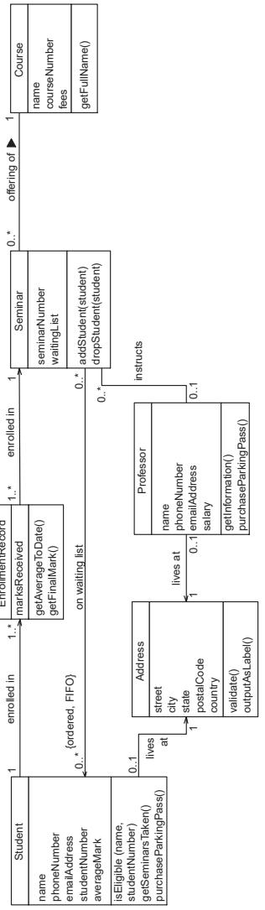

Figure 6-15.

Combined class

diagram

<table border=1 style='margin: auto; word-wrap: break-word;'><tr><td style='text-align: center; word-wrap: break-word;'>DEFINITIONS</td></tr><tr><td style='text-align: center; word-wrap: break-word;'>Class normalization. The process by which you refactor the behavior within a class diagram in such a way as to increase the cohesion of classes while minimizing the coupling between them.</td></tr><tr><td style='text-align: center; word-wrap: break-word;'>Cohesion. The degree of relatedness within an encapsulated unit (such as a component or a class).</td></tr><tr><td style='text-align: center; word-wrap: break-word;'>Coupling. The degree of dependence between two items. In general, it is better to reduce coupling wherever possible.</td></tr><tr><td style='text-align: center; word-wrap: break-word;'>Getter. A method to obtain the value of a data attribute, or to calculate the value, of an object or class.</td></tr><tr><td style='text-align: center; word-wrap: break-word;'>Setter. A method that sets the value of a data attribute of an object or class. Also known as a mutator.</td></tr></table>

associations are often two-way streets: not only do professors instruct seminars, but also seminars are instructed by professors. This leads to questions such as: how many professors can instruct any given seminar and is it possible to have a seminar with no one instructing it? The implication is you also need to identify the cardinality and optionality of an association. Cardinality represents the concept of "how many," and optionality represents the concept of "whether you must have something." Important to note is the UML chooses to combine the concepts of optionality and cardinality into the single concept of multiplicity. The multiplicity of the association is labeled on either end of the line, one multiplicity indicator for each direction (Table 6-1 summarizes the potential multiplicity indicators you can use).

Another option for associations is to indicate the direction in which the label should be read. This is depicted using a filled triangle, an example of which is shown on the “offering of” association between the “Seminar” and “Course” classes of Figure 6-15. This marker indicates that the association should be read “a seminar is an offering of a course,” instead

<table border=1 style='margin: auto; word-wrap: break-word;'><tr><td style='text-align: center; word-wrap: break-word;'>TIP</td><td style='text-align: center; word-wrap: break-word;'>For each class involved in an association, there is always a multiplicity for it. When the multiplicity is one and one only (for example, one and one only person may be President of the United States at any given time), then it is common practice not to indicate the multiplicity and, instead, to assume it is “1.” I believe this is a mistake. If the multiplicity is “1,” then indicate it as such. When something is left off a diagram, I can’t tell if that is what is meant or if the modeler simply hasn’t gotten around to working on that aspect of the model yet. I always assume the modeler hasn’t done the work yet.</td></tr><tr><td style='text-align: center; word-wrap: break-word;'>Always Indicate the Multiplicity</td><td style='text-align: center; word-wrap: break-word;'></td></tr></table>

<table border=1 style='margin: auto; word-wrap: break-word;'><tr><td style='text-align: center; word-wrap: break-word;'>Indicator</td><td style='text-align: center; word-wrap: break-word;'>Meaning</td></tr><tr><td style='text-align: center; word-wrap: break-word;'>0..1</td><td style='text-align: center; word-wrap: break-word;'>Zero or one</td></tr><tr><td style='text-align: center; word-wrap: break-word;'>1</td><td style='text-align: center; word-wrap: break-word;'>One only</td></tr><tr><td style='text-align: center; word-wrap: break-word;'>0.. $ ^{{*}} $</td><td style='text-align: center; word-wrap: break-word;'>Zero or more</td></tr><tr><td style='text-align: center; word-wrap: break-word;'>1.. $ ^{{*}} $</td><td style='text-align: center; word-wrap: break-word;'>One or more</td></tr><tr><td style='text-align: center; word-wrap: break-word;'>n</td><td style='text-align: center; word-wrap: break-word;'>Only n (where n &gt; 1)</td></tr><tr><td style='text-align: center; word-wrap: break-word;'>0..n</td><td style='text-align: center; word-wrap: break-word;'>Zero to n (where n &gt; 1)</td></tr><tr><td style='text-align: center; word-wrap: break-word;'>1..n</td><td style='text-align: center; word-wrap: break-word;'>One to n (where n &gt; 1)</td></tr></table>

of “a course is an offering of a seminar.” Direction markers should be used whenever it isn’t clear which way a label should be read. My advice, however, is if your label is not clear, then you should consider rewording it. Refer to Figure 5-9 for an overview of modeling associations in UML class diagrams.

At each end of the association, the role, the context an object takes within the association, may also be indicated. My style is to model the role only when the information adds value, for example, knowing the role of the “Student” class is “enrolled student” in the “enrolled in” association doesn’t add anything to the model. I indicate roles when it isn’t clear from the association label what the roles are, if there is a recursive association, or if there are several associations between two classes. In Figure 6-16, I have evolved our class diagram to include two associations between “Professor” and “Seminar.” Not only do professors instruct seminars, they also assist in them. When several associations exist between two classes, something that is relatively common, you often find you need to indicate the roles to understand the associations fully. In this case, I indicated the roles professors take, but not seminars, because the role of the seminar objects weren’t very interesting. Both roles are modeled for the “mentors” recursive association that the “Professor” class has because it is interesting to know that the mentoring professor is called an advisor and the mentored professor is called an associate.

Figure 6-16 is also interesting because it uses a UML contraint to indicate that a professor may instruct a given seminar, may assist with a seminar, or may not be involved in the seminar, but wouldn't be both an assistant and an instructor for the same seminar. The contraint description "NAND" represents the logical concept of "not and."

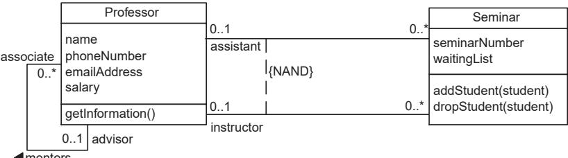

Figure 6-16. Modeling roles in associations

#### 6.3.3 Modeling Dependencies

Dependency relationships are used to model transitory associations between two classes. Transitory associations occur when one or both of the classes are not persistent, in other words, their instances are not saved to permanent storage. User interface classes are typically not persistent: you create the screen or report object, work with it, and then discard/destroy it when you no longer need it. Because these objects collaborate with other objects to fulfill their responsibilities, and because the only way an object can collaborate with another is if it knows about it, then some sort of relationship must exist between the two classes. In this case, you model this fact with a dependency relationship, which, as you see in Figure 6-17, is depicted as a dashed arrow. In this diagram, I chose to model the classes simply as boxes, instead of the usual three-sectioned boxes indicating the name of the class, its attributes, and its methods. As you saw in Chapter 5, both notations are acceptable within the UML.

#### 6.3.4 Introducing Reuse Between Classes via Inheritance

Similarities often exist between different classes. Very often two or more classes will share the same attributes and/or the same methods. Because you

<table border=1 style='margin: auto; word-wrap: break-word;'><tr><td style='text-align: center; word-wrap: break-word;'>DEFINITIONS</td></tr><tr><td style='text-align: center; word-wrap: break-word;'>Cardinality. Represents the concept “how many?” in associations.</td></tr><tr><td style='text-align: center; word-wrap: break-word;'>Optionality. Represents the concept “do you need to have it?” in associations.</td></tr><tr><td style='text-align: center; word-wrap: break-word;'>Multiplicity. The UML combines the concepts of cardinality and optionality into the single concept of multiplicity.</td></tr><tr><td style='text-align: center; word-wrap: break-word;'>Recursive association. An association in which the objects involved in it are instances of the same class. For example, people marry people.</td></tr></table>

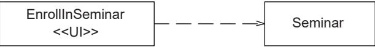

don't want to have to write the same code repeatedly, you want a mechanism that takes advantage of these similarities. Inheritance is that mechanism. Inheritance models "is a" and "is like" relationships, enabling you to reuse existing data and code easily. When A inherits from B, we say A is the subclass of B and B is the superclass of A. Furthermore, we say we have "pure inheritance" when A inherits all the attributes and methods of B. The UML modeling notation for inheritance is a line with a closed arrowhead pointing from the subclass to the superclass.

In Figure 6-15, many similarities occur between the “Student” and “Professor” classes. Not only do they have similar attributes, but they also have similar methods. To take advantage of these similarities, I created a new class called “Person” and had both “Student” and “Professor” inherit from it, as you see in Figure 6-18. This structure would be called the “Person” inheritance hierarchy because “Person” is its root class. The “Person” class is abstract: Objects are not created directly from it, and it captures the similarities between the students and professors. Abstract classes are modeled with their names in italics, as opposed to concrete classes, classes from which objects are instantiated, whose names are in normal text. Both classes had a name, email address, and phone number, so these attributes were moved into “Person.” The “purchaseParkingPass()” method was also common between the two classes, so that was also moved into parent class. By introducing this inheritance relationship to the model, I reduced the amount of work to be performed. Instead of implementing these responsibilities twice, they are implemented once, in the “Person” class, and reused by “Student” and “Professor.”

An interesting aspect of Figure 6-18 is the association between “Person” and “Address.” First, this association was pushed up to “Person” because both “Professor” and “Student” had a “lives at” association with

## DEFINITIONS

Dependency relationship. A dependency relationship exists between Class A and B when instances of Class A interact with instances of Class B. Dependency relationships are used when no direct relationship (inheritance, aggregation, or association) exists between the two classes.

Persistence. The issue of how objects are permanently stored.

Figure 6-17.

Modeling

dependencies

between classes

<table border=1 style='margin: auto; word-wrap: break-word;'><tr><td style='text-align: center; word-wrap: break-word;'>DEFINITIONS</td></tr><tr><td style='text-align: center; word-wrap: break-word;'>Abstract class. A class that doesn&#x27;t have objects instantiated from it.</td></tr><tr><td style='text-align: center; word-wrap: break-word;'>Concrete class. A class that has objects instantiated from it.</td></tr><tr><td style='text-align: center; word-wrap: break-word;'>Inheritance hierarchy. A set of classes related through inheritance. Also referred to as a class hierarchy.</td></tr><tr><td style='text-align: center; word-wrap: break-word;'>Inheritance. The representation of an  $ i $s a, is like, or is kind of relationship between two classes. Inheritance promotes reuse by enabling a subclass to benefit automatically from all the behavior it inherits from its superclass(es).</td></tr><tr><td style='text-align: center; word-wrap: break-word;'>Root class. The top-most class in an inheritance hierarchy.</td></tr><tr><td style='text-align: center; word-wrap: break-word;'>Subclass. If Class B inherits from Class A, we say B is a subclass of A.</td></tr><tr><td style='text-align: center; word-wrap: break-word;'>Superclass. If Class B inherits from Class A, we say A is a superclass of B.</td></tr></table>

“Address.” I could do this because, as I described in Chapter 5, associations are implemented by the combination of attributes and methods. Because attributes and methods can be inherited, any association they implemented can also be inherited by implication. It made sense to apply inheritance here because the associations represented the same concept: a person lives at an address (I was also lucky because the direction of the associations, as well as their multiplicities, were identical).

Another interesting aspect of Figure 6-18 is that although both “Professor” and “Student” had associations with “Seminar,” I didn’t choose to push this association up into “Person.” The issue is that the semantics of the two associations are different. First, one association is unidirectional whereas the other is bidirectional, a good indication that they are significantly different. Second, the multiplicities are different, another good indication that the associations are different. Third, and most important, the two associations are completely different from one another. One represents the fact that professors instruct seminars, whereas the other one represents that students are on waiting lists to enroll in a seminar.

#### 6.3.5 Modeling Aggregation Associations

Sometimes an object is made up of other objects. For example, an airplane is made up of a fuselage, wings, engines, landing gear, flaps, and so on. A delivery shipment contains one or more packages. A team consists of two or more employees. These are all examples of the concept of aggregation, which represents “is part of” relationships. An engine is part of a plane, a package is part of a shipment, and an employee is part of a team.

Modeling aggregation associations, or composition associations that are simply stronger forms of aggregation, is similar conceptually to modeling

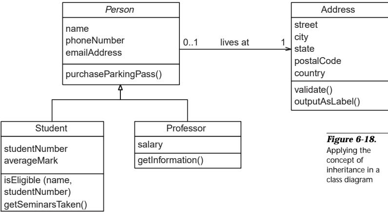

Figure 6-18.

Applying the concept of inheritance in a class diagram

associations. In Figure 6-19, you see a simple class model depicting the relationships between “Program,” (a program is a collection of courses that lead to a degree) and the “Course” class. A course may be part of one or more programs—some courses such as “ARC 305 Medieval Gardening Tools” are for general interest only and are not part of a program—and any given program has one or more courses in it. Also notice how an association exists between “Program” and “Course” representing that some courses are recommended for a program, but are not officially offered as part of them (my SMEs told me this). For example, the course “CSC 148 Introduction to Computer Science” is recommended for the engineering, business, and physics programs within the university. It made sense to model this relationship with an association instead of an aggregation because it isn’t true that a recommended course is part of a program.

In the class diagram of Figure 6-15, I was lucky because I used similar names for these attributes in both classes: "name," "emailAddress," and "phoneNumber," respectively. However, you will often find situations where one class has an attribute called "name," whereas another one has " 名名" or "middleInitial," and "lastName." You then need to decide whether these are, in fact, the same thing and, if they are, to be prepared to refactor your existing model, and perhaps even to reflect whichever approach to storing a person's name you accept. A similar issue can also occur with methods and associations.

## TIP

Sometimes

Opportunities

for Inheritance

Are Not So

Obvious

<table border=1 style='margin: auto; word-wrap: break-word;'><tr><td style='text-align: center; word-wrap: break-word;'>DEFINITIONS</td></tr><tr><td style='text-align: center; word-wrap: break-word;'>Aggregation. The representation of “is part of” associations.</td></tr><tr><td style='text-align: center; word-wrap: break-word;'>Composition. A strong form of aggregation in which the “whole” is completely responsible for its parts and each “part” object is only associated with the one “whole” object.</td></tr></table>

In Figure 6-20, I present an example using composition, modeling the fact that a product is composed of one or more components, and then, in turn, that a component may be composed of several subcomponents (you can have recursive aggregation and composition associations). Composition makes sense in both these cases because whatever you do to an instance of the whole, you are likely to also do to its parts. For example, if I sell a product by implication, I am selling its components. A good rule of thumb is that the composition form of aggregation is generally applicable whenever both classes represent physical items and aggregation makes sense.

Association classes may be useful during analysis, but need to be resolved during design.

#### 6.3.6 Modeling Association Classes

Association classes, also called link classes, are used to model associations that have methods and attributes. “EnrollmentRecord” is modeled as an associative class in Figure 6-21, instead of being modeled as a “normal” class as in Figure 6-15. Associative classes are typically modeled during analysis, as you see in Figure 6-21, and then refactored into the original approach you see in Figure 6-15 during design. The reason this occurs is,

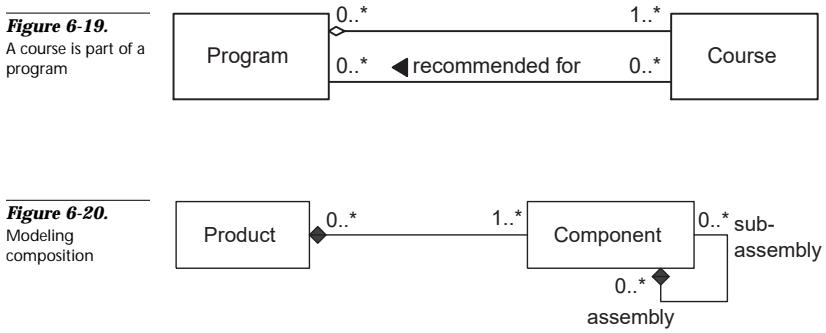

One of the following sentences should make sense: "A subclass IS A superclass" or "A subclass IS LIKE A superclass." For example, it makes sense to say a student is a person and a dragon is like a bird. It doesn't make sense to say a student is a vehicle or is like a vehicle, so the class "Student" likely shouldn't inherit from "Vehicle."

TIP

Apply the Sentence Ru

to date, at least to my knowledge, no mainstream programming language exists that supports the notion of associations that have responsibilities. Because you can directly build your software in this manner, I have a tendency to stay away from using association classes and, instead, resolve them during analysis, as you saw with my original approach. Yes, this is not a purist way to model, but it is programmatic. Nothing is wrong with using associative classes. I apply this concept on occasion; I just don't find many situations where it makes sense.

I want to take a minute to point out a potential problem with the “enrolled in” associations in both Figure 6-15 and Figure 6-21. I doubt they are truly unidirectional. In Chapter 3, a use case indicates that lists of students enrolled in a seminar are produced for professors. This tells me a need exists to traverse from “Seminar” objects to “Student” objects, indicating that these associations should be modeled bidirectionally.

#### 6.3.7 Documenting Class Models

It isn't enough to draw a class diagram; it also needs to be documented. The bulk of the documentation work is documenting the details about a class, as well as the reasoning behind any trade-offs you have made. Here's what to do:

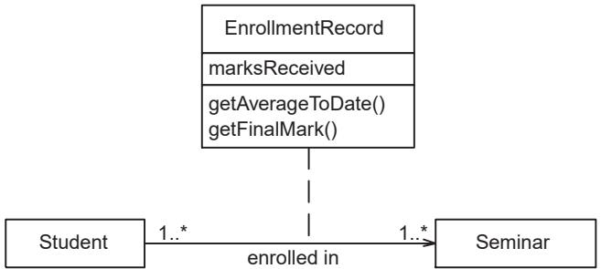

Figure 6-21. An example of an associative class

<table border=1 style='margin: auto; word-wrap: break-word;'><tr><td style='text-align: center; word-wrap: break-word;'>TIP</td><td style='text-align: center; word-wrap: break-word;'>When deciding whether to use aggregation or composition over association, Craig Larman (1998) says it best: If in doubt, leave it out. The reality is that many modelers will agonize over when to use aggregation even though little difference exists among association, aggregation, and composition at the coding level, something you see in Chapter 8.</td></tr><tr><td style='text-align: center; word-wrap: break-word;'>If In Doubt, Leave It Out</td><td style='text-align: center; word-wrap: break-word;'></td></tr></table>

1. Classes. A class is documented by a sentence or two describing its purpose. You should also indicate whether the class is persistent or transitory, and if it has any aliases (other names it is called) for the class. Documenting the potential alias for a class is important because different people in an organization can call the same thing by different names. For example, do banks serve clients or customers? Do truckers drive trucks, vehicles, or lorries? Do children eat sweets, candies, or goodies? You want to ensure that everyone is using the same terminology. Also, include references to any applicable business rules or constraints contained in the supplementary specification.

2. Attributes. An attribute is best described with one or two sentences, its type should be indicated if appropriate, an example should be given if not unclear how the attribute is to be used, and a range of values should be defined, if appropriate. Also, include references to any applicable business rules or constraints contained in the supplementary specification.

3. Methods. Methods are documented with pseudo-code, also known as structured English, describing its logic. The parameters (if any) and the return value (if any) should be documented in a manner similar to attributes. The preconditions and postconditions for the method should be indicated so developers understand what the method does. Also, include references to any applicable business rules or constraints contained in the supplementary specification.

4. Inheritance. I generally don't document inheritance relationships. My belief is if you need to document why you have applied inheritance, then you probably shouldn't have applied it to start.

5. Associations. The most important information about associations—the label, multiplicities, and roles—already appear on the diagram. I typically also include a few sentences describing the association, as well as reference any applicable business rules or constraints contained in the supplementary specification.

6. Aggregation and composition. These are both documented exactly as you would associations.

#### 6.3.8 Conceptual Class Modeling Tips

In this section, I want to share a collection of tips and techniques that I have found useful over the years to improve the quality of my conceptual class models.

1. You don't have to get it perfect at the start. I started the conceptual model by converting my Class Responsibility Collaborator (CRC) model into a UML class model. This was a good start, but I quickly found I needed to evolve the model as my analysis of the system moved forward. The point is I didn't get the model right at the start and that was okay. I didn't get the multiplicities on associations at the beginning, and I didn't even get all the classes to start. Many modelers will waste a lot of time at the beginning of conceptual modeling by focusing on one small aspect of the model and trying to get it right at first. It's also common to see modeling teams argue for hours about whether to use association, aggregation, or composition in a certain spot when little difference actually exists among the three options. I would rather pick one, move forward, and trust that, at some point in the future, it will become clearer which option to use as I understand the problem domain better.

2. Start at your domain model. Your CRC model contains important information that is relevant to your conceptual model, providing an excellent starting point.

3. Evolve your class diagram via sequence diagrams. Your sequence diagrams model the logic of your use cases, in particular, the critical business logic your system must support. As you develop your sequence diagrams, the topic of Section 6.2, you quickly flesh out the behaviors required of your classes.

## DEFINITIONS

Precondition. An expression of the constraints under which an operation or use case will operate properly.

Postcondition. An expression of the properties of the state of an operation or use case after it has been invoked successfully.

4. Focus on the problem space. The purpose of analysis is to understand and model the problem space of your system, not the solution space. Optimization and technology issues shouldn't yet be taken into account within your models; this is what design is all about.

5. Focus on fulfilling the requirements first. Many modelers make the mistake of focusing on the application of inheritance relationships or an analysis pattern they have read about, instead of an analyzing process their requirements model. Inheritance and analysis patterns are good things but, if your model doesn't reflect your problem space, then it doesn't really matter what fancy techniques you have applied, does it?

6. Use meaningful names. Your model elements should all have names that describe what they represent. Use full words. I prefer to see method names, such as "calculateInvoiceTotal0" as opposed to "calcInvTot()." Yes, the second name is easier to type because it's shorter, but is it easier to understand? Even worse are names such as "param1" and "x" because you have no idea what they represent.

7. Perform object-oriented analysis. Throughout this chapter, I describe proven techniques for performing object-oriented analysis (OOA), yet nowhere do you see me advise you to look at the existing database schema and create your models based on that design. This is a data-driven approach to development, not an object-oriented one, an approach that rarely results in high-quality software (Ambler, 1998b). Many organizations flounder with objects because they refuse to give up their old data-driven ways and/or they seek to recover their huge investment in existing legacy data models. Data modeling, more accurately called persistence modeling, is described in Chapter 7. Another related issue you run into, luckily one that is easier to overcome, is SMEs who describe requirements in terms of tables. Don't worry about it; just convert the concept to classes and move forward.

8. Understand and effectively apply analysis patterns. This is the topic of Section 6.7, so the only thing I say now is analysis patterns are good things.

9. Class model in parallel with user interface prototyping. As you develop your user interface prototype, you quickly discover that detailed attributes and operations need to be implemented by your classes. Never forget that object-oriented development is iterative—you will typically work on several models in parallel, working on each one a bit at a time.

### 6.4 Activity Diagramming

UML activity diagrams (Rumbaugh, Jacobson, and Booch, 1999) are used to document the logic of a single operation/method, a single use case, or the flow of logic of a business process. In many ways, activity diagrams are the object-oriented equivalent of flow charts and data-flow diagrams (DFDs) from structured development (Gane and Sarson, 1978). The activity diagram of Figure 6-22 depicts the business logic for how someone new to the university would enroll for the first time.

The filled circle represents the starting point of the activity diagram—effectively a placeholder—and the filled circle with a border represents the ending point. The rounded rectangles represent processes or activities that are performed. For the diagram of Figure 6-22, the activities map reasonably closely to use cases, although you will notice the “Enroll in Seminar(s)” activity would be the invocation of the “Enroll in Seminar” use case several times. Activities can also be much more finely grained, particularly if I had chosen to document the logic of a method instead of a high-level business process. The diamond represents decision points. In this example, the decision point had only two possible outcomes, but it could just as easily have had many more. The arrows represent transitions between activities, modeling the flow order between the various activities. The text on the arrows represent conditions that must be fulfilled to proceed along the transition and are always described using the format “[condition].” $ ^{4} $ The thick bars represent the start and end of potentially parallel processes—after you are successfully enrolled in the university, you must attend the mandatory overview presentation, as well as enroll in at least one seminar and pay at least some of your tuition.

Exiting from an activity is possible in several ways, as you see with the “Fill out Enrollment Forms” activity. If your forms are correctly filled out, then you can proceed to enroll in the university. If your forms aren’t correct, however, then you need to obtain help, perhaps from a registrar, to fill them out correctly.

This activity diagram is interesting because it cuts across the logic of several of the use cases identified in Chapter 3. It is a good thing that use case models don't communicate the time ordering of processes well. For example, although the use case diagram presented in Figure 3-8 gives you a good idea as to the type of functionality this system performs, it offers no definitive answer as to the order in which these use cases might occur. The activity diagram of Figure 6-22 does, however. Once again, different models have different strengths and weaknesses.

Figure 6-22.

A UML activity diagram for

enrolling in school

for the first time

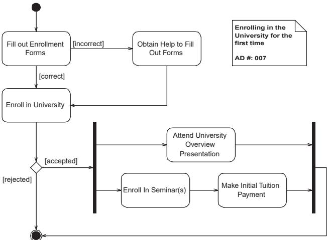

#### 6.4.1 How to Draw Activity Diagrams

The following steps describe the fundamental tasks of activity diagram-ming, tasks you will perform in an iterative manner.

1. Identify the scope of the activity diagram. Begin by identifying what it is you are modeling. Is it a single use case? A portion of a use case? A business process that includes several use cases? A single method of a class? Once you identify the scope of your diagram, you should add a label at the top, using a note, indicating an appropriate title for the diagram and a unique identifier for it. You may also want to include the date and even the names of the authors of the diagram, as well.

2. Add start and end points. Every activity diagram has one starting point and one ending point, so you might as well add them right away. Fowler and Scott's (1997) style is to make ending points optional. Sometimes an activity is simply a dead end but, if this is the case, then there is no harm in indicating the only transition is to an ending point. This way, when someone else reads your diagram, he or she knows you have considered how to exit from these activities.

## DEFINITIONS

<table border=1 style='margin: auto; word-wrap: break-word;'><tr><td style='text-align: center; word-wrap: break-word;'>Activity diagram. A UML diagram used to model high-level business processes or the transitions between states of a class (in this respect, activity diagrams are effectively specializations of state chart diagrams).</td></tr><tr><td style='text-align: center; word-wrap: break-word;'>Data-flow diagram (DFD). A diagram that shows the movement of data within a system among processes, entities, and data stores. Data-flow diagrams, also called process diagrams, were a primary artifact of structured/procedural modeling.</td></tr><tr><td style='text-align: center; word-wrap: break-word;'>Flow chart. A diagram depicting the logic flow of a single process or method. Flow charts were a primary artifact of structured/procedural modeling.</td></tr><tr><td style='text-align: center; word-wrap: break-word;'>State chart diagram. A UML diagram that describes the states an object may be in, as well as the transitions between states. Formerly referred to as a “state diagram” or “state-transition diagram.”</td></tr></table>

3. Add activities. If you are modeling a use case, introduce an activity for each major step initiated by an actor (this activity would include the initial step, plus any steps describing the response of the system to the initial step). If you are modeling a high-level business process, introduce an activity for each major process, often a use case or a package of use cases. Finally, if you are modeling a method, then it is common to have an activity for this step in the code.

4. Add transitions from the activities. My style is always to exit from an activity, even if it is simply to an ending point. Whenever there is more than one transition out of an activity, you must label each transition appropriately.

5. Add decision points. Sometimes the logic of what you are modeling calls for a decision to be made. Perhaps something needs to be inspected or compared to something else. Important to note is that the use of decision points is optional. For example, in Figure 6-22, I could just as easily have modeled the accepted and rejected transitions straight out of the “Enroll in University” activity.

6. Identify opportunities for parallel activities. Two activities can occur in parallel when no direct relationship exists between them and they must both occur before a third activity can. For example, in Figure 6-22, you see it is possible to attend the overview or enroll in seminars in either order; it is just that both activities must occur before you can end the overall process.

<table border=1 style='margin: auto; word-wrap: break-word;'><tr><td style='text-align: center; word-wrap: break-word;'>TIP</td><td rowspan="2">Every activity has at least one entry transition—otherwise, you would never perform the activity, and at least one exit transition—otherwise you would never stop performing it. For each activity, I always ask myself: From where could I get into this and where can I go from here? By asking this question, it enables you to model the pertinent logic thoroughly.</td></tr><tr><td style='text-align: center; word-wrap: break-word;'>Activities Have Entry and Exit Transitions</td></tr></table>

#### 6.4.2 How to Document Activity Diagrams

Activity diagrams are usually documented with a brief description of the activity and an indication of any actions taken during a process. Often, this is simply a reference to one or more use cases or methods. Also, for complex activities, it is common to document it using an activity diagram. In many ways, activity diagrams are simply a variation of the UML state chart diagrams, described in Chapter 7.

### 6.5 User Interface Prototyping

User interface prototyping is an iterative analysis technique in which users are actively involved in the mocking-up of the UI for a system. UI prototyping has two purposes: First, it is an analysis technique because it enables you to explore the problem space your system addresses. Second, UI prototyping enables you to explore the solution space of your system, at least from the point-of-view of its users, and provides a vehicle for you to communicate the possible UI design(s) of your system. In this chapter, I discuss the fundamentals of UI prototyping and, in Chapter 7, I present a collection of tips and techniques for designing effective user interfaces for object-oriented software.

As you see in the activity diagram depicted in Figure 6-23, four high-level steps are in the UI prototyping process:

• Determine the needs of your users

• Build the prototype

• Evaluate the prototype

• Determine if you are finished

#### 6.5.1 Determining the Needs of Your Users

User interface modeling moves from requirements definition into analysis at the point you decide to evolve all or part of your essential user interface

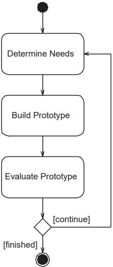

prototype, described in detail in Chapter 3, into a traditional UI prototype. This implies that you convert your handdrawings, flip-chart paper, and sticky notes into something a little more substantial. You begin this process by making platform decisions. For example, do you intend to deploy your system so it runs in an Internet browser, as an application with a Windows-based graphical user interface (GUI), as a cross-platform Java application, or as a mainframe-based set of “green screens”? Different platforms lead to different prototyping tools, for a browser-based application, you need to use an HTML-development tool, whereas a Java-based application would require a Java development tool and a different approach to the user interface design. User interface design is discussed in Chapter 7.

As you iterate through UI prototyping, you discover you need to update your defined requirements, including your use case model (Section 6.1) and your essential user interface prototype (Chapter 3). You are also likely to discover that information is missing from your domain model, a Class Responsibility Collaborator (CRC) model (Chapter 3), as well as from your conceptual model, a UML class model (Section 6.3). These models should be updated, as is appropriate, as you proceed with UI prototyping. Remember, object-oriented software development is an iterative process, so this is normal.

Figure 6-23. The iterative steps of prototyping

<table border=1 style='margin: auto; word-wrap: break-word;'><tr><td style='text-align: center; word-wrap: break-word;'>TIP</td><td style='text-align: center; word-wrap: break-word;'>Although UI prototyping is an important part of analysis and design, it&#x27;s not sufficient by itself. UI prototypes depict what will be built, but are unable to communicate adequately how they will be used (that is what use case models are good for). Furthermore, UI prototypes don&#x27;t provide much indication as to the details of the business logic behind the screens, which is what sequence and activity diagrams are good at. And they aren&#x27;t good at depicting the static structure of your software, which is where class models excel.</td></tr><tr><td style='text-align: center; word-wrap: break-word;'>User Interface\nPrototyping Is Not a Substitute for Analysis and Design</td><td style='text-align: center; word-wrap: break-word;'>The design is not sufficient by itself. UI prototypes depict what will be built, but are unable to communicate adequately how they will be used (that is what use case models are good for). Furthermore, UI prototypes don&#x27;t provide much information as to the details of the business logic behind the screens, which is what sequence and activity diagrams are good at. And they are not good at depicting the static structure of your software, which is where class models excel.</td></tr></table>

#### 6.5.2 Building the Prototype

Using a prototyping tool or high-level language, you develop the screens, pages, and reports needed by your users. The best advice during this stage of the process is not to invest a lot of time in making the code “good” because chances are high you will scrap large portions of your prototype code when portions or all of your prototype fail the evaluation. With the user interface platform selected, you can begin converting individual aspects of your essential UI prototype into your traditional UI prototype. For example, with a browser-based platform, your major UI elements become HTML pages whereas, with a Windows-based platform, they would become windows or dialog boxes. Minor UI elements would become buttons, list boxes, custom list boxes, radio buttons, and so on as appropriate.

#### 6.5.3 Evaluating the Prototype

After a version of the UI prototype is built, it needs to be evaluated by your SMEs to verify that it meets their needs. I’ve always found I need to address three basic questions during an evaluation:

• What is good about the UI prototype?

• What is bad about the UI prototype?

• What is missing from the UI prototype?

#### 6.5.4 Determining If You Are Finished

After evaluating the prototype, you may find you need to scrap parts of it, modify parts, and even add brand-new parts. You want to stop the UI prototyping process when you find that the evaluation process is no longer generating any new ideas or it is generating a small number of not-so-important ideas. Otherwise, back to step one.

#### 6.5.5 Good Things to Understand About Prototyping

Constantine and Lockwood (1999) provide valuable insight into the process of user interface prototyping. First, you cannot make everything simple. Sometimes your software will be difficult to use because the problem it addresses is inherently difficult. Your goal is to make your user interface as easy as possible to use, not simplistic. Second, they differentiate between the concepts of WYSIWYG, "What You See Is What You Get," and WYSIWYN, "What You See Is What You Need." Their point is that a good user interface fulfills the needs of the people who work with it. It isn't loaded with a lot of interesting but unnecessary, features. Third, consistency is important in your user interface. Inconsistent user interfaces lead to less usable software, more programming, and greater support and training costs. Fourth, small details can make or break your user interface. Have you ever used some software, and then discarded it for the product of a competitor because you didn't like the way it prints, saves files, or some other feature you simply found too annoying to use? I have. Although the rest of the software may have been great, that vendor lost my business because a portion of its product's user interface was deficient.

#### 6.5.6 Prototyping Tips and Techniques

I have found the following tips and techniques have worked well for me in the past while UI prototyping:

1. Work with the real users. The best people to get involved in prototyping are the ones who will actually use the application when it is done. These are the people who have the most to gain from a successful implementation, and these are the people who know their own needs best.

2. Use a prototyping tool. Invest the money in a prototyping tool that enables you to put screens together quickly. Because you probably won't want to keep the prototype code you write—code written quickly is rarely worth keeping—you shouldn't be too concerned if your prototyping tool generates a different type of code than what you intend to develop in.

3. Get your SMEs to work with the prototype. Just as you want to take a car for a test drive before you buy it, your users should be

<table border=1 style='margin: auto; word-wrap: break-word;'><tr><td style='text-align: center; word-wrap: break-word;'>DEFINITIONS</td></tr><tr><td style='text-align: center; word-wrap: break-word;'>WYSIWYG. What You See Is What You Get.</td></tr><tr><td style='text-align: center; word-wrap: break-word;'>WYSIWYN. What You See Is What You Need.</td></tr></table>

able to take an application for a test drive before it is developed. Furthermore, by working with the prototype hands-on, they can quickly determine whether the system meets their needs. A good approach is to ask them to work through some use case scenarios using the prototype as if it were the real system.

4. Understand the underlying business. You need to understand the underlying business before you can develop a prototype that supports it. In other words, you need to base your UI prototype on your requirements. The more you know about the business, the more likely it is you can build a prototype that supports it.

5. Don't spend a lot of time making the code good. At the beginning of the prototyping process, you will throw away a lot of your work as you learn more about the business. Therefore, it doesn't make sense to invest a lot of effort in code you probably aren't going to keep anyway.

6. Only prototype features that you can actually build. Christmas wish lists are for kids. If you cannot possibly deliver the functionality, don't prototype it.

7. Get an interface expert to help you design it. User interface experts understand how to develop easy-to-use interfaces, whereas you probably don't. A general rule of thumb is, if you've never taken a course in human factors, you probably shouldn't be leading a UI prototyping effort.

8. Explain what a prototype is. The biggest complaint developers have about UI prototyping is their users say "That's great. Install it this afternoon." Basically, this happens because users don't realize a few months of work are left to do on the system. The reason this happens is simple: From your user's point-of-view, a fully functional application is a bunch of screens and reports tied together by a menu. Unfortunately, this is exactly what a prototype looks like. To avoid this problem, point out that your prototype is like a Styrofoam model that architects build to describe the design of a house. Nobody would expect to live in a Styrofoam model, so why would anyone expect to use a system prototype to get a job done?

9. Avoid implementation decisions as long as possible. Be careful about how you name user interface items. Strive to keep the names generic, so you don't imply too much about the implementation technology. For example, in Figure 6-2, I used the name "UI23 Security Login Screen," which implies I intend to use GUI technology to implement this major UI item. Had I

named it "UI23 Security Login," I wouldn't have implied an implementation technology.

### 6.6 Evolving Your Supplementary Specification

During analysis, you will evolve your understanding of the contents of your supplementary specification. This includes fleshing out the constraints, business rules, and nonfunctional requirements you identified during the requirements definition. As you evolve your other models, such as your activity diagrams and your conceptual class model, you are likely to discover that the information contained in your supplementary specification is not as detailed as it should be and, therefore, needs to be worked on more. Also, you will apply the information contained in your supplementary specification within your models, either on your diagrams using the UML's Object Constraint Language (OCL) or as references within the model documentation.

#### 6.6.1 The Object Constraint Language

OCL (Warner and Kleppe, 1999) is a formal language, similar to structured English, used to express side-effect-free constraints within Unified Modeling Language models. OCL can appear on any UML diagram or in the supporting documentation describing a diagram. OCL can be used for a wide variety of purposes, including specifying the invariants of classes, preconditions and postconditions on operations, and constraints on operations. The reality is that a graphical model, such as a UML class diagram, isn't sufficient for a precise and unambiguous specification. You must describe additional constraints about the objects in the model, constraints that are defined in your supplementary specification. OCL can be used to model actual constraints, described in your supplementary specification, as well as business rules and functional requirements. Although this information is described in your supplementary specification using natural language your users understand, experience shows that natural language often results in ambiguities that, in turn, lead to defects in your software. Hence, the need for OCL.

OCL statements are depicted on UML diagrams in the format “{constraint description},” where the constraint description may be in any format, including predicate calculus. Fowler and Scott (1997) suggest you focus on readability and understandability and, therefore, suggest using an informal description. For example, in Figure 6-11, I modeled the constraint “{ordered FIFO}” on the association between “Seminar” and “Student” and, in Figure 6-16, I modeled the “{NAND}” constraint between two association roles. The basic idea is that students are put on the waiting list on a first-come, first-served basis—in other words, the students are put on the waiting list in order. UML constraint statements are used to model com-

plex and/or important information accurately in your UML diagrams. An important aspect of OCL is it is a modeling language, not a programming language. You will use a language such as OCL to document your object design, and a language such as Java or C++ to implement it.

### 6.7 Applying Analysis Patterns Effectively

Analysis patterns (Fowler, 1997; Ambler, 1998a) describe solutions to common problems found in the analysis/business domain of a system. Analysis patterns are typically more specific than design patterns, described in Chapter 7, because they describe a solution for a portion of a business domain. This doesn't mean an analysis pattern is applicable only to a single line of business, although it could be. In this section, I overview two analysis patterns I have used in various business domains, patterns I believe you will find useful when you are modeling.

The Business Entity analysis pattern describes the different types of people and organizations with whom you interact.

#### 6.7.1 The Business Entity Analysis Pattern

Every organization has to deal either with other organizations or people, usually both. As a result, you need to keep track of them. The solution for the Business Entity analysis pattern (Ambler, 1998a), similar to Fowler's (1997) Party pattern, is presented in Figure 6-24. This pattern is a specialization of Peter Coad's Roles Played Pattern (Coad, 1992; Ambler, 1998a) to model the different types of organizations and people with whom your company interacts.

Figure 6-24.

The Business Entity analysis pattern

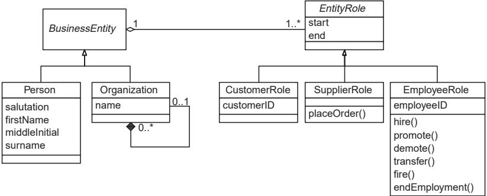

## DEFINITIONS

Invariant. A set of assertions about an instance or class that must be true at all "stable" times, where a stable time is the period before a method is invoked on the object/class and immediately after a method is invoked.

Object Constraint Language (OCL). A formal language, similar to structured English, to express side-effect-free constraints within UML models.

The basic idea of this pattern is to separate the concept of a business entity, such as a person or company, from the roles it fulfills. For example, Tony Stark may be a customer of your organization, as well as an employee. Furthermore, one day he may also sell services to your company, also making him a supplier. The person doesn't change, but the role(s) he has with your organization does, so you need to find a way to model this, which is what this pattern does. Each business entity has one or more roles with your organization and each role has a range during which it was applicable (the "start" and "end" attributes). Each role implements the behavior specific to it, such as placing an order with a supplier or the hiring and promotion of an employee.

Note that the use of aggregation between “BusinessEntity” and “EntityRole” is questionable at best. Is a role really part of a business entity? This sounds like a philosophical question that likely won’t have a definitive answer. However, the Roles Played pattern, on which this is based, uses aggregation, so I decided to stay consistent with the source.

#### 6.7.2 The Contact Point Analysis Pattern

The Contact Point analysis pattern (Ambler, 1998a), the solution for which is depicted in Figure 6-25, describes an approach for keeping track of the various means by which you interact with business entities. Your organization most likely sends information and bills to, as well as ships products to, the surface addresses of your customers. Perhaps it emails information to customers and employees, or faxes information to them. It also probably needs to keep track of the contact phone number for anyone with whom it interacts. The Contact Point pattern models an approach to supporting this functionality.

The basic idea behind this pattern is that surface addresses, email addresses, and phone numbers are really the same sort of thing—a means by which you can contact other business entities. Subclasses of "ContactPoint" need to be able to do at least two tasks: They need to know how things/information can be sent to them and they need to know how to output their "label information." You can send faxes to

<table border=1 style='margin: auto; word-wrap: break-word;'><tr><td style='text-align: center; word-wrap: break-word;'>TIP</td><td style='text-align: center; word-wrap: break-word;'>The real value of analysis patterns is the thinking behind them. A pattern might not be the total solution to your problem, but it might provide enough insight to help save you several hours or days during development. Consider analysis patterns as a good start at solutions.</td></tr><tr><td style='text-align: center; word-wrap: break-word;'>How to Use Analysis Patterns Effectively</td><td style='text-align: center; word-wrap: break-word;'></td></tr></table>

You can use patterns together to solve difficult problems.

phone numbers, email to electronic addresses, and letters and packages to surface addresses. You also need to be able to print contact point information on labels, letterhead, and reports. To do so, contact points collaborate with instances of "ContactPointType" for descriptor information. For example, you want to output "Fax: (416) 555-1212," not just "(416) 555-1212." Furthermore, the "Phone" class should have the capability to be automatically dialed. The different varieties of contact point types would include details such as voice phone line, fax phone line, work address, home address, billing address, and personal email ID.

I applied the Item-Item Description pattern (Coad, 1992; Ambler, 1998a) when modeling the “ContactPoint” and “ContactPointType” classes. This demonstrates an important principle of object-oriented patterns—they can be used in combination to solve larger problems.

#### 6.7.3 The Advantages and Disadvantages of Patterns

Several advantages and disadvantages exist to working with object-oriented patterns. They are discussed in the following sections.

##### 6.7.3.1 The Potential Advantages of Patterns

1. Patterns increase developer productivity. By documenting solutions to common problems, patterns promote reuse of development efforts. Increased reuse within your organization improves your productivity.

2. Patterns describe proven solutions to common problems. Patterns are “born” when developers recognize they are applying the same solution to a common problem over and over again. I developed the Contact Point analysis pattern after implementing similar solutions for a variety of computer systems.

3. Patterns increase the consistency between applications. By using the same patterns over and over again, you increase the consistency between applications, making them easier to understand and maintain. When your applications are developed in a

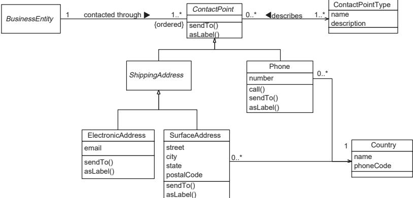

consistent manner, it's that much easier to do technical walk-throughs that enable you to improve the quality of your development efforts.

4. Patterns are potentially better than reusable code. People can talk about reusable code all they want, but the differences between system platforms makes this dream difficult at best. However, patterns support the reuse of other people's approaches to solving problems (Ambler, 1998b; Ambler, 1999) and, therefore, can be applied in a wide range of environments because they are not environment-specific.

5. More and more patterns are being developed every day. A lot of exciting work is going on in patterns, with new patterns being introduced every day. This enables you to take advantage of the development efforts of thousands of people, often for the mere cost of a book, magazine, or telephone call to link you to the Internet.

Figure 6-25.

The Contact Point analysis pattern

I maintain a Web page, http://www.ambysoft.com/processPatternsPage.html, that provides links and references to printed literature pertaining to patterns and the software process. From this page, I link to the major patterns sites online, including sites specializing in analysis patterns.

## TIP

Visit the Process Patterns

Resource Page

##### 6.7.3.2 The Potential Disadvantages of Patterns

1. You need to learn a large number of patterns. Although there's an advantage to having access to a large number of patterns, the disadvantage is you have to learn a large number of them, or at least know they exist. This can be a lot of work.

2. The NIH (not-invented-here) syndrome can get in the way. Many developers are unwilling to accept the work of others: If they didn't create it, then it isn't any good. In addition, if a pattern is not exactly what they need, then they might not be willing to use it. Whenever I run into this attitude, I always like to point out the versatility and widespread acceptance of patterns within the object community and discuss several common patterns such as Singleton (Gamma et al., 1995) and Item-Item Description (Coad, 1992).

3. Patterns are not code. Hard-core techies are often unwilling to accept anything as reusable except code. For some reason, they find it hard to accept that you can reuse ideas as well as source code.

4. “Pattern” is quickly becoming a buzzword. As more people realize the value of patterns, more marketing people are beginning to exploit it to increase the sales of whatever product or service they are pushing. Just as in the mid-1990s we saw the term “object-oriented” used as an adjective to describe products that had almost nothing to do with objects, I suspect we’ll see the same sort of thing happen with the term “pattern.”

### 6.8 User Documentation

Mayhew (1992) believes the user documentation is part of the user interface for an application and that well-written user documentation is no excuse for a poorly designed user interface. My experience confirms these beliefs—because modern systems are complex, your users often require significant documentation that describes how to use them effectively. Because different types of users have different needs, you also discover you need to develop several kinds of user documentation. Don't worry, it's not as hard as it sounds, particularly if you have developed the models this book recommends.

#### 6.8.1 Types of User Documentation

Weiss (1991) points out the need for different kinds of manuals to support the needs of different types of users. The lesson to be learned is that one

manual does not fit all. He suggests a tutorial manual for novice users, a user manual for intermediate users, and a reference manual for expert users. Tourniaire and Farrell (1997) also recommend that you develop a support user's guide describing the support services provided to your user community, a document that is typically less than a page in length.

When appropriate, your user documentation should include a description of the skills needed to use your system. For example, your users may require training in your business domain or in basic computer skills, such as using a mouse. This information is needed to develop training plans for users and by support engineers when they are attempting to determine the source of a problem. Quite often, support engineers will receive support calls where the solution is to give the user additional training.

#### 6.8.2 How to Write User Documentation

What were you trying to do the last time you looked at a user manual? You were likely trying to determine how to accomplish a task, a task that probably would be described via a use case or activity diagram in your analysis model. My experience is that the easiest way to write your user documentation is to start with the models that describe how your users work with your system: your use case model and your activity diagrams. Use cases describe how users interact with your system and, as you saw in Section 6.4, UML activity diagrams are often used to describe high-level business logic. This is exactly the type of information your user documentation should reflect.

Start your user manual with a description of the system itself, probably several paragraphs, information you likely have in your supplementary specification. Then, add a section describing any high-level business

## DEFINITIONS

Reference manual. A document, either paper or electronic, aimed at experts who need quick access to information.

Support user's guide. A brief document, usually a single page, that describes the support services for your application that are available to your user community. This guide includes support phone numbers, fax numbers, and Web site locations, as well as hours of operations and tips for obtaining the best services.

Tutorial. A document, either paper or electronic, aimed at novice users who need to learn the fundamentals of an application.

User manual. A document, either paper or electronic, aimed at intermediate users who understand the basics of an application, but who may not know how to perform all applicable work tasks with the application.

processes, processes you should have documented the logic for using a UML activity diagram. For large systems, you may find you have a section for each UML package within your use case model or even a separate user manual. Then, for each use case, add an appropriate subsection describing it; the use case text will drive the body of that section. You will likely want to combine steps into paragraphs to make your documentation more readable. Wherever you reference a UI element, you may decide to include a relevant picture of that portion of your user interface (my suggestion is to wait until you have baselined your user interface design before investing the time to generate the pictures). You may also decide to replace references to business rules with their descriptions to help increase your user's understanding of how the system actually works. Although many in the industry call this a use case driven approach to writing user documentation, it really is a model-driven approach because your use cases simply aren't sufficient for this purpose.

Tutorials are developed in a similar manner to user manuals, although a few differences exist. First, tutorials focus on the most critical uses of the system, whereas a user manual should focus on the entire system. Second, tutorials should have a more explicit focus on learning a product, so they'll include more detailed use instructions than a user manual might. The assumption is that anyone using a tutorial likely knows little about the system and, therefore, needs more help, whereas someone using a user manual is probably familiar with the system itself, but needs help with a specific aspect of it.

Your reference manual, because it has a slightly different purpose, is generally driven by your user interface model, instead of your use cases and activity diagrams. I generally include an overview of the system, sections for each major portion of your system, and subsections describing the major user interface elements. The subsections should describe the purpose of the relevant screen/report/page and how to work with it.

You will often hear advice within the software industry to write your documentation before you write you code. Although this is a reasonably

<table border=1 style='margin: auto; word-wrap: break-word;'><tr><td style='text-align: center; word-wrap: break-word;'>TIP</td><td rowspan="2">Writing is hard and writing good user documentation is even harder. It takes a lot of effort and significant skill to do well, the type of skill technical writers have. If possible, hire a technical writer to work with you to produce your user documentation. This will improve the quality of your documentation and, hence, the quality of your overall user interface, Hiring a technical writer will also free you to focus on other development activities, such as modeling, coding, and testing.</td></tr><tr><td style='text-align: center; word-wrap: break-word;'>Hire a Technical Writer</td></tr></table>

good practice, why do people give this advice? I believe the motivation is that writing user documentation first forces you to think about how your system will be used before you start to build it. My advice is different: invest the time to understand your system by developing requirements for it, analyzing it, and designing it, and then let this understanding drive the development of your source code and your user documentation. I have worked on several systems where we developed the user documentation in parallel with the source code, not before it, and it worked out well.

### 6.9 Organizing Your Models with Packages

Packages are UML constructs that enable you to organize model elements into groups, making your UML diagrams simpler and easier to understand. Packages are depicted as file folders and can be used on any of the UML diagrams, although they are most common on use case diagrams and class diagrams because these models have a tendency to grow. I use packages only when my diagrams become unwieldy, which generally implies they cannot be printed on a single page, to organize a large diagram into smaller ones. A good rule of thumb is that a diagram should have  $ 7 \pm 2 $ bubbles on it, a bubble being a use case or class.

So how do you identify packages on use case diagrams? I like to start with use cases that are related to one another via extend and include associations, my rule of thumb being that included and extended use cases belong in the same package as the base/parent use case. This heuristic works well because these use cases typically were introduced by “pulling out” their logic from the base/parent use case to start. I then analyze the use cases with which my main actors are involved. What you find is each actor will interact with your system to fulfill a few main goals; for example, students interact with your system to enroll in the university, manage their schedules, and manage their financial obligations with the university. This suggests the need for an “Enrollment” package, a “Student Schedule Management” package, and a “Student Financial Management” package.

Anything you put into a package should make sense when considered with the rest of the contents of the package. To determine whether a package is cohesive, a good rule of thumb is you should be able to give your package a short, descriptive name. If you can't, then you may have put several unrelated things into the package.

## TIP

Packages Should Be Cohesive

With respect to class diagrams, I take a similar approach and, once again, I apply several rules of thumb. First, classes in the same inheritance hierarchy typically belong in the same package. Second, classes related to one another via aggregation or composition often belong in the same package. Third, classes that collaborate with each other a lot—information reflected by your sequence diagrams and collaboration diagrams (Chapter 7)—often belong in the same package. Fourth, the desire to make your packages cohesive will often drive your other decisions to put a class into a package.

### 6.10 What You Have Learned

This chapter introduced you to the main artifacts of object-oriented analysis (OOA) and their interrelationships, as depicted in Figure 6-1. You learned that the purpose of analysis is to understand what will be built, as opposed to the purpose of requirements gathering (Chapter 3), which is to determine what your users would like to have built. The main difference is that the focus of requirements gathering is on understanding your users and their potential use of the system, whereas the focus of analysis shifts to understanding the system itself.

In this chapter you saw how to apply the key object-oriented analysis techniques: system use case modeling, sequence diagramming, class modeling, activity diagramming, and user interface prototyping. In Chapter 7, you see how your analysis efforts bridge the gap between requirements and system design.

### 6.11 Review Questions

1. Develop system use cases for the use case diagram of Figure 3-10. Use the essential use cases you developed for Question 1 in Chapter 3 as your starting point.

2. Rework the class diagrams of Figures 6-15, 6-16, and 6-18 to include the fact that professors also enroll in seminars exactly the way students do. For the purpose of this question, focus on the associations

<table border=1 style='margin: auto; word-wrap: break-word;'><tr><td style='text-align: center; word-wrap: break-word;'>DEFINITIONS</td></tr><tr><td style='text-align: center; word-wrap: break-word;'>Cohesion. The degree of relatedness within an encapsulated unit (such as a component or a class).</td></tr><tr><td style='text-align: center; word-wrap: break-word;'>Package. A UML construct that enables you to organize model elements into groups.</td></tr></table>

between classes and the resulting opportunities for applying inheritance, if any. Draw a new class diagram that includes the inheritance hierarchy, assists association between “Professor” and “Seminar,” and any new associations. Justify any new applications of inheritance.

3. Your coworker has two classes, A and B, and she knows some sort of relationship exists between them. However, what she isn't sure of is whether it is an association, an aggregation association, a composition association, or an inheritance relationship. Develop a UML activity diagram to help your coworker decide among the different types of relationships.

4. The “Enroll in Seminar” use case, described in Figure 6-3, states that when a student is not qualified to enroll in a seminar, a list of the prerequisites for that seminar would be displayed. What changes to the conceptual class diagram developed in Section 6.3 would need to be made to support this feature? What association(s) did you need to add? What do you think the multiplicities would be? Why? The role(s)? Why? Is there more than one way to model this? If so, what are the trade-offs?

5. Develop a UML activity model describing the business logic of the “Enroll in Seminar” use case described in Figure 6-2. Be sure to include the alternate courses described in the figure. Are any alternate courses missing? If so, model them in your activity diagram. Is there any opportunity for performing some activities in parallel?

6. Both Figures 6-20 and 6-24 showed a similar use of composition. A component is potentially composed of other components and an organization is potentially composed of other organizations. Discuss why this may or may not indicate the existence of a “composition pattern.” Has such a pattern been previously identified? (Do a search of the patterns literature.)

7. Apply the Contact Point and Business Entity analysis patterns to your class model for the university. Discuss how this has improved your model. Has this detracted from your model in any way? If so,

## DEFINITION

Baseline. A tested and certified version of a deliverable representing a conceptual milestone, which, thereafter, serves as the basis for further development and that can be modified only through formal change control procedures. A particular version becomes a baseline when a responsible group decides to designate it as such.

how? Do you need to verify this change with your SMEs? Why or why not?

8. Develop sequence diagrams for your use cases in Question 1. As you develop the sequence diagrams, update your conceptual class model to reflect new operations or classes you identify. Also, update the logic of your system use cases as appropriate.

9. Develop a conceptual class model for the bank case study, described in Section 3.10.1, following the approach described in this chapter. First, start with your CRC model, and then try to flesh it out as best you can (develop sequence diagrams for the use cases you developed in Chapter 3). When you have done so, baseline your model. You may decide to organize your model using packages, as well as apply common analysis patterns.

10. Compare and contrast the information content of your domain model (your CRC model), and your conceptual class model for the bank case study. What are the strengths and weaknesses of each model? Why?

11. Compare and contrast the narrative style for writing use cases with the action-response style. What are the advantages and disadvantages of each? When would or wouldn't you use each approach?

12. Search the Web for documentation templates for use cases, actors, and user interface specifications. For use case templates, compare and contrast the content they capture with what has been suggested in this book.

13. Search the Web for papers and information about object-oriented analysis. Compare and contrast the various techniques. Formulate a reason why differences exist among the various approaches and discuss the advantages and disadvantages of having different approaches available to you.