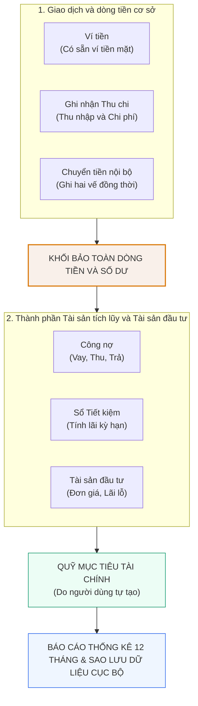

## 2. MÔ TẢ TỔNG QUÁT HỆ THỐNG

### 2.1 Bối cảnh hệ thống

Hệ thống Quản lý Tài chính Cá nhân là ứng dụng máy tính để bàn cục bộ đơn người dùng chạy trên nền tảng Java 17. Hệ thống quản lý số dư ví, tài sản tích lũy, tài sản đầu tư và công nợ theo cách ghi hai vế và giữ cho số dư luôn khớp về mặt toán học.

Các nguyên tắc thiết kế nền tảng chi phối hành vi nghiệp vụ và mô hình lưu trữ của hệ thống:

| Nguyên tắc | Nội dung kỹ thuật |
| :--- | :--- |
| Ghi hai vế đồng thời | Áp dụng ghi hai vế (trừ ví nguồn, cộng ví đích) cho mọi giao dịch điều chuyển nội bộ, để tổng tiền trong các ví luôn không đổi. |
| Tổng hợp tài sản ròng ngay lập tức | Tính theo công thức đại số tại thời điểm tra cứu từ 5 thành phần. Các thành phần gồm tổng tiền trong các ví, giá trị gốc và lãi dồn tích của sổ tiết kiệm, giá trị thị trường của các tài sản đầu tư, tổng nợ phải thu, trừ tổng nợ phải trả. |
| Phân tích dòng tiền 12 tháng gần nhất | Trích xuất chuỗi dữ liệu 12 tháng liên tục kết thúc tại tháng người dùng chọn, mặc định là tháng hiện tại, để phân tích dòng tiền thuần định kỳ và tỷ lệ tiết kiệm. |
| Lưu trữ tệp cục bộ an toàn | Ghi dữ liệu trực tiếp xuống tệp tin JSON cục bộ bằng cách ghi tệp an toàn, không làm hỏng hoặc mất dữ liệu cũ khi mất điện hoặc tắt máy đột ngột. Dữ liệu được giữ lại khi ngoại tuyến và độc lập hoàn toàn với hệ quản trị cơ sở dữ liệu bên ngoài. |

Sơ đồ phân rã mức cao các khối nghiệp vụ tài chính của hệ thống:

### 2.2 Mục tiêu hệ thống

Hệ thống đáp ứng 5 mục tiêu kỹ thuật đo được bằng số và kiểm tra được:

| Mã   | Tên                                               | Định nghĩa kỹ thuật                                                                                                                                            | Tiêu chí đo kiểm                                                                                                                                                                                                    |
| ---- | ------------------------------------------------- | -------------------------------------------------------------------------------------------------------------------------------------------------------------- | ------------------------------------------------------------------------------------------------------------------------------------------------------------------------------------------------------------------- |
| G-01 | Ghi nhận dòng tiền và cấu trúc danh mục phân cấp | Lưu các biến động số dư và gán nhãn theo cấu trúc phân loại cây 3 cấp (Loại, Nhóm nhu cầu, Danh mục chi tiết)                                   | 100% giao dịch thu chi được định danh đúng ví và đúng danh mục hợp lệ; số dư ví cập nhật ngay sau khi ghi nhận với độ trễ xử lý dưới 50 ms trong cùng transaction logic                                         |
| G-02 | Xác định tài sản ròng và cơ cấu phân bổ     | Tổng hợp tài sản ròng tại thời điểm tra cứu từ 5 thành phần: ví tiền, sổ tiết kiệm, tài sản đầu tư, nợ phải thu và nợ phải trả                              | Tài sản ròng khớp đúng tổng đại số của 5 thành phần với sai số tuyệt đối bằng 0; tổng tỷ lệ phân bổ giữa các ví đạt đúng 100,00% tại mọi thời điểm kiểm tra lại                                               |
| G-03 | Giám sát công nợ, tích lũy và tài sản đầu tư     | Theo dõi chi tiết từng khoản vay, nợ phải trả, sổ tiết kiệm có kỳ hạn và tài sản đầu tư                                                                  | Số liệu công nợ phân tách riêng biệt theo từng người vay hoặc người cho vay; tiền lãi tiết kiệm được tính theo lãi suất năm, lãi đơn chia 365 ngày; giá trị tài sản đầu tư phản ánh đúng theo đơn giá cập nhật với sai số 0 VND |
| G-04 | Quy hoạch tài chính theo quỹ mục tiêu             | Cho phép gom và theo dõi tiến độ tích lũy từ tiền mặt, sổ tiết kiệm và lệnh mua của tài sản đầu tư vào các quỹ mục tiêu do người dùng tự tạo | Tỷ lệ hoàn thành tiến độ (%) của từng quỹ được tính từ tổng tài sản phân bổ chia cho số tiền mục tiêu; cập nhật lại tỷ lệ và trạng thái đạt mục tiêu ngay sau khi có biến động tài sản liên kết                       |
| G-05 | Bảo đảm độ chính xác số học tài chính             | Loại bỏ hoàn toàn sai số làm tròn số thực nhị phân trong các phép tính số dư, tính lãi, định giá và tổng hợp báo cáo                                           | Sai số làm tròn số học bằng 0 trên 100% kịch bản tính toán số dư, tính lãi dồn tích và phân bổ ngân sách; bảo đảm không xuất hiện sai số dấu chấm động nhị phân trên toàn bộ dữ liệu tài chính                      |

### 2.3 Đặc điểm tác nhân người dùng

Hệ thống phục vụ một tác nhân duy nhất là Người dùng, quản lý thông tin cấu hình cá nhân và đơn vị tiền tệ cơ sở trên máy tính cục bộ, với các đặc điểm vận hành:

| Thuộc tính tác nhân    | Đặc tả kỹ thuật                                                                                                                                                                               |
| ---------------------- | --------------------------------------------------------------------------------------------------------------------------------------------------------------------------------------------- |
| Tác nhân               | Người dùng                                                                                                                                                                                    |
| Vai trò trong hệ thống | Tác nhân chính duy nhất tương tác trực tiếp với giao diện người dùng; quản lý cấu hình cá nhân và đơn vị tiền tệ cơ sở                                                                       |
| Phạm vi quyền hạn      | Toàn quyền tạo, sửa đổi, tra cứu và sao lưu dữ liệu trên tất cả 10 nhóm chức năng nghiệp vụ; không áp dụng phân quyền nhiều cấp                                                                 |
| Yêu cầu kỹ năng        | Kỹ năng vận hành ứng dụng máy tính cá nhân cơ bản; hiểu biết các khái niệm tài chính thông dụng gồm thu chi, chuyển tiền, công nợ, tiết kiệm ngân hàng và tài sản đầu tư                       |
| Tần suất tương tác     | Tương tác hàng ngày để nhập giao dịch thu chi và chuyển tiền; tương tác định kỳ hàng tuần hoặc hàng tháng để cập nhật đơn giá, so khớp công nợ, theo dõi tiến độ quỹ mục tiêu và tra cứu báo cáo |

### 2.4 Giới hạn kỹ thuật, giả định và sự phụ thuộc

Hệ thống tuân thủ các giới hạn kỹ thuật sau:

Giới hạn kỹ thuật:

| Mã     | Nội dung                                                                                                                                                                                                                                                                                                                                                 |
| ------ | -------------------------------------------------------------------------------------------------------------------------------------------------------------------------------------------------------------------------------------------------------------------------------------------------------------------------------------------------------- |
| CON-01 | Ứng dụng phải được biên dịch và chạy trên môi trường Java Development Kit phiên bản 17 LTS trở lên.                                                                                                                                                                                                                                              |
| CON-02 | Mọi phép tính số học về tiền tệ, số dư ví, tỷ lệ phần trăm, lãi suất và biến trung gian phải dùng kiểu số có độ chính xác cố định (tối thiểu 18 chữ số phần nguyên và 2 chữ số thập phân). Hệ thống cấm dùng số thực dấu chấm động nhị phân để loại bỏ sai số làm tròn. |
| CON-03 | Toàn bộ các quy tắc tính toán số dư, tính lãi, ghi hai vế và định giá phải được kiểm chứng tự động, bao phủ 100% các quy tắc tài chính luôn đúng BR-FIN.                                                                                                                                                                                                      |
| CON-04 | Dữ liệu phải được lưu trên tệp tin cục bộ định dạng văn bản có cấu trúc JSON, cho phép sao lưu và phục hồi độc lập mà không phụ thuộc vào hệ quản trị cơ sở dữ liệu bên ngoài.                                                                                                                                                                   |

Giả định của hệ thống:

| Mã    | Nội dung                                                                                                                                                                |
| ----- | ----------------------------------------------------------------------------------------------------------------------------------------------------------------------- |
| AS-01 | Một năm có 365 ngày khi tính lãi tiết kiệm, kể cả năm nhuận.                                                     |
| AS-02 | Hệ thống giả định chỉ có một phiên làm việc đơn tiến trình duy nhất truy cập vào tệp dữ liệu tại một thời điểm trên ứng dụng máy tính để bàn cục bộ.                    |
| AS-03 | Đơn giá hoặc giá trị thị trường tổng của tài sản đầu tư được người dùng cập nhật dựa trên giá công bố thực tế, không yêu cầu tự động crawl dữ liệu trực tuyến. |

Sự phụ thuộc hệ thống:

| Mã    | Thành phần              | Bản chất                                                                                                                                                                                                      |
| ----- | ----------------------- | ------------------------------------------------------------------------------------------------------------------------------------------------------------------------------------------------------------- |
| DE-01 | Đồng hồ hệ thống        | Cung cấp mốc thời gian thực tế từ hệ thống phần cứng và hệ điều hành để ghi nhận thời điểm giao dịch, tính số ngày thực gửi của sổ tiết kiệm và xác định chuỗi 12 tháng gần nhất trong báo cáo thống kê. |
| DE-02 | Hệ thống tệp tin cục bộ | Cung cấp quyền đọc, ghi tệp tin trên ổ đĩa để lưu trữ lâu dài, áp dụng cách ghi tệp an toàn và sao lưu dữ liệu.                                                                                            |

### 2.5 Môi trường vận hành

Yêu cầu môi trường vận hành của hệ thống:

| Yếu tố môi trường        | Yêu cầu kỹ thuật tối thiểu                                                                               | Ghi chú tương thích                                                                  |
| ------------------------ | -------------------------------------------------------------------------------------------------------- | ------------------------------------------------------------------------------------ |
| Hệ điều hành             | Bất kỳ hệ điều hành máy tính cá nhân nào có môi trường thực thi Java tương thích (Windows, macOS, Linux) | Độc lập nền tảng nhờ máy ảo Java                                 |
| Môi trường chạy Java | Java Runtime Environment hoặc Java Development Kit 17 LTS trở lên                                        | Cần có để chạy mã bytecode của ứng dụng                                        |
| Cấu hình phần cứng       | Cấu hình máy tính cá nhân thông thường đủ chạy môi trường thực thi Java                                  | Chưa xác lập ngưỡng phần cứng tối thiểu cụ thể; sẽ bổ sung sau khi có đo đạc thực tế |
| Hiển thị                 | Kích thước màn hình đủ hiển thị đầy đủ bảng biểu số liệu và biểu đồ báo cáo                              | Chưa xác lập độ phân giải tối thiểu cụ thể                                           |

### 2.6 Luận đề kỹ thuật và phân tích đánh đổi

#### Luận đề kỹ thuật

Hệ thống giải quyết bài toán quản lý tài chính cá nhân cho một người dùng duy nhất trên môi trường máy tính để bàn cục bộ. Hệ thống chấp nhận đánh đổi sự phức tạp của kiến trúc mạng phân tán và hệ quản trị cơ sở dữ liệu máy chủ. Đổi lại, hệ thống đạt sai số số học bằng 0.00 VNĐ theo quy định BR-FIN-01, ghi tệp an toàn cục bộ và phản hồi ngay cho các phép toán số dư với quy mô dữ liệu cá nhân thông thường.

#### Phân tích ba trục đánh đổi kỹ thuật

| Trục đánh đổi       | Lựa chọn kỹ thuật                                                                                                                                   | Lợi ích thu được                                                                                                                           | Chi phí và đánh đổi chấp nhận                                                                                                                                   |
| ------------------- | --------------------------------------------------------------------------------------------------------------------------------------------------- | ------------------------------------------------------------------------------------------------------------------------------------------ | --------------------------------------------------------------------------------------------------------------------------------------------------------------- |
| Độ chính xác số học | Sử dụng số thập phân với số chữ số cố định cho toàn bộ các trường tiền tệ, tỷ lệ và biến trung gian; loại trừ số thực dấu chấm động nhị phân. | Loại bỏ 100% sai số làm tròn của số thực dấu chấm động nhị phân; giữ cho số dư trong sổ ghi tiền luôn đúng và cộng trừ luôn khớp.                     | Chi phí tính toán phần mềm cao hơn tính toán phần cứng của kiểu số nguyên thủy; chấp nhận vì việc tính chính xác về tài chính là ưu tiên kỹ thuật cao nhất.              |
| Lưu trữ dữ liệu     | Sử dụng tệp tin cục bộ có cấu trúc JSON kết hợp cách ghi tạm, đồng bộ vật lý và thay thế tệp chính bằng một thao tác duy nhất.                                           | Loại bỏ phụ thuộc vào phần mềm cơ sở dữ liệu bên ngoài; người dùng trực tiếp làm chủ tệp dữ liệu, thuận tiện sao lưu và di chuyển độc lập. | Không có sẵn tính năng lập chỉ mục nâng cao và tinh chỉnh truy vấn tự động của hệ cơ sở dữ liệu quan hệ; toàn bộ dữ liệu được đọc vào bộ nhớ khi khởi động ứng dụng. |
| Kiểm soát truy cập  | Mô hình người dùng duy nhất vận hành trên ứng dụng máy tính để bàn cá nhân.                                                                         | Đơn giản hóa việc khóa dữ liệu, loại trừ xung đột ghi đồng thời từ nhiều phiên mạng; bảo đảm giao diện phản hồi ngay lập tức.      | Không hỗ trợ cộng tác đa người dùng đồng thời qua mạng; chỉ phục vụ nhu cầu quản lý tài chính cá nhân độc lập.                                                  |

#### Ngưỡng gãy hệ thống

Hệ thống được thiết kế cho quy mô vận hành cá nhân. Điểm gãy kỹ thuật xuất hiện trong hai trường hợp:

1. Quy mô dữ liệu vượt xa mức sử dụng cá nhân thông thường: Kiến trúc lưu trữ tệp tin phẳng JSON nguyên khối đọc toàn bộ vào bộ nhớ khi khởi động. Kiến trúc này sẽ trở thành điểm nghẽn hiệu năng và bộ nhớ khi khối lượng dữ liệu tăng đủ lớn. Khi đạt ngưỡng này (sẽ xác định bằng đo đạc thực tế), kiến trúc lưu trữ cần tái cấu trúc sang cơ sở dữ liệu quan hệ nhúng cục bộ có đánh chỉ mục và phân trang.
2. Nhu cầu đồng bộ ngay lập tức giữa nhiều thiết bị: Khi cập nhật đồng thời từ nhiều thiết bị, cách lưu tệp cục bộ đơn tiến trình không còn đáp ứng do xung đột ghi dữ liệu. Khi đó, hệ thống phải chuyển sang kiến trúc dịch vụ mạng Client-Server hoặc Cloud API có kiểm soát tương tranh.

---

