## 7. SƠ ĐỒ CA SỬ DỤNG HỆ THỐNG

Phần này trực quan hóa ranh giới chức năng và các luồng tương tác giữa tác nhân Người dùng với 44 ca sử dụng của Hệ thống Quản lý Tài chính Cá nhân bằng mô hình sơ đồ ca sử dụng UML.

Mô hình gồm một sơ đồ tổng quan và các sơ đồ ca sử dụng chi tiết:

1. Sơ đồ tổng quan kiến trúc nhóm chức năng: Mô tả ranh giới hệ thống, tác nhân người dùng duy nhất và 4 gói nghiệp vụ vĩ mô hợp nhất từ 10 nhóm chức năng dưới dạng các ca sử dụng tóm lược.
2. Sơ đồ ca sử dụng chi tiết theo 4 nhóm chức năng nghiệp vụ lớn: Tập hợp 10 sơ đồ con làm rõ toàn bộ 44 ca sử dụng thành phần. Toàn bộ 4 nhóm lớn được chia thành 10 nhóm sơ đồ con tương ứng một-một với 10 nhóm chức năng nghiệp vụ, để dễ đọc và theo dõi độc lập.

Bảng 11 sơ đồ ca sử dụng hệ thống theo loại sơ đồ:

| Loại sơ đồ | Mục | Tên sơ đồ ca sử dụng | Phạm vi nhóm chức năng và mã ca sử dụng |
| :---: | :---: | :--- | :--- |
| Sơ đồ tổng quan | 7.1 | Sơ đồ tổng quan kiến trúc nhóm chức năng | Toàn hệ thống (4 gói nghiệp vụ vĩ mô) |
| Sơ đồ ca sử dụng chi tiết | 7.2.1a | Nhóm Ví tiền | `UC-WAL-01` đến `UC-WAL-04` |
| Sơ đồ ca sử dụng chi tiết | 7.2.1b | Nhóm Ghi nhận thu chi | `UC-TXN-01` đến `UC-TXN-04` |
| Sơ đồ ca sử dụng chi tiết | 7.2.1c | Nhóm Chuyển tiền nội bộ | `UC-TRF-01` đến `UC-TRF-03` |
| Sơ đồ ca sử dụng chi tiết | 7.2.1d | Nhóm Danh mục phân loại | `UC-CAT-01` đến `UC-CAT-04` |
| Sơ đồ ca sử dụng chi tiết | 7.2.2a | Nhóm Sổ tiết kiệm | `UC-SAV-01` đến `UC-SAV-06` |
| Sơ đồ ca sử dụng chi tiết | 7.2.2b | Nhóm Tài sản đầu tư | `UC-INV-01` đến `UC-INV-08` |
| Sơ đồ ca sử dụng chi tiết | 7.2.3a | Nhóm Công nợ | `UC-DEBT-01` đến `UC-DEBT-03` |
| Sơ đồ ca sử dụng chi tiết | 7.2.3b | Nhóm Quỹ mục tiêu | `UC-FND-01` đến `UC-FND-05` |
| Sơ đồ ca sử dụng chi tiết | 7.2.4a | Nhóm Thống kê và báo cáo | `UC-REP-01` đến `UC-REP-04` |
| Sơ đồ ca sử dụng chi tiết | 7.2.4b | Nhóm Lưu trữ và sao lưu dữ liệu | `UC-DAT-01` đến `UC-DAT-03` |
| **Tổng cộng** | | **11 sơ đồ trực quan** | **44 ca sử dụng** |

---

### 7.1 Sơ đồ Ca sử dụng tổng quan kiến trúc nhóm chức năng

Sơ đồ tổng quan xác lập khung kiến trúc của hệ thống PFMS, thể hiện liên kết giữa tác nhân người dùng với ranh giới hệ thống và bốn ca sử dụng tóm lược đại diện cho bốn gói nghiệp vụ vĩ mô.

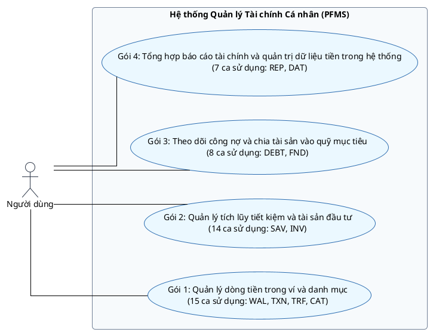

#### Phân tích kiến trúc nhóm chức năng

##### Bảng phân loại 44 ca sử dụng theo mục tiêu của tác nhân

| Nhóm chức năng | Mã UC | Tên Ca sử dụng | Mục tiêu nghiệp vụ của Tác nhân | Quy tắc nghiệp vụ chi phối |
|---|:---:|---|---|---|
| **Nhóm chức năng 1:** Dòng tiền và Tiền trong ví | `UC-WAL-01..04` | Tạo, theo dõi, cập nhật và điều chỉnh số dư ví tiền | Giữ các nguồn tiền dùng được ngay và kiểm soát số dư khả dụng | `BR-FIN-01`, `BR-FIN-02` |
| | `UC-TXN-01..04` | Ghi nhận, tra cứu, chỉnh sửa và xóa giao dịch thu chi | Nhập các khoản thu nhập và chi phí hàng ngày, gán nhãn phân loại | `BR-FIN-01`, `BR-FIN-02`, `BR-FIN-04`, `BR-FIN-07` |
| | `UC-TRF-01..03` | Chuyển tiền, tra cứu và hủy giao dịch chuyển tiền nội bộ | Chuyển tiền giữa hai ví, tự động ghi hai vế (trừ ví nguồn, cộng ví đích) | `BR-FIN-01`, `BR-FIN-02`, `BR-FIN-03` |
| | `UC-CAT-01..04` | Bổ sung, đổi tên, chuyển nhóm, khôi phục và xóa danh mục hoặc nhóm | Tạo cây cấu trúc phân loại thu chi 3 cấp phục vụ thống kê báo cáo | `BR-FIN-04` |
| **Nhóm chức năng 2:** Sổ tiết kiệm và Tài sản đầu tư | `UC-SAV-01..06` | Mở, tất toán đúng hạn, tất toán trước hạn, gửi thêm, theo dõi và tái tục sổ tiết kiệm | Gửi vốn có kỳ hạn, theo dõi lãi dự kiến và tất toán sổ tiết kiệm | `BR-FIN-01`, `BR-FIN-02`, `BR-FIN-05`, `BR-FIN-10` |
| | `UC-INV-01..08` | Mua, bán, cập nhật đơn giá, định giá, ghi nhận sự kiện và quản lý khoản đầu tư | Ghi nhận lệnh mua, lệnh bán tài sản đầu tư, cập nhật biến động đơn giá, đo lường tỷ suất sinh lời thị trường, ghi nhận sự kiện và tự nhóm các lệnh mua thành khoản đầu tư | `BR-FIN-01`, `BR-FIN-02`, `BR-FIN-06`, `BR-FIN-07`, `BR-FIN-08`, `BR-FIN-10` |
| **Nhóm chức năng 3:** Công nợ và Quỹ mục tiêu | `UC-DEBT-01..03` | Cho vay và thu lại, đi vay và trả nợ, xóa nợ khó đòi | Quản lý nợ phải thu và nợ phải trả theo từng người vay hoặc người cho vay | `BR-FIN-01`, `BR-FIN-02`, `BR-FIN-09` |
| | `UC-FND-01..05` | Tạo, theo dõi, điều chỉnh, chuyển tài sản giữa các quỹ và xóa quỹ mục tiêu | Gom nhiều loại tài sản vào một quỹ để theo dõi tiến độ hoàn thành mục tiêu tài chính | `BR-FIN-01`, `BR-FIN-05`, `BR-FIN-10` |
| **Nhóm chức năng 4:** Báo cáo tài chính và Quản trị dữ liệu | `UC-REP-01..04` | Thống kê dòng tiền, cơ cấu thu chi, tài sản ròng và sao kê công nợ | Tổng hợp dòng tiền 12 tháng gần nhất, cơ cấu chi tiêu, tài sản ròng và sao kê công nợ theo từng người vay hoặc người cho vay | `BR-FIN-01`, `BR-FIN-05`, `BR-FIN-06`, `BR-FIN-07`, `BR-FIN-09` |
| | `UC-DAT-01..03` | Xuất, nhập phục hồi và kiểm tra lại dữ liệu | Lưu dữ liệu tiền trong hệ thống an toàn ở máy tính cục bộ, phục hồi từ tệp sao lưu và kiểm tra lại để dữ liệu không bị sai lệch | `BR-FIN-01`, `BR-FIN-02`, `BR-FIN-03`, `BR-FIN-04`, `BR-FIN-09` |

---

### 7.2 Sơ đồ Ca sử dụng chi tiết theo 4 nhóm chức năng nghiệp vụ

---

#### 7.2.1 Nhóm chức năng Dòng tiền và Tiền trong ví

Nhóm chức năng này điều hành dòng tiền dùng được ngay, bao gồm các miền nghiệp vụ: ví tiền, ghi nhận thu chi, chuyển tiền nội bộ theo nguyên lý ghi hai vế (trừ ví nguồn, cộng ví đích) và cây danh mục phân loại. Nhóm gồm 15 ca sử dụng được chia thành bốn sơ đồ ca sử dụng theo từng nhóm nghiệp vụ chuyên biệt:

##### 7.2.1a Nhóm Ví tiền (WAL)

Nhóm quản lý các nguồn tiền dùng được ngay (tiền mặt, tài khoản ngân hàng, ví điện tử), thuộc Nhóm chức năng 1: Dòng tiền và Tiền trong ví.

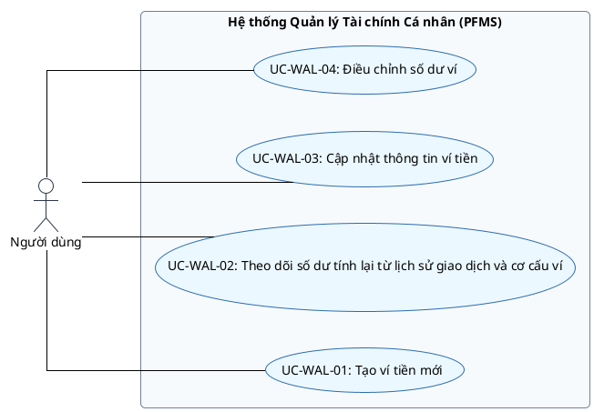

##### Cấu trúc ca sử dụng và điều kiện nhóm

| Thành phần | Mô tả |
|---|---|
| Ca sử dụng thành phần | `UC-WAL-01`: Tạo ví tiền mới: Tạo ví tiền mới với số dư ban đầu. `UC-WAL-02`: Theo dõi số dư tính lại từ lịch sử giao dịch và cơ cấu ví: Quan sát số dư khả dụng theo thời gian thực và tỷ lệ chia tiền giữa các ví. `UC-WAL-03`: Cập nhật thông tin ví tiền: Chỉnh sửa thuộc tính ví, bao gồm chuyển đổi trạng thái lưu trữ như một luồng thay thế của việc cập nhật. `UC-WAL-04`: Điều chỉnh số dư ví: Ghi nhận khoản điều chỉnh có thể truy vết khi số dư thực tế lệch khỏi số dư hệ thống. |
| Tương tác tác nhân | Toàn bộ 4 ca sử dụng là các mục tiêu độc lập cấp người dùng, do Người dùng trực tiếp bắt đầu từ giao diện quản trị ví tiền. |
| Điều kiện nghiệp vụ | Dùng kiểu số thập phân chính xác, cố định cho số tiền (`BR-FIN-01`) và giữ cho số dư ví luôn không âm (`BR-FIN-02`). |

---

##### 7.2.1b Nhóm Ghi nhận thu chi (TXN)

Nhóm ghi nhận, tra cứu, chỉnh sửa và xóa các khoản thu nhập và chi phí hàng ngày, thuộc Nhóm chức năng 1: Dòng tiền và Tiền trong ví.

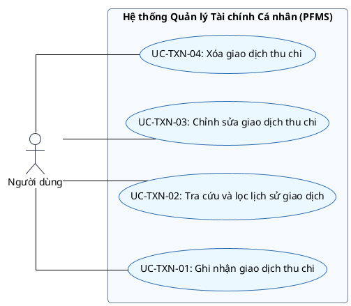

##### Cấu trúc ca sử dụng và điều kiện nhóm

| Thành phần | Mô tả |
|---|---|
| Ca sử dụng thành phần | `UC-TXN-01`: Ghi nhận giao dịch thu chi: Nhập giao dịch thu nhập hoặc chi phí hàng ngày, gán nhãn danh mục chuẩn hóa. Khoản thu từ tài sản đầu tư không ghi tại đây mà ghi qua `UC-INV-05` theo `BR-FIN-07`. `UC-TXN-02`: Tra cứu và lọc lịch sử giao dịch: Truy vấn danh sách giao dịch theo khoảng thời gian, ví, danh mục. `UC-TXN-03`: Chỉnh sửa giao dịch thu chi: Cập nhật số tiền, danh mục hoặc ghi chú của giao dịch đã ghi nhận, hoàn nguyên số dư ví trước khi ghi lại. `UC-TXN-04`: Xóa giao dịch thu chi: Loại bỏ giao dịch khỏi sổ ghi tiền và hoàn nguyên số dư ví liên quan. |
| Tương tác tác nhân | Toàn bộ 4 ca sử dụng do Người dùng trực tiếp bắt đầu từ giao diện ghi chép giao dịch. |
| Điều kiện nghiệp vụ | Số thập phân chính xác (`BR-FIN-01`), giữ nguyên số dư ví khi hoàn nguyên giao dịch (`BR-FIN-02`) và mã liên kết tới nhóm cha trong cây danh mục 3 cấp (`BR-FIN-04`). Khoản thu từ tài sản đầu tư ghi qua sự kiện Nhận tiền mặt (`BR-FIN-07`). |

---

##### 7.2.1c Nhóm Chuyển tiền nội bộ (TRF)

Nhóm điều chuyển dòng tiền giữa hai ví nội bộ và quản trị lịch sử chuyển tiền, thuộc Nhóm chức năng 1: Dòng tiền và Tiền trong ví.

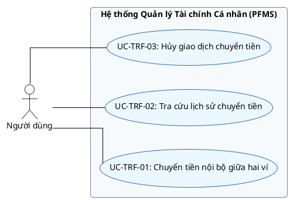

##### Cấu trúc ca sử dụng và điều kiện nhóm

| Thành phần | Mô tả |
|---|---|
| Ca sử dụng thành phần | `UC-TRF-01`: Chuyển tiền nội bộ giữa hai ví: Điều chuyển giá trị tiền tệ giữa ví nguồn và ví đích, ghi nhận phí chuyển tiền (nếu có) như một bước trong luồng chính. `UC-TRF-02`: Tra cứu lịch sử chuyển tiền: Truy vấn danh sách các bản ghi chuyển tiền đã thực hiện. `UC-TRF-03`: Hủy giao dịch chuyển tiền: Hoàn nguyên hai khoản ghi của một giao dịch chuyển tiền đã ghi nhận. |
| Tương tác tác nhân | Toàn bộ 3 ca sử dụng vận hành độc lập, khoản phí chuyển tiền được tính gộp trực tiếp vào luồng chính của `UC-TRF-01`. |
| Điều kiện nghiệp vụ | `BR-FIN-02`: Giữ cho số dư ví luôn không âm và luôn tính đúng từ lịch sử giao dịch, chi phối `UC-TRF-01`, `UC-TRF-03`. `BR-FIN-03`: Quy tắc ghi hai vế khi chuyển tiền nội bộ. Tổng số dư ví được bảo toàn ngoại trừ trường hợp phát sinh phí chuyển tiền. Khi hủy chuyển khoản, phí liên kết chuyển trạng thái `CANCELLED` kèm hoàn phí về ví nguồn; chi phối `UC-TRF-01`, `UC-TRF-02`, `UC-TRF-03`. |

---

##### 7.2.1d Nhóm Danh mục phân loại (CAT)

Nhóm quản trị cây cấu trúc phân loại thu chi 3 cấp Type $\rightarrow$ Group $\rightarrow$ Category, thuộc Nhóm chức năng 1: Dòng tiền và Tiền trong ví.

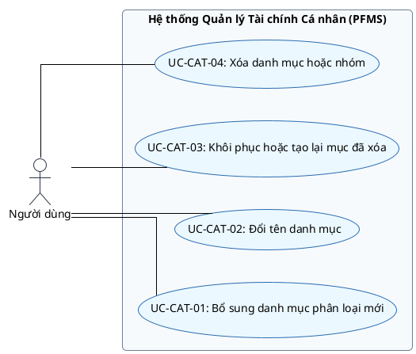

##### Cấu trúc ca sử dụng và điều kiện nhóm

| Thành phần | Mô tả |
|---|---|
| Ca sử dụng thành phần | `UC-CAT-01`: Bổ sung danh mục phân loại mới: Tạo mới nhóm hoặc danh mục trong cây phân loại 3 cấp. `UC-CAT-02`: Đổi tên danh mục: Cập nhật tên hiển thị của một nhóm hoặc danh mục hiện có, và chuyển danh mục sang nhóm khác cùng Loại thu chi. `UC-CAT-03`: Khôi phục hoặc tạo lại mục đã xóa: Lấy lại một nhóm hoặc danh mục đã xóa, giữ lịch sử cũ hoặc tạo mới. `UC-CAT-04`: Xóa danh mục hoặc nhóm: Xóa hẳn mục chưa có giao dịch, hoặc chuyển sang đã xóa và giữ giao dịch nếu đã có. |
| Tương tác tác nhân | Toàn bộ 4 ca sử dụng do Người dùng trực tiếp thao tác trên cây danh mục phân loại. |
| Điều kiện nghiệp vụ | Mã liên kết tới nhóm cha trong cây danh mục 3 cấp, mỗi danh mục thuộc đúng một nhóm cha (`BR-FIN-04`). |

---

#### 7.2.2 Nhóm chức năng Sổ tiết kiệm và Tài sản đầu tư

Nhóm chức năng này quản lý các tài sản tài chính trung và dài hạn gồm tiền gửi tiết kiệm có kỳ hạn tại ngân hàng thương mại và các tài sản đầu tư. Nhóm gồm 14 ca sử dụng được chia thành hai sơ đồ ca sử dụng theo từng nhóm nghiệp vụ chuyên biệt:

##### 7.2.2a Nhóm Sổ tiết kiệm (SAV)

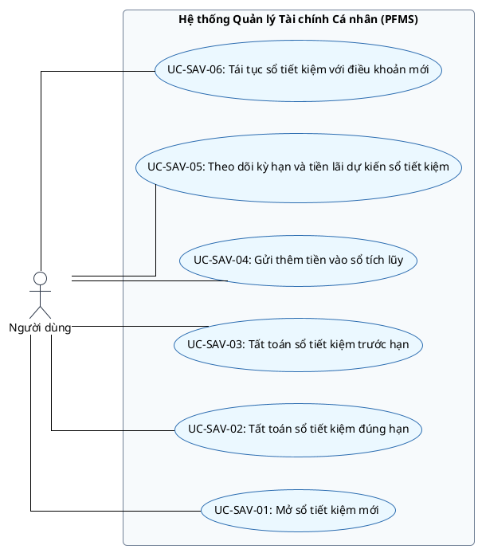

##### Cấu trúc ca sử dụng và điều kiện nhóm

| Thành phần | Mô tả |
|---|---|
| Ca sử dụng thành phần | Nhóm Sổ tiết kiệm gồm `UC-SAV-01` (Mở sổ tiết kiệm mới), `UC-SAV-02` (Tất toán sổ tiết kiệm đúng hạn), `UC-SAV-03` (Tất toán sổ tiết kiệm trước hạn), `UC-SAV-04` (Gửi thêm tiền vào sổ tích lũy), `UC-SAV-05` (Theo dõi kỳ hạn và tiền lãi dự kiến sổ tiết kiệm) và `UC-SAV-06` (Tái tục sổ tiết kiệm với điều khoản mới). |
| Tương tác tác nhân | `UC-SAV-02` (Tất toán sổ tiết kiệm đúng hạn) và `UC-SAV-03` (Tất toán sổ tiết kiệm trước hạn) là hai ca sử dụng độc lập loại trừ lẫn nhau tại cùng một thời điểm trên cùng một sổ tiết kiệm, phân biệt bằng điều kiện ngày đáo hạn ($currentDate \ge MaturityDate$ so với $currentDate < MaturityDate$). `UC-SAV-06` (Tái tục sổ tiết kiệm với điều khoản mới) là mục tiêu độc lập chỉ khả thi sau khi `UC-SAV-02` hoàn tất và đưa sổ về trạng thái `SETTLED_MATURED`. |
| Điều kiện nghiệp vụ | `BR-FIN-05`: Quy tắc tính lãi tiết kiệm có kỳ hạn theo lãi suất năm chia 365 ngày. Hỗ trợ 4 phương thức gồm lãi đơn (`SIMPLE`), lãi kép tháng (`COMPOUND_MONTHLY`), trả trước (`PREPAID`), trả sau (`POSTPAID`). Tất toán trả trước nhận gốc $Payout = Principal$; tất toán trước hạn hưởng lãi không kỳ hạn; chi phối `UC-SAV-01` đến `UC-SAV-06`. `BR-FIN-01`: Quy tắc độ chính xác tài chính về số tiền và làm tròn, chi phối `UC-SAV-01`. `BR-FIN-02`: Quy tắc bảo toàn số dư ví khi có biến động, chi phối `UC-SAV-01`, `UC-SAV-02`, `UC-SAV-03`, `UC-SAV-04`, `UC-SAV-06`. `BR-FIN-10`: Quy tắc gắn tài sản vào quỹ mục tiêu, mỗi sổ tiết kiệm gắn tối đa một quỹ, chi phối `UC-SAV-01`, `UC-SAV-02`, `UC-SAV-03`. |

---

##### 7.2.2b Nhóm Tài sản đầu tư (INV)

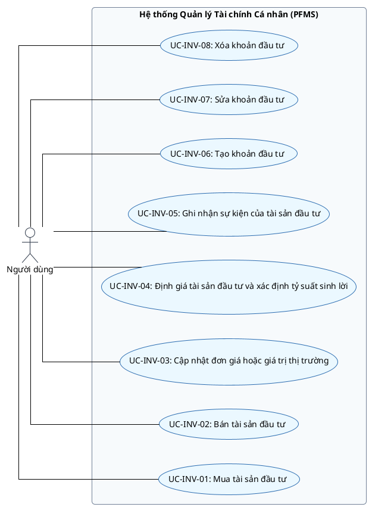

##### Cấu trúc ca sử dụng và điều kiện nhóm

| Thành phần | Mô tả |
|---|---|
| Ca sử dụng thành phần | Nhóm Tài sản đầu tư gồm `UC-INV-01` (Mua tài sản đầu tư), `UC-INV-02` (Bán tài sản đầu tư), `UC-INV-03` (Cập nhật đơn giá hoặc giá trị thị trường), `UC-INV-04` (Định giá tài sản đầu tư và xác định tỷ suất sinh lời), `UC-INV-05` (Ghi nhận sự kiện của tài sản đầu tư), `UC-INV-06` (Tạo khoản đầu tư), `UC-INV-07` (Sửa khoản đầu tư) và `UC-INV-08` (Xóa khoản đầu tư). |
| Tương tác tác nhân | Toàn bộ 8 ca sử dụng là các mục tiêu độc lập cấp người dùng, do Người dùng trực tiếp bắt đầu từ giao diện quản lý tài sản đầu tư. |
| Điều kiện nghiệp vụ | `BR-FIN-06`: Quy tắc định giá và giá vốn tài sản đầu tư theo phương pháp FIFO. Đơn giá mua thay thế bản ghi cùng ngày trong lịch sử giá và trở thành đơn giá hiện hành; chi phối `UC-INV-01`, `UC-INV-02`, `UC-INV-03`, `UC-INV-04`. `BR-FIN-01`: Quy tắc độ chính xác tài chính về số tiền và làm tròn, chi phối `UC-INV-01`, `UC-INV-02`, `UC-INV-05`. `BR-FIN-02`: Quy tắc bảo toàn số dư ví khi có biến động, chi phối `UC-INV-01`, `UC-INV-02`, `UC-INV-05`. `BR-FIN-07`: Quy tắc sự kiện của tài sản đầu tư gồm Nhận tiền mặt, Thêm đơn vị cùng loại và Hoàn vốn, trong đó Nhận tiền mặt và Hoàn vốn tăng số dư ví nhận tiền. Cổ tức thuộc kỳ trước ngày mua đầu tiên được ghi nhận dưới dạng Hoàn vốn; chi phối `UC-INV-05` và dòng thu nhập đầu tư trong `UC-REP-01`. `BR-FIN-08`: Quy tắc tỷ suất sinh lời của tài sản đầu tư. Khi $HoldDays \ge 365$ ngày, hệ thống hiển thị đồng thời cả 2 dòng tỷ suất (tỷ suất cả lệnh quy đổi kép theo năm và tỷ suất phần đang giữ); chi phối `UC-INV-04`. `BR-FIN-10`: Quy tắc gắn tài sản vào quỹ mục tiêu, mỗi lệnh mua gắn tối đa một quỹ. Xử lý lệnh mua đã gắn quỹ mục tiêu khi bán và khi bán hết đơn vị; chi phối `UC-INV-01`, `UC-INV-02`, `UC-INV-03` và giữ nguyên khi quản lý khoản đầu tư tại `UC-INV-06`, `UC-INV-07`, `UC-INV-08`. |

---

#### 7.2.3 Nhóm chức năng Công nợ và Quỹ mục tiêu

Nhóm chức năng này quản lý hai nhánh tài chính cá nhân gồm quan hệ công nợ với người vay, người cho vay (phải thu và phải trả) và việc chia tài sản vào các quỹ mục tiêu độc lập. Nhóm gồm 8 ca sử dụng được chia thành hai sơ đồ ca sử dụng theo từng nhóm nghiệp vụ chuyên biệt:

##### 7.2.3a Nhóm Công nợ (DEBT)

Nhóm quản lý quan hệ công nợ với người vay, người cho vay, gồm các khoản cho vay phải thu, khoản đi vay phải trả và xử lý nợ khó đòi.

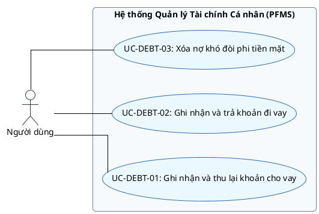

##### Cấu trúc ca sử dụng và điều kiện nhóm

| Thành phần | Mô tả |
|---|---|
| Ca sử dụng thành phần | Nhóm Công nợ gồm `UC-DEBT-01` (Ghi nhận và thu lại khoản cho vay), `UC-DEBT-02` (Ghi nhận và trả khoản đi vay) và `UC-DEBT-03` (Xóa nợ khó đòi phi tiền mặt). Chức năng sao kê công nợ chi tiết theo từng người vay hoặc người cho vay được xử lý tập trung tại `UC-REP-04` thuộc Nhóm chức năng 4. |
| Tương tác tác nhân | Toàn bộ 3 ca sử dụng trong nhóm Công nợ đều là các ca sử dụng độc lập mức người dùng, do Người dùng trực tiếp bắt đầu từ giao diện. Thao tác xóa nợ không dùng tiền mặt `UC-DEBT-03` vận hành độc lập theo phán quyết của người dùng khi xử lý nợ khó đòi còn lại, không phụ thuộc vào quá trình giải ngân cho vay hay đi vay mới. |
| Điều kiện nghiệp vụ | `BR-FIN-09`: Số tiền còn nợ luôn không âm, trần thu nợ hoặc trả nợ và đặc tính không dùng tiền mặt của thao tác xóa nợ. |

---

##### 7.2.3b Nhóm Quỹ mục tiêu (FND)

Nhóm gom tài sản nhiều thành phần vào các quỹ mục tiêu độc lập để theo dõi tiến độ hoàn thành các kế hoạch tài chính.

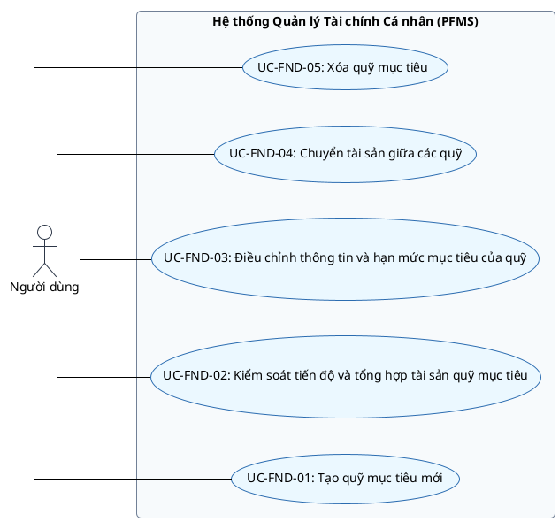

##### Cấu trúc ca sử dụng và điều kiện nhóm

| Thành phần | Mô tả |
|---|---|
| Ca sử dụng thành phần | Nhóm Quỹ mục tiêu gồm `UC-FND-01` (Tạo quỹ mục tiêu mới), `UC-FND-02` (Kiểm soát tiến độ và tổng hợp tài sản quỹ mục tiêu), `UC-FND-03` (Điều chỉnh thông tin và hạn mức mục tiêu của quỹ), `UC-FND-04` (Chuyển tài sản giữa các quỹ) và `UC-FND-05` (Xóa quỹ mục tiêu). |
| Tương tác tác nhân | Toàn bộ 5 ca sử dụng trong nhóm Quỹ mục tiêu đều là các ca sử dụng độc lập mức người dùng, do Người dùng trực tiếp bắt đầu từ giao diện. |
| Điều kiện nghiệp vụ | `BR-FIN-10`: Quy tắc gắn tài sản vào quỹ mục tiêu; tổng hợp tài sản 3 thành phần; không tính trùng tài sản; giữ nguyên tổng tài sản khi chuyển giữa các quỹ. Xử lý lệnh mua đã gắn quỹ mục tiêu khi bán và khi bán hết đơn vị; chi phối `UC-FND-01`, `UC-FND-02`, `UC-FND-03`, `UC-FND-04`, `UC-INV-01`, `UC-INV-02`. |

---

#### 7.2.4 Nhóm chức năng Thống kê, Báo cáo và Quản trị dữ liệu

Nhóm chức năng này tổng hợp số liệu quản trị, phân tích xu hướng tài chính và thực hiện sao lưu, phục hồi, kiểm tra lại độ an toàn của dữ liệu tiền trong hệ thống. Nhóm gồm 7 ca sử dụng được chia thành hai sơ đồ ca sử dụng theo từng nhóm nghiệp vụ chuyên biệt:

##### 7.2.4a Nhóm Thống kê và báo cáo (REP)

Nhóm tổng hợp dòng tiền 12 tháng gần nhất, cơ cấu thu chi, tài sản ròng và sao kê công nợ theo từng người vay hoặc người cho vay.

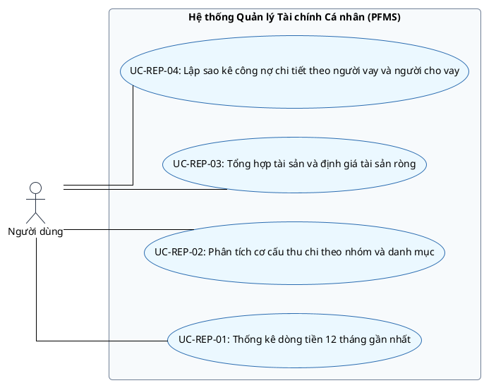

##### Cấu trúc ca sử dụng và điều kiện nhóm

| Thành phần | Mô tả |
|---|---|
| Ca sử dụng thành phần | Nhóm Thống kê và báo cáo gồm `UC-REP-01` (Thống kê dòng tiền 12 tháng gần nhất), `UC-REP-02` (Phân tích cơ cấu thu chi theo nhóm và danh mục), `UC-REP-03` (Tổng hợp tài sản và định giá tài sản ròng) và `UC-REP-04` (Lập sao kê công nợ chi tiết theo người vay và người cho vay). |
| Tương tác tác nhân | Người dùng tương tác trực tiếp với cả 4 ca sử dụng. `UC-REP-04` thuộc miền báo cáo và không liên hệ với các ca sử dụng công nợ (`UC-DEBT`) của Nhóm chức năng 3. |
| Điều kiện nghiệp vụ | `BR-FIN-01`: Quy tắc độ chính xác tài chính, chi phối `UC-REP-01`, `UC-REP-02`. `BR-FIN-05`: Quy tắc tính lãi tiết kiệm có kỳ hạn, áp dụng cho thành phần tiền gửi tiết kiệm của tài sản ròng trong `UC-REP-03`. `BR-FIN-06`: Quy tắc định giá và giá vốn tài sản đầu tư, áp dụng cho thành phần tài sản đầu tư của tài sản ròng trong `UC-REP-03`. `BR-FIN-07`: Quy tắc sự kiện của tài sản đầu tư, áp dụng cho dòng thu nhập đầu tư từ sự kiện Nhận tiền mặt trong `UC-REP-01`. `BR-FIN-09`: Quy tắc theo dõi công nợ, chi phối `UC-REP-03`, `UC-REP-04`. |
| Yêu cầu chức năng liên quan | `FR-REP-01`: Chuỗi 12 tháng liên tục tính từ một mốc thời gian chỉ định, tỷ lệ tiết kiệm bằng 0.00 khi tổng thu nhập tháng không dương. Thu nhập tháng gồm dòng thu nhập đầu tư từ sự kiện Nhận tiền mặt. `FR-REP-03`: Bảng cân đối tài chính cá nhân 5 thành phần với sai số bằng 0.00 VNĐ. |

---

##### 7.2.4b Nhóm Lưu trữ và sao lưu dữ liệu (DAT)

Nhóm xuất dữ liệu ra tệp sao lưu, phục hồi từ tệp sao lưu và kiểm tra lại, so khớp độc lập các quy tắc luôn đúng của dữ liệu tiền trong hệ thống.

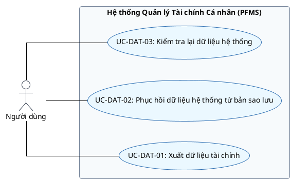

##### Cấu trúc ca sử dụng và điều kiện nhóm

| Thành phần | Mô tả |
|---|---|
| Ca sử dụng thành phần | Nhóm Lưu trữ và sao lưu dữ liệu gồm `UC-DAT-01` (Xuất dữ liệu tài chính), `UC-DAT-02` (Phục hồi dữ liệu hệ thống từ bản sao lưu) và `UC-DAT-03` (Kiểm tra lại dữ liệu hệ thống). |
| Tương tác tác nhân | Người dùng tương tác trực tiếp với cả 3 ca sử dụng. Thao tác kiểm tra lại độ toàn vẹn dữ liệu (`UC-DAT-03`) vận hành độc lập, cho phép chạy theo nhu cầu so khớp dữ liệu tiền trong hệ thống. Ca sử dụng `UC-DAT-02` tự động áp dụng quy trình kiểm tra 4 bước tương tự trước khi hoàn tất ghi đè tệp. |
| Điều kiện nghiệp vụ | `BR-FIN-01`: Quy tắc độ chính xác tài chính, chi phối `UC-DAT-01`. `BR-FIN-02`: Quy tắc bảo toàn số dư ví, chi phối `UC-DAT-02`, `UC-DAT-03`. `BR-FIN-03`: Quy tắc ghi hai vế khi chuyển tiền nội bộ, chi phối `UC-DAT-02`, `UC-DAT-03`. `BR-FIN-04`: Quy tắc phân cấp danh mục thu chi 3 cấp, chi phối `UC-DAT-02`, `UC-DAT-03`. `BR-FIN-09`: Quy tắc theo dõi công nợ, chi phối `UC-DAT-03`. |
| Yêu cầu chức năng liên quan | `FR-DAT-02`: Quy trình kiểm tra 4 bước khi nhập dữ liệu và hoàn nguyên tự động khi xảy ra lỗi. `FR-DAT-03`: Kiểm tra lại độc lập 4 quy tắc luôn đúng về số dư ví, ghi hai vế, cây danh mục và công nợ không âm. |

---
