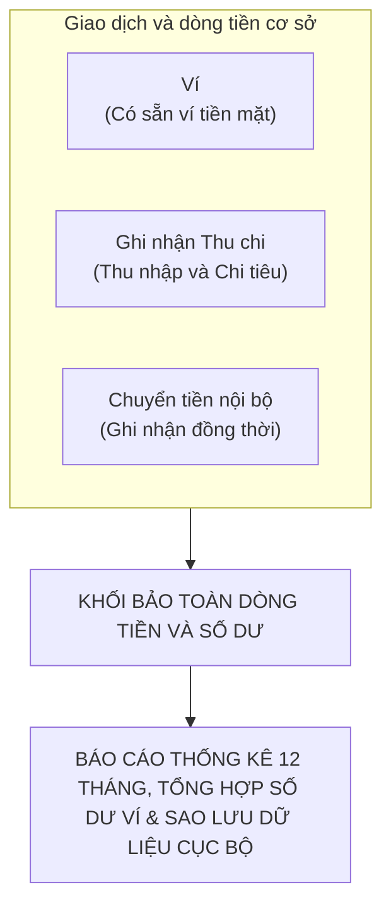

## 2. MÔ TẢ TỔNG QUÁT HỆ THỐNG

### 2.1 Bối cảnh hệ thống

Hệ thống quản lý tài chính cá nhân (PFMS) là ứng dụng máy tính để bàn cục bộ đơn người dùng chạy trên nền tảng Java 17. Hệ thống quản lý số dư ví theo cơ chế ghi nhận đồng thời và giữ cho số dư luôn khớp về mặt toán học.

Các nguyên tắc thiết kế nền tảng chi phối hành vi nghiệp vụ và mô hình lưu trữ của hệ thống:

| Nguyên tắc | Nội dung |
| :--- | :--- |
| Ghi nhận đồng thời | Áp dụng cơ chế ghi nhận đồng thời (trừ ví nguồn, cộng ví đích) cho mọi giao dịch điều chuyển nội bộ. Mục đích là giữ tổng số dư trong các ví không đổi, ngoại trừ chi phí chuyển tiền. |
| Tổng hợp tiền trong ví ngay lập tức | Tính theo công thức đại số tại thời điểm tra cứu từ lịch sử dòng tiền của từng ví. |
| Phân tích dòng tiền 12 tháng gần nhất | Trích xuất chuỗi dữ liệu 12 tháng liên tục kết thúc tại tháng Người dùng chọn, mặc định là tháng hiện tại, để phân tích dòng tiền thuần định kỳ và tỷ lệ tiết kiệm. |
| Lưu trữ tệp cục bộ an toàn | Ghi dữ liệu trực tiếp xuống tệp tin JSON cục bộ bằng cách ghi tệp an toàn, không làm hỏng hoặc mất dữ liệu cũ khi mất điện hoặc tắt máy đột ngột. Dữ liệu được giữ lại khi ngoại tuyến và độc lập hoàn toàn với hệ quản trị cơ sở dữ liệu bên ngoài. |

Sơ đồ phân rã mức cao các khối nghiệp vụ tài chính của hệ thống:

### 2.2 Mục tiêu hệ thống

Các mục tiêu nghiệp vụ định lượng và tiêu chí kiểm chứng tương ứng.

| Mã mục tiêu | Tên mục tiêu | Định nghĩa | Tiêu chí đo kiểm |
| --- | --- | --- | --- |
| `G-01` | Ghi nhận dòng tiền và cấu trúc danh mục phân cấp | Lưu các biến động số dư và gán nhãn theo cấu trúc danh mục 3 cấp (Loại, Nhóm nhu cầu, Danh mục chi tiết) | Tỷ lệ giao dịch thu chi đã lưu được định danh đúng ví và đúng danh mục hợp lệ bằng 100.00%. Kiểm chứng theo Tạo mới giao dịch thu nhập (`FR-TXN-01`) và Tạo mới giao dịch chi tiêu (`FR-TXN-02`). Danh mục hợp lệ gồm danh mục đang dùng và danh mục đã xóa còn tồn tại theo Phục hồi dữ liệu hệ thống từ bản sao lưu (`FR-DAT-02`). Số dư ví cập nhật ngay sau khi ghi nhận theo Hiệu năng và độ trễ phản hồi (`NFR-02`). |
| `G-02` | Xác định tổng số dư và cơ cấu phân bổ ví | Tính tổng số dư của các ví và phần trăm số dư mỗi ví chiếm trong tổng, tại ngày Người dùng tra cứu. Số dư của từng ví được tính từ lịch sử dòng tiền của ví đó | Tổng số dư hiển thị bằng đúng tổng số dư của từng ví cộng lại, chênh lệch 0 VNĐ. Khi tổng số dư lớn hơn 0, 100.00% số ví hiển thị tỷ lệ đúng theo công thức của Thống kê cơ cấu số dư theo ví (`FR-WAL-04`). |
| `G-03` | Bảo đảm độ chính xác số học tài chính | Loại bỏ hoàn toàn sai số làm tròn số thực nhị phân trong các phép tính số dư và tổng hợp báo cáo | Sai số làm tròn số học bằng 0.00 VNĐ theo Độ chính xác và toàn vẹn dữ liệu tài chính (`NFR-01`) trong các kịch bản tính toán số dư và tổng hợp báo cáo. Bảo đảm không xuất hiện sai số dấu chấm động nhị phân trên toàn bộ dữ liệu tài chính. |

### 2.3 Đặc điểm người dùng

Hệ thống phục vụ một Người dùng duy nhất có toàn quyền quản trị dữ liệu cục bộ mà không phân quyền nhiều cấp. Người dùng chỉ cần kỹ năng máy tính cơ bản và hiểu biết tài chính thông dụng để ghi nhận giao dịch hàng ngày cùng theo dõi báo cáo định kỳ.

### 2.4 Giới hạn kỹ thuật, giả định và sự phụ thuộc

Bảng dưới đây liệt kê những giới hạn kỹ thuật mà hệ thống bắt buộc phải tuân thủ, những giả định làm cơ sở cho thiết kế và những thành phần bên ngoài mà hệ thống phụ thuộc để vận hành đúng.

| Mã giới hạn | Nội dung |
| --- | --- |
| `CON-01` | Ứng dụng phải được biên dịch và chạy trên môi trường Java Development Kit phiên bản 17 LTS trở lên. |
| `CON-02` | Mọi phép tính số học về tiền tệ, số dư ví, tỷ lệ phần trăm và biến trung gian phải dùng kiểu số có độ chính xác cố định. Độ chính xác tối thiểu là 18 chữ số phần nguyên và 2 chữ số thập phân. Hệ thống không được dùng số thực dấu chấm động nhị phân để loại bỏ sai số làm tròn. |
| `CON-03` | Toàn bộ các quy tắc tính toán số dư, ghi nhận đồng thời và tổng hợp báo cáo phải được kiểm chứng tự động, bao phủ 100% các quy tắc nghiệp vụ. |
| `CON-04` | Dữ liệu phải được lưu trên tệp tin cục bộ định dạng văn bản có cấu trúc JSON và bảng mã UTF-8. Cách lưu này cho phép sao lưu và phục hồi độc lập mà không phụ thuộc vào hệ quản trị cơ sở dữ liệu bên ngoài. |
| `CON-05` | Dữ liệu đầu vào phải tuân theo các giới hạn sau: tên ví, tên nhóm và tên danh mục dài từ 1 đến 50 ký tự. Mô tả ví, ghi chú giao dịch và lý do điều chỉnh số dư dài tối đa 255 ký tự (cho phép để trống). Số bản ghi mỗi trang nằm trong khoảng từ 10 đến 100 và mặc định là 50. |
| `CON-06` | Bản sao lưu tự động phải được đặt tên theo định dạng `backup_YYYYMMDD_HHMMSS.json` và lưu trong thư mục riêng `backups/`. |

Thiết kế hệ thống dựa trên các giả định sau đây về phạm vi người dùng, phiên làm việc và nguồn gốc của tệp sao lưu:

| Mã giả định | Nội dung |
| :---: | :--- |
| `AS-01` | Hệ thống giả định chỉ có một Người dùng và một phiên làm việc đơn tiến trình duy nhất. Phiên này truy cập vào tệp dữ liệu tại một thời điểm trên ứng dụng máy tính để bàn cục bộ. |
| `AS-02` | Hệ thống giả định tệp sao lưu do chính hệ thống tạo ra và không bị chỉnh sửa bên ngoài hệ thống. Vì vậy khi nhập tệp, Quy tắc tên của ví, nhóm nhu cầu và danh mục (`BR-NAM-01`) không được kiểm tra lại. Tệp hỏng hoặc sai loại vẫn bị từ chối theo quy trình kiểm tra của Phục hồi dữ liệu hệ thống từ bản sao lưu (`FR-DAT-02`). |

Hệ thống cần các thành phần bên ngoài sau đây của máy tính để vận hành đúng, cụ thể là nguồn thời gian và khả năng đọc, ghi tệp tin cục bộ:

| Mã phụ thuộc | Thành phần | Vai trò |
| --- | --- | --- |
| `DE-01` | Đồng hồ hệ thống | Cung cấp mốc thời gian thực tế từ hệ thống phần cứng và hệ điều hành. Mốc này dùng để ghi nhận thời điểm giao dịch và xác định chuỗi 12 tháng gần nhất trong báo cáo thống kê. |
| `DE-02` | Hệ thống tệp tin cục bộ | Cung cấp quyền đọc, ghi tệp tin trên ổ đĩa để lưu trữ lâu dài, áp dụng cách ghi tệp an toàn và sao lưu dữ liệu. |

### 2.5 Môi trường vận hành

Bảng yêu cầu môi trường vận hành tối thiểu, gồm hệ điều hành, môi trường chạy Java, cấu hình phần cứng, khả năng hiển thị và các ghi chú tương thích

| Yếu tố môi trường | Mức tối thiểu | Ghi chú tương thích |
| --- | --- | --- |
| Hệ điều hành | Bất kỳ hệ điều hành máy tính cá nhân nào có môi trường thực thi Java tương thích (Windows, macOS, Linux) | Độc lập nền tảng nhờ máy ảo Java |
| Môi trường chạy Java | Java Runtime Environment hoặc Java Development Kit 17 LTS trở lên | Cần có để chạy mã bytecode của ứng dụng |
| Cấu hình phần cứng | Cấu hình máy tính cá nhân thông thường đủ chạy môi trường thực thi Java | Chưa xác lập ngưỡng phần cứng tối thiểu cụ thể; sẽ bổ sung sau khi có đo đạc thực tế |
| Hiển thị | Kích thước màn hình đủ hiển thị bảng biểu số liệu và biểu đồ báo cáo | Chưa xác lập độ phân giải tối thiểu cụ thể; khuyến nghị 1280x720 pixel trở lên |

### 2.6 Luận đề kỹ thuật và phân tích đánh đổi

#### Luận đề kỹ thuật

Hệ thống giải quyết bài toán quản lý tài chính cá nhân cho một Người dùng duy nhất trên môi trường máy tính để bàn cục bộ. Hệ thống chấp nhận đánh đổi sự phức tạp của kiến trúc mạng phân tán và hệ quản trị cơ sở dữ liệu máy chủ. Đổi lại, hệ thống đạt sai số số học bằng 0.00 VNĐ theo Quy tắc độ chính xác tài chính (`BR-FIN-01`). Hệ thống còn ghi tệp an toàn cục bộ và phản hồi ngay cho các phép toán số dư với quy mô dữ liệu cá nhân thông thường.

#### Lựa chọn thiết kế và hệ quả

| Hạng mục | Lựa chọn | Lợi ích | Hạn chế |
| --- | --- | --- | --- |
| Độ chính xác số học | Sử dụng số thập phân với số chữ số cố định cho toàn bộ các trường tiền tệ, tỷ lệ và biến trung gian; loại trừ số thực dấu chấm động nhị phân. | Loại bỏ sai số làm tròn của số thực dấu chấm động nhị phân; giữ cho số dư các ví và phép cộng trừ khớp nhau. | Tải tính toán phần mềm cao hơn tính toán phần cứng của kiểu số nguyên thủy; chấp nhận vì việc tính chính xác về tài chính là ưu tiên kỹ thuật cao nhất. |
| Lưu trữ dữ liệu | Sử dụng tệp tin cục bộ có cấu trúc JSON kết hợp cơ chế ghi tệp an toàn bảo toàn dữ liệu chống hỏng hóc. | Loại bỏ phụ thuộc vào phần mềm cơ sở dữ liệu bên ngoài; Người dùng trực tiếp làm chủ tệp dữ liệu, thuận tiện sao lưu và di chuyển độc lập. | Không có sẵn tính năng lập chỉ mục nâng cao và tinh chỉnh truy vấn tự động của hệ cơ sở dữ liệu quan hệ. Toàn bộ dữ liệu được đọc vào bộ nhớ khi khởi động ứng dụng. |
| Kiểm soát truy cập | Mô hình Người dùng duy nhất vận hành trên ứng dụng máy tính để bàn cá nhân. | Đơn giản hóa việc khóa dữ liệu, loại trừ xung đột ghi đồng thời từ nhiều phiên mạng; bảo đảm giao diện phản hồi ngay lập tức. | Không hỗ trợ cộng tác đa người dùng đồng thời qua mạng; chỉ phục vụ nhu cầu quản lý tài chính cá nhân độc lập. |

#### Ngưỡng gãy hệ thống

Hệ thống được thiết kế cho quy mô vận hành cá nhân. Điểm gãy kỹ thuật xuất hiện trong hai trường hợp:

1. Quy mô dữ liệu vượt xa mức sử dụng cá nhân thông thường: Kiến trúc lưu trữ tệp tin phẳng JSON nguyên khối đọc toàn bộ vào bộ nhớ khi khởi động. Kiến trúc này sẽ trở thành điểm nghẽn hiệu năng và bộ nhớ khi khối lượng dữ liệu tăng đủ lớn. Khi đạt ngưỡng này (sẽ xác định bằng đo đạc thực tế), kiến trúc lưu trữ cần tái cấu trúc sang cơ sở dữ liệu quan hệ nhúng cục bộ. Cơ sở dữ liệu này có đánh chỉ mục và phân trang.
2. Nhu cầu đồng bộ ngay lập tức giữa nhiều thiết bị: Khi cập nhật đồng thời từ nhiều thiết bị, cách lưu tệp cục bộ đơn tiến trình không còn đáp ứng. Nguyên nhân là xung đột ghi dữ liệu. Khi đó, hệ thống phải chuyển sang kiến trúc dịch vụ mạng Client-Server hoặc Cloud API có kiểm soát tương tranh.
