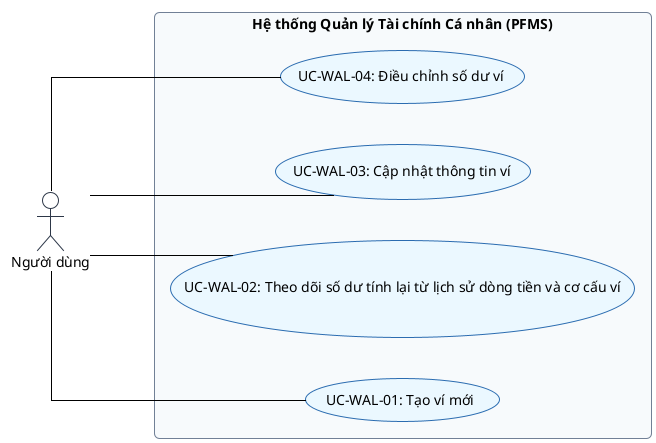
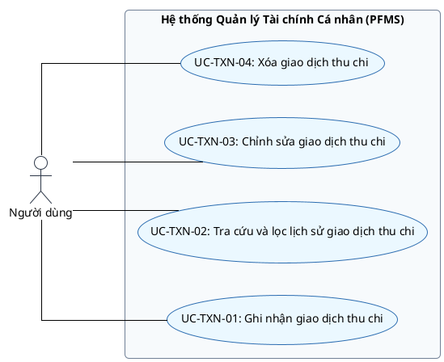
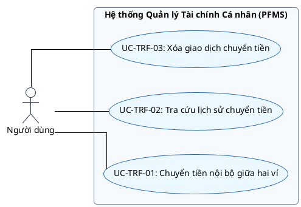
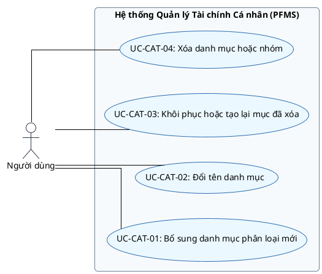
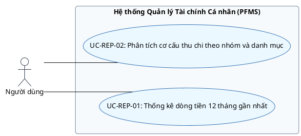
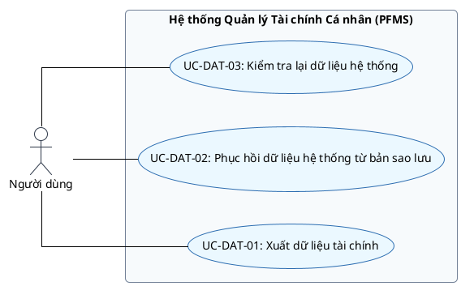

## 7. SƠ ĐỒ CA SỬ DỤNG HỆ THỐNG

Sơ đồ ca sử dụng hệ thống trực quan hóa ranh giới chức năng, tác nhân tương tác và liên kết của 20 ca sử dụng trong Hệ thống Quản lý Tài chính Cá nhân theo chuẩn ngôn ngữ mô hình hóa UML 2.5 (ISO/IEC 19505) và cẩm nang mô hình hóa IREB CPRE. Hệ thống áp dụng phương pháp phân rã trực quan hai tầng kiến trúc: Tầng 1 là sơ đồ vĩ mô bao quát ranh giới hệ thống và hai gói nghiệp vụ lớn; Tầng 2 là tập hợp sáu sơ đồ vi mô làm rõ toàn bộ 20 ca sử dụng thành phần, trong đó mỗi sơ đồ giới hạn không quá 9 nút để bảo đảm khả năng tiếp nhận thông tin trực quan tối ưu.

Mô hình sơ đồ tuân thủ ba nguyên tắc kỹ thuật cốt lõi:
1. Ngữ nghĩa định danh ca sử dụng: Tên nút ca sử dụng luôn tuân theo cấu trúc chuẩn Động từ + Danh từ thể hiện một mục tiêu hoàn chỉnh của người dùng, loại bỏ hoàn toàn các nút "Quản lý X" gộp chung nhiều thao tác.
2. Ràng buộc ngữ nghĩa quan hệ: Không lạm dụng quan hệ phụ thuộc tuần tự; các kịch bản thực thi rẽ nhánh loại trừ nhau không được biểu diễn bằng quan hệ mở rộng sai lệch.
3. Tính khớp nối hai chiều tuyệt đối: Toàn bộ 20 nút ca sử dụng trên 7 sơ đồ trực quan đều ánh xạ chính xác một-một với các ca sử dụng chi tiết tại Mục 6 và ma trận truy vết tại Mục 8, không có thực thể bóng ma.

Bảng tổng hợp 7 sơ đồ ca sử dụng của hệ thống:

| Tầng kiến trúc | Mục | Tên sơ đồ | Phạm vi chức năng | Số lượng UC | Dải mã |
| :---: | :---: | :--- | :--- | :---: | :--- |
| Tầng 1 (Vĩ mô) | 7.1 | Sơ đồ tổng quan kiến trúc nhóm chức năng | Toàn hệ thống (2 gói nghiệp vụ vĩ mô) | 20 | `UC-WAL-01` đến `UC-DAT-03` |
| Tầng 2 (Vi mô) | 7.2.1a | Nhóm Ví | Tài khoản thanh toán và cơ cấu số dư | 4 | `UC-WAL-01` đến `UC-WAL-04` |
| Tầng 2 (Vi mô) | 7.2.1b | Nhóm Ghi nhận thu chi | Dòng tiền thu nhập và chi tiêu | 4 | `UC-TXN-01` đến `UC-TXN-04` |
| Tầng 2 (Vi mô) | 7.2.1c | Nhóm Chuyển tiền nội bộ | Điều chuyển dòng tiền giữa hai ví | 3 | `UC-TRF-01` đến `UC-TRF-03` |
| Tầng 2 (Vi mô) | 7.2.1d | Nhóm Danh mục phân loại | Cấu trúc phân loại thu chi 3 cấp | 4 | `UC-CAT-01` đến `UC-CAT-04` |
| Tầng 2 (Vi mô) | 7.2.2a | Nhóm Thống kê và báo cáo | Phân tích xu hướng và cơ cấu thu chi | 2 | `UC-REP-01` đến `UC-REP-02` |
| Tầng 2 (Vi mô) | 7.2.2b | Nhóm Lưu trữ và sao lưu dữ liệu | Sao lưu, phục hồi và kiểm tra dữ liệu | 3 | `UC-DAT-01` đến `UC-DAT-03` |
| **Tổng cộng** |  | **7 sơ đồ trực quan** | **Toàn bộ hệ thống** | **20 UC** |  |

### 7.1 Sơ đồ Ca sử dụng tổng quan kiến trúc nhóm chức năng

Sơ đồ tổng quan xác lập khung kiến trúc của hệ thống PFMS. Sơ đồ thể hiện liên kết giữa Người dùng với ranh giới hệ thống và hai ca sử dụng tóm lược đại diện cho hai gói nghiệp vụ vĩ mô.

#### Phân tích kiến trúc nhóm chức năng

##### Bảng phân loại 20 ca sử dụng theo mục tiêu của Người dùng

| Gói nghiệp vụ | Mã UC | Tên ca sử dụng | Mục tiêu của Người dùng | Quy tắc nghiệp vụ chi phối |
| --- | :---: | --- | --- | --- |
| **Gói 1:** Dòng tiền và Tiền trong ví | `UC-WAL-01` đến `UC-WAL-04` | Tạo, theo dõi, cập nhật và điều chỉnh số dư ví | Giữ các nguồn tiền dùng được ngay và kiểm soát số dư khả dụng | `BR-FIN-01`, `BR-FIN-02`, `BR-NAM-01` |
|  | `UC-TXN-01` đến `UC-TXN-04` | Ghi nhận, tra cứu, chỉnh sửa và xóa giao dịch thu chi | Nhập các khoản thu nhập và chi tiêu hàng ngày, gán nhãn phân loại | `BR-FIN-01`, `BR-FIN-02`, `BR-FIN-04` |
|  | `UC-TRF-01` đến `UC-TRF-03` | Chuyển tiền, tra cứu và xóa giao dịch chuyển tiền nội bộ | Chuyển tiền giữa hai ví, tự động ghi nhận đồng thời (trừ ví nguồn, cộng ví đích) | `BR-FIN-01`, `BR-FIN-02`, `BR-FIN-03` |
|  | `UC-CAT-01` đến `UC-CAT-04` | Bổ sung, đổi tên, chuyển nhóm, khôi phục và xóa danh mục hoặc nhóm | Tạo cấu trúc danh mục 3 cấp phục vụ thống kê báo cáo | `BR-FIN-04`, `BR-NAM-01` |
| **Gói 2:** Thống kê, Báo cáo và Quản trị dữ liệu | `UC-REP-01` đến `UC-REP-02` | Thống kê dòng tiền và cơ cấu thu chi | Tổng hợp dòng tiền 12 tháng gần nhất và cơ cấu chi tiêu | `BR-FIN-01`, `BR-FIN-04` |
|  | `UC-DAT-01` đến `UC-DAT-03` | Xuất, nhập phục hồi và kiểm tra lại dữ liệu | Lưu dữ liệu tiền trong hệ thống an toàn ở máy tính cục bộ, phục hồi từ tệp sao lưu và kiểm tra lại để dữ liệu không bị sai lệch | `BR-FIN-01`, `BR-FIN-02`, `BR-FIN-03`, `BR-FIN-04` |

### 7.2 Sơ đồ Ca sử dụng chi tiết theo 2 nhóm chức năng nghiệp vụ

#### 7.2.1 Nhóm chức năng Dòng tiền và Tiền trong ví

Nhóm chức năng này điều hành dòng tiền dùng được ngay. Các miền nghiệp vụ gồm: ví, ghi nhận thu chi, chuyển tiền nội bộ theo cơ chế ghi nhận đồng thời (trừ ví nguồn, cộng ví đích) và cấu trúc danh mục. Nhóm gồm 15 ca sử dụng được chia thành bốn sơ đồ ca sử dụng theo từng nhóm nghiệp vụ chuyên biệt:

##### 7.2.1a Nhóm Ví (WAL)

Nhóm quản lý các nguồn tiền dùng được ngay, thuộc Gói 1: Dòng tiền và Tiền trong ví.

##### Cấu trúc ca sử dụng và điều kiện nhóm

| Trường | Nội dung |
| --- | --- |
| Ca sử dụng thành phần | `UC-WAL-01`: Tạo ví mới: Tạo ví mới với số dư 0.00. `UC-WAL-02`: Theo dõi số dư tính lại từ lịch sử dòng tiền và cơ cấu ví: Quan sát số dư khả dụng theo thời gian thực và tỷ lệ chia tiền giữa các ví. `UC-WAL-03`: Cập nhật thông tin ví: Chỉnh sửa thuộc tính ví, bao gồm chuyển đổi trạng thái lưu trữ như một luồng thay thế của việc cập nhật. `UC-WAL-04`: Điều chỉnh số dư ví: Ghi nhận khoản điều chỉnh có thể truy vết khi số dư thực tế lệch khỏi số dư hệ thống. |
| Tương tác của Người dùng | Toàn bộ 4 ca sử dụng là các mục tiêu độc lập cấp người dùng, do Người dùng trực tiếp bắt đầu từ giao diện quản trị ví. |
| Điều kiện nghiệp vụ | Dùng kiểu số thập phân chính xác, cố định cho số tiền (`BR-FIN-01`) và giữ cho số dư ví luôn không âm (`BR-FIN-02`). Tên ví hợp lệ và duy nhất (`BR-NAM-01`). |

##### 7.2.1b Nhóm Ghi nhận thu chi (TXN)

Nhóm ghi nhận, tra cứu, chỉnh sửa và xóa các khoản thu nhập và chi tiêu hàng ngày, thuộc Gói 1: Dòng tiền và Tiền trong ví.

##### Cấu trúc ca sử dụng và điều kiện nhóm

| Trường | Nội dung |
| --- | --- |
| Ca sử dụng thành phần | `UC-TXN-01`: Ghi nhận giao dịch thu chi: Nhập giao dịch thu nhập hoặc chi tiêu hàng ngày kèm chi phí (nếu có), gán nhãn danh mục chuẩn hóa. `UC-TXN-02`: Tra cứu và lọc lịch sử giao dịch thu chi: Truy vấn danh sách giao dịch theo khoảng thời gian, ví, danh mục. `UC-TXN-03`: Chỉnh sửa giao dịch thu chi: Cập nhật số tiền, chi phí, danh mục hoặc ghi chú của giao dịch đã ghi nhận. Ca sử dụng này cũng tạo, cập nhật hoặc xóa phí giao dịch liên kết theo chi phí mới và hoàn nguyên số dư ví trước khi ghi lại. `UC-TXN-04`: Xóa giao dịch thu chi: Loại bỏ giao dịch cùng phí giao dịch liên kết khỏi sổ giao dịch thu chi và hoàn nguyên số dư ví liên quan. |
| Tương tác của Người dùng | Toàn bộ 4 ca sử dụng do Người dùng trực tiếp bắt đầu từ giao diện ghi chép giao dịch. |
| Điều kiện nghiệp vụ | Số thập phân chính xác (`BR-FIN-01`), giữ nguyên số dư ví khi hoàn nguyên giao dịch (`BR-FIN-02`) và mã liên kết tới nhóm cha trong cấu trúc danh mục 3 cấp (`BR-FIN-04`). |

##### 7.2.1c Nhóm Chuyển tiền nội bộ (TRF)

Nhóm điều chuyển dòng tiền giữa hai ví nội bộ và quản trị lịch sử chuyển tiền, thuộc Gói 1: Dòng tiền và Tiền trong ví.

##### Cấu trúc ca sử dụng và điều kiện nhóm

| Trường | Nội dung |
| --- | --- |
| Ca sử dụng thành phần | `UC-TRF-01`: Chuyển tiền nội bộ giữa hai ví: Điều chuyển giá trị tiền tệ giữa ví nguồn và ví đích, ghi nhận phí chuyển tiền (nếu có) như một bước trong luồng chính. `UC-TRF-02`: Tra cứu lịch sử chuyển tiền: Truy vấn danh sách các giao dịch chuyển tiền đã thực hiện. `UC-TRF-03`: Xóa giao dịch chuyển tiền: Xóa giao dịch chuyển tiền đã ghi nhận cùng phí giao dịch liên kết, hoàn nguyên số dư của cả hai ví. |
| Tương tác của Người dùng | Toàn bộ 3 ca sử dụng vận hành độc lập, chi phí chuyển tiền được ghi riêng thành phí giao dịch liên kết trong luồng chính của `UC-TRF-01`. |
| Điều kiện nghiệp vụ | `BR-FIN-01`: Dùng số thập phân chính xác cho số tiền chuyển và chi phí, chi phối `UC-TRF-01`. `BR-FIN-02`: Giữ cho số dư ví luôn không âm và luôn tính đúng từ lịch sử dòng tiền, chi phối `UC-TRF-01`, `UC-TRF-02`, `UC-TRF-03`. `BR-FIN-03`: Quy tắc ghi nhận đồng thời khi chuyển tiền nội bộ. Tổng số dư ví được bảo toàn ngoại trừ trường hợp phát sinh phí chuyển tiền. Khi xóa chuyển tiền, phí liên kết bị xóa cùng giao dịch chuyển tiền, nên số dư ví nguồn tự được hoàn phí khi tính lại; chi phối `UC-TRF-01`, `UC-TRF-02`, `UC-TRF-03`. |

##### 7.2.1d Nhóm Danh mục phân loại (CAT)

Nhóm quản trị cấu trúc danh mục 3 cấp Loại thu chi -> Nhóm nhu cầu -> Danh mục chi tiết, thuộc Gói 1: Dòng tiền và Tiền trong ví.

##### Cấu trúc ca sử dụng và điều kiện nhóm

| Trường | Nội dung |
| --- | --- |
| Ca sử dụng thành phần | `UC-CAT-01`: Bổ sung danh mục phân loại mới: Tạo mới nhóm hoặc danh mục trong cấu trúc danh mục 3 cấp. `UC-CAT-02`: Đổi tên danh mục: Cập nhật tên hiển thị của một nhóm hoặc danh mục hiện có, và chuyển danh mục sang nhóm khác cùng Loại thu chi. `UC-CAT-03`: Khôi phục hoặc tạo lại mục đã xóa: Lấy lại một nhóm hoặc danh mục đã xóa, giữ lịch sử cũ hoặc tạo mới. `UC-CAT-04`: Xóa danh mục hoặc nhóm: Xóa hẳn mục chưa có giao dịch, hoặc chuyển sang đã xóa và giữ giao dịch nếu đã có. |
| Tương tác của Người dùng | Toàn bộ 4 ca sử dụng do Người dùng trực tiếp thao tác trên cấu trúc danh mục. |
| Điều kiện nghiệp vụ | Mã liên kết tới nhóm cha trong cấu trúc danh mục 3 cấp, mỗi danh mục thuộc đúng một nhóm cha (`BR-FIN-04`). Tên nhóm và danh mục hợp lệ và duy nhất (`BR-NAM-01`). |

#### 7.2.2 Nhóm chức năng Thống kê, Báo cáo và Quản trị dữ liệu

Nhóm chức năng này tổng hợp số liệu quản trị và phân tích xu hướng tài chính. Nhóm cũng thực hiện sao lưu, phục hồi và kiểm tra tính toàn vẹn 4 điều kiện dữ liệu theo `FR-DAT-03`. Nhóm gồm 5 ca sử dụng được chia thành hai sơ đồ ca sử dụng theo từng nhóm nghiệp vụ chuyên biệt:

##### 7.2.2a Nhóm Thống kê và báo cáo (REP)

Nhóm tổng hợp dòng tiền 12 tháng gần nhất và cơ cấu thu chi.

##### Cấu trúc ca sử dụng và điều kiện nhóm

| Trường | Nội dung |
| --- | --- |
| Ca sử dụng thành phần | Nhóm Thống kê và báo cáo gồm `UC-REP-01` (Thống kê dòng tiền 12 tháng gần nhất) và `UC-REP-02` (Phân tích cơ cấu thu chi theo nhóm và danh mục). |
| Tương tác của Người dùng | Người dùng tương tác trực tiếp với cả 2 ca sử dụng. |
| Điều kiện nghiệp vụ | `BR-FIN-01`: Quy tắc độ chính xác tài chính, chi phối `UC-REP-01`, `UC-REP-02`. `BR-FIN-04`: Quy tắc phân cấp danh mục thu chi 3 cấp, chi phối `UC-REP-02`. |
| Yêu cầu chức năng liên quan | `FR-REP-01`: Chuỗi 12 tháng liên tục tính từ một mốc thời gian chỉ định, tỷ lệ tiết kiệm bằng 0.00 khi tổng thu nhập tháng không dương. `FR-REP-02`: Phân tích cơ cấu chi tiêu theo nhóm và danh mục, hiển thị danh mục đã xóa với nhãn tương ứng. |

##### 7.2.2b Nhóm Lưu trữ và sao lưu dữ liệu (DAT)

Nhóm xuất dữ liệu ra tệp sao lưu và phục hồi từ tệp sao lưu. Nhóm cũng kiểm tra lại, so khớp độc lập các quy tắc `BR-FIN-02`, `BR-FIN-03` và `BR-FIN-04` của dữ liệu tiền trong hệ thống.

##### Cấu trúc ca sử dụng và điều kiện nhóm

| Trường | Nội dung |
| --- | --- |
| Ca sử dụng thành phần | Nhóm Lưu trữ và sao lưu dữ liệu gồm `UC-DAT-01` (Xuất dữ liệu tài chính), `UC-DAT-02` (Phục hồi dữ liệu hệ thống từ bản sao lưu) và `UC-DAT-03` (Kiểm tra lại dữ liệu hệ thống). |
| Tương tác của Người dùng | Người dùng tương tác trực tiếp với cả 3 ca sử dụng. Thao tác kiểm tra lại độ toàn vẹn dữ liệu (`UC-DAT-03`) vận hành độc lập, cho phép chạy theo nhu cầu so khớp dữ liệu tiền trong hệ thống. Ca sử dụng `UC-DAT-02` tự động áp dụng quy trình kiểm tra 4 bước tương tự trước khi hoàn tất thay thế dữ liệu. |
| Điều kiện nghiệp vụ | `BR-FIN-01`: Quy tắc độ chính xác tài chính, chi phối `UC-DAT-01`. `BR-FIN-02`: Quy tắc bảo toàn số dư ví, chi phối `UC-DAT-02`, `UC-DAT-03`. `BR-FIN-03`: Quy tắc ghi nhận đồng thời khi chuyển tiền nội bộ, chi phối `UC-DAT-03`. `BR-FIN-04`: Quy tắc phân cấp danh mục thu chi 3 cấp, chi phối `UC-DAT-02`, `UC-DAT-03`. |
| Yêu cầu chức năng liên quan | `FR-DAT-01`: Xuất dữ liệu tài chính ra tệp JSON giữ nguyên độ chính xác số học. `FR-DAT-02`: Quy trình kiểm tra 4 bước khi nhập dữ liệu và hoàn nguyên tự động khi xảy ra lỗi. `FR-DAT-03`: Kiểm tra lại độc lập 4 điều kiện toàn vẹn về số dư ví, cân bằng nguồn - đích khi chuyển tiền, liên kết danh mục và liên kết phí chuyển tiền. |
