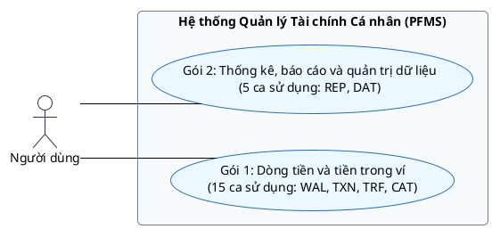
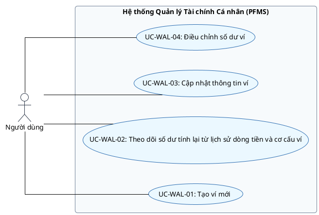
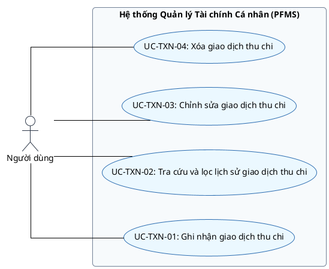
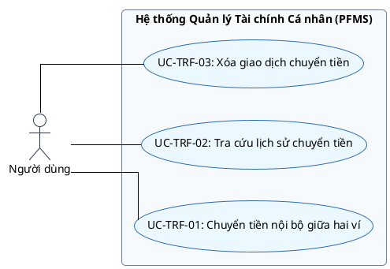
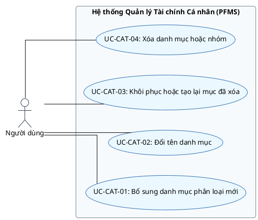
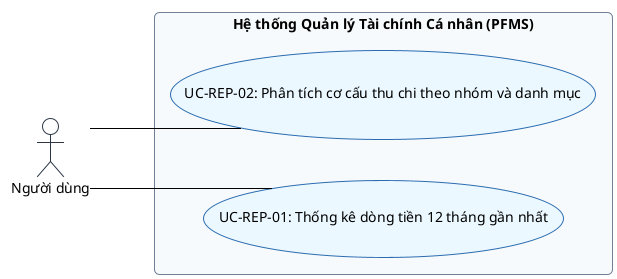
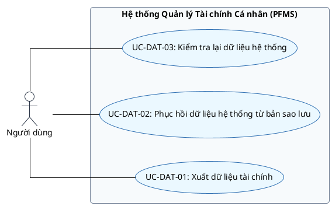

## 7. Sơ đồ ca sử dụng hệ thống

Sơ đồ ca sử dụng thể hiện phạm vi chức năng, tác nhân và mối liên hệ của 20 ca sử dụng trong Hệ thống Quản lý Tài chính Cá nhân (PFMS). Hệ thống được tổ chức phân tầng thành hai cấp độ:

- Tầng 1 (vĩ mô): một sơ đồ tổng quan thể hiện ranh giới hệ thống và hai gói nghiệp vụ lớn.
- Tầng 2 (vi mô): sáu sơ đồ chi tiết bao phủ đủ 20 ca sử dụng, mỗi sơ đồ duy trì dưới 9 phần tử để tối ưu khả năng quan sát.

Ba nguyên tắc thiết kế áp dụng khi xây dựng sơ đồ ca sử dụng:

1. Đặt tên theo dạng động từ + danh từ: mỗi ca sử dụng thể hiện một mục tiêu hoàn chỉnh của Người dùng, không dùng các nút gộp chung mơ hồ.
2. Sử dụng quan hệ đúng ngữ nghĩa: không lạm dụng quan hệ phụ thuộc tuần tự, không biểu diễn các kịch bản rẽ nhánh loại trừ bằng quan hệ mở rộng.
3. Tính nhất quán và khớp nối hai chiều: 20 ca sử dụng trên 7 sơ đồ ánh xạ một-một với hồ sơ đặc tả chi tiết và ma trận truy vết.

Trong cả 7 sơ đồ, toàn bộ ca sử dụng đều do tác nhân Người dùng trực tiếp kích hoạt.

Bảng tổng hợp danh mục sơ đồ ca sử dụng của hệ thống phân bổ theo hai tầng kiến trúc, phạm vi nghiệp vụ và số lượng ca sử dụng tương ứng:

| Tầng | Mục | Tên sơ đồ | Phạm vi | Số UC | Dải mã |
| :---: | :---: | :--- | :--- | :---: | :--- |
| 1 | 7.1 | Tổng quan nhóm chức năng | Toàn hệ thống (2 gói nghiệp vụ) | 20 | `UC-WAL-01` đến `UC-DAT-03` |
| 2 | 7.2.1a | Nhóm Ví | Tài khoản thanh toán và số dư | 4 | `UC-WAL-01` đến `UC-WAL-04` |
| 2 | 7.2.1b | Nhóm Ghi nhận thu chi | Dòng tiền thu nhập và chi tiêu | 4 | `UC-TXN-01` đến `UC-TXN-04` |
| 2 | 7.2.1c | Nhóm Chuyển tiền nội bộ | Chuyển tiền giữa hai ví | 3 | `UC-TRF-01` đến `UC-TRF-03` |
| 2 | 7.2.1d | Nhóm Danh mục phân loại | Cấu trúc phân loại thu chi 3 cấp | 4 | `UC-CAT-01` đến `UC-CAT-04` |
| 2 | 7.2.2a | Nhóm Thống kê và báo cáo | Xu hướng và cơ cấu thu chi | 2 | `UC-REP-01` đến `UC-REP-02` |
| 2 | 7.2.2b | Nhóm Lưu trữ và sao lưu dữ liệu | Sao lưu, phục hồi, kiểm tra dữ liệu | 3 | `UC-DAT-01` đến `UC-DAT-03` |
|  |  | **Tổng cộng: 7 sơ đồ** |  | **20** |  |

### 7.1 Sơ đồ Ca sử dụng tổng quan kiến trúc nhóm chức năng

Sơ đồ tổng quan xác lập khung kiến trúc của hệ thống: Người dùng tương tác với hệ thống thông qua hai ca sử dụng tóm lược, mỗi ca đại diện cho một gói nghiệp vụ độc lập.

Bảng phân loại chi tiết 20 ca sử dụng theo mục tiêu tương tác của Người dùng và các quy tắc nghiệp vụ tài chính chi phối thuộc hai gói chức năng:

| Gói | Mã UC | Mục tiêu của Người dùng | Quy tắc nghiệp vụ |
| --- | :---: | --- | --- |
| **Gói 1:** Dòng tiền và tiền trong ví | `UC-WAL-01` đến `04` | Quản lý các nguồn tiền khả dụng và kiểm soát số dư | Quy tắc độ chính xác tài chính (`BR-FIN-01`), Quy tắc bảo toàn số dư ví (`BR-FIN-02`), Quy tắc tên của ví, nhóm nhu cầu và danh mục (`BR-NAM-01`) |
|  | `UC-TXN-01` đến `04` | Ghi nhận thu nhập, chi tiêu hằng ngày và phân loại theo danh mục | Quy tắc độ chính xác tài chính (`BR-FIN-01`), Quy tắc bảo toàn số dư ví (`BR-FIN-02`), Quy tắc phân cấp danh mục thu chi 3 cấp (`BR-FIN-04`) |
|  | `UC-TRF-01` đến `03` | Chuyển tiền giữa hai ví, tự động trừ ví nguồn và cộng ví đích | Quy tắc độ chính xác tài chính (`BR-FIN-01`), Quy tắc bảo toàn số dư ví (`BR-FIN-02`), Quy tắc ghi nhận đồng thời khi chuyển tiền nội bộ (`BR-FIN-03`) |
|  | `UC-CAT-01` đến `04` | Thiết lập cấu trúc danh mục 3 cấp phục vụ thống kê | Quy tắc phân cấp danh mục thu chi 3 cấp (`BR-FIN-04`), Quy tắc tên của ví, nhóm nhu cầu và danh mục (`BR-NAM-01`) |
| **Gói 2:** Thống kê, báo cáo và quản trị dữ liệu | `UC-REP-01` đến `02` | Theo dõi dòng tiền 12 tháng gần nhất và phân tích cơ cấu chi tiêu | Quy tắc độ chính xác tài chính (`BR-FIN-01`), Quy tắc phân cấp danh mục thu chi 3 cấp (`BR-FIN-04`) |
|  | `UC-DAT-01` đến `03` | Xuất dữ liệu, phục hồi bản sao lưu và kiểm tra tính toàn vẹn hệ thống | Quy tắc độ chính xác tài chính (`BR-FIN-01`) đến Quy tắc phân cấp danh mục thu chi 3 cấp (`BR-FIN-04`) |

### 7.2 Sơ đồ Ca sử dụng chi tiết theo 2 nhóm chức năng nghiệp vụ

#### 7.2.1 Nhóm chức năng Dòng tiền và Tiền trong ví

Nhóm chức năng này gồm các ca sử dụng, được phân rã thành bốn sơ đồ chi tiết: ví, ghi nhận thu chi, chuyển tiền nội bộ (cơ chế ghi nhận đồng thời: trừ ví nguồn, cộng ví đích) và danh mục phân loại.

##### 7.2.1a Nhóm Ví (WAL)

- `UC-WAL-01`: Tạo ví mới với số dư ban đầu 0.00 VNĐ.
- `UC-WAL-02`: Xem số dư khả dụng theo thời gian thực và tỷ lệ cơ cấu phân bổ giữa các ví.
- `UC-WAL-03`: Sửa thuộc tính ví; chuyển ví sang trạng thái lưu trữ là luồng rẽ nhánh hợp lệ.
- `UC-WAL-04`: Ghi nhận khoản điều chỉnh có dấu vết khi số dư thực tế lệch so với số dư hệ thống.

Quy tắc nghiệp vụ chi phối: số tiền dùng số thập phân chính xác theo Quy tắc độ chính xác tài chính (`BR-FIN-01`); số dư ví luôn không âm theo Quy tắc bảo toàn số dư ví (`BR-FIN-02`); tên ví hợp lệ và duy nhất theo Quy tắc tên của ví, nhóm nhu cầu và danh mục (`BR-NAM-01`).

##### 7.2.1b Nhóm Ghi nhận thu chi (TXN)

- `UC-TXN-01`: Ghi nhận giao dịch thu nhập hoặc chi tiêu, kèm chi phí liên kết (nếu có) và gán danh mục 3 cấp.
- `UC-TXN-02`: Tra cứu và lọc lịch sử giao dịch theo khoảng thời gian, ví và danh mục.
- `UC-TXN-03`: Chỉnh sửa giao dịch thu chi, tự động hoàn nguyên ví cũ trước khi áp dụng ví mới và cập nhật phí liên kết.
- `UC-TXN-04`: Xóa giao dịch cùng phí liên kết và hoàn nguyên số dư ví liên quan.

Quy tắc nghiệp vụ chi phối: số thập phân chính xác theo Quy tắc độ chính xác tài chính (`BR-FIN-01`); hoàn nguyên giao dịch bảo toàn số dư ví theo Quy tắc bảo toàn số dư ví (`BR-FIN-02`); phân cấp danh mục thu chi 3 cấp theo Quy tắc phân cấp danh mục thu chi 3 cấp (`BR-FIN-04`).

##### 7.2.1c Nhóm Chuyển tiền nội bộ (TRF)

- `UC-TRF-01`: Chuyển tiền giữa hai ví nội bộ; chi phí chuyển tiền (nếu có) được ghi nhận thành phí liên kết trong cùng giao dịch.
- `UC-TRF-02`: Tra cứu lịch sử các giao dịch chuyển tiền nội bộ đã thực hiện.
- `UC-TRF-03`: Xóa giao dịch chuyển tiền cùng phí liên kết, tự động hoàn nguyên số dư cho cả hai ví.

Quy tắc nghiệp vụ chi phối:
- Quy tắc độ chính xác tài chính (`BR-FIN-01`): dùng số thập phân chính xác cho số tiền chuyển và phí giao dịch (chi phối `UC-TRF-01`).
- Quy tắc bảo toàn số dư ví (`BR-FIN-02`): số dư ví luôn không âm và tính lại từ lịch sử dòng tiền (chi phối cả 3 ca).
- Quy tắc ghi nhận đồng thời khi chuyển tiền nội bộ (`BR-FIN-03`): ghi nhận đồng thời giữa hai ví; bảo toàn tổng số dư hệ thống trừ chi phí chuyển tiền; tự động hoàn phí liên kết khi xóa giao dịch (chi phối cả 3 ca).

##### 7.2.1d Nhóm Danh mục phân loại (CAT)

Nhóm chức năng này quản lý cấu trúc danh mục 3 cấp: loại thu chi -> nhóm nhu cầu -> danh mục chi tiết.

- `UC-CAT-01`: Bổ sung nhóm hoặc danh mục mới trong cấu trúc phân cấp 3 cấp.
- `UC-CAT-02`: Đổi tên hiển thị của nhóm hoặc danh mục, và chuyển danh mục sang nhóm khác cùng loại thu chi.
- `UC-CAT-03`: Khôi phục nhóm hoặc danh mục đã ẩn (giữ nguyên liên kết lịch sử) hoặc tạo mục mới.
- `UC-CAT-04`: Xóa vĩnh viễn mục chưa có giao dịch; ẩn mục đã phát sinh giao dịch để bảo toàn dữ liệu lịch sử.

Quy tắc nghiệp vụ chi phối: mỗi danh mục thuộc đúng một nhóm cha theo Quy tắc phân cấp danh mục thu chi 3 cấp (`BR-FIN-04`); tên nhóm và danh mục hợp lệ, không trùng lặp trong cùng phạm vi theo Quy tắc tên của ví, nhóm nhu cầu và danh mục (`BR-NAM-01`).

#### 7.2.2 Nhóm chức năng Thống kê, Báo cáo và Quản trị dữ liệu

Nhóm chức năng này gồm 5 ca sử dụng, được phân rã thành hai sơ đồ chi tiết: thống kê phân tích dòng tiền và sao lưu, phục hồi, kiểm tra toàn vẹn dữ liệu theo `FR-DAT-03`.

##### 7.2.2a Nhóm Thống kê và báo cáo (REP)

- `UC-REP-01`: Thống kê xu hướng dòng tiền 12 tháng liên tục gần nhất.
- `UC-REP-02`: Phân tích tỷ lệ cơ cấu thu chi theo nhóm nhu cầu và danh mục chi tiết.

Quy tắc nghiệp vụ chi phối: Quy tắc độ chính xác tài chính (`BR-FIN-01`) chi phối cả hai ca sử dụng; Quy tắc phân cấp danh mục thu chi 3 cấp (`BR-FIN-04`) chi phối `UC-REP-02`.

Yêu cầu chức năng liên quan:
- `FR-REP-01`: thống kê chuỗi 12 tháng liên tục từ mốc chỉ định; tỷ lệ tiết kiệm bằng 0.00% khi tổng thu nhập không dương.
- `FR-REP-02`: phân tích cơ cấu chi tiêu theo nhóm và danh mục; danh mục đã xóa vẫn hiển thị đầy đủ kèm nhãn trạng thái.

##### 7.2.2b Nhóm Lưu trữ và sao lưu dữ liệu (DAT)

Nhóm chức năng này xuất dữ liệu tài chính, phục hồi từ bản sao lưu và kiểm tra độc lập các quy tắc toàn vẹn hệ thống.

- `UC-DAT-01`: Xuất toàn bộ dữ liệu tài chính ra tệp JSON chuẩn hóa.
- `UC-DAT-02`: Phục hồi dữ liệu từ tệp sao lưu qua quy trình kiểm tra 4 bước và tự động sao lưu trước khi thay thế.
- `UC-DAT-03`: Kiểm tra độc lập 4 điều kiện toàn vẹn hệ thống theo yêu cầu của Người dùng.

Quy tắc nghiệp vụ chi phối:
- Quy tắc độ chính xác tài chính (`BR-FIN-01`): bảo đảm độ chính xác số học khi xuất tệp (chi phối `UC-DAT-01`).
- Quy tắc bảo toàn số dư ví (`BR-FIN-02`): bảo toàn số dư ví không âm và tính lại từ lịch sử dòng tiền (chi phối `UC-DAT-02`, `UC-DAT-03`).
- Quy tắc ghi nhận đồng thời khi chuyển tiền nội bộ (`BR-FIN-03`): cân bằng nguồn - đích khi chuyển tiền nội bộ (chi phối `UC-DAT-03`).
- Quy tắc phân cấp danh mục thu chi 3 cấp (`BR-FIN-04`): kiểm soát tính hợp lệ của cây danh mục 3 cấp (chi phối `UC-DAT-02`, `UC-DAT-03`).

Yêu cầu chức năng liên quan:
- `FR-DAT-01`: xuất dữ liệu ra tệp JSON, giữ nguyên độ chính xác số học thập phân.
- `FR-DAT-02`: quy trình kiểm tra 4 bước khi nạp dữ liệu, tự động sao lưu trước khi thay thế và tự hoàn nguyên nếu lỗi.
- `FR-DAT-03`: thuật toán quét độc lập kiểm tra 4 điều kiện toàn vẹn: số dư ví, cân bằng chuyển tiền, liên kết danh mục và liên kết phí chuyển tiền.
