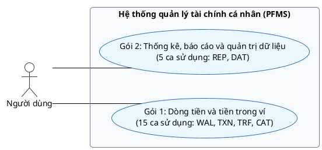
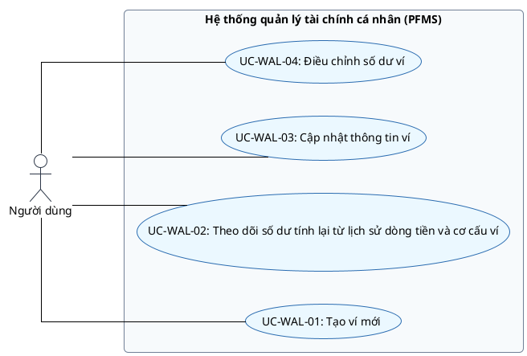
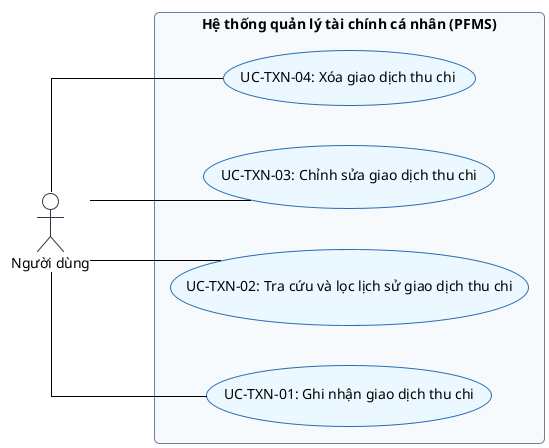
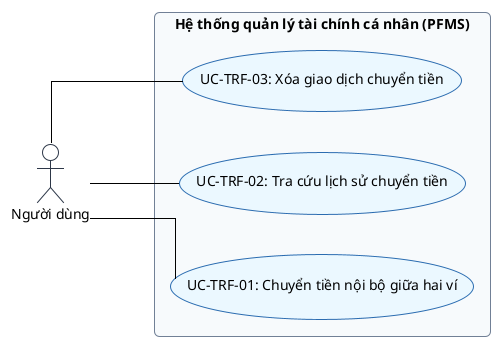
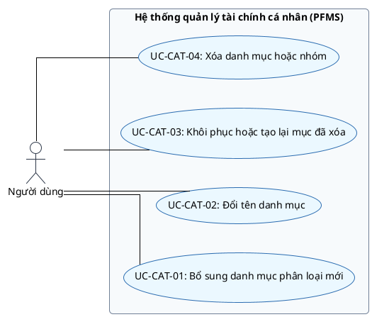
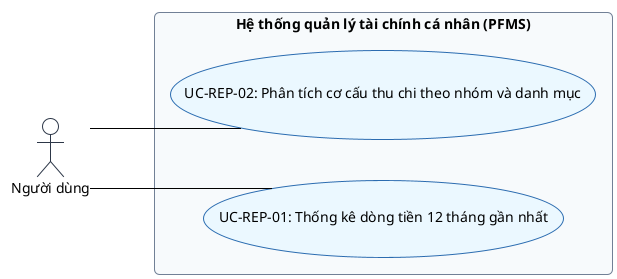
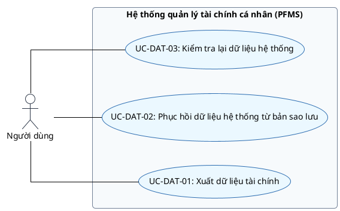

## 7. Sơ đồ ca sử dụng hệ thống

Sơ đồ ca sử dụng cho thấy phạm vi chức năng, tác nhân và mối liên hệ của 20 ca sử dụng trong Hệ thống quản lý tài chính cá nhân (PFMS), theo chuẩn UML 2.5 (ISO/IEC 19505) và cẩm nang IREB CPRE. Hệ thống được chia thành hai tầng:

- **Tầng 1 (vĩ mô):** một sơ đồ tổng quan thể hiện ranh giới hệ thống và hai gói nghiệp vụ lớn.
- **Tầng 2 (vi mô):** sáu sơ đồ chi tiết bao phủ đủ 20 ca sử dụng, mỗi sơ đồ không quá 9 nút để dễ đọc.

Ba nguyên tắc áp dụng khi vẽ sơ đồ:

1. **Đặt tên theo dạng Động từ + Danh từ:** mỗi ca sử dụng là một mục tiêu trọn vẹn của người dùng, không dùng các nút gộp kiểu "Quản lý X".
2. **Dùng quan hệ đúng ngữ nghĩa:** không lạm dụng quan hệ phụ thuộc tuần tự, và các kịch bản rẽ nhánh loại trừ nhau không được biểu diễn bằng quan hệ mở rộng.
3. **Khớp hai chiều:** 20 ca sử dụng trên 7 sơ đồ ánh xạ một-một với các ca sử dụng chi tiết ở Mục 6 và ma trận truy vết ở Mục 8, không có ca sử dụng "ma".

Trong cả 7 sơ đồ, mọi ca sử dụng đều do Người dùng trực tiếp khởi động.

| Tầng | Mục | Tên sơ đồ | Phạm vi | Số UC | Dải mã |
| :---: | :---: | :--- | :--- | :---: | :--- |
| 1 | 7.1 | Tổng quan nhóm chức năng | Toàn hệ thống (2 gói nghiệp vụ) | 20 | `UC-WAL-01` đến `UC-DAT-03` |
| 2 | 7.2.1a | Nhóm Ví | Tài khoản thanh toán và số dư | 4 | `UC-WAL-01` đến `UC-WAL-04` |
| 2 | 7.2.1b | Nhóm Ghi nhận thu chi | Dòng tiền thu nhập và chi tiêu | 4 | `UC-TXN-01` đến `UC-TXN-04` |
| 2 | 7.2.1c | Nhóm Chuyển tiền nội bộ | Chuyển tiền giữa hai ví | 3 | `UC-TRF-01` đến `UC-TRF-03` |
| 2 | 7.2.1d | Nhóm Danh mục phân loại | Cấu trúc phân loại thu chi 3 cấp | 4 | `UC-CAT-01` đến `UC-CAT-04` |
| 2 | 7.2.2a | Nhóm Thống kê và báo cáo | Xu hướng và cơ cấu thu chi | 2 | `UC-REP-01` đến `UC-REP-02` |
| 2 | 7.2.2b | Nhóm Lưu trữ và sao lưu dữ liệu | Sao lưu, phục hồi, kiểm tra dữ liệu | 3 | `UC-DAT-01` đến `UC-DAT-03` |
| | | **Tổng cộng: 7 sơ đồ** | | **20** | |

### 7.1 Sơ đồ tổng quan nhóm chức năng

Sơ đồ này xác lập khung kiến trúc của PFMS: Người dùng tương tác với hệ thống thông qua hai ca sử dụng tóm lược, mỗi ca đại diện cho một gói nghiệp vụ.

**Phân loại 20 ca sử dụng theo mục tiêu của Người dùng**

| Gói | Mã UC | Mục tiêu của Người dùng | Quy tắc nghiệp vụ |
| --- | :---: | --- | --- |
| **Gói 1:** Dòng tiền và tiền trong ví | `UC-WAL-01` đến `04` | Giữ các nguồn tiền dùng được ngay và kiểm soát số dư | `BR-FIN-01`, `BR-FIN-02`, `BR-NAM-01` |
| | `UC-TXN-01` đến `04` | Nhập thu nhập, chi tiêu hằng ngày và gán nhãn phân loại | `BR-FIN-01`, `BR-FIN-02`, `BR-FIN-04` |
| | `UC-TRF-01` đến `03` | Chuyển tiền giữa hai ví, tự động trừ ví nguồn và cộng ví đích | `BR-FIN-01`, `BR-FIN-02`, `BR-FIN-03` |
| | `UC-CAT-01` đến `04` | Xây cấu trúc danh mục 3 cấp phục vụ thống kê | `BR-FIN-04`, `BR-NAM-01` |
| **Gói 2:** Thống kê, báo cáo và quản trị dữ liệu | `UC-REP-01` đến `02` | Xem dòng tiền 12 tháng gần nhất và cơ cấu thu chi | `BR-FIN-01`, `BR-FIN-04` |
| | `UC-DAT-01` đến `03` | Sao lưu dữ liệu về máy, phục hồi từ tệp sao lưu và kiểm tra để dữ liệu không bị sai lệch | `BR-FIN-01` đến `BR-FIN-04` |

### 7.2 Sơ đồ chi tiết theo hai nhóm chức năng

#### 7.2.1 Nhóm Dòng tiền và tiền trong ví

Nhóm này gồm 15 ca sử dụng, chia thành bốn sơ đồ: ví, ghi nhận thu chi, chuyển tiền nội bộ (ghi nhận đồng thời: trừ ví nguồn, cộng ví đích) và danh mục.

##### 7.2.1a Nhóm Ví (WAL)

- `UC-WAL-01`: Tạo ví mới với số dư 0.00.
- `UC-WAL-02`: Xem số dư khả dụng theo thời gian thực và tỷ lệ chia tiền giữa các ví.
- `UC-WAL-03`: Sửa thuộc tính ví. Việc chuyển sang trạng thái lưu trữ là một luồng thay thế của ca này.
- `UC-WAL-04`: Ghi nhận khoản điều chỉnh có thể truy vết khi số dư thực tế lệch so với số dư trong hệ thống.
- **Quy tắc:** số tiền dùng kiểu thập phân chính xác, cố định (`BR-FIN-01`); số dư ví luôn không âm (`BR-FIN-02`); tên ví hợp lệ và duy nhất (`BR-NAM-01`).

##### 7.2.1b Nhóm Ghi nhận thu chi (TXN)

- `UC-TXN-01`: Nhập giao dịch thu nhập hoặc chi tiêu, kèm chi phí (nếu có) và gán danh mục chuẩn.
- `UC-TXN-02`: Tra cứu giao dịch theo khoảng thời gian, ví và danh mục.
- `UC-TXN-03`: Sửa số tiền, chi phí, danh mục hoặc ghi chú. Ca này hoàn nguyên số dư ví trước khi ghi lại, đồng thời tạo, cập nhật hoặc xóa phí giao dịch liên kết theo chi phí mới.
- `UC-TXN-04`: Xóa giao dịch cùng phí liên kết và hoàn nguyên số dư ví liên quan.
- **Quy tắc:** số thập phân chính xác (`BR-FIN-01`); hoàn nguyên giao dịch phải giữ đúng số dư ví (`BR-FIN-02`); mỗi danh mục liên kết với nhóm cha trong cấu trúc 3 cấp (`BR-FIN-04`).

##### 7.2.1c Nhóm Chuyển tiền nội bộ (TRF)

- `UC-TRF-01`: Chuyển tiền từ ví nguồn sang ví đích. Phí chuyển tiền (nếu có) được ghi riêng thành phí giao dịch liên kết ngay trong luồng chính.
- `UC-TRF-02`: Tra cứu các giao dịch chuyển tiền đã thực hiện.
- `UC-TRF-03`: Xóa giao dịch chuyển tiền cùng phí liên kết, hoàn nguyên số dư cả hai ví.
- **Quy tắc:**
  - `BR-FIN-01`: dùng số thập phân chính xác cho số tiền chuyển và phí (chi phối `UC-TRF-01`).
  - `BR-FIN-02`: số dư ví luôn không âm và luôn tính đúng từ lịch sử dòng tiền (chi phối cả 3 ca).
  - `BR-FIN-03`: ghi nhận đồng thời khi chuyển tiền. Tổng số dư các ví được bảo toàn, trừ phần phí. Khi xóa chuyển tiền, phí liên kết bị xóa theo nên số dư ví nguồn tự được hoàn phí khi tính lại (chi phối cả 3 ca).

##### 7.2.1d Nhóm Danh mục phân loại (CAT)

Nhóm này quản lý cấu trúc danh mục 3 cấp: loại thu chi → nhóm nhu cầu → danh mục chi tiết.

- `UC-CAT-01`: Tạo mới nhóm hoặc danh mục trong cấu trúc 3 cấp.
- `UC-CAT-02`: Đổi tên hiển thị của nhóm hoặc danh mục, và chuyển danh mục sang nhóm khác cùng loại thu chi.
- `UC-CAT-03`: Lấy lại nhóm hoặc danh mục đã xóa (giữ lịch sử cũ) hoặc tạo mới.
- `UC-CAT-04`: Xóa hẳn mục chưa có giao dịch; nếu đã có giao dịch thì chỉ chuyển sang trạng thái "đã xóa" để giữ lại giao dịch.
- **Quy tắc:** mỗi danh mục thuộc đúng một nhóm cha (`BR-FIN-04`); tên nhóm và danh mục hợp lệ, không trùng (`BR-NAM-01`).

#### 7.2.2 Nhóm Thống kê, báo cáo và quản trị dữ liệu

Nhóm này gồm 5 ca sử dụng, chia thành hai sơ đồ: thống kê phân tích xu hướng tài chính, và sao lưu, phục hồi, kiểm tra tính toàn vẹn dữ liệu theo `FR-DAT-03`.

##### 7.2.2a Nhóm Thống kê và báo cáo (REP)

- `UC-REP-01`: Thống kê dòng tiền 12 tháng gần nhất.
- `UC-REP-02`: Phân tích cơ cấu thu chi theo nhóm và danh mục.
- **Quy tắc:** `BR-FIN-01` (độ chính xác tài chính) chi phối cả hai ca; `BR-FIN-04` (phân cấp danh mục 3 cấp) chi phối `UC-REP-02`.
- **Yêu cầu chức năng liên quan:**
  - `FR-REP-01`: chuỗi 12 tháng liên tục tính từ một mốc chỉ định; tỷ lệ tiết kiệm bằng 0.00 khi tổng thu nhập tháng không dương.
  - `FR-REP-02`: phân tích cơ cấu chi tiêu theo nhóm và danh mục, danh mục đã xóa vẫn hiển thị kèm nhãn tương ứng.

##### 7.2.2b Nhóm Lưu trữ và sao lưu dữ liệu (DAT)

Nhóm này xuất dữ liệu ra tệp sao lưu, phục hồi từ tệp sao lưu, và kiểm tra độc lập các quy tắc `BR-FIN-02`, `BR-FIN-03`, `BR-FIN-04`.

- `UC-DAT-01`: Xuất dữ liệu tài chính.
- `UC-DAT-02`: Phục hồi dữ liệu từ bản sao lưu. Ca này tự áp dụng quy trình kiểm tra 4 bước trước khi hoàn tất thay thế dữ liệu.
- `UC-DAT-03`: Kiểm tra lại dữ liệu hệ thống. Ca này chạy độc lập, theo nhu cầu của Người dùng.
- **Quy tắc:**
  - `BR-FIN-01`: độ chính xác tài chính (chi phối `UC-DAT-01`).
  - `BR-FIN-02`: bảo toàn số dư ví (chi phối `UC-DAT-02`, `UC-DAT-03`).
  - `BR-FIN-03`: ghi nhận đồng thời khi chuyển tiền nội bộ (chi phối `UC-DAT-03`).
  - `BR-FIN-04`: phân cấp danh mục 3 cấp (chi phối `UC-DAT-02`, `UC-DAT-03`).
- **Yêu cầu chức năng liên quan:**
  - `FR-DAT-01`: xuất dữ liệu ra tệp JSON, giữ nguyên độ chính xác số học.
  - `FR-DAT-02`: kiểm tra 4 bước khi nhập dữ liệu, tự hoàn nguyên nếu có lỗi.
  - `FR-DAT-03`: kiểm tra độc lập 4 điều kiện toàn vẹn: số dư ví, cân bằng nguồn - đích khi chuyển tiền, liên kết danh mục và liên kết phí chuyển tiền.