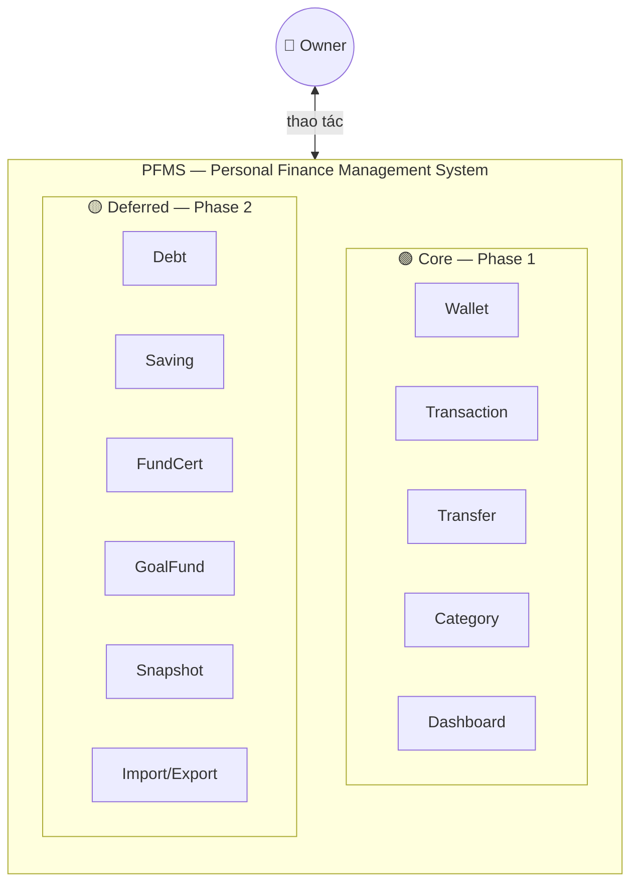
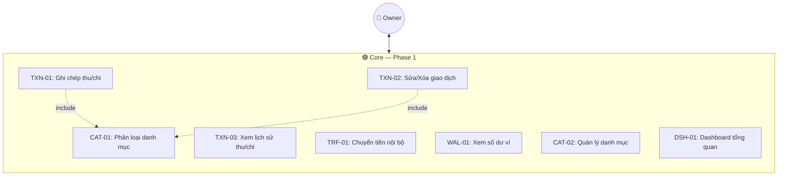
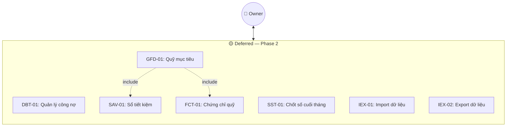

# **Personal Finance Management**

## Mục lục
1. [Giới thiệu](#1-giới-thiệu)
2. [Mô tả tổng quan hệ thống](#2-mô-tả-tổng-quan-hệ-thống)
3. [Thuật ngữ & định nghĩa](#3-thuật-ngữ--định-nghĩa)
4. [Yêu cầu chức năng (FR)](#4-yêu-cầu-chức-năng-fr)
5. [Yêu cầu phi chức năng (NFR)](#5-yêu-cầu-phi-chức-năng-nfr)
6. [Đặc tả Use Case](#6-đặc-tả-use-case)
7. [Phụ lục — Sơ đồ Use Case](#7-phụ-lục--sơ-đồ-use-case)

---

## 1. Giới thiệu

### 1.1 Mục đích
Tài liệu này đặc tả các yêu cầu chức năng và phi chức năng của hệ thống **Quản lý tài chính cá nhân** — một ứng dụng Desktop giúp người dùng quản lý ví tiền, giao dịch thu/chi, chuyển khoản, công nợ, sổ tiết kiệm, chứng chỉ quỹ đầu tư và các quỹ mục tiêu cá nhân. Hệ thống được chuyển hóa từ mô hình dữ liệu của file Excel `finance-mng.xlsm`.

### 1.2 Phạm vi hệ thống
Hệ thống phát triển theo 2 giai đoạn:

| Giai đoạn | Phạm vi | Nội dung |
|---|---|---|
| **`Core`** | Làm & code trước | Ghi chép & phân loại thu/chi; Thống kê số tiền trong ví; Lịch sử thu/chi; Chuyển tiền nội bộ |
| **`Deferred`** | Làm sau khi Core hoàn thiện | Công nợ · Sổ tiết kiệm · Chứng chỉ quỹ · Quỹ mục tiêu · Chốt tháng · Import/Export |

### 1.3 Đối tượng sử dụng
Người dùng cá nhân (1 người dùng — Owner). **Không** có đăng nhập/phân quyền.

---

## 2. Mô tả tổng quan hệ thống

### 2.1 Bối cảnh hệ thống
Hệ thống quản lý dữ liệu tài chính của một cá nhân, hỗ trợ nhiều ví, nhiều loại tài sản và báo cáo tổng hợp. Dữ liệu lưu cục bộ, single-user.

### 2.2 Mục tiêu hệ thống (System Goals)
1. **Quản lý dòng tiền:** ghi chép, phân loại và theo dõi thu/chi theo danh mục 3 cấp (type → group → category).
2. **Nắm bắt tình hình tài sản:** tính toán số dư từng ví và tổng tài sản theo thời gian thực.
3. **Hỗ trợ ra quyết định:** cung cấp dashboard tổng quan với biểu đồ cơ cấu tài sản, thu/chi theo tháng và dòng tiền.
4. **Quản lý mục tiêu tài chính:** theo dõi tiến độ các quỹ mục tiêu (khẩn cấp, sức khỏe, mục tiêu, hưu trí).
5. **Đảm bảo độ chính xác tài chính:** mọi phép tính tiền dùng `BigDecimal`, không dùng số thực dấu chấm động.

### 2.3 Giả định (Assumptions)
- Hệ thống là **single-user**: chỉ có một người dùng là Owner, **không** có đăng nhập/phân quyền.
- Dữ liệu **lưu cục bộ** (database nhúng, ví dụ H2); **không** đồng bộ lên cloud/đa thiết bị.
- Danh mục phân loại cố định **3 cấp**: `type` → `group` → `category`.
- Mọi số tiền, lãi suất, số dư đều là `BigDecimal` (2 số thập phân).
- Người dùng có thể import dữ liệu từ file Excel nguồn `finance-mng.xlsm` hoặc template CSV.
- Lãi suất tính theo quy ước: tiết kiệm không kỳ hạn = lãi đơn `capital*rate/365`; có kỳ hạn theo số ngày thực gửi; chứng chỉ quỹ dùng hàm `RATE()`.

### 2.4 Ràng buộc (Constraints)
- **Nền tảng:** Desktop **Java 17+** với **JavaFX** (FXML, SceneBuilder); đóng gói `.exe` bằng `jpackage`.
- **Kiến trúc:** phân tầng View (JavaFX/FXML) / Controller / Model / Service / Repository; tuân thủ OOP, SOLID.
- **Không** có yêu cầu đăng nhập, cloud sync, bản Web hoặc bản Mobile.
- **Dữ liệu lịch sử:** hỗ trợ đối chiếu với kết quả của file Excel gốc.

### 2.5 Actor
Hệ thống chỉ có **một actor duy nhất**:

| Actor | Mô tả |
|---|---|
| **Owner** (Người dùng) | Chủ sở hữu tài chính cá nhân, thực hiện mọi thao tác: nhập thu/chi, chuyển khoản, quản lý tài sản, xem báo cáo. |

> **Ghi chú:** Vì hệ thống chỉ hướng tới một đối tượng duy nhất, sơ đồ Use Case không thể hiện mối quan hệ "nối từng UC vào actor". Thay vào đó, sơ đồ tập trung vào **quan hệ giữa các use case** (include / extend / generalization) và **phân nhóm theo module**, phân tầng `Core` / `Deferred`. Xem mục 7.

### 2.6 Phạm vi (In / Out)

| Nhãn | Nghĩa | Nội dung |
|---|---|---|
| **`Core`** | Làm & code trước | Như mục 1.2 |
| **`Deferred`** | Thuộc dự án, làm sau | Như mục 1.2 |
| **`Out`** | Không thuộc dự án này | Đăng nhập/phân quyền · Cloud sync · Bản Web · Bản Mobile · Đồng bộ đa thiết bị |

---

## 3. Thuật ngữ & định nghĩa (Glossary)

| Thuật ngữ (EN) | Tiếng Việt | Mô tả |
|---|---|---|
| `Wallet` / `Account` | Ví / Tài khoản | Nơi lưu tiền: cash, mb bank, timo, vietcombank, msb, shopee pay |
| `Transaction` | Giao dịch | Thu/chi tiền, ghi nhận ngày, số tiền, ví, danh mục |
| `Transfer` | Chuyển khoản | Chuyển tiền nội bộ giữa 2 ví (không tính thu/chi) |
| `Income` / `Expense` | Thu nhập / Chi tiêu | 2 loại giao dịch chính |
| `Category` | Danh mục | Phân loại 3 cấp: `type` → `group` → `category` |
| `Debt` | Công nợ | Cho vay (`lend`) / đi vay (`borrow`), thu (`collect`), trả (`repay`), xóa (`write-off`) |
| `Receivable` / `Payable` | Phải thu / Phải trả | Công nợ tổng hợp |
| `Saving` | Sổ tiết kiệm | Gửi tiết kiệm kỳ hạn / không kỳ hạn, có lãi |
| `FundCertificate` | Chứng chỉ quỹ | Đầu tư: stock / bond / balance |
| `Goal Fund` | Quỹ mục tiêu | Emergency, Health, Target, Retirement |
| `Snapshot` | Chốt số tháng | Đóng băng số liệu cuối tháng (audit trail) |
| `Cash Flow` | Dòng tiền | Income − Expense trong 1 kỳ |

---

## 4. Yêu cầu chức năng (FR)

**Quy ước:** `FR-<nhóm>-<số>` · MoSCoW: Must/Should/Could · Scope: `Core`/`Deferred`

### 4.1 Wallet
| ID | Yêu cầu | MoSCoW | Scope |
|---|---|---|---|
| `FR-WAL-01` | Hiển thị danh sách ví & số dư từng ví | Must | Core |
| `FR-WAL-02` | Số dư ví = Σ(transactions) ± Σ(transfers) ± Σ(debt flows) | Must | Core |
| `FR-WAL-03` | Hiển thị tỷ trọng (%) từng ví | Should | Core |
| `FR-WAL-04` | Tạo / chỉnh sửa ví | Could | Deferred |

### 4.2 Transaction
| ID | Yêu cầu | MoSCoW | Scope |
|---|---|---|---|
| `FR-TXN-01` | Thêm giao dịch (date, amount, wallet, type, group, category) | Must | Core |
| `FR-TXN-02` | Số tiền dùng `BigDecimal`, dương=thu, âm=chi | Must | Core |
| `FR-TXN-03` | Sửa / xóa giao dịch | Must | Core |
| `FR-TXN-04` | Xem lịch sử, lọc theo ngày/thời gian/nhóm/danh mục | Must | Core |
| `FR-TXN-05` | Cột type/group/category là dropdown động | Must | Core |

### 4.3 Transfer
| ID | Yêu cầu | MoSCoW | Scope |
|---|---|---|---|
| `FR-TRF-01` | Chuyển tiền giữa 2 ví (date, amount, from, to) | Must | Core |
| `FR-TRF-02` | Không tính là thu/chi, chỉ cập nhật số dư | Must | Core |
| `FR-TRF-03` | Ngăn chuyển khi số dư ví nguồn không đủ | Should | Core |

### 4.4 Category
| ID | Yêu cầu | MoSCoW | Scope |
|---|---|---|---|
| `FR-CAT-01` | Phân cấp 3 cấp type → group → category | Must | Core |
| `FR-CAT-02` | Định nghĩa group cho income & expense | Must | Core |
| `FR-CAT-03` | Lọc group/category theo type/group đã chọn | Must | Core |
| `FR-CAT-04` | Thêm/sửa/xóa danh mục | Could | Core |

### 4.5 Dashboard
| ID | Yêu cầu | MoSCoW | Scope |
|---|---|---|---|
| `FR-DSH-01` | Tổng tài sản = wallets + savings + investments + receivable − payable | Must | Core |
| `FR-DSH-02` | Biểu đồ cơ cấu tài sản, ví, quỹ | Should | Core |
| `FR-DSH-03` | Thu/chi theo tháng (income, expense, cash flow, savings rate) | Should | Core |
| `FR-DSH-04` | Biểu đồ thu/chi theo nhóm & danh mục | Should | Core |
| `FR-DSH-05` | Bảng thống kê 12 tháng gần nhất | Could | Core |

### 4.6 Debt (Deferred)
| ID | Yêu cầu | MoSCoW | Scope |
|---|---|---|---|
| `FR-DBT-01` | Ghi nhận lend/borrow/collect/repay/write-off | Must | Deferred |
| `FR-DBT-02` | receivable = lend − collect − write-off lend; payable = borrow − repay − write-off borrow | Must | Deferred |
| `FR-DBT-03` | Sao kê công nợ theo người | Should | Deferred |
| `FR-DBT-04` | Cập nhật số dư ví khi có nghiệp vụ công nợ | Must | Deferred |

### 4.7 Saving (Deferred)
| ID | Yêu cầu | MoSCoW | Scope |
|---|---|---|---|
| `FR-SAV-01` | Quản lý sổ tiết kiệm (fund, principal, term, rate, start) | Must | Deferred |
| `FR-SAV-02` | Tính số dư: kỳ hạn cố định vs unlimited | Must | Deferred |
| `FR-SAV-03` | Hiển thị tiến độ kỳ hạn (process) | Should | Deferred |

### 4.8 FundCert (Deferred)
| ID | Yêu cầu | MoSCoW | Scope |
|---|---|---|---|
| `FR-FCT-01` | Quản lý chứng chỉ quỹ (fund, name, type, principal, start) | Must | Deferred |
| `FR-FCT-02` | Nhập giá trị hiện tại (balance) theo giá thị trường | Must | Deferred |
| `FR-FCT-03` | Tính suất sinh lời năm (annualized return) bằng RATE() | Must | Deferred |
| `FR-FCT-04` | Hiển thị lãi/lỗ = balance − principal | Should | Deferred |

### 4.9 GoalFund (Deferred)
| ID | Yêu cầu | MoSCoW | Scope |
|---|---|---|---|
| `FR-GFD-01` | Quỹ = cash + saving + fund_cert | Must | Deferred |
| `FR-GFD-02` | Hiển thị total, target, tiến độ % | Must | Deferred |
| `FR-GFD-03` | Phân bổ tiền mặt vào quỹ (funds_cash) | Should | Deferred |

### 4.10 Snapshot (Deferred)
| ID | Yêu cầu | MoSCoW | Scope |
|---|---|---|---|
| `FR-SST-01` | Thêm dòng tháng mới cho assets_total & fund_performance | Must | Deferred |
| `FR-SST-02` | Chuyển formula → value (đóng băng) | Must | Deferred |
| `FR-SST-03` | Hiển thị chuỗi thời gian tổng tài sản theo tháng | Should | Deferred |

### 4.11 Import/Export (Deferred)
| ID | Yêu cầu | MoSCoW | Scope |
|---|---|---|---|
| `FR-IEX-01` | Import từ Excel/CSV | Must | Deferred |
| `FR-IEX-02` | Export dữ liệu & báo cáo | Should | Deferred |
| `FR-IEX-03` | Validate dữ liệu trước khi import | Must | Deferred |

---

## 5. Yêu cầu phi chức năng (NFR)

**Quy ước:** `NFR-<loại>-<số>`

### 5.1 Hiệu năng (Performance)
| ID | Yêu cầu |
|---|---|
| `NFR-PERF-01` | Thao tác thêm/sửa/xóa giao dịch phản hồi < 1s |
| `NFR-PERF-02` | Mở dashboard với ≥ 5.000 giao dịch < 3s |
| `NFR-PERF-03` | Import 1.000+ giao dịch < 10s |

### 5.2 Bảo mật (Security)
| ID | Yêu cầu |
|---|---|
| `NFR-SEC-01` | Dữ liệu lưu cục bộ, không gửi lên server ngoài |
| `NFR-SEC-02` | Có thể mã hóa dữ liệu lưu (tùy chọn) |
| `NFR-SEC-03` | Single-user, không đăng nhập |

### 5.3 Độ chính xác tài chính (Financial Accuracy) — QUAN TRỌNG
| ID | Yêu cầu |
|---|---|
| `NFR-FIN-01` | **Bắt buộc dùng `BigDecimal`** cho mọi số tiền, lãi suất, số dư — KHÔNG dùng `double`/`float` |
| `NFR-FIN-02` | Kết quả tính toán khớp với file Excel (đối chiếu dữ liệu) |
| `NFR-FIN-03` | Làm tròn đến 2 số thập phân (quy tắc kinh doanh) |
| `NFR-FIN-04` | Nhất quán số dư ví: mọi giao dịch cập nhật chính xác |

### 5.4 Khả năng bảo trì (Maintainability)
| ID | Yêu cầu |
|---|---|
| `NFR-MNT-01` | Tuân thủ 4 nguyên lý OOP (Encapsulation, Inheritance, Polymorphism, Abstraction) |
| `NFR-MNT-02` | Tuân thủ SOLID (SRP, OCP, LSP, ISP, DIP) |
| `NFR-MNT-03` | Áp dụng Design Patterns (Strategy, Factory, Observer, State, Command, Template Method, Builder) |
| `NFR-MNT-04` | Tách lớp: View (JavaFX/FXML) / Controller / Model / Service / Repository |
| `NFR-MNT-05` | Comments/JavaDoc; phân package theo module |

### 5.5 Khả dụng (Usability)
| ID | Yêu cầu |
|---|---|
| `NFR-USA-01` | Giao diện trực quan, dễ dùng cho người không chuyên |
| `NFR-USA-02` | Dropdown, validation, thông báo lỗi rõ ràng |
| `NFR-USA-03` | Biểu đồ trực quan (donut, line, bar) |

### 5.6 Khả năng kiểm thử (Testability)
| ID | Yêu cầu |
|---|---|
| `NFR-TST-01` | Logic nghiệp vụ tách biệt khỏi GUI |
| `NFR-TST-02` | Unit test: lãi suất, công nợ, chuyển khoản, RATE |
| `NFR-TST-03` | Coverage ≥ 80% domain/service |

### 5.7 Tương thích (Compatibility)
| ID | Yêu cầu |
|---|---|
| `NFR-COMP-01` | Chạy Windows (chính), có thể macOS/Linux |
| `NFR-COMP-02` | Java 17+ (JavaFX), package `.exe` bằng jpackage |

### 5.8 Khả năng mở rộng (Scalability)
| ID | Yêu cầu |
|---|---|
| `NFR-SCAL-01` | Hỗ trợ 10.000+ giao dịch không giảm hiệu năng |
| `NFR-SCAL-02` | Mở rộng module mới không phá vỡ hệ thống |

---

## 6. Đặc tả Use Case

**Quy ước ID:** theo module · **Định dạng (Format A):** Tên, Mô tả, Actor, Pre/Post-condition, Main/Alternate/Exception Flow, Trigger, Frequency, Priority.

### 6.1 Module Wallet — `WAL-01`: Xem số dư các ví

| Thuộc tính | Mô tả |
|---|---|
| **Tên** | Xem số dư các ví (View Wallet Balances) |
| **Mô tả** | Người dùng xem số dư hiện tại của từng ví và tỷ trọng của mỗi ví trên tổng tài sản. |
| **Actor** | Owner |
| **Pre-condition** | Hệ thống đã có dữ liệu ví (tối thiểu 1 ví). |
| **Post-condition** | Người dùng nhìn thấy bảng số dư từng ví + số dư tổng + tỷ trọng (%). |
| **Giả định** | Đã có dữ liệu ví; số dư được tính từ giao dịch, chuyển khoản và công nợ đã lưu. |
| **Trigger** | Người dùng mở màn hình "Wallets" hoặc trang Dashboard. |
| **Frequency** | Rất thường xuyên (mỗi lần mở app). |
| **Priority** | `Core` · Must |
| **Main Flow** | 1. Người dùng chọn mục "Wallet". 2. Hệ thống lấy danh sách ví (`List<Wallet>`). 3. Với mỗi ví, hệ thống tính `balance = Σ(transactions) ± Σ(transfers) ± Σ(debt flows)`. 4. Hệ thống hiển thị bảng: `Wallet | Balance | Rate%`. 5. Hệ thống hiển thị tổng số dư (Total). |
| **Alternate Flow** | 3a. Nếu ví chưa có giao dịch nào → hiển thị `balance = 0`. |
| **Exception Flow** | 5a. Nếu danh sách ví rỗng → thông báo "Chưa có ví, hãy tạo ví mới". |

### 6.2 Module Transaction

**`TXN-01`: Ghi chép giao dịch thu/chi**

| Thuộc tính | Mô tả |
|---|---|
| **Tên** | Ghi chép giao dịch thu/chi (Create Transaction) |
| **Mô tả** | Người dùng nhập một giao dịch thu hoặc chi với ngày, số tiền, ví, và phân loại danh mục. |
| **Actor** | Owner |
| **Pre-condition** | Có ít nhất 1 ví và hệ thống đã có danh mục phân loại. |
| **Post-condition** | Một giao dịch mới được lưu, số dư ví tương ứng được cập nhật. |
| **Giả định** | Có ≥ 1 ví; danh mục phân loại đã được cấu hình; hệ thống validate danh mục theo `type`/`group`. |
| **Trigger** | Người dùng bấm "Add Transaction". |
| **Frequency** | Rất thường xuyên (mỗi khi có thu/chi phát sinh). |
| **Priority** | `Core` · Must |
| **Main Flow** | 1. Người dùng mở form "Add Transaction". 2. Hệ thống hiển thị các trường: date, amount, wallet, type, group, category. 3. Người dùng nhập ngày & số tiền, chọn ví (dropdown), chọn type (income/expense). 4. Hệ thống hiển thị danh sách `group` phù hợp với `type`. 5. Người dùng chọn group → hệ thống hiển thị danh sách `category` phù hợp. 6. Người dùng chọn category, xác nhận Save. 7. Hệ thống kiểm tra dữ liệu hợp lệ → thêm bản ghi. 8. Số dư ví được cập nhật; thông báo thành công. |
| **Alternate Flow** | 6a. Người dùng hủy bỏ → không lưu gì, đóng form. |
| **Exception Flow** | 7a. Số tiền ≤ 0 hoặc không phải số → lỗi "Amount must be > 0". 7b. Ngày không hợp lệ → lỗi "Invalid date". 7c. Ví/category không hợp lệ → lỗi "Category does not belong to selected group". |

**`TXN-02`: Sửa / Xóa giao dịch**

| Thuộc tính | Mô tả |
|---|---|
| **Tên** | Sửa / Xóa giao dịch (Edit / Delete Transaction) |
| **Mô tả** | Người dùng chỉnh sửa hoặc xóa một giao dịch đã nhập; số dư ví được tính lại. |
| **Actor** | Owner |
| **Pre-condition** | Giao dịch tồn tại trong hệ thống. |
| **Post-condition** | Giao dịch được cập nhật hoặc xóa; số dư ví phản ánh đúng. |
| **Giả định** | Giao dịch cần sửa/xóa đang tồn tại và chưa bị đóng băng bởi snapshot (Core chưa có snapshot nên bỏ qua). |
| **Trigger** | Người dùng chọn một giao dịch trong bảng lịch sử → "Edit" / "Delete". |
| **Frequency** | Trung bình. |
| **Priority** | `Core` · Must |
| **Main Flow** | 1. Người dùng chọn giao dịch từ danh sách. 2. Chọn hành động "Edit" hoặc "Delete". 3. *Nếu Edit:* form hiển thị dữ liệu hiện tại; người dùng sửa & lưu. 4. *Nếu Delete:* hệ thống hỏi xác nhận. 5. Hệ thống cập nhật/xóa bản ghi. 6. Số dư ví được tính lại (giảm/trả lại giao dịch cũ). |
| **Exception Flow** | 4a. Người dùng hủy xác nhận → không xóa. |

**`TXN-03`: Xem lịch sử thu/chi**

| Thuộc tính | Mô tả |
|---|---|
| **Tên** | Xem lịch sử thu/chi (View Transaction History) |
| **Mô tả** | Người dùng xem danh sách giao dịch, lọc theo thời gian / ví / loại / nhóm / danh mục. |
| **Actor** | Owner |
| **Pre-condition** | Hệ thống có dữ liệu giao dịch. |
| **Post-condition** | Hiển thị bảng giao dịch phù hợp bộ lọc, kèm tổng thu/chi. |
| **Giả định** | Hệ thống có dữ liệu giao dịch; bộ lọc có thể kết hợp (ngày, ví, type, group, category). |
| **Trigger** | Người dùng mở màn hình "Transactions". |
| **Frequency** | Rất thường xuyên. |
| **Priority** | `Core` · Must |
| **Main Flow** | 1. Người dùng mở màn hình "Transactions". 2. Hệ thống hiển thị toàn bộ giao dịch (bảng, cột date/amount/wallet/type/group/category). 3. Người dùng áp bộ lọc (khoảng ngày, ví, type, group, category). 4. Hệ thống lọc & hiển thị danh sách. 5. Hệ thống hiển thị tổng thu, tổng chi ở cuối bảng. |
| **Alternate Flow** | 4a. Không có giao dịch phù hợp → thông báo "No transactions match filter". |

### 6.3 Module Transfer — `TRF-01`: Chuyển tiền nội bộ giữa các ví

| Thuộc tính | Mô tả |
|---|---|
| **Tên** | Chuyển tiền nội bộ (Internal Transfer) |
| **Mô tả** | Người dùng chuyển tiền từ ví này sang ví khác; không tính là thu/chi. |
| **Actor** | Owner |
| **Pre-condition** | Có ≥ 2 ví. |
| **Post-condition** | Ví nguồn giảm, ví đích tăng; không phát sinh bản ghi thu/chi. |
| **Giả định** | Có ≥ 2 ví; ví nguồn và ví đích khác nhau; số dư ví nguồn đủ để chuyển. |
| **Trigger** | Người dùng bấm "Transfer Money". |
| **Frequency** | Trung bình. |
| **Priority** | `Core` · Must |
| **Main Flow** | 1. Người dùng mở form "Transfer". 2. Nhập ngày, chọn ví nguồn (from), ví đích (to), nhập số tiền. 3. Hệ thống kiểm tra `from ≠ to` và số dư ví nguồn đủ. 4. Hệ thống cập nhật: `from.balance -= amount`; `to.balance += amount`. 5. Lưu bản ghi chuyển khoản; thông báo thành công. |
| **Exception Flow** | 3a. `from == to` → lỗi "Source and destination wallet must be different". 3b. Số dư ví nguồn < amount → lỗi "Insufficient balance". |

### 6.4 Module Category

**`CAT-01`: Phân loại thu/chi theo danh mục**

| Thuộc tính | Mô tả |
|---|---|
| **Tên** | Phân loại thu/chi theo danh mục (Classify Transaction) |
| **Mô tả** | Người dùng gán một giao dịch vào danh mục phân cấp type → group → category. |
| **Actor** | Owner |
| **Pre-condition** | Hệ thống có cấu hình danh mục (classification). |
| **Post-condition** | Giao dịch được gán danh mục hợp lệ. |
| **Giả định** | Cấu hình danh mục (classification) đã tồn tại; `type`/`group`/`category` quan hệ 3 cấp khớp nhau. |
| **Trigger** | Người dùng nhập giao dịch mới hoặc sửa danh mục của giao dịch cũ. |
| **Frequency** | Rất thường xuyên (gắn với TXN-01). |
| **Priority** | `Core` · Must |
| **Main Flow** | 1. Hệ thống xác định `type` người dùng chọn. 2. Hệ thống lọc danh sách `group` theo `type` (loại trùng bằng dictionary). 3. Người dùng chọn `group`. 4. Hệ thống lọc danh sách `category` theo `type` + `group`. 5. Người dùng chọn `category`; lưu phân loại. |
| **Exception Flow** | 5a. Danh mục không tồn tại / không khớp group → lỗi "Category mismatch". |

**`CAT-02`: Quản lý danh mục phân loại**

| Thuộc tính | Mô tả |
|---|---|
| **Tên** | Quản lý danh mục phân loại (Manage Categories) |
| **Mô tả** | Người dùng thêm / sửa / xóa group, category trong danh mục. |
| **Actor** | Owner |
| **Pre-condition** | Hệ thống đang ở màn hình quản lý danh mục. |
| **Post-condition** | Danh mục được cập nhật; dropdown và dữ liệu mới phản ánh đúng. |
| **Giả định** | Người dùng có quyền quản lý danh mục; thay đổi không làm hỏng dữ liệu giao dịch đã gán. |
| **Trigger** | Người dùng truy cập "Manage Categories". |
| **Frequency** | Thấp. |
| **Priority** | `Core` · Could |
| **Main Flow** | 1. Người dùng chọn `type`. 2. Hệ thống hiển thị cây danh mục (group → category). 3. Người dùng thêm group mới / thêm category vào group / sửa tên / xóa. 4. Hệ thống lưu thay đổi, cập nhật dropdown. |

### 6.5 Module Dashboard — `DSH-01`: Xem dashboard tổng quan

| Thuộc tính | Mô tả |
|---|---|
| **Tên** | Xem dashboard tổng quan (View Dashboard) |
| **Mô tả** | Người dùng xem tổng quan tài chính: tổng tài sản, cơ cấu ví, thu/chi theo tháng, quỹ mục tiêu, biểu đồ. |
| **Actor** | Owner |
| **Pre-condition** | Hệ thống có dữ liệu giao dịch. |
| **Post-condition** | Dashboard hiển thị các chỉ số & biểu đồ cập nhật. |
| **Giả định** | Hệ thống có dữ liệu giao dịch và cấu hình danh mục để tính toán; số liệu dùng `BigDecimal`. |
| **Trigger** | Người dùng mở ứng dụng (mặc định hiển thị dashboard). |
| **Frequency** | Rất thường xuyên. |
| **Priority** | `Core` · Must |
| **Main Flow** | 1. Hệ thống tính tổng tài sản = wallets + savings + investments + receivable − payable. 2. Hệ thống tính thu/chi theo tháng hiện tại & 12 tháng gần nhất. 3. Hệ thống hiển thị biểu đồ: donut cơ cấu tài sản, line dòng tiền, bar thu/chi theo nhóm. 4. Hệ thống hiển thị bảng thống kê tháng (income, expense, cash flow, savings rate). |
| **Exception Flow** | 4a. Không có dữ liệu → hiển thị dashboard trống + thông báo. |

### 6.6 Module Debt — `DBT-01`: Quản lý công nợ (Deferred)

| Thuộc tính | Mô tả |
|---|---|
| **Tên** | Quản lý công nợ (Manage Debts) |
| **Mô tả** | Người dùng ghi nhận các nghiệp vụ cho vay/đi vay, thu nợ, trả nợ, xóa nợ. |
| **Actor** | Owner |
| **Pre-condition** | Có ít nhất 1 ví. |
| **Post-condition** | Công nợ được ghi nhận; receivable/payable & số dư ví được cập nhật. |
| **Giả định** | Có ≥ 1 ví; các nghiệp vụ (lend/borrow/collect/repay/write-off) không vi phạm logic phải thu/phải trả. |
| **Trigger** | Người dùng truy cập "Debts". |
| **Frequency** | Trung bình. |
| **Priority** | `Deferred` · Must |
| **Main Flow** | 1. Người dùng chọn loại nghiệp vụ (lend/borrow/collect/repay/write-off). 2. Nhập ngày, batch, người (person), số tiền, ví. 3. Hệ thống xác định nghiệp vụ:    - `lend` → tăng receivable, giảm ví.    - `borrow` → tăng payable, tăng ví.    - `collect` → giảm receivable, tăng ví.    - `repay` → giảm payable, giảm ví.    - `write-off lend` → giảm receivable (xóa).    - `write-off borrow` → giảm payable (xóa). 4. Hệ thống lưu & cập nhật số dư ví. |
| **Exception Flow** | 3a. Vi phạm logic (thu nợ > phải thu) → lỗi. |

### 6.7 Module Saving — `SAV-01`: Quản lý sổ tiết kiệm (Deferred)

| Thuộc tính | Mô tả |
|---|---|
| **Tên** | Quản lý sổ tiết kiệm (Manage Savings) |
| **Mô tả** | Người dùng quản lý các sổ tiết kiệm có kỳ hạn / không kỳ hạn, tính số dư & lãi. |
| **Actor** | Owner |
| **Pre-condition** | Có quỹ mục tiêu (goal fund). |
| **Post-condition** | Sổ tiết kiệm được lưu; số dư & tiến độ tính đúng. |
| **Giả định** | Có ít nhất 1 quỹ mục tiêu; `term` có trong danh mục kỳ hạn; lãi suất là `BigDecimal`. |
| **Trigger** | Người dùng truy cập "Savings". |
| **Frequency** | Thấp–trung bình. |
| **Priority** | `Deferred` · Must |
| **Main Flow** | 1. Người dùng thêm sổ tiết kiệm: fund, principal, term, rate, start. 2. Hệ thống tra `term` để lấy số ngày. 3. Hệ thống tính `balance`: kỳ hạn cố định (gốc + lãi theo ngày gửi/kỳ hạn) hoặc unlimited (lãi đơn `capital*rate/365`). 4. Hệ thống tính `process` (tiến độ kỳ hạn). 5. Hiển thị danh sách sổ tiết kiệm. |
| **Exception Flow** | 2a. `term` không có trong danh mục → lỗi "Invalid term". |

### 6.8 Module FundCert — `FCT-01`: Quản lý chứng chỉ quỹ đầu tư (Deferred)

| Thuộc tính | Mô tả |
|---|---|
| **Tên** | Quản lý chứng chỉ quỹ (Manage Fund Certificates) |
| **Mô tả** | Người dùng quản lý danh mục đầu tư: stock/bond/balanced, nhập giá hiện tại, tính suất sinh lời năm. |
| **Actor** | Owner |
| **Pre-condition** | Có quỹ mục tiêu. |
| **Post-condition** | Chứng chỉ quỹ được lưu; suất sinh lời & lãi/lỗ tính đúng. |
| **Giả định** | Có ít nhất 1 quỹ mục tiêu; `principal > 0`; `start` hợp lệ; `type` thuộc stock/bond/balance. |
| **Trigger** | Người dùng truy cập "Fund Certificates". |
| **Frequency** | Thấp–trung bình. |
| **Priority** | `Deferred` · Must |
| **Main Flow** | 1. Người dùng thêm chứng chỉ quỹ: fund, name, type, principal, start. 2. Người dùng nhập `balance` hiện tại (theo giá thị trường). 3. Hệ thống tính số năm nắm giữ = (today − start)/365.25. 4. Hệ thống tính `rate` = RATE(nper=năm, pmt=0, pv=−principal, fv=balance). 5. Hệ thống tính `interest` = balance − principal. 6. Hiển thị danh sách. |
| **Exception Flow** | 3a. `principal` ≤ 0 hoặc ngày bất hợp lệ → lỗi. |

### 6.9 Module GoalFund — `GFD-01`: Phân bổ & theo dõi quỹ mục tiêu (Deferred)

| Thuộc tính | Mô tả |
|---|---|
| **Tên** | Quản lý quỹ mục tiêu (Manage Goal Funds) |
| **Mô tả** | Người dùng theo dõi các quỹ (emergency, health, target, retirement), tổng của từng quỹ và tiến độ so với mục tiêu. |
| **Actor** | Owner |
| **Pre-condition** | Có sổ tiết kiệm & chứng chỉ quỹ. |
| **Post-condition** | Mỗi quỹ hiển thị cash + saving + fund_cert + total + tiến độ %. |
| **Giả định** | Có ít nhất 1 sổ tiết kiệm và 1 chứng chỉ quỹ; đã phân bổ tiền mặt (`funds_cash`) cho từng quỹ; `target` ≥ 0. |
| **Trigger** | Người dùng truy cập "Goal Funds". |
| **Frequency** | Trung bình. |
| **Priority** | `Deferred` · Must |
| **Main Flow** | 1. Hệ thống lấy danh sách quỹ (emergency, health, target, retirement). 2. Người dùng phân bổ tiền mặt vào quỹ (`funds_cash`): chọn quỹ, nhập `amount` (FR-GFD-03). 3. Với mỗi quỹ: tính `cash` (từ funds_cash), `saving` (Σ savings), `fund_cert` (Σ fund_certs). 4. Hệ thống tính `total` = cash + saving + fund_cert. 5. Hệ thống lấy `target` & tính `process` = total/target. 6. Hiển thị bảng + biểu đồ tiến độ. |
| **Exception Flow** | 5a. `target` = 0 → hiển thị process = N/A (chia cho 0). |

### 6.10 Module Snapshot — `SST-01`: Chốt số cuối tháng (Deferred)

| Thuộc tính | Mô tả |
|---|---|
| **Tên** | Chốt số cuối tháng (Month-End Freeze) |
| **Mô tả** | Hệ thống đóng băng số liệu tháng cũ và thêm dòng tháng mới cho chuỗi tổng tài sản & hiệu suất quỹ. |
| **Actor** | Owner (kích hoạt thủ công hoặc tự động khi mở app). |
| **Pre-condition** | Hệ thống có dữ liệu. |
| **Post-condition** | Bảng assets_total & fund_performance có dòng tháng mới, số liệu tháng cũ được đóng băng (formula → value). |
| **Giả định** | Hệ thống có dữ liệu; bảng chuỗi thời gian đã tồn tại; chỉ chốt 1 lần mỗi tháng, không trùng lặp. |
| **Trigger** | Cuối tháng / khi mở app (Workbook_Open analog) hoặc người dùng bấm "Freeze". |
| **Frequency** | 1 lần mỗi tháng. |
| **Priority** | `Deferred` · Must |
| **Main Flow** | 1. Hệ thống lấy dòng cuối của bảng assets_total. 2. So sánh tháng dòng cuối với tháng hiện tại. 3. Nếu dòng cuối ở tháng hiện tại & chưa đóng băng → không làm gì. 4. Ngược lại: chuyển công thức dòng cuối → giá trị; thêm dòng mới với tháng +1. 5. Lặp lại cho bảng fund_performance. |
| **Exception Flow** | 2a. Tháng dòng cuối = tháng hiện tại nhưng đã đóng băng → không thêm trùng. |

### 6.11 Module Import/Export

**`IEX-01`: Import dữ liệu từ Excel/CSV (Deferred)**

| Thuộc tính | Mô tả |
|---|---|
| **Tên** | Import dữ liệu (Import Data) |
| **Mô tả** | Người dùng nhập dữ liệu từ file Excel/CSV (từ `finance-mng.xlsm` hoặc template). |
| **Actor** | Owner |
| **Pre-condition** | Có file Excel/CSV đúng định dạng. |
| **Post-condition** | Dữ liệu được import vào hệ thống (giao dịch, ví, danh mục...). |
| **Giả định** | Có file Excel/CSV đúng format; dữ liệu hợp lệ (định dạng, ngày, số tiền, danh mục) trước khi import. |
| **Trigger** | Người dùng bấm "Import". |
| **Frequency** | Thấp. |
| **Priority** | `Deferred` · Must |
| **Main Flow** | 1. Người dùng chọn file. 2. Hệ thống đọc dữ liệu (Apache POI/CSV parser). 3. Hệ thống validate (định dạng, ngày, số tiền, danh mục). 4. Hệ thống import vào đúng module tương ứng. 5. Thông báo kết quả (số dòng thành công/lỗi). |
| **Exception Flow** | 3a. File sai định dạng → lỗi "Invalid file format". 3b. Dòng dữ liệu lỗi → bỏ qua & báo cáo. |

**`IEX-02`: Export dữ liệu & báo cáo (Deferred)**

| Thuộc tính | Mô tả |
|---|---|
| **Tên** | Export dữ liệu & báo cáo (Export Data / Report) |
| **Mô tả** | Người dùng xuất dữ liệu hoặc báo cáo ra file Excel/CSV/PDF. |
| **Actor** | Owner |
| **Pre-condition** | Hệ thống có dữ liệu cần xuất. |
| **Post-condition** | File xuất ra được tạo thành công. |
| **Giả định** | Hệ thống có dữ liệu cần xuất; thư mục đích ghi được; chọn đúng định dạng (Excel/CSV/PDF). |
| **Trigger** | Người dùng bấm "Export". |
| **Frequency** | Thấp. |
| **Priority** | `Deferred` · Should |
| **Main Flow** | 1. Người dùng chọn loại báo cáo / phạm vi dữ liệu. 2. Chọn định dạng (Excel/CSV/PDF). 3. Hệ thống tạo file. 4. Thông báo đường dẫn file xuất. |

---

## 7. Phụ lục — Sơ đồ Use Case

> Vì hệ thống chỉ có **một actor duy nhất (Owner)**, sơ đồ không vẽ "nối từng UC vào actor" (thừa). Thay vào đó, sơ đồ tập trung vào **phân nhóm theo module**, **phân tầng `Core`/`Deferred`** và **quan hệ `include` giữa các use case** (A bắt buộc thực thi B). Các quan hệ **đọc/ghi dữ liệu** (data dependency) và các **nghiệp vụ con** được ghi chú bằng chữ, không vẽ mũi tên — vì chúng không phải quan hệ use case theo chuẩn UML.

### Hình 7.1 — Tổng quan hệ thống (1 Actor + 2 tầng + các module)

### Hình 7.2 — Chi tiết tầng Core (quan hệ `include`)

> **Ghi chú quan hệ dữ liệu (không phải quan hệ use case):**
> - `DSH-01` (Dashboard) **đọc** dữ liệu từ `WAL-01` (số dư), `TXN-03` (thu/chi) và `TRF-01` (chuyển khoản) để vẽ biểu đồ.
> - `TRF-01` **cập nhật** số dư ví của `WAL-01` (transfer không tính thu/chi).
> - `CAT-02` (quản lý danh mục) **cung cấp master data** cho `CAT-01` (phân loại).
> - `TXN-02` include `CAT-01` chỉ áp dụng cho phần **Sửa** (sửa danh mục của giao dịch cũ); phần **Xóa** là alternate flow, không phân loại lại.

### Hình 7.3 — Chi tiết tầng Deferred (quan hệ `include`)

> **Ghi chú quan hệ dữ liệu (không phải quan hệ use case):**
> - `GFD-01` (quỹ mục tiêu) **tổng hợp** từ `funds_cash` + `savings` + `fund_certs` → mỗi quỹ = cash + saving + fund_cert (FR-GFD-01). Công nợ (`DBT-01`) **không** nằm trong thành phần quỹ.
> - `SST-01` (chốt tháng) **đóng băng** bảng chuỗi thời gian `assets_total` và `fund_performance` (chuyển formula → value) — không trực tiếp sửa record `savings`/`fund_certs`.
> - `IEX-01` (Import) và `IEX-02` (Export) là **hai chức năng độc lập**, không có quan hệ include/extend với nhau.
> - 6 nghiệp vụ công nợ (`lend`/`borrow`/`collect`/`repay`/`write-off lend`/`write-off borrow`) là **nhánh xử lý bên trong** `DBT-01` (xem Main Flow mục 6.6), sẽ được thể hiện bằng **kế thừa ở class diagram** (Milestone 3), không phải generalization use case.

---

## Tổng kết

| Hạng mục | Kết quả |
|---|---|
| **Đề tài** | Personal Finance Manager — mở rộng từ Topic 10 (Basic) |
| **Use Case** | 15 UC (Format A đầy đủ) — 8 Core + 7 Deferred |
| **Functional Requirements** | ~40 FR (Must/Should/Could) |
| **Non-Functional Requirements** | ~30 NFR (8 nhóm) |
| **Actor** | 1 (Owner, single-user) |
| **Platform** | Desktop JavaFX |