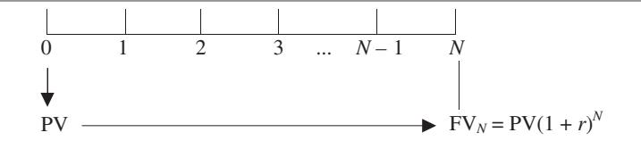
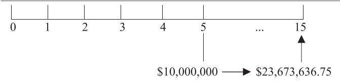
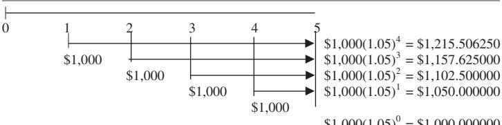
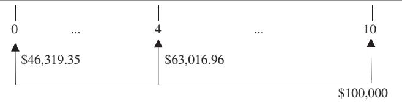
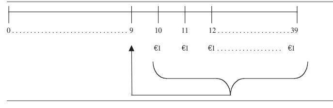
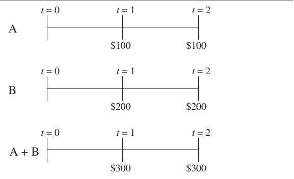

# THE TIME VALUE OF MONEY

Richard A. DeFusco, CFA

Dennis W. McLeavey, CFA

Jerald E. Pinto, PhD, CFA

David E. Runkle, PhD, CFA

## LEARNING OUTCOMES

After completing this chapter, you will be able to do the following:

- interpret interest rates as required rates of return, discount rates, or opportunity costs;

- explain an interest rate as the sum of a real risk-free rate and premiums that compensate investors for bearing distinct types of risk;

- calculate and interpret the effective annual rate, given the stated annual interest rate and the frequency of compounding;

- solve time value of money problems for different frequencies of compounding;

- calculate and interpret the future value (FV) and present value (PV) of a single sum of money, an ordinary annuity, an annuity due, a perpetuity (PV only), and a series of unequal cash flows;

• demonstrate the use of a time line in modeling and solving time value of money problems.

### 1. INTRODUCTION

As individuals, we often face decisions that involve saving money for a future use, or borrowing money for current consumption. We then need to determine the amount we need to invest, if we are saving, or the cost of borrowing, if we are shopping for a loan. As investment analysts, much of our work also involves evaluating transactions with present and future cash flows.

When we place a value on any security, for example, we are attempting to determine the worth of a stream of future cash flows. To carry out all the above tasks accurately, we must understand the mathematics of time value of money problems. Money has time value in that individual's value is given amount of money more highly the earlier it is received. Therefore, a smaller amount of money now may be equivalent in value to a larger amount received at a future date. The time value of money as a topic in investment mathematics deals with equivalence relationships between cash flows with different dates. Mastery of time value of money concepts and techniques is essential for investment analysts.

The reading $ ^{1} $ is organized as follows: Section 2 introduces some terminology used throughout the reading and supplies some economic intuition for the variables we will discuss. Section 3 tackles the problem of determining the worth at a future point in time of an amount invested today. Section 4 addresses the future worth of a series of cash flows. These two sections provide the tools for calculating the equivalent value at a future date of a single cash flow or series of cash flows. Sections 5 and 6 discuss the equivalent value today of a single future cash flow and a series of future cash flows, respectively. In Section 7, we explore how to determine other quantities of interest in time value of money problems.

### 2. INTEREST RATES: INTERPRETATION

In this reading, we will continually refer to interest rates. In some cases, we assume a particular value for the interest rate; in other cases, the interest rate will be the unknown quantity we seek to determine. Before turning to the mechanics of time value of money problems, we must illustrate the underlying economic concepts. In this section, we briefly explain the meaning and interpretation of interest rates.

Time value of money concerns equivalence relationships between cash flows occurring on different dates. The idea of equivalence relationships is relatively simple. Consider the following exchange: You pay 10,000 today and in return receive 9,500 today. Would you accept this arrangement? Not likely. But what if you received the 9,500 today and paid the 10,000 one year from now? Can these amounts be considered equivalent? Possibly, because a payment of 10,000 a year from now would probably be worth less to you than a payment of 10,000 today. It would be fair, therefore, to discount the 10,000 received in one year; that is, to cut its value based on how much time passes before the money is paid. An interest rate, denoted  $ r $, is a rate of return that reflects the relationship between differently dated cash flows. If 9,500 today and 10,000 in one year are equivalent in value, then 10,000 - 9,500 = 500 is the required compensation for receiving 10,000 in one year rather than now. The interest rate—the required compensation stated as a rate of return—is 500/9,500 = 0.0526 or 5.26 percent.

Interest rates can be thought of in three ways. First, they can be considered required rates of return—that is, the minimum rate of return an investor must receive in order to accept the investment. Second, interest rates can be considered discount rates. In the example above, 5.26 percent is that rate at which we discounted the $10,000 future amount to find its value today. Thus, we use the terms “interest rate” and “discount rate” almost interchangeably. Third, interest rates can be considered opportunity costs. An opportunity cost is the value that investors forgo by choosing a particular course of action. In the example, if the party who supplied

$9,500 had instead decided to spend it today, he would have forgone earning 5.26 percent on the money. So we can view 5.26 percent as the opportunity cost of current consumption.

Economics tells us that interest rates are set in the marketplace by the forces of supply and demand, where investors are suppliers of funds and borrowers are demanders of funds. Taking the perspective of investors in analyzing market-determined interest rates, we can view an interest rate $r$ as being composed of a real risk-free interest rate plus a set of four premiums that are required returns or compensation for bearing distinct types of risk:

 $$ \begin{aligned}r&=Real~risk-free~interest~rate+Inflation~premium+Default~risk~premium\\&\quad+Liquidity~premium+Maturity~premium\end{aligned} $$ 

- The real risk-free interest rate is the single-period interest rate for a completely risk-free security if no inflation were expected. In economic theory, the real risk-free rate reflects the time preferences of individuals for current versus future real consumption.

The inflation premium compensates investors for expected inflation and reflects the average inflation rate expected over the maturity of the debt. Inflation reduces the purchasing power of a unit of currency—the amount of goods and services one can buy with it. The sum of the real risk-free interest rate and the inflation premium is the nominal risk-free interest rate. $ ^{2} $ Many countries have governmental short-term debt whose interest rate can be considered to represent the nominal risk-free interest rate in that country. The interest rate on a 90-day US Treasury bill (T-bill), for example, represents the nominal risk-free interest rate over that time horizon. $ ^{3} $ US T-bills can be bought and sold in large quantities with minimal transaction costs and are backed by the full faith and credit of the US government.

- The default risk premium compensates investors for the possibility that the borrower will fail to make a promised payment at the contracted time and in the contracted amount.

- The liquidity premium compensates investors for the risk of loss relative to an investment's fair value if the investment needs to be converted to cash quickly. US T-bills, for example, do not bear a liquidity premium because large amounts can be bought and sold without affecting their market price. Many bonds of small issuers, by contrast, trade infrequently after they are issued; the interest rate on such bonds includes a liquidity premium reflecting the relatively high costs (including the impact on price) of selling a position.

- The maturity premium compensates investors for the increased sensitivity of the market value of debt to a change in market interest rates as maturity is extended, in general (holding all else equal). The difference between the interest rate on longer-maturity, liquid Treasury debt and that on short-term Treasury debt reflects a positive maturity premium for the longer-term debt (and possibly different inflation premiums as well).

Using this insight into the economic meaning of interest rates, we now turn to a discussion of solving time value of money problems, starting with the future value of a single cash flow.

### 3. THE FUTURE VALUE OF A SINGLE CASH FLOW

In this section, we introduce time value associated with a single cash flow or lump-sum investment. We describe the relationship between an initial investment or present value (PV), which earns a rate of return (the interest rate per period) denoted as r, and its future value (FV), which will be received N years or periods from today.

The following example illustrates this concept. Suppose you invest 100 (PV = 100) in an interest-bearing bank account paying 5 percent annually. At the end of the first year, you will have the 100 plus the interest earned,  $ 0.05 \times \100 = \5 $, for a total of 105. To formalize this one-period example, we define the following terms:

 $$ \begin{aligned}PV&=present value~of~the~investment\\ F V_{N}&=future~value~of~the~investment~N~periods~from~today\\ r&=rate~of~interest~per~period\end{aligned} $$ 

For $N=1$, the expression for the future value of amount PV is

 $$ \mathrm{FV}_{1}=\mathrm{PV}(1+r) $$ 

For this example, we calculate the future value one year from today as  $ FV_{1} = \100(1.05) = \105 $.

Now suppose you decide to invest the initial $100 for two years with interest earned and credited to your account annually (annual compounding). At the end of the first year (the beginning of the second year), your account will have $105, which you will leave in the bank for another year. Thus, with a beginning amount of $105 (PV = $105), the amount at the end of the second year will be $105(1.05) = $110.25. Note that the $5.25 interest earned during the second year is 5 percent of the amount invested at the beginning of Year 2.

Another way to understand this example is to note that the amount invested at the beginning of Year 2 is composed of the original $100 that you invested plus the $5 interest earned during the first year. During the second year, the original principal again earns interest, as does the interest that was earned during Year 1. You can see how the original investment grows:

<table border=1 style='margin: auto; word-wrap: break-word;'><tr><td style='text-align: center; word-wrap: break-word;'>Original investment</td><td style='text-align: center; word-wrap: break-word;'>$100.00</td></tr><tr><td style='text-align: center; word-wrap: break-word;'>Interest for the first year ($100 \times 0.05)</td><td style='text-align: center; word-wrap: break-word;'>5.00</td></tr><tr><td style='text-align: center; word-wrap: break-word;'>Interest for the second year based on original investment ($100 \times 0.05)</td><td style='text-align: center; word-wrap: break-word;'>5.00</td></tr><tr><td style='text-align: center; word-wrap: break-word;'>Interest for the second year based on interest earned in the first year (0.05 \times $5.00 interest on interest)</td><td style='text-align: center; word-wrap: break-word;'>0.25</td></tr><tr><td style='text-align: center; word-wrap: break-word;'>Total</td><td style='text-align: center; word-wrap: break-word;'>$110.25</td></tr></table>

The $5 interest that you earned each period on the $100 original investment is known as \textit{simple interest} (the interest rate times the principal). \textit{Principal} is the amount of funds originally invested. During the two-year period, you earn $10 of simple interest. The extra $0.25 that you have at the end of Year 2 is the interest you earned on the Year 1 interest of $5 that you reinvested.

The interest earned on interest provides the first glimpse of the phenomenon known as compounding. Although the interest earned on the initial investment is important, for a given interest rate it is fixed in size from period to period. The compounded interest earned on reinvested interest is a far more powerful force because, for a given interest rate, it grows in size each period. The importance of compounding increases with the magnitude of the interest rate. For example, $100 invested today would be worth about $13,150 after 100 years if compounded annually at 5 percent, but worth more than $20 million if compounded annually over the same time period at a rate of 13 percent.

To verify the $20 million figure, we need a general formula to handle compounding for any number of periods. The following general formula relates the present value of an initial investment to its future value after N periods:

 $$ \mathrm{FV}_{N}=\mathrm{PV}(1+r)^{N} $$ 

where $r$ is the stated interest rate per period and $N$ is the number of compounding periods. In the bank example, $\mathrm{FV}_2 = \$100(1 + 0.05)^2 = \$110.25$. In the 13 percent investment example, $\mathrm{FV}_{100} = \$100(1.13)^{100} = \$20,316,287.42$.

The most important point to remember about using the future value equation is that the stated interest rate, r, and the number of compounding periods, N, must be compatible. Both variables must be defined in the same time units. For example, if N is stated in months, then r should be the one-month interest rate, unannualized.

A time line helps us to keep track of the compatibility of time units and the interest rate per time period. In the time line, we use the time index  $ t $ to represent a point in time a stated number of periods from today. Thus the present value is the amount available for investment today, indexed as t = 0. We can now refer to a time  $ N $ periods from today as  $ t = N $. The time line in Figure 1 shows this relationship.

In Figure 1, we have positioned the initial investment, PV, at  $ t = 0 $. Using Equation 2, we move the present value, PV, forward to  $ t = N $ by the factor  $ (1 + r)^{N} $. This factor is called a future value factor. We denote the future value on the time line as FV and position it at  $ t = N $. Suppose the future value is to be received exactly 10 periods from today's date  $ (N = 10) $. The present value, PV, and the future value, FV, are separated in time through the factor  $ (1 + r)^{10} $.

The fact that the present value and the future value are separated in time has important consequences:

We can add amounts of money only if they are indexed at the same point in time.

• For a given interest rate, the future value increases with the number of periods.

• For a given number of periods, the future value increases with the interest rate.

FIGURE 1 The Relationship between an Initial Investment, PV, and Its Future Value, FV

To better understand these concepts, consider three examples that illustrate how to apply the future value formula.

## EXAMPLE 1 The Future Value of a Lump Sum with Interim Cash Reinvested at the Same Rate

You are the lucky winner of your state's lottery of $5 million after taxes. You invest your winnings in a five-year certificate of deposit (CD) at a local financial institution. The CD promises to pay 7 percent per year compounded annually. This institution also lets you reinvest the interest at that rate for the duration of the CD. How much will you have at the end of five years if your money remains invested at 7 percent for five years with no withdrawals?

Solution: To solve this problem, compute the future value of the $5 million investment using the following values in Equation 2:

 $$ PV=\5,000,000 $$ 

 $$ r=7\%=0.07 $$ 

 $$ N=5 $$ 

 $$ \mathrm{FV}_{N}=\mathrm{PV}\big(1+r\big)^{N} $$ 

 $$ =\5,000,000(1.07)^{5} $$ 

 $$ =\5,000,000(1.402552) $$ 

 $$ =\7,012,758.65 $$ 

At the end of five years, you will have $7,012,758.65 if your money remains invested at 7 percent with no withdrawals.

In this and most examples in this reading, note that the factors are reported at six decimal places but the calculations may actually reflect greater precision. For example, the reported 1.402552 has been rounded up from 1.40255173 (the calculation is actually carried out with more than eight decimal places of precision by the calculator or spreadsheet). Our final result reflects the higher number of decimal places carried by the calculator or spreadsheet. $ ^{4} $

## EXAMPLE 2 The Future Value of a Lump Sum with No Interim Cash

An institution offers you the following terms for a contract: For an investment of ¥2,500,000, the institution promises to pay you a lump sum six years from now at an 8 percent annual interest rate. What future amount can you expect?

Solution: Use the following data in Equation 2 to find the future value:

 $$  PV=¥2,500,000 $$ 

 $$ r=8\%=0.08 $$ 

 $$ N=6 $$ 

 $$ \mathrm{FV}_{N}=\mathrm{PV}\big(1+r\big)^{N} $$ 

 $$ =¥2,500,000(1.08)^{6} $$ 

 $$ =¥2,500,000(1.586874) $$ 

 $$ =¥3,967,186 $$ 

You can expect to receive ¥3,967,186 six years from now.

Our third example is a more complicated future value problem that illustrates the importance of keeping track of actual calendar time.

## EXAMPLE 3 The Future Value of a Lump Sum

A pension fund manager estimates that his corporate sponsor will make a $10 million contribution five years from now. The rate of return on plan assets has been estimated at 9 percent per year. The pension fund manager wants to calculate the future value of this contribution 15 years from now, which is the date at which the funds will be distributed to retirees. What is that future value?

Solution: By positioning the initial investment, PV, at t=5, we can calculate the future value of the contribution using the following data in Equation 2:

 $$ PV=\10\mathrm{~m i l l i o n} $$ 

 $$ r=9\%=0.09 $$ 

 $$ N=10 $$ 

 $$ \begin{aligned}FV_{N}&=PV\big(1+r\big)^{N}\\&=\10,000,000\big(1.09\big)^{10}\\&=\10,000,000\big(2.367364\big)\\&=\23,673,636.75\\ \end{aligned} $$ 

FIGURE 2 The Future Value of a Lump Sum, Initial Investment Not at t = 0

This problem looks much like the previous two, but it differs in one important respect: its timing. From the standpoint of today  $ (t=0) $, the future amount of 23,673,636.75 is 15 years into the future. Although the future value is 10 years from its present value, the present value of 10 million will not be received for another five years.

As Figure 2 shows, we have followed the convention of indexing today as t = 0 and indexing subsequent times by adding 1 for each period. The additional contribution of $10 million is to be received in five years, so it is indexed as t = 5 and appears as such in the figure. The future value of the investment in 10 years is then indexed at t = 15; that is, 10 years following the receipt of the $10 million contribution at t = 5. Time lines like this one can be extremely useful when dealing with more complicated problems, especially those involving more than one cash flow.

In a later section of this reading, we will discuss how to calculate the value today of the $10 million to be received five years from now. For the moment, we can use Equation 2. Suppose the pension fund manager in Example 3 above were to receive $6,499,313.86 today from the corporate sponsor. How much will that sum be worth at the end of five years? How much will it be worth at the end of 15 years?

 $$ PV=\6,499,313.86 $$ 

 $$ r=9\%=0.09 $$ 

 $$ N=5 $$ 

 $$ \begin{aligned}FV_{N}&=PV(1+r)^{N}\\&=\6,499,313.86(1.09)^{5}\\&=\6,499,313.86(1.538624)\\&=\10,000,000 at the five-year mark\end{aligned} $$ 

and

 $$ PV=\6,499,313.86 $$ 

 $$ r=9\%=0.09 $$ 

 $$ N=15 $$ 

 $$ \begin{aligned}FV_{N}&=PV\big(1+r\big)^{N}\\&=\6,499,313.86\big(1.09\big)^{15}\\&=\6,499,313.86\big(3.642482\big)\\&=\23,673,636.74 at the15-year mark\end{aligned} $$ 

These results show that today's present value of about $6.5 million becomes $10 million after five years and $23.67 million after 15 years.

#### 3.1. The Frequency of Compounding

In this section, we examine investments paying interest more than once a year. For instance, many banks offer a monthly interest rate that compounds 12 times a year. In such an arrangement, they pay interest on interest every month. Rather than quote the periodic monthly interest rate, financial institutions often quote an annual interest rate that we refer to as the stated annual interest rate or quoted interest rate. We denote the stated annual interest rate by  $ r_s $. For instance, your bank might state that a particular CD pays 8 percent compounded monthly. The stated annual interest rate equals the monthly interest rate multiplied by 12. In this example, the monthly interest rate is 0.08/12 = 0.0067 or 0.67 percent. $ ^5 $ This rate is strictly a quoting convention because  $ (1 + 0.0067)^{12} = 1.083 $, not 1.08; the term  $ (1 + r_s) $ is not meant to be a future value factor when compounding is more frequent than annual.

With more than one compounding period per year, the future value formula can be expressed as

 $$ \mathrm{FV}_{N}=\mathrm{PV}\left(1+\frac{r_{s}}{m}\right)^{mN} $$ 

where  $ r_s $ is the stated annual interest rate, m is the number of compounding periods per year, and N now stands for the number of years. Note the compatibility here between the interest rate used,  $ r_f/m $, and the number of compounding periods, mN. The periodic rate,  $ r_s/m $, is the stated annual interest rate divided by the number of compounding periods per year. The number of compounding periods, mN, is the number of compounding periods in one year multiplied by the number of years. The periodic rate,  $ r_s/m $, and the number of compounding periods, mN, must be compatible.

## EXAMPLE 4 The Future Value of a Lump Sum with Quarterly Compounding

Continuing with the CD example, suppose your bank offers you a CD with a two-year maturity, a stated annual interest rate of 8 percent compounded quarterly, and a feature allowing reinvestment of the interest at the same interest rate. You decide to invest $10,000. What will the CD be worth at maturity?

Solution: Compute the future value with Equation 3 as follows:

PV = 10,000
 $ r_{s} = 8\% = 0.08 $
m = 4
 $ r_{s}/m = 0.08/4 = 0.02 $
N = 2
mN = 4(2) = 8 interest periods

 $$ \mathrm{FV}_{N}=\mathrm{PV}\left(1+\frac{r_{s}}{m}\right)^{mN} $$ 

 $$ =\10,000(1.02)^{8} $$ 

 $$ =\10,000(1.171659) $$ 

At maturity, the CD will be worth $11,716.59.

The future value formula in Equation 3 does not differ from the one in Equation 2. Simply keep in mind that the interest rate to use is the rate per period and the exponent is the number of interest, or compounding, periods.

## EXAMPLE 5 The Future Value of a Lump Sum with Monthly Compounding

An Australian bank offers to pay you 6 percent compounded monthly. You decide to invest A$1 million for one year. What is the future value of your investment if interest payments are reinvested at 6 percent?

Solution: Use Equation 3 to find the future value of the one-year investment as follows:

 $$ PV=A\1,000,000 $$ 

 $$ r_{s}=6\%=0.06 $$ 

 $$ m=12 $$ 

 $$ r_{s}/m=0.06/12=0.0050 $$ 

 $$ N=1 $$ 

 $$ m N=12(1)=12\text{interest periods} $$ 

 $$ \begin{aligned}FV_{N}&=PV\bigg(1+\frac{r_{s}}{m}\bigg)^{mN}\\&=A\1,000,000\big(1.005\big)^{12}\\&=A\1,000,000\big(1.061678\big)\\&=A\1,061,677.81\\ \end{aligned} $$ 

If you had been paid 6 percent with annual compounding, the future amount would be only A$1,000,000 (1.06) = A$1,060,000 instead of A$1,061,677.81 with monthly compounding.

#### 3.2. Continuous Compounding

The preceding discussion on compounding periods illustrates discrete compounding, which credits interest after a discrete amount of time has elapsed. If the number of compounding periods per year becomes infinite, then interest is said to compound continuously. If we want to use the future value formula with continuous compounding, we need to find the limiting value of the future value factor for  $ m \to \infty $ (infinitely many compounding periods per year) in Equation 3. The expression for the future value of a sum in N years with continuous compounding is

 $$ \mathrm{FV}_{N}=\mathrm{PV}e^{r_{s}N} $$ 

The term  $ e^{r_s N} $ is the transcendental number  $ e \approx 2.7182818 $ raised to the power  $ r_s N $. Most financial calculators have the function  $ e^x $.

## EXAMPLE 6 The Future Value of a Lump Sum with Continuous Compounding

Suppose a $10,000 investment will earn 8 percent compounded continuously for two years. We can compute the future value with Equation 4 as follows:

 $$  PV=\10,000 $$ 

 $$ r_{s}=8\%=0.08 $$ 

 $$ N=2 $$ 

 $$ \begin{aligned}\mathrm{FV}_{N}&=\mathrm{PV}e^{r_{s} N}\\&=\10,000e^{0.08(2)}\\&=\10,000(1.173511)\\&=\11,735.11\end{aligned} $$ 

With the same interest rate but using continuous compounding, the $10,000 investment will grow to $11,735.11 in two years, compared with $11,716.59 using quarterly compounding as shown in Example 4.

Table 1 shows how a stated annual interest rate of 8 percent generates different ending dollar amounts with annual, semiannual, quarterly, monthly, daily, and continuous compounding for an initial investment of $1 (carried out to six decimal places).

TABLE 1 The Effect of Compounding Frequency on Future Value

<table border=1 style='margin: auto; word-wrap: break-word;'><tr><td style='text-align: center; word-wrap: break-word;'>Frequency</td><td style='text-align: center; word-wrap: break-word;'>r/m</td><td style='text-align: center; word-wrap: break-word;'>mN</td><td colspan="2">Future Value of 1</td></tr><tr><td style='text-align: center; word-wrap: break-word;'>Annual</td><td style='text-align: center; word-wrap: break-word;'>8%/1 = 8%</td><td style='text-align: center; word-wrap: break-word;'>$ 1 \times 1 = 1 $</td><td style='text-align: center; word-wrap: break-word;'>1.00(1.08)</td><td style='text-align: center; word-wrap: break-word;'>=1.08</td></tr><tr><td style='text-align: center; word-wrap: break-word;'>Semiannual</td><td style='text-align: center; word-wrap: break-word;'>8%/2 = 4%</td><td style='text-align: center; word-wrap: break-word;'>$ 2 \times 1 = 2 $</td><td style='text-align: center; word-wrap: break-word;'>1.00(1.04) $ ^{{2}} $</td><td style='text-align: center; word-wrap: break-word;'>=1.081600</td></tr><tr><td style='text-align: center; word-wrap: break-word;'>Quarterly</td><td style='text-align: center; word-wrap: break-word;'>8%/4 = 2%</td><td style='text-align: center; word-wrap: break-word;'>$ 4 \times 1 = 4 $</td><td style='text-align: center; word-wrap: break-word;'>1.00(1.02) $ ^{{4}} $</td><td style='text-align: center; word-wrap: break-word;'>=1.082432</td></tr><tr><td style='text-align: center; word-wrap: break-word;'>Monthly</td><td style='text-align: center; word-wrap: break-word;'>8%/12 = 0.6667%</td><td style='text-align: center; word-wrap: break-word;'>$ 12 \times 1 = 12 $</td><td style='text-align: center; word-wrap: break-word;'>1.00(1.006667) $ ^{{12}} $</td><td style='text-align: center; word-wrap: break-word;'>=1.083000</td></tr><tr><td style='text-align: center; word-wrap: break-word;'>Daily</td><td style='text-align: center; word-wrap: break-word;'>8%/365 = 0.0219%</td><td style='text-align: center; word-wrap: break-word;'>$ 365 \times 1 = 365 $</td><td style='text-align: center; word-wrap: break-word;'>1.00(1.000219) $ ^{{365}} $</td><td style='text-align: center; word-wrap: break-word;'>=1.083278</td></tr><tr><td style='text-align: center; word-wrap: break-word;'>Continuous</td><td style='text-align: center; word-wrap: break-word;'></td><td style='text-align: center; word-wrap: break-word;'></td><td style='text-align: center; word-wrap: break-word;'>1.00e^{0.08(1)}</td><td style='text-align: center; word-wrap: break-word;'>=1.083287</td></tr></table>

As Table 1 shows, all six cases have the same stated annual interest rate of 8 percent; they have different ending dollar amounts, however, because of differences in the frequency of compounding. With annual compounding, the ending amount is $1.08. More frequent compounding results in larger ending amounts. The ending dollar amount with continuous compounding is the maximum amount that can be earned with a stated annual rate of 8 percent.

Table 1 also shows that a 1 investment earning 8.16 percent compounded annually grows to the same future value at the end of one year as a 1 investment earning 8 percent compounded semiannually. This result leads us to a distinction between the stated annual interest rate and the effective annual rate (EAR). $ ^{6} $ For an 8 percent stated annual interest rate with semiannual compounding, the EAR is 8.16 percent.

#### 3.3. Stated and Effective Rates

The stated annual interest rate does not give a future value directly, so we need a formula for the EAR. With an annual interest rate of 8 percent compounded semiannually, we receive a periodic rate of 4 percent. During the course of a year, an investment of $1 would grow to $1(1.04)^2 = $1.0816, as illustrated in Table 1. The interest earned on the $1 investment is $0.0816 and represents an effective annual rate of interest of 8.16 percent. The effective annual rate is calculated as follows:

 $$ \mathrm{EAR}=(1+\mathrm{Periodic~interest~rate})^{m}-1 $$ 

The periodic interest rate is the stated annual interest rate divided by $m$, where $m$ is the number of compounding periods in one year. Using our previous example, we can solve for EAR as follows: $(1.04)^{2}-1=8.16$ percent.

The concept of EAR extends to continuous compounding. Suppose we have a rate of 8 percent compounded continuously. We can find the EAR in the same way as above by finding the appropriate future value factor. In this case, a $1 investment would grow to $1e^{0.08(1.0)} = $1.0833. The interest earned for one year represents an effective annual rate of 8.33 percent and is larger than the 8.16 percent EAR with semiannual compounding because interest is compounded more frequently. With continuous compounding, we can solve for the effective annual rate as follows:

 $$  EAR=e^{r_{s}}-1 $$ 

We can reverse the formulas for EAR with discrete and continuous compounding to find a periodic rate that corresponds to a particular effective annual rate. Suppose we want to find the appropriate periodic rate for a given effective annual rate of 8.16 percent with semiannual compounding. We can use Equation 5 to find the periodic rate:

 $$ 0.0816=\left(1+Periodic rate\right)^{2}-1 $$ 

 $$ 1.0816=\left(1+Periodic rate\right)^{2} $$ 

 $$ \left(1.0816\right)^{1/2}-1=Periodic rate $$ 

 $$ (1.04)-1=Periodic rate $$ 

 $$ 4\%=Periodic rate $$ 

To calculate the continuously compounded rate (the stated annual interest rate with continuous compounding) corresponding to an effective annual rate of 8.33 percent, we find the interest rate that satisfies Equation 6:

 $$ 0.0833=e^{r_{s}}-1 $$ 

 $$ 1.0833=e^{r_{s}} $$ 

To solve this equation, we take the natural logarithm of both sides. (Recall that the natural log of  $ e^{r_{s}} $ is  $ \ln e^{r_{s}} = r_{s} $.) Therefore,  $ \ln 1.0833 = r_{s} $, resulting in  $ r_{s} = 8 $ percent. We see that a stated annual rate of 8 percent with continuous compounding is equivalent to an EAR of 8.33 percent.

### 4. THE FUTURE VALUE OF A SERIES OF CASH FLOWS

In this section, we consider series of cash flows, both even and uneven. We begin with a list of terms commonly used when valuing cash flows that are distributed over many time periods.

• An annuity is a finite set of level sequential cash flows.

• An ordinary annuity has a first cash flow that occurs one period from now (indexed at t = 1).

• An annuity due has a first cash flow that occurs immediately (indexed at t=0).

• A perpetuity is a perpetual annuity, or a set of level never-ending sequential cash flows, with the first cash flow occurring one period from now.

#### 4.1. Equal Cash Flows—Ordinary Annuity

Consider an ordinary annuity paying 5 percent annually. Suppose we have five separate deposits of 1,000 occurring at equally spaced intervals of one year, with the first payment occurring at  $ t = 1 $. Our goal is to find the future value of this ordinary annuity after the last deposit at  $ t = 5 $. The increment in the time counter is one year, so the last payment occurs five years from now. As the time line in Figure 3 shows, we find the future value of each 1,000 deposit as of  $ t = 5 $ with Equation 2,  $ FV_N = PV(1 + r)^N $. The arrows in Figure 3 extend from the payment date to  $ t = 5 $. For instance, the first 1,000 deposit made at  $ t = 1 $ will compound over four periods. Using Equation 2, we find that the future value of the first deposit at  $ t = 5 $ is 1,000(1.05)^4 = 1,215.51. We calculate the future value of all other payments in a similar fashion. (Note that we are finding the future value at  $ t = 5 $, so the last payment does not earn any interest.) With all values now at  $ t = 5 $, we can add the future values to arrive at the future value of the annuity. This amount is 5,525.63.

We can arrive at a general annuity formula if we define the annuity amount as A, the number of time periods as N, and the interest rate per period as r. We can then define the future value as

 $$ \mathrm{FV}_{N}=A\Big[\big(1+r\big)^{N-1}+\big(1+r\big)^{N-2}+\big(1+r\big)^{N-3}+\ldots+\big(1+r\big)^{1}+\big(1+r\big)^{0}\Big] $$ 

which simplifies to

 $$ \mathrm{FV}_{N}=A\left[\frac{(1+r)^{N}-1}{r}\right] $$ 

The term in brackets is the future value annuity factor. This factor gives the future value of an ordinary annuity of $1 per period. Multiplying the future value annuity factor by the annuity amount gives the future value of an ordinary annuity. For the ordinary annuity in Figure 3, we find the future value annuity factor from Equation 7 as

 $$ \left[\frac{(1.05)^{5}-1}{0.05}\right]=5.525631 $$ 

With an annuity amount $1,000, the future value of the annuity is $1,000 (5.525631) = $5,525.63, an amount that agrees with our earlier work.

FIGURE 3 The Future Value of a Five-Year Ordinary Annuity

 $$ \begin{array}{r l}&{\qquad\1,000(1.05)^{0}=\1,000.000000}\\ &{\mathrm{S u m~a t~}t=5\qquad\qquad\qquad\qquad\qquad\qquad\5,525.63}\end{array} $$ 

The next example illustrates how to find the future value of an ordinary annuity using the formula in Equation 7.

## EXAMPLE 7 The Future Value of an Annuity

Suppose your company's defined contribution retirement plan allows you to invest up to €20,000 per year. You plan to invest €20,000 per year in a stock index fund for the next 30 years. Historically, this fund has earned 9 percent per year on average. Assuming that you actually earn 9 percent a year, how much money will you have available for retirement after making the last payment?

Solution: Use Equation 7 to find the future amount:

 $$ A=\epsilon20,000 $$ 

 $$ r=9\%=0.09 $$ 

 $$ N=30 $$ 

 $$ \mathrm{FV~annuity~factor}=\frac{\left(1+r\right)^{N}-1}{r}=\frac{\left(1.09\right)^{30}-1}{0.09}=136.307539 $$ 

 $$ \mathrm{FV}_{N}=\mathrm{€}20,000(136.307539) $$ 

 $$ =\mathrm{€}2,726,150.77 $$ 

Assuming the fund continues to earn an average of 9 percent per year, you will have €2,726,150.77 available at retirement.

#### 4.2. Unequal Cash Flows

In many cases, cash flow streams are unequal, precluding the simple use of the future value annuity factor. For instance, an individual investor might have a savings plan that involves unequal cash payments depending on the month of the year or lower savings during a planned vacation. One can always find the future value of a series of unequal cash flows by compounding the cash flows one at a time. Suppose you have the five cash flows described in Table 2, indexed relative to the present (t=0).

TABLE 2 A Series of Unequal Cash Flows and Their Future Values at 5 Percent

<table border=1 style='margin: auto; word-wrap: break-word;'><tr><td style='text-align: center; word-wrap: break-word;'>Time</td><td style='text-align: center; word-wrap: break-word;'>Cash Flow ()</td><td style='text-align: center; word-wrap: break-word;'>Future Value at Year 5</td></tr><tr><td style='text-align: center; word-wrap: break-word;'>t = 1</td><td style='text-align: center; word-wrap: break-word;'>1,000</td><td style='text-align: center; word-wrap: break-word;'>1,000(1.05) $ ^{4} $ = 1,215.51</td></tr><tr><td style='text-align: center; word-wrap: break-word;'>t = 2</td><td style='text-align: center; word-wrap: break-word;'>2,000</td><td style='text-align: center; word-wrap: break-word;'>2,000(1.05) $ ^{3} $ = 2,315.25</td></tr><tr><td style='text-align: center; word-wrap: break-word;'>t = 3</td><td style='text-align: center; word-wrap: break-word;'>4,000</td><td style='text-align: center; word-wrap: break-word;'>4,000(1.05) $ ^{2} $ = 4,410.00</td></tr><tr><td style='text-align: center; word-wrap: break-word;'>t = 4</td><td style='text-align: center; word-wrap: break-word;'>5,000</td><td style='text-align: center; word-wrap: break-word;'>5,000(1.05) $ ^{1} $ = 5,250.00</td></tr><tr><td style='text-align: center; word-wrap: break-word;'>t = 5</td><td style='text-align: center; word-wrap: break-word;'>6,000</td><td style='text-align: center; word-wrap: break-word;'>6,000(1.05) $ ^{0} $ = 6,000.00</td></tr><tr><td style='text-align: center; word-wrap: break-word;'></td><td style='text-align: center; word-wrap: break-word;'></td><td style='text-align: center; word-wrap: break-word;'>Sum = 19,190.76</td></tr></table>

All of the payments shown in Table 2 are different. Therefore, the most direct approach to finding the future value at t = 5 is to compute the future value of each payment as of t = 5 and then sum the individual future values. The total future value at Year 5 equals $19,190.76, as shown in the third column. Later in this reading, you will learn shortcuts to take when the cash flows are close to even; these shortcuts will allow you to combine annuity and single-period calculations.

### 5. THE PRESENT VALUE OF A SINGLE CASH FLOW

#### 5.1. Finding the Present Value of a Single Cash Flow

Just as the future value factor links today's present value with tomorrow's future value, the present value factor allows us to discount future value to present value. For example, with a 5 percent interest rate generating a future payoff of $105 in one year, what current amount invested at 5 percent for one year will grow to $105? The answer is $100; therefore, $100 is the present value of $105 to be received in one year at a discount rate of 5 percent.

Given a future cash flow that is to be received in N periods and an interest rate per period of r, we can use the formula for future value to solve directly for the present value as follows:

 $$ \mathrm{FV}_{N}=\mathrm{PV}\big(1+r\big)^{N} $$ 

 $$  PV=FV_{N}\left[\frac{1}{\left(1+r\right)^{N}}\right] $$ 

 $$  PV=FV_{N}\left(1+r\right)^{-N} $$ 

We see from Equation 8 that the present value factor,  $ (1 + r)^{-N} $, is the reciprocal of the future value factor,  $ (1 + r)^{N} $.

## EXAMPLE 8 The Present Value of a Lump Sum

An insurance company has issued a Guaranteed Investment Contract (GIC) that promises to pay $100,000 in six years with an 8 percent return rate. What amount of money must the insurer invest today at 8 percent for six years to make the promised payment?

Solution: We can use Equation 8 to find the present value using the following data:

 $$ \begin{aligned}FV_{N}&=\100,000\\r&=8\%=0.08\\N&=6\\ PV&=FV_{N}\left(1+r\right)^{-N}\\&=\100,000\left[\frac{1}{\left(1.08\right)^{6}}\right]\\&=\100,000(0.6301696)\\&=\63,016.96\end{aligned} $$ 

FIGURE 4 The Present Value of a Lump Sum to Be Received at Time t = 6

<table border=1 style='margin: auto; word-wrap: break-word;'><tr><td style='text-align: center; word-wrap: break-word;'>0</td><td style='text-align: center; word-wrap: break-word;'>1</td><td style='text-align: center; word-wrap: break-word;'>2</td><td style='text-align: center; word-wrap: break-word;'>3</td><td style='text-align: center; word-wrap: break-word;'>4</td><td style='text-align: center; word-wrap: break-word;'>5</td><td style='text-align: center; word-wrap: break-word;'>6</td></tr><tr><td colspan="7">PV = $63,016.96</td></tr><tr><td colspan="5"></td><td colspan="2">$100,000 = FV</td></tr></table>

We can say that $63,016.96 today, with an interest rate of 8 percent, is equivalent to $100,000 to be received in six years. Discounting the $100,000 makes a future $100,000 equivalent to $63,016.96 when allowance is made for the time value of money. As the time line in Figure 4 shows, the $100,000 has been discounted six full periods.

## EXAMPLE 9 The Projected Present Value of a More Distant Future Lump Sum

Suppose you own a liquid financial asset that will pay you $100,000 in 10 years from today. Your daughter plans to attend college four years from today, and you want to know what the asset's present value will be at that time. Given an 8 percent discount rate, what will the asset be worth four years from today?

Solution: The value of the asset is the present value of the asset's promised payment. At  $ t = 4 $, the cash payment will be received six years later. With this information, you can solve for the value four years from today using Equation 8:

 $$ \mathrm{FV}_{N}=\100,000 $$ 

 $$ r=8\%=0.08 $$ 

 $$ N=6 $$ 

 $$ \begin{aligned}\mathrm{PV}&=\mathrm{FV}_{N}\left(1+r\right)^{-N}\\&=\100,000\frac{1}{\left(1.08\right)^{6}}\\&=\100,000(0.6301696)\\&=\63,016.96\end{aligned} $$ 

FIGURE 5 The Relationship between Present Value and Future Value

The time line in Figure 5 shows the future payment of $100,000 that is to be received at $t=10$. The time line also shows the values at $t=4$ and at $t=0$. Relative to the payment at $t=10$, the amount at $t=4$ is a projected present value, while the amount at $t=0$ is the present value (as of today).

Present value problems require an evaluation of the present value factor,  $ (1 + r)^{-N} $. Present values relate to the discount rate and the number of periods in the following ways:

For a given discount rate, the further in the future the amount to be received, the smaller that amount's present value.

• Holding time constant, the larger the discount rate, the smaller the present value of a future amount.

#### 5.2. The Frequency of Compounding

Recall that interest may be paid semiannually, quarterly, monthly, or even daily. To handle interest payments made more than once a year, we can modify the present value formula (Equation 8) as follows. Recall that  $ r_{s} $ is the quoted interest rate and equals the periodic interest rate multiplied by the number of compounding periods in each year. In general, with more than one compounding period in a year, we can express the formula for present value as

 $$ \mathrm{PV}=\mathrm{FV}_{N}\left(1+\frac{r_{s}}{m}\right)^{-mN} $$ 

where

m = number of compounding periods per year

 $ r_{s}= $ quoted annual interest rate

N = number of years

The formula in Equation 9 is quite similar to that in Equation 8. As we have already noted, present value and future value factors are reciprocals. Changing the frequency of compounding does not alter this result. The only difference is the use of the periodic interest rate and the corresponding number of compounding periods.

The following example illustrates Equation 9.

## EXAMPLE 10 The Present Value of a Lump Sum with Monthly Compounding

The manager of a Canadian pension fund knows that the fund must make a lump-sum payment of C$5 million 10 years from now. She wants to invest an amount today in a GIC so that it will grow to the required amount. The current interest rate on GICs is 6 percent a year, compounded monthly. How much should she invest today in the GIC?

Solution: Use Equation 9 to find the required present value:

 $$ \mathrm{FV}_{N}=\mathrm{C}\5,000,000 $$ 

 $$ r_{s}=6\%=0.06 $$ 

 $$ m=12 $$ 

 $$ r_{s}/m=0.06/12=0.005 $$ 

 $$ N=10 $$ 

 $$ m N=12(10)=120 $$ 

 $$ \mathrm{PV}=\mathrm{FV}_{N}\left(1+\frac{r_{s}}{m}\right)^{-mN} $$ 

 $$ =C\5,000,000{\left(1.005\right)}^{-120} $$ 

 $$ =C\5,000,000(0.549633) $$ 

 $$ =C\2,748,163.67 $$ 

In applying Equation 9, we use the periodic rate (in this case, the monthly rate) and the appropriate number of periods with monthly compounding (in this case, 10 years of monthly compounding, or 120 periods).

### 6. THE PRESENT VALUE OF A SERIES OF CASH FLOWS

Many applications in investment management involve assets that offer a series of cash flows over time. The cash flows may be highly uneven, relatively even, or equal. They may occur over relatively short periods of time, longer periods of time, or even stretch on indefinitely. In this section, we discuss how to find the present value of a series of cash flows.

#### 6.1. The Present Value of a Series of Equal Cash Flows

We begin with an ordinary annuity. Recall that an ordinary annuity has equal annuity payments, with the first payment starting one period into the future. In total, the annuity makes N payments, with the first payment at t=1 and the last at t=N. We can express the present

value of an ordinary annuity as the sum of the present values of each individual annuity payment, as follows:

 $$  PV=\frac{A}{\left(1+r\right)}+\frac{A}{\left(1+r\right)^{2}}+\frac{A}{\left(1+r\right)^{3}}+\ldots+\frac{A}{\left(1+r\right)^{N-1}}+\frac{A}{\left(1+r\right)^{N}} $$ 

where

A = the annuity amount

r = the interest rate per period corresponding to the frequency of annuity payments (for example, annual, quarterly, or monthly)

N = the number of annuity payments

Because the annuity payment  $ (A) $ is a constant in this equation, it can be factored out as a common term. Thus the sum of the interest factors has a shortcut expression:

 $$ \begin{aligned}&PV=A\left[\frac{1-\frac{1}{\left(1+r\right)^{N}}}{r}\right]\\ \end{aligned} $$ 

In much the same way that we computed the future value of an ordinary annuity, we find the present value by multiplying the annuity amount by a present value annuity factor (the term in brackets in Equation 11).

## EXAMPLE 11 The Present Value of an Ordinary Annuity

Suppose you are considering purchasing a financial asset that promises to pay €1,000 per year for five years, with the first payment one year from now. The required rate of return is 12 percent per year. How much should you pay for this asset?

Solution: To find the value of the financial asset, use the formula for the present value of an ordinary annuity given in Equation 11 with the following data:

 $$ \begin{aligned}A&=€ 1,000\\r&=12\%=0.12\\N&=5\end{aligned} $$ 

 $$ \begin{aligned}PV&=A\left[\frac{1-\frac{1}{\left(1+r\right)^{N}}}{r}\right]\\&=\€1,000\left[\frac{1-\frac{1}{\left(1.12\right)^{5}}}{0.12}\right]\end{aligned} $$ 

 $$ =\mathrm{€}1,000(3.604776) $$ 

 $$ =€3,604.78 $$ 

The series of cash flows of €1,000 per year for five years is currently worth €3,604.78 when discounted at 12 percent.

FIGURE 6 An Annuity Due of $100 per Period

<table border=1 style='margin: auto; word-wrap: break-word;'><tr><td style='text-align: center; word-wrap: break-word;'>0</td><td style='text-align: center; word-wrap: break-word;'>1</td><td style='text-align: center; word-wrap: break-word;'>2</td><td style='text-align: center; word-wrap: break-word;'>3</td></tr><tr><td style='text-align: center; word-wrap: break-word;'>$100</td><td style='text-align: center; word-wrap: break-word;'>$100</td><td style='text-align: center; word-wrap: break-word;'>$100</td><td style='text-align: center; word-wrap: break-word;'>$100</td></tr></table>

Keeping track of the actual calendar time brings us to a specific type of annuity with level payments: the annuity due. An annuity due has its first payment occurring today (t = 0). In total, the annuity due will make N payments. Figure 6 presents the time line for an annuity due that makes four payments of $100.

As Figure 6 shows, we can view the four-period annuity due as the sum of two parts: a $100 lump sum today and an ordinary annuity of $100 per period for three periods. At a 12 percent discount rate, the four $100 cash flows in this annuity due example will be worth $340.18.

Expressing the value of the future series of cash flows in today's dollars gives us a convenient way of comparing annuities. The next example illustrates this approach.

## EXAMPLE 12 An Annuity Due as the Present Value of an Immediate Cash Flow Plus an Ordinary Annuity

You are retiring today and must choose to take your retirement benefits either as a lump sum or as an annuity. Your company's benefits officer presents you with two alternatives: an immediate lump sum of $2 million or an annuity with 20 payments of $200,000 a year with the first payment starting today. The interest rate at your bank is 7 percent per year compounded annually. Which option has the greater present value? (Ignore any tax differences between the two options.)

Solution: To compare the two options, find the present value of each at time t = 0 and choose the one with the larger value. The first option's present value is $2 million,

 $$ \mathrm{PV}\left(\mathrm{Annuity}\mathrm{due}\right)=A\left\{\left[1-\left(1+r\right)^{-N}\right]\bigg/r\right\}\left(1+r\right) $$ 

already expressed in today's dollars. The second option is an annuity due. Because the first payment occurs at $t = 0$, you can separate the annuity benefits into two pieces: an immediate $200,000 to be paid today ($t = 0$) and an ordinary annuity of $200,000 per year for 19 years. To value this option, you need to find the present value of the ordinary annuity using Equation 11 and then add $200,000 to it.

 $$ A=\200,000 $$ 

 $$ N=19 $$ 

 $$ r=7\%=0.07 $$ 

 $$ \mathrm{PV}=A\left[\frac{1-\frac{1}{\left(1+r\right)^{N}}}{r}\right] $$ 

 $$ =\200,000\left[\frac{1-\frac{1}{\left(1.07\right)^{19}}}{0.07}\right] $$ 

 $$ =\200,000(10.335595) $$ 

 $$ =\2,067,119.05 $$ 

The 19 payments of $200,000 have a present value of $2,067,119.05. Adding the initial payment of $200,000 to $2,067,119.05, we find that the total value of the annuity option is $2,267,119.05. The present value of the annuity is greater than the lump sum alternative of $2 million.

We now look at another example reiterating the equivalence of present and future values.

## EXAMPLE 13 The Projected Present Value of an Ordinary Annuity

A German pension fund manager anticipates that benefits of €1 million per year must be paid to retirees. Retirements will not occur until 10 years from now at time  $ t = 10 $. Once benefits begin to be paid, they will extend until  $ t = 39 $ for a total of 30 payments. What is the present value of the pension liability if the appropriate annual discount rate for plan liabilities is 5 percent compounded annually?

Solution: This problem involves an annuity with the first payment at $t=10$. From the perspective of $t=9$, we have an ordinary annuity with 30 payments. We can compute the present value of this annuity with Equation 11 and then look at it on a time line.

 $$ \begin{aligned}A&=\€1{,}000{,}000\\r&=5\%&=0.05\end{aligned} $$ 

 $$ N=30 $$ 

 $$ \mathrm{PV}=A\left[\frac{1-\frac{1}{\left(1+r\right)^{N}}}{r}\right] $$ 

 $$ =\begin{aligned}&\text{€}1,000,000\left[\frac{1-\frac{1}{\left(1.05\right)^{30}}}{0.05}\right]\end{aligned} $$ 

 $$ =\mathrm{€}1,000,000\mathrm{（}15.372451\mathrm{）} $$ 

 $$ =\text{€}15{,}372{,}451.03 $$ 

On the time line, we have shown the pension payments of €1 million extending from t = 10 to t = 39. The bracket and arrow indicate the process of finding the present value of the annuity, discounted back to t = 9. The present value of the pension benefits as of t = 9 is €15,372,451.03. The problem is to find the present value today (at t = 0).

Now we can rely on the equivalence of present value and future value. As Figure 7 shows, we can view the amount at t=9 as a future value from the vantage point of t=0. We compute the present value of the amount at t=9 as follows:

 $$ \mathrm{FV}_{N}=\mathrm{€}15,372,451.03\ (\mathrm{the~present~value~at~}t=9) $$ 

 $$ N=9 $$ 

 $$ r=5\%=0.05 $$ 

 $$  PV=FV_{N}(1+r)^{-N} $$ 

 $$ =\mathrm{€}15{,}372{,}451.03(1.05)^{-9} $$ 

 $$ =\mathrm{€}15{,}372{,}451.03\mathrm{(0.644609)} $$ 

 $$ =\mathrm{€}9,909,219.00 $$ 

The present value of the pension liability is €9,909,219.00.

FIGURE 7 The Present Value of an Ordinary Annuity with First Payment at Time t = 10 (in Millions)

Example 13 illustrates three procedures emphasized in this reading:

• finding the present or future value of any cash flow series;

- recognizing the equivalence of present value and appropriately discounted future value; and

• keeping track of the actual calendar time in a problem involving the time value of money.

#### 6.2. The Present Value of an Infinite Series of Equal Cash Flows—Perpetuity

Consider the case of an ordinary annuity that extends indefinitely. Such an ordinary annuity is called a perpetuity (a perpetual annuity). To derive a formula for the present value of a perpetuity, we can modify Equation 10 to account for an infinite series of cash flows:

 $$  PV=A\sum_{t=1}^{\infty}\left[\frac{1}{\left(1+r\right)^{t}}\right] $$ 

As long as interest rates are positive, the sum of present value factors converges and

 $$  PV=\frac{A}{r} $$ 

To see this, look back at Equation 11, the expression for the present value of an ordinary annuity. As  $ N $ (the number of periods in the annuity) goes to infinity, the term  $ 1/(1+r)^{N} $ approaches 0 and Equation 11 simplifies to Equation 13. This equation will reappear when we value dividends from stocks because stocks have no predefined life span. (A stock paying constant dividends is similar to a perpetuity.) With the first payment a year from now, a perpetuity of 10 per year with a 20 percent required rate of return has a present value of 10/0.2 = 50.

Equation 13 is valid only for a perpetuity with level payments. In our development above, the first payment occurred at t = 1; therefore, we compute the present value as of t = 0.

Other assets also come close to satisfying the assumptions of a perpetuity. Certain government bonds and preferred stocks are typical examples of financial assets that make level payments for an indefinite period of time.

## EXAMPLE 14 The Present Value of a Perpetuity

The British government once issued a type of security called a consol bond, which promised to pay a level cash flow indefinitely. If a consol bond paid £100 per year in perpetuity, what would it be worth today if the required rate of return were 5 percent?

Solution: To answer this question, we can use Equation 13 with the following data:

 $$ \begin{aligned}A&=\pounds100\\r&=5\%=0.05\\ PV&=A/r\\&=\pounds100/0.05\\&=\pounds2,000\end{aligned} $$ 

The bond would be worth £2,000.

#### 6.3. Present Values Indexed at Times Other than t = 0

In practice with investments, analysts frequently need to find present values indexed at times other than $t = 0$. Subscripting the present value and evaluating a perpetuity beginning with $100$ payments in Year 2, we find $\mathrm{PV}_{1} = $100/0.05 = $2,000 at a 5 percent discount rate. Further, we can calculate today's $\mathrm{PV}$ as $\mathrm{PV}_{0} = $2,000/1.05 = $1,904.76.

Consider a similar situation in which cash flows of $6 per year begin at the end of the fourth year and continue at the end of each year thereafter, with the last cash flow at the end of the 10th year. From the perspective of the end of the third year, we are facing a typical seven-year ordinary annuity. We can find the present value of the annuity from the perspective of the end of the third year and then discount that present value back to the present. At an interest rate of 5 percent, the cash flows of $6 per year starting at the end of the fourth year will be worth $34.72 at the end of the third year (t = 3) and $29.99 today (t = 0).

The next example illustrates the important concept that an annuity or perpetuity beginning sometime in the future can be expressed in present value terms one period prior to the first payment. That present value can then be discounted back to today's present value.

## EXAMPLE 15 The Present Value of a Projected Perpetuity

Consider a level perpetuity of £100 per year with its first payment beginning at  $ t = 5 $. What is its present value today (at  $ t = 0 $), given a 5 percent discount rate?

Solution: First, we find the present value of the perpetuity at t = 4 and then discount that amount back to t = 0. (Recall that a perpetuity or an ordinary annuity has its first payment one period away, explaining the t = 4 index for our present value calculation.)

i. Find the present value of the perpetuity at t=4:

 $ A = £100 $
 $ r = 5\% = 0.05 $
PV = A/r
= £100/0.05
= £2,000

ii. Find the present value of the future amount at t=4. From the perspective of t=0, the present value of £2,000 can be considered a future value. Now we need to find the present value of a lump sum:

 $$ \mathrm{FV}_{N}=\pounds2,000\ (\mathrm{the~present~value~at~}t=4) $$ 

 $$ r=5\%=0.05 $$ 

 $$ N=4 $$ 

 $$ \begin{aligned}PV&=FV_{N}\left(1+r\right)^{-N}\\&=\pounds2,000(1.05)^{-4}\\&=\pounds2,000(0.822702)\\&=\pounds1,645.40\\ \end{aligned} $$ 

Today's present value of the perpetuity is £1,645.40.

As discussed earlier, an annuity is a series of payments of a fixed amount for a specified number of periods. Suppose we own a perpetuity. At the same time, we issue a perpetuity obligating us to make payments; these payments are the same size as those of the perpetuity we own. However, the first payment of the perpetuity we issue is at t = 5; payments then continue on forever. The payments on this second perpetuity exactly offset the payments received from the perpetuity we own at t = 5 and all subsequent dates. We are left with level nonzero net cash flows at t = 1, 2, 3, and 4. This outcome exactly fits the definition of an annuity with four payments. Thus we can construct an annuity as the difference between two perpetuities with equal, level payments but differing starting dates. The next example illustrates this result.

## EXAMPLE 16 The Present Value of an Ordinary Annuity as the Present Value of a Current Minus Projected Perpetuity

Given a 5 percent discount rate, find the present value of a four-year ordinary annuity of £100 per year starting in Year 1 as the difference between the following two level perpetuities:

Perpetuity 1 £100 per year starting in Year 1 (first payment at  $ t = 1 $)

Perpetuity 2 £100 per year starting in Year 5 (first payment at t = 5)

Solution: If we subtract Perpetuity 2 from Perpetuity 1, we are left with an ordinary annuity of £100 per period for four years (payments at  $ t = 1, 2, 3, 4 $). Subtracting the present value of Perpetuity 2 from that of Perpetuity 1, we arrive at the present value of the four-year ordinary annuity:

 $$  PV_{0}\left(Perpetuity1\right)=£100/0.05=£2,000 $$ 

 $$ \mathrm{PV}_{4}\left(\mathrm{Perpetuity~2}\right)=£100/0.05=£2,000 $$ 

 $$ \mathrm{PV}_{0}\left(\mathrm{Perpetuity~2}\right)=£2,000/\left(1.05\right)^{4}=£1,645.40 $$ 

 $$ \begin{aligned}PV_{0}\left(Annuity\right)&=PV_{0}\left(Perpetuity\ 1\right)-PV_{0}\left(Perpetuity\ 2\right)\\&=\pounds2,000-\pounds1,645.40\\&=\pounds354.60\\ \end{aligned} $$ 

The four-year ordinary annuity's present value is equal to £2,000 – £1,645.40 = £354.60.

#### 6.4. The Present Value of a Series of Unequal Cash Flows

When we have unequal cash flows, we must first find the present value of each individual cash flow and then sum the respective present values. For a series with many cash flows, we usually use a spreadsheet. Table 3 lists a series of cash flows with the time periods in the first column, cash flows in the second column, and each cash flow's present value in the third column. The last row of Table 3 shows the sum of the five present values.

TABLE 3 A Series of Unequal Cash Flows and Their Present Values at 5 Percent

<table border=1 style='margin: auto; word-wrap: break-word;'><tr><td style='text-align: center; word-wrap: break-word;'>Time Period</td><td style='text-align: center; word-wrap: break-word;'>Cash Flow ($)</td><td style='text-align: center; word-wrap: break-word;'>Present Value at Year 0</td></tr><tr><td style='text-align: center; word-wrap: break-word;'>1</td><td style='text-align: center; word-wrap: break-word;'>1,000</td><td style='text-align: center; word-wrap: break-word;'>$1,000(1.05)^{-1} = $952.38</td></tr><tr><td style='text-align: center; word-wrap: break-word;'>2</td><td style='text-align: center; word-wrap: break-word;'>2,000</td><td style='text-align: center; word-wrap: break-word;'>$2,000(1.05)^{-2} = $1,814.06</td></tr><tr><td style='text-align: center; word-wrap: break-word;'>3</td><td style='text-align: center; word-wrap: break-word;'>4,000</td><td style='text-align: center; word-wrap: break-word;'>$4,000(1.05)^{-3} = $3,455.35</td></tr><tr><td style='text-align: center; word-wrap: break-word;'>4</td><td style='text-align: center; word-wrap: break-word;'>5,000</td><td style='text-align: center; word-wrap: break-word;'>$5,000(1.05)^{-4} = $4,113.51</td></tr><tr><td style='text-align: center; word-wrap: break-word;'>5</td><td style='text-align: center; word-wrap: break-word;'>6,000</td><td style='text-align: center; word-wrap: break-word;'>$6,000(1.05)^{-5} = $4,701.16</td></tr><tr><td style='text-align: center; word-wrap: break-word;'></td><td style='text-align: center; word-wrap: break-word;'></td><td style='text-align: center; word-wrap: break-word;'>Sum = $15,036.46</td></tr></table>

We could calculate the future value of these cash flows by computing them one at a time using the single-payment future value formula. We already know the present value of this series, however, so we can easily apply time-value equivalence. The future value of the series of cash flows from Table 2, $19,190.76, is equal to the single $15,036.46 amount compounded forward to t = 5:

 $$ PV=\15,036.46 $$ 

 $$ N=5 $$ 

 $$ r=5\%=0.05 $$ 

 $$ \mathrm{FV}_{N}=\mathrm{PV}\big(1+r\big)^{N} $$ 

 $$ =\15,036.46(1.05)^{5} $$ 

 $$ =\15,036.46(1.276282) $$ 

 $$ =\19,190.76 $$ 

### 7. SOLVING FOR RATES, NUMBER OF PERIODS, OR SIZE OF ANNUITY PAYMENTS

In the previous examples, certain pieces of information have been made available. For instance, all problems have given the rate of interest, r, the number of time periods, N, the annuity amount, A, and either the present value, PV, or future value, FV. In real-world applications, however, although the present and future values may be given, you may have to solve for either the interest rate, the number of periods, or the annuity amount. In the subsections that follow, we show these types of problems.

## nates

Suppose a bank deposit of €100 is known to generate a payoff of €111 in one year. With this information, we can infer the interest rate that separates the present value of €100 from the future value of €111 by using Equation 2,  $ FV_{N} = PV(1 + r)^{N} $, with  $ N = 1 $. With PV, FV, and N known, we can solve for r directly:

 $$ 1+r=\mathrm{F V}/\mathrm{P V} $$ 

 $$ 1+r=\€1111/\€100=1.11 $$ 

 $$ r=0.11,or11\% $$ 

The interest rate that equates €100 at t = 0 to €111 at t = 1 is 11 percent. Thus we can state that €100 grows to €111 with a growth rate of 11 percent.

As this example shows, an interest rate can also be considered a growth rate. The particular application will usually dictate whether we use the term “interest rate” or “growth rate.” Solving Equation 2 for r and replacing the interest rate r with the growth rate g produces the following expression for determining growth rates:

 $$ g=(FV_{N}/PV)^{1/N}-1 $$ 

Below are two examples that use the concept of a growth rate.

## EXAMPLE 17 Calculating a Growth Rate (1)

Hyundai Steel, the first Korean steelmaker, was established in 1953. Hyundai Steel's sales increased from ₩10,503.0 billion in 2008 to ₩14,146.4 billion in 2012. However, its net profit declined from ₩822.5 billion in 2008 to ₩796.4 billion in 2012. Calculate the following growth rates for Hyundai Steel for the four-year period from the end of 2008 to the end of 2012:

1. Sales growth rate.

2. Net profit growth rate.

Solution to 1: To solve this problem, we can use Equation 14,  $ g = (\text{FV}_N / \text{PV})^{1/N} - 1 $. We denote sales in 2008 as PV and sales in 2012 as  $ \text{FV}_4 $. We can then solve for the growth rate as follows:

 $$ g=\sqrt[4]{\textcircled{w}14,146.4/\textcircled{w}10,503.0}-1 $$ 

 $$ =\sqrt[4]{1.346891}-1 $$ 

 $$ =1.077291{-}1 $$ 

 $$ =0.077291\mathrm{~o r~a b o u t~}7.7\% $$ 

The calculated growth rate of about 7.7 percent a year shows that Hyundai Steel's sales grew substantially during the 2008–2012 period.

Solution to 2: In this case, we can speak of a positive compound rate of decrease or a negative compound growth rate. Using Equation 14, we find

 $$ \begin{aligned}g&=\sqrt[4]{\because796.4/\because822.5}-1\\&=\sqrt[4]{0.968267}-1\\&=0.991971-1\\&=-0.008029or about-0.80\%\\ \end{aligned} $$ 

In contrast to the positive sales growth, the rate of growth in net profit was approximately -0.80 percent during the 2008–2012 period.

## EXAMPLE 18 Calculating a Growth Rate (2)

Toyota Motor Corporation, one of the largest automakers in the world, had consolidated vehicle sales of 7.35 million units in 2012. This is substantially less than consolidated vehicle sales of 8.52 million units five years earlier in 2007. What was the growth rate in number of vehicles sold by Toyota from 2007 to 2012?

Solution: Using Equation 14, we find

 $$ g=\sqrt[5]{7.35/8.52}-1 $$ 

 $$ =\sqrt[5]{0.862676}-1 $$ 

 $$ =0.970889-1 $$ 

 $$ =-0.029111\mathrm{~o r~a b o u t~}-2.9\% $$ 

The rate of growth in vehicles sold was approximately -2.9 percent during the 2007–2012 period. Note that we can also refer to -2.9 percent as the compound annual growth rate because it is the single number that compounds the number of vehicles sold in 2007 forward to the number of vehicles sold in 2012. Table 4 lists the number of vehicles sold by Toyota from 2007 to 2012.

Table 4 also shows 1 plus the one-year growth rate in number of vehicles sold. We can compute the 1 plus five-year cumulative growth in number of vehicles sold from 2007 to 2012 as the product of quantities (1 + one-year growth rate). We arrive at the same result as when we divide the ending number of vehicles sold, 7.35 million, by the beginning number of vehicles sold, 8.52 million:

 $$ \begin{aligned}\frac{7.35}{8.52}=&\left(\frac{8.91}{8.52}\right)\left(\frac{7.57}{8.91}\right)\left(\frac{7.24}{7.57}\right)\left(\frac{7.31}{7.24}\right)\left(\frac{7.35}{7.31}\right)\\ =&\left(1+g_{1}\right)\left(1+g_{2}\right)\left(1+g_{3}\right)\left(1+g_{4}\right)\left(1+g_{5}\right)\end{aligned} $$ 

 $$ 0.862676=\left(1.045775\right)\left(0.849607\right)\left(0.956407\right)\left(1.009669\right)\left(1.005472\right) $$ 

TABLE 4 Number of Vehicles Sold, 2007–2012

<table border=1 style='margin: auto; word-wrap: break-word;'><tr><td style='text-align: center; word-wrap: break-word;'>Year</td><td style='text-align: center; word-wrap: break-word;'>Number of Vehicles Sold (Millions)</td><td style='text-align: center; word-wrap: break-word;'>$ (1 + g)_{t} $</td><td style='text-align: center; word-wrap: break-word;'>t</td></tr><tr><td style='text-align: center; word-wrap: break-word;'>2007</td><td style='text-align: center; word-wrap: break-word;'>8.52</td><td style='text-align: center; word-wrap: break-word;'></td><td style='text-align: center; word-wrap: break-word;'>0</td></tr><tr><td style='text-align: center; word-wrap: break-word;'>2008</td><td style='text-align: center; word-wrap: break-word;'>8.91</td><td style='text-align: center; word-wrap: break-word;'>8.91/8.52 = 1.045775</td><td style='text-align: center; word-wrap: break-word;'>1</td></tr><tr><td style='text-align: center; word-wrap: break-word;'>2009</td><td style='text-align: center; word-wrap: break-word;'>7.57</td><td style='text-align: center; word-wrap: break-word;'>7.57/8.91 = 0.849607</td><td style='text-align: center; word-wrap: break-word;'>2</td></tr><tr><td style='text-align: center; word-wrap: break-word;'>2010</td><td style='text-align: center; word-wrap: break-word;'>7.24</td><td style='text-align: center; word-wrap: break-word;'>7.24/7.57 = 0.956407</td><td style='text-align: center; word-wrap: break-word;'>3</td></tr><tr><td style='text-align: center; word-wrap: break-word;'>2011</td><td style='text-align: center; word-wrap: break-word;'>7.31</td><td style='text-align: center; word-wrap: break-word;'>7.31/7.24 = 1.009669</td><td style='text-align: center; word-wrap: break-word;'>4</td></tr><tr><td style='text-align: center; word-wrap: break-word;'>2012</td><td style='text-align: center; word-wrap: break-word;'>7.35</td><td style='text-align: center; word-wrap: break-word;'>7.35/7.31 = 1.005472</td><td style='text-align: center; word-wrap: break-word;'>5</td></tr></table>

Source: www.toyota.com.

The right-hand side of the equation is the product of 1 plus the one-year growth rate in number of vehicles sold for each year. Recall that, using Equation 14, we took the fifth root of 7.35/8.52 = 0.862676. In effect, we were solving for the single value of g which, when compounded over five periods, gives the correct product of 1 plus the one-year growth rates. $ ^{8} $

In conclusion, we do not need to compute intermediate growth rates as in Table 4 to solve for a compound growth rate  $ g $. Sometimes, however, the intermediate growth rates are interesting or informative. For example, at first (from 2007 to 2008), Toyota Motors increased its number of vehicles sold. We can also analyze the variability in growth rates when we conduct an analysis as in Table 4. Most of the decline in Toyota Motor's sales occurred in 2009. Elsewhere in Toyota Motor's disclosures, the company noted that the substantial decline in vehicle sales in 2009 was due to the steep downturn in the global economy. Sales declined further in 2010 as the market conditions remained difficult. Each of the next two years saw a slight increase in sales.

The compound growth rate is an excellent summary measure of growth over multiple time periods. In our Toyota Motors example, the compound growth rate of -2.9 percent is the single growth rate that, when added to 1, compounded over five years, and multiplied by the 2007 number of vehicles sold, yields the 2012 number of vehicles sold.

#### 7.2. Solving for the Number of Periods

In this section, we demonstrate how to solve for the number of periods given present value, future value, and interest or growth rates.

## EXAMPLE 19 The Number of Annual Compounding Periods Needed for an Investment to Reach a Specific Value

You are interested in determining how long it will take an investment of €10,000,000 to double in value. The current interest rate is 7 percent compounded annually. How many years will it take €10,000,000 to double to €20,000,000?

Solution: Use Equation 2,  $ FV_{N} = PV(1 + r)^{N} $, to solve for the number of periods, N, as follows:

 $$ \left(1+r\right)^{N}=\mathrm{F V}_{N}/\mathrm{P V}=2 $$ 

 $$ N\ln(1+r)=\ln(2) $$ 

 $$ \begin{aligned}N&=\ln(2)/\ln(1+r)\\&=\ln(2)/\ln(1.07)=10.24\end{aligned} $$ 

With an interest rate of 7 percent, it will take approximately 10 years for the initial €10,000,000 investment to grow to €20,000,000. Solving for N in the expression (1.07) $ ^{N} $ = 2.0 requires taking the natural logarithm of both sides and using the rule that  $ \ln(x^{N}) = N \ln(x) $. Generally, we find that  $ N = [\ln(\text{FV}/\text{PV})] / \ln(1 + r) $. Here,  $ N = \ln(\text{€}20,000,000 / \text{€}10,000,000) / \ln(1.07) = \ln(2) / \ln(1.07) = 10.24 $.

#### 7.3. Solving for the Size of Annuity Payments

In this section, we discuss how to solve for annuity payments. Mortgages, auto loans, and retirement savings plans are classic examples of applications of annuity formulas.

## EXAMPLE 20 Calculating the Size of Payments on a Fixed-Rate Mortgage

You are planning to purchase a 120,000 house by making a down payment of 20,000 and borrowing the remainder with a 30-year fixed-rate mortgage with monthly payments. The first payment is due at  $ t = 1 $. Current mortgage interest rates are quoted at 8 percent with monthly compounding. What will your monthly mortgage payments be?

Solution: The bank will determine the mortgage payments such that at the stated periodic interest rate, the present value of the payments will be equal to the amount borrowed (in this case, 100,000). With this fact in mind, we can use Equation 11,  $ PV = A \left[ \frac{1 - \frac{1}{(1 + r)^N}}{r} \right] $, to solve for the annuity amount, A, as the present value divided by the present value annuity factor:

 $$  PV=\100,000 $$ 

 $$ r_{s}=8\%=0.08 $$ 

 $$ m=12 $$ 

 $$ r_{s}/m=0.08/12=0.006667 $$ 

 $$ N=30 $$ 

 $$ m N=12\times30=360 $$ 

 $$ \begin{aligned}Present~value~annuity~factor&=\frac{1-\frac{1}{\left[1+\left(r_{s}/m\right)\right]^{mN}}}{r_{s}/m}=\frac{1-\frac{1}{\left(1.006667\right)^{360}}}{0.006667}\\&=136.283494\\A&=PV/Present~value~annuity~factor\\&=\100,000/136.283494\\&=\733.76\end{aligned} $$ 

The amount borrowed, $100,000, is equivalent to 360 monthly payments of $733.76 with a stated interest rate of 8 percent. The mortgage problem is a relatively straightforward application of finding a level annuity payment.

Next, we turn to a retirement-planning problem. This problem illustrates the complexity of the situation in which an individual wants to retire with a specified retirement income. Over the course of a life cycle, the individual may be able to save only a small amount during the early years but then may have the financial resources to save more during later years. Savings plans often involve uneven cash flows, a topic we will examine in the last part of this reading. When dealing with uneven cash flows, we take maximum advantage of the principle that dollar amounts indexed at the same point in time are additive—the cash flow additivity principle.

## EXAMPLE 21 The Projected Annuity Amount Needed to Fund a Future-Annuity Inflow

Jill Grant is 22 years old (at  $ t=0 $) and is planning for her retirement at age 63 (at  $ t=41 $). She plans to save 2,000 per year for the next 15 years ( $ t=1 $ to  $ t=15 $). She wants to have retirement income of 100,000 per year for 20 years, with the first retirement payment starting at  $ t=41 $. How much must Grant save each year from  $ t=16 $ to  $ t=40 $ in order to achieve her retirement goal? Assume she plans to invest in a diversified stock-and-bond mutual fund that will earn 8 percent per year on average.

Solution: To help solve this problem, we set up the information on a time line. As Figure 8 shows, Grant will save $2,000 (an outflow) each year for Years 1 to 15. Starting in Year 41, Grant will start to draw retirement income of $100,000 per year for 20 years.

FIGURE 8 Solving for Missing Annuity Payments (in Thousands)

<table border=1 style='margin: auto; word-wrap: break-word;'><tr><td style='text-align: center; word-wrap: break-word;'>0</td><td style='text-align: center; word-wrap: break-word;'>1</td><td style='text-align: center; word-wrap: break-word;'>2</td><td style='text-align: center; word-wrap: break-word;'>15</td><td style='text-align: center; word-wrap: break-word;'>16</td><td style='text-align: center; word-wrap: break-word;'>17</td><td style='text-align: center; word-wrap: break-word;'>40</td><td style='text-align: center; word-wrap: break-word;'>41</td><td style='text-align: center; word-wrap: break-word;'>42</td><td style='text-align: center; word-wrap: break-word;'>60</td></tr><tr><td style='text-align: center; word-wrap: break-word;'></td><td style='text-align: center; word-wrap: break-word;'>($2)</td><td style='text-align: center; word-wrap: break-word;'>($2)</td><td style='text-align: center; word-wrap: break-word;'>...($2)</td><td style='text-align: center; word-wrap: break-word;'>(X)</td><td style='text-align: center; word-wrap: break-word;'>(X)</td><td style='text-align: center; word-wrap: break-word;'>...(X)</td><td style='text-align: center; word-wrap: break-word;'>$100</td><td style='text-align: center; word-wrap: break-word;'>$100</td><td style='text-align: center; word-wrap: break-word;'>...$100</td></tr></table>

In the time line, the annual savings is recorded in parentheses ($2) to show that it is an outflow. The problem is to find the savings, recorded as X, from Year 16 to Year 40.

Solving this problem involves satisfying the following relationship: the present value of savings (outflows) equals the present value of retirement income (inflows). We could bring all the dollar amounts to t = 40 or to t = 15 and solve for X.

Let us evaluate all dollar amounts at t = 15 (we encourage the reader to repeat the problem by bringing all cash flows to t = 40). As of t = 15, the first payment of X will be one period away (at t = 16). Thus we can value the stream of Xs using the formula for the present value of an ordinary annuity.

This problem involves three series of level cash flows. The basic idea is that the present value of the retirement income must equal the present value of Grant's savings. Our strategy requires the following steps:

1. Find the future value of the savings of $2,000 per year and index it at t = 15. This value tells us how much Grant will have saved.

2. Find the present value of the retirement income at t = 15. This value tells us how much Grant needs to meet her retirement goals (as of t = 15). Two substeps are necessary. First, calculate the present value of the annuity of $100,000 per year at t = 40. Use the formula for the present value of an annuity. (Note that the present value is indexed at t = 40 because the first payment is at t = 41.) Next, discount the present value back to t = 15 (a total of 25 periods).

3. Now compute the difference between the amount Grant has saved (Step 1) and the amount she needs to meet her retirement goals (Step 2). Her savings from t = 16 to t = 40 must have a present value equal to the difference between the future value of her savings and the present value of her retirement income.

Our goal is to determine the amount Grant should save in each of the 25 years from t = 16 to t = 40. We start by bringing the $2,000 savings to t = 15, as follows:

 $$ \begin{aligned}A&=\2,000\\r&=8\%=0.08\\N&=15\end{aligned} $$ 

 $$ \begin{aligned}FV&=A\Biggl[\frac{(1+r)^{N}-1}{r}\Biggr]\\&=\2,000\Biggl[\frac{(1.08)^{15}-1}{0.08}\Biggr]\\&=\2,000(27.152114)\\&=\54,304.23\\ \end{aligned} $$ 

At t = 15, Grant's initial savings will have grown to $54,304.23.

Now we need to know the value of Grant's retirement income at $t = 15$. As stated earlier, computing the retirement present value requires two substeps. First, find the present value at $t = 40$ with the formula in Equation 11; second, discount this present value back to $t = 15$. Now we can find the retirement income present value at $t = 40$:

 $$ A=\100,000 $$ 

 $$ r=8\%=0.08 $$ 

 $$ N=20 $$ 

 $$ \begin{aligned}PV&=A\left[\frac{1-\frac{1}{\left(1+r\right)^{N}}}{r}\right]\\&=\100,000\left[\frac{1-\frac{1}{\left(1.08\right)^{20}}}{0.08}\right]\\&=\100,000(9.818147)\\&=\981,814.74\end{aligned} $$ 

The present value amount is as of t = 40, so we must now discount it back as a lump sum to t = 15:

 $$ \mathrm{FV}_{N}=\981,814.74 $$ 

 $$ N=25 $$ 

 $$ r=8\%=0.08 $$ 

 $$ \begin{aligned}PV&=FV_{N}\left(1+r\right)^{-N}\\&=\981,814.74(1.08)^{-25}\\&=\981,814.74(0.146018)\\&=\143,362.53\\ \end{aligned} $$ 

Now recall that Grant will have saved $54,304.23 by $15. Therefore, in present value terms, the annuity from $16 to $160 is equal to $40. Therefore, the amount for retirement ($143,362.53). This amount is equal to $143,362.53 - $54,304.23 = $89,058.30. Therefore, we must now find the annuity payment, $143,362.53 - $54,304.23 = $89,058.30. Therefore, we must now find the annuity payment, $143,362.53 - $54,304.23 = $89,058.30. Therefore, we must now find the annuity payment, $143,362.53 - $54,304.23 = $89,058.30. Therefore, we must now find the annuity payment, $143,362.53 - $54,304.23 = $89,058.30.

 $$ PV=\89,058.30 $$ 

 $$ r=8\%=0.08 $$ 

 $$ N=25 $$ 

 $$ \begin{aligned}Present~value~annuity~factor&=\left[\frac{1-\frac{1}{\left(1+r\right)^{N}}}{r}\right]\\&=\left[\frac{1-\frac{1}{\left(1.08\right)^{25}}}{0.08}\right]\\&=10.674776\\A&=PV/Present~value~annuity~factor\\&=89,058.30/10.674776\\&=8,342.87\end{aligned} $$ 

Grant will need to increase her savings to $8,342.87 per year from $t = 16$ to $t = 40$ to meet her retirement goal of having a fund equal to $981,814.74 after making her last payment at $t = 40$.

#### 7.4. Review of Present and Future Value Equivalence

As we have demonstrated, finding present and future values involves moving amounts of money to different points on a time line. These operations are possible because present value and future value are equivalent measures separated in time. Table 5 illustrates this equivalence; it lists the timing of five cash flows, their present values at $t=0$, and their future values at $t=5$.

To interpret Table 5, start with the third column, which shows the present values. Note that each $1,000 cash payment is discounted back the appropriate number of periods to find the present value at $t = 0$. The present value of $4,329.48 is exactly equivalent to the series of cash flows. This information illustrates an important point: A lump sum can actually generate an annuity. If we place a lump sum in an account that earns the stated interest rate for all periods, we can generate an annuity that is equivalent to the lump sum. Amortized loans, such as mortgages and car loans, are examples of this principle.

TABLE 5 The Equivalence of Present and Future Values

<table border=1 style='margin: auto; word-wrap: break-word;'><tr><td style='text-align: center; word-wrap: break-word;'>Time</td><td style='text-align: center; word-wrap: break-word;'>Cash Flow ()</td><td style='text-align: center; word-wrap: break-word;'>Present Value at  $ t = 0 $</td><td style='text-align: center; word-wrap: break-word;'>Future Value at  $ t = 5 $</td></tr><tr><td style='text-align: center; word-wrap: break-word;'>1</td><td style='text-align: center; word-wrap: break-word;'>1,000</td><td style='text-align: center; word-wrap: break-word;'>$ \1,000(1.05)^{-1} = \952.38 $</td><td style='text-align: center; word-wrap: break-word;'>$ \1,000(1.05)^{4} = \1,215.51 $</td></tr><tr><td style='text-align: center; word-wrap: break-word;'>2</td><td style='text-align: center; word-wrap: break-word;'>1,000</td><td style='text-align: center; word-wrap: break-word;'>$ \1,000(1.05)^{-2} = \907.03 $</td><td style='text-align: center; word-wrap: break-word;'>$ \1,000(1.05)^{3} = \1,157.63 $</td></tr><tr><td style='text-align: center; word-wrap: break-word;'>3</td><td style='text-align: center; word-wrap: break-word;'>1,000</td><td style='text-align: center; word-wrap: break-word;'>$ \1,000(1.05)^{-3} = \863.84 $</td><td style='text-align: center; word-wrap: break-word;'>$ \1,000(1.05)^{2} = \1,102.50 $</td></tr><tr><td style='text-align: center; word-wrap: break-word;'>4</td><td style='text-align: center; word-wrap: break-word;'>1,000</td><td style='text-align: center; word-wrap: break-word;'>$ \1,000(1.05)^{-4} = \822.70 $</td><td style='text-align: center; word-wrap: break-word;'>$ \1,000(1.05)^{1} = \1,050.00 $</td></tr><tr><td style='text-align: center; word-wrap: break-word;'>5</td><td style='text-align: center; word-wrap: break-word;'>1,000</td><td style='text-align: center; word-wrap: break-word;'>$ \1,000(1.05)^{-5} = \783.53 $</td><td style='text-align: center; word-wrap: break-word;'>$ \1,000(1.05)^{0} = \1,000.00 $</td></tr><tr><td style='text-align: center; word-wrap: break-word;'></td><td style='text-align: center; word-wrap: break-word;'></td><td style='text-align: center; word-wrap: break-word;'>Sum:  $ \4,329.48 $</td><td style='text-align: center; word-wrap: break-word;'>Sum:  $ \5,525.64 $</td></tr></table>

To see how a lump sum can fund an annuity, assume that we place $4,329.48 in the bank today at 5 percent interest. We can calculate the size of the annuity payments by using Equation 11. Solving for A, we find

 $$ \begin{aligned}A&=\frac{PV}{\frac{1-\left[1/\left(1+r\right)^{N}\right]}{r}}\\&=\frac{\4,329.48}{\frac{1-\left[1/\left(1.05\right)^{5}\right]}{0.05}}\\&=\1,000\end{aligned} $$ 

Table 6 shows how the initial investment of $4,329.48 can actually generate five $1,000 withdrawals over the next five years.

To interpret Table 6, start with an initial present value of $4,329.48 at $t = 0$. From $t = 0$ to $t = 1$, the initial investment earns 5 percent interest, generating a future value of $4,329.48(1.05) = $4,545.95. We then withdraw $1,000 from our account, leaving $4,545.95 - $1,000 = $3,545.95 (the figure reported in the last column for time period 1). In the next period, we earn one year's worth of interest and then make a $1,000 withdrawal. After the fourth withdrawal, we have $952.38, which earns 5 percent. This amount then grows to $1,000 during the year, just enough for us to make the last withdrawal. Thus the initial present value, when invested at 5 percent for five years, generates the $1,000 five-year ordinary annuity. The present value of the initial investment is exactly equivalent to the annuity.

Now we can look at how future value relates to annuities. In Table 5, we reported that the future value of the annuity was $5,525.64. We arrived at this figure by compounding the first $1,000 payment forward four periods, the second $1,000 forward three periods, and so on. We then added the five future amounts at $5,525.64 at $5 and $4,329.48 at $4. These two dollar measures are thus equivalent. We can verify the equivalence by finding the present value of $5,525.64, which is $5,525.64 \times (1.05)^{-5} = $4,329.48. We found this result above when we showed that a lump sum can generate an annuity.

To summarize what we have learned so far: A lump sum can be seen as equivalent to an annuity, and an annuity can be seen as equivalent to its future value. Thus present values,

TABLE 6 How an Initial Present Value Funds an Annuity

<table border=1 style='margin: auto; word-wrap: break-word;'><tr><td style='text-align: center; word-wrap: break-word;'>Time Period</td><td style='text-align: center; word-wrap: break-word;'>Amount Available at the Beginning of the Time Period ($)</td><td style='text-align: center; word-wrap: break-word;'>Ending Amount before Withdrawal</td><td style='text-align: center; word-wrap: break-word;'>Withdrawal ($)</td><td style='text-align: center; word-wrap: break-word;'>Amount Available after Withdrawal ($)</td></tr><tr><td style='text-align: center; word-wrap: break-word;'>1</td><td style='text-align: center; word-wrap: break-word;'>4,329.48</td><td style='text-align: center; word-wrap: break-word;'>$4,329.48(1.05) = $4,545.95</td><td style='text-align: center; word-wrap: break-word;'>1,000</td><td style='text-align: center; word-wrap: break-word;'>3,545.95</td></tr><tr><td style='text-align: center; word-wrap: break-word;'>2</td><td style='text-align: center; word-wrap: break-word;'>3,545.95</td><td style='text-align: center; word-wrap: break-word;'>$3,545.95(1.05) = $3,723.25</td><td style='text-align: center; word-wrap: break-word;'>1,000</td><td style='text-align: center; word-wrap: break-word;'>2,723.25</td></tr><tr><td style='text-align: center; word-wrap: break-word;'>3</td><td style='text-align: center; word-wrap: break-word;'>2,723.25</td><td style='text-align: center; word-wrap: break-word;'>$2,723.25(1.05) = $2,859.41</td><td style='text-align: center; word-wrap: break-word;'>1,000</td><td style='text-align: center; word-wrap: break-word;'>1,859.41</td></tr><tr><td style='text-align: center; word-wrap: break-word;'>4</td><td style='text-align: center; word-wrap: break-word;'>1,859.41</td><td style='text-align: center; word-wrap: break-word;'>$1,859.41(1.05) = $1,952.38</td><td style='text-align: center; word-wrap: break-word;'>1,000</td><td style='text-align: center; word-wrap: break-word;'>952.38</td></tr><tr><td style='text-align: center; word-wrap: break-word;'>5</td><td style='text-align: center; word-wrap: break-word;'>952.38</td><td style='text-align: center; word-wrap: break-word;'>$952.38(1.05) = $1,000</td><td style='text-align: center; word-wrap: break-word;'>1,000</td><td style='text-align: center; word-wrap: break-word;'>0</td></tr></table>

future values, and a series of cash flows can all be considered equivalent as long as they are indexed at the same point in time.

#### 7.5. The Cash Flow Additivity Principle

The cash flow additivity principle—the idea that amounts of money indexed at the same point in time are additive—is one of the most important concepts in time value of money mathematics. We have already mentioned and used this principle; this section provides a reference example for it.

Consider the two series of cash flows shown on the time line in Figure 9. The series are denoted A and B. If we assume that the annual interest rate is 2 percent, we can find the future value of each series of cash flows as follows. Series A's future value is $100(1.02) + $100 = $202. Series B's future value is $200(1.02) + $200 = $404. The future value of (A + B) is $202 + $404 = $606 by the method we have used up to this point. The alternative way to find the future value is to add the cash flows of each series, A and B (call it A + B), and then find the future value of the combined cash flow, as shown in Figure 9.

The third time line in Figure 9 shows the combined series of cash flows. Series A has a cash flow of $100 at t = 1, and Series B has a cash flow of $200 at t = 1. The combined series thus has a cash flow of $300 at t = 1. We can similarly calculate the cash flow of the combined series at t = 2. The future value of the combined series (A + B) is $300(1.02) + $300 = $606—the same result we found when we added the future values of each series.

The additivity and equivalence principles also appear in another common situation. Suppose cash flows are $4 at the end of the first year and $24 (actually separate payments of $4 and $20) at the end of the second year. Rather than finding present values of the first year's $4 and the second year's $24, we can treat this situation as a $4 annuity for two years and a second-year $20 lump sum. If the discount rate were 6 percent, the $4 annuity would have a present value of $7.33 and the $20 lump sum a present value of $17.80, for a total of $25.13.

FIGURE 9 The Additivity of Two Series of Cash Flows

### 8. SUMMARY

In this reading, we have explored a foundation topic in investment mathematics, the time value of money. We have developed and reviewed the following concepts for use in financial applications:

- The interest rate, r, is the required rate of return; r is also called the discount rate or opportunity cost.

- An interest rate can be viewed as the sum of the real risk-free interest rate and a set of premiums that compensate lenders for risk: an inflation premium, a default risk premium, a liquidity premium, and a maturity premium.

• The future value, FV, is the present value, PV, times the future value factor,  $ (1 + r)^{N} $.

- The interest rate, r, makes current and future currency amounts equivalent based on their time value.

- The stated annual interest rate is a quoted interest rate that does not account for compounding within the year.

- The periodic rate is the quoted interest rate per period; it equals the stated annual interest rate divided by the number of compounding periods per year.

- The effective annual rate is the amount by which a unit of currency will grow in a year with interest on interest included.

• An annuity is a finite set of level sequential cash flows.

- There are two types of annuities, the annuity due and the ordinary annuity. The annuity due has a first cash flow that occurs immediately; the ordinary annuity has a first cash flow that occurs one period from the present (indexed at t = 1).

- On a time line, we can index the present as 0 and then display equally spaced hash marks to represent a number of periods into the future. This representation allows us to index how many periods away each cash flow will be paid.

• Annuities may be handled in a similar fashion as single payments if we use annuity factors instead of single-payment factors.

• The present value, PV, is the future value, FV, times the present value factor,  $ (1 + r)^{-N} $.

• The present value of a perpetuity is  $ A/r $, where A is the periodic payment to be received forever.

- It is possible to calculate an unknown variable, given the other relevant variables in time value of money problems.

- The cash flow additivity principle can be used to solve problems with uneven cash flows by combining single payments and annuities.

## PROBLEMS

Practice Problems and Solutions: 1–20 taken from Quantitative Methods for Investment Analysis, Second Edition, by Richard A. DeFusco, CFA, Dennis W. McLeavey, CFA, Jerald E. Pinto, CFA, and David E. Runkle, CFA. Copyright © 2004 by CFA Institute. All other problems and solutions copyright © CFA Institute.

1. The table below gives current information on the interest rates for two two-year and two eight-year maturity investments. The table also gives the maturity, liquidity, and default risk characteristics of a new investment possibility (Investment 3). All investments promise only a single payment (a payment at maturity). Assume that premiums relating to inflation, liquidity, and default risk are constant across all time horizons.

<table border=1 style='margin: auto; word-wrap: break-word;'><tr><td style='text-align: center; word-wrap: break-word;'>Investment</td><td style='text-align: center; word-wrap: break-word;'>Maturity (in Years)</td><td style='text-align: center; word-wrap: break-word;'>Liquidity</td><td style='text-align: center; word-wrap: break-word;'>Default Risk</td><td style='text-align: center; word-wrap: break-word;'>Interest Rate (%)</td></tr><tr><td style='text-align: center; word-wrap: break-word;'>1</td><td style='text-align: center; word-wrap: break-word;'>2</td><td style='text-align: center; word-wrap: break-word;'>High</td><td style='text-align: center; word-wrap: break-word;'>Low</td><td style='text-align: center; word-wrap: break-word;'>2.0</td></tr><tr><td style='text-align: center; word-wrap: break-word;'>2</td><td style='text-align: center; word-wrap: break-word;'>2</td><td style='text-align: center; word-wrap: break-word;'>Low</td><td style='text-align: center; word-wrap: break-word;'>Low</td><td style='text-align: center; word-wrap: break-word;'>2.5</td></tr><tr><td style='text-align: center; word-wrap: break-word;'>3</td><td style='text-align: center; word-wrap: break-word;'>7</td><td style='text-align: center; word-wrap: break-word;'>Low</td><td style='text-align: center; word-wrap: break-word;'>Low</td><td style='text-align: center; word-wrap: break-word;'>$ r_{{3}} $</td></tr><tr><td style='text-align: center; word-wrap: break-word;'>4</td><td style='text-align: center; word-wrap: break-word;'>8</td><td style='text-align: center; word-wrap: break-word;'>High</td><td style='text-align: center; word-wrap: break-word;'>Low</td><td style='text-align: center; word-wrap: break-word;'>4.0</td></tr><tr><td style='text-align: center; word-wrap: break-word;'>5</td><td style='text-align: center; word-wrap: break-word;'>8</td><td style='text-align: center; word-wrap: break-word;'>Low</td><td style='text-align: center; word-wrap: break-word;'>High</td><td style='text-align: center; word-wrap: break-word;'>6.5</td></tr></table>

Based on the information in the above table, address the following:

A. Explain the difference between the interest rates on Investment 1 and Investment 2.

B. Estimate the default risk premium.

C. Calculate upper and lower limits for the interest rate on Investment 3,  $ r_{3} $.

2. A client has a $5 million portfolio and invests 5 percent of it in a money market fund projected to earn 3 percent annually. Estimate the value of this portion of his portfolio after seven years.

3. A client invests $500,000 in a bond fund projected to earn 7 percent annually. Estimate the value of her investment after 10 years.

4. For liquidity purposes, a client keeps $100,000 in a bank account. The bank quotes a stated annual interest rate of 7 percent. The bank's service representative explains that the stated rate is the rate one would earn if one were to cash out rather than invest the interest payments. How much will your client have in his account at the end of one year, assuming no additions or withdrawals, using the following types of compounding?

A. Quarterly.

B. Monthly.

C. Continuous.

5. A bank quotes a rate of 5.89 percent with an effective annual rate of 6.05 percent. Does the bank use annual, quarterly, or monthly compounding?

6. A bank pays a stated annual interest rate of 8 percent. What is the effective annual rate using the following types of compounding?

A. Quarterly.

B. Monthly.

C. Continuous.

7. A couple plans to set aside $20,000 per year in a conservative portfolio projected to earn 7 percent a year. If they make their first savings contribution one year from now, how much will they have at the end of 20 years?

8. Two years from now, a client will receive the first of three annual payments of $20,000 from a small business project. If she can earn 9 percent annually on her investments and plans to retire in six years, how much will the three business project payments be worth at the time of her retirement?

9. To cover the first year's total college tuition payments for his two children, a father will make a $75,000 payment five years from now. How much will he need to invest today to meet his first tuition goal if the investment earns 6 percent annually?

10. A client has agreed to invest €100,000 one year from now in a business planning to expand, and she has decided to set aside the funds today in a bank account that pays 7 percent compounded quarterly. How much does she need to set aside?

11. A client can choose between receiving 10 annual $100,000 retirement payments, starting one year from today, or receiving a lump sum today. Knowing that he can invest at a rate

of 5 percent annually, he has decided to take the lump sum. What lump sum today will be equivalent to the future annual payments?

12. A perpetual preferred stock position pays quarterly dividends of $1,000 indefinitely (forever). If an investor has a required rate of return of 12 percent per year compounded quarterly on this type of investment, how much should he be willing to pay for this dividend stream?

13. At retirement, a client has two payment options: a 20-year annuity at €50,000 per year starting after one year or a lump sum of €500,000 today. If the client's required rate of return on retirement fund investments is 6 percent per year, which plan has the higher present value and by how much?

14. You are considering investing in two different instruments. The first instrument will pay nothing for three years, but then it will pay $20,000 per year for four years. The second instrument will pay $20,000 for three years and $30,000 in the fourth year. All payments are made at year-end. If your required rate of return on these investments is 8 percent annually, what should you be willing to pay for:

B. The second instrument (use the formula for a four-year annuity)?

15. Suppose you plan to send your daughter to college in three years. You expect her to earn two-thirds of her tuition payment in scholarship money, so you estimate that your payments will be $10,000 a year for four years. To estimate whether you have set aside enough money, you ignore possible inflation in tuition payments and assume that you can earn 8 percent annually on your investments. How much should you set aside now to cover these payments?

16. A client is confused about two terms on some certificate-of-deposit rates quoted at his bank in the United States. You explain that the stated annual interest rate is an annual rate that does not take into account compounding within a year. The rate his bank calls APY (annual percentage yield) is the effective annual rate taking into account compounding. The bank's customer service representative mentioned monthly compounding, with $1,000 becoming $1,061.68 at the end of a year. To prepare to explain the terms to your client, calculate the stated annual interest rate that the bank must be quoting.

17. A client seeking liquidity sets aside €35,000 in a bank account today. The account pays 5 percent compounded monthly. Because the client is concerned about the fact that deposit insurance covers the account for only up to €100,000, calculate how many months it will take to reach that amount.

18. A client plans to send a child to college for four years starting 18 years from now. Having set aside money for tuition, she decides to plan for room and board also. She estimates these costs at $20,000 per year, payable at the beginning of each year, by the time her child goes to college. If she starts next year and makes 17 payments into a savings account paying 5 percent annually, what annual payments must she make?

19. A couple plans to pay their child's college tuition for 4 years starting 18 years from now. The current annual cost of college is C$7,000, and they expect this cost to rise at an annual rate of 5 percent. In their planning, they assume that they can earn 6 percent annually. How much must they put aside each year, starting next year, if they plan to make 17 equal payments?

20. You are analyzing the last five years of earnings per share data for a company. The figures are $4.00, $4.50, $5.00, $6.00, and $7.00. At what compound annual rate did EPS grow during these years?

21. An analyst expects that a company's net sales will double and the company's net income will triple over the next five-year period starting now. Based on the analyst's expectations, which of the following best describes the expected compound annual growth?

A. Net sales will grow 15% annually and net income will grow 25% annually.

B. Net sales will grow 20% annually and net income will grow 40% annually.

C. Net sales will grow 25% annually and net income will grow 50% annually.

