

4

# TIME VALUE OF MONEY

## LEARNING GOALS

Discuss the role of time value in finance, the use of computational tools, and the basic patterns of cash flow.

Understand the concepts of future and present value, their calculation for single amounts, and the relationship of present value to future value.

LG3 Find the future value and the present value of both an ordinary annuity and an annuity due, and find the present value of a perpetuity.

LG4 Calculate both the future value and the present value of a mixed stream of cash flows.

Understand the effect that compounding interest more frequently than annually has on future value and on the effective annual rate of interest.

Describe the procedures involved in (1) determining deposits to accumulate a future sum, (2) loan amortization, (3) finding interest or growth rates, and (4) finding an unknown number of periods.

## Across the Disciplines WHY THIS CHAPTER MATTERS TO YOU

Accounting: You need to understand time-value-of-money calculations in order to account for certain transactions such as loan amortization, lease payments, and bond interest rates.

Information systems: You need to understand time-value-of-money calculations in order to design systems that optimize the firm's cash flows.

Management: You need to understand time-value-of-money calculations so that you can plan cash collections and disbursements in a way that will enable the firm to get the greatest value from its money.

Marketing: You need to understand time value of money because funding for new programs and products must be justified financially using time-value-of-money techniques.

Operations: You need to understand time value of money because investments in new equipment, in inventory, and in production quantities will be affected by time-value-of-money techniques.

## LCV

# IT ALL STARTS WITH TIME (VALUE)

How do managers decide which customers offer the highest profit potential? Should marketing programs focus on new customer acquisitions? Or is it better to increase repeat purchases by existing customers or to implement programs aimed at specific target markets? Time-value-of-money calculations can be a key part of such decisions. A technique called lifetime customer valuation (LCV) calculates the value today (present value) of profits that new or existing customers are expected to generate in the future. After comparing the cost to acquire or retain customers to the profit stream from those customers, managers have the information they need to allocate marketing expenditures accordingly.

In most cases, existing customers warrant the greatest investment. Research shows that increasing customer retention 5 percent raised the value of the average customer from 25 percent to 95 percent, depending on the industry.

Many dot-com retailers ignored this important finding as they rushed to get to the Web first. As new companies, they had to spend to attract customers. But in the frenzy of the moment, they didn't monitor costs and compare those costs to sales. Their high customer acquisition costs often exceeded what customers spent at the e-tailers' Web sites—and the result was often bankruptcy.

Business-to-business (B2B) companies are now joining consumer product companies like Lexus Motors and credit card issuer MBNA in using LCV. The technique has been updated to include intangible factors, such as outsourcing potential and partnership quality. Even though intangible factors complicate the methodology, the underlying principle is the same: Identify the most profitable clients and allocate more resources to them. "It actually makes a lot of sense," says Bob Lento, senior vice president of sales at Convergys, a customer service and billing services provider. Which is more valuable and deserves more of the firm's resources—a company with whom Convergys does $20 million in business each year, with no expectation of growing that business, or one with current business of $10 million that might develop into a $100-million client? Convergys's management instituted an LCV program several years ago to answer this question. After engaging in a trial-and-error process to refine its formula, Convergys chose to include traditional LCV items such as repeat business and whether the customer bases purchasing decisions solely on cost. Then it factors in such intangibles as the level within the customer company of a salesperson's contact (higher is better) and whether the customer perceives Convergys as a strategic partner or a commodity service provider (strategic is better).

Thanks to LCV, Convergys's Customer Management Group increased its operating income by winning new business from old customers. The firm's CFO, Steve Rolls, believes in LCV. "This long-term view of customers gives us a much better picture of what we're going after," he says.

### G1 4.1 The Role of Time Value in Finance

Hint The time value of money is one of the most important concepts in finance. Money that the firm has in its possession today is more valuable than future payments because the money it now has can be invested and earn positive returns.

## time line

A horizontal line on which time zero appears at the leftmost end and future periods are marked from left to right; can be used to depict investment cash flows.

Financial managers and investors are always confronted with opportunities to earn positive rates of return on their funds, whether through investment in attractive projects or in interest-bearing securities or deposits. Therefore, the timing of cash outflows and inflows has important economic consequences, which financial managers explicitly recognize as the time value of money. Time value is based on the belief that a dollar today is worth more than a dollar that will be received at some future date. We begin our study of time value in finance by considering the two views of time value—future value and present value, the computational tools used to streamline time value calculations, and the basic patterns of cash flow.

## Future Value versus Present Value

Financial values and decisions can be assessed by using either future value or present value techniques. Although these techniques will result in the same decisions, they view the decision differently. Future value techniques typically measure cash flows at the end of a project's life. Present value techniques measure cash flows at the start of a project's life (time zero). Future value is cash you will receive at a given future date, and present value is just like cash in hand today.

A time line can be used to depict the cash flows associated with a given investment. It is a horizontal line on which time zero appears at the leftmost end and future periods are marked from left to right. A line covering five periods (in this case, years) is given in Figure 4.1. The cash flow occurring at time zero and that at the end of each year are shown above the line; the negative values represent cash outflows ($10,000 at time zero) and the positive values represent cash inflows ($3,000 inflow at the end of year 1, $5,000 inflow at the end of year 2, and so on).

Because money has a time value, all of the cash flows associated with an investment, such as those in Figure 4.1, must be measured at the same point in time. Typically, that point is either the end or the beginning of the investment's life. The future value technique uses compounding to find the future value of each cash flow at the end of the investment's life and then sums these values to find the investment's future value. This approach is depicted above the time line in Figure 4.2. The figure shows that the future value of each cash flow is measured

### FIGURE 4.1

Time line depicting an investment's cash flows

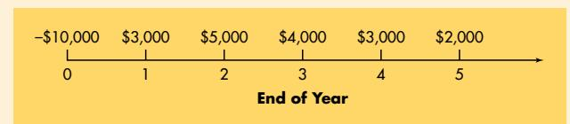

### FIGURE 4.2

Compounding

and Discounting

Time line showing

compounding to find future

value and discounting to find

present value

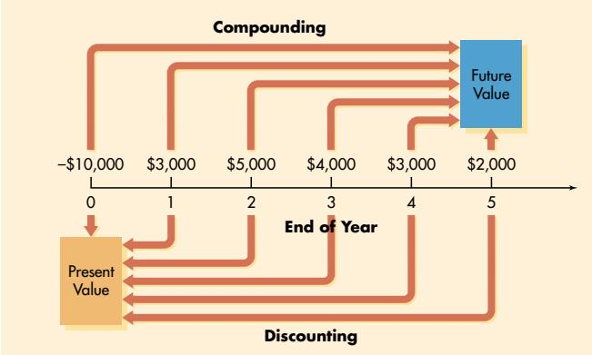

at the end of the investment's 5-year life. Alternatively, the present value technique uses discounting to find the present value of each cash flow at time zero and then sums these values to find the investment's value today. Application of this approach is depicted below the time line in Figure 4.2.

The meaning and mechanics of compounding to find future value and of discounting to find present value are covered in this chapter. Although future value and present value result in the same decisions, financial managers—because they make decisions at time zero—tend to rely primarily on present value techniques.

## Computational Tools

Time-consuming calculations are often involved in finding future and present values. Although you should understand the concepts and mathematics underlying these calculations, the application of time value techniques can be streamlined. We focus on the use of financial tables, hand-held financial calculators, and computers and spreadsheets as aids in computation.

## Financial Tables

Financial tables include various future and present value interest factors that simplify time value calculations. The values shown in these tables are easily developed from formulas, with various degrees of rounding. The tables are typically indexed by the interest rate (in columns) and the number of periods (in rows). Figure 4.3 shows this general layout. The interest factor at a 20 percent interest rate for 10 years would be found at the intersection of the 20% column and the 10-period row, as shown by the dark blue box. A full set of the four basic financial tables is included in Appendix A at the end of the book. These tables are described more fully later in the chapter.

### FIGURE 4.3

Financial Tables Layout and use of a financial table

<table border=1 style='margin: auto; word-wrap: break-word;'><tr><td colspan="9">Interest Rate \downarrow</td></tr><tr><td style='text-align: center; word-wrap: break-word;'>Period</td><td style='text-align: center; word-wrap: break-word;'>1%</td><td style='text-align: center; word-wrap: break-word;'>2%</td><td style='text-align: center; word-wrap: break-word;'>...</td><td style='text-align: center; word-wrap: break-word;'>10%</td><td style='text-align: center; word-wrap: break-word;'>...</td><td style='text-align: center; word-wrap: break-word;'>20%</td><td style='text-align: center; word-wrap: break-word;'>...</td><td style='text-align: center; word-wrap: break-word;'>50%</td></tr><tr><td style='text-align: center; word-wrap: break-word;'>1</td><td style='text-align: center; word-wrap: break-word;'></td><td style='text-align: center; word-wrap: break-word;'></td><td style='text-align: center; word-wrap: break-word;'>...</td><td style='text-align: center; word-wrap: break-word;'></td><td style='text-align: center; word-wrap: break-word;'>...</td><td style='text-align: center; word-wrap: break-word;'>:</td><td style='text-align: center; word-wrap: break-word;'>...</td><td style='text-align: center; word-wrap: break-word;'></td></tr><tr><td style='text-align: center; word-wrap: break-word;'>2</td><td style='text-align: center; word-wrap: break-word;'></td><td style='text-align: center; word-wrap: break-word;'></td><td style='text-align: center; word-wrap: break-word;'>...</td><td style='text-align: center; word-wrap: break-word;'></td><td style='text-align: center; word-wrap: break-word;'>...</td><td style='text-align: center; word-wrap: break-word;'>:</td><td style='text-align: center; word-wrap: break-word;'>...</td><td style='text-align: center; word-wrap: break-word;'></td></tr><tr><td style='text-align: center; word-wrap: break-word;'>3</td><td style='text-align: center; word-wrap: break-word;'></td><td style='text-align: center; word-wrap: break-word;'></td><td style='text-align: center; word-wrap: break-word;'>...</td><td style='text-align: center; word-wrap: break-word;'></td><td style='text-align: center; word-wrap: break-word;'>...</td><td style='text-align: center; word-wrap: break-word;'>:</td><td style='text-align: center; word-wrap: break-word;'>...</td><td style='text-align: center; word-wrap: break-word;'></td></tr><tr><td style='text-align: center; word-wrap: break-word;'>:</td><td style='text-align: center; word-wrap: break-word;'>:</td><td style='text-align: center; word-wrap: break-word;'>:</td><td style='text-align: center; word-wrap: break-word;'>...</td><td style='text-align: center; word-wrap: break-word;'>:</td><td style='text-align: center; word-wrap: break-word;'>...</td><td style='text-align: center; word-wrap: break-word;'>:</td><td style='text-align: center; word-wrap: break-word;'>...</td><td style='text-align: center; word-wrap: break-word;'>:</td></tr><tr><td style='text-align: center; word-wrap: break-word;'>→10</td><td style='text-align: center; word-wrap: break-word;'>...</td><td style='text-align: center; word-wrap: break-word;'>...</td><td style='text-align: center; word-wrap: break-word;'>...</td><td style='text-align: center; word-wrap: break-word;'>...</td><td style='text-align: center; word-wrap: break-word;'>...</td><td style='text-align: center; word-wrap: break-word;'>X.XXX</td><td style='text-align: center; word-wrap: break-word;'>...</td><td style='text-align: center; word-wrap: break-word;'>...</td></tr><tr><td style='text-align: center; word-wrap: break-word;'>:</td><td style='text-align: center; word-wrap: break-word;'>:</td><td style='text-align: center; word-wrap: break-word;'>:</td><td style='text-align: center; word-wrap: break-word;'>...</td><td style='text-align: center; word-wrap: break-word;'>:</td><td style='text-align: center; word-wrap: break-word;'>...</td><td style='text-align: center; word-wrap: break-word;'>:</td><td style='text-align: center; word-wrap: break-word;'>...</td><td style='text-align: center; word-wrap: break-word;'>:</td></tr><tr><td style='text-align: center; word-wrap: break-word;'>20</td><td style='text-align: center; word-wrap: break-word;'></td><td style='text-align: center; word-wrap: break-word;'></td><td style='text-align: center; word-wrap: break-word;'>...</td><td style='text-align: center; word-wrap: break-word;'></td><td style='text-align: center; word-wrap: break-word;'>...</td><td style='text-align: center; word-wrap: break-word;'></td><td style='text-align: center; word-wrap: break-word;'>...</td><td style='text-align: center; word-wrap: break-word;'></td></tr><tr><td style='text-align: center; word-wrap: break-word;'>:</td><td style='text-align: center; word-wrap: break-word;'>:</td><td style='text-align: center; word-wrap: break-word;'>:</td><td style='text-align: center; word-wrap: break-word;'>...</td><td style='text-align: center; word-wrap: break-word;'>:</td><td style='text-align: center; word-wrap: break-word;'>...</td><td style='text-align: center; word-wrap: break-word;'>:</td><td style='text-align: center; word-wrap: break-word;'>...</td><td style='text-align: center; word-wrap: break-word;'>:</td></tr><tr><td style='text-align: center; word-wrap: break-word;'>50</td><td style='text-align: center; word-wrap: break-word;'></td><td style='text-align: center; word-wrap: break-word;'></td><td style='text-align: center; word-wrap: break-word;'>...</td><td style='text-align: center; word-wrap: break-word;'></td><td style='text-align: center; word-wrap: break-word;'>...</td><td style='text-align: center; word-wrap: break-word;'></td><td style='text-align: center; word-wrap: break-word;'>...</td><td style='text-align: center; word-wrap: break-word;'></td></tr></table>

## Financial Calculators

Financial calculators also can be used for time value computations. Generally, financial calculators include numerous preprogrammed financial routines. This chapter and those that follow show the keystrokes for calculating interest factors and making other financial computations. For convenience, we use the important financial keys, labeled in a fashion consistent with most major financial calculators.

We focus primarily on the keys pictured and defined in Figure 4.4. We typically use four of the first five keys shown in the left column, along with the compute (CPT) key. One of the four keys represents the unknown value being calculated. (Occasionally, all five of the keys are used, with one representing the unknown value.) The keystrokes on some of the more sophisticated calculators are menu-driven: After you select the appropriate routine, the calculator prompts you to input each value; on these calculators, a compute key is not needed to obtain a solution. Regardless, any calculator with the basic future and present value functions can be used in lieu of financial tables. The keystrokes for other financial calculators are explained in the reference guides that accompany them.

Once you understand the basic underlying concepts, you probably will want to use a calculator to streamline routine financial calculations. With a little prac-

FIGURE 4.4

Calculator Keys

Important financial keys

on the typical calculator

N — Number of periods

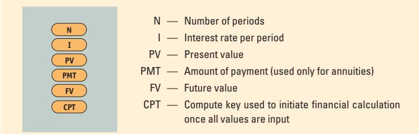

PMT — Amount of payment (used only for annuities)

CPT — Compute key used to initiate financial calculation once all values are input

notice, you can increase both the speed and the accuracy of your financial computations. Note that because of a calculator's greater precision, slight differences are likely to exist between values calculated by using financial tables and those found with a financial calculator. Remember that conceptual understanding of the material is the objective. An ability to solve problems with the aid of a calculator does not necessarily reflect such an understanding, so don't just settle for answers. Work with the material until you are sure you also understand the concepts.

Hint Anyone familiar with electronic spreadsheets, such as Lotus or Excel, realizes that most of the time-value-of-money calculations can be done expeditiously by using the special functions contained in the spreadsheet.

## Computers and Spreadsheets

Like financial calculators, computers and spreadsheets have built-in routines that simplify time value calculations. We provide in the text a number of spreadsheet solutions that identify the cell entries for calculating time values. The value for each variable is entered in a cell in the spreadsheet, and the calculation is programmed using an equation that links the individual cells. If values of the variables are changed, the solution automatically changes as a result of the equation linking the cells. In the spreadsheet solutions in this book, the equation that determines the calculation is shown at the bottom of the spreadsheet.

It is important that you become familiar with the use of spreadsheets for several reasons.

- Spreadsheets go far beyond the computational abilities of calculators. They offer a host of routines for important financial and statistical relationships. They perform complex analyses, for example, that evaluate the probabilities of success and the risks of failure for management decisions.

- Spreadsheets have the ability to program logical decisions. They make it possible to automate the choice of the best option from among two or more alternatives. We give several examples of this ability to identify the optimal selection among alternative investments and to decide what level of credit to extend to customers.

- Spreadsheets display not only the calculated values of solutions but also the input conditions on which solutions are based. The linkage between a spreadsheet's cells makes it possible to do sensitivity analysis—that is, to evaluate the impacts of changes in conditions on the values of the solutions. Managers, after all, are seldom interested simply in determining a single value for a given set of conditions. Conditions change, and managers who are not prepared to react quickly to take advantage of changes must suffer their consequences.

- Spreadsheets encourage teamwork. They assemble details from different corporate divisions and consolidate them into a firm's financial statements and cash budgets. They integrate information from marketing, manufacturing, and other functional organizations to evaluate capital investments. Laptop computers provide the portability to transport these abilities and use spreadsheets wherever one might be—attending an important meeting at a firm's headquarters or visiting a distant customer or supplier.

- Spreadsheets enhance learning. Creating spreadsheets promotes one's understanding of a subject. Because spreadsheets are interactive, one gets an

immediate response to one's entries. The interplay between computer and user becomes a game that many find both enjoyable and instructive.

- Finally, spreadsheets communicate as well as calculate. Their output includes tables and charts that can be incorporated into reports. They interplay with immense databases that corporations use for directing and controlling global operations. They are the nearest thing we have to a universal business language.

The ability to use spreadsheets has become a prime skill for today's managers. As the saying goes, “Get aboard the bandwagon, or get run over.” The spreadsheet solutions we present in this book will help you climb up onto that bandwagon!

## Basic Patterns of Cash Flow

The cash flow—both inflows and outflows—of a firm can be described by its general pattern. It can be defined as a single amount, an annuity, or a mixed stream.

Single amount: A lump-sum amount either currently held or expected at some future date. Examples include $1,000 today and $650 to be received at the end of 10 years.

Annuity: A level periodic stream of cash flow. For our purposes, we'll work primarily with annual cash flows. Examples include either paying out or receiving $800 at the end of each of the next 7 years.

Mixed stream: A stream of cash flow that is not an annuity; a stream of unequal periodic cash flows that reflect no particular pattern. Examples include the following two cash flow streams A and B.

<table border=1 style='margin: auto; word-wrap: break-word;'><tr><td rowspan="2">End of year</td><td colspan="2">Mixed cash flow stream</td></tr><tr><td style='text-align: center; word-wrap: break-word;'>A</td><td style='text-align: center; word-wrap: break-word;'>B</td></tr><tr><td style='text-align: center; word-wrap: break-word;'>1</td><td style='text-align: center; word-wrap: break-word;'>$ 100</td><td style='text-align: center; word-wrap: break-word;'>-$ 50</td></tr><tr><td style='text-align: center; word-wrap: break-word;'>2</td><td style='text-align: center; word-wrap: break-word;'>800</td><td style='text-align: center; word-wrap: break-word;'>100</td></tr><tr><td style='text-align: center; word-wrap: break-word;'>3</td><td style='text-align: center; word-wrap: break-word;'>1,200</td><td style='text-align: center; word-wrap: break-word;'>80</td></tr><tr><td style='text-align: center; word-wrap: break-word;'>4</td><td style='text-align: center; word-wrap: break-word;'>1,200</td><td style='text-align: center; word-wrap: break-word;'>- 60</td></tr><tr><td style='text-align: center; word-wrap: break-word;'>5</td><td style='text-align: center; word-wrap: break-word;'>1,400</td><td style='text-align: center; word-wrap: break-word;'></td></tr><tr><td style='text-align: center; word-wrap: break-word;'>6</td><td style='text-align: center; word-wrap: break-word;'>300</td><td style='text-align: center; word-wrap: break-word;'></td></tr></table>

Note that neither cash flow stream has equal, periodic cash flows and that A is a 6-year mixed stream and B is a 4-year mixed stream.

In the next three sections of this chapter, we develop the concepts and techniques for finding future and present values of single amounts, annuities, and mixed streams, respectively. Detailed demonstrations of these cash flow patterns are included.

## Review Questions

4–1 What is the difference between future value and present value? Which approach is generally preferred by financial managers? Why?

4–2 Define and differentiate among the three basic patterns of cash flow: (1) a single amount, (2) an annuity, and (3) a mixed stream.

### LG2 4.2 Single Amounts

## compound interest

Interest that is earned on a given deposit and has become part of the principal at the end of a specified period.

The most basic future value and present value concepts and computations concern single amounts, either present or future amounts. We begin by considering the future value of present amounts. Then we will use the underlying concepts to learn how to determine the present value of future amounts. You will see that although future value is more intuitively appealing, present value is more useful in financial decision making.

The value of a present amount at a future date, found by applying compound interest over a specified period of time.

## future value

The amount of money on which interest is paid.

## principal

## Future Value of a Single Amount

Imagine that at age 25 you began making annual purchases of $2,000 of an investment that earns a guaranteed 5 percent annually. At the end of 40 years, at age 65, you would have invested a total of $80,000 (40 years × $2,000 per year). Assuming that all funds remain invested, how much would you have accumulated at the end of the fortieth year? $100,000? $150,000? $200,000? No, your $80,000 would have grown to $242,000! Why? Because the time value of money allowed your investments to generate returns that built on each other over the 40 years.

## The Concept of Future Value

We speak of compound interest to indicate that the amount of interest earned on a given deposit has become part of the principal at the end of a specified period. The term principal refers to the amount of money on which the interest is paid. Annual compounding is the most common type.

The future value of a present amount is found by applying compound interest over a specified period of time. Savings institutions advertise compound interest returns at a rate of x percent, or x percent interest, compounded annually, semiannually, quarterly, monthly, weekly, daily, or even continuously. The concept of future value with annual compounding can be illustrated by a simple example.

If Fred Moreno places $100 in a savings account paying 8% interest compounded annually, at the end of 1 year he will have $108 in the account—the initial principal of $100 plus 8% ($8) in interest. The future value at the end of the first year is calculated by using Equation 4.1:

## EXAMPLE

 $$ \mathrm{F u t u r e~v a l u e~a t~e n d~o f~y e a r~}1=\100\times(1+0.08)=\108 $$ 

If Fred were to leave this money in the account for another year, he would be paid interest at the rate of 8% on the new principal of $108. At the end of this

second year there would be $116.64 in the account. This amount would represent the principal at the beginning of year 2 ($108) plus 8% of the $108 ($8.64) in interest. The future value at the end of the second year is calculated by using Equation 4.2:

 $$ \begin{aligned}Future~value~at~end~of~year~2&=\108\times(1+0.08)\\&=\116.64\end{aligned} $$ 

Substituting the expression between the equals signs in Equation 4.1 for the $108 figure in Equation 4.2 gives us Equation 4.3:

 $$ \begin{aligned}Future~value~at~end~of~year~2&=\100\times(1+0.08)\times(1+0.08)\\&=\100\times(1+0.08)^{2}\\&=\116.64\end{aligned} $$ 

The equations in the preceding example lead to a more general formula for calculating future value.

## The Equation for Future Value

Time line for future value of a single amount ($800 initial principal, earning 6%, at the end of 5 years)

The basic relationship in Equation 4.3 can be generalized to find the future value after any number of periods. We use the following notation for the various inputs:

 $ FV_{n} $ = future value at the end of period n

PV = initial principal, or present value

i=annual rate of interest paid. (Note: On financial calculators, I is typically used to represent this rate.)

n = number of periods (typically years) that the money is left on deposit

The general equation for the future value at the end of period n is

 $$ FV_{n}=PV\times(1+i)^{n} $$ 

A simple example will illustrate how to apply Equation 4.4.

## EXAMPLE

Jane Farber places 800 in a savings account paying 6% interest compounded annually. She wants to know how much money will be in the account at the end of 5 years. Substituting  $ PV = \800 $, i = 0.06, and n = 5 into Equation 4.4 gives the amount at the end of year 5.

 $$ FV_{5}=\800\times(1+0.06)^{5}=\800\times(1.338)=\1,070.40 $$ 

This analysis can be depicted on a time line as follows:

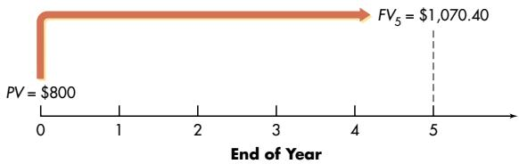

future value interest factor

The multiplier used to calculate, at a specified interest rate, the future value of a present amount as of a given time.

## Using Computational Tools to Find Future Value

Solving the equation in the preceding example involves raising 1.06 to the fifth power. Using a future value interest table or a financial calculator or a computer and spreadsheet greatly simplifies the calculation. A table that provides values for  $ (1+i)^n $ in Equation 4.4 is included near the back of the book in Appendix Table A-1. The value in each cell of the table is called the future value interest factor. This factor is the multiplier used to calculate, at a specified interest rate, the future value of a present amount as of a given time. The future value interest factor for an initial principal of 1 compounded at i percent for n periods is referred to as  $ FVIF_{i,n} $.

 $$ Future~value~interest~factor=FVIF_{i,n}=(1+i)^{n} $$ 

By finding the intersection of the annual interest rate, i, and the appropriate periods, n, you will find the future value interest factor that is relevant to a particular problem. $ ^{1} $ Using  $ FVIF_{i,n} $ as the appropriate factor, we can rewrite the general equation for future value (Equation 4.4) as follows:

 $$ FV_{n}=PV\times(FVIF_{i,n}) $$ 

This expression indicates that to find the future value at the end of period $n$ of an initial deposit, we have merely to multiply the initial deposit, $PV$, by the appropriate future value interest factor.$^{2}$

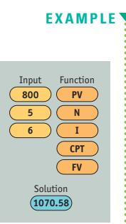

In the preceding example, Jane Farber placed $800 in her savings account at 6% interest compounded annually and wishes to find out how much will be in the account at the end of 5 years.

Table Use The future value interest factor for an initial principal of 1 on deposit for 5 years at 6% interest compounded annually,  $ FVIF_{6\%,5yrs} $, found in Table A-1, is 1.338. Using Equation 4.6,  $ \800 \times 1.338 = \1,070.40 $. Therefore, the future value of Jane's deposit at the end of year 5 will be 1,070.40.

Calculator Use $ ^{3} $ The financial calculator can be used to calculate the future value directly. $ ^{4} $ First punch in 800 and depress PV; next punch in 5 and depress N; then punch in 6 and depress I (which is equivalent to “i” in our notation) $ ^{5} $; finally, to calculate the future value, depress CPT and then FV. The future value of 1,070.58 should appear on the calculator display as shown at the left. On

### FIGURE 4.5

many calculators, this value will be preceded by a minus sign  $ (-1,070.58) $. If a minus sign appears on your calculator, ignore it here as well as in all other “Calculator Use” illustrations in this text. $ ^{6} $

Future Value Relationship

Interest rates, time periods, and future value of one dollar

Because the calculator is more accurate than the future value factors, which have been rounded to the nearest 0.001, a slight difference—in this case, $0.18—will frequently exist between the values found by these alternative methods. Clearly, the improved accuracy and ease of calculation tend to favor the use of the calculator. (Note: In future examples of calculator use, we will use only a display similar to that shown on the preceding page. If you need a reminder of the procedures involved, go back and review the preceding paragraph.)

Spreadsheet Use The future value of the single amount also can be calculated as shown on the following Excel spreadsheet.

<table border=1 style='margin: auto; word-wrap: break-word;'><tr><td style='text-align: center; word-wrap: break-word;'></td><td style='text-align: center; word-wrap: break-word;'>A</td><td style='text-align: center; word-wrap: break-word;'>B</td></tr><tr><td style='text-align: center; word-wrap: break-word;'>1</td><td colspan="2">FUTURE VALUE OF A SINGLE AMOUNT</td></tr><tr><td style='text-align: center; word-wrap: break-word;'>2</td><td style='text-align: center; word-wrap: break-word;'>Present value</td><td style='text-align: center; word-wrap: break-word;'>$800</td></tr><tr><td style='text-align: center; word-wrap: break-word;'>3</td><td style='text-align: center; word-wrap: break-word;'>Interest rate, pct per year compounded annually</td><td style='text-align: center; word-wrap: break-word;'>6%</td></tr><tr><td style='text-align: center; word-wrap: break-word;'>4</td><td style='text-align: center; word-wrap: break-word;'>Number of years</td><td style='text-align: center; word-wrap: break-word;'>5</td></tr><tr><td style='text-align: center; word-wrap: break-word;'>5</td><td style='text-align: center; word-wrap: break-word;'>Future value</td><td style='text-align: center; word-wrap: break-word;'>$1,070.58</td></tr><tr><td colspan="3">Entry in Cell B5 is =FV(B3,B4,0,-B2,0). The minus sign appears before B2 because the present value is an outflow (i.e., a deposit made by Jane Farber).</td></tr></table>

## A Graphical View of Future Value

Remember that we measure future value at the end of the given period. Figure 4.5 illustrates the relationship among various interest rates, the number of periods interest is earned, and the future value of one dollar. The figure shows that (1) the

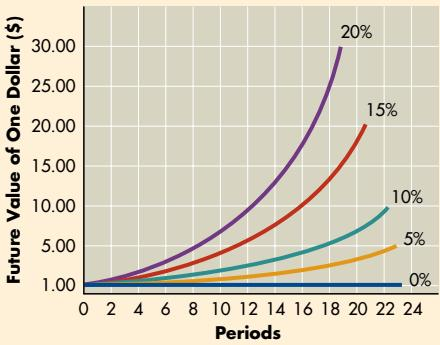

higher the interest rate, the higher the future value, and (2) the longer the period of time, the higher the future value. Note that for an interest rate of 0 percent, the future value always equals the present value ($1.00). But for any interest rate greater than zero, the future value is greater than the present value of $1.00.

The current dollar value of a future amount—the amount of money that would have to be invested today at a given interest rate over a specified period to equal the future amount.

## present value

## Present Value of a Single Amount

It is often useful to determine the value today of a future amount of money. For example, how much would I have to deposit today into an account paying 7 percent annual interest in order to accumulate $3,000 at the end of 5 years? Present value is the current dollar value of a future amount—the amount of money that would have to be invested today at a given interest rate over a specified period to equal the future amount. Present value depends largely on the investment opportunities and the point in time at which the amount is to be received. This section explores the present value of a single amount.

## discounting cash flows

The process of finding present values; the inverse of compounding interest.

## The Concept of Present Value

The process of finding present values is often referred to as discounting cash flows. It is concerned with answering the following question: “If I can earn i percent on my money, what is the most I would be willing to pay now for an opportunity to receive  $ FV_{n} $ dollars n periods from today?”

This process is actually the inverse of compounding interest. Instead of finding the future value of present dollars invested at a given rate, discounting determines the present value of a future amount, assuming an opportunity to earn a certain return on the money. This annual rate of return is variously referred to as the discount rate, required return, cost of capital, and opportunity cost. $ ^{7} $ These terms will be used interchangeably in this text.

## EXAMPLE

Paul Shorter has an opportunity to receive $300 one year from now. If he can earn 6% on his investments in the normal course of events, what is the most he should pay now for this opportunity? To answer this question, Paul must determine how many dollars he would have to invest at 6% today to have $300 one year from now. Letting PV equal this unknown amount and using the same notation as in the future value discussion, we have

 $$ PV\times(1+0.06)=\300 $$ 

Solving Equation 4.7 for PV gives us Equation 4.8:

 $$ \begin{aligned}PV&=\frac{\300}{(1+0.06)}\\&=\283.02\end{aligned} $$ 

The value today (“present value”) of $300 received one year from today, given an opportunity cost of 6%, is $283.02. That is, investing $283.02 today at the 6% opportunity cost would result in $300 at the end of one year.

## The Equation for Present Value

The present value of a future amount can be found mathematically by solving Equation 4.4 for PV. In other words, the present value, PV, of some future amount,  $ FV_{n} $, to be received n periods from now, assuming an opportunity cost of i, is calculated as follows:

Time line for present value of a single amount ($1,700 future amount, discounted at 8%, from the end of 8 years)

## EXAMPLE

 $$ PV=\frac{FV_{n}}{(1+i)^{n}}=FV_{n}\times\left[\frac{1}{(1+i)^{n}}\right] $$ 

Note the similarity between this general equation for present value and the equation in the preceding example (Equation 4.8). Let's use this equation in an example.

present value interest factor

The multiplier used to calculate,

at a specified discount rate, the

present value of an amount to be

received in a future period.

Pam Valenti wishes to find the present value of 1,700 that will be received 8 years from now. Pam’s opportunity cost is 8%. Substituting  $ FV_{8} = \1,700 $, n = 8, and i = 0.08 into Equation 4.9 yields Equation 4.10:

 $$ PV=\frac{\1,700}{(1+0.08)^{8}}=\frac{\1,700}{1.851}=\918.42 $$ 

The following time line shows this analysis.

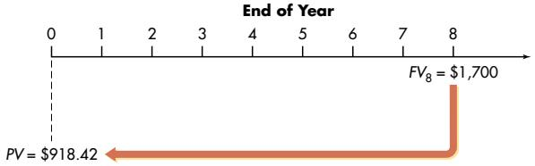

## Using Computational Tools to Find Present Value

The present value calculation can be simplified by using a present value interest factor. This factor is the multiplier used to calculate, at a specified discount rate, the present value of an amount to be received in a future period. The present value interest factor for the present value of 1 discounted at i percent for n periods is referred to as  $ PVIF_{i,n} $.

 $$  Present~value~interest~factor=PVIF_{i,n}=\frac{1}{(1+i)^{n}} $$ 

Appendix Table A–2 presents present value interest factors for 1. By letting  $ PVIF_{i,n} $ represent the appropriate factor, we can rewrite the general equation for present value (Equation 4.9) as follows:

 $$ PV=FV_{n}\times(PVIF_{i,n}) $$ 

This expression indicates that to find the present value of an amount to be received in a future period, $n$, we have merely to multiply the future amount, $FV_{n}$, by the appropriate present value interest factor.

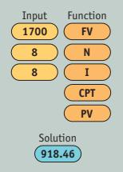

As noted, Pam Valenti wishes to find the present value of $1,700 to be received 8 years from now, assuming an 8% opportunity cost.

Table Use The present value interest factor for 8% and 8 years,  $ PVIF_{8} $, 8 yrs, found in Table A-2, is 0.540. Using Equation 4.12, 1,700 \times 0.540 = \918. The present value of the 1,700 Pam expects to receive in 8 years is \918.

Calculator Use Using the calculator's financial functions and the inputs shown at the left, you should find the present value to be $918.46. The value obtained with the calculator is more accurate than the values found using the equation or the table, although for the purposes of this text, these differences are insignificant.

Spreadsheet Use The present value of the single future amount also can be calculated as shown on the following Excel spreadsheet.

<table border=1 style='margin: auto; word-wrap: break-word;'><tr><td style='text-align: center; word-wrap: break-word;'></td><td style='text-align: center; word-wrap: break-word;'>A</td><td style='text-align: center; word-wrap: break-word;'>B</td></tr><tr><td style='text-align: center; word-wrap: break-word;'>1</td><td colspan="2">PRESENT VALUE OF A SINGLE FUTURE AMOUNT</td></tr><tr><td style='text-align: center; word-wrap: break-word;'>2</td><td style='text-align: center; word-wrap: break-word;'>Future value</td><td style='text-align: center; word-wrap: break-word;'>$1,700</td></tr><tr><td style='text-align: center; word-wrap: break-word;'>3</td><td style='text-align: center; word-wrap: break-word;'>Interest rate, pct per year compounded annually</td><td style='text-align: center; word-wrap: break-word;'>8%</td></tr><tr><td style='text-align: center; word-wrap: break-word;'>4</td><td style='text-align: center; word-wrap: break-word;'>Number of years</td><td style='text-align: center; word-wrap: break-word;'>8</td></tr><tr><td style='text-align: center; word-wrap: break-word;'>5</td><td style='text-align: center; word-wrap: break-word;'>Present value</td><td style='text-align: center; word-wrap: break-word;'>$918.46</td></tr><tr><td colspan="3">Entry in Cell B5 is =—PV(B3,B4,0,B2). The minus sign appears before PV to change the present value to a positive amount.</td></tr></table>

## A Graphical View of Present Value

Remember that present value calculations assume that the future values are measured at the end of the given period. The relationships among the factors in a present value calculation are illustrated in Figure 4.6. The figure clearly shows that, everything else being equal, (1) the higher the discount rate, the lower the

### FIGURE 4.6

Present Value Relationship

Discount rates, time periods, and present value of one dollar

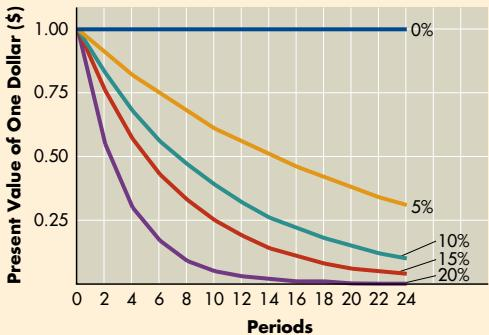

present value, and (2) the longer the period of time, the lower the present value. Also note that given a discount rate of 0 percent, the present value always equals the future value ($1.00). But for any discount rate greater than zero, the present value is less than the future value of $1.00.

## Comparing Present Value and Future Value

We will close this section with some important observations about present values. One is that the expression for the present value interest factor for $i$ percent and $n$ periods, $1/(1+i)^n$, is the inverse of the future value interest factor for $i$ percent and $n$ periods, $(1+i)^n$. You can confirm this very simply: Divide a present value interest factor for $i$ percent and $n$ periods, $PVIF_{i,n}$, given in Table A-2, into 1.0, and compare the resulting value to the future value interest factor given in Table A-1 for $i$ percent and $n$ periods, $FVIF_{i,n}$. The two values should be equivalent.

Second, because of the relationship between present value interest factors and future value interest factors, we can find the present value interest factors given a table of future value interest factors, and vice versa. For example, the future value interest factor (from Table A-1) for 10 percent and 5 periods is 1.611. Dividing this value into 1.0 yields 0.621, which is the present value interest factor (given in Table A-2) for 10 percent and 5 periods.

## Review Questions

4–3 How is the compounding process related to the payment of interest on savings? What is the general equation for future value?

4–4 What effect would a decrease in the interest rate have on the future value of a deposit? What effect would an increase in the holding period have on future value?

4–5 What is meant by “the present value of a future amount”? What is the general equation for present value?

4–6 What effect does increasing the required return have on the present value of a future amount? Why?

4–7 How are present value and future value calculations related?

### 4.3 Annuities

## annuity

A stream of equal periodic cash flows, over a specified time period. These cash flows can be inflows of returns earned on investments or outflows of funds invested to earn future returns.

How much will you have at the end of 5 years if your employer withholds and invests $1,000 of your year-end bonus at the end of each of the next 5 years, guaranteeing you a 9 percent annual rate of return? How much would you pay today, given that you can earn 7 percent on low-risk investments, to receive a guaranteed $3,000 at the end of each of the next 20 years? To answer these questions, you need to understand the application of the time value of money to annuities.

An annuity is a stream of equal periodic cash flows, over a specified time period. These cash flows are usually annual but can occur at other intervals, such as monthly (rent, car payments). The cash flows in an annuity can be inflows (the

## ordinary annuity

An annuity for which the cash flow occurs at the end of each period.

## annuity due

An annuity for which the cash flow occurs at the beginning of each period.

$3,000 received at the end of each of the next 20 years) or outflows (the $1,000 invested at the end of each of the next 5 years).

## Types of Annuities

## EXAMPLE

There are two basic types of annuities. For an ordinary annuity, the cash flow occurs at the end of each period. For an annuity due, the cash flow occurs at the beginning of each period.

Fran Abrams is choosing which of two annuities to receive. Both are 5-year, $1,000 annuities; annuity A is an ordinary annuity, and annuity B is an annuity due. To better understand the difference between these annuities, she has listed their cash flows in Table 4.1. Note that the amount of each annuity totals $5,000. The two annuities differ in the timing of their cash flows: The cash flows are received sooner with the annuity due than with the ordinary annuity.

Although the cash flows of both annuities in Table 4.1 total $5,000, the annuity due would have a higher future value than the ordinary annuity, because each of its five annual cash flows can earn interest for one year more than each of the ordinary annuity's cash flows. In general, as will be demonstrated later in this chapter, both the future value and the present value of an annuity due are always greater than the future value and the present value, respectively, of an otherwise identical ordinary annuity.

Because ordinary annuities are more frequently used in finance, unless otherwise specified, the term annuity is intended throughout this book to refer to ordinary annuities.

## Finding the Future Value of an Ordinary Annuity

The calculations required to find the future value of an ordinary annuity are illustrated in the following example.

TABLE 4.1 Comparison of Ordinary Annuity and Annuity Due Cash Flows ($1,000, 5 Years)

<table border=1 style='margin: auto; word-wrap: break-word;'><tr><td rowspan="2">End of year $ ^{{a}} $</td><td colspan="2">Annual cash flows</td></tr><tr><td style='text-align: center; word-wrap: break-word;'>Annuity A (ordinary)</td><td style='text-align: center; word-wrap: break-word;'>Annuity B (annuity due)</td></tr><tr><td style='text-align: center; word-wrap: break-word;'>0</td><td style='text-align: center; word-wrap: break-word;'>0</td><td style='text-align: center; word-wrap: break-word;'>1,000</td></tr><tr><td style='text-align: center; word-wrap: break-word;'>1</td><td style='text-align: center; word-wrap: break-word;'>1,000</td><td style='text-align: center; word-wrap: break-word;'>1,000</td></tr><tr><td style='text-align: center; word-wrap: break-word;'>2</td><td style='text-align: center; word-wrap: break-word;'>1,000</td><td style='text-align: center; word-wrap: break-word;'>1,000</td></tr><tr><td style='text-align: center; word-wrap: break-word;'>3</td><td style='text-align: center; word-wrap: break-word;'>1,000</td><td style='text-align: center; word-wrap: break-word;'>1,000</td></tr><tr><td style='text-align: center; word-wrap: break-word;'>4</td><td style='text-align: center; word-wrap: break-word;'>1,000</td><td style='text-align: center; word-wrap: break-word;'>1,000</td></tr><tr><td style='text-align: center; word-wrap: break-word;'>5</td><td style='text-align: center; word-wrap: break-word;'>1,000</td><td style='text-align: center; word-wrap: break-word;'>0</td></tr><tr><td style='text-align: center; word-wrap: break-word;'>Totals</td><td style='text-align: center; word-wrap: break-word;'>5,000</td><td style='text-align: center; word-wrap: break-word;'>5,000</td></tr></table>

 $ ^{a} $The ends of years 0, 1, 2, 3, 4, and 5 are equivalent to the beginnings of years 1, 2, 3, 4, 5, and 6, respectively.

EXAMPLE

Time line for future value of an ordinary annuity ($1,000 end-of-year deposit, earning 7%, at the end of 5 years)

Fran Abrams wishes to determine how much money she will have at the end of 5 years if he chooses annuity A, the ordinary annuity. It represents deposits of $1,000 annually, at the end of each of the next 5 years, into a savings account paying 7% annual interest. This situation is depicted on the following time line:

future value interest factor for an ordinary annuity The multiplier used to calculate the future value of an ordinary annuity at a specified interest rate over a given period of time.

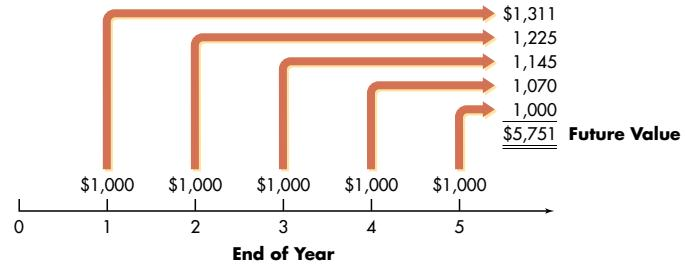

As the figure shows, at the end of year 5, Fran will have $5,751 in her account. Note that because the deposits are made at the end of the year, the first deposit will earn interest for 4 years, the second for 3 years, and so on.

## Using Computational Tools to Find the Future Value of an Ordinary Annuity

Annuity calculations can be simplified by using an interest table or a financial calculator or a computer and spreadsheet. A table for the future value of a 1 ordinary annuity is given in Appendix Table A–3. The factors in the table are derived by summing the future value interest factors for the appropriate number of years. For example, the factor for the annuity in the preceding example is the sum of the factors for the five years (years 4 through 0):  $ 1.311 + 1.225 + 1.145 + 1.070 + 1.000 = 5.751 $. Because the deposits occur at the end of each year, they will earn interest from the end of the year in which each occurs to the end of year 5. Therefore, the first deposit earns interest for 4 years (end of year 1 through end of year 5), and the last deposit earns interest for zero years. The future value interest factor for zero years at any interest rate,  $ FVIF_{i,0} $, is 1.000, as we have noted. The formula for the future value interest factor for an ordinary annuity when interest is compounded annually at i percent for n periods,  $ FVIFA_{i,n} $, is $ ^{8} $

 $$ FVIFA_{i,n}=\sum_{t=1}^{n}(1+i)^{t-1} $$ 

 $$ FVIFA_{i,n}=\frac{1}{i}\times[(1+i)^{n}-1] $$ 

This factor is the multiplier used to calculate the future value of an ordinary annuity at a specified interest rate over a given period of time.

Using  $ FVA_{n} $ for the future value of an n-year annuity, PMT for the amount to be deposited annually at the end of each year, and  $ FVIFA_{i,n} $ for the appropriate future value interest factor for a one-dollar ordinary annuity compounded at i percent for n years, we can express the relationship among these variables alternatively as

 $$ FVA_{n}=PMT\times(FVIFA_{i,n}) $$ 

EXAMPLE

The following example illustrates this calculation using a table, a calculator, and a spreadsheet.

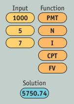

As noted earlier, Fran Abrams wishes to find the future value  $ (FVA_{n}) $ at the end of 5 years (n) of an annual end-of-year deposit of 1,000 (PMT) into an account paying 7% annual interest (i) during the next 5 years.

Table Use The future value interest factor for an ordinary 5-year annuity at 7% (FVIFA $ _{7\%,5yrs} $), found in Table A-3, is 5.751. Using Equation 4.14, the 1,000 deposit  $ \times $ 5.751 results in a future value for the annuity of 5,751.

Calculator Use Using the calculator inputs shown at the left, you will find the future value of the ordinary annuity to be $5,750.74, a slightly more precise answer than that found using the table.

Spreadsheet Use The future value of the ordinary annuity also can be calculated as shown on the following Excel spreadsheet.

<table border=1 style='margin: auto; word-wrap: break-word;'><tr><td style='text-align: center; word-wrap: break-word;'></td><td style='text-align: center; word-wrap: break-word;'>A</td><td style='text-align: center; word-wrap: break-word;'>B</td></tr><tr><td style='text-align: center; word-wrap: break-word;'>1</td><td colspan="2">FUTURE VALUE OF AN ORDINARY ANNUITY</td></tr><tr><td style='text-align: center; word-wrap: break-word;'>2</td><td style='text-align: center; word-wrap: break-word;'>Annual payment</td><td style='text-align: center; word-wrap: break-word;'>$1,000</td></tr><tr><td style='text-align: center; word-wrap: break-word;'>3</td><td style='text-align: center; word-wrap: break-word;'>Annual rate of interest, compounded annually</td><td style='text-align: center; word-wrap: break-word;'>7%</td></tr><tr><td style='text-align: center; word-wrap: break-word;'>4</td><td style='text-align: center; word-wrap: break-word;'>Number of years</td><td style='text-align: center; word-wrap: break-word;'>5</td></tr><tr><td style='text-align: center; word-wrap: break-word;'>5</td><td style='text-align: center; word-wrap: break-word;'>Future value of an ordinary annuity</td><td style='text-align: center; word-wrap: break-word;'>$5,750.74</td></tr><tr><td colspan="3">Entry in Cell B5 is =FV(B3,B4,-B2) The minus sign appears before B2 because the annual payment is a cash outflow.</td></tr></table>

## Finding the Present Value of an Ordinary Annuity

Quite often in finance, there is a need to find the present value of a stream of cash flows to be received in future periods. An annuity is, of course, a stream of equal periodic cash flows. (We’ll explore the case of mixed streams of cash flows in a later section.) The method for finding the present value of an ordinary annuity is similar to the method just discussed. There are long and short methods for making this calculation.

EXAMPLE

Time line for present value of an ordinary annuity ($700 end-of-year cash flows, discounted at 8%, over 5 years)

Braden Company, a small producer of plastic toys, wants to determine the most it should pay to purchase a particular ordinary annuity. The annuity consists of cash flows of $700 at the end of each year for 5 years. The firm requires the annuity to provide a minimum return of 8%. This situation is depicted on the following time line:

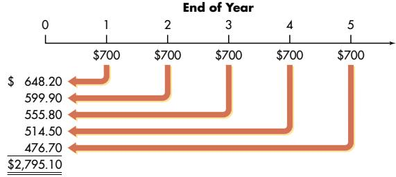

Table 4.2 shows the long method for finding the present value of the annuity. This method involves finding the present value of each payment and summing them. This procedure yields a present value of $2,795.10.

## Using Computational Tools to Find the Present Value of an Ordinary Annuity

Annuity calculations can be simplified by using an interest table for the present value of an annuity, a financial calculator, or a computer and spreadsheet. The values for the present value of a $1 ordinary annuity are given in Appendix Table A–4. The factors in the table are derived by summing the present value interest

TABLE 4.2 The Long Method for Finding the Present Value of an Ordinary Annuity

<table border=1 style='margin: auto; word-wrap: break-word;'><tr><td style='text-align: center; word-wrap: break-word;'>Year (n)</td><td style='text-align: center; word-wrap: break-word;'>Cash flow (1)</td><td style='text-align: center; word-wrap: break-word;'>$ PVIF_{{8\%},n} $ $ ^{{a}} $ (2)</td><td style='text-align: center; word-wrap: break-word;'>Present value [(1)  $ \times $ (2)] (3)</td></tr><tr><td style='text-align: center; word-wrap: break-word;'>1</td><td style='text-align: center; word-wrap: break-word;'>700</td><td style='text-align: center; word-wrap: break-word;'>0.926</td><td style='text-align: center; word-wrap: break-word;'>648.20</td></tr><tr><td style='text-align: center; word-wrap: break-word;'>2</td><td style='text-align: center; word-wrap: break-word;'>700</td><td style='text-align: center; word-wrap: break-word;'>0.857</td><td style='text-align: center; word-wrap: break-word;'>599.90</td></tr><tr><td style='text-align: center; word-wrap: break-word;'>3</td><td style='text-align: center; word-wrap: break-word;'>700</td><td style='text-align: center; word-wrap: break-word;'>0.794</td><td style='text-align: center; word-wrap: break-word;'>555.80</td></tr><tr><td style='text-align: center; word-wrap: break-word;'>4</td><td style='text-align: center; word-wrap: break-word;'>700</td><td style='text-align: center; word-wrap: break-word;'>0.735</td><td style='text-align: center; word-wrap: break-word;'>514.50</td></tr><tr><td style='text-align: center; word-wrap: break-word;'>5</td><td style='text-align: center; word-wrap: break-word;'>700</td><td style='text-align: center; word-wrap: break-word;'>0.681</td><td style='text-align: center; word-wrap: break-word;'>476.70</td></tr><tr><td style='text-align: center; word-wrap: break-word;'></td><td style='text-align: center; word-wrap: break-word;'></td><td style='text-align: center; word-wrap: break-word;'>Present value of annuity</td><td style='text-align: center; word-wrap: break-word;'>2,795.10</td></tr></table>

 $ ^{a} $Present value interest factors at 8% are from Table A–2.

present value interest factor for an ordinary annuity

The multiplier used to calculate the present value of an ordinary annuity at a specified discount rate over a given period of time.

factors (in Table A-2) for the appropriate number of years at the given discount rate. The formula for the present value interest factor for an ordinary annuity with cash flows that are discounted at i percent for n periods,  $ PVIFA_{i,n} $, is $ ^{9} $

 $$ PVIFA_{i,n}=\sum_{t=1}^{n}\frac{1}{(1+i)^{t}} $$ 

This factor is the multiplier used to calculate the present value of an ordinary annuity at a specified discount rate over a given period of time.

By letting  $ PVA_{n} $ equal the present value of an n-year ordinary annuity, letting PMT equal the amount to be received annually at the end of each year, and letting  $ PVIFA_{i,n} $ represent the appropriate present value interest factor for a one-dollar ordinary annuity discounted at i percent for n years, we can express the relationship among these variables as

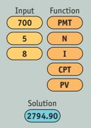

 $$ PVA_{n}=PMT\times(PVIFA_{i,n}) $$ 

EXAMPLE

The following example illustrates this calculation using a table, a calculator, and a spreadsheet.

Braden Company, as we have noted, wants to find the present value of a 5-year ordinary annuity of $700, assuming an 8% opportunity cost.

Table Use The present value interest factor for an ordinary annuity at 8% for 5 years (PVIFA $ _{8\%,5yrs} $), found in Table A–4, is 3.993. If we use Equation 4.16, 700 annuity  $ \times $ 3.993 results in a present value of 2,795.10.

Calculator Use Using the calculator's inputs shown at the left, you will find the present value of the ordinary annuity to be $2,794.90. The value obtained with the calculator is more accurate than those found using the equation or the table.

Spreadsheet Use The present value of the ordinary annuity also can be calculated as shown on the following Excel spreadsheet.

<table border=1 style='margin: auto; word-wrap: break-word;'><tr><td style='text-align: center; word-wrap: break-word;'></td><td style='text-align: center; word-wrap: break-word;'>A</td><td style='text-align: center; word-wrap: break-word;'>B</td></tr><tr><td style='text-align: center; word-wrap: break-word;'>1</td><td colspan="2">PRESENT VALUE OF AN ORDINARY ANNUITY</td></tr><tr><td style='text-align: center; word-wrap: break-word;'>2</td><td style='text-align: center; word-wrap: break-word;'>Annual payment</td><td style='text-align: center; word-wrap: break-word;'>$700</td></tr><tr><td style='text-align: center; word-wrap: break-word;'>3</td><td style='text-align: center; word-wrap: break-word;'>Annual rate of interest, compounded annually</td><td style='text-align: center; word-wrap: break-word;'>8%</td></tr><tr><td style='text-align: center; word-wrap: break-word;'>4</td><td style='text-align: center; word-wrap: break-word;'>Number of years</td><td style='text-align: center; word-wrap: break-word;'>5</td></tr><tr><td style='text-align: center; word-wrap: break-word;'>5</td><td style='text-align: center; word-wrap: break-word;'>Present value of an ordinary annuity</td><td style='text-align: center; word-wrap: break-word;'>$2,794.90</td></tr><tr><td colspan="3">Entry in Cell B5 is =PV(B3,B4,-B2). The minus sign appears before B2 because the annual payment is a cash outflow.</td></tr></table>

 $$ PVIFA_{i,n}=\frac{1}{i}\times\left[1-\frac{1}{(1+i)^{n}}\right] $$ 

## FOCUS ON PRACTICE Farewell to the Good “Olds” Days

## In Practice

For almost 3,000 car dealers, December 2000 marked the end of a 103-year era. General Motors announced that it would phase out the unprofitable Oldsmobile brand with the production of the 2004 model year—or sooner if demand dropped too low. GM entered into a major negotiation with owners of Oldsmobile dealerships to determine the value of the brand's dealerships and how to compensate franchise owners for their investment. Closing out the Oldsmobile name over the 4-year period could cost GM $2 billion or more, depending on real estate values, the future value of lost profits, and leasehold improvements.

As they waited to see what would happen, many Olds dealers voiced concern about recent expenditures to upgrade their facilities to comply with GM standards. They also wondered about the franchise's viability during the phase-out. After all, how many customers will want to buy Oldsmobiles, knowing the brand is being discontinued?

In a letter to dealers, William J. Lovejoy, GM's North American group sales vice president, says GM will repurchase all unsold Olds vehicles regardless of model year, as well as unused and undamaged parts; will remove and buy back all signage; and will buy back essential tools but let dealers retain tools exclusively designed for Olds products. By mid-2001, GM had offered Olds dealers cash to surrender franchises, up to about $2,900 per Olds sold during the best year between 1998 and 2000.

Cal Woodward, a CPA with expertise in dealership accounting, worked with the negotiating team to develop an appropriate list of requests. He recommended that they include reimbursement for the present value of future profits they will lose as a result of the closing of their Oldsmobile franchises and for reduced profits or losses in the interim period. Mr. Woodward suggested that they use a 9 percent interest factor to calculate the present value of 10 years of incremental franchise profits.

Sources: Adapted from James R. Healey and Earle Eldridge, "Good Olds Days Are Numbered," USA Today (September 10, 2001), p. 6B; Maynard M. Gordon, "What's an Olds Franchise Worth?" Ward's Dealer Business (February 1, 2001), p. 40; Al Rothenberg, "No More Merry Oldsmobile," Ward's Auto World (March 1, 2001), p. 86.

## Finding the Future Value of an Annuity Due

We now turn our attention to annuities due. Remember that the cash flows of an annuity due occur at the start of the period. A simple conversion is applied to use the future value interest factors for an ordinary annuity (in Table A-3) with annuities due. Equation 4.17 presents this conversion:

 $$ FVIFA_{i,n}(annuity\operatorname{due})=FVIFA_{i,n}\times(1+i) $$ 

This equation says that the future value interest factor for an annuity due can be found merely by multiplying the future value interest factor for an ordinary annuity at the same percent and number of periods by  $ (1+i) $. Why is this adjustment necessary? Because each cash flow of an annuity due earns interest for one year more than an ordinary annuity (from the start to the end of the year). Multiplying  $ FVIFA_{i,n} $ by  $ (1+i) $ simply adds an additional year's interest to each annuity cash flow. The following example demonstrates how to find the future value of an annuity due.

## EXAMPLE

Remember from an earlier example that Fran Abrams wanted to choose between an ordinary annuity and an annuity due, both offering similar terms except for the timing of cash flows. We calculated the future value of the ordinary annuity in the example on page 164. We now will calculate the future value of the annuity due, using the cash flows represented by annuity B in Table 4.1 (page 163).

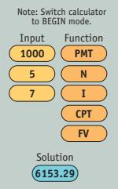

Table Use Substituting $i=7\%$ and $n=5$ years into Equation 4.17, with the aid of the appropriate interest factor from Table A-3, we get

 $$ \begin{aligned}FVIFA_{7\%,5yrs}(annuity\ due)&=FVIFA_{7\%,5yrs}\times(1+0.07)\\&=5.751\times1.07=6.154\end{aligned} $$ 

Then, substituting  $ PMT = \1{,}000 $ and  $ FVIFA_{7\%, 5 \text{ yrs}} $ (annuity due) = 6.154 into Equation 4.14, we get a future value for the annuity due:

 $$ FVA_{5}=\1,000\times6.154=\6,154 $$ 

Calculator Use Before using your calculator to find the future value of an annuity due, depending on the specific calculator, you must either switch it to BEGIN mode or use the DUE key. Then, using the inputs shown at the left, you will find the future value of the annuity due to be $6,153.29. (Note: Because we nearly always assume end-of-period cash flows, be sure to switch your calculator back to END mode when you have completed your annuity-due calculations.)

Spreadsheet Use The future value of the annuity due also can be calculated as shown on the following Excel spreadsheet.

<table border=1 style='margin: auto; word-wrap: break-word;'><tr><td style='text-align: center; word-wrap: break-word;'></td><td style='text-align: center; word-wrap: break-word;'>A</td><td style='text-align: center; word-wrap: break-word;'>B</td></tr><tr><td style='text-align: center; word-wrap: break-word;'>1</td><td colspan="2">FUTURE VALUE OF AN ANNUITY DUE</td></tr><tr><td style='text-align: center; word-wrap: break-word;'>2</td><td style='text-align: center; word-wrap: break-word;'>Annual payment</td><td style='text-align: center; word-wrap: break-word;'>$1,000</td></tr><tr><td style='text-align: center; word-wrap: break-word;'>3</td><td style='text-align: center; word-wrap: break-word;'>Annual rate of interest, compounded annually</td><td style='text-align: center; word-wrap: break-word;'>7%</td></tr><tr><td style='text-align: center; word-wrap: break-word;'>4</td><td style='text-align: center; word-wrap: break-word;'>Number of years</td><td style='text-align: center; word-wrap: break-word;'>5</td></tr><tr><td style='text-align: center; word-wrap: break-word;'>5</td><td style='text-align: center; word-wrap: break-word;'>Future value of an annuity due</td><td style='text-align: center; word-wrap: break-word;'>$6,153.29</td></tr><tr><td colspan="3">Entry in Cell B5 is =FV(B3,B4,-B2,0,1). The minus sign appears before B2 because the annual payment is a cash outflow.</td></tr></table>

## Comparison of an Annuity Due with an Ordinary Annuity Future Value

The future value of an annuity due is always greater than the future value of an otherwise identical ordinary annuity. We can see this by comparing the future values at the end of year 5 of Fran Abrams's two annuities:

 $$ \mathrm{O r d i n a r y~a n n u i t y}=\5,750.74\qquad\mathrm{A n n u i t y~d u e}=\6,153.29 $$ 

Because the cash flow of the annuity due occurs at the beginning of the period rather than at the end, its future value is greater. In the example, Fran would earn about $400 more with the annuity due.

## Finding the Present Value of an Annuity Due

We can also find the present value of an annuity due. This calculation can be easily performed by adjusting the ordinary annuity calculation. Because the cash flows of an annuity due occur at the beginning rather than the end of the period, to find their present value, each annuity due cash flow is discounted back one less year than for an ordinary annuity. A simple conversion can be applied to use the present value interest factors for an ordinary annuity (in Table A-4) with annuities due.

 $$ PVIFA_{i,n}(annuity\operatorname{due})=PVIFA_{i,n}\times(1+i) $$ 

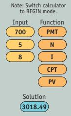

The equation indicates that the present value interest factor for an annuity due can be obtained by multiplying the present value interest factor for an ordinary annuity at the same percent and number of periods by  $ (1 + i) $. This conversion adjusts for the fact that each cash flow of an annuity due is discounted back one less year than a comparable ordinary annuity Multiplying  $ PVIFA_{i,n} $ by  $ (1 + i) $ effectively adds back one year of interest to each annuity cash flow. Adding back one year of interest to each cash flow in effect reduces by 1 the number of years each annuity cash flow is discounted.

In the earlier example of Braden Company on page 166, we found the present value of Braden's $700, 5-year ordinary annuity discounted at 8% to be about $2,795. If we now assume that Braden's $700 annual cash flow occurs at the start of each year and is thereby an annuity due, we can calculate its present value using a table, a calculator, or a spreadsheet.

Table Use Substituting $i=8\%$ and $n=5$ years into Equation 4.18, with the aid of the appropriate interest factor from Table A-4, we get

 $$ \begin{aligned}PVIFA_{8\%,5yrs}(annuity~due)&=PVIFA_{8\%,5yrs}\times(1+0.08)\\&=3.993\times1.08=4.312\end{aligned} $$ 

Then, substituting  $ PMT = \700 $ and  $ PVIFA_{8\%,5yrs} $ (annuity due) = 4.312 into Equation 4.16, we get a present value for the annuity due:

 $$ PVA_{5}=\700\times4.312=\3,018.40 $$ 

Calculator Use Before using your calculator to find the present value of an annuity due, depending on the specifics of your calculator, you must either switch it to BEGIN mode or use the DUE key. Then, using the inputs shown at the left, you will find the present value of the annuity due to be $3,018.49. (Note: Because we nearly always assume end-of-period cash flows, be sure to switch your calculator back to END mode when you have completed your annuity-due calculations.)

Spreadsheet Use The present value of the annuity due also can be calculated as shown on the following Excel spreadsheet.

<table border=1 style='margin: auto; word-wrap: break-word;'><tr><td style='text-align: center; word-wrap: break-word;'></td><td style='text-align: center; word-wrap: break-word;'>A</td><td style='text-align: center; word-wrap: break-word;'>B</td></tr><tr><td style='text-align: center; word-wrap: break-word;'>1</td><td colspan="2">PRESENT VALUE OF AN ANNUITY DUE</td></tr><tr><td style='text-align: center; word-wrap: break-word;'>2</td><td style='text-align: center; word-wrap: break-word;'>Annual payment</td><td style='text-align: center; word-wrap: break-word;'>$700</td></tr><tr><td style='text-align: center; word-wrap: break-word;'>3</td><td style='text-align: center; word-wrap: break-word;'>Annual rate of interest, compounded annually</td><td style='text-align: center; word-wrap: break-word;'>8%</td></tr><tr><td style='text-align: center; word-wrap: break-word;'>4</td><td style='text-align: center; word-wrap: break-word;'>Number of years</td><td style='text-align: center; word-wrap: break-word;'>5</td></tr><tr><td style='text-align: center; word-wrap: break-word;'>5</td><td style='text-align: center; word-wrap: break-word;'>Present value of an annuity due</td><td style='text-align: center; word-wrap: break-word;'>$3,018.49</td></tr><tr><td colspan="3">Entry in Cell B5 is =PV(B3,B4,-B2,0,1). The minus sign appears before B2 because the annual payment is a cash outflow.</td></tr></table>

## Comparison of an Annuity Due with an Ordinary Annuity Present Value

The present value of an annuity due is always greater than the present value of an otherwise identical ordinary annuity. We can see this by comparing the present values of the Braden Company's two annuities:

Because the cash flow of the annuity due occurs at the beginning of the period rather than at the end, its present value is greater. In the example, Braden Company would realize about $200 more in present value with the annuity due.

## perpetuity

An annuity with an infinite life, providing continual annual cash flow.

## Finding the Present Value of a Perpetuity

A perpetuity is an annuity with an infinite life—in other words, an annuity that never stops providing its holder with a cash flow at the end of each year (for example, the right to receive $500 at the end of each year forever).

It is sometimes necessary to find the present value of a perpetuity. The present value interest factor for a perpetuity discounted at the rate i is

 $$ PVIFA_{i,\infty}=\frac{1}{i} $$ 

As the equation shows, the appropriate factor,  $ PVIFA_{i,\infty} $, is found simply by dividing the discount rate, i (stated as a decimal), into 1. The validity of this method can be seen by looking at the factors in Table A-4 for 8, 10, 20, and 40 percent: As the number of periods (typically years) approaches 50, these factors approach the values calculated using Equation 4.19:  $ 1 \div 0.08 = 12.50 $;  $ 1 \div 0.10 = 10.00 $;  $ 1 \div 0.20 = 5.00 $; and  $ 1 \div 0.40 = 2.50 $.

## EXAMPLE

Ross Clark wishes to endow a chair in finance at his alma mater. The university indicated that it requires 200,000 per year to support the chair, and the endowment would earn 10% per year. To determine the amount Ross must give the university to fund the chair, we must determine the present value of a 200,000 perpetuity discounted at 10%. The appropriate present value interest factor can be found by dividing 1 by 0.10, as noted in Equation 4.19. Substituting the resulting factor, 10, and the amount of the perpetuity,  $ PMT = \200,000 $, into Equation 4.16 results in a present value of 2,000,000 for the perpetuity. In other words, to generate 200,000 every year for an indefinite period requires 2,000,000 today if Ross Clark's alma mater can earn 10% on its investments. If the university earns 10% interest annually on the 2,000,000, it can withdraw 200,000 a year indefinitely without touching the initial 2,000,000, which would never be drawn upon.

## Review Questions

4–8 What is the difference between an ordinary annuity and an annuity due? Which always has greater future value and present value for identical annuities and interest rates? Why?

4–9 What are the most efficient ways to calculate the present value of an ordinary annuity? What is the relationship between the PVIF and PVIFA interest factors given in Tables A–2 and A–4, respectively?

4–10 How can the future value interest factors for an ordinary annuity be modified to find the future value of an annuity due?

4–11 How can the present value interest factors for an ordinary annuity be modified to find the present value of an annuity due?

4–12 What is a perpetuity? How can the present value interest factor for such a stream of cash flows be determined?

### 4.4 Mixed Streams

## mixed stream

A stream of unequal periodic cash flows that reflect no particular pattern.

Time line for future value of a mixed stream (end-of-year cash flows, compounded at 8% to the end of year 5)

Two basic types of cash flow streams are possible: the annuity and the mixed stream. Whereas an annuity is a pattern of equal periodic cash flows, a mixed stream is a stream of unequal periodic cash flows that reflect no particular pattern. Financial managers frequently need to evaluate opportunities that are expected to provide mixed streams of cash flows. Here we consider both the future value and the present value of mixed streams.

## EXAMPLE

## Future Value of a Mixed Stream

Determining the future value of a mixed stream of cash flows is straightforward. We determine the future value of each cash flow at the specified future date and then add all the individual future values to find the total future value.

Shrell Industries, a cabinet manufacturer, expects to receive the following mixed stream of cash flows over the next 5 years from one of its small customers.

<table border=1 style='margin: auto; word-wrap: break-word;'><tr><td style='text-align: center; word-wrap: break-word;'>End of year</td><td style='text-align: center; word-wrap: break-word;'>Cash flow</td></tr><tr><td style='text-align: center; word-wrap: break-word;'>1</td><td style='text-align: center; word-wrap: break-word;'>$11,500</td></tr><tr><td style='text-align: center; word-wrap: break-word;'>2</td><td style='text-align: center; word-wrap: break-word;'>14,000</td></tr><tr><td style='text-align: center; word-wrap: break-word;'>3</td><td style='text-align: center; word-wrap: break-word;'>12,900</td></tr><tr><td style='text-align: center; word-wrap: break-word;'>4</td><td style='text-align: center; word-wrap: break-word;'>16,000</td></tr><tr><td style='text-align: center; word-wrap: break-word;'>5</td><td style='text-align: center; word-wrap: break-word;'>18,000</td></tr></table>

If Shrell expects to earn 8% on its investments, how much will it accumulate by the end of year 5 if it immediately invests these cash flows when they are received? This situation is depicted on the following time time:

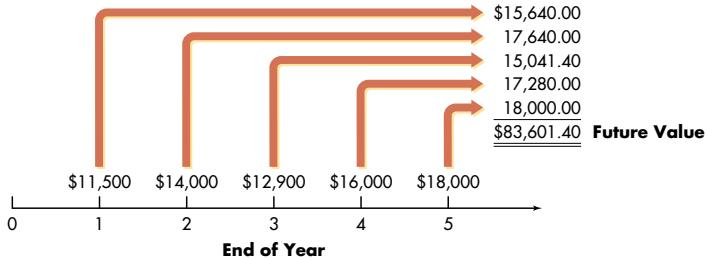

Table Use To solve this problem, we determine the future value of each cash flow compounded at 8% for the appropriate number of years. Note that the first cash flow of $11,500, received at the end of year 1, will earn interest for 4 years (end of year 1 through end of year 5); the second cash flow of $14,000, received at the end of year 2, will earn interest for 3 years (end of year 2 through end of year 5); and so on. The sum of the individual end-of-year-5 future values is the future value of the mixed cash flow stream. The future value interest factors required are

TABLE 4.3 Future Value of a Mixed Stream of Cash Flows

<table border=1 style='margin: auto; word-wrap: break-word;'><tr><td style='text-align: center; word-wrap: break-word;'>Year</td><td style='text-align: center; word-wrap: break-word;'>Cash flow (1)</td><td style='text-align: center; word-wrap: break-word;'>Number of years earning interest  $ n $ (2)</td><td style='text-align: center; word-wrap: break-word;'>$ FVIF_{{8\%},n}^{{a}} $ (2)</td><td style='text-align: center; word-wrap: break-word;'>Future value [(1)  $ \times $ (3)] (4)</td></tr><tr><td style='text-align: center; word-wrap: break-word;'>1</td><td style='text-align: center; word-wrap: break-word;'>11,500</td><td style='text-align: center; word-wrap: break-word;'>5 - 1 = 4</td><td style='text-align: center; word-wrap: break-word;'>1.360</td><td style='text-align: center; word-wrap: break-word;'>15,640.00</td></tr><tr><td style='text-align: center; word-wrap: break-word;'>2</td><td style='text-align: center; word-wrap: break-word;'>14,000</td><td style='text-align: center; word-wrap: break-word;'>5 - 2 = 3</td><td style='text-align: center; word-wrap: break-word;'>1.260</td><td style='text-align: center; word-wrap: break-word;'>17,640.00</td></tr><tr><td style='text-align: center; word-wrap: break-word;'>3</td><td style='text-align: center; word-wrap: break-word;'>12,900</td><td style='text-align: center; word-wrap: break-word;'>5 - 3 = 2</td><td style='text-align: center; word-wrap: break-word;'>1.166</td><td style='text-align: center; word-wrap: break-word;'>15,041.40</td></tr><tr><td style='text-align: center; word-wrap: break-word;'>4</td><td style='text-align: center; word-wrap: break-word;'>16,000</td><td style='text-align: center; word-wrap: break-word;'>5 - 4 = 1</td><td style='text-align: center; word-wrap: break-word;'>1.080</td><td style='text-align: center; word-wrap: break-word;'>17,280.00</td></tr><tr><td style='text-align: center; word-wrap: break-word;'>5</td><td style='text-align: center; word-wrap: break-word;'>18,000</td><td style='text-align: center; word-wrap: break-word;'>5 - 5 = 0</td><td style='text-align: center; word-wrap: break-word;'>$ 1.000^{{b}} $</td><td style='text-align: center; word-wrap: break-word;'>$ \frac{{18,000.00}}{{83,601.40}} $</td></tr><tr><td colspan="5">Future value of mixed stream</td></tr></table>

 $ ^{a} $Future value interest factors at 8% are from Table A–1.

 $ ^{b} $The future value of the end-of-year-5 deposit at the end of year 5 is its present value because it earns interest for zero years and  $ (1+0.08)^{0}=1.000 $.

those shown in Table A-1. Table 4.3 presents the calculations needed to find the future value of the cash flow stream, which turns out to be $83,601.40.

Calculator Use You can use your calculator to find the future value of each individual cash flow, as demonstrated earlier (page 157), and then sum the future values, to get the future value of the stream. Unfortunately, unless you can program your calculator, most calculators lack a function that would allow you to input all of the cash flows, specify the interest rate, and directly calculate the future value of the entire cash flow stream. Had you used your calculator to find the individual cash flow future values and then summed them, the future value of Shrell Industries' cash flow stream at the end of year 5 would have been $83,608.15, a more precise value than the one obtained by using a financial table.

Spreadsheet Use The future value of the mixed stream also can be calculated as shown on the following Excel spreadsheet.

<table border=1 style='margin: auto; word-wrap: break-word;'><tr><td style='text-align: center; word-wrap: break-word;'></td><td style='text-align: center; word-wrap: break-word;'>A</td><td style='text-align: center; word-wrap: break-word;'>B</td></tr><tr><td style='text-align: center; word-wrap: break-word;'>1</td><td colspan="2">FUTURE VALUE OF A MIXED STREAM</td></tr><tr><td style='text-align: center; word-wrap: break-word;'>2</td><td style='text-align: center; word-wrap: break-word;'>Interest rate, pct/year</td><td style='text-align: center; word-wrap: break-word;'>8%</td></tr><tr><td style='text-align: center; word-wrap: break-word;'>3</td><td style='text-align: center; word-wrap: break-word;'>Year</td><td style='text-align: center; word-wrap: break-word;'>Year-End Cash Flow</td></tr><tr><td style='text-align: center; word-wrap: break-word;'>4</td><td style='text-align: center; word-wrap: break-word;'>1</td><td style='text-align: center; word-wrap: break-word;'>$11,500</td></tr><tr><td style='text-align: center; word-wrap: break-word;'>5</td><td style='text-align: center; word-wrap: break-word;'>2</td><td style='text-align: center; word-wrap: break-word;'>$14,000</td></tr><tr><td style='text-align: center; word-wrap: break-word;'>6</td><td style='text-align: center; word-wrap: break-word;'>3</td><td style='text-align: center; word-wrap: break-word;'>$12,900</td></tr><tr><td style='text-align: center; word-wrap: break-word;'>7</td><td style='text-align: center; word-wrap: break-word;'>4</td><td style='text-align: center; word-wrap: break-word;'>$16,000</td></tr><tr><td style='text-align: center; word-wrap: break-word;'>8</td><td style='text-align: center; word-wrap: break-word;'>5</td><td style='text-align: center; word-wrap: break-word;'>$18,000</td></tr><tr><td style='text-align: center; word-wrap: break-word;'>9</td><td style='text-align: center; word-wrap: break-word;'>Future value</td><td style='text-align: center; word-wrap: break-word;'>$83,608.15</td></tr><tr><td colspan="3">Entry in Cell B9 is =-FV(B2,A8,0,NPV(B2,B4:B8)). The minus sign appears before FV to convert the future value to a positive amount.</td></tr></table>

If Shrell Industries invests at 8% interest the cash flows received from its customer over the next 5 years, the company will accumulate about $83,600 by the end of year 5.

## Present Value of a Mixed Stream

## EXAMPLE

Time line for present value of a mixed stream (end-of-year cash flows, discounted at 9% over the corresponding number of years)

Finding the present value of a mixed stream of cash flows is similar to finding the future value of a mixed stream. We determine the present value of each future amount and then add all the individual present values together to find the total present value.

Frey Company, a shoe manufacturer, has been offered an opportunity to receive the following mixed stream of cash flows over the next 5 years:

<table border=1 style='margin: auto; word-wrap: break-word;'><tr><td style='text-align: center; word-wrap: break-word;'>End of year</td><td style='text-align: center; word-wrap: break-word;'>Cash flow</td></tr><tr><td style='text-align: center; word-wrap: break-word;'>1</td><td style='text-align: center; word-wrap: break-word;'>$400</td></tr><tr><td style='text-align: center; word-wrap: break-word;'>2</td><td style='text-align: center; word-wrap: break-word;'>800</td></tr><tr><td style='text-align: center; word-wrap: break-word;'>3</td><td style='text-align: center; word-wrap: break-word;'>500</td></tr><tr><td style='text-align: center; word-wrap: break-word;'>4</td><td style='text-align: center; word-wrap: break-word;'>400</td></tr><tr><td style='text-align: center; word-wrap: break-word;'>5</td><td style='text-align: center; word-wrap: break-word;'>300</td></tr></table>

If the firm must earn at least 9% on its investments, what is the most it should pay for this opportunity? This situation is depicted on the following time line:

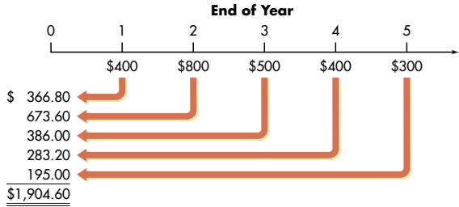

Table Use To solve this problem, determine the present value of each cash flow discounted at 9% for the appropriate number of years. The sum of these individual values is the present value of the total stream. The present value interest factors required are those shown in Table A–2. Table 4.4 presents the calculations needed to find the present value of the cash flow stream, which turns out to be $1,904.60.

Calculator Use You can use a calculator to find the present value of each individual cash flow, as demonstrated earlier (page 161), and then sum the present values, to get the present value of the stream. However, most financial calculators have a function that allows you to punch in all cash flows, specify the discount rate, and then directly calculate the present value of the entire cash flow stream. Because calculators provide solutions more precise than those based on rounded

TABLE 4.4 Present Value of a Mixed Stream of Cash Flows

<table border=1 style='margin: auto; word-wrap: break-word;'><tr><td style='text-align: center; word-wrap: break-word;'>Year (n)</td><td style='text-align: center; word-wrap: break-word;'>Cash flow (1)</td><td style='text-align: center; word-wrap: break-word;'>$ PVIF_{9\%,n} $ $ ^{a} $ (2)</td><td style='text-align: center; word-wrap: break-word;'>Present value [(1)  $ \times $ (2)] (3)</td></tr><tr><td style='text-align: center; word-wrap: break-word;'>1</td><td style='text-align: center; word-wrap: break-word;'>400</td><td style='text-align: center; word-wrap: break-word;'>0.917</td><td style='text-align: center; word-wrap: break-word;'>366.80</td></tr><tr><td style='text-align: center; word-wrap: break-word;'>2</td><td style='text-align: center; word-wrap: break-word;'>800</td><td style='text-align: center; word-wrap: break-word;'>0.842</td><td style='text-align: center; word-wrap: break-word;'>673.60</td></tr><tr><td style='text-align: center; word-wrap: break-word;'>3</td><td style='text-align: center; word-wrap: break-word;'>500</td><td style='text-align: center; word-wrap: break-word;'>0.772</td><td style='text-align: center; word-wrap: break-word;'>386.00</td></tr><tr><td style='text-align: center; word-wrap: break-word;'>4</td><td style='text-align: center; word-wrap: break-word;'>400</td><td style='text-align: center; word-wrap: break-word;'>0.708</td><td style='text-align: center; word-wrap: break-word;'>283.20</td></tr><tr><td style='text-align: center; word-wrap: break-word;'>5</td><td style='text-align: center; word-wrap: break-word;'>300</td><td style='text-align: center; word-wrap: break-word;'>0.650</td><td style='text-align: center; word-wrap: break-word;'>195.00</td></tr><tr><td style='text-align: center; word-wrap: break-word;'></td><td colspan="2">Present value of mixed stream</td><td style='text-align: center; word-wrap: break-word;'>$ 1,904.60 $</td></tr></table>

 $ ^{a} $Present value interest factors at 9% are from Table A–2.

table factors, the present value of Frey Company's cash flow stream found using a calculator is $1,904.76, which is close to the $1,904.60 value calculated before.

Spreadsheet Use The present value of the mixed stream of future cash flows also can be calculated as shown on the following Excel spreadsheet.

<table border=1 style='margin: auto; word-wrap: break-word;'><tr><td style='text-align: center; word-wrap: break-word;'></td><td style='text-align: center; word-wrap: break-word;'>A</td><td style='text-align: center; word-wrap: break-word;'>B</td></tr><tr><td style='text-align: center; word-wrap: break-word;'>1</td><td colspan="2">PRESENT VALUE OF A MIXED STREAM OF FUTURE CASH FLOWS</td></tr><tr><td style='text-align: center; word-wrap: break-word;'>2</td><td style='text-align: center; word-wrap: break-word;'>Interest Rate, pct/year</td><td style='text-align: center; word-wrap: break-word;'>9%</td></tr><tr><td style='text-align: center; word-wrap: break-word;'>3</td><td style='text-align: center; word-wrap: break-word;'>Year</td><td style='text-align: center; word-wrap: break-word;'>Year-End Cash Flow</td></tr><tr><td style='text-align: center; word-wrap: break-word;'>4</td><td style='text-align: center; word-wrap: break-word;'>1</td><td style='text-align: center; word-wrap: break-word;'>$400</td></tr><tr><td style='text-align: center; word-wrap: break-word;'>5</td><td style='text-align: center; word-wrap: break-word;'>2</td><td style='text-align: center; word-wrap: break-word;'>$800</td></tr><tr><td style='text-align: center; word-wrap: break-word;'>6</td><td style='text-align: center; word-wrap: break-word;'>3</td><td style='text-align: center; word-wrap: break-word;'>$500</td></tr><tr><td style='text-align: center; word-wrap: break-word;'>7</td><td style='text-align: center; word-wrap: break-word;'>4</td><td style='text-align: center; word-wrap: break-word;'>$400</td></tr><tr><td style='text-align: center; word-wrap: break-word;'>8</td><td style='text-align: center; word-wrap: break-word;'>5</td><td style='text-align: center; word-wrap: break-word;'>$300</td></tr><tr><td style='text-align: center; word-wrap: break-word;'>9</td><td style='text-align: center; word-wrap: break-word;'>Present value</td><td style='text-align: center; word-wrap: break-word;'>$1,904.76</td></tr><tr><td colspan="3">Entry in Cell B9 is =NPV(B2,B4:B8).</td></tr></table>

Paying about $1,905 would provide exactly a 9% return. Frey should pay no more than that amount for the opportunity to receive these cash flows.

## Review Question

4–13 How is the future value of a mixed stream of cash flows calculated? How is the present value of a mixed stream of cash flows calculated?

### LG5 4.5 Compounding Interest More Frequently Than Annually

Interest is often compounded more frequently than once a year. Savings institutions compound interest semiannually, quarterly, monthly, weekly, daily, or even continuously. This section discusses various issues and techniques related to these more frequent compounding intervals.

## Semiannual Compounding

## semiannual compounding

Compounding of interest over two periods within the year.

Semiannual compounding of interest involves two compounding periods within the year. Instead of the stated interest rate being paid once a year, one-half of the stated interest rate is paid twice a year.

## EXAMPLE

Fred Moreno has decided to invest $100 in a savings account paying 8% interest compounded semiannually. If he leaves his money in the account for 24 months (2 years), he will be paid 4% interest compounded over four periods, each of which is 6 months long. Table 4.5 uses interest factors to show that at the end of 12 months (1 year) with 8% semiannual compounding, Fred will have $108.16; at the end of 24 months (2 years), he will have $116.99.

## quarterly compounding

Compounding of interest over four periods within the year.

## Quarterly Compounding

Quarterly compounding of interest involves four compounding periods within the year. One-fourth of the stated interest rate is paid four times a year.

## EXAMPLE

Fred Moreno has found an institution that will pay him 8% interest compounded quarterly. If he leaves his money in this account for 24 months (2 years), he will be paid 2% interest compounded over eight periods, each of which is 3 months long. Table 4.6 uses interest factors to show the amount Fred will have at the end of each period. At the end of 12 months (1 year), with 8% quarterly compounding, Fred will have $108.24; at the end of 24 months (2 years), he will have $117.16.

TABLE 4.5 The Future Value from Investing $100 at 8% Interest Compounded Semiannually Over 24 Months (2 Years)

<table border=1 style='margin: auto; word-wrap: break-word;'><tr><td style='text-align: center; word-wrap: break-word;'>Period</td><td style='text-align: center; word-wrap: break-word;'>Beginning principal (1)</td><td style='text-align: center; word-wrap: break-word;'>Future value interest factor (2)</td><td style='text-align: center; word-wrap: break-word;'>Future value at end of period [(1)  $ \times $ (2)] (3)</td></tr><tr><td style='text-align: center; word-wrap: break-word;'>6 months</td><td style='text-align: center; word-wrap: break-word;'>100.00</td><td style='text-align: center; word-wrap: break-word;'>1.04</td><td style='text-align: center; word-wrap: break-word;'>104.00</td></tr><tr><td style='text-align: center; word-wrap: break-word;'>12 months</td><td style='text-align: center; word-wrap: break-word;'>104.00</td><td style='text-align: center; word-wrap: break-word;'>1.04</td><td style='text-align: center; word-wrap: break-word;'>108.16</td></tr><tr><td style='text-align: center; word-wrap: break-word;'>18 months</td><td style='text-align: center; word-wrap: break-word;'>108.16</td><td style='text-align: center; word-wrap: break-word;'>1.04</td><td style='text-align: center; word-wrap: break-word;'>112.49</td></tr><tr><td style='text-align: center; word-wrap: break-word;'>24 months</td><td style='text-align: center; word-wrap: break-word;'>112.49</td><td style='text-align: center; word-wrap: break-word;'>1.04</td><td style='text-align: center; word-wrap: break-word;'>116.99</td></tr></table>

TABLE 4.6 The Future Value from Investing $100 at 8% Interest Compounded Quarterly Over 24 Months (2 Years)

<table border=1 style='margin: auto; word-wrap: break-word;'><tr><td style='text-align: center; word-wrap: break-word;'>Period</td><td style='text-align: center; word-wrap: break-word;'>Beginning principal (1)</td><td style='text-align: center; word-wrap: break-word;'>Future value interest factor (2)</td><td style='text-align: center; word-wrap: break-word;'>Future value at end of period [(1)  $ \times $ (2)] (3)</td></tr><tr><td style='text-align: center; word-wrap: break-word;'>3 months</td><td style='text-align: center; word-wrap: break-word;'>100.00</td><td style='text-align: center; word-wrap: break-word;'>1.02</td><td style='text-align: center; word-wrap: break-word;'>102.00</td></tr><tr><td style='text-align: center; word-wrap: break-word;'>6 months</td><td style='text-align: center; word-wrap: break-word;'>102.00</td><td style='text-align: center; word-wrap: break-word;'>1.02</td><td style='text-align: center; word-wrap: break-word;'>104.04</td></tr><tr><td style='text-align: center; word-wrap: break-word;'>9 months</td><td style='text-align: center; word-wrap: break-word;'>104.04</td><td style='text-align: center; word-wrap: break-word;'>1.02</td><td style='text-align: center; word-wrap: break-word;'>106.12</td></tr><tr><td style='text-align: center; word-wrap: break-word;'>12 months</td><td style='text-align: center; word-wrap: break-word;'>106.12</td><td style='text-align: center; word-wrap: break-word;'>1.02</td><td style='text-align: center; word-wrap: break-word;'>108.24</td></tr><tr><td style='text-align: center; word-wrap: break-word;'>15 months</td><td style='text-align: center; word-wrap: break-word;'>108.24</td><td style='text-align: center; word-wrap: break-word;'>1.02</td><td style='text-align: center; word-wrap: break-word;'>110.40</td></tr><tr><td style='text-align: center; word-wrap: break-word;'>18 months</td><td style='text-align: center; word-wrap: break-word;'>110.40</td><td style='text-align: center; word-wrap: break-word;'>1.02</td><td style='text-align: center; word-wrap: break-word;'>112.61</td></tr><tr><td style='text-align: center; word-wrap: break-word;'>21 months</td><td style='text-align: center; word-wrap: break-word;'>112.61</td><td style='text-align: center; word-wrap: break-word;'>1.02</td><td style='text-align: center; word-wrap: break-word;'>114.86</td></tr><tr><td style='text-align: center; word-wrap: break-word;'>24 months</td><td style='text-align: center; word-wrap: break-word;'>114.86</td><td style='text-align: center; word-wrap: break-word;'>1.02</td><td style='text-align: center; word-wrap: break-word;'>117.16</td></tr></table>

TABLE 4.7 The Future Value at the End of Years 1 and 2 from Investing $100 at 8% Interest, Given Various Compounding Periods

<table border=1 style='margin: auto; word-wrap: break-word;'><tr><td rowspan="2">End of year</td><td colspan="3">Compounding period</td></tr><tr><td style='text-align: center; word-wrap: break-word;'>Annual</td><td style='text-align: center; word-wrap: break-word;'>Semiannual</td><td style='text-align: center; word-wrap: break-word;'>Quarterly</td></tr><tr><td style='text-align: center; word-wrap: break-word;'>1</td><td style='text-align: center; word-wrap: break-word;'>$108.00</td><td style='text-align: center; word-wrap: break-word;'>$108.16</td><td style='text-align: center; word-wrap: break-word;'>$108.24</td></tr><tr><td style='text-align: center; word-wrap: break-word;'>2</td><td style='text-align: center; word-wrap: break-word;'>116.64</td><td style='text-align: center; word-wrap: break-word;'>116.99</td><td style='text-align: center; word-wrap: break-word;'>117.16</td></tr></table>

Table 4.7 compares values for Fred Moreno's $100 at the end of years 1 and 2 given annual, semiannual, and quarterly compounding periods at the 8 percent rate. As shown, the more frequently interest is compounded, the greater the amount of money accumulated. This is true for any interest rate for any period of time.

## A General Equation for Compounding More Frequently Than Annually

The formula for annual compounding (Equation 4.4) can be rewritten for use when compounding takes place more frequently. If m equals the number of times per year interest is compounded, the formula for annual compounding can be rewritten as

 $$ FV_{n}=PV\times\left(1+\frac{i}{m}\right)^{m\times n} $$ 

If $m=1$, Equation 4.20 reduces to Equation 4.4. Thus, if interest is compounded annually (once a year), Equation 4.20 will provide the same result as Equation 4.4. The general use of Equation 4.20 can be illustrated with a simple example.

## EXAMPLE

The preceding examples calculated the amount that Fred Moreno would have at the end of 2 years if he deposited $100 at 8% interest compounded semiannually and compounded quarterly. For semiannual compounding, m would equal 2 in Equation 4.20; for quarterly compounding, m would equal 4. Substituting the appropriate values for semiannual and quarterly compounding into Equation 4.20, we find that

1. For semiannual compounding:

 $$ FV_{2}=\100\times\left(1+\frac{0.08}{2}\right)^{2\times2}=\100\times(1+0.04)^{4}=\116.99 $$ 

2. For quarterly compounding:

 $$ FV_{2}=\100\times\left(1+\frac{0.08}{4}\right)^{4\times2}=\100\times(1+0.02)^{8}=\117.16 $$ 

These results agree with the values for $FV_{2}$ in Tables 4.5 and 4.6.

If the interest were compounded monthly, weekly, or daily, m would equal 12, 52, or 365, respectively.

## Using Computational Tools for Compounding More Frequently Than Annually

We can use the future value interest factors for one dollar, given in Table A-1, when interest is compounded m times each year. Instead of indexing the table for i percent and n years, as we do when interest is compounded annually, we index it for  $ (i \div m) $ percent and  $ (m \times n) $ periods. However, the table is less useful, because it includes only selected rates for a limited number of periods. Instead, a financial calculator or a computer and spreadsheet is typically required.

## EXAMPLE

Fred Moreno wished to find the future value of $100 invested at 8% interest compounded both semiannually and quarterly for 2 years. The number of compounding periods, m, the interest rate, and the number of periods used in each case, along with the future value interest factor, are as follows:

<table border=1 style='margin: auto; word-wrap: break-word;'><tr><td style='text-align: center; word-wrap: break-word;'>Compounding period</td><td style='text-align: center; word-wrap: break-word;'>m</td><td style='text-align: center; word-wrap: break-word;'>Interest rate\n(i  $ \div $ m)</td><td style='text-align: center; word-wrap: break-word;'>Periods\n( $ m \times n $)</td><td style='text-align: center; word-wrap: break-word;'>Future value interest factor from Table A-1</td></tr><tr><td style='text-align: center; word-wrap: break-word;'>Semiannual</td><td style='text-align: center; word-wrap: break-word;'>2</td><td style='text-align: center; word-wrap: break-word;'>8%  $ \div $ 2 = 4%</td><td style='text-align: center; word-wrap: break-word;'>2  $ \times $ 2 = 4</td><td style='text-align: center; word-wrap: break-word;'>1.170</td></tr><tr><td style='text-align: center; word-wrap: break-word;'>Quarterly</td><td style='text-align: center; word-wrap: break-word;'>4</td><td style='text-align: center; word-wrap: break-word;'>8%  $ \div $ 4 = 2%</td><td style='text-align: center; word-wrap: break-word;'>4  $ \times $ 2 = 8</td><td style='text-align: center; word-wrap: break-word;'>1.172</td></tr></table>

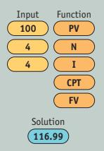

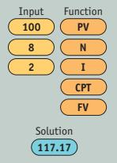

Table Use Multiplying each of the future value interest factors by the initial 100 deposit results in a value of 117.00 (1.170 $ \times $ 100) for semiannual compounding and a value of 117.20 (1.172 $ \times $ 100) for quarterly compounding.

continuous compounding

Compounding of interest an

infinite number of times per year

at intervals of microseconds.

Calculator Use If the calculator were used for the semiannual compounding calculation, the number of periods would be 4 and the interest rate would be 4%. The future value of $116.99 will appear on the calculator display as shown at the top left.

For the quarterly compounding case, the number of periods would be 8 and the interest rate would be 2%. The future value of $117.17 will appear on the calculator display as shown in the second display at the left.

Spreadsheet Use The future value of the single amount with semiannual and quarterly compounding also can be calculated as shown on the following Excel spreadsheet.

<table border=1 style='margin: auto; word-wrap: break-word;'><tr><td style='text-align: center; word-wrap: break-word;'></td><td style='text-align: center; word-wrap: break-word;'>A</td><td style='text-align: center; word-wrap: break-word;'>B</td></tr><tr><td style='text-align: center; word-wrap: break-word;'>1</td><td colspan="2">FUTURE VALUE OF A SINGLE AMOUNT WITH SEMIANNUAL AND QUARTERLY COMPOUNDING</td></tr><tr><td style='text-align: center; word-wrap: break-word;'>2</td><td style='text-align: center; word-wrap: break-word;'>Present value</td><td style='text-align: center; word-wrap: break-word;'>$100</td></tr><tr><td style='text-align: center; word-wrap: break-word;'>3</td><td style='text-align: center; word-wrap: break-word;'>Interest rate, pct per year compounded semiannually</td><td style='text-align: center; word-wrap: break-word;'>8%</td></tr><tr><td style='text-align: center; word-wrap: break-word;'>4</td><td style='text-align: center; word-wrap: break-word;'>Number of years</td><td style='text-align: center; word-wrap: break-word;'>2</td></tr><tr><td style='text-align: center; word-wrap: break-word;'>5</td><td style='text-align: center; word-wrap: break-word;'>Future value with semiannual compounding</td><td style='text-align: center; word-wrap: break-word;'>$116.99</td></tr><tr><td style='text-align: center; word-wrap: break-word;'>6</td><td style='text-align: center; word-wrap: break-word;'>Present value</td><td style='text-align: center; word-wrap: break-word;'>$100</td></tr><tr><td style='text-align: center; word-wrap: break-word;'>7</td><td style='text-align: center; word-wrap: break-word;'>Interest rate, pct per year compounded quarterly</td><td style='text-align: center; word-wrap: break-word;'>8%</td></tr><tr><td style='text-align: center; word-wrap: break-word;'>8</td><td style='text-align: center; word-wrap: break-word;'>Number of years</td><td style='text-align: center; word-wrap: break-word;'>2</td></tr><tr><td style='text-align: center; word-wrap: break-word;'>9</td><td style='text-align: center; word-wrap: break-word;'>Future value with quarterly compounding</td><td style='text-align: center; word-wrap: break-word;'>$117.17</td></tr><tr><td colspan="3">Entry in Cell B5 is =FV(B3/2,B4*2,0,-B2,0).\nEntry in Cell B9 is =FV(B7/4,B8*4,0,-B2,0).\nThe minus sign appears before B2 because the present value\nis a cash outflow (i.e., a deposit made by Fred Moreno).</td></tr></table>

Comparing the calculator, table, and spreadsheet values, we can see that the calculator and spreadsheet values agree generally with the values in Table 4.7 but are more precise because the table factors have been rounded.

## Continuous Compounding

In the extreme case, interest can be compounded continuously. Continuous compounding involves compounding over every microsecond—the smallest time period imaginable. In this case, m in Equation 4.20 would approach infinity. Through the use of calculus, we know that as m approaches infinity, the equation becomes

 $$ FV_{n}\text{(continuous compounding)}=PV\times(e^{i\times n}) $$ 

where e is the exponential function $ ^{10} $, which has a value of 2.7183. The future value interest factor for continuous compounding is therefore

 $$ FVIF_{i,n}\text{(continuous compounding)}=e^{i\times n} $$ 

EXAMPLE

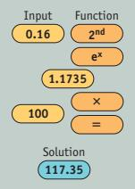

nominal (stated) annual rate

Contractual annual rate of interest charged by a lender or promised by a borrower.

effective (true) annual rate (EAR)

The annual rate of interest

actually paid or earned.

To find the value at the end of 2 years (n=2) of Fred Moreno's $100 deposit (PV=$100) in an account paying 8% annual interest (i=0.08) compounded continuously, we can substitute into Equation 4.21:

 $$ \begin{aligned}FV_{2}\left(continuous~compounding\right)&=\100\times e^{0.08\times2}\\&=\100\times2.7183^{0.16}\\&=\100\times1.1735=\117.35\end{aligned} $$ 

Calculator Use To find this value using the calculator, you need first to find the value of  $ e^{0.16} $ by punching in 0.16 and then pressing 2nd and then  $ e^{x} $ to get 1.1735. Next multiply this value by 100 to get the future value of 117.35 as shown at the left. (Note: On some calculators, you may not have to press 2nd before pressing  $ e^{x} $.)

Spreadsheet Use The future value of the single amount with continuous compounding also can be calculated as shown on the following Excel spreadsheet.

<table border=1 style='margin: auto; word-wrap: break-word;'><tr><td style='text-align: center; word-wrap: break-word;'></td><td style='text-align: center; word-wrap: break-word;'>A</td><td style='text-align: center; word-wrap: break-word;'>B</td></tr><tr><td style='text-align: center; word-wrap: break-word;'>1</td><td colspan="2">FUTURE VALUE OF A SINGLE AMOUNT WITH CONTINUOUS COMPOUNDING</td></tr><tr><td style='text-align: center; word-wrap: break-word;'>2</td><td style='text-align: center; word-wrap: break-word;'>Present value</td><td style='text-align: center; word-wrap: break-word;'>$100</td></tr><tr><td style='text-align: center; word-wrap: break-word;'>3</td><td style='text-align: center; word-wrap: break-word;'>Annual rate of interest, compounded continuously</td><td style='text-align: center; word-wrap: break-word;'>8%</td></tr><tr><td style='text-align: center; word-wrap: break-word;'>4</td><td style='text-align: center; word-wrap: break-word;'>Number of years</td><td style='text-align: center; word-wrap: break-word;'>2</td></tr><tr><td style='text-align: center; word-wrap: break-word;'>5</td><td style='text-align: center; word-wrap: break-word;'>Future value with continuous compounding</td><td style='text-align: center; word-wrap: break-word;'>$117.35</td></tr><tr><td colspan="3">Entry in Cell B5 is =B2*EXP(B3*B4).</td></tr></table>

The future value with continuous compounding therefore equals $117.35. As expected, the continuously compounded value is larger than the future value of interest compounded semiannually ($116.99) or quarterly ($117.16). Continuous compounding offers the largest amount that would result from compounding interest more frequently than annually.

## Nominal and Effective Annual Rates of Interest

Both businesses and investors need to make objective comparisons of loan costs or investment returns over different compounding periods. In order to put interest rates on a common basis, to allow comparison, we distinguish between nominal and effective annual rates. The nominal, or stated, annual rate is the contractual annual rate of interest charged by a lender or promised by a borrower. The effective, or true, annual rate (EAR) is the annual rate of interest actually paid or earned. The effective annual rate reflects the impact of compounding frequency, whereas the nominal annual rate does not.

Using the notation introduced earlier, we can calculate the effective annual rate, EAR, by substituting values for the nominal annual rate, i, and the compounding frequency, m, into Equation 4.23:

 $$ EAR=\left(1+\frac{i}{m}\right)^{m}-1 $$ 

We can apply this equation using data from preceding examples.

annual percentage rate (APR)

The nominal annual rate of interest, found by multiplying the periodic rate by the number of periods in 1 year, that must be disclosed to consumers on credit cards and loans as a result of "truth-in-lending laws."

Fred Moreno wishes to find the effective annual rate associated with an 8% nominal annual rate (i=0.08) when interest is compounded (1) annually (m=1); (2) semiannually (m=2); and (3) quarterly (m=4). Substituting these values into Equation 4.23, we get

annual percentage yield (APY)

The effective annual rate of interest that must be disclosed to consumers by banks on their savings products as a result of "truth-in-savings laws."

1. For annual compounding:

 $$ EAR=\left(1+\frac{0.08}{1}\right)^{1}-1=(1+0.08)^{1}-1=1+0.08-1=0.08=8\% $$ 

2. For semiannual compounding:

 $$ EAR=\left(1+\frac{0.08}{2}\right)^{2}-1=(1+0.04)^{2}-1=1.0816-1=0.0816=8.16\% $$ 

3. For quarterly compounding:

 $$ EAR=\left(1+\frac{0.08}{4}\right)^{4}-1=(1+0.02)^{4}-1=1.0824-1=0.0824=8.24\% $$ 

These values demonstrate two important points: The first is that nominal and effective annual rates are equivalent for annual compounding. The second is that the effective annual rate increases with increasing compounding frequency, up to a limit that occurs with continuous compounding. $ ^{11} $

At the consumer level, “truth-in-lending laws” require disclosure on credit card and loan agreements of the annual percentage rate (APR). The APR is the nominal annual rate found by multiplying the periodic rate by the number of periods in one year. For example, a bank credit card that charges  $ 1\frac{1}{2} $ per month (the periodic rate) would have an APR of 18% (1.5% per month  $ \times $ 12 months per year).

“Truth-in-savings laws,” on the other hand, require banks to quote the annual percentage yield (APY) on their savings products. The APY is the effective annual rate a savings product pays. For example, a savings account that pays 0.5 percent per month would have an APY of 6.17 percent [(1.005) $ ^{12} $ – 1].

Quoting loan interest rates at their lower nominal annual rate (the APR) and savings interest rates at the higher effective annual rate (the APY) offers two advantages: It tends to standardize disclosure to consumers, and it enables financial institutions to quote the most attractive interest rates: low loan rates and high savings rates.

11. The effective annual rate for this extreme case can be found by using the following equation:

 $$ \mathrm{EAR~(continuous~compounding)}=e^{k}-1 $$ 

For the 8% nominal annual rate  $ (k=0.08) $, substitution into Equation 4.23a results in an effective annual rate of

 $$ e^{0.08}-1=1.0833-1=0.0833=8.33\% $$ 

## Review Questions

4–14 What effect does compounding interest more frequently than annually have on (a) future value and (b) the effective annual rate (EAR)? Why?

4–15 How does the future value of a deposit subject to continuous compounding compare to the value obtained by annual compounding?

4–16 Differentiate between a nominal annual rate and an effective annual rate (EAR). Define annual percentage rate (APR) and annual percentage yield (APY).

### 4.6 Special Applications of Time Value

Future value and present value techniques have a number of important applications in finance. We'll study four of them in this section: (1) deposits needed to accumulate a future sum, (2) loan amortization, (3) interest or growth rates, and (4) finding an unknown number of periods.

## Deposits Needed to Accumulate a Future Sum

Suppose you want to buy a house 5 years from now, and you estimate that an initial down payment of $20,000 will be required at that time. To accumulate the 20,000, you will wish to make equal annual end-of-year deposits into an account paying annual interest of 6 percent. The solution to this problem is closely related to the process of finding the future value of an annuity. You must determine what size annuity will result in a single amount equal to $20,000 at the end of year 5.

Earlier in the chapter we found the future value of an n-year ordinary annuity,  $ FVA_{n} $, by multiplying the annual deposit, PMT, by the appropriate interest factor,  $ FVIFA_{i,n} $. The relationship of the three variables was defined by Equation 4.14, which is repeated here as Equation 4.24:

 $$ FVA_{n}=PMT\times(FVIFA_{i,n}) $$ 

We can find the annual deposit required to accumulate  $ FVA_{n} $ dollars by solving Equation 4.24 for PMT. Isolating PMT on the left side of the equation gives us

 $$ P M T=\frac{F V A_{n}}{F V I F A_{i,n}} $$ 

Once this is done, we have only to substitute the known values of  $ FVA_{n} $ and  $ FVIFA_{i,n} $ into the right side of the equation to find the annual deposit required.

## EXAMPLE

As just stated, you want to determine the equal annual end-of-year deposits required to accumulate $20,000 at the end of 5 years, given an interest rate of 6%.

Table Use Table A-3 indicates that the future value interest factor for an ordinary annuity at 6% for 5 years ( $ FVIFA_{6\%,5yrs} $) is 5.637. Substituting

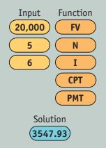

FVA $ _5 $ = 20,000 and FVIFA $ _6\% $,5yrs = 5.637 into Equation 4.25 yields an annual required deposit, PMT, of 3,547.99. Thus if 3,547.99 is deposited at the end of each year for 5 years at 6% interest, there will be 20,000 in the account at the end of the 5 years.

loan amortization schedule

A schedule of equal payments to repay a loan. It shows the allocation of each loan payment to interest and principal.

The determination of the equal periodic loan payments necessary to provide a lender with a specified interest return and to repay the loan principal over a specified period.

## loan amortization

Calculator Use Using the calculator inputs shown at the left, you will find the annual deposit amount to be $3,547.93. Note that this value, except for a slight rounding difference, agrees with the value found by using Table A-3.

Spreadsheet Use The annual deposit needed to accumulate the future sum also can be calculated as shown on the following Excel spreadsheet.

<table border=1 style='margin: auto; word-wrap: break-word;'><tr><td style='text-align: center; word-wrap: break-word;'></td><td style='text-align: center; word-wrap: break-word;'>A</td><td style='text-align: center; word-wrap: break-word;'>B</td></tr><tr><td style='text-align: center; word-wrap: break-word;'>1</td><td colspan="2">ANNUAL DEPOSIT NEEDED TO ACCUMULATE A FUTURE SUM</td></tr><tr><td style='text-align: center; word-wrap: break-word;'>2</td><td style='text-align: center; word-wrap: break-word;'>Future value</td><td style='text-align: center; word-wrap: break-word;'>$20,000</td></tr><tr><td style='text-align: center; word-wrap: break-word;'>3</td><td style='text-align: center; word-wrap: break-word;'>Number of years</td><td style='text-align: center; word-wrap: break-word;'>5</td></tr><tr><td style='text-align: center; word-wrap: break-word;'>4</td><td style='text-align: center; word-wrap: break-word;'>Annual rate of interest</td><td style='text-align: center; word-wrap: break-word;'>6%</td></tr><tr><td style='text-align: center; word-wrap: break-word;'>5</td><td style='text-align: center; word-wrap: break-word;'>Annual deposit</td><td style='text-align: center; word-wrap: break-word;'>$3,547.93</td></tr><tr><td colspan="3">Entry in Cell B5 is =-PMT(B4,B3,0,B2). The minus sign appears before PMT because the annual deposits are cash outflows.</td></tr></table>

## Loan Amortization

The term loan amortization refers to the computation of equal periodic loan payments. These payments provide a lender with a specified interest return and repay the loan principal over a specified period. The loan amortization process involves finding the future payments, over the term of the loan, whose present value at the loan interest rate equals the amount of initial principal borrowed. Lenders use a loan amortization schedule to determine these payment amounts and the allocation of each payment to interest and principal. In the case of home mortgages, these tables are used to find the equal monthly payments necessary to amortize, or pay off, the mortgage at a specified interest rate over a 15- to 30-year period.

Amortizing a loan actually involves creating an annuity out of a present amount. For example, say you borrow $6,000 at 10 percent and agree to make equal annual end-of-year payments over 4 years. To find the size of the payments, the lender determines the amount of a 4-year annuity discounted at 10 percent that has a present value of $6,000. This process is actually the inverse of finding the present value of an annuity.

Earlier in the chapter, we found the present value,  $ PVA_{n} $, of an n-year annuity by multiplying the annual amount, PMT, by the present value interest factor for an annuity,  $ PVIFA_{i,n} $. This relationship, which was originally expressed as Equation 4.16, is repeated here as Equation 4.26:

 $$ PVA_{n}=PMT\times(PVIFA_{i,n}) $$ 

In Practice

## FOCUS ON PRACTICE Time Is on Your Side

For many years, the 30-year fixed-rate mortgage was the traditional choice of home buyers. In recent years, however, more homeowners are choosing fixed-rate mortgages with a 15-year term when they buy a new home or refinance their current residence. They are often pleasantly surprised to discover that they can pay off the loan in half the time with a monthly payment that is only about 25 percent higher. Not only will they own the home free and clear sooner, but they pay considerably less interest over the life of the loan.

<table border=1 style='margin: auto; word-wrap: break-word;'><tr><td style='text-align: center; word-wrap: break-word;'>Term</td><td style='text-align: center; word-wrap: break-word;'>Rate</td><td style='text-align: center; word-wrap: break-word;'>Monthly principal and interest</td><td style='text-align: center; word-wrap: break-word;'>Total interest paid over the term of the loan</td></tr><tr><td style='text-align: center; word-wrap: break-word;'>15 years</td><td style='text-align: center; word-wrap: break-word;'>6.50%</td><td style='text-align: center; word-wrap: break-word;'>$1,742</td><td style='text-align: center; word-wrap: break-word;'>$113,625</td></tr><tr><td style='text-align: center; word-wrap: break-word;'>30 years</td><td style='text-align: center; word-wrap: break-word;'>6.85%</td><td style='text-align: center; word-wrap: break-word;'>$1,311</td><td style='text-align: center; word-wrap: break-word;'>$271,390</td></tr></table>

For example, assume you need a $200,000 mortgage and can borrow at fixed rates. The shorter loan would carry a lower rate (because it presents less risk for the lender). The accompanying table shows how the two mort-gages compare: The extra $431 a month, or a total of $77,580, saves $157,765 in interest payments over the life of the loan, for net savings of $80,185!

Why isn't everyone rushing to take out a shorter mortgage? Many homeowners either can't afford the higher monthly payment or would rather have the extra spending money now. Others hope to do even better by investing the difference themselves. Suppose you invested $431 each month in a mutual fund with an average annual return of 7 percent. At the end of 15 years, your $77,580 investment would have grown to $136,611, or $59,031 more than you contributed! However, many people lack the self-discipline to save rather than spend that money. For them, the 15-year mortgage represents forced savings.

Yet another option is to make additional principal payments whenever possible. This shortens the life of the loan without committing you to the higher payments. By paying just 100 more each month, you can shorten the life of a 30-year mortgage to 24 $ \frac{1}{4} $ years, with attendant interest savings.

Sources: Daniela Deane, "Adding Up Pros, Cons of 15-Year Loans," Washington Post (October 13, 2001), p. H7; Henry Savage, "Is 15-Year Loan Right for You?" Washington Times (June 22, 2001), p. F22; Carlos Tejada, "Sweet Fifteen: Shorter Mortgages Are Gaining Support," Wall Street Journal (September 17, 1998), p. C1; Ann Tergesen, "It's Time to Refinance... Again," Business Week (November 2, 1998), pp. 134–135.

To find the equal annual payment required to pay off, or amortize, the loan,  $ PVA_{n} $, over a certain number of years at a specified interest rate, we need to solve Equation 4.26 for PMT. Isolating PMT on the left side of the equation gives us

 $$ P M T=\frac{P V A_{n}}{P V I F A_{i,n}} $$ 

Once this is done, we have only to substitute the known values into the righthand side of the equation to find the annual payment required.

## EXAMPLE

As just stated, you want to determine the equal annual end-of-year payments necessary to amortize fully a $6,000, 10% loan over 4 years.

Table Use Table A-4 indicates that the present value interest factor for an annuity corresponding to 10% and 4 years ( $ PVIFA_{10\%,4yrs} $) is 3.170. Substituting  $ PVA_{4} = \6,000 $ and  $ PVIFA_{10\%,4yrs} = 3.170 $ into Equation 4.27 and solving for PMT yield an annual loan payment of \1,892.74. Thus to repay the interest and principal on a \6,000, 10%, 4-year loan, equal annual end-of-year payments of \1,892.74 are necessary.

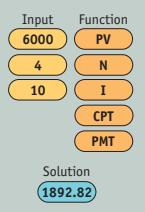

Calculator Use Using the calculator inputs shown at the left, you will find the annual payment amount to be $1,892.82. Except for a slight rounding difference, this value agrees with the table solution.

The allocation of each loan payment to interest and principal can be seen in columns 3 and 4 of the loan amortization schedule in Table 4.8 at the top of page 186. The portion of each payment that represents interest (column 3) declines over the repayment period, and the portion going to principal repayment (column 4) increases. This pattern is typical of amortized loans; as the principal is reduced, the interest component declines, leaving a larger portion of each subsequent loan payment to repay principal.

Spreadsheet Use The annual payment to repay the loan also can be calculated as shown on the first Excel spreadsheet. The amortization schedule allocating each loan payment to interest and principal also can be calculated precisely as shown on the second spreadsheet.

<table border=1 style='margin: auto; word-wrap: break-word;'><tr><td style='text-align: center; word-wrap: break-word;'></td><td style='text-align: center; word-wrap: break-word;'>A</td><td style='text-align: center; word-wrap: break-word;'>B</td></tr><tr><td style='text-align: center; word-wrap: break-word;'>1</td><td colspan="2">ANNUAL PAYMENT TO REPAY A LOAN</td></tr><tr><td style='text-align: center; word-wrap: break-word;'>2</td><td style='text-align: center; word-wrap: break-word;'>Loan principal (present value)</td><td style='text-align: center; word-wrap: break-word;'>$6,000</td></tr><tr><td style='text-align: center; word-wrap: break-word;'>3</td><td style='text-align: center; word-wrap: break-word;'>Annual rate of interest</td><td style='text-align: center; word-wrap: break-word;'>10%</td></tr><tr><td style='text-align: center; word-wrap: break-word;'>4</td><td style='text-align: center; word-wrap: break-word;'>Number of years</td><td style='text-align: center; word-wrap: break-word;'>4</td></tr><tr><td style='text-align: center; word-wrap: break-word;'>5</td><td style='text-align: center; word-wrap: break-word;'>Annual payment</td><td style='text-align: center; word-wrap: break-word;'>$1,892.82</td></tr><tr><td colspan="3">Entry in Cell B5 is =–PMT(B3,B4,B2). The minus sign appears before PMT because the annual payments are cash outflows.</td></tr></table>

<table border=1 style='margin: auto; word-wrap: break-word;'><tr><td style='text-align: center; word-wrap: break-word;'></td><td style='text-align: center; word-wrap: break-word;'>A</td><td style='text-align: center; word-wrap: break-word;'>B</td><td style='text-align: center; word-wrap: break-word;'>C</td><td style='text-align: center; word-wrap: break-word;'>D</td><td style='text-align: center; word-wrap: break-word;'>E</td></tr><tr><td style='text-align: center; word-wrap: break-word;'>1</td><td colspan="5">LOAN AMORTIZATION SCHEDULE</td></tr><tr><td style='text-align: center; word-wrap: break-word;'>2</td><td style='text-align: center; word-wrap: break-word;'></td><td colspan="2">Data: Loan principal</td><td style='text-align: center; word-wrap: break-word;'>$6,000</td><td style='text-align: center; word-wrap: break-word;'></td></tr><tr><td style='text-align: center; word-wrap: break-word;'>3</td><td style='text-align: center; word-wrap: break-word;'></td><td colspan="2">Annual rate of interest</td><td style='text-align: center; word-wrap: break-word;'>10%</td><td style='text-align: center; word-wrap: break-word;'></td></tr><tr><td style='text-align: center; word-wrap: break-word;'>4</td><td style='text-align: center; word-wrap: break-word;'></td><td colspan="2">Number of years</td><td style='text-align: center; word-wrap: break-word;'>4</td><td style='text-align: center; word-wrap: break-word;'></td></tr><tr><td style='text-align: center; word-wrap: break-word;'>5</td><td style='text-align: center; word-wrap: break-word;'></td><td colspan="3">Annual Payments</td><td style='text-align: center; word-wrap: break-word;'></td></tr><tr><td style='text-align: center; word-wrap: break-word;'>6</td><td style='text-align: center; word-wrap: break-word;'>Year</td><td style='text-align: center; word-wrap: break-word;'>Total</td><td style='text-align: center; word-wrap: break-word;'>To Interest</td><td style='text-align: center; word-wrap: break-word;'>To Principal</td><td style='text-align: center; word-wrap: break-word;'>Year-End Principal</td></tr><tr><td style='text-align: center; word-wrap: break-word;'>7</td><td style='text-align: center; word-wrap: break-word;'>0</td><td style='text-align: center; word-wrap: break-word;'></td><td style='text-align: center; word-wrap: break-word;'></td><td style='text-align: center; word-wrap: break-word;'></td><td style='text-align: center; word-wrap: break-word;'>$ 6,000.00</td></tr><tr><td style='text-align: center; word-wrap: break-word;'>8</td><td style='text-align: center; word-wrap: break-word;'>1</td><td style='text-align: center; word-wrap: break-word;'>$1,892.82</td><td style='text-align: center; word-wrap: break-word;'>$600.00</td><td style='text-align: center; word-wrap: break-word;'>$1,292.82</td><td style='text-align: center; word-wrap: break-word;'>4,707.18</td></tr><tr><td style='text-align: center; word-wrap: break-word;'>9</td><td style='text-align: center; word-wrap: break-word;'>2</td><td style='text-align: center; word-wrap: break-word;'>$1,892.82</td><td style='text-align: center; word-wrap: break-word;'>$470.72</td><td style='text-align: center; word-wrap: break-word;'>$1,422.11</td><td style='text-align: center; word-wrap: break-word;'>3,285.07</td></tr><tr><td style='text-align: center; word-wrap: break-word;'>10</td><td style='text-align: center; word-wrap: break-word;'>3</td><td style='text-align: center; word-wrap: break-word;'>$1,892.82</td><td style='text-align: center; word-wrap: break-word;'>$328.51</td><td style='text-align: center; word-wrap: break-word;'>$1,564.32</td><td style='text-align: center; word-wrap: break-word;'>1,720.75</td></tr><tr><td style='text-align: center; word-wrap: break-word;'>11</td><td style='text-align: center; word-wrap: break-word;'>4</td><td style='text-align: center; word-wrap: break-word;'>$1,892.82</td><td style='text-align: center; word-wrap: break-word;'>$172.07</td><td style='text-align: center; word-wrap: break-word;'>$1,720.75</td><td style='text-align: center; word-wrap: break-word;'>0.00</td></tr></table>

Key Cell Entries

Cell B8: ==PMT($D$3,$D$4,$D$2), copy to B9:B11

Cell C8: =-CUMIPMT($D$3,$D$4,$D$2,A8,A8,0), copy to C9:C11

Cell D8: =CUMPRINC($D$3,$D$4,$D$2,A8,A8,0), copy to D9:D11

Cell E8: =E7-D8, copy to E9:E11

The minus signs appear before the entries in Cells B8, C8, and D8 because these are cash outflows.

TABLE 4.8 Loan Amortization Schedule ($6,000 Principal, 10% Interest, 4-Year Repayment Period)

<table border=1 style='margin: auto; word-wrap: break-word;'><tr><td style='text-align: center; word-wrap: break-word;'></td><td style='text-align: center; word-wrap: break-word;'></td><td style='text-align: center; word-wrap: break-word;'></td><td colspan="2">Payments</td><td style='text-align: center; word-wrap: break-word;'></td></tr><tr><td style='text-align: center; word-wrap: break-word;'>End of year</td><td style='text-align: center; word-wrap: break-word;'>Beginning-of-year principal (1)</td><td style='text-align: center; word-wrap: break-word;'>Loan payment (2)</td><td style='text-align: center; word-wrap: break-word;'>Interest  $ [0.10 \times (2)] $ (3)</td><td style='text-align: center; word-wrap: break-word;'>Principal  $ [(1) - (3)] $ (4)</td><td style='text-align: center; word-wrap: break-word;'>End-of-year principal  $ [(2) - (4)] $ (5)</td></tr><tr><td style='text-align: center; word-wrap: break-word;'>1</td><td style='text-align: center; word-wrap: break-word;'>6,000.00</td><td style='text-align: center; word-wrap: break-word;'>1,892.74</td><td style='text-align: center; word-wrap: break-word;'>600.00</td><td style='text-align: center; word-wrap: break-word;'>1,292.74</td><td style='text-align: center; word-wrap: break-word;'>4,707.26</td></tr><tr><td style='text-align: center; word-wrap: break-word;'>2</td><td style='text-align: center; word-wrap: break-word;'>4,707.26</td><td style='text-align: center; word-wrap: break-word;'>1,892.74</td><td style='text-align: center; word-wrap: break-word;'>470.73</td><td style='text-align: center; word-wrap: break-word;'>1,422.01</td><td style='text-align: center; word-wrap: break-word;'>3,285.25</td></tr><tr><td style='text-align: center; word-wrap: break-word;'>3</td><td style='text-align: center; word-wrap: break-word;'>3,285.25</td><td style='text-align: center; word-wrap: break-word;'>1,892.74</td><td style='text-align: center; word-wrap: break-word;'>328.53</td><td style='text-align: center; word-wrap: break-word;'>1,564.21</td><td style='text-align: center; word-wrap: break-word;'>1,721.04</td></tr><tr><td style='text-align: center; word-wrap: break-word;'>4</td><td style='text-align: center; word-wrap: break-word;'>1,721.04</td><td style='text-align: center; word-wrap: break-word;'>1,892.74</td><td style='text-align: center; word-wrap: break-word;'>172.10</td><td style='text-align: center; word-wrap: break-word;'>1,720.64</td><td style='text-align: center; word-wrap: break-word;'>— $ ^{{a}} $</td></tr></table>

Because of rounding, a slight difference ($0.40) exists between the beginning-of-year-4 principal (in column 1) and the year-4 principal payment (in column 4).

## Interest or Growth Rates

It is often necessary to calculate the compound annual interest or growth rate (that is, the annual rate of change in values) of a series of cash flows. Examples include finding the interest rate on a loan, the rate of growth in sales, and the rate of growth in earnings. In doing this, we can use either future value or present value interest factors. The use of present value interest factors is described in this section. The simplest situation is one in which a person wishes to find the rate of interest or growth in a series of cash flows. $ ^{12} $

Ray Noble wishes to find the rate of interest or growth reflected in the stream of cash flows he received from a real estate investment over the period 1999 through 2003. The following table lists those cash flows:

<table border=1 style='margin: auto; word-wrap: break-word;'><tr><td style='text-align: center; word-wrap: break-word;'>Year</td><td style='text-align: center; word-wrap: break-word;'>Cash flow</td></tr><tr><td style='text-align: center; word-wrap: break-word;'>2003</td><td style='text-align: center; word-wrap: break-word;'>$1,520</td></tr><tr><td style='text-align: center; word-wrap: break-word;'>2002</td><td style='text-align: center; word-wrap: break-word;'>1,440</td></tr><tr><td style='text-align: center; word-wrap: break-word;'>2001</td><td style='text-align: center; word-wrap: break-word;'>1,370</td></tr><tr><td style='text-align: center; word-wrap: break-word;'>2000</td><td style='text-align: center; word-wrap: break-word;'>1,300</td></tr><tr><td style='text-align: center; word-wrap: break-word;'>1999</td><td style='text-align: center; word-wrap: break-word;'>1,250</td></tr></table>

By using the first year (1999) as a base year, we see that interest has been earned (or growth experienced) for 4 years.

Table Use The first step in finding the interest or growth rate is to divide the amount received in the earliest year (PV) by the amount received in the latest year ( $ FV_{n} $). Looking back at Equation 4.12, we see that this results in the present value

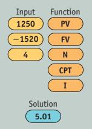

interest factor for a single amount for 4 years, PVIF_{i,4yrs}, which is 0.822 ($1,250 ÷ $1,520). The interest rate in Table A-2 associated with the factor closest to 0.822 for 4 years is the interest or growth rate of Ray's cash flows. In the row for year 4 in Table A-2, the factor for 5 percent is 0.823—almost exactly the 0.822 value. Therefore, the interest or growth rate of the given cash flows is approximately (to the nearest whole percent) 5%.^{13}

Calculator Use Using the calculator, we treat the earliest value as a present value, PV, and the latest value as a future value,  $ FV_{n} $. (Note: Most calculators require either the PV or the FV value to be input as a negative number to calculate an unknown interest or growth rate. That approach is used here.) Using the inputs shown at the left, you will find the interest or growth rate to be 5.01%, which is consistent with, but more precise than, the value found using Table A-2.

Spreadsheet Use The interest or growth rate for the series of cash flows also can be calculated as shown on the following Excel spreadsheet.

<table border=1 style='margin: auto; word-wrap: break-word;'><tr><td style='text-align: center; word-wrap: break-word;'></td><td style='text-align: center; word-wrap: break-word;'>A</td><td style='text-align: center; word-wrap: break-word;'>B</td></tr><tr><td style='text-align: center; word-wrap: break-word;'>1</td><td colspan="2">INTEREST OR GROWTH RATE – SERIES OF CASH FLOWS</td></tr><tr><td style='text-align: center; word-wrap: break-word;'>2</td><td style='text-align: center; word-wrap: break-word;'>Year</td><td style='text-align: center; word-wrap: break-word;'>Cash Flow</td></tr><tr><td style='text-align: center; word-wrap: break-word;'>3</td><td style='text-align: center; word-wrap: break-word;'>2003</td><td style='text-align: center; word-wrap: break-word;'>$1,520</td></tr><tr><td style='text-align: center; word-wrap: break-word;'>4</td><td style='text-align: center; word-wrap: break-word;'>2002</td><td style='text-align: center; word-wrap: break-word;'>$1,440</td></tr><tr><td style='text-align: center; word-wrap: break-word;'>5</td><td style='text-align: center; word-wrap: break-word;'>2001</td><td style='text-align: center; word-wrap: break-word;'>$1,370</td></tr><tr><td style='text-align: center; word-wrap: break-word;'>6</td><td style='text-align: center; word-wrap: break-word;'>2000</td><td style='text-align: center; word-wrap: break-word;'>$1,300</td></tr><tr><td style='text-align: center; word-wrap: break-word;'>7</td><td style='text-align: center; word-wrap: break-word;'>1999</td><td style='text-align: center; word-wrap: break-word;'>$1,250</td></tr><tr><td style='text-align: center; word-wrap: break-word;'>8</td><td style='text-align: center; word-wrap: break-word;'>Annual growth rate</td><td style='text-align: center; word-wrap: break-word;'>5.01%</td></tr><tr><td colspan="3">Entry in Cell B8 is =RATE((A3–A7),0,B7,–B3,0). The expression A3–A7 in the entry calculates the number of years of growth. The minus sign appears before B3 because the investment in 2003 is treated as a cash outflow.</td></tr></table>

Another type of interest-rate problem involves finding the interest rate associated with an annuity, or equal-payment loan.

## EXAMPLE

Jan Jacobs can borrow $2,000 to be repaid in equal annual end-of-year amounts of $514.14 for the next 5 years. She wants to find the interest rate on this loan.

Table Use Substituting  $ PVA_{5} = \2{,}000 $ and  $ PMT = \514.14 $ into Equation 4.26 and rearranging the equation to solve for  $ PVIFA_{i,5yrs} $, we get

 $$ PVIFA_{i,5yrs}=\frac{PVA_{5}}{PMT}=\frac{\2,000}{\514.14}=3.890 $$ 

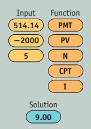

The interest rate for 5 years associated with the annuity factor closest to 3.890 in Table A–4 is 9%. Therefore, the interest rate on the loan is approximately (to the nearest whole percent) 9%.

Calculator Use (Note: Most calculators require either the PMT or the PV value to be input as a negative number in order to calculate an unknown interest rate on an equal-payment loan. That approach is used here.) Using the inputs shown at the left, you will find the interest rate to be 9.00%, which is consistent with the value found using Table A-4.

Spreadsheet Use The interest or growth rate for the annuity also can be calculated as shown on the following Excel spreadsheet.

<table border=1 style='margin: auto; word-wrap: break-word;'><tr><td style='text-align: center; word-wrap: break-word;'></td><td style='text-align: center; word-wrap: break-word;'>A</td><td style='text-align: center; word-wrap: break-word;'>B</td></tr><tr><td style='text-align: center; word-wrap: break-word;'>1</td><td colspan="2">INTEREST OR GROWTH RATE – ANNUITY</td></tr><tr><td style='text-align: center; word-wrap: break-word;'>2</td><td style='text-align: center; word-wrap: break-word;'>Present value (loan principal)</td><td style='text-align: center; word-wrap: break-word;'>$2,000</td></tr><tr><td style='text-align: center; word-wrap: break-word;'>3</td><td style='text-align: center; word-wrap: break-word;'>Number of years</td><td style='text-align: center; word-wrap: break-word;'>5</td></tr><tr><td style='text-align: center; word-wrap: break-word;'>4</td><td style='text-align: center; word-wrap: break-word;'>Annual payment</td><td style='text-align: center; word-wrap: break-word;'>$514.14</td></tr><tr><td style='text-align: center; word-wrap: break-word;'>5</td><td style='text-align: center; word-wrap: break-word;'>Annual interest rate</td><td style='text-align: center; word-wrap: break-word;'>9.00%</td></tr></table>

Entry in Cell B5 is =RATE(B3,B4,-B2).

The minus sign appears before B2 because the loan principal is treated as a cash outflow.

## Finding an Unknown Number of Periods

Sometimes it is necessary to calculate the number of time periods needed to generate a given amount of cash flow from an initial amount. Here we briefly consider this calculation for both single amounts and annuities. This simplest case is when a person wishes to determine the number of periods, $n$, it will take for an initial deposit, $PV$, to grow to a specified future amount, $FV_{n}$, given a stated interest rate, $i$.

## EXAMPLE

Ann Bates wishes to determine the number of years it will take for her initial $1,000 deposit, earning 8% annual interest, to grow to equal $2,500. Simply stated, at an 8% annual rate of interest, how many years, $n, will it take for Ann's $1,000, PV, to grow to $2,500, $FV_n?

Table Use In a manner similar to our approach above to finding an unknown interest or growth rate in a series of cash flows, we begin by dividing the amount deposited in the earliest year by the amount received in the latest year. This results in the present value interest factor for 8% and $PVIF_{8\%,n}$, which is 0.400 ($1,000 = $2,500). The number of years (periods) in Table A-2 associated with the factor closest to 0.400 for an 8% interest rate is the number of years required for $1,000 to grow into $2,500 at 8%. In the 8% column of Table A-2, the factor for 12 years is 0.397—almost exactly the 0.400 value. Therefore, the number of years necessary for the $1,000 to grow to a future value of $2,500 at 8% is approximately (to the nearest year) 12.

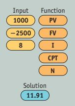

Calculator Use Using the calculator, we treat the initial value as the present value, PV, and the latest value as the future value,  $ FV_{n} $. (Note: Most calculators require either the PV or the FV value to be input as a negative number to calculate an unknown number of periods. That approach is used here.) Using the inputs shown at the left, we find the number of periods to be 11.91 years, which is consistent with, but more precise than, the value found above using Table A-2.

Spreadsheet Use The number of years for the present value to grow to a specified future value also can be calculated as shown on the following Excel spreadsheet.

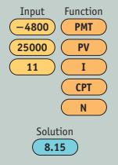

<table border=1 style='margin: auto; word-wrap: break-word;'><tr><td style='text-align: center; word-wrap: break-word;'></td><td style='text-align: center; word-wrap: break-word;'>A</td><td style='text-align: center; word-wrap: break-word;'>B</td></tr><tr><td style='text-align: center; word-wrap: break-word;'>1</td><td colspan="2">YEARS FOR A PRESENT VALUE TO GROW TO A SPECIFIED FUTURE VALUE</td></tr><tr><td style='text-align: center; word-wrap: break-word;'>2</td><td style='text-align: center; word-wrap: break-word;'>Present value (deposit)</td><td style='text-align: center; word-wrap: break-word;'>$1,000</td></tr><tr><td style='text-align: center; word-wrap: break-word;'>3</td><td style='text-align: center; word-wrap: break-word;'>Annual rate of interest, compounded annually</td><td style='text-align: center; word-wrap: break-word;'>8%</td></tr><tr><td style='text-align: center; word-wrap: break-word;'>4</td><td style='text-align: center; word-wrap: break-word;'>Future value</td><td style='text-align: center; word-wrap: break-word;'>$2,500</td></tr><tr><td style='text-align: center; word-wrap: break-word;'>5</td><td style='text-align: center; word-wrap: break-word;'>Number of years</td><td style='text-align: center; word-wrap: break-word;'>11.91</td></tr><tr><td colspan="3">Entry in Cell B5 is =NPER(B3,0,B2,-B4). The minus sign appears before B4 because the future value is treated as a cash outflow.</td></tr></table>

Another type of number-of-periods problem involves finding the number of periods associated with an annuity. Occasionally we wish to find the unknown life, $n$, of an annuity, $PMT$, that is intended to achieve a specific objective, such as repaying a loan of a given amount, $PVA_{n}$, with a stated interest rate, $i$.

## EXAMPLE

Bill Smart can borrow 25,000 at an 11% annual interest rate; equal, annual end-of-year payments of 4,800 are required. He wishes to determine how long it will take to fully repay the loan. In other words, he wishes to determine how many years,  $ n $, it will take to repay the 25,000, 11% loan,  $ PVA_{n} $, if the payments of 4,800, PMT, are made at the end of each year.

Table Use Substituting  $ PVA_{n} = \25,000 $ and  $ PMT = \4,800 $ into Equation 4.26 and rearranging the equation to solve  $ PVIFA_{11\%,nyrs} $, we get

 $$ PVIFA_{11\%,n y r s}=\frac{P V A_{n}}{P M T}=\frac{\25,000}{\4,800}=5.208 $$ 

The number of periods for an 11% interest rate associated with the annuity factor closest to 5.208 in Table A-4 is 8 years. Therefore, the number of periods necessary to repay the loan fully is approximately (to the nearest year) 8 years.

Calculator Use (Note: Most calculators require either the PV or the PMT value to be input as a negative number in order to calculate an unknown number of periods. That approach is used here.) Using the inputs shown at the left, you will find the number of periods to be 8.15, which is consistent with the value found using Table A-4.

Spreadsheet Use The number of years to pay off the loan also can be calculated as shown on the following Excel spreadsheet.

<table border=1 style='margin: auto; word-wrap: break-word;'><tr><td style='text-align: center; word-wrap: break-word;'></td><td style='text-align: center; word-wrap: break-word;'>A</td><td style='text-align: center; word-wrap: break-word;'>B</td></tr><tr><td style='text-align: center; word-wrap: break-word;'>1</td><td colspan="2">YEARS TO PAY OFF A LOAN</td></tr><tr><td style='text-align: center; word-wrap: break-word;'>2</td><td style='text-align: center; word-wrap: break-word;'>Annual payment</td><td style='text-align: center; word-wrap: break-word;'>$4,800</td></tr><tr><td style='text-align: center; word-wrap: break-word;'>3</td><td style='text-align: center; word-wrap: break-word;'>Annual rate of interest, compounded annually</td><td style='text-align: center; word-wrap: break-word;'>11%</td></tr><tr><td style='text-align: center; word-wrap: break-word;'>4</td><td style='text-align: center; word-wrap: break-word;'>Present value (loan principal)</td><td style='text-align: center; word-wrap: break-word;'>$25,000</td></tr><tr><td style='text-align: center; word-wrap: break-word;'>5</td><td style='text-align: center; word-wrap: break-word;'>Number of years to pay off the loan</td><td style='text-align: center; word-wrap: break-word;'>8.15</td></tr><tr><td colspan="3">Entry in Cell B5 is =NPER(B3,-B2,B4). The minus sign appears before B2 because the payments are treated as cash outflows.</td></tr></table>

## Review Questions

4–17 How can you determine the size of the equal annual end-of-period deposits necessary to accumulate a certain future sum at the end of a specified future period at a given annual interest rate?

4–18 Describe the procedure used to amortize a loan into a series of equal periodic payments.

4–19 Which present value interest factors would be used to find (a) the growth rate associated with a series of cash flows and (b) the interest rate associated with an equal-payment loan?

4–20 How can you determine the unknown number of periods when you know the present and future values—single amount or annuity—and the applicable rate of interest?

## SUMMARY

## FOCUS ON VALUE

Time value of money is an important tool that financial managers and other market participants use to assess the impact of proposed actions. Because firms have long lives and their important decisions affect their long-term cash flows, the effective application of time-value-of-money techniques is extremely important. Time value techniques enable financial managers to evaluate cash flows occurring at different times in order to combine, compare, and evaluate them and link them to the firm's overall goal of share price maximization. It will become clear in Chapters 6 and 7 that the application of time value techniques is a key part of the value determination process. Using them, we can measure the firm's value and evaluate the impact that various events and decisions might have on it. Clearly, an understanding of time-value-of-money techniques and an ability to apply them are needed in order to make intelligent value-creating decisions.

## REVIEW OF LEARNING GOALS

Discuss the role of time value in finance, the use of computational tools, and the basic patterns of cash flow. Financial managers and investors use time-value-of-money techniques when assessing the value of the expected cash flow streams associated with investment alternatives. Alternatives can be assessed by either compounding to find future value or discounting to find present value. Because they are at time zero when making decisions, financial managers rely primarily on present value techniques. Financial tables, financial calculators, and computers and spreadsheets can streamline the application of time value techniques. The cash flow of a firm can be described by its pattern—single amount, annuity, or mixed stream.

Understand the concepts of future and present value, their calculation for single amounts, and the relationship of present value to future value. Future value relies on compound interest to measure future amounts: The initial principal or deposit in one period, along with the interest earned on it, becomes the beginning principal of the following period. The present value of a future amount is the amount of money today that is equivalent to the given future amount, considering the return that can be earned on the current money. Present value is the inverse future value. The interest factor formulas and basic equations for both the future value and the present value of a single amount are given in Table 4.9.

LG3 Find the future value and the present value of both an ordinary annuity and an annuity due, and find the present value of a perpetuity. An annuity is a pattern of equal periodic cash flows. For an ordinary annuity, the cash flows occur at the end of the period. For an annuity due, cash flows occur at the beginning of the period. The future value of an ordinary annuity can be found by using the future value interest factor for an annuity; the present value of an ordinary annuity can be found by using the present value interest factor for an annuity. A simple conversion can be applied to use the future value and present value interest factors for an ordinary annuity to find, respectively, the future value and the present value of an annuity due. The present value of a perpetuity—an infinited annuity—is found using 1 divided by the discount rate to represent the present value interest factor. The interest factor formulas and basic equations for the future value and the present value of both an ordinary annuity and an annuity due, and the present value of a perpetuity, are given in Table 4.9.

Calculate both the future value and the present value of a mixed stream of cash flows. A mixed stream of cash flows is a stream of unequal periodic cash flows that reflect no particular pattern. The future value of a mixed stream of cash flows is the sum of the future values of each individual cash flow. Similarly, the present value of a mixed stream of cash flows is the sum of the present values of the individual cash flows.

Understand the effect that compounding interest more frequently than annually has on future value and on the effective annual rate of interest. Interest can be compounded at intervals ranging from annually to daily, and even continuously. The more often interest is compounded, the larger the future amount that will be accumulated, and the higher the effective, or true, annual rate (EAR). The annual percentage rate (APR)—a nominal annual rate—is quoted on credit cards and loans. The annual percentage yield (APY)—an effective annual rate—is quoted on savings products. The interest factor formulas for compounding more frequently than annually are given in Table 4.9.

LGG Describe the procedures involved in (1) determining deposits to accumulate a future sum, (2) loan amortization, (3) finding interest or growth rates, and (4) finding an unknown number of periods. The periodic deposit to accumulate a given future sum can be found by solving the equation for the future value of an annuity for the annual payment. A loan can be amortized into equal periodic payments by solving the equation for the present value of an annuity for the periodic payment. Interest or growth rates can be estimated by finding the unknown interest rate in the equation for the present value of a single amount or an annuity. Similarly, an unknown number of periods can be estimated by finding the unknown number of periods in the equation for the present value of a single amount or an annuity.

### TABLE 4.9 Summary of Key Definitions, Formulas, and Equations for Time Value of Money

Definitions of variables

$e = \text{exponential function} = 2.7183$

EAR = effective annual rate

$FV_{n} = \text{future value of an n-year annuity}$

$m = \text{number of times per year interest is compounded}$

$n = \text{number of periods—typically years—over which money earns a return}$

$PMT = \text{amount deposited or received annually at the end of each year}$

$PV = \text{initial principal or present value}$

$PVA_{n} = \text{present value of an n-year annuity}$

$t = \text{period number index}$

Interest factor formulas

Future value of a single amount with annual compounding:

$FVID_{i,n} = (1 + i)^{n}$ [Eq. 4.5; factors in Table A-1]

Present value of a single amount:

$PVIF_{i,n} = \frac{1}{(1 + i)^{n}}$ [Eq. 4.11; factors in Table A-2]

Future value of an ordinary annuity:

$FVIDA_{i,n} = \sum_{t=1}^{n} (1 + i)^{t-1}$ [Eq. 4.13; factors in Table A-3]

Present value of an ordinary annuity:

$PVIFA_{i,n} = \sum_{t=1}^{n} \frac{1}{(1 + i)^{t}}$ [Eq. 4.15; factors in Table A-4]

Future value of an annuity due:

$FVIFA_{i,n} \quad (\text{annuity due}) = FVIDA_{i,n} \times (1 + i)$ [Eq. 4.17]

Present value of an annuity due:

$PVIFA_{i,n} \quad (\text{annuity due}) = PVIFA_{i,n} \times (1 + i)$ [Eq. 4.18]

Present value of a perpetuity:

$PVIFA_{i,\infty} = \frac{1}{t}$ [Eq. 4.19]

Future value with compounding more frequently than annually:

$FVID_{i,n} = \left(1 + \frac{i}{m}\right)^{m \times n}$ [Eq. 4.20]

for continuous compounding, $m = \infty$;

$FVID_{i,n} \quad (\text{continuous compounding}) = e^{i \times n}$ [Eq. 4.22]

to find the effective annual rate:

$EAR = \left(1 + \frac{i}{m}\right)^{m} - 1$ [Eq. 4.23]

Basic equations

Future value (single amount): $FV_{n} = PV \times (FVID_{i,n})$ [Eq. 4.6]

Present value (single amount): $PV = FV_{n} \times (PVID_{i,n})$ [Eq. 4.12]

Future value (annuity): $FVA_{n} = PMT \times (FVIDA_{i,n})$ [Eq. 4.14]

Present value (annuity): $PVA_{n} = PMT \times (PVIFA_{i,n})$ [Eq. 4.16]

## SELF-TEST PROBLEMS (Solutions in Appendix B)

ST 4-1 Future values for various compounding frequencies Delia Martin has $10,000 that she can deposit in any of three savings accounts for a 3-year period. Bank A compounds interest on an annual basis, bank B compounds interest twice each year, and bank C compounds interest each quarter. All three banks have a stated annual interest rate of 4%.

a. What amount would Ms. Martin have at the end of the third year, leaving all interest paid on deposit, in each bank?

b. What effective annual rate (EAR) would she earn in each of the banks?

c. On the basis of your findings in parts a and b, which bank should Ms. Martin deal with? Why?

d. If a fourth bank (bank D), also with a 4% stated interest rate, compounds interest continuously, how much would Ms. Martin have at the end of the third year? Does this alternative change your recommendation in part c? Explain why or why not.

ST 4–2 Future values of annuities Ramesh Abdul wishes to choose the better of two equally costly cash flow streams: annuity X and annuity Y. X is an annuity due with a cash inflow of $9,000 for each of 6 years. Y is an ordinary annuity with a cash inflow of $10,000 for each of 6 years. Assume that Ramesh can earn 15% on his investments.

a. On a purely subjective basis, which annuity do you think is more attractive? Why?

b. Find the future value at the end of year 6,  $ FVA_{6} $, for both annuity X and annuity Y.

c. Use your finding in part b to indicate which annuity is more attractive. Why? Compare your finding to your subjective response in part a.

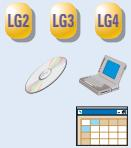

ST 4–3 Present values of single amounts and streams You have a choice of accepting either of two 5-year cash flow streams or single amounts. One cash flow stream is an ordinary annuity, and the other is a mixed stream. You may accept alternative A or B—either as a cash flow stream or as a single amount. Given the cash flow stream and single amounts associated with each (see the accompanying table), and assuming a 9% opportunity cost, which alternative (A or B) and in which form (cash flow stream or single amount) would you prefer?

<table border=1 style='margin: auto; word-wrap: break-word;'><tr><td colspan="3">Cash flow stream</td></tr><tr><td style='text-align: center; word-wrap: break-word;'>End of year</td><td style='text-align: center; word-wrap: break-word;'>Alternative A</td><td style='text-align: center; word-wrap: break-word;'>Alternative B</td></tr><tr><td style='text-align: center; word-wrap: break-word;'>1</td><td style='text-align: center; word-wrap: break-word;'>$700</td><td style='text-align: center; word-wrap: break-word;'>$1,100</td></tr><tr><td style='text-align: center; word-wrap: break-word;'>2</td><td style='text-align: center; word-wrap: break-word;'>700</td><td style='text-align: center; word-wrap: break-word;'>900</td></tr><tr><td style='text-align: center; word-wrap: break-word;'>3</td><td style='text-align: center; word-wrap: break-word;'>700</td><td style='text-align: center; word-wrap: break-word;'>700</td></tr><tr><td style='text-align: center; word-wrap: break-word;'>4</td><td style='text-align: center; word-wrap: break-word;'>700</td><td style='text-align: center; word-wrap: break-word;'>500</td></tr><tr><td style='text-align: center; word-wrap: break-word;'>5</td><td style='text-align: center; word-wrap: break-word;'>700</td><td style='text-align: center; word-wrap: break-word;'>300</td></tr><tr><td colspan="3">Single amount</td></tr><tr><td style='text-align: center; word-wrap: break-word;'>At time zero</td><td style='text-align: center; word-wrap: break-word;'>$2,825</td><td style='text-align: center; word-wrap: break-word;'>$2,800</td></tr></table>

ST 4-4 Deposits needed to accumulate a future sum Judi Janson wishes to accumulate $8,000 by the end of 5 years by making equal annual end-of-year deposits over the next 5 years. If Judi can earn 7% on her investments, how much must she deposit at the end of each year to meet this goal?

## PROBLEMS

4–1 Using a time line The financial manager at Starbuck Industries is considering an investment that requires an initial outlay of $25,000 and is expected to result in cash inflows of $3,000 at the end of year 1, $6,000 at the end of years 2 and 3, $10,000 at the end of year 4, $8,000 at the end of year 5, and $7,000 at the end of year 6.

a. Draw and label a time line depicting the cash flows associated with Starbuck Industries' proposed investment.

b. Use arrows to demonstrate, on the time line in part a, how compounding to find future value can be used to measure all cash flows at the end of year 6.

c. Use arrows to demonstrate, on the time line in part b, how discounting to find present value can be used to measure all cash flows at time zero.

d. Which of the approaches—future value or present value—do financial managers rely on most often for decision making? Why?

### LG2 4–2 Future value calculation Without referring to tables or to the preprogrammed function on your financial calculator, use the basic formula for future value along with the given interest rate, i, and the number of periods, n, to calculate the future value interest factor in each of the cases shown in the following table. Compare the calculated value to the value in Appendix Table A-1

<table border=1 style='margin: auto; word-wrap: break-word;'><tr><td style='text-align: center; word-wrap: break-word;'>Case</td><td style='text-align: center; word-wrap: break-word;'>Interest rate,  $ i $</td><td style='text-align: center; word-wrap: break-word;'>Number of periods,  $ n $</td></tr><tr><td style='text-align: center; word-wrap: break-word;'>A</td><td style='text-align: center; word-wrap: break-word;'>12%</td><td style='text-align: center; word-wrap: break-word;'>2</td></tr><tr><td style='text-align: center; word-wrap: break-word;'>B</td><td style='text-align: center; word-wrap: break-word;'>6</td><td style='text-align: center; word-wrap: break-word;'>3</td></tr><tr><td style='text-align: center; word-wrap: break-word;'>C</td><td style='text-align: center; word-wrap: break-word;'>9</td><td style='text-align: center; word-wrap: break-word;'>2</td></tr><tr><td style='text-align: center; word-wrap: break-word;'>D</td><td style='text-align: center; word-wrap: break-word;'>3</td><td style='text-align: center; word-wrap: break-word;'>4</td></tr></table>

### 4 –3 Future value tables Use the future value interest factors in Appendix Table A–1 in each of the cases shown in the following table to estimate, to the nearest year, how long it would take an initial deposit, assuming no withdrawals, a. To double

b. To quadruple.

<table border=1 style='margin: auto; word-wrap: break-word;'><tr><td style='text-align: center; word-wrap: break-word;'>Case</td><td style='text-align: center; word-wrap: break-word;'>Interest rate</td></tr><tr><td style='text-align: center; word-wrap: break-word;'>A</td><td style='text-align: center; word-wrap: break-word;'>7%</td></tr><tr><td style='text-align: center; word-wrap: break-word;'>B</td><td style='text-align: center; word-wrap: break-word;'>40</td></tr><tr><td style='text-align: center; word-wrap: break-word;'>C</td><td style='text-align: center; word-wrap: break-word;'>20</td></tr><tr><td style='text-align: center; word-wrap: break-word;'>D</td><td style='text-align: center; word-wrap: break-word;'>10</td></tr></table>

## 4 -4 Future values For each of the cases shown in the following table, calculate the future value of the single cash flow deposited today that will be available at the end of the deposit period if the interest is compounded annually at the rate specified over the given period

<table border=1 style='margin: auto; word-wrap: break-word;'><tr><td style='text-align: center; word-wrap: break-word;'>Case</td><td style='text-align: center; word-wrap: break-word;'>Single cash flow</td><td style='text-align: center; word-wrap: break-word;'>Interest rate</td><td style='text-align: center; word-wrap: break-word;'>Deposit period (years)</td></tr><tr><td style='text-align: center; word-wrap: break-word;'>A</td><td style='text-align: center; word-wrap: break-word;'>$ 200</td><td style='text-align: center; word-wrap: break-word;'>5%</td><td style='text-align: center; word-wrap: break-word;'>20</td></tr><tr><td style='text-align: center; word-wrap: break-word;'>B</td><td style='text-align: center; word-wrap: break-word;'>4,500</td><td style='text-align: center; word-wrap: break-word;'>8</td><td style='text-align: center; word-wrap: break-word;'>7</td></tr><tr><td style='text-align: center; word-wrap: break-word;'>C</td><td style='text-align: center; word-wrap: break-word;'>10,000</td><td style='text-align: center; word-wrap: break-word;'>9</td><td style='text-align: center; word-wrap: break-word;'>10</td></tr><tr><td style='text-align: center; word-wrap: break-word;'>D</td><td style='text-align: center; word-wrap: break-word;'>25,000</td><td style='text-align: center; word-wrap: break-word;'>10</td><td style='text-align: center; word-wrap: break-word;'>12</td></tr><tr><td style='text-align: center; word-wrap: break-word;'>E</td><td style='text-align: center; word-wrap: break-word;'>37,000</td><td style='text-align: center; word-wrap: break-word;'>11</td><td style='text-align: center; word-wrap: break-word;'>5</td></tr><tr><td style='text-align: center; word-wrap: break-word;'>F</td><td style='text-align: center; word-wrap: break-word;'>40,000</td><td style='text-align: center; word-wrap: break-word;'>12</td><td style='text-align: center; word-wrap: break-word;'>9</td></tr></table>

## 4 –5 Future value You have $1,500 to invest today at 7% interest compounded annually

a. Find how much you will have accumulated in the account at the end of (1) 3 years, (2) 6 years, and (3) 9 years.

b. Use your findings in part a to calculate the amount of interest earned in (1) the first 3 years (years 1 to 3), (2) the second 3 years (years 4 to 6), and (3) the third 3 years (years 7 to 9).

c. Compare and contrast your findings in part b. Explain why the amount of interest earned increases in each succeeding 3-year period.

4–6 Inflation and future value As part of your financial planning, you wish to purchase a new car exactly 5 years from today. The car you wish to purchase costs $14,000 today, and your research indicates that its price will increase by 2% to 4% per year over the next 5 years.

a. Estimate the price of the car at the end of 5 years if inflation is (1) 2% per year, and (2) 4% per year.

b. How much more expensive will the car be if the rate of inflation is 4% rather than 2%?

### 4 –7 Future value and time You can deposit $10,000 into an account paying 9% annual interest either today or exactly 10 years from today. How much better off will you be at the end of 40 years if you decide to make the initial deposit today rather than 10 years from today?

LG2 4–8 Future value calculation Misty need to have $15,000 at the end of 5 years in order to fulfill her goal of purchasing a small sailboat. She is willing to invest the funds as a single amount today but wonders what sort of investment return she will need to earn. Use your calculator or the time value tables to figure out the approximate annually compounded rate of return needed in each of these cases:

a. Misty can invest $10,200 today.

b. Misty can invest $8,150 today.

c. Misty can invest $7,150 today.

4–9 Single-payment loan repayment A person borrows $200 to be repaid in 8 years with 14% annually compounded interest. The loan may be repaid at the end of any earlier year with no prepayment penalty.

a. What amount will be due if the loan is repaid at the end of year 1?

b. What is the repayment at the end of year?

c. What amount is due at the end of the eighth year?

4–10 Present value calculation Without referring to tables or to the preprogrammed function on your financial calculator, use the basic formula for present value, along with the given opportunity cost, i, and the number of periods, n, to calculate the present value interest factor in each of the cases shown in the accompanying table. Compare the calculated value to the table value.

<table border=1 style='margin: auto; word-wrap: break-word;'><tr><td style='text-align: center; word-wrap: break-word;'>Case</td><td style='text-align: center; word-wrap: break-word;'>Opportunity cost,  $ i $</td><td style='text-align: center; word-wrap: break-word;'>Number of periods,  $ n $</td></tr><tr><td style='text-align: center; word-wrap: break-word;'>A</td><td style='text-align: center; word-wrap: break-word;'>2%</td><td style='text-align: center; word-wrap: break-word;'>4</td></tr><tr><td style='text-align: center; word-wrap: break-word;'>B</td><td style='text-align: center; word-wrap: break-word;'>10</td><td style='text-align: center; word-wrap: break-word;'>2</td></tr><tr><td style='text-align: center; word-wrap: break-word;'>C</td><td style='text-align: center; word-wrap: break-word;'>5</td><td style='text-align: center; word-wrap: break-word;'>3</td></tr><tr><td style='text-align: center; word-wrap: break-word;'>D</td><td style='text-align: center; word-wrap: break-word;'>13</td><td style='text-align: center; word-wrap: break-word;'>2</td></tr></table>

## LG2 4–11 Present values For each of the cases shown in the following table, calculate the present value of the cash flow, discounting at the rate given and assuming that the cash flow is received at the end of the period noted

<table border=1 style='margin: auto; word-wrap: break-word;'><tr><td style='text-align: center; word-wrap: break-word;'>Case</td><td style='text-align: center; word-wrap: break-word;'>Single cash flow</td><td style='text-align: center; word-wrap: break-word;'>Discount rate</td><td style='text-align: center; word-wrap: break-word;'>End of period (years)</td></tr><tr><td style='text-align: center; word-wrap: break-word;'>A</td><td style='text-align: center; word-wrap: break-word;'>$ 7,000</td><td style='text-align: center; word-wrap: break-word;'>12%</td><td style='text-align: center; word-wrap: break-word;'>4</td></tr><tr><td style='text-align: center; word-wrap: break-word;'>B</td><td style='text-align: center; word-wrap: break-word;'>28,000</td><td style='text-align: center; word-wrap: break-word;'>8</td><td style='text-align: center; word-wrap: break-word;'>20</td></tr><tr><td style='text-align: center; word-wrap: break-word;'>C</td><td style='text-align: center; word-wrap: break-word;'>10,000</td><td style='text-align: center; word-wrap: break-word;'>14</td><td style='text-align: center; word-wrap: break-word;'>12</td></tr><tr><td style='text-align: center; word-wrap: break-word;'>D</td><td style='text-align: center; word-wrap: break-word;'>150,000</td><td style='text-align: center; word-wrap: break-word;'>11</td><td style='text-align: center; word-wrap: break-word;'>6</td></tr><tr><td style='text-align: center; word-wrap: break-word;'>E</td><td style='text-align: center; word-wrap: break-word;'>45,000</td><td style='text-align: center; word-wrap: break-word;'>20</td><td style='text-align: center; word-wrap: break-word;'>8</td></tr></table>

4–12 Present value concept Answer each of the following questions.

a. What single investment made today, earning 12% annual interest, will be worth $6,000 at the end of 6 years?

b. What is the present value of $6,000 to be received at the end of 6 years if the discount rate is 12%?

c. What is the most you would pay today for a promise to repay you $6,000 at the end of 6 years if your opportunity cost is 12%?

d. Compare, contrast, and discuss your findings in parts a through c.

4–13 Present value Jim Nance has been offered a future payment of $500 three years from today. If his opportunity cost is 7% compounded annually, what value should he place on this opportunity today? What is the most he should pay to purchase this payment today?

## 4 -14

Present value An Iowa state savings bond can be converted to $100 at maturity 6 years from purchase. If the state bonds are to be competitive with U.S. Savings Bonds, which pay 8% annual interest (compounded annually), at what price must the state sell its bonds? Assume no cash payments on savings bonds prior to redemption.

4–15 Present value and discount rates You just won a lottery that promises to pay you $1,000,000 exactly 10 years from today. Because the $1,000,000 payment is guaranteed by the state in which you live, opportunities exist to sell the claim today for an immediate single cash payment.

a. What is the least you will sell your claim for if you can earn the following rates of return on similar-risk investments during the 10-year period?

(1) 6%

(2) 9%

(3) 12%

b. Rework part a under the assumption that the $1,000,000 payment will be received in 15 rather than 10 years.

c. On the basis of your findings in parts a and b, discuss the effect of both the size of the rate of return and the time until receipt of payment on the present value of a future sum.

### 4 –16 Present value comparisons of single amounts In exchange for a $20,000 payment today, a well-known company will allow you to choose one of the alternatives shown in the following table. Your opportunity cost is 11%

<table border=1 style='margin: auto; word-wrap: break-word;'><tr><td style='text-align: center; word-wrap: break-word;'>Alternative</td><td style='text-align: center; word-wrap: break-word;'>Single amount</td></tr><tr><td style='text-align: center; word-wrap: break-word;'>A</td><td style='text-align: center; word-wrap: break-word;'>$28,500 at end of 3 years</td></tr><tr><td style='text-align: center; word-wrap: break-word;'>B</td><td style='text-align: center; word-wrap: break-word;'>$54,000 at end of 9 years</td></tr><tr><td style='text-align: center; word-wrap: break-word;'>C</td><td style='text-align: center; word-wrap: break-word;'>$160,000 at end of 20 years</td></tr></table>

a. Find the value today of each alternative.

b. Are all the alternatives acceptable, i.e., worth $20,000 today?

c. Which alternative, if any, will you take?

#### 4 –17 Cash flow investment decision Tom Alexander has an opportunity to purchase any of the investments shown in the following table. The purchase price, the amount of the single cash inflow, and its year of receipt are given for each investment. Which purchase recommendations would you make, assuming that Tom can earn 10% on his investments?

<table border=1 style='margin: auto; word-wrap: break-word;'><tr><td style='text-align: center; word-wrap: break-word;'>Investment</td><td style='text-align: center; word-wrap: break-word;'>Price</td><td style='text-align: center; word-wrap: break-word;'>Single cash inflow</td><td style='text-align: center; word-wrap: break-word;'>Year of receipt</td></tr><tr><td style='text-align: center; word-wrap: break-word;'>A</td><td style='text-align: center; word-wrap: break-word;'>$18,000</td><td style='text-align: center; word-wrap: break-word;'>$30,000</td><td style='text-align: center; word-wrap: break-word;'>5</td></tr><tr><td style='text-align: center; word-wrap: break-word;'>B</td><td style='text-align: center; word-wrap: break-word;'>600</td><td style='text-align: center; word-wrap: break-word;'>3,000</td><td style='text-align: center; word-wrap: break-word;'>20</td></tr><tr><td style='text-align: center; word-wrap: break-word;'>C</td><td style='text-align: center; word-wrap: break-word;'>3,500</td><td style='text-align: center; word-wrap: break-word;'>10,000</td><td style='text-align: center; word-wrap: break-word;'>10</td></tr><tr><td style='text-align: center; word-wrap: break-word;'>D</td><td style='text-align: center; word-wrap: break-word;'>1,000</td><td style='text-align: center; word-wrap: break-word;'>15,000</td><td style='text-align: center; word-wrap: break-word;'>40</td></tr></table>

4–18 Future value of an annuity For each case in the accompanying table, answer the questions that follow.

<table border=1 style='margin: auto; word-wrap: break-word;'><tr><td style='text-align: center; word-wrap: break-word;'>Case</td><td style='text-align: center; word-wrap: break-word;'>Amount of annuity</td><td style='text-align: center; word-wrap: break-word;'>Interest rate</td><td style='text-align: center; word-wrap: break-word;'>Deposit period (years)</td></tr><tr><td style='text-align: center; word-wrap: break-word;'>A</td><td style='text-align: center; word-wrap: break-word;'>$ 2,500</td><td style='text-align: center; word-wrap: break-word;'>8%</td><td style='text-align: center; word-wrap: break-word;'>10</td></tr><tr><td style='text-align: center; word-wrap: break-word;'>B</td><td style='text-align: center; word-wrap: break-word;'>500</td><td style='text-align: center; word-wrap: break-word;'>12</td><td style='text-align: center; word-wrap: break-word;'>6</td></tr><tr><td style='text-align: center; word-wrap: break-word;'>C</td><td style='text-align: center; word-wrap: break-word;'>30,000</td><td style='text-align: center; word-wrap: break-word;'>20</td><td style='text-align: center; word-wrap: break-word;'>5</td></tr><tr><td style='text-align: center; word-wrap: break-word;'>D</td><td style='text-align: center; word-wrap: break-word;'>11,500</td><td style='text-align: center; word-wrap: break-word;'>9</td><td style='text-align: center; word-wrap: break-word;'>8</td></tr><tr><td style='text-align: center; word-wrap: break-word;'>E</td><td style='text-align: center; word-wrap: break-word;'>6,000</td><td style='text-align: center; word-wrap: break-word;'>14</td><td style='text-align: center; word-wrap: break-word;'>30</td></tr></table>

a. Calculate the future value of the annuity assuming that it is

(1) an ordinary annuity.

(2) an annuity due.

b. Compare your findings in parts a(1) and a(2). All else being identical, which type of annuity—ordinary or annuity due—is preferable? Explain why.

4–19 Present value of an annuity Consider the following cases.

<table border=1 style='margin: auto; word-wrap: break-word;'><tr><td style='text-align: center; word-wrap: break-word;'>Case</td><td style='text-align: center; word-wrap: break-word;'>Amount of annuity</td><td style='text-align: center; word-wrap: break-word;'>Interest rate</td><td style='text-align: center; word-wrap: break-word;'>Period (years)</td></tr><tr><td style='text-align: center; word-wrap: break-word;'>A</td><td style='text-align: center; word-wrap: break-word;'>$ 12,000</td><td style='text-align: center; word-wrap: break-word;'>7%</td><td style='text-align: center; word-wrap: break-word;'>3</td></tr><tr><td style='text-align: center; word-wrap: break-word;'>B</td><td style='text-align: center; word-wrap: break-word;'>55,000</td><td style='text-align: center; word-wrap: break-word;'>12</td><td style='text-align: center; word-wrap: break-word;'>15</td></tr><tr><td style='text-align: center; word-wrap: break-word;'>C</td><td style='text-align: center; word-wrap: break-word;'>700</td><td style='text-align: center; word-wrap: break-word;'>20</td><td style='text-align: center; word-wrap: break-word;'>9</td></tr><tr><td style='text-align: center; word-wrap: break-word;'>D</td><td style='text-align: center; word-wrap: break-word;'>140,000</td><td style='text-align: center; word-wrap: break-word;'>5</td><td style='text-align: center; word-wrap: break-word;'>7</td></tr><tr><td style='text-align: center; word-wrap: break-word;'>E</td><td style='text-align: center; word-wrap: break-word;'>22,500</td><td style='text-align: center; word-wrap: break-word;'>10</td><td style='text-align: center; word-wrap: break-word;'>5</td></tr></table>

a. Calculate the present value of the annuity assuming that it is

(1) an ordinary due.

(2) an annuity due.

b. Compare your findings in parts a(1) and a(2). All else being identical, which type of annuity—ordinary or annuity due—is preferable? Explain why.

4–20 Ordinary annuity versus annuity due Marian Kirk wishes to select the better of two 10-year annuities, C and D. Annuity C is an ordinary annuity of $2,500 per year for 10 years. Annuity D is an annuity due of $2,200 per year for 10 years.

a. Find the future value of both annuities at the end of year 10, assuming that Marian can earn (1) 10% annual interest and (2) 20% annual interest.

b. Use your findings in part a to indicate which annuity has the greater future value at the end of year 10 for both the (1) 10% and (2) 20% interest rates.

c. Find the present value of both annuities, assuming that Marian can earn (1) 10% annual interest and (2) 20% annual interest.

d. Use your findings in part c to indicate which annuity has the greater present value for both (1) 10% and (2) 20% interest rates.

e. Briefly compare, contrast, and explain any differences between your findings using the 10% and 20% interest rates in parts b and d.

4–21 Future value of a retirement annuity Hal Thomas, a 25-year-old college graduate, wishes to retire at age 65. To supplement other sources of retirement income, he can deposit $2,000 each year into a tax-deferred individual retirement arrangement (IRA). The IRA will be invested to earn an annual return of 10%, which is assumed to be attainable over the next 40 years.

a. If Hal makes annual end-of-year $2,000 deposits into the IRA, how much will he have accumulated by the end of his 65th year?

b. If Hal decides to wait until age 35 to begin making annual end-of-year $2,000 deposits into the IRA, how much will he have accumulated by the end of his 65th year?

c. Using your findings in parts a and b, discuss the impact of delaying making deposits into the IRA for 10 years (age 25 to age 35) on the amount accumulated by the end of Hal's 65th year.

d. Rework parts a, b, and c, assuming that Hal makes all deposits at the beginning, rather than the end, of each year. Discuss the effect of beginning-of-year deposits on the future value accumulated by the end of Hal's 65th year.

4–22 Present value of a retirement annuity An insurance agent is trying to sell you an immediate-retirement annuity, which for a single amount paid today will provide you with $12,000 at the end of each year for the next 25 years. You currently earn 9% on low-risk investments comparable to the retirement annuity. Ignoring taxes, what is the most you would pay for this annuity?

4–23 Funding your retirement You plan to retire in exactly 20 years. Your goal is to create a fund that will allow you to receive $20,000 at the end of each year for the 30 years between retirement and death (a psychic told you would die after 30 years). You know that you will be able to earn 11% per year during the 30-year retirement period.

a. How large a fund will you need when you retire in 20 years to provide the 30-year, $20,000 retirement annuity?

b. How much will you need today as a single amount to provide the fund calculated in part a if you earn only 9% per year during the 20 years preceding retirement?

c. What effect would an increase in the rate you can earn both during and prior to retirement have on the values found in parts a and b? Explain.

##### 4 –24 Present value of an annuity versus a single amount Assume that you just won the state lottery. Your prize can be taken either in the form of $40,000 at the end of each of the next 25 years (i.e., $1,000,000 over 25 years) or as a single amount of $500,000 paid immediately

a. If you expect to be able to earn 5% annually on your investments over the next 25 years, ignoring taxes and other considerations, which alternative should you take? Why?

b. Would your decision in part a change if you could earn 7% rather than 5% on your investments over the next 25 years? Why?

c. On a strictly economic basis, at approximately what earnings rate would you be indifferent between the two plans?

LG3 4–25 Perpetuities Consider the data in the following table.

<table border=1 style='margin: auto; word-wrap: break-word;'><tr><td style='text-align: center; word-wrap: break-word;'>Perpetuity</td><td style='text-align: center; word-wrap: break-word;'>Annual amount</td><td style='text-align: center; word-wrap: break-word;'>Discount rate</td></tr><tr><td style='text-align: center; word-wrap: break-word;'>A</td><td style='text-align: center; word-wrap: break-word;'>$ 20,000</td><td style='text-align: center; word-wrap: break-word;'>8%</td></tr><tr><td style='text-align: center; word-wrap: break-word;'>B</td><td style='text-align: center; word-wrap: break-word;'>100,000</td><td style='text-align: center; word-wrap: break-word;'>10</td></tr><tr><td style='text-align: center; word-wrap: break-word;'>C</td><td style='text-align: center; word-wrap: break-word;'>3,000</td><td style='text-align: center; word-wrap: break-word;'>6</td></tr><tr><td style='text-align: center; word-wrap: break-word;'>D</td><td style='text-align: center; word-wrap: break-word;'>60,000</td><td style='text-align: center; word-wrap: break-word;'>5</td></tr></table>

Determine, for each of the perpetuities:

a. The appropriate present value interest factor.

b. The present value.

4–26 Creating an endowment Upon completion of her introductory finance course, Marla Lee was so pleased with the amount of useful and interesting knowledge she gained that she convinced her parents, who were wealthy alums of the university she was attending, to create an endowment. The endowment is to allow three needy students to take the introductory finance course each year in perpetuity. The guaranteed annual cost of tuition and books for the course is $600 per student. The endowment will be created by making a single payment to the university. The university expects to earn exactly 6% per year on these funds.

a. How large an initial single payment must Marla's parents make to the university to fund the endowment?

b. What amount would be needed to fund the endowment if the university could earn 9% rather than 6% per year on the funds?

4–27 Future value of a mixed stream For each of the mixed streams of cash flows shown in the following table, determine the future value at the end of the final year if deposits are made into an account paying annual interest of 12%, assuming that no withdrawals are made during the period and that the deposits are made:

a. At the end of each year.

b. At the beginning of each year.

<table border=1 style='margin: auto; word-wrap: break-word;'><tr><td rowspan="2">Year</td><td colspan="3">Cash flow stream</td></tr><tr><td style='text-align: center; word-wrap: break-word;'>A</td><td style='text-align: center; word-wrap: break-word;'>B</td><td style='text-align: center; word-wrap: break-word;'>C</td></tr><tr><td style='text-align: center; word-wrap: break-word;'>1</td><td style='text-align: center; word-wrap: break-word;'>$ 900</td><td style='text-align: center; word-wrap: break-word;'>$30,000</td><td style='text-align: center; word-wrap: break-word;'>$1,200</td></tr><tr><td style='text-align: center; word-wrap: break-word;'>2</td><td style='text-align: center; word-wrap: break-word;'>1,000</td><td style='text-align: center; word-wrap: break-word;'>25,000</td><td style='text-align: center; word-wrap: break-word;'>1,200</td></tr><tr><td style='text-align: center; word-wrap: break-word;'>3</td><td style='text-align: center; word-wrap: break-word;'>1,200</td><td style='text-align: center; word-wrap: break-word;'>20,000</td><td style='text-align: center; word-wrap: break-word;'>1,000</td></tr><tr><td style='text-align: center; word-wrap: break-word;'>4</td><td style='text-align: center; word-wrap: break-word;'></td><td style='text-align: center; word-wrap: break-word;'>10,000</td><td style='text-align: center; word-wrap: break-word;'>1,900</td></tr><tr><td style='text-align: center; word-wrap: break-word;'>5</td><td style='text-align: center; word-wrap: break-word;'></td><td style='text-align: center; word-wrap: break-word;'>5,000</td><td style='text-align: center; word-wrap: break-word;'></td></tr></table>

4–28 Future value of a single amount versus a mixed stream Gina Vitale has just contracted to sell a small parcel of land that she inherited a few years ago. The buyer is willing to pay $24,000 at the closing of the transaction or will pay the amounts shown in the following table at the beginning of each of the next

5 years. Because Gina doesn't really need the money today, she plans to let it accumulate in an account that earns 7% annual interest. Given her desire to buy a house at the end of 5 years after closing on the sale of the lot, she decides to choose the payment alternative—$24,000 single amount or the mixed stream of payments in the following table—that provides the higher future value at the end of 5 years. Which alternative will she choose?

<table border=1 style='margin: auto; word-wrap: break-word;'><tr><td colspan="2">Mixed stream</td></tr><tr><td style='text-align: center; word-wrap: break-word;'>Beginning of year</td><td style='text-align: center; word-wrap: break-word;'>Cash flow</td></tr><tr><td style='text-align: center; word-wrap: break-word;'>1</td><td style='text-align: center; word-wrap: break-word;'>$ 2,000</td></tr><tr><td style='text-align: center; word-wrap: break-word;'>2</td><td style='text-align: center; word-wrap: break-word;'>4,000</td></tr><tr><td style='text-align: center; word-wrap: break-word;'>3</td><td style='text-align: center; word-wrap: break-word;'>6,000</td></tr><tr><td style='text-align: center; word-wrap: break-word;'>4</td><td style='text-align: center; word-wrap: break-word;'>8,000</td></tr><tr><td style='text-align: center; word-wrap: break-word;'>5</td><td style='text-align: center; word-wrap: break-word;'>10,000</td></tr></table>

4–29 Present value—Mixed streams. Find the present value of the streams of cash flows shown in the following table. Assume that the firm's opportunity cost is 12%.

<table border=1 style='margin: auto; word-wrap: break-word;'><tr><td colspan="2">A</td><td colspan="2">B</td><td colspan="2">C</td></tr><tr><td style='text-align: center; word-wrap: break-word;'>Year</td><td style='text-align: center; word-wrap: break-word;'>Cash flow</td><td style='text-align: center; word-wrap: break-word;'>Year</td><td style='text-align: center; word-wrap: break-word;'>Cash flow</td><td style='text-align: center; word-wrap: break-word;'>Year</td><td style='text-align: center; word-wrap: break-word;'>Cash flow</td></tr><tr><td style='text-align: center; word-wrap: break-word;'>1</td><td style='text-align: center; word-wrap: break-word;'>-$2,000</td><td style='text-align: center; word-wrap: break-word;'>1</td><td style='text-align: center; word-wrap: break-word;'>$10,000</td><td style='text-align: center; word-wrap: break-word;'>1-5</td><td style='text-align: center; word-wrap: break-word;'>$10,000/yr</td></tr><tr><td style='text-align: center; word-wrap: break-word;'>2</td><td style='text-align: center; word-wrap: break-word;'>3,000</td><td style='text-align: center; word-wrap: break-word;'>2-5</td><td style='text-align: center; word-wrap: break-word;'>5,000/yr</td><td style='text-align: center; word-wrap: break-word;'>6-10</td><td style='text-align: center; word-wrap: break-word;'>8,000/yr</td></tr><tr><td style='text-align: center; word-wrap: break-word;'>3</td><td style='text-align: center; word-wrap: break-word;'>4,000</td><td style='text-align: center; word-wrap: break-word;'>6</td><td style='text-align: center; word-wrap: break-word;'>7,000</td><td style='text-align: center; word-wrap: break-word;'></td><td style='text-align: center; word-wrap: break-word;'></td></tr><tr><td style='text-align: center; word-wrap: break-word;'>4</td><td style='text-align: center; word-wrap: break-word;'>6,000</td><td style='text-align: center; word-wrap: break-word;'></td><td style='text-align: center; word-wrap: break-word;'></td><td style='text-align: center; word-wrap: break-word;'></td><td style='text-align: center; word-wrap: break-word;'></td></tr><tr><td style='text-align: center; word-wrap: break-word;'>5</td><td style='text-align: center; word-wrap: break-word;'>8,000</td><td style='text-align: center; word-wrap: break-word;'></td><td style='text-align: center; word-wrap: break-word;'></td><td style='text-align: center; word-wrap: break-word;'></td><td style='text-align: center; word-wrap: break-word;'></td></tr></table>

4–30 Present value—Mixed streams Consider the mixed streams of cash flows shown in the following table.

<table border=1 style='margin: auto; word-wrap: break-word;'><tr><td rowspan="2">Year</td><td colspan="2">Cash flow stream</td></tr><tr><td style='text-align: center; word-wrap: break-word;'>A</td><td style='text-align: center; word-wrap: break-word;'>B</td></tr><tr><td style='text-align: center; word-wrap: break-word;'>1</td><td style='text-align: center; word-wrap: break-word;'>$ 50,000</td><td style='text-align: center; word-wrap: break-word;'>$ 10,000</td></tr><tr><td style='text-align: center; word-wrap: break-word;'>2</td><td style='text-align: center; word-wrap: break-word;'>40,000</td><td style='text-align: center; word-wrap: break-word;'>20,000</td></tr><tr><td style='text-align: center; word-wrap: break-word;'>3</td><td style='text-align: center; word-wrap: break-word;'>30,000</td><td style='text-align: center; word-wrap: break-word;'>30,000</td></tr><tr><td style='text-align: center; word-wrap: break-word;'>4</td><td style='text-align: center; word-wrap: break-word;'>20,000</td><td style='text-align: center; word-wrap: break-word;'>40,000</td></tr><tr><td style='text-align: center; word-wrap: break-word;'>5</td><td style='text-align: center; word-wrap: break-word;'>10,000</td><td style='text-align: center; word-wrap: break-word;'>50,000</td></tr><tr><td style='text-align: center; word-wrap: break-word;'>Totals</td><td style='text-align: center; word-wrap: break-word;'>$150,000</td><td style='text-align: center; word-wrap: break-word;'>$150,000</td></tr></table>

a. Find the present value of each stream using a 15% discount rate.

b. Compare the calculated present values and discuss them in light of the fact that the undiscounted cash flows total $150,000 in each case.

4–31 Present value of a mixed stream Harte Systems, Inc., a maker of electronic surveillance equipment, is considering selling to a well-known hardware chain the rights to market its home security system. The proposed deal calls for payments of $30,000 and $25,000 at the end of years 1 and 2 and for annual year-end payments of $15,000 in years 3 through 9. A final payment of $10,000 would be due at the end of year 10.

a. Lay out the cash flows involved in the offer on a time line.

b. If Harte applies a required rate of return of 12% to them, what is the present value of this series of payments?

c. A second company has offered Harte a one-time payment of $100,000 for the rights to market the home security system. Which offer should Harte accept?

4–32 Funding budget shortfalls As part of your personal budgeting process, you have determined that in each of the next 5 years you will have budget shortfalls. In other words, you will need the amounts shown in the following table at the end of the given year to balance your budget—that is, to make inflows equal outflows. You expect to be able to earn 8% on your investments during the next 5 years and wish to fund the budget shortfalls over the next 5 years with a single amount.

<table border=1 style='margin: auto; word-wrap: break-word;'><tr><td style='text-align: center; word-wrap: break-word;'>End of year</td><td style='text-align: center; word-wrap: break-word;'>Budget shortfall</td></tr><tr><td style='text-align: center; word-wrap: break-word;'>1</td><td style='text-align: center; word-wrap: break-word;'>$ 5,000</td></tr><tr><td style='text-align: center; word-wrap: break-word;'>2</td><td style='text-align: center; word-wrap: break-word;'>4,000</td></tr><tr><td style='text-align: center; word-wrap: break-word;'>3</td><td style='text-align: center; word-wrap: break-word;'>6,000</td></tr><tr><td style='text-align: center; word-wrap: break-word;'>4</td><td style='text-align: center; word-wrap: break-word;'>10,000</td></tr><tr><td style='text-align: center; word-wrap: break-word;'>5</td><td style='text-align: center; word-wrap: break-word;'>3,000</td></tr></table>

a. How large must the single deposit today into an account paying 8% annual interest be to provide for full coverage of the anticipated budget shortfalls?

b. What effect would an increase in your earnings rate have on the amount calculated in part a? Explain.

## 4 –33 Relationship between future value and present value—Mixed stream Using only the information in the accompanying table, answer the questions that follow

<table border=1 style='margin: auto; word-wrap: break-word;'><tr><td style='text-align: center; word-wrap: break-word;'>Year (t)</td><td style='text-align: center; word-wrap: break-word;'>Cash flow</td><td style='text-align: center; word-wrap: break-word;'>Future value interest factor at 5% ( $ FVIF_{5\%,t} $)</td></tr><tr><td style='text-align: center; word-wrap: break-word;'>1</td><td style='text-align: center; word-wrap: break-word;'>800</td><td style='text-align: center; word-wrap: break-word;'>1.050</td></tr><tr><td style='text-align: center; word-wrap: break-word;'>2</td><td style='text-align: center; word-wrap: break-word;'>900</td><td style='text-align: center; word-wrap: break-word;'>1.102</td></tr><tr><td style='text-align: center; word-wrap: break-word;'>3</td><td style='text-align: center; word-wrap: break-word;'>1,000</td><td style='text-align: center; word-wrap: break-word;'>1.158</td></tr><tr><td style='text-align: center; word-wrap: break-word;'>4</td><td style='text-align: center; word-wrap: break-word;'>1,500</td><td style='text-align: center; word-wrap: break-word;'>1.216</td></tr><tr><td style='text-align: center; word-wrap: break-word;'>5</td><td style='text-align: center; word-wrap: break-word;'>2,000</td><td style='text-align: center; word-wrap: break-word;'>1.276</td></tr></table>

a. Determine the present value of the mixed stream of cash flows using a 5% discount rate.

b. How much would you be willing to pay for an opportunity to buy this stream, assuming that you can at best earn 5% on your investments?

c. What effect, if any, would a 7% rather than a 5% opportunity cost have on your analysis? (Explain verbally.)

## 4 –34 Changing compounding frequency Using annual, semiannual, and quarterly compounding periods, for each of the following: (1) Calculate the future value if $5,000 is initially deposited, and (2) determine the effective annual rate (EAR)

a. At 12% annual interest for 5 years.

b. At 16% annual interest for 6 years.

c. At 20% annual interest for 10 years.

## 4 –35 Compounding frequency, future value, and effective annual rates For each of the cases in the following table:

a. Calculate the future value at the end of the specified deposit period.

b. Determine the effective annual rate, EAR.

c. Compare the nominal annual rate, i, to the effective annual rate, EAR. What relationship exists between compounding frequency and the nominal and effective annual rates.

<table border=1 style='margin: auto; word-wrap: break-word;'><tr><td style='text-align: center; word-wrap: break-word;'>Case</td><td style='text-align: center; word-wrap: break-word;'>Amount of initial deposit</td><td style='text-align: center; word-wrap: break-word;'>Nominal annual rate,  $ i $</td><td style='text-align: center; word-wrap: break-word;'>Compounding frequency,  $ m $ (times/year)</td><td style='text-align: center; word-wrap: break-word;'>Deposit period (years)</td></tr><tr><td style='text-align: center; word-wrap: break-word;'>A</td><td style='text-align: center; word-wrap: break-word;'>2,500</td><td style='text-align: center; word-wrap: break-word;'>6%</td><td style='text-align: center; word-wrap: break-word;'>2</td><td style='text-align: center; word-wrap: break-word;'>5</td></tr><tr><td style='text-align: center; word-wrap: break-word;'>B</td><td style='text-align: center; word-wrap: break-word;'>50,000</td><td style='text-align: center; word-wrap: break-word;'>12</td><td style='text-align: center; word-wrap: break-word;'>6</td><td style='text-align: center; word-wrap: break-word;'>3</td></tr><tr><td style='text-align: center; word-wrap: break-word;'>C</td><td style='text-align: center; word-wrap: break-word;'>1,000</td><td style='text-align: center; word-wrap: break-word;'>5</td><td style='text-align: center; word-wrap: break-word;'>1</td><td style='text-align: center; word-wrap: break-word;'>10</td></tr><tr><td style='text-align: center; word-wrap: break-word;'>D</td><td style='text-align: center; word-wrap: break-word;'>20,000</td><td style='text-align: center; word-wrap: break-word;'>16</td><td style='text-align: center; word-wrap: break-word;'>4</td><td style='text-align: center; word-wrap: break-word;'>6</td></tr></table>

## 4 –36 Continuous compounding For each of the cases in the following table, find the future value at the end of the deposit period, assuming that interest is compounded continuously at the given nominal annual rate

<table border=1 style='margin: auto; word-wrap: break-word;'><tr><td style='text-align: center; word-wrap: break-word;'>Case</td><td style='text-align: center; word-wrap: break-word;'>Amount of initial deposit</td><td style='text-align: center; word-wrap: break-word;'>Nominal annual rate,  $ i $</td><td style='text-align: center; word-wrap: break-word;'>Deposit period (years),  $ n $</td></tr><tr><td style='text-align: center; word-wrap: break-word;'>A</td><td style='text-align: center; word-wrap: break-word;'>1,000</td><td style='text-align: center; word-wrap: break-word;'>9%</td><td style='text-align: center; word-wrap: break-word;'>2</td></tr><tr><td style='text-align: center; word-wrap: break-word;'>B</td><td style='text-align: center; word-wrap: break-word;'>600</td><td style='text-align: center; word-wrap: break-word;'>10</td><td style='text-align: center; word-wrap: break-word;'>10</td></tr><tr><td style='text-align: center; word-wrap: break-word;'>C</td><td style='text-align: center; word-wrap: break-word;'>4,000</td><td style='text-align: center; word-wrap: break-word;'>8</td><td style='text-align: center; word-wrap: break-word;'>7</td></tr><tr><td style='text-align: center; word-wrap: break-word;'>D</td><td style='text-align: center; word-wrap: break-word;'>2,500</td><td style='text-align: center; word-wrap: break-word;'>12</td><td style='text-align: center; word-wrap: break-word;'>4</td></tr></table>

## 4 –37 Compounding frequency and future value You plan to invest $2,000 in an individual retirement arrangement (IRA) today at a nominal annual rate of 8%, which is expected to apply to all future years

a. How much will you have in the account at the end of 10 years if interest is compounded (1) annually? (2) semiannually? (3) daily (assume a 360-day year)? (4) continuously?

b. What is the effective annual rate, EAR, for each compounding period in part a?

c. How much greater will your IRA account balance be at the end of 10 years if interest is compounded continuously rather than annually?

d. How does the compounding frequency affect the future value and effective annual rate for a given deposit? Explain in terms of your findings in parts a through c.

## 4 –38 Comparing compounding periods René Levin wishes to determine the future value at the end of 2 years of a $15,000 deposit made today into an account paying a nominal annual rate of 12%

a. Find the future value of René's deposit, assuming that interest is compounded (1) annually, (2) quarterly, (3) monthly, and (4) continuously.

b. Compare your findings in part a, and use them to demonstrate the relationship between compounding frequency and future value.

c. What is the maximum future value obtainable given the $15,000 deposit, the 2-year time period, and the 12% nominal annual rate? Use your findings in part a to explain.

## 4 –39 Annuities and compounding Janet Boyle intends to deposit $300 per year in a credit union for the next 10 years, and the credit union pays an annual interest rate of 8%

a. Determine the future value that Janet will have at the end of 10 years, given that end-of-period deposits are made and no interest is withdrawn, if

(1) $300 is deposited annually and the credit union pays interest annually.

(2) $150 is deposited semiannually and the credit union pays interest semiannually.

(3) $75 is deposited quarterly and the credit union pays interest quarterly.

b. Use your finding in part a to discuss the effect of more frequent deposits and compounding of interest on the future value of an annuity.

## 4 –40 Deposits to accumulate future sums For each of the cases shown in the following table, determine the amount of the equal annual end-of-year deposits necessary to accumulate the given sum at the end of the specified period, assuming the stated annual interest rate

<table border=1 style='margin: auto; word-wrap: break-word;'><tr><td style='text-align: center; word-wrap: break-word;'>Case</td><td style='text-align: center; word-wrap: break-word;'>Sum to be accumulated</td><td style='text-align: center; word-wrap: break-word;'>Accumulation period (years)</td><td style='text-align: center; word-wrap: break-word;'>Interest rate</td></tr><tr><td style='text-align: center; word-wrap: break-word;'>A</td><td style='text-align: center; word-wrap: break-word;'>$ 5,000</td><td style='text-align: center; word-wrap: break-word;'>3</td><td style='text-align: center; word-wrap: break-word;'>12%</td></tr><tr><td style='text-align: center; word-wrap: break-word;'>B</td><td style='text-align: center; word-wrap: break-word;'>100,000</td><td style='text-align: center; word-wrap: break-word;'>20</td><td style='text-align: center; word-wrap: break-word;'>7</td></tr><tr><td style='text-align: center; word-wrap: break-word;'>C</td><td style='text-align: center; word-wrap: break-word;'>30,000</td><td style='text-align: center; word-wrap: break-word;'>8</td><td style='text-align: center; word-wrap: break-word;'>10</td></tr><tr><td style='text-align: center; word-wrap: break-word;'>D</td><td style='text-align: center; word-wrap: break-word;'>15,000</td><td style='text-align: center; word-wrap: break-word;'>12</td><td style='text-align: center; word-wrap: break-word;'>8</td></tr></table>

4–41 Creating a retirement fund To supplement your planned retirement in exactly 42 years, you estimate that you need to accumulate $220,000 by the end of

42 years from today. You plan to make equal annual end-of-year deposits into an account paying 8% annual interest.

a. How large must the annual deposits be to create the $220,000 fund by the end of 42 years?

b. If you can afford to deposit only $600 per year into the account, how much will you have accumulated by the end of the 42nd year?

4–42 Accumulating a growing future sum A retirement home at Deer Trail Estates now costs $85,000. Inflation is expected to cause this price to increase at 6% per year over the 20 years before C. L. Donovan retires. How large an equal annual end-of-year deposit must be made each year into an account paying an annual interest rate of 10% for Donovan to have the cash to purchase a home at retirement?

4–43 Deposits to create a perpetuity You have decided to endow your favorite university with a scholarship. It is expected to cost $6,000 per year to attend the university into perpetuity. You expect to give the university the endowment in 10 years and will accumulate it by making annual (end-of-year) deposits into an account. The rate of interest is expected to be 10% for all future time periods.

a. How large must the endowment be?

b. How much must you deposit at the end of each of the next 10 years to accumulate the required amount?

4–44 Inflation, future value, and annual deposits While vacationing in Florida, John Kelley saw the vacation home of his dreams. It was listed with a sale price of $200,000. The only catch is that John is 40 years old and plans to continue working until he is 65. Still, he believes that prices generally increase at the overall rate of inflation. John believes that he can earn 9% annually after taxes on his investments. He is willing to invest a fixed amount at the end of each of the next 25 years to fund the cash purchase of such a house (one that can be purchased today for $200,000) when he retires.

a. Inflation is expected to average 5% a year for the next 25 years. What will John's dream house cost when he retires?

b. How much must John invest at the end of each of the next 25 years in order to have the cash purchase price of the house when he retires?

c. If John invests at the beginning instead of at the end of each of the next 25 years, how much must he invest each year?

4–45 Loan payment Determine the equal annual end-of-year payment required each year, over the life of the loans shown in the following table, to repay them fully during the stated term of the loan.

<table border=1 style='margin: auto; word-wrap: break-word;'><tr><td style='text-align: center; word-wrap: break-word;'>Loan</td><td style='text-align: center; word-wrap: break-word;'>Principal</td><td style='text-align: center; word-wrap: break-word;'>Interest rate</td><td style='text-align: center; word-wrap: break-word;'>Term of loan (years)</td></tr><tr><td style='text-align: center; word-wrap: break-word;'>A</td><td style='text-align: center; word-wrap: break-word;'>$12,000</td><td style='text-align: center; word-wrap: break-word;'>8%</td><td style='text-align: center; word-wrap: break-word;'>3</td></tr><tr><td style='text-align: center; word-wrap: break-word;'>B</td><td style='text-align: center; word-wrap: break-word;'>60,000</td><td style='text-align: center; word-wrap: break-word;'>12</td><td style='text-align: center; word-wrap: break-word;'>10</td></tr><tr><td style='text-align: center; word-wrap: break-word;'>C</td><td style='text-align: center; word-wrap: break-word;'>75,000</td><td style='text-align: center; word-wrap: break-word;'>10</td><td style='text-align: center; word-wrap: break-word;'>30</td></tr><tr><td style='text-align: center; word-wrap: break-word;'>D</td><td style='text-align: center; word-wrap: break-word;'>4,000</td><td style='text-align: center; word-wrap: break-word;'>15</td><td style='text-align: center; word-wrap: break-word;'>5</td></tr></table>

4–46 Loan amortization schedule Joan Messineo borrowed $15,000 at a 14% annual rate of interest to be repaid over 3 years. The loan is amortized into three equal annual end-of-year payments.

a. Calculate the annual end-of-year loan payment.

b. Prepare a loan amortization schedule showing the interest and principal breakdown of each of the three loan payments.

c. Explain why the interest portion of each payment declines with the passage of time.

4–47 Loan interest deductions Liz Rogers just closed a $10,000 business loan that is to be repaid in three equal annual end-of-year payments. The interest rate on the loan is 13%. As part of her firm's detailed financial planning, Liz wishes to determine the annual interest deduction attributable to the loan. (Because it is a business loan, the interest portion of each loan payment is tax-deductible to the business.)

a. Determine the firm's annual loan payment.

b. Prepare an amortization schedule for the loan.

c. How much interest expense will Liz's firm have in each of the next 3 years as a result of this loan?

4–48 Monthly loan payments Tim Smith is shopping for a used car. He has found one priced at $4,500. The dealer has told Tim that if he can come up with a down payment of $500, the dealer will finance the balance of the price at a 12% annual rate over 2 years (24 months).

a. Assuming that Tim accepts the dealer's offer, what will his monthly (end-of-month) payment amount be?

b. Use a financial calculator or Equation 4.15a (found in footnote 9) to help you figure out what Tim's monthly payment would be if the dealer were willing to finance the balance of the car price at a 9% yearly rate.

4–49 Growth rates You are given the series of cash flows shown in the following table.

<table border=1 style='margin: auto; word-wrap: break-word;'><tr><td rowspan="2">Year</td><td colspan="3">Cash flows</td></tr><tr><td style='text-align: center; word-wrap: break-word;'>A</td><td style='text-align: center; word-wrap: break-word;'>B</td><td style='text-align: center; word-wrap: break-word;'>C</td></tr><tr><td style='text-align: center; word-wrap: break-word;'>1</td><td style='text-align: center; word-wrap: break-word;'>$500</td><td style='text-align: center; word-wrap: break-word;'>$1,500</td><td style='text-align: center; word-wrap: break-word;'>$2,500</td></tr><tr><td style='text-align: center; word-wrap: break-word;'>2</td><td style='text-align: center; word-wrap: break-word;'>560</td><td style='text-align: center; word-wrap: break-word;'>1,550</td><td style='text-align: center; word-wrap: break-word;'>2,600</td></tr><tr><td style='text-align: center; word-wrap: break-word;'>3</td><td style='text-align: center; word-wrap: break-word;'>640</td><td style='text-align: center; word-wrap: break-word;'>1,610</td><td style='text-align: center; word-wrap: break-word;'>2,650</td></tr><tr><td style='text-align: center; word-wrap: break-word;'>4</td><td style='text-align: center; word-wrap: break-word;'>720</td><td style='text-align: center; word-wrap: break-word;'>1,680</td><td style='text-align: center; word-wrap: break-word;'>2,650</td></tr><tr><td style='text-align: center; word-wrap: break-word;'>5</td><td style='text-align: center; word-wrap: break-word;'>800</td><td style='text-align: center; word-wrap: break-word;'>1,760</td><td style='text-align: center; word-wrap: break-word;'>2,800</td></tr><tr><td style='text-align: center; word-wrap: break-word;'>6</td><td style='text-align: center; word-wrap: break-word;'></td><td style='text-align: center; word-wrap: break-word;'>1,850</td><td style='text-align: center; word-wrap: break-word;'>2,850</td></tr><tr><td style='text-align: center; word-wrap: break-word;'>7</td><td style='text-align: center; word-wrap: break-word;'></td><td style='text-align: center; word-wrap: break-word;'>1,950</td><td style='text-align: center; word-wrap: break-word;'>2,900</td></tr><tr><td style='text-align: center; word-wrap: break-word;'>8</td><td style='text-align: center; word-wrap: break-word;'></td><td style='text-align: center; word-wrap: break-word;'>2,060</td><td style='text-align: center; word-wrap: break-word;'></td></tr><tr><td style='text-align: center; word-wrap: break-word;'>9</td><td style='text-align: center; word-wrap: break-word;'></td><td style='text-align: center; word-wrap: break-word;'>2,170</td><td style='text-align: center; word-wrap: break-word;'></td></tr><tr><td style='text-align: center; word-wrap: break-word;'>10</td><td style='text-align: center; word-wrap: break-word;'></td><td style='text-align: center; word-wrap: break-word;'>2,280</td><td style='text-align: center; word-wrap: break-word;'></td></tr></table>

a. Calculate the compound annual growth rate associated with each cash flow stream.

b. If year-1 values represent initial deposits in a savings account paying annual interest, what is the annual rate of interest earned on each account?

c. Compare and discuss the growth rate and interest rate found in parts a and b, respectively.

4–50 Rate of return Rishi Singh has $1,500 to invest. His investment counselor suggests an investment that pays no stated interest but will return $2,000 at the end of 3 years.

a. What annual rate of return will Mr. Singh earn with this investment?

b. Mr. Singh is considering another investment, of equal risk, that earns an annual return of 8%. Which investment should he make, and why?

4–51 Rate of return and investment choice Clare Jaccard has $5,000 to invest. Because she is only 25 years old, she is not concerned about the length of the investment's life. What she is sensitive to is the rate of return she will earn on the investment. With the help of her financial advisor, Clare has isolated the four equally risky investments, each providing a single amount at the end of its life, as shown in the following table. All of the investments require an initial $5,000 payment.

<table border=1 style='margin: auto; word-wrap: break-word;'><tr><td style='text-align: center; word-wrap: break-word;'>Investment</td><td style='text-align: center; word-wrap: break-word;'>Single amount</td><td style='text-align: center; word-wrap: break-word;'>Investment life (years)</td></tr><tr><td style='text-align: center; word-wrap: break-word;'>A</td><td style='text-align: center; word-wrap: break-word;'>$ 8,400</td><td style='text-align: center; word-wrap: break-word;'>6</td></tr><tr><td style='text-align: center; word-wrap: break-word;'>B</td><td style='text-align: center; word-wrap: break-word;'>15,900</td><td style='text-align: center; word-wrap: break-word;'>15</td></tr><tr><td style='text-align: center; word-wrap: break-word;'>C</td><td style='text-align: center; word-wrap: break-word;'>7,600</td><td style='text-align: center; word-wrap: break-word;'>4</td></tr><tr><td style='text-align: center; word-wrap: break-word;'>D</td><td style='text-align: center; word-wrap: break-word;'>13,000</td><td style='text-align: center; word-wrap: break-word;'>10</td></tr></table>

a. Calculate, to the nearest 1%, the rate of return on each of the four investments available to Clare.

b. Which investment would you recommend to Clare, given her goal of maximizing the rate of return?

4–52 Rate of return—Annuity What is the rate of return on an investment of $10,606 if the company will receive $2,000 each year for the next 10 years?

4–53 Choosing the best annuity Raina Herzig wishes to choose the best of four immediate-retirement annuities available to her. In each case, in exchange for paying a single premium today, she will receive equal annual end-of-year cash benefits for a specified number of years. She considers the annuities to be equally risky and is not concerned about their differing lives. Her decision will be based solely on the rate of return she will earn on each annuity. The key terms of each of the four annuities are shown in the following table.

<table border=1 style='margin: auto; word-wrap: break-word;'><tr><td style='text-align: center; word-wrap: break-word;'>Annuity</td><td style='text-align: center; word-wrap: break-word;'>Premium paid today</td><td style='text-align: center; word-wrap: break-word;'>Annual benefit</td><td style='text-align: center; word-wrap: break-word;'>Life (years)</td></tr><tr><td style='text-align: center; word-wrap: break-word;'>A</td><td style='text-align: center; word-wrap: break-word;'>$30,000</td><td style='text-align: center; word-wrap: break-word;'>$3,100</td><td style='text-align: center; word-wrap: break-word;'>20</td></tr><tr><td style='text-align: center; word-wrap: break-word;'>B</td><td style='text-align: center; word-wrap: break-word;'>25,000</td><td style='text-align: center; word-wrap: break-word;'>3,900</td><td style='text-align: center; word-wrap: break-word;'>10</td></tr><tr><td style='text-align: center; word-wrap: break-word;'>C</td><td style='text-align: center; word-wrap: break-word;'>40,000</td><td style='text-align: center; word-wrap: break-word;'>4,200</td><td style='text-align: center; word-wrap: break-word;'>15</td></tr><tr><td style='text-align: center; word-wrap: break-word;'>D</td><td style='text-align: center; word-wrap: break-word;'>35,000</td><td style='text-align: center; word-wrap: break-word;'>4,000</td><td style='text-align: center; word-wrap: break-word;'>12</td></tr></table>

a. Calculate to the nearest 1% the rate of return on each of the four annuities Raina is considering.

b. Given Raina's stated decision criterion, which annuity would you recommend?

4–54 Interest rate for an annuity Anna Waldheim was seriously injured in an industrial accident. She sued the responsible parties and was awarded a judgment of $2,000,000. Today, she and her attorney are attending a settlement conference with the defendants. The defendants have made an initial offer of $156,000 per year for 25 years. Anna plans to counteroffer at $255,000 per year for 25 years. Both the offer and the counteroffer have a present value of $2,000,000, the amount of the judgment. Both assume payments at the end of each year.

a. What interest rate assumption have the defendants used in their offer (rounded to the nearest whole percent)?

b. What interest rate assumption have Anna and her lawyer used in their counteroffer (rounded to the nearest whole percent)?

c. Anna is willing to settle for an annuity that carries an interest rate assumption of 9%. What annual payment would be acceptable to her?

4–55 Loan rates of interest John Flemming has been shopping for a loan to finance the purchase of a used car. He has found three possibilities that seem attractive and wishes to select the one with the lowest interest rate. The information available with respect to each of the three $5,000 loans is shown in the following table.

<table border=1 style='margin: auto; word-wrap: break-word;'><tr><td style='text-align: center; word-wrap: break-word;'>Loan</td><td style='text-align: center; word-wrap: break-word;'>Principal</td><td style='text-align: center; word-wrap: break-word;'>Annual payment</td><td style='text-align: center; word-wrap: break-word;'>Term (years)</td></tr><tr><td style='text-align: center; word-wrap: break-word;'>A</td><td style='text-align: center; word-wrap: break-word;'>$5,000</td><td style='text-align: center; word-wrap: break-word;'>$1,352.81</td><td style='text-align: center; word-wrap: break-word;'>5</td></tr><tr><td style='text-align: center; word-wrap: break-word;'>B</td><td style='text-align: center; word-wrap: break-word;'>5,000</td><td style='text-align: center; word-wrap: break-word;'>1,543.21</td><td style='text-align: center; word-wrap: break-word;'>4</td></tr><tr><td style='text-align: center; word-wrap: break-word;'>C</td><td style='text-align: center; word-wrap: break-word;'>5,000</td><td style='text-align: center; word-wrap: break-word;'>2,010.45</td><td style='text-align: center; word-wrap: break-word;'>3</td></tr></table>

a. Determine the interest rate associated with each of the loans.

b. Which loan should Mr. Flemming take?

## 4 –56 Number of years—Single amounts For each of the following cases, determine the number of years it will take for the initial deposit to grow to equal the future amount at the given interest rate

<table border=1 style='margin: auto; word-wrap: break-word;'><tr><td style='text-align: center; word-wrap: break-word;'>Case</td><td style='text-align: center; word-wrap: break-word;'>Initial deposit</td><td style='text-align: center; word-wrap: break-word;'>Future amount</td><td style='text-align: center; word-wrap: break-word;'>Interest rate</td></tr><tr><td style='text-align: center; word-wrap: break-word;'>A</td><td style='text-align: center; word-wrap: break-word;'>$ 300</td><td style='text-align: center; word-wrap: break-word;'>$ 1,000</td><td style='text-align: center; word-wrap: break-word;'>7%</td></tr><tr><td style='text-align: center; word-wrap: break-word;'>B</td><td style='text-align: center; word-wrap: break-word;'>12,000</td><td style='text-align: center; word-wrap: break-word;'>15,000</td><td style='text-align: center; word-wrap: break-word;'>5</td></tr><tr><td style='text-align: center; word-wrap: break-word;'>C</td><td style='text-align: center; word-wrap: break-word;'>9,000</td><td style='text-align: center; word-wrap: break-word;'>20,000</td><td style='text-align: center; word-wrap: break-word;'>10</td></tr><tr><td style='text-align: center; word-wrap: break-word;'>D</td><td style='text-align: center; word-wrap: break-word;'>100</td><td style='text-align: center; word-wrap: break-word;'>500</td><td style='text-align: center; word-wrap: break-word;'>9</td></tr><tr><td style='text-align: center; word-wrap: break-word;'>E</td><td style='text-align: center; word-wrap: break-word;'>7,500</td><td style='text-align: center; word-wrap: break-word;'>30,000</td><td style='text-align: center; word-wrap: break-word;'>15</td></tr></table>

4–57 Time to accumulate a given sum Manuel Rios wishes to determine how long it will take an initial deposit of $10,000 to double.

a. If Manuel earns 10% annual interest on the deposit, how long will it take for him to double his money?

b. How long will it take if he earns only 7% annual interest?

c. How long will it take if he can earn 12% annual interest?

d. Reviewing your findings in parts a, b, and c, indicate what relationship exists between the interest rate and the amount of time it will take Manuel to double his money?

## 4 –58 Number of years—Annuities In each of the following cases, determine the number of years that the given annual end-of-year cash flow must continue in order to provide the given rate of return on the given initial amount

<table border=1 style='margin: auto; word-wrap: break-word;'><tr><td style='text-align: center; word-wrap: break-word;'>Case</td><td style='text-align: center; word-wrap: break-word;'>Initial amount</td><td style='text-align: center; word-wrap: break-word;'>Annual cash flow</td><td style='text-align: center; word-wrap: break-word;'>Rate of return</td></tr><tr><td style='text-align: center; word-wrap: break-word;'>A</td><td style='text-align: center; word-wrap: break-word;'>$ 1,000</td><td style='text-align: center; word-wrap: break-word;'>$ 250</td><td style='text-align: center; word-wrap: break-word;'>11%</td></tr><tr><td style='text-align: center; word-wrap: break-word;'>B</td><td style='text-align: center; word-wrap: break-word;'>150,000</td><td style='text-align: center; word-wrap: break-word;'>30,000</td><td style='text-align: center; word-wrap: break-word;'>15</td></tr><tr><td style='text-align: center; word-wrap: break-word;'>C</td><td style='text-align: center; word-wrap: break-word;'>80,000</td><td style='text-align: center; word-wrap: break-word;'>10,000</td><td style='text-align: center; word-wrap: break-word;'>10</td></tr><tr><td style='text-align: center; word-wrap: break-word;'>D</td><td style='text-align: center; word-wrap: break-word;'>600</td><td style='text-align: center; word-wrap: break-word;'>275</td><td style='text-align: center; word-wrap: break-word;'>9</td></tr><tr><td style='text-align: center; word-wrap: break-word;'>E</td><td style='text-align: center; word-wrap: break-word;'>17,000</td><td style='text-align: center; word-wrap: break-word;'>3,500</td><td style='text-align: center; word-wrap: break-word;'>6</td></tr></table>

4–59 Time to repay installment loan Mia Salto wishes to determine how long it will take to repay a loan with initial proceeds of $14,000 where annual end-of-year installment payments of $2,450 are required.

a. If Mia can borrow at a 12% annual rate of interest, how long will it take for her to repay the loan fully?

b. How long will it take if she can borrow at a 9% annual rate?

c. How long will it take if she has to pay 15% annual interest?

d. Reviewing your answers in parts a, b, and c, describe the general relationship between the interest rate and the amount of time it will take Mia to repay the loan fully.

## CHAPTER 4 CASE

## Finding Jill Moran's Retirement Annuity

Sunrise Industries wishes to accumulate funds to provide a retirement annuity for its vice president of research, Jill Moran. Ms. Moran by contract will retire at the end of exactly 12 years. Upon retirement, she is entitled to receive an annual end-of-year payment of $42,000 for exactly 20 years. If she dies prior to the end of the 20-year period, the annual payments will pass to her heirs. During the 12-year “accumulation period” Sunrise wishes to fund the annuity by making equal annual end-of-year deposits into an account earning 9% interest. Once the 20-year “distribution period” begins, Sunrise plans to move the accumulated monies into an account earning a guaranteed 12% per year. At the end of the distribution period, the account balance will equal zero. Note that the first

deposit will be made at the end of year 1 and that the first distribution payment will be received at the end of year 13.

## Required

a. Draw a time line depicting all of the cash flows associated with Sunrise's view of the retirement annuity.

b. How large a sum must Sunrise accumulate by the end of year 12 to provide the 20-year, $42,000 annuity?

c. How large must Sunrise's equal annual end-of-year deposits into the account be over the 12-year accumulation period to fund fully Ms. Moran's retirement annuity?

d. How much would Sunrise have to deposit annually during the accumulation period if it could earn 10% rather than 9% during the accumulation period?

e. How much would Sunrise have to deposit annually during the accumulation period if Ms. Moran's retirement annuity were a perpetuity and all other terms were the same as initially described?

## WEB EXERCISE

Go to Web site www.arachnoid.com/lutusp/finance_old.html. Page down to the portion of this screen that contains the financial calculator.

1. To determine the FV of a fixed amount, enter the following:

Into PV, enter -1000; into np, enter 1; into pmt, enter 0; and, into ir, enter 8.

Now click on Calculate FV, and 1080.00 should appear in the FV wind

2. Determine FV for each of the following compounding periods by changing only the following:

a. np to 2, and ir to 8/2

b. np to 12, and ir to 8/12

c. np to 52, and ir to 8/52

3. To determine the PV of a fixed amount, enter the following:

Into FV, 1080; into np, 1; into pmt, 0; and, into ir, 8. Now click on Calculate PV. What is the PV?

4. To determine the FV of an annuity, enter the following:

Into PV, 0; into FV, 0; into np, 12; into pmt, 1000; and, into ir, 8. Now click on Calculate FV. What is the FV?

5. To determine the PV of an annuity, change only the FV setting to 0; keep the other entries the same as in question 4. Click on Calculate PV. What is the PV?

6. Check your answers for questions 4 and 5 by using the techniques discussed in this chapter.

Go to Web site www.homeowners.com/. Click on Calculators in the left column. Click on Mortgage Calculator.

7. Enter the following into the mortgage calculator: Loan amount, 100000; duration in years, 30; and interest rate, 10. Click on compute payment. What is the monthly payment?

8. Calculate the monthly payment for $100,000 loans for 30 years at 8%, 6%, 4%, and 2%.

9. Calculate the monthly payment for $100,000 loans at 8% for 30 years, 20 years, 10 years, and 5 years.