## IMPLEMENTING DOMAIN-DRIVEN DESIGN

VAUGHN VERNON

FOREWORD BY ERIC EVANS

FREE SAMPLE CHAPTER

SHARE WITH OTHERS

f 8+ in Su

## Praise for Implementing Domain-Driven Design

“With Implementing Domain-Driven Design, Vaughn has made an important contribution not only to the literature of the Domain-Driven Design community, but also to the literature of the broader enterprise application architecture field. In key chapters on Architecture and Repositories, for example, Vaughn shows how DDD fits with the expanding array of architecture styles and persistence technologies for enterprise applications—including SOA and REST, NoSQL and data grids—that has emerged in the decade since Eric Evans’ seminal book was first published. And, fittingly, Vaughn illuminates the blocking and tackling of DDD—the implementation of entities, value objects, aggregates, services, events, factories, and repositories—with plentiful examples and valuable insights drawn from decades of practical experience. In a word, I would describe this book as thorough. For software developers of all experience levels looking to improve their results, and design and implement domain-driven enterprise applications consistently with the best current state of professional practice, Implementing Domain-Driven Design will impart a treasure trove of knowledge hard won within the DDD and enterprise application architecture communities over the last couple decades.”

## —Randy Stafford, Architect At-Large, Oracle Coherence Product Development

“Domain-Driven Design is a powerful set of thinking tools that can have a profound impact on how effective a team can be at building software-intensive systems. The thing is that many developers got lost at times when applying these thinking tools and really needed more concrete guidance. In this book, Vaughn provides the missing links between theory and practice. In addition to shedding light on many of the misunderstood elements of DDD, Vaughn also connects new concepts like Command/Query Responsibility Segregation and Event Sourcing that many advanced DDD practitioners have used with great success. This book is a must-read for anybody looking to put DDD into practice.”

## —Udi Dahan, Founder of NServiceBus

“For years, developers struggling to practice Domain-Driven Design have been wishing for more practical help in actually implementing DDD. Vaughn did an excellent job in closing the gap between theory and practice with a complete implementation reference. He paints a vivid picture of what it is like to do DDD in a contemporary project, and provides plenty of practical advice on how to approach and solve typical challenges occurring in a project life cycle.”

—Alberto Brandolini, DDD Instructor, Certified by Eric Evans and Domain Language, Inc.

DDD, and then some. As I read, I found myself highlighting many sections ... I will be referring back to it, and recommending it, often."

—Paul Rayner, Principal Consultant & Owner, Virtual Genius, LLC., DDD Instructor, Certified by Eric Evans and Domain Language, Inc., DDD Denver Founder and Co-leader

“One important part of the DDD classes I teach is discussing how to put all the ideas and pieces together into a full blown working implementation. With this book, the DDD community now has a comprehensive reference that addresses this in detail. Implementing Domain-Driven Design deals with all aspects of building a system using DDD, from getting the small details right to keeping track of the big picture. This is a great reference and an excellent companion to Eric Evans seminal DDD book.”

Domain Language, Inc.

—Patrik Fredriksson, DDD Instructor, Certified by Eric Evans and

“If you care about software craftsmanship—and you should—then Domain-Driven Design is a crucial skill set to master and Implementing Domain-Driven Design is the fast path to success. IDDD offers a highly readable yet rigorous discussion of DDD’s strategic and tactical patterns that enables developers to move immediately from understanding to action. Tomorrow’s business software will benefit from the clear guidance provided by this book.”

—Dave Muirhead, Principal Consultant, Blue River Systems Group

“There’s theory and practice around DDD that every developer needs to know, and this is the missing piece of the puzzle that puts it all together. Highly recommended!”

—Rickard Öberg, Java Champion and Developer at Neo Technology

“In IDDD, Vaughn takes a top-down approach to DDD, bringing strategic patterns such as bounded context and context maps to the fore, with the building block patterns of entities, values and services tackled later. His book uses a case study throughout, and to get the most out of it you’ll need to spend time grokking that case study. But if you do you’ll be able to see the value of applying DDD to a complex domain; the frequent sidenotes, diagrams, tables, and code all help illustrate the main points. So if you want to build a solid DDD system employing the architectural styles most commonly in use today, Vaughn’s book comes recommended.”

—Dan Haywood, author of Domain-Driven Design with Naked Objects

“This book employs a top-down approach to understanding DDD in a way that fluently connects strategic patterns to lower level tactical constraints. Theory is coupled with guided approaches to implementation within modern architectural styles. Throughout the book, Vaughn highlights the importance and value of focusing on the business domain all while balancing technical considerations. As a result, the role of DDD, as well as what it does and perhaps more importantly doesn’t imply, become ostensibly clear. Many a time, my team and I would be at odds with the friction encountered in applying DDD. With Implementing Domain-Driven Design as our luminous guide we were able to overcome those challenges and translate our efforts into immediate business value.”

—Lev Gorodinski, Principal Architect, DrillSpot.com

Implementing

Domain-Driven Design

This page intentionally left blank

# Implementing Domain-Driven Design

Vaughn Vernon

Addison-Wesley

Upper Saddle River, NJ • Boston • Indianapolis • San Francisco

New York • Toronto • Montreal • London • Munich • Paris • Madrid

Capetown • Sydney • Tokyo • Singapore • Mexico City

Many of the designations used by manufacturers and sellers to distinguish their products are claimed as trademarks. Where those designations appear in this book, and the publisher was aware of a trademark claim, the designations have been printed with initial capital letters or in all capitals.

The author and publisher have taken care in the preparation of this book, but make no expressed or implied warranty of any kind and assume no responsibility for errors or omissions. No liability is assumed for incidental or consequential damages in connection with or arising out of the use of the information or programs contained herein.

The publisher offers excellent discounts on this book when ordered in quantity for bulk purchases or special sales, which may include electronic versions and/or custom covers and content particular to your business, training goals, marketing focus, and branding interests. For more information, please contact:

U.S. Corporate and Government Sales

(800) 382-3419

corpsales@pearsontechgroup.com

For sales outside the United States, please contact:

International Sales

international@pearsoned.com

Visit us on the Web: informit.com/aw

Library of Congress Control Number: 2012954071

Copyright © 2013 Pearson Education, Inc.

All rights reserved. Printed in the United States of America. This publication is protected by copyright, and permission must be obtained from the publisher prior to any prohibited reproduction, storage in a retrieval system, or transmission in any form or by any means, electronic, mechanical, photocopying, recording, or likewise. To obtain permission to use material from this work, please submit a written request to Pearson Education, Inc., Permissions Department, One Lake Street, Upper Saddle River, New Jersey 07458, or you may fax your request to (201) 236-3290.

ISBN-13: 978-0-321-83457-7

ISBN-10: 0-321-83457-7

Text printed in the United States on recycled paper at Courier in Westford, Massachusetts. Second printing, July 2013

This book is dedicated to my dearest Nicole and Tristan. Thanks for your love, your support, and your patience.

This page intentionally left blank

## Contents

Foreword ..... xvii  
Preface ..... xix  
Acknowledgments. ..... xxix  
About the Author ..... xxxiii  
Guide to This Book ..... xxxv  
Chapter 1 Getting Started with DDD ..... 1  
Can I DDD? ..... 2  
Why You Should Do DDD ..... 6  
How to Do DDD ..... 20  
The Business Value of Using DDD ..... 25  
1. The Organization Gains a Useful Model of Its Domain ..... 26  
2. A Refined, Precise Definition and Understanding of the Business Is Developed ..... 27  
3. Domain Experts Contribute to Software Design ..... 27  
4. A Better User Experience Is Gained ..... 27  
5. Clean Boundaries Are Placed around Pure Models ..... 28  
6. Enterprise Architecture Is Better Organized ..... 28  
7. Agile, Iterative, Continuous Modeling Is Used ..... 28  
8. New Tools, Both Strategic and Tactical, Are Employed ..... 28  
The Challenges of Applying DDD ..... 29  
Fiction, with Bucketfuls of Reality ..... 38  
Wrap-Up ..... 41

Chapter 2 Domains, Subdomains, and Bounded Contexts ..... 43  
Big Picture ..... 43  
Subdomains and Bounded Contexts at Work ..... 44  
Focus on the Core Domain ..... 50  
Why Strategic Design Is So Incredibly Essential ..... 53  
Real-World Domains and Subdomains ..... 56  
Making Sense of Bounded Contexts ..... 62  
Room for More than the Model ..... 66  
Size of Bounded Contexts ..... 68  
Aligning with Technical Components ..... 71  
Sample Contexts ..... 72  
Collaboration Context ..... 73  
Identity and Access Context ..... 80  
Agile Project Management Context ..... 82  
Wrap-Up ..... 84  
Chapter 3 Context Maps ..... 87  
Why Context Maps Are So Essential ..... 87  
Drawing Context Maps ..... 89  
Projects and Organizational Relationships ..... 91  
Mapping the Three Contexts ..... 95  
Wrap-Up ..... 111  
Chapter 4 Architecture ..... 113  
Interviewing the Successful CIO ..... 114  
Layers ..... 119  
Dependency Inversion Principle ..... 123  
Hexagonal or Ports and Adapters ..... 125  
Service-Oriented ..... 130  
Representational State Transfer—REST ..... 133  
REST as an Architectural Style ..... 133  
Key Aspects of a RESTful HTTP Server ..... 135  
Key Aspects of a RESTful HTTP Client ..... 136  
REST and DDD ..... 136  
Why REST? ..... 138

Command-Query Responsibility Segregation, or CQRS ..... 138  
Examining Areas of CQRS ..... 140  
Dealing with an Eventually Consistent Query Model ..... 146  
Event-Driven Architecture ..... 147  
Pipes and Filters ..... 149  
Long-Running Processes, aka Sagas ..... 153  
Event Sourcing ..... 160  
Data Fabric and Grid-Based Distributed Computing ..... 163  
Data Replication ..... 164  
Event-Driven Fabrics and Domain Events ..... 165  
Continuous Queries ..... 166  
Distributed Processing ..... 167  
Wrap-Up ..... 168  
Chapter 5 Entities ..... 171  
Why We Use Entities ..... 171  
Unique Identity ..... 173  
User Provides Identity ..... 174  
Application Generates Identity ..... 175  
Persistence Mechanism Generates Identity ..... 179  
Another Bounded Context Assigns Identity ..... 182  
When the Timing of Identity Generation Matters ..... 184  
Surrogate Identity ..... 186  
Identity Stability ..... 188  
Discovering Entities and Their Intrinsic Characteristics ..... 191  
Uncovering Entities and Properties ..... 192  
Digging for Essential Behavior ..... 196  
Roles and Responsibilities ..... 200  
Construction ..... 205  
Validation ..... 208  
Change Tracking ..... 216  
Wrap-Up ..... 217  
Chapter 6 Value Objects ..... 219  
Value Characteristics ..... 221  
Measures, Quantifies, or Describes ..... 221  
Immutable ..... 221

Conceptual Whole ..... 223  
Replaceability ..... 226  
Value Equality ..... 227  
Side-Effect-Free Behavior ..... 228  
Integrate with Minimalism ..... 232  
Standard Types Expressed as Values ..... 234  
Testing Value Objects ..... 239  
Implementation ..... 243  
Persisting Value Objects ..... 248  
Reject Undue Influence of Data Model Leakage ..... 249  
ORM and Single Value Objects ..... 251  
ORM and Many Values Serialized into a Single Column ..... 253  
ORM and Many Values Backed by a Database Entity ..... 255  
ORM and Many Values Backed by a Join Table ..... 260  
ORM and Enum-as-State Objects ..... 261  
Wrap-Up ..... 263  
  
Chapter 7 Services ..... 265  
What a Domain Service Is (but First, What It Is Not) ..... 267  
Make Sure You Need a Service ..... 268  
Modeling a Service in the Domain ..... 272  
Is Separated Interface a Necessity? ..... 275  
A Calculation Process ..... 277  
Transformation Services ..... 280  
Using a Mini-Layer of Domain Services ..... 281  
Testing Services ..... 281  
Wrap-Up ..... 284  
  
Chapter 8 Domain Events ..... 285  
The When and Why of Domain Events ..... 285  
Modeling Events ..... 288  
With Aggregate Characteristics ..... 294  
Identity ..... 295  
Publishing Events from the Domain Model ..... 296  
Publisher ..... 297  
Subscribers ..... 300

Spreading the News to Remote Bounded Contexts ..... 303  
Messaging Infrastructure Consistency ..... 303  
Autonomous Services and Systems ..... 305  
Latency Tolerances ..... 306  
Event Store ..... 307  
Architectural Styles for Forwarding Stored Events ..... 312  
Publishing Notifications as RESTful Resources ..... 312  
Publishing Notifications through Messaging Middleware ..... 317  
Implementation ..... 318  
Publishing the NotificationLog ..... 319  
Publishing Message-Based Notifications ..... 324  
Wrap-Up ..... 331  
Chapter 9 Modules ..... 333  
Designing with Modules ..... 333  
Basic Module Naming Conventions ..... 336  
Module Naming Conventions for the Model ..... 337  
Modules of the Agile Project Management Context ..... 340  
Modules in Other Layers ..... 343  
Module before Bounded Context ..... 344  
Wrap-Up ..... 345  
Chapter 10 Aggregates ..... 347  
Using Aggregates in the Scrum Core Domain ..... 348  
First Attempt: Large-Cluster Aggregate ..... 349  
Second Attempt: Multiple Aggregates ..... 351  
Rule: Model True Invariants in Consistency Boundaries ..... 353  
Rule: Design Small Aggregates ..... 355  
Don't Trust Every Use Case ..... 358  
Rule: Reference Other Aggregates by Identity ..... 359  
Making Aggregates Work Together through Identity References ..... 361  
Model Navigation ..... 362  
Scalability and Distribution ..... 363  
Rule: Use Eventual Consistency Outside the Boundary ..... 364  
Ask Whose Job It Is ..... 366

Reasons to Break the Rules ..... 367  
Reason One: User Interface Convenience ..... 367  
Reason Two: Lack of Technical Mechanisms ..... 368  
Reason Three: Global Transactions ..... 369  
Reason Four: Query Performance ..... 369  
Adhering to the Rules ..... 370  
Gaining Insight through Discovery ..... 370  
Rethinking the Design, Again ..... 370  
Estimating Aggregate Cost ..... 372  
Common Usage Scenarios ..... 373  
Memory Consumption ..... 374  
Exploring Another Alternative Design ..... 375  
Implementing Eventual Consistency ..... 376  
Is It the Team Member's Job? ..... 378  
Time for Decisions ..... 379  
Implementation ..... 380  
Create a Root Entity with Unique Identity ..... 380  
Favor Value Object Parts ..... 382  
Using Law of Demeter and Tell, Don't Ask ..... 382  
Optimistic Concurrency ..... 385  
Avoid Dependency Injection ..... 387  
Wrap-Up ..... 388  
Chapter 11 Factories ..... 389  
Factories in the Domain Model ..... 389  
Factory Method on Aggregate Root ..... 391  
Creating CalendarEntry Instances ..... 392  
Creating Discussion Instances ..... 395  
Factory on Service ..... 397  
Wrap-Up ..... 400  
Chapter 12 Repositories ..... 401  
Collection-Oriented Repositories ..... 402  
Hibernate Implementation ..... 407  
Considerations for a TopLink Implementation ..... 416

Persistence-Oriented Repositories ..... 418  
Coherence Implementation ..... 420  
MongoDB Implementation ..... 425  
Additional Behavior ..... 430  
Managing Transactions ..... 432  
A Warning ..... 437  
Type Hierarchies ..... 437  
Repository versus Data Access Object ..... 440  
Testing Repositories ..... 441  
Testing with In-Memory Implementations ..... 445  
Wrap-Up ..... 448  
Chapter 13 Integrating Bounded Contexts ..... 449  
Integration Basics ..... 450  
Distributed Systems Are Fundamentally Different ..... 451  
Exchanging Information across System Boundaries ..... 452  
Integration Using RESTful Resources ..... 458  
Implementing the RESTful Resource ..... 459  
Implementing the REST Client Using an Anticorruption Layer ..... 463  
Integration Using Messaging ..... 469  
Staying Informed about Product Owners and Team Members ..... 469  
Can You Handle the Responsibility? ..... 476  
Long-Running Processes, and Avoiding Responsibility ..... 481  
Process State Machines and Time-out Trackers ..... 493  
Designing a More Sophisticated Process ..... 503  
When Messaging or Your System Is Unavailable ..... 507  
Wrap-Up ..... 508  
Chapter 14 Application ..... 509  
User Interface ..... 512  
Rendering Domain Objects ..... 512  
Render Data Transfer Object from Aggregate Instances ..... 513  
Use a Mediator to Publish Aggregate Internal State ..... 514  
Render Aggregate Instances from a Domain Payload Object ..... 515

State Representations of Aggregate Instances ..... 516  
Use Case Optimal Repository Queries ..... 517  
Dealing with Multiple, Disparate Clients ..... 517  
Rendition Adapters and Handling User Edits ..... 518  
Application Services ..... 521  
Sample Application Service ..... 522  
Decoupled Service Output ..... 528  
Composing Multiple Bounded Contexts ..... 531  
Infrastructure ..... 532  
Enterprise Component Containers ..... 534  
Wrap-Up ..... 537  
Appendix A Aggregates and Event Sourcing: A+ES ..... 539  
Inside an Application Service ..... 541  
Command Handlers ..... 549  
Lambda Syntax ..... 553  
Concurrency Control ..... 554  
Structural Freedom with A+ES ..... 558  
Performance ..... 558  
Implementing an Event Store ..... 561  
Relational Persistence ..... 565  
BLOB Persistence ..... 568  
Focused Aggregates ..... 569  
Read Model Projections ..... 570  
Use with Aggregate Design ..... 573  
Events Enrichment ..... 573  
Supporting Tools and Patterns ..... 576  
Event Serializers ..... 576  
Event Immutability ..... 577  
Value Objects ..... 577  
Contract Generation ..... 580  
Unit Testing and Specifications ..... 582  
Event Sourcing in Functional Languages ..... 583  
Bibliography ..... 585  
Index ..... 589

## Foreword

In this new book, Vaughn Vernon presents the whole of Domain-Driven Design (DDD) in a distinctive way, with new explanations of the concepts, new examples, and an original organization of topics. I believe this fresh, alternative approach will help people grasp the subtleties of DDD, particularly the more abstract ones such as Aggregates and Bounded Contexts. Not only do different people prefer different styles—subtle abstractions are hard to absorb without multiple explanations.

Also, the book conveys some of the insights of the past nine years that have been described in papers and presentations but have not appeared in a book before now. It places Domain Events alongside Entities and Value Objects as the building blocks of a model. It discusses the Big Ball of Mud and places it into the Context Map. It explains the hexagonal architecture, which has emerged as a better description of what we do than the layered architecture.

My first exposure to the material in this book came almost two years ago (although Vaughn had been working on his book for some time by then). At the first DDD Summit, several of us committed to writing about certain topics about which we felt there were fresh things to say or there was a particular need in the community for more specific advice. Vaughn took up the challenge of writing about Aggregates, and he followed through with a series of excellent articles about Aggregates (which became a chapter in this book).

There was also a consensus at the summit that many practitioners would benefit from a more prescriptive treatment of some of the DDD patterns. The honest answer to almost any question in software development is, “It depends.” That is not very useful to people who want to learn to apply a technique, however. A person who is assimilating a new subject needs concrete guidance. Rules of thumb don’t have to be right in all cases. They are what usually works well or the thing to try first. Through their decisiveness, they convey the philosophy of the approach to solving the problem. Vaughn’s book has a good mix of straightforward advice balanced with a discussion of trade-offs that keep it from being simplistic.

Not only have additional patterns, such as Domain Events, become a mainstream part of DDD—people in the field have progressed in learning how to apply those patterns, not to mention adapting them to newer architectures and technologies. Nine years after my book, Domain-Driven Design: Tackling Complexity in the Heart of Software, was published, there's actually a lot to say about DDD that is new, and there are new ways to talk about the fundamentals. Vaughn's book is the most complete explanation yet of those new insights into practicing DDD.

—Eric Evans

Domain Language, Inc.

# Preface

All the calculations show it can't work. There's only one thing to do:

make it work.

—Pierre-Georges Latécoère,

early French aviation entrepreneur

And make it work we shall. The Domain-Driven Design approach to software development is far too important to leave any capable developer without clear directions for how to implement it successfully.

## Getting Grounded, Getting Airborne

When I was a kid, my father learned to pilot small airplanes. Often the whole family would go up flying. Sometimes we flew to another airport for lunch, then returned. When Dad had less time but longed to be in the air, we'd go out, just the two of us, and circle the airport doing "touch-and-goes."

We also took some long trips. For those, we always had a map of the route that Dad had earlier charted. Our job as kids was to help navigate by looking out for landmarks below so we could be certain to stay on course. This was great fun for us because it was a challenge to spot objects so far below that exhibited little in the way of identifying details. Actually, I'm sure that Dad always knew where we were. He had all the instruments on the dashboard, and he was licensed for instrument flight.

The view from the air really changed my perspective. Now and then Dad and I would fly over our house in the countryside. At a few hundred feet up, this gave me a context for home that I didn't have before. As Dad would cruise over our house, Mom and my sisters would run out into the yard to wave at us. I knew it was them, although I couldn't look into their eyes. We couldn't

converse. If I had shouted out the airplane window, they would never have heard me. I could see the split-rail fence in the front dividing our property from the road. When on the ground I'd walk across it as if on a balance beam. From the air, it looked like carefully woven twigs. And there was the huge yard that I circled row by row on our riding lawn mower every summer. From the air, I saw only a sea of green, not the blades of grass.

I loved those moments in the air. They are etched in my memory as if Dad and I were just taxiing in after landing to tie down for the evening. As much as I loved those flights, they sure were no substitute for being on the ground. And as cool as they were, the touch-and-goes were just too brief to make me feel grounded.

## Landing with Domain-Driven Design

Getting in touch with Domain-Driven Design (DDD) can be like flight to a kid. The view from the air is stunning, but sometimes things look unfamiliar enough to prevent us from knowing exactly where we are. Getting from point A to point B appears far from realistic. The DDD grownups always seem to know where they are. They’ve long ago plotted a course, and they are completely in tune with their navigational instruments. A great number of others don’t feel grounded. What is needed is the ability to “land and tie down.” Next, a map is needed to guide the way from where we are to where we need to be.

In the book Domain-Driven Design: Tackling Complexity in the Heart of Software [Evans], Eric Evans brought about what is a timeless work. It is my firm belief that Eric's work will guide developers in practical ways for decades to come. Like other pattern works, it establishes flight far enough above the surface to give a broad vision. Yet, there may be a bit more of a challenge when we need to understand the groundwork involved in implementing DDD, and we usually desire more detailed examples. If only we could land and stay on the surface a bit longer, and even drive home or to some other familiar place.

Part of my goal is to take you in for a soft landing, secure the aircraft, and help you get home by way of a well-known surface route. That will help you make sense of implementing DDD, giving you examples that use familiar tools and technologies. And since none of us can stay home all the time, I will also help you venture out onto other paths to explore new terrain, taking you to places that perhaps you've never been before. Sometimes the path will be steep, but given the right tactics, a challenging yet safe ascent is possible. On this trip you'll learn about alternative architectures and patterns for integrating

multiple domain models. This may expose you to some previously unexplored territory. You will find detailed coverage of strategic modeling with multiple integrations, and you'll even learn how to develop autonomous services.

My goal is to provide a map to help you take both short jaunts and long, complicated treks, enjoying the surrounding detail, without getting lost or injured along the way.

## Mapping the Terrain and Charting for Flight

It seems that in software development we are always mapping from one thing to another. We map our objects to databases. We map our objects to the user interface and then back again. We map our objects to and from various application representations, including those that can be consumed by other systems and applications. With all this mapping, it's natural to want a map from the higher-level patterns of Evans to implementation.

Even if you have already landed a few times with DDD, there is probably more to benefit from. Sometimes DDD is first embraced as a technical tool set. Some refer to this approach to DDD as DDD-Lite. We may have homed in on Entities, Services, possibly made a brave attempt at designing Aggregates, and tried to manage their persistence using Repositories. Those patterns felt a bit like familiar ground, so we put them to use. We may even have found some use for Value Objects along the way. All of these fall within the catalog of tactical design patterns, which are more technical. They help us take on a serious software problem with the skill of a surgeon with a scalpel. Still, there is much to learn about these and other places to go with tactical design as well. I map them to implementation.

Have you traveled beyond tactical modeling? Have you visited and even lingered with what some call the “other half” of DDD, the strategic design patterns? If you’ve left out the use of Bounded Context and Context Maps, you have probably also missed out on the use of the Ubiquitous Language.

If there is a single “invention” Evans delivers to the software development community, it is the Ubiquitous Language. At a minimum he brought the Ubiquitous Language out of the dusty archives of design wisdom. It is a team pattern used to capture the concepts and terms of a specific core business domain in the software model itself. The software model incorporates the nouns, adjectives, verbs, and richer expressions formally spoken by the development team, a team that includes one or more business domain experts. It would be a mistake, however, to conclude that the Language is limited to mere words. Just as any human language reflects the minds of those who speak it, the Ubiquitous

Language reflects the mental model of the experts of the business domain you are working in. Thus, the software and the tests that verify the model's adherence to the tenets of the domain both capture and adhere to this Language, the same conceived and spoken by the team. The Language is equally as valuable as the various strategic and tactical modeling patterns and in some cases has a more enduring quality.

Simply stated, practicing DDD-Lite leads to the construction of inferior domain models. That's because the Ubiquitous Language, Bounded Context, and Context Mapping have so much to offer. You get more than a team lingo. The Language of a team in an explicit Bounded Context expressed as a domain model adds true business value and gives us certainty that we are implementing the correct software. Even from a technical standpoint, it helps us create better models, ones with more potent behaviors, that are pure and less error prone. Thus, I map the strategic design patterns to understandable example implementations.

This book maps the terrain of DDD in a way that allows you to experience the benefits of both strategic and tactical design. It puts you in touch with its business value and technical strengths by peering closely at the details.

It would be a disappointment if all we ever did with DDD is stay on the ground. Getting stuck in the details, we'd forget that the view from flight teaches us a lot, too. Don't limit yourself to rugged ground travel. Brave the challenge of getting in the pilot's seat and see from a height that is telling. With training flights on strategic design, with its Bounded Contexts and Context Maps, you will be prepared to gain a grander perspective on its full realization. When you reward yourself with DDD flight, I will have reached my goal.

## Summary of Chapters

The following highlights the chapters of this book and how you can benefit from each one.

## Chapter 1: Getting Started with DDD

This chapter introduces you to the benefits of using DDD and how to achieve the most from it. You will learn what DDD can do for your projects and your teams as you grapple with complexity. You'll find out how to score your project to see if it deserves the DDD investment. You will consider the common alternatives to DDD and why they often lead to problems. The chapter lays the foundations of DDD as you learn how to take the first steps on your project.

and it even gives you some ways to sell DDD to your management, domain experts, and technical team members. That will enable you to face the challenges of using DDD armed with the knowledge of how to succeed.

You are introduced to a project case study that involves a fictitious company and team, yet one with real-world DDD challenges. The company, with the charter to create innovative SaaS-based products in a multitenant environment, experiences many of the mistakes common to DDD adoption but makes vital discoveries that help the teams solve their issues and keep the project on track. The project is one that most developers can relate to, as it involves developing a Scrum-based project management application. This case study introduction sets the stage for subsequent chapters. Each strategic and tactical pattern is taught through the eyes of the team, both as they err and as they make strides toward maturity in implementing DDD successfully.

## Chapter 2: Domains, Subdomains, and Bounded Contexts

What is a Domain, a Subdomain, and a Core Domain? What are Bounded Contexts, and why and how should you use them? These questions are answered in the light of mistakes made by the project team in our case study. Early on in their first DDD project they failed to understand the Subdomain they were working within, its Bounded Context, and a concise Ubiquitous Language. In fact, they were completely unfamiliar with strategic design, only leveraging the tactical patterns for their technical benefits. This led to problems in their initial domain model design. Fortunately, they recognized what had happened before it became a hopeless morass.

A vital message is conveyed, that of applying Bounded Contexts to distinguish and segregate models properly. Addressed are common misapplications of the pattern along with effective implementation advice. The text then leads you through the corrective steps the team took and how that resulted in the creation of two distinct Bounded Contexts. This led to the proper separation of modeling concepts in their third Bounded Context, the new Core Domain, and the main sample used in the book.

This chapter will strongly resonate with readers who have felt the pain of applying DDD only in a technical way. If you are uninitiated in strategic design, you are pointed in the right direction to start out on a successful journey.

## Chapter 3: Context Maps

Context Maps are a powerful tool to help a team understand their business domain, the boundaries between distinct models, and how they are currently, or can be, integrated. This technique is not limited to drawing a diagram of

your system architecture. It’s about understanding the relationships between the various Bounded Contexts in an enterprise and the patterns used to map objects cleanly from one model to another. Use of this tool is important to succeeding with Bounded Contexts in a complex business enterprise. This chapter takes you through the process used by the project team as they applied Context Mapping to understand the problems they created with their first Bounded Context (Chapter 2). It then shows how the two resulting clean Bounded Contexts were leveraged by the team responsible for designing and implementing the new Core Domain.

## Chapter 4: Architecture

Just about everyone knows the Layers Architecture. Are Layers the only way to house a DDD application, or can other diverse architectures be used? Here we consider how to use DDD within such architectures as Hexagonal (Ports and Adapters), Service-Oriented, REST, CQRS, Event-Driven (Pipes and Filters, Long-Running Processes or Sagas, Event Sourcing), and Data Fabric/Grid-Based. Several of these architectural styles were put to use by the project team.

## Chapter 5: Entities

The first of the DDD tactical patterns treated is Entities. The project team first leaned too heavily on these, overlooking the importance of designing with Value Objects when appropriate. This led to a discussion of how to avoid widespread overuse of Entities because of the undue influence of databases and persistence frameworks.

Once you are familiar with ways to distinguish their proper use, you see lots of examples of how to design Entities well. How do we express the Ubiquitous Language with an Entity? How are Entities tested, implemented, and persisted? You are stepped through how-to guidance for each of these.

## Chapter 6: Value Objects

Early on the project team missed out on important modeling opportunities with Value Objects. They focused too intensely on the individual attributes of Entities when they should have been giving careful consideration to how multiple related attributes are properly gathered as an immutable whole. This chapter looks at Value Object design from several angles, discussing how to identify the special characteristics in the model as a means to determine when to use a Value rather than an Entity. Other important topics are covered, such as the role of Values in integration and modeling Standard Types. The chapter then shows how to design domain-centric tests, how to implement Value types,

and how to avoid the bad influence persistence mechanisms can have on our need to store them as part of an Aggregate.

## Chapter 7: Services

This chapter shows how to determine when to model a concept as a fine-grained, stateless Service that lives in the domain model. You are shown when you should design a Service instead of an Entity or Value Object, and how Domain Services can be implemented to handle business domain logic as well as for technical integration purposes. The decisions of the project team are used to exemplify when to use Services and how they are designed.

## Chapter 8: Domain Events

Domain Events were not formally introduced by Eric Evans as part of DDD until after his book was published. You’ll learn why Domain Events published by the model are so powerful, and the diverse ways that they can be used, even in supporting integration and autonomous business services. Although various kinds of technical events are sent and processed by applications, the distinguishing characteristics of Domain Events are spotlighted. Design and implementation guidance is provided, instructing you on available options and trade-offs. The chapter then teaches how to create a Publish-Subscribe mechanism, how Domain Events are published to integrated subscribers across the enterprise, ways to create and manage an Event Store, and how to properly deal with common messaging challenges faced. Each of these areas is discussed in light of the project team’s efforts to use them correctly and to their best advantage.

## Chapter 9: Modules

How do we organize model objects into right-sized containers with limited coupling to objects that are in different containers? How do we name these containers so they reflect the Ubiquitous Language? Beyond packages and namespaces, how can we use the more modern modularization facilities, such as OSGi and Jigsaw, provided by languages and frameworks? Here you will see how Modules were put to use by the project team across a few of their projects.

## Chapter 10: Aggregates

Aggregates are probably the least well understood among DDD's tactical tools. Yet, if we apply some rules of thumb, Aggregates can be made simpler and quicker to implement. You will learn how to cut through the complexity

barrier to use Aggregates that create consistency boundaries around small object clusters. Because of putting too much emphasis on the less important aspects of Aggregates, the project team in our case study stumbled in a few different ways. We step through the team's iterations with a few modeling challenges and analyze what went wrong and what they did about it. The result of their efforts led to a deeper understanding of their Core Domain. We look in on how the team corrected their mistakes through the proper application of transactional and eventual consistency, and how that led them to design a more scalable and high-performing model within a distributed processing environment.

## Chapter 11: Factories

[Gamma et al.] has plenty to say about Factories, so why bother with treating them in this book? This is a simple chapter that does not attempt to reinvent the wheel. Rather, its focus is on understanding where Factories should exist. There are, of course, a few good tips to share about designing a worthy Factory in a DDD setting. See how the project team created Factories in their Core Domain as a way to simplify the client interface and protect the model's consumers from introducing disastrous bugs into their multitenant environment.

## Chapter 12: Repositories

Isn't a Repository just a simple Data Access Object (DAO)? If not, what's the difference? Why should we consider designing Repositories to mimic collections rather than databases? Learn how to design a Repository that is used with an ORM, one that supports the Coherence grid-based distributed cache, and one that uses a NoSQL key-value store. Each of these optional persistence mechanisms was at the disposal of the project team because of the power and versatility behind the Repository building block pattern.

## Chapter 13: Integrating Bounded Contexts

Now that you understand the higher-level techniques of Context Mapping and have the tactical patterns on your side, what is involved in actually implementing the integrations between models? What integration options are afforded by DDD? This chapter uncovers a few different ways to implement model integrations using Context Mapping. Instruction is given based on how the project team integrated the Core Domain with other supporting Bounded Contexts introduced in early chapters.

## Chapter 14: Application

You have designed a model per your Core Domain's Ubiquitous Language. You've developed ample tests around its usage and correctness, and it works. But how do other members of your team design the areas of the application that surround the model? Should they use DTOs to transfer data between the model and the user interface? Or are there other options for conveying model state up to the presentation components? How do the Application Services and infrastructure work? This chapter addresses those concerns using the now familiar project to convey available options.

## Appendix A: Aggregates and Event Sourcing: A+ES

Event Sourcing is an important technical approach to persisting Aggregates that also provides the basis for developing an Event-Driven Architecture. Event Sourcing can be used to represent the entire state of an Aggregate as a sequence of Events that have occurred since it was created. The Events are used to rebuild the state of the Aggregate by replaying them in the same order in which they occurred. The premise is that this approach simplifies persistence and allows capturing concepts with complex behavioral properties, besides the far-reaching influence the Events themselves can have on your own and external systems.

## Java and Development Tools

The majority of the examples in this book use the Java Programming Language. I could have provided the examples in C#, but I made a conscious decision to use Java instead.

First of all, and sad to say, I think there has been a general abandonment of good design and development practices in the Java community. These days it may be difficult to find a clean, explicit domain model in most Java-based projects. It seems to me that Scrum and other agile techniques are being used as substitutes for careful modeling, where a product backlog is thrust at developers as if it serves as a set of designs. Most agile practitioners will leave their daily stand-up without giving a second thought to how their backlog tasks will affect the underlying model of the business. Although I assume this is needless to say, I must assert that Scrum, for example, was never meant to stand in place of design. No matter how many project and product managers would like to keep you marching on a relentless path of continuous delivery, Scrum

was not meant only as a means to keep Gantt chart enthusiasts happy. Yet, it has become that in so many cases.

I consider this a big problem, and a major theme I have is to inspire the Java community to return to domain modeling by giving a reasonable amount of thought to how sound, yet agile and rapid, design techniques can benefit their work.

Further, there are already some good resources for using DDD in a .NET environment, one being Applying Domain-Driven Design and Patterns: With Examples in C# and .NET by Jimmy Nilsson [Nilsson]. Due to Jimmy's good work and that of others promoting the Alt.NET mindset, there is a high tide of good design and development practices going on in the .NET community. Java developers need to take notice.

Second, I am well aware that the C#.NET community will have no problem whatsoever understanding Java code. Due to the fact that much of the DDD community uses C#.NET, most of my early book reviewers are C# developers, and I never once received a complaint about their having to read Java code. So, I have no concern that my use of Java in any way alienates C# developers.

I need to add that at the time of this writing there was a significant shift toward interest in using document-based and key-value storage over relational databases. This is for good reason, for even Martin Fowler has aptly nicknamed these “aggregate-oriented storage.” It’s a fitting name and well describes the advantages of using NoSQL storage in a DDD setting.

Yet, in my consulting work I find that many are still quite married to relational databases and object-relational mapping. Therefore, I think that in practical terms there has been no disservice to the community of NoSQL enthusiasts by my including guidance on using object-relational mapping techniques for domain models. I do acknowledge, however, that this may earn me some scorn from those who think that the object-relational impedance mismatch makes it unworthy of consideration. That's fine, and I accept the flames, because there is a vast majority who must still live with the drudgeries of this impedance mismatch on a day-to-day basis, however unenlightened they may seem to the minority.

Of course, I also provide guidance in Chapter 12, “Repositories,” on the use of document-based, key-value, and Data Fabric/Grid-Based stores. As well, in several places I discuss where the use of a NoSQL store would tend to influence an alternative design of Aggregates and their contained parts. It’s quite likely that the trend toward NoSQL stores will continue to spur growth in that sector, so in this case object-relational developers need to take notice. As you can see, I understand both sides of the argument, and I agree with both. It’s all part of the ongoing friction created by technology trends, and the friction needs to happen in order for positive change to happen.

## Acknowledgments

I am grateful to the fine staff at Addison-Wesley for giving me the opportunity to publish under their highly respected label. As I have stated before in my classes and presentations, I see Addison-Wesley as a publisher that understands the value of DDD. Both Christopher Guzikowski and Chris Zahn (Dr. Z) have supported my efforts throughout the editorial process. I will not forget the day that Christopher Guzikowski called to share the news that he wanted to sign me as one of his authors. I will remember how he encouraged me to persevere through the doubts that most authors must experience, until publication was in sight. Of course, it was Dr. Z who made sure the text was put into a publishable state. Thanks to my production editor, Elizabeth Ryan, for coordinating the book's publication details. And thanks to my intrepid copyeditor, Barbara Wood.

Going back a ways, it was Eric Evans who devoted a major portion of five years of his career to write the first definitive work on DDD. Without his efforts, the wisdom that grew out of the Smalltalk and patterns communities, and that Eric himself refined, many more developers would just be hacking their way to delivering bad software. Sadly, this problem is more common than it should be. As Eric says, the poor quality of software development, and the uncreative joylessness of the teams that produce the software, nearly drove him to exit the software industry for good. We owe Eric hearty thanks for concentrating his energy into educating rather than into a career change.

At the end of the first DDD Summit in 2011, which Eric invited me to attend, it was determined that the leadership should produce a set of guidelines by which more developers could succeed with DDD. I was already far along with this book and was in a good position to understand what developers were missing. I offered to write an essay to provide the “rules of thumb” for Aggregates. I determined that this three-part series entitled “Effective Aggregate Design” would form the foundation for Chapter 10 of this book. Once released on dddcommunity.org, it became quite clear how such sound guidance was

XXiX

greatly needed. Thanks to others among the DDD leadership who reviewed that essay and thus provided valuable feedback for this book. Eric Evans and Paul Rayner did several detailed reviews of the essay. I also received feedback from Udi Dahan, Greg Young, Jimmy Nilsson, Nicolas Hedhman, and Rickard Öberg.

Special thanks go to Randy Stafford, a longtime member of the DDD community. After attending a DDD talk I gave several years ago in Denver, Randy urged me to become more involved in the larger DDD community. Sometime later, Randy introduced me to Eric Evans so I could pitch my ideas about drawing the DDD community together. While my ideas were a bit grander and possibly less achievable, Eric convinced us that forming a smaller contingent composed of clear DDD leadership would have more near-term value. From these discussions the DDD Summit 2011 was formed. Needless to say, without Randy's coaxing me to push forward with my views of DDD, this book would not exist, and perhaps not even a DDD Summit. Although Randy was too busy with Oracle Coherence work to contribute to this book, perhaps we will get the chance to write something in the future in a combined effort.

A huge thank-you goes to Rinat Abdullin, Stefan Tilkov, and Wes Williams for contributing sections about specialized topics to the text. It's nearly impossible to know everything about everything related to DDD, and absolutely impossible to be an expert in all areas of software development. That's why I turned to experts in specific areas to write a few sections of Chapter 4 and Appendix A. Thanks go to Stefan Tilkov for his uncommon knowledge of REST, to Wes Williams for his GemFire experience, and to Rinat Abdullin for sharing his continually expanding experience with Event Sourcing for Aggregate implementation.

One of my earliest reviewers was Leo Gorodinsk, and he stuck with the project. I first met Leo at our DDD Denver meetup. He provided a lot of great feedback on this book based on his own struggles while implementing DDD with his team in Boulder, Colorado. I hope my book helped Leo as much as his critical reviews helped me. I see Leo as part of DDD's future.

Many others provided feedback on at least one chapter of my book, and some on several chapters. Some of the more critical feedback was provided by Gojko Adzic, Alberto Brandolini, Udi Dahan, Dan Haywood, Dave Muirhead, and Stefan Tilkov. Specifically, Dan Haywood and Gojko Adzic delivered much of the early feedback, which was based on the most-painful-to-read content I produced. I am glad they endured and corrected me. Alberto Brandolini's insights into strategic design in general, and Context Mapping specifically, helped me focus on the essence of that vital material. Dave Muirhead, with an abundance of experience in object-oriented design, domain modeling, as well as object persistence and in-memory data grids—including GemFire

and Coherence—influenced my text regarding some of the history and finer details of object persistence. Besides his REST contribution, Stefan Tilkov supplied additional insights into architecture in general, and SOA and Pipes and Filters specifically. Finally, Udi Dahan validated and helped me clarify some of the concepts of CQRS, Long-Running Processes (aka Sagas), and messaging with NServiceBus. Other reviewers who provided valuable feedback were Rinat Abdullin, Svein Arne Ackenhausen, Javier Ruiz Aranguren, William Doman, Chuck Durfee, Craig Hoff, Aeden Jameson, Jiwei Wu, Josh Maletz, Tom Marrs, Michael McCarthy, Rob Meidal, Jon Slenk, Aaron Stockton, Tom Stockton, Chris Sutton, and Wes Williams.

Scorpio Steele produced the fantastic illustrations for the book. Scorpio made everyone on the IDDD team the superheroes that they truly are. At the other end of the spectrum was the nontechnical editorial review by my good friend Kerry Gilbert. While everyone else made sure I was technically correct, Kerry put me “under the grammar hammer.”

My father and mother have provided great inspiration and support throughout my life. My father—AJ in the “Cowboy Logic” humor throughout this book—is not just a cowboy. Don’t get me wrong. Being a great cowboy would be enough. Besides loving flight and piloting airplanes, my father was an accomplished civil engineer and land surveyor, and a talented negotiator. He still loves math and studying the galaxies. Among many other things he taught me, my Dad imparted to me how to solve a right triangle when I was around ten years old. Thanks, Dad, for giving me a technical bent at a young age. Thanks also go to my mom, one of the nicest people you could ever know. She has always encouraged and supported me through my personal challenges. Besides, what stamina I have comes from her. I could go on, but I could never say enough good things about her.

Although this book is dedicated to my loving wife, Nicole, and our marvelous son, Tristan, my thanks would not be complete without a special mention here. They are the ones who allowed me to work on and complete the book. Without their support and encouragement my task would not have been possible. Thanks so much, my dearest loved ones.

This page intentionally left blank

## About the Author

Vaughn Vernon is a veteran software craftsman with more than twenty-five years of experience in software design, development, and architecture. He is a thought leader in simplifying software design and implementation using innovative methods. He has been programming with object-oriented languages since the 1980s and applying the tenets of Domain-Driven Design since his Smalltalk domain modeling days in the early 1990s. His experience spans a wide range of business domains, including aerospace, environmental, geospatial, insurance, medical and health care, and telecommunications. He has also succeeded in technical endeavors, creating reusable frameworks, libraries, and implementation acceleration tools. He consults and speaks internationally and has taught his Implementing Domain-Driven Design classes on multiple continents. You can read more about his latest efforts at www.VaughnVernon.co and follow him on Twitter here: @VaughnVernon.

XXXiii

This page intentionally left blank

# Guide to This Book

The book Domain-Driven Design by Eric Evans presents what is essentially a large pattern language. A pattern language is a set of software patterns that are intertwined because they are dependent on each other. Any one pattern references one or more other patterns that it depends on, or that depend on it. What does this mean for you?

It means that as you read any given chapter of this book, you could run into a DDD pattern that isn't discussed in that chapter and that you don't already know. Don't panic, and please don't stop reading out of frustration. The referenced pattern is very likely explained in detail in another chapter of the book.

In order to help unravel the pattern language, I used the syntax found in Table G.1 in the text.

Table G.1 The Syntax Used in This Book

<table border=1 style='margin: auto; word-wrap: break-word;'><tr><td style='text-align: center; word-wrap: break-word;'>When You See This . . .</td><td style='text-align: center; word-wrap: break-word;'>It Means This . . .</td></tr><tr><td style='text-align: center; word-wrap: break-word;'>Pattern Name (#)</td><td style='text-align: center; word-wrap: break-word;'>1. It is the first time the pattern is referenced in the chapter that you are reading, or\n2. It is an important additional reference to a pattern that was already mentioned in the chapter, but it&#x27;s essential to know where to locate more information about it at that point in the text.</td></tr><tr><td style='text-align: center; word-wrap: break-word;'>Bounded Context (2)</td><td style='text-align: center; word-wrap: break-word;'>The chapter you are reading is referencing Chapter 2 for you to find out deep details about Bounded Contexts.</td></tr><tr><td style='text-align: center; word-wrap: break-word;'>Bounded Context</td><td style='text-align: center; word-wrap: break-word;'>It is the way I reference a pattern already mentioned in the same chapter. I don&#x27;t want to irritate you by making every reference to a given pattern bold, with a chapter number.</td></tr><tr><td style='text-align: center; word-wrap: break-word;'>[REFERENCE]</td><td style='text-align: center; word-wrap: break-word;'>It is a bibliographic reference to another work.</td></tr></table>

Table G.1 The Syntax Used in This Book (Continued)

<table border=1 style='margin: auto; word-wrap: break-word;'><tr><td style='text-align: center; word-wrap: break-word;'>When You See This . . .</td><td style='text-align: center; word-wrap: break-word;'>It Means This . . .</td></tr><tr><td style='text-align: center; word-wrap: break-word;'>[Evans] or [Evans, Ref]</td><td style='text-align: center; word-wrap: break-word;'>I don&#x27;t cover the specific referenced DDD pattern extensively, and if you want to know more, you need to read these works by Eric Evans. (They&#x27;re always recommended reading!)
[Evans] means his classic book, Domain-Driven Design.
[Evans, Ref] means a second publication that is a separate, condensed reference to the patterns in [Evans] that have been updated and extended.</td></tr><tr><td style='text-align: center; word-wrap: break-word;'>[Gamma et al.] and [Fowler, P of EAA]</td><td style='text-align: center; word-wrap: break-word;'>[Gamma et al.] means the classic book Design Patterns.
[Fowler, P of EAA] means Martin Fowler&#x27;s Patterns of Enterprise Application Architecture.
I reference these works frequently. Although I reference several other works as well, you will tend to see these a bit more than others. Examine the full bibliography for details.</td></tr></table>

If you start reading in the middle of a chapter and you see a reference such as Bounded Context, remember that you'll probably find a chapter in this book that covers the pattern. Just glance at the index for a richer set of references.

If you have already read [Evans] and you know its patterns to some degree, you'll probably tend to use this book as a way to clarify your understanding of DDD and to get ideas for how to improve your existing model designs. In that case you may not need a big-picture view right now. But if you are relatively new to DDD, the following section will help you see how the patterns fit together, and how this book can be used to get you up and running quickly. So, read on.

## Big-Picture View of DDD

Early on I take you through one of the pillars of DDD, the Ubiquitous Language (1). A Ubiquitous Language is applicable within a single Bounded Context (2). Straightaway, you need to familiarize yourself with that critical domain modeling mindset. Just remember that whichever way your software models are designed tactically, strategically you'll want them to reflect the following: a clean Ubiquitous Language modeled in an explicitly Bounded Context.

## Strategic Modeling

A Bounded Context is a conceptual boundary where a domain model is applicable. It provides a context for the Ubiquitous Language that is spoken by the team and expressed in its carefully designed software model, as shown in Figure G.1.

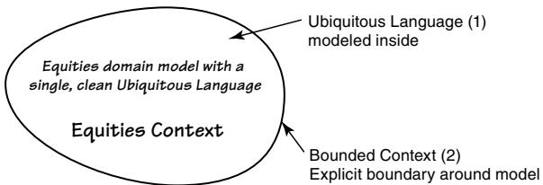

Figure G.1 A diagram illustrating a Bounded Context and relevant Ubiquitous Language

As you practice strategic design, you'll find that the Context Mapping (3) patterns seen in Figure G.2 work in harmony. Your team will use Context Maps to understand their project terrain.

We’ve just considered the big picture of DDD’s strategic design. Understanding it is imperative.

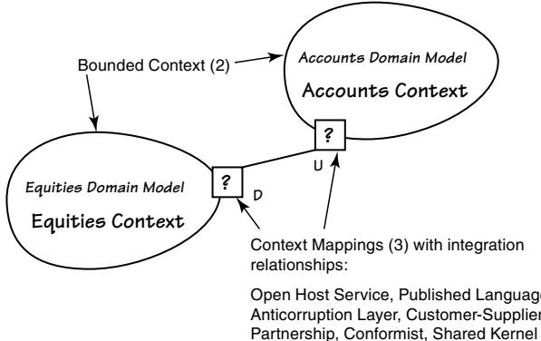

Figure G.2 Context Maps show the relationships among Bounded Contexts.

## Architecture

Sometimes a new Bounded Context or existing ones that interact through Context Mapping will need to take on a new style of Architecture (4). It's important to keep in mind that your strategically and tactically designed domain models should be architecturally neutral. Still, there will need to be some architecture around and between each model. A powerful architectural style for hosting a Bounded Context is Hexagonal, which can be used to facilitate other styles such as Service-Oriented, REST and Event-Driven, and others. Figure G.3 depicts a Hexagonal Architecture, and while it may look a little busy, it's a fairly simplistic style to employ.

Sometimes we may be tempted to place too much emphasis on architecture rather than focusing on the importance of carefully crafting a DDD-based model. Architecture is important, but architectural influences come and go. Remember to prioritize correctly, placing more emphasis on the domain model, which has greater business value and will be more enduring.

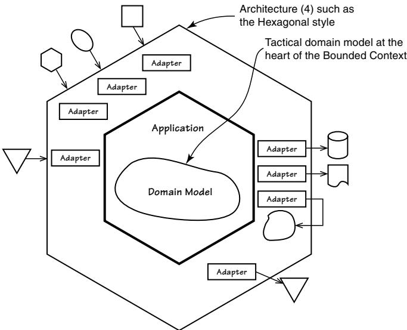

Figure G.3 The Hexagonal Architecture with the domain model at the heart of the software

## Tactical Modeling

We model tactically inside a Bounded Context using DDD's building block patterns. One of the most important patterns of tactical design is Aggregate (10), as illustrated in Figure G.4.

An Aggregate is composed of either a single Entity (5) or a cluster of Entities and Value Objects (6) that must remain transactionally consistent throughout the Aggregate's lifetime. Understanding how to effectively model Aggregates is quite important and one of the least well understood techniques among DDD's building blocks. If they are so important, you may be wondering why Aggregates are placed later in the book. First of all, the placement of tactical patterns in this book follows the same order as is found in [Evans]. Also, since Aggregates are based on other tactical patterns, we cover the basic building blocks—such as Entities and Value Objects—before the more complex Aggregate pattern.

An instance of an Aggregate is persisted using its Repository (12) and later searched for within and retrieved from it. You can see an indication of that in Figure G.4.

Use stateless Services (7), such as seen in Figure G.5, inside the domain model to perform business operations that don't fit naturally as an operation on an Entity or a Value Object.

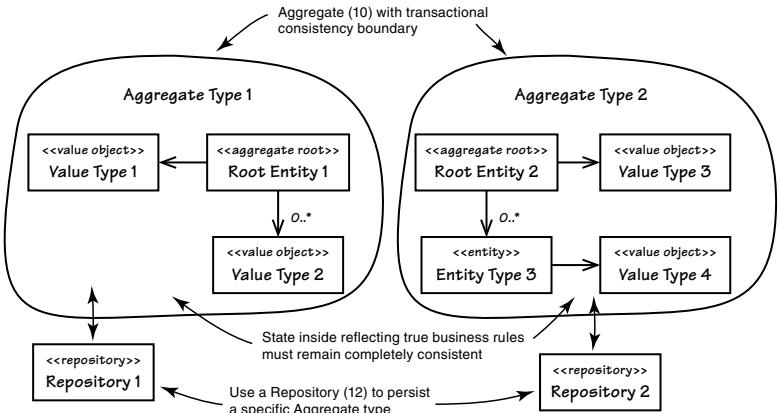

Figure G.4 Two Aggregate types with their own transactional consistency boundaries

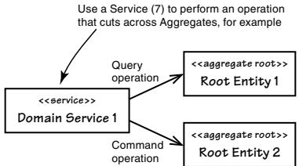

Figure G.5 Domain Services carry out domain-specific operations, which may involve multiple domain objects.

Use Domain Events (8) to indicate the occurrence of significant happenings in the domain. Domain Events can be modeled a few different ways. When they capture occurrences that are a result of some Aggregate command operation, the Aggregate itself publishes the Event as depicted in Figure G.6.

Although often given little thought, it's really important to design Modules (9) correctly. In its simplest form, think of a Module as a package in Java or a namespace in C#. Remember that if you design your Modules mechanically rather than according to the Ubiquitous Language, they will probably do more harm than good. Figure G.7 illustrates how Modules should contain a limited set of cohesive domain objects.

Of course, there's much more to implementing DDD, and I won't try to cover it all here. There's a whole book ahead of you that does just that. I think this Guide gets you off on the right foot for your journey through implementing DDD. So, enjoy the journey!

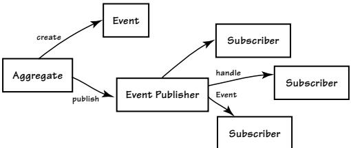

Figure G.6 Domain Events can be published by Aggregates.

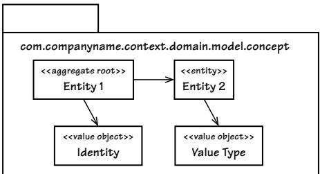

Figure G.7 A Module contains and organizes cohesive domain objects.

Oh, and just to get you familiarized with Cowboy Logic, here's one for the trail:

## Cowboy Logic

AJ: “Don't worry about bitin' off more than you can chew. Your mouth is probably a whole lot bigger than you think.”;-)

LB: "You meant to say 'mind,' J. Your mind is bigger than you think!"

This page intentionally left blank

## Aggregates

The universe is built up into an aggregate of permanent objects connected by causal relations that are independent of the subject and are placed in objective space and time.

—Jean Piaget

Clustering Entities (5) and Value Objects (6) into an Aggregate with a carefully crafted consistency boundary may at first seem like quick work, but among all DDD tactical guidance, this pattern is one of the least well understood.

## Road Map to This Chapter

• Along with SaaSOvation, experience the negative consequences of improperly modeling Aggregates.

- Learn to design by the Aggregate Rules of Thumb as a set of best-practice guidelines.

• Grasp how to model true invariants in consistency boundaries according to real business rules.

• Consider the advantages of designing small Aggregates.

• See why you should design Aggregates to reference other Aggregates by identity.

- Discover the importance of using eventual consistency outside the Aggregate boundary.

- Learn Aggregate implementation techniques, including Tell, Don't Ask and Law of Demeter.

To start off, it might help to consider some common questions. Is an Aggregate just a way to cluster a graph of closely related objects under a common parent? If so, is there some practical limit to the number of objects that should be allowed to reside in the graph? Since one Aggregate instance can reference other Aggregate instances, can the associations be navigated deeply, modifying various objects along the way? And what is this concept of invariants and a consistency boundary all about? It is the answer to this last question that greatly influences the answers to the others.

There are various ways to model Aggregates incorrectly. We could fall into the trap of designing for compositional convenience and make them too large. At the other end of the spectrum we could strip all Aggregates bare and as a result fail to protect true invariants. As we'll see, it's imperative that we avoid both extremes and instead pay attention to the business rules.

## Using Aggregates in the Scrum Core Domain

We'll take a close look at how Aggregates are used by SaaS Ovation, and specifically within the Agile Project Management Context the application named ProjectOvation. It follows the traditional Scrum project management model, complete with product, product owner, team, backlog items, planned releases, and sprints. If you think of Scrum at its richest, that's where ProjectOvation is headed; this is a familiar domain to most of us. The Scrum terminology forms the starting point of the Ubiquitous Language (1). Since it is a subscription-based application hosted using the software as a service (SaaS) model, each subscribing organization is registered as a tenant, another term of our Ubiquitous Language.

The company has assembled a group of talented Scrum experts and developers. However, since their experience with DDD is somewhat limited, the team will make some mistakes with DDD as they climb a difficult learning curve. They will grow by learning from their experiences with Aggregates, and so can we. Their struggles may help us recognize and change similar unfavorable situations we've created in our own software.

The concepts of this domain, along with its performance and scalability requirements, are more complex than any that the team has previously faced in the initial Core Domain (2), the Collaboration Context. To address these issues, one of the DDD tactical tools that they will employ is Aggregates.

How should the team choose the best object clusters? The Aggregate pattern discusses composition and alludes to information hiding, which they understand how to achieve. It also discusses consistency boundaries and transactions, but they haven't been overly concerned with that. Their chosen persistence mechanism will help manage atomic commits of their data. However, that was a crucial misunderstanding of the pattern's guidance that caused them to regress. Here's what happened. The team considered the following statements in the Ubiquitous Language:

• Products have backlog items, releases, and sprints.

• New product backlog items are planned.

• New product sprints are scheduled.

• New product releases are scheduled.

• A planned backlog item may be scheduled for release.

The team put a lot of weight on the words Products have in the first statement, which influenced their initial attempt to design Aggregates for this domain.

• A scheduled backlog item may be committed to a sprint.

From these they envisioned a model and made their first attempt at a design. Let's see how it went.

## First Attempt: Large-Cluster Aggregate

It sounded to some like composition, that objects needed to be interconnected like an object graph. Maintaining these object life cycles together was considered very important. As a result the developers added the following consistency rules to the specification:

• If a backlog item is committed to a sprint, we must not allow it to be removed from the system.

If a sprint has committed backlog items, we must not allow it to be removed from the system.

If a release has scheduled backlog items, we must not allow it to be removed from the system.

• If a backlog item is scheduled for release, we must not allow it to be removed from the system.

As a result, Product was first modeled as a very large Aggregate. The Root object, Product, held all BacklogItem, all Release, and all Sprint instances associated with it. The interface design protected all parts from inadvertent client removal.

This design is shown in the following code, and as a UML diagram in Figure 10.1:

public class Product extends ConcurrencySafeEntity {
    private Set<BacklogItem> backlogItems;
    private String description;
    private String name;
    private ProductId productId;
    private Set<Release> releases;
}

private Set<Sprint> sprints;
private TenantId tenantId;
...
}

The big Aggregate looked attractive, but it wasn't truly practical. Once the application was running in its intended multi-user environment, it began to regularly experience transactional failures. Let's look more closely at a few client usage patterns and how they interact with our technical solution model. Our Aggregate instances employ optimistic concurrency to protect persistent objects from simultaneous overlapping modifications by different clients, thus avoiding the use of database locks. As discussed in Entities (5), objects carry a version number that is incremented when changes are made and checked before they are saved to the database. If the version on the persisted object is greater than the version on the client's copy, the client's is considered stale and updates are rejected.

Consider a common simultaneous, multiclient usage scenario:

- Two users, Bill and Joe, view the same Product marked as version 1 and begin to work on it.

Bill plans a new BacklogItem and commits. The Product version is incremented to 2.

Joe schedules a new Release and tries to save, but his commit fails because it was based on Product version 1.

Persistence mechanisms are used in this general way to deal with concurrency. $ ^{1} $ If you argue that the default concurrency configurations can be changed, reserve your verdict for a while longer. This approach is actually important to protecting Aggregate invariants from concurrent changes.

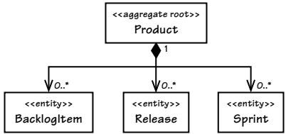

Figure 10.1 Product modeled as a very large Aggregate

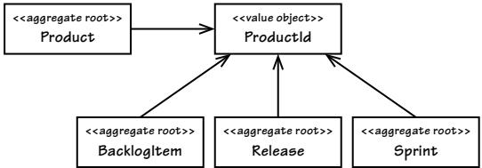

Figure 10.2 Product and related concepts are modeled as separate Aggregate types.

These consistency problems came up with just two users. Add more users, and you have a really big problem. With Scrum, multiple users often make these kinds of overlapping modifications during the sprint planning meeting and in sprint execution. Failing all but one of their requests on an ongoing basis is completely unacceptable.

Nothing about planning a new backlog item should logically interfere with scheduling a new release! Why did Joe's commit fail? At the heart of the issue, the large-cluster Aggregate was designed with false invariants in mind, not real business rules. These false invariants are artificial constraints imposed by developers. There are other ways for the team to prevent inappropriate removal without being arbitrarily restrictive. Besides causing transactional issues, the design also has performance and scalability drawbacks.

## Second Attempt: Multiple Aggregates

Now consider an alternative model as shown in Figure 10.2, in which there are four distinct Aggregates. Each of the dependencies is associated by inference using a common ProductId, which is the identity of Product considered the parent of the other three.

Breaking the single large Aggregate into four will change some method contracts on Product. With the large-cluster Aggregate design the method signatures looked like this:

public class Product ... {
    ...
    public void planBacklogItem(
        String aSummary, String aCategory,
        BacklogItemType aType, StoryPoints aStoryPoints) {
        }
    ...
    public void scheduleRelease(
        String aName, String aDescription,
    }
}

Chapter 10 AGGREGATES
Date aBegins, Date anEnds) {
...
}
public void scheduleSprint(
String aName, String aGoals,
Date aBegins, Date anEnds) {
...
}
...
}

All of these methods are CQS commands [Fowler, CQS]; that is, they modify the state of the Product by adding the new element to a collection, so they have a void return type. But with the multiple-Aggregate design, we have

public class Product ... {
    ...
    public BacklogItem planBacklogItem(
        String aSummary, String aCategory,
        BacklogItemType aType, StoryPoints aStoryPoints) {
        ...
    }

    public Release scheduleRelease(
        String aName, String aDescription,
        Date aBegins, Date anEnds) {
        ...
    }

    public Sprint scheduleSprint(
        String aName, String aGoals,
        Date aBegins, Date anEnds) {
        ...
    }
    ...
}

These redesigned methods have a CQS query contract and act as Factories (11); that is, each creates a new Aggregate instance and returns a reference to it. Now when a client wants to plan a backlog item, the transactional Application Service (14) must do the following:

public class ProductBacklogItemService {
    ...
    @Transactional
    public void planProductBacklogItem(

String aTenantId, String aProductId, String aSummary, String aCategory, String aBacklogItemType, String aStoryPoints) {

Product product =
    productRepository.productOfId(
        new TenantId(aTenantId),
        new ProductId(aProductId));

BacklogItem plannedBacklogItem =
    product.planBacklogItem(
        aSummary,
        aCategory,
        BacklogItemType.valueOf(aBacklogItemType),
        StoryPoints.valueOf(aStoryPoints));

backlogItemRepository.add(plannedBacklogItem);
}

So we've solved the transaction failure issue by modeling it away. Any number of BacklogItem, Release, and Sprint instances can now be safely created by simultaneous user requests. That's pretty simple.

However, even with clear transactional advantages, the four smaller Aggregates are less convenient from the perspective of client consumption. Perhaps instead we could tune the large Aggregate to eliminate the concurrency issues. By setting our Hibernate mapping optimistic-lock option to false, we make the transaction failure domino effect go away. There is no invariant on the total number of created BacklogItem, Release, or Sprint instances, so why not just allow the collections to grow unbounded and ignore these specific modifications on Product? What additional cost would there be for keeping the large-cluster Aggregate? The problem is that it could actually grow out of control. Before thoroughly examining why, let's consider the most important modeling tip the SaaSOvation team needed.

## Rule: Model True Invariants in Consistency Boundaries

When trying to discover the Aggregates in a Bounded Context (2), we must understand the model's true invariants. Only with that knowledge can we determine which objects should be clustered into a given Aggregate.

An invariant is a business rule that must always be consistent. There are different kinds of consistency. One is transactional consistency, which is

considered immediate and atomic. There is also eventual consistency. When discussing invariants, we are referring to transactional consistency. We might have the invariant

c = a + b

Therefore, when a is 2 and b is 3, c must be 5. According to that rule and conditions, if c is anything but 5, a system invariant is violated. To ensure that c is consistent, we design a boundary around these specific attributes of the model:

AggregateType1 {
    int a;
    int b;
    int c;
    operations ...
}

The consistency boundary logically asserts that everything inside adheres to a specific set of business invariant rules no matter what operations are performed. The consistency of everything outside this boundary is irrelevant to the Aggregate. Thus, Aggregate is synonymous with transactional consistency boundary. (In this limited example, AggregateType1 has three attributes of type int, but any given Aggregate could hold attributes of various types.)

When employing a typical persistence mechanism, we use a single transaction $ ^{2} $ to manage consistency. When the transaction commits, everything inside one boundary must be consistent. A properly designed Aggregate is one that can be modified in any way required by the business with its invariants completely consistent within a single transaction. And a properly designed Bounded Context modifies only one Aggregate instance per transaction in all cases. What is more, we cannot correctly reason on Aggregate design without applying transactional analysis.

Limiting modification to one Aggregate instance per transaction may sound overly strict. However, it is a rule of thumb and should be the goal in most cases. It addresses the very reason to use Aggregates.

## Whiteboard Time

- List on your whiteboard all large-cluster Aggregates in your system.

- Make a note next to each of those Aggregates why it is a large cluster and any potential problems caused by its size.

- Next to that list, name any Aggregates that are modified in the same transaction with others.

- Make a note next to each of those Aggregates whether true or false invariants caused the formation of poorly designed Aggregate boundaries.

The fact that Aggregates must be designed with a consistency focus implies that the user interface should concentrate each request to execute a single command on just one Aggregate instance. If user requests try to accomplish too much, the application will be forced to modify multiple instances at once.

Therefore, Aggregates are chiefly about consistency boundaries and not driven by a desire to design object graphs. Some real-world invariants will be more complex than this. Even so, typically invariants will be less demanding on our modeling efforts, making it possible to design small Aggregates.

## Rule: Design Small Aggregates

We can now thoroughly address this question: What additional cost would there be for keeping the large-cluster Aggregate? Even if we guarantee that every transaction would succeed, a large cluster still limits performance and scalability. As SaaSOvation develops its market, it's going to bring in lots of tenants. As each tenant makes a deep commitment to ProjectOvation, SaaS-Ovation will host more and more projects and the management artifacts to go along with them. That will result in vast numbers of products, backlog items, releases, sprints, and others. Performance and scalability are nonfunctional requirements that cannot be ignored.

Keeping performance and scalability in mind, what happens when one user of one tenant wants to add a single backlog item to a product, one that is years old and already has thousands of backlog items? Assume a persistence mechanism capable of lazy loading (Hibernate). We almost never load all backlog items, releases, and sprints at once. Still, thousands of backlog items would be

loaded into memory just to add one new element to the already large collection. It's worse if a persistence mechanism does not support lazy loading. Even being memory conscious, sometimes we would have to load multiple collections, such as when scheduling a backlog item for release or committing one to a sprint; all backlog items, and either all releases or all sprints, would be loaded.

To see this clearly, look at the diagram in Figure 10.3 containing the zoomed composition. Don't let the 0..* fool you; the number of associations will almost never be zero and will keep growing over time. We would likely need to load thousands and thousands of objects into memory all at once, just to carry out what should be a relatively basic operation. That's just for a single team member of a single tenant on a single product. We have to keep in mind that this could happen all at once with hundreds or thousands of tenants, each with multiple teams and many products. And over time the situation will only become worse.

This large-cluster Aggregate will never perform or scale well. It is more likely to become a nightmare leading only to failure. It was deficient from the start because the false invariants and a desire for compositional convenience drove the design, to the detriment of transactional success, performance, and scalability.

If we are going to design small Aggregates, what does “small” mean? The extreme would be an Aggregate with only its globally unique identity and one

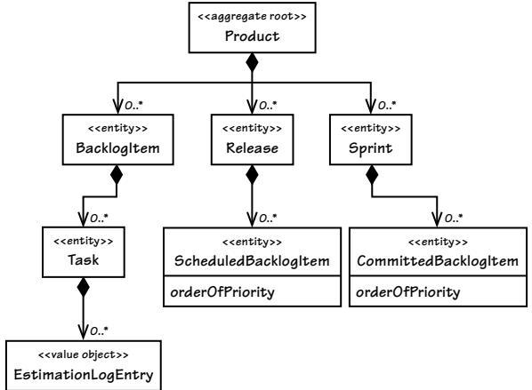

Figure 10.3 With this Product model, multiple large collections load during many basic operations.

additional attribute, which is not what's being recommended (unless that is truly what one specific Aggregate requires). Rather, limit the Aggregate to just the Root Entity and a minimal number of attributes and/or Value-typed properties. $ ^{3} $ The correct minimum is however many are necessary, and no more.

Which ones are necessary? The simple answer is: those that must be consistent with others, even if domain experts don't specify them as rules. For example, Product has name and description attributes. We can't imagine name and description being inconsistent, modeled in separate Aggregates. When you change the name, you probably also change the description. If you change one and not the other, it's probably because you are fixing a spelling error or making the description more fitting to the name. Even though domain experts will probably not think of this as an explicit business rule, it is an implicit one.

What if you think you should model a contained part as an Entity? First ask whether that part must itself change over time, or whether it can be completely replaced when change is necessary. Cases where instances can be completely replaced point to the use of a Value Object rather than an Entity. At times Entity parts are necessary. Yet, if we run through this design exercise on a case-by-case basis, many concepts modeled as Entities can be refactored to Value Objects. Favoring Value types as Aggregate parts doesn't mean the Aggregate is immutable since the Root Entity itself mutates when one of its Value-typed properties is replaced.

There are important advantages to limiting internal parts to Values. Depending on your persistence mechanism, Values can be serialized with the Root Entity, whereas Entities can require separately tracked storage. Overhead is higher with Entity parts, as, for example, when SQL joins are necessary to read them using Hibernate. Reading a single database table row is much faster. Value objects are smaller and safer to use (fewer bugs). Due to immutability it is easier for unit tests to prove their correctness. These advantages are discussed in Value Objects (6).

On one project for the financial derivatives sector using Qi4j [Öberg], Nicolas Hedhman $ ^{4} $ reported that his team was able to design approximately 70 percent of all Aggregates with just a Root Entity containing some Value-typed properties. The remaining 30 percent had just two to three total Entities. This doesn't indicate that all domain models will have a 70/30 split. It does indicate that a high percentage of Aggregates can be limited to a single Entity, the Root.

The [Evans] discussion of Aggregates gives an example where having multiple Entities makes sense. A purchase order is assigned a maximum allowable total, and the sum of all line items must not surpass the total. The rule becomes tricky to enforce when multiple users simultaneously add line items. Any one addition is not permitted to exceed the limit, but concurrent additions by multiple users could collectively do so. I won't repeat the solution here, but I want to emphasize that most of the time the invariants of business models are simpler to manage than that example. Recognizing this helps us to model Aggregates with as few properties as possible.

Smaller Aggregates not only perform and scale better, they are also biased toward transactional success, meaning that conflicts preventing a commit are rare. This makes a system more usable. Your domain will not often have true invariant constraints that force you into large-composition design situations. Therefore, it is just plain smart to limit Aggregate size. When you occasionally encounter a true consistency rule, add another few Entities, or possibly a collection, as necessary, but continue to push yourself to keep the overall size as small as possible.

## Don't Trust Every Use Case

Business analysts play an important role in delivering use case specifications. Much work goes into a large and detailed specification, and it will affect many of our design decisions. Yet, we mustn't forget that use cases derived in this way don't carry the perspective of the domain experts and developers of our close-knit modeling team. We still must reconcile each use case with our current model and design, including our decisions about Aggregates. A common issue that arises is a particular use case that calls for the modification of multiple Aggregate instances. In such a case we must determine whether the specified large user goal is spread across multiple persistence transactions, or if it occurs within just one. If it is the latter, it pays to be skeptical. No matter how well it is written, such a use case may not accurately reflect the true Aggregates of our model.

Assuming your Aggregate boundaries are aligned with real business constraints, it’s going to cause problems if business analysts specify what you see in Figure 10.4. Thinking through the various commit order permutations, you’ll see that there are cases where two of the three requests will fail. $ ^{5} $ What

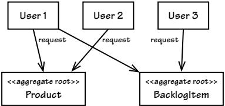

Figure 10.4 Concurrency contention exists among three users who are all trying to access the same two Aggregate instances, leading to a high number of transactional failures.

does attempting this indicate about your design? The answer to that question may lead to a deeper understanding of the domain. Trying to keep multiple Aggregate instances consistent may be telling you that your team has missed an invariant. You may end up folding the multiple Aggregates into one new concept with a new name in order to address the newly recognized business rule. (And, of course, it might be only parts of the old Aggregates that get rolled into the new one.)

So a new use case may lead to insights that push us to remodel the Aggregate, but be skeptical here, too. Forming one Aggregate from multiple ones may drive out a completely new concept with a new name, yet if modeling this new concept leads you toward designing a large-cluster Aggregate, that can end up with all the problems common to that approach. What different approach may help?

Just because you are given a use case that calls for maintaining consistency in a single transaction doesn't mean you should do that. Often, in such cases, the business goal can be achieved with eventual consistency between Aggregates. The team should critically examine the use cases and challenge their assumptions, especially when following them as written would lead to unwieldy designs. The team may have to rewrite the use case (or at least re-imagine it if they face an uncooperative business analyst). The new use case would specify eventual consistency and the acceptable update delay. This is one of the issues taken up later in this chapter.

## Rule: Reference Other Aggregates by Identity

When designing Aggregates, we may desire a compositional structure that allows for traversal through deep object graphs, but that is not the motivation of the pattern. [Evans] states that one Aggregate may hold references to

the Root of other Aggregates. However, we must keep in mind that this does not place the referenced Aggregate inside the consistency boundary of the one referencing it. The reference does not cause the formation of just one whole Aggregate. There are still two (or more), as shown in Figure 10.5.

In Java the association would be modeled like this:

public class BacklogItem extends ConcurrencySafeEntity {
    ...
    private Product product;
    ...
}

That is, the BacklogItem holds a direct object association to Product.

In combination with what's already been discussed and what's next, this has a few implications:

1. Both the referencing Aggregate (BacklogItem) and the referenced Aggregate (Product) must not be modified in the same transaction. Only one or the other may be modified in a single transaction.

2. If you are modifying multiple instances in a single transaction, it may be a strong indication that your consistency boundaries are wrong. If so, it is possibly a missed modeling opportunity; a concept of your Ubiquitous Language has not yet been discovered although it is waving its hands and shouting at you (see earlier in this chapter).

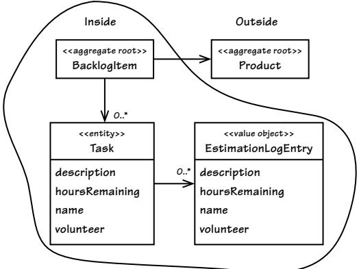

Figure 10.5 There are two Aggregates, not one.

3. If you are attempting to apply point 2, and doing so influences a large-cluster Aggregate with all the previously stated caveats, it may be an indication that you need to use eventual consistency (see later in this chapter) instead of atomic consistency.

If you don't hold any reference, you can't modify another Aggregate. So the temptation to modify multiple Aggregates in the same transaction could be squelched by avoiding the situation in the first place. But that is overly limiting since domain models always require some associative connections. What might we do to facilitate necessary associations, protect from transaction misuse or inordinate failure, and allow the model to perform and scale?

## Making Aggregates Work Together through Identity References

Prefer references to external Aggregates only by their globally unique identity, not by holding a direct object reference (or “pointer”). This is exemplified in Figure 10.6.

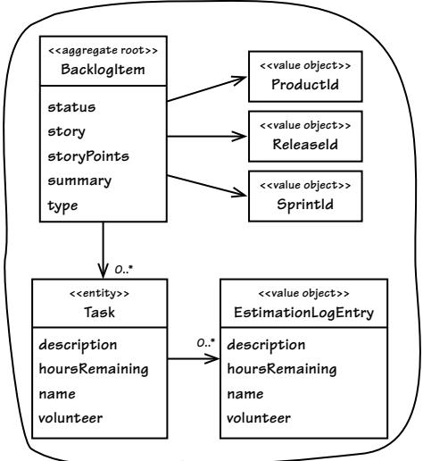

Figure 10.6 The BacklogItem Aggregate, inferring associations outside its boundary with identities

We would refactor the source to

public class BacklogItem extends ConcurrencySafeEntity {
    ...
    private ProductId productId;
    ...
}

Aggregates with inferred object references are thus automatically smaller because references are never eagerly loaded. The model can perform better because instances require less time to load and take less memory. Using less memory has positive implications for both memory allocation overhead and garbage collection.

## Model Navigation

Reference by identity doesn't completely prevent navigation through the model. Some will use a Repository (12) from inside an Aggregate for lookup. This technique is called Disconnected Domain Model, and it's actually a form of lazy loading. There's a different recommended approach, however: Use a Repository or Domain Service (7) to look up dependent objects ahead of invoking the Aggregate behavior. A client Application Service may control this, then dispatch to the Aggregate:

public class ProductBacklogItemService ... {
    ...
    @Transactional
    public void assignTeamMemberToTask(
        String aTenantId,
        String aBacklogItemId,
        String aTaskId,
        String aTeamMemberId) {

        BacklogItem backlogItem = backlogItemRepository.backlogItemOfId(
            new TenantId(aTenantId),
            new BacklogItemId(aBacklogItemId));

        Team ofTeam = teamRepository.teamOfId(
            backlogItem.tenantId(),
            backlogItem.teamId());

        backlogItem.assignTeamMemberToTask(
            new TeamMemberId(aTeamMemberId),
        )
    }
}

ofTeam,
new TaskId(aTaskId));
}
...
}

Having an Application Service resolve dependencies frees the Aggregate from relying on either a Repository or a Domain Service. However, for very complex and domain-specific dependency resolutions, passing a Domain Service into an Aggregate command method can be the best way to go. The Aggregate can then double-dispatch to the Domain Service to resolve references. Again, in whatever way one Aggregate gains access to others, referencing multiple Aggregates in one request does not give license to cause modification on two or more of them.

LB: “I’ve got two points of reference when I’m navigating at night. If it smells like beef on the hoof, I’m heading to the herd. If it smells like beef on the grill, I’m heading home.”

## Cowboy Logic

Limiting a model to using only reference by identity could make it more difficult to serve clients that assemble and render User Interface (14) views. You may have to use multiple Repositories in a single use case to populate views. If query overhead causes performance issues, it may be worth considering the use of  $ \theta $ joins or CQRS. Hibernate, for example, supports  $ \theta $ joins as a means to assemble a number of referentially associated Aggregate instances in a single join query, which can provide the necessary viewable parts. If CQRS and  $ \theta $ joins are not an option, you may need to strike a balance between inferred and direct object reference.

If all this advice seems to lead to a less convenient model, consider the additional benefits it affords. Making Aggregates smaller leads to better-performing models, plus we can add scalability and distribution.

## Scalability and Distribution

Since Aggregates don't use direct references to other Aggregates but reference by identity, their persistent state can be moved around to reach large scale. Almost-infinite scalability is achieved by allowing for continuous repartitioning of Aggregate data storage, as explained by Amazon.com's Pat Helland in

his position paper “Life beyond Distributed Transactions: An Apostate’s Opinion” [Helland]. What we call Aggregate, he calls entity. But what he describes is still an Aggregate by any other name: a unit of composition that has transactional consistency. Some NoSQL persistence mechanisms support the Amazon-inspired distributed storage. These provide much of what [Helland] refers to as the lower, scale-aware layer. When employing a distributed store, or even when using a SQL database with similar motivations, reference by identity plays an important role.

Distribution extends beyond storage. Since there are always multiple Bounded Contexts at play in a given Core Domain initiative, reference by identity allows distributed domain models to have associations from afar. When an Event-Driven approach is in use, message-based Domain Events (8) containing Aggregate identities are sent around the enterprise. Message subscribers in foreign Bounded Contexts use the identities to carry out operations in their own domain models. Reference by identity forms remote associations or partners. Distributed operations are managed by what [Helland] calls two-party activities, but in Publish-Subscribe [Buschmann et al.] or Observer [Gamma et al.] terms it's multi-party (two or more). Transactions across distributed systems are not atomic. The various systems bring multiple Aggregates into a consistent state eventually.

## Rule: Use Eventual Consistency Outside the Boundary

There is a frequently overlooked statement found in the [Evans] Aggregate pattern definition. It bears heavily on what we must do to achieve model consistency when multiple Aggregates must be affected by a single client request:

Any rule that spans AGGREGATES will not be expected to be up-to-date at all times. Through event processing, batch processing, or other update mechanisms, other dependencies can be resolved within some specific time. [Evans, p. 128]

Thus, if executing a command on one Aggregate instance requires that additional business rules execute on one or more other Aggregates, use eventual consistency. Accepting that all Aggregate instances in a large-scale, high-traffic enterprise are never completely consistent helps us accept that eventual consistency also makes sense in the smaller scale where just a few instances are involved.

Ask the domain experts if they could tolerate some time delay between the modification of one instance and the others involved. Domain experts are sometimes far more comfortable with the idea of delayed consistency than are developers. They are aware of realistic delays that occur all the time in their business, whereas developers are usually indoctrinated with an atomic change.

mentality. Domain experts often remember the days prior to computer automation of their business operations, when various kinds of delays occurred all the time and consistency was never immediate. Thus, domain experts are often willing to allow for reasonable delays—a generous number of seconds, minutes, hours, or even days—before consistency occurs.

There is a practical way to support eventual consistency in a DDD model. An Aggregate command method publishes a Domain Event that is in time delivered to one or more asynchronous subscribers:

public class BacklogItem extends ConcurrencySafeEntity {
    ...
    public void commitTo(Sprint aSprint) {
        ...
        DomainEventPublisher
        .instance()
        .publish(new BacklogItemCommitted(
            this.tenantId(),
            this.backlogItemId(),
            this.sprintId());
    }
}

Each of these subscribers then retrieves a different yet corresponding Aggregate instance and executes its behavior based on it. Each of the subscribers executes in a separate transaction, obeying the rule of Aggregates to modify just one instance per transaction.

What happens if the subscriber experiences concurrency contention with another client, causing its modification to fail? The modification can be retried if the subscriber does not acknowledge success to the messaging mechanism. The message will be redelivered, a new transaction started, a new attempt made to execute the necessary command, and a corresponding commit made. This retry process can continue until consistency is achieved, or until a retry limit is reached. $ ^{6} $ If complete failure occurs, it may be necessary to compensate, or at a minimum to report the failure for pending intervention.

What is accomplished by publishing the BacklogItemCommitted Domain Event in this specific example? Recalling that BacklogItem already holds the identity of the Sprint it is committed to, we are in no way interested in

maintaining a meaningless bidirectional association. Rather, the Event allows for the eventual creation of a CommittedBacklogItem so the Sprint can make a record of work commitment. Since each CommittedBacklogItem has an ordering attribute, it allows the Sprint to give each BacklogItem an ordering different from those of Product and Release, and that is not tied to the BacklogItem instance's own recorded estimation of Business-Priority. Thus, Product and Release hold similar associations, namely, ProductBacklogItem and ScheduledBacklogItem, respectively.

## Whiteboard Time

- Return to your list of large-cluster Aggregates and the two or more modified in a single transaction.

- Describe and diagram how you will break up the large clusters. Circle and note each of the true invariants inside each of the new small Aggregates.

- Describe and diagram how you will keep separate Aggregates eventually consistent.

This example demonstrates how to use eventual consistency in a single Bounded Context, but the same technique can also be applied in a distributed fashion as previously described.

## Ask Whose Job It Is

Some domain scenarios can make it very challenging to determine whether transactional or eventual consistency should be used. Those who use DDD in a classic/traditional way may lean toward transactional consistency. Those who use CQRS may tend toward eventual consistency. But which is correct? Frankly, neither of those tendencies provides a domain-specific answer, only a technical preference. Is there a better way to break the tie?

## Cowboy Logic

LB: "My son told me that he found on the Internet how to make my cows more fertile. I told him that's the bull's job."

Discussing this with Eric Evans revealed a very simple and sound guideline. When examining the use case (or story), ask whether it's the job of the user executing the use case to make the data consistent. If it is, try to make it transactionally consistent, but only by adhering to the other rules of Aggregates. If it is another user's job, or the job of the system, allow it to be eventually consistent. That bit of wisdom not only provides a convenient tie breaker, but it helps us gain a deeper understanding of our domain. It exposes the real system invariants: the ones that must be kept transactionally consistent. That understanding is much more valuable than defaulting to a technical leaning.

This is a great tip to add to the Aggregate Rules of Thumb. Since there are other forces to consider, it may not always lead to the final choice between transactional and eventual consistency but will usually provide deeper insight into the model. This guideline is used later in the chapter when the team revisits their Aggregate boundaries.

## Reasons to Break the Rules

An experienced DDD practitioner may at times decide to persist changes to multiple Aggregate instances in a single transaction, but only with good reason. What might some reasons be? I discuss four reasons here. You may experience these and others.

## Reason One: User Interface Convenience

Sometimes user interfaces, as a convenience, allow users to define the common characteristics of many things at once in order to create batches of them. Perhaps it happens frequently that team members want to create several backlog items as a batch. The user interface allows them to fill out all the common properties in one section, and then one by one the few distinguishing properties of each, eliminating repeated gestures. All of the new backlog items are then planned (created) at once:

public class ProductBacklogItemService ... {
    ...
    @Transactional
    public void planBatchOfProductBacklogItems(
        String aTenantId, String productId,
        BacklogItemDescription[] aDescriptions) {

        Product product =
            productRepository.productOfId(
                new TenantId(aTenantId),
                new ProductId(productId));
}

for (BacklogItemDescription desc : aDescriptions) {
    BacklogItem plannedBacklogItem =
        product.planBacklogItem(
            desc.summary(),
            desc.category(),
            BacklogItemType.valueOf(
                desc.backlogItemType(),
                StoryPoints.valueOf(
                    desc.storyPoints());
        );
    backlogItemRepository.add(plannedBacklogItem);
}
...
}

Does this cause a problem with managing invariants? In this case, no, since it would not matter whether these were created one at a time or in batch. The objects being instantiated are full Aggregates, which maintain their own invariants. Thus, if creating a batch of Aggregate instances all at once is semantically no different from creating one at a time repeatedly, it represents one reason to break the rule of thumb with impunity.

## Reason Two: Lack of Technical Mechanisms

Eventual consistency requires the use of some kind of out-of-band processing capability, such as messaging, timers, or background threads. What if the project you are working on has no provision for any such mechanism? While most of us would consider that strange, I have faced that very limitation. With no messaging mechanism, no background timers, and no other home-grown threading capabilities, what could be done?

If we aren’t careful, this situation could lead us back toward designing large-cluster Aggregates. While that might make us feel as if we are adhering to the single transaction rule, as previously discussed it would also degrade performance and limit scalability. To avoid that, perhaps we could instead change the system’s Aggregates altogether, forcing the model to solve our challenges. We’ve already considered the possibility that project specifications may be jealously guarded, leaving us little room for negotiating previously unimagined domain concepts. That’s not really the DDD way, but sometimes it does happen. The conditions may allow for no reasonable way to alter the modeling circumstances in our favor. In such cases project dynamics may force us to modify two or more Aggregate instances in one transaction. However obvious this might seem, such a decision should not be made too hastily.

## Cowboy Logic

A): "If you think that rules are made to be broken, you'd better know a good repairman."

Consider an additional factor that could further support diverging from the rule: user-aggregate affinity. Are the business workflows such that only one user would be focused on one set of Aggregate instances at any given time? Ensuring user-aggregate affinity makes the decision to alter multiple Aggregate instances in a single transaction more sound since it tends to prevent the violation of invariants and transactional collisions. Even with user-aggregate affinity, in rare situations users may face concurrency conflicts. Yet each Aggregate would still be protected from that by using optimistic concurrency. Anyway, concurrency conflicts can happen in any system, and even more frequently when user-aggregate affinity is not our ally. Besides, recovering from concurrency conflicts is straightforward when encountered at rare times. Thus, when our design is forced to, sometimes it works out well to modify multiple Aggregate instances in one transaction.

## Reason Three: Global Transactions

Another influence considered is the effects of legacy technologies and enterprise policies. One such might be the need to strictly adhere to the use of global, two-phase commit transactions. This is one of those situations that may be impossible to push back on, at least in the short term.

Even if you must use a global transaction, you don't necessarily have to modify multiple Aggregate instances at once in your local Bounded Context. If you can avoid doing so, at least you can prevent transactional contention in your Core Domain and actually obey the rules of Aggregates as far as you are able. The downside to global transactions is that your system will probably never scale as it could if you were able to avoid two-phase commits and the immediate consistency that goes along with them.

## Reason Four: Query Performance

There may be times when it's best to hold direct object references to other Aggregates. This could be used to ease Repository query performance issues. These must be weighed carefully in the light of potential size and overall

performance trade-off implications. One example of breaking the rule of reference by identity is given later in the chapter.

## Adhering to the Rules

You may experience user interface design decisions, technical limitations, stiff policies, or other factors in your enterprise environment that require you to make some compromises. Certainly we don't go in search of excuses to break the Aggregate Rules of Thumb. In the long run, adhering to the rules will benefit our projects. We'll have consistency where necessary, and support for optimally performing and highly scalable systems.

## Gaining Insight through Discovery

With the rules of Aggregates in use, we'll see how adhering to them affects the design of the SaaSOvation Scrum model. We'll see how the project team rethinks their design again, applying newfound techniques. That effort leads to the discovery of new insights into the model. Their various ideas are tried and then superseded.

## Rethinking the Design, Again

After the refactoring iteration that broke up the large-cluster Product, the BacklogItem now stands alone as its own Aggregate. It reflects the model presented in Figure 10.7. The team composed a collection of Task instances inside the BacklogItem Aggregate. Each BacklogItem has a globally unique identity, its BacklogItemId. All associations to other Aggregates are inferred through identities. That means its parent Product, the Release it is scheduled within, and the Sprint to which it is committed are referenced by identities. It seems fairly small.

With the team now jazzed about designing small Aggregates, could they possibly overdo it in that direction?

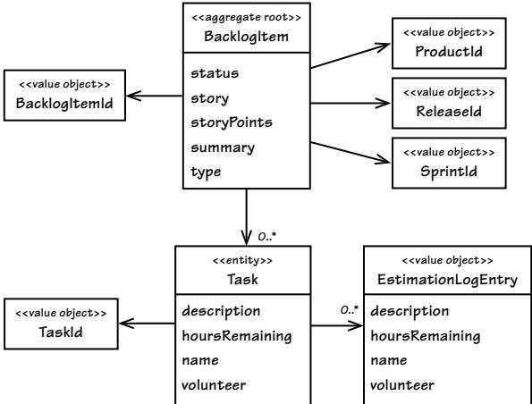

Figure 10.7 The fully composed BacklogItem Aggregate

Given this potential overhead and the errors already made in designing the large-cluster Product of Figures 10.1 and 10.3, the team was now on a mission to reduce the size of every Aggregate in the Bounded Context. Crucial questions arose. Was there a true invariant between BacklogItem and Task that this relationship must maintain? Or was this yet another case where the association could be further broken apart, with two separate Aggregates being safely formed? What would be the total cost of keeping the design as is?

A key to their making a proper determination lay in the Ubiquitous Language. Here is where an invariant was stated:

- When progress is made on a backlog item task, the team member will estimate task hours remaining.

- When a team member estimates that zero hours are remaining on a specific task, the backlog item checks all tasks for any remaining hours. If no hours remain on any tasks, the backlog item status is automatically changed to done.

- When a team member estimates that one or more hours are remaining on a specific task and the backlog item's status is already done, the status is automatically regressed.

This sure seemed like a true invariant. The backlog item's correct status is automatically adjusted and is completely dependent on the total number of hours remaining on all its tasks. If the total number of task hours and the backlog item status are to remain consistent, it seems as if Figure 10.7 does stipulate the correct Aggregate

consistency boundary. However, the team should still determine what the current cluster could cost in terms of performance and scalability. That would be weighed against what they might save if the backlog item status could be eventually consistent with the total task hours remaining.

Some will see this as a classic opportunity to use eventual consistency, but we won’t jump to that conclusion just yet. Let’s analyze a transactional consistency approach, then investigate what could be accomplished using eventual consistency. We can then draw our own conclusion as to which approach is preferred.

## Estimating Aggregate Cost

As Figure 10.7 shows, each Task holds a collection of EstimationLogEntry instances. These logs model the specific occasions when a team member enters a new estimate of hours remaining. In practical terms, how many Task elements will each BacklogItem hold, and how many EstimationLogEntry elements will a given Task hold? It's hard to say exactly. It's largely a measure of how complex any one task is and how long a sprint lasts. But some back-of-the-envelope (BOTE) calculations might help [Bentley].

Task hours are usually reestimated each day after a team member works on a given task. Let's say that most sprints are either two or three weeks in length. There will be longer sprints, but a two- to three-week time span is common enough. So let's select a number of days somewhere between ten and 15. Without being too precise, 12 days works well since there may actually be more two-week than three-week sprints.

Next, consider the number of hours assigned to each task. Remembering that tasks must be broken down into manageable units, we generally use a number of hours between four and 16. Normally if a task exceeds a 12-hour estimate, Scrum experts suggest breaking it down further. But using 12 hours as a first test makes it easier to simulate work evenly. We can say that tasks are worked on for one hour on each of the 12 days of the sprint. Doing so favors more complex tasks. So we'll figure 12 reestimations per task, assuming that each task starts out with 12 hours allocated to it.

The question remains: How many tasks would be required per backlog item? That too is a difficult question to answer. What if we thought in terms of there being two or three tasks required per Layer (4) or Hexagonal Port-Adapter (4) for a given feature slice? For example, we might count three for the User Interface Layer (14), two for the Application Layer (14), three for the Domain Layer, and three for the Infrastructure Layer (14). That would bring us to 11 total

tasks. It might be just right or a bit slim, but we’ve already erred on the side of numerous task estimations. Let’s bump it up to 12 tasks per backlog item to be more liberal. With that we are allowing for 12 tasks, each with 12 estimation logs, or 144 total collected objects per backlog item. While this may be more than the norm, it gives us a chunky BOTE calculation to work with.

There is another variable to be considered. If Scrum expert advice to define smaller tasks is commonly followed, it would change things somewhat. Doubling the number of tasks (24) and halving the number of estimation log entries (6) would still produce 144 total objects. However, it would cause more tasks to be loaded (24 rather than 12) during all estimation requests, consuming more memory on each. The team will try various combinations to see if there is any significant impact on their performance tests. But to start they will use 12 tasks of 12 hours each.

## Common Usage Scenarios

Now it's important to consider common usage scenarios. How often will one user request need to load all 144 objects into memory at once? Would that ever happen? It seems not, but the team needs to check. If not, what's the likely high-end count of objects? Also, will there typically be multiclient usage that causes concurrency contention on backlog items? Let's see.

The following scenarios are based on the use of Hibernate for persistence. Also, each Entity type has its own optimistic concurrency version attribute. This is workable because the changing status invariant is managed on the BacklogItem Root Entity. When the status is automatically altered (to done or back to committed), the Root's version is bumped. Thus, changes to tasks can happen independently of each other and without impacting the Root each time one is modified, unless the result is a status change. (The following analysis could need to be revisited if using, for example, document-based storage, since the Root is effectively modified every time a collected part is modified.)

When a backlog item is first created, there are zero contained tasks. Normally it is not until sprint planning that tasks are defined. During that meeting tasks are identified by the team. As each one is called out, a team member adds it to the corresponding backlog item. There is no need for two team members to contend with each other for the Aggregate, as if racing to see who can enter new tasks more quickly. That would cause collision, and one of the two requests would fail (for the same reason simultaneously adding various parts to Product previously failed). However, the two team members would probably soon figure out how counterproductive their redundant work is.

If the developers learned that multiple users do indeed regularly want to add tasks together, it would change the analysis significantly. That understanding

could immediately tip the scales in favor of breaking BacklogItem and Task into two separate Aggregates. On the other hand, this could also be a perfect time to tune the Hibernate mapping by setting the optimistic-lock option to false. Allowing tasks to grow simultaneously could make sense in this case, especially if they don't pose performance and scalability issues.

If tasks are at first estimated at zero hours and later updated to an accurate estimate, we still don't tend to experience concurrency contention, although this would add one additional estimation log entry, pushing our BOTE total to 13. Simultaneous use here does not change the backlog item status. Again, it advances to done only by going from greater than zero to zero hours, or regresses to committed if already done and hours are changed from zero to one or more—two uncommon events.

Will daily estimations cause problems? On day one of the sprint there are usually zero estimation logs on a given task of a backlog item. At the end of day one, each volunteer team member working on a task reduces the estimated hours by one. This adds a new estimation log to each task, but the backlog item's status remains unaffected. There is never contention on a task because just one team member adjusts its hours. It's not until day 12 that we reach the point of status transition. Still, as each of any 11 tasks is reduced to zero hours, the backlog item's status is not altered. It's only the very last estimation, the 144th on the 12th task, that causes automatic status transition to the done state.

This analysis led the team to an important realization. Even if they altered the usage scenarios, accelerating task completion by double (six days) or even mixing it up completely, it wouldn't change anything. It's always the final estimate that transitions the status, which modifies the Root. This seemed like a safe design, although memory overhead was still in question.

## Memory Consumption

Now to address the memory consumption. Important here is that estimates are logged by date as Value Objects. If a team member reestimates any number of times on a single day, only the most recent estimate is retained. The latest Value of the same date replaces the previous one in the collection. At this point there's no requirement to track task estimation mistakes. There is the assumption that a task will never have more estimation log entries than the number of days the sprint is in progress. That assumption changes if tasks were defined one or more days before the sprint planning meeting, and hours were reestimated on any of those earlier days. There would be one extra log for each day that occurred.

What about the total number of tasks and estimates in memory for each reestimation? When using lazy loading for the tasks and estimation logs, we would have as many as 12 plus 12 collected objects in memory at one time per request. This is because all 12 tasks would be loaded when accessing that collection. To add the latest estimation log entry to one of those tasks, we'd have to load the collection of estimation log entries. That would be up to another 12 objects. In the end the Aggregate design requires one backlog item, 12 tasks, and 12 log entries, or 25 objects maximum total. That's not very many; it's a small Aggregate. Another factor is that the higher end of objects (for example, 25) is not reached until the last day of the sprint. During much of the sprint the Aggregate is even smaller.

Will this design cause performance problems because of lazy loads? Possibly, because it actually requires two lazy loads, one for the tasks and one for the estimation log entries for one of the tasks. The team will have to test to investigate the possible overhead of the multiple fetches.

There’s another factor. Scrum enables teams to experiment in order to identify the right planning model for their practices. As explained by [Sutherland], experienced teams with a well-known velocity can estimate using story points rather than task hours. As they define each task, they can assign just one hour to each task. During the sprint they will reestimate only once per task, changing one hour to zero when the task is completed. As it pertains to Aggregate design, using story points reduces the total number of estimation logs per task to just one and almost eliminates memory overhead.

The foregoing analysis was enough to motivate the team to test against their BOTE calculations. After inconclusive results, however, they decided that there were still too many variables for them to be confident that this design dealt well with their concerns. There were enough unknowns to consider an alternative design.

## Exploring Another Alternative Design

Is there another design that could contribute to Aggregate boundaries more fitting to the usage scenarios?

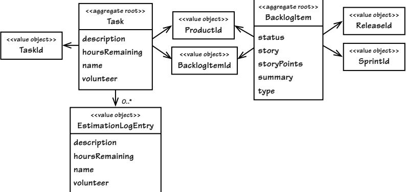

Figure 10.8 BacklogItem and Task modeled as separate Aggregates

To be thorough, the team wanted to think through what they would have to do to make Task an independent Aggregate, and if that would actually work to their benefit. What they envisioned is seen in Figure 10.8. Doing this would reduce part composition overhead by 12 objects and reduce lazy load overhead. In fact, this design gave them the option to eagerly load estimation log entries in all cases if that would perform best.

The developers agreed not to modify separate Aggregates, both the Task and the BacklogItem, in the same transaction. They had to determine if they could perform a necessary automatic status change within an acceptable time frame. They'd be weakening the invariant's consistency since the status couldn't be consistent by transaction. Would that be acceptable? They discussed the matter with the domain experts and learned that some delay between the final zero-hour estimate and the status being set to done, and vice versa, would be acceptable.

## Implementing Eventual Consistency

It looks as if there could be a legitimate use of eventual consistency between separate Aggregates. Here is how it could work.

public class TaskHoursRemainingEstimated implements DomainEvent {
    private Date occurredOn;
    private TenantId tenantId;
    private BacklogItemId backlogItemId;
    private TaskId taskId;
    private int hoursRemaining;
    ...
}

A specialized subscriber would now listen for these and delegate to a Domain Service to coordinate the consistency processing. The Service would

• Use the BacklogItemRepository to retrieve the identified BacklogItem.

- Use the TaskRepository to retrieve all Task instances associated with the identified BacklogItem.

- Execute the BacklogItem command named estimateTaskHoursRemaining(), passing the Domain Event's hoursRemaining and the retrieved Task instances. The BacklogItem may transition its status depending on parameters.

The team should find a way to optimize this. The three-step design requires all Task instances to be loaded every time a reestimation occurs. When using our BOTE estimate and advancing continuously toward done, 143 out of 144 times that's unnecessary. This could be optimized pretty easily. Instead of using the Repository to get all Task instances, they could simply ask it for the sum of all Task hours as calculated by the database:

public class HibernateTaskRepository implements TaskRepository {
    ...
    public int totalBacklogItemTaskHoursRemaining(
        TenantId aTenantId,
        BacklogItemId aBacklogItemId) {
        Query query = session.createQuery(
            "select sum(task.hoursRemaining) from Task task"
            + "where task.tenantId = ? and "
            + "task.backlogItemId = ?");
    }
}

Eventual consistency complicates the user interface a bit. Unless the status transition can be achieved within a few hundred milliseconds, how would the user interface display the new state? Should they place business logic in

the view to determine the current status? That would constitute a smart UI anti-pattern. Perhaps the view would just display the stale status and allow users to deal with the visual inconsistency. That could easily be perceived as a bug, or at least be very annoying.

The view could use a background Ajax polling request, but that could be quite inefficient. Since the view component could not easily determine exactly when checking for a status update is necessary, most Ajax pings would be unnecessary. Using our BOTE numbers, 143 of 144 reestimations would not cause the status update, which is a lot of redundant requests on the Web tier. With the right server-side support the clients could instead depend on Comet (aka Ajax Push). Although a nice challenge, that would introduce a completely new technology that the team had no experience using.

On the other hand, perhaps the best solution is the simplest. They could opt to place a visual cue on the screen that informs the user that the current status is uncertain. The view could suggest a time frame for checking back or refreshing. Alternatively, the changed status will probably show on the next rendered view. That's safe. The team would need to run some user acceptance tests, but it looked hopeful.

## Is It the Team Member's Job?

One important question has thus far been completely overlooked: Whose job is it to bring a backlog item's status into consistency with all remaining task hours? Do team members using Scrum care if the parent backlog item's status transitions to done just as they set the last task's hours to zero? Will they always know they are working with the last task that has remaining hours? Perhaps they will and perhaps it is the responsibility of each team member to bring each backlog item to official completion.

On the other hand, what if there is another project stakeholder involved? For example, the product owner or some other person may desire to check the candidate backlog item for satisfactory completion. Maybe someone wants to use the feature on a continuous integration server first. If others are happy with the developers' claim of completion, they will manually mark the status as done. This certainly changes the game, indicating that neither transactional nor eventual consistency is necessary. Tasks could be split off from their parent backlog item because this new use case allows it. However, if it is really the team members who should cause the automatic transition to done, it would mean that tasks should probably be composed within the backlog item to allow for transactional consistency. Interestingly, there is no clear answer here either, which probably indicates that it should be an optional application preference.

Leaving tasks within their backlog item solves the consistency problem, and it's a modeling choice that can support both automatic and manual status transitions.

This valuable exercise uncovered a completely new aspect of the domain. It seems as if teams should be able to configure a workflow preference. They won't implement such a feature now, but they will promote it for further discussion. Asking "whose job is it?" led them to a few vital perceptions about their domain.

Next, one of the developers made a

very practical suggestion as an alternative to this whole analysis. If they were chiefly concerned with the possible overhead of the story attribute, why not do something about that specifically? They could reduce the total storage capacity for the story and in addition create a new useCaseDefinition property. They could design it to lazy load, since much of the time it would never be used. Or they could even design it as a separate Aggregate, loading it only when needed. With that idea they realized this could be a good time to break the rule to reference external Aggregates only by identity. It seemed like a suitable modeling choice to use a direct object reference and declare its object-relational mapping so as to lazily load it. Perhaps that made sense.

## Time for Decisions

This level of analysis can't continue all day. There needs to be a decision. It's not as if going in one direction now would negate the possibility of going another route later. Open-mindedness is now blocking pragmatism.

The option to split it in two remained in their hip pocket just in case. After further experimentation with the current design, running it through performance and load

tests, as well investigating user acceptance with an eventually consistent status, it will become clearer which approach is better. The BOTE numbers could prove to be wrong if in production the Aggregate is larger than imagined. If so, the team will no doubt split it into two.

If you were a member of the ProjectOvation team, which modeling option would you have chosen? Don’t shy away from discovery sessions as demonstrated in the case study. That entire effort would require 30 minutes, and perhaps as much as 60 minutes at worst. It’s well worth the time to gain deeper insight into your Core Domain.

## Implementation

The more prominent factors summarized and highlighted here can make implementations more robust but should be investigated more thoroughly in Entities (5), Value Objects (6), Domain Events (8), Modules (9), Factories (11), and Repositories (12). Use this amalgamation as a point of reference.

## Create a Root Entity with Unique Identity

Model one Entity as the Aggregate Root. Examples of Root Entities in the preceding modeling efforts are Product, BacklogItem, Release, and Sprint. Depending on the decision made to split Task from BacklogItem, Task may also be a Root.

The refined Product model finally led to the declaration of the following Root Entity:

public class Product extends ConcurrencySafeEntity {
    private Set<ProductBacklogItem> backlogItems;
    private String description;
    private String name;
    private ProductDiscussion productDiscussion;
    private ProductId productId;
    private TenantId tenantId;
    ...
}

Class ConcurrencySafeEntity is a Layer Supertype [Fowler, P of EAA] used to manage surrogate identity and optimistic concurrency versioning, as explained in Entities (5).

A Set of ProductBacklogItem instances not previously discussed has been, perhaps mysteriously, added to the Root. This is for a special purpose. It's not the same as the BacklogItem collection that was formerly composed here. It is for the purpose of maintaining a separate ordering of backlog items.

Each Root must be designed with a globally unique identity. The Product has been modeled with a Value type named ProductId. That type is the domain-specific identity, and it is different from the surrogate identity provided by ConcurrencySafeEntity. How a model-based identity is designed, allocated, and maintained is further explained in Entities (5). The implementation of ProductRepository has nextIdentity() generate ProductId as a UUID:

public class HibernateProductRepository implements ProductRepository {
    ...
    public ProductId nextIdentity() {
        return new ProductId(java.util.UUID.randomUUID())
        .toString().toUpperCase();
    }
    ...
}

Using nextIdentity(), a client Application Service can instantiate a Product with its globally unique identity:

public class ProductService ... {
    ...
    @Transactional
    public String newProduct(
        String aTenantId, aProductName, aProductDescription) {
        Product product =
            new Product(
                new TenantId(aTenantId),
                this.productRepository.nextIdentity(),
                "My Product",
                "This is the description of my product.",
                new ProductDiscussion(
                    new DiscussionDescriptor(
                        DiscussionDescriptor.UNDEFINED_ID),
                        DiscussionAvailability.NOT_REQUESTED) );

        this.productRepository.add(product);

        return product.productId().id();
    }
}

The Application Service uses ProductRepository to both generate an identity and then persist the new Product instance. It returns the plain String representation of the new ProductId.

## Favor Value Object Parts

Choose to model a contained Aggregate part as a Value Object rather than an Entity whenever possible. A contained part that can be completely replaced, if its replacement does not cause significant overhead in the model or infrastructure, is the best candidate.

Our current Product model is designed with two simple attributes and three Value-typed properties. Both description and name are String attributes that can be completely replaced. The productId and tenantId Values are maintained as stable identities; that is, they are never changed after construction. They support reference by identity rather than direct to object. In fact, the referenced Tenant Aggregate is not even in the same Bounded Context and thus should be referenced only by identity. The productDiscussion is an eventually consistent Value-typed property. When the Product is first instantiated, the discussion may be requested but will not exist until sometime later. It must be created in the Collaboration Context. Once the creation has been completed in the other Bounded Context, the identity and status are set on the Product.

There are good reasons why ProductBacklogItem is modeled as an Entity rather than a Value. As discussed in Value Objects (6), since the backing database is used via Hibernate, it must model collections of Values as database entities. Reordering any one of the elements could cause a significant number, even all, of the ProductBacklogItem instances to be deleted and replaced. That would tend to cause significant overhead in the infrastructure. As an Entity, it allows the ordering attribute to be changed across any and all collection elements as often as a product owner requires. However, if we were to switch from using Hibernate with MySQL to a key-value store, we could easily change ProductBacklogItem to be a Value type instead. When using a key-value or document store, Aggregate instances are typically serialized as one value representation for storage.

## Using Law of Demeter and Tell, Don't Ask

Both Law of Demeter [Appleton, LoD] and Tell, Don't Ask [PragProg, TDA] are design principles that can be used when implementing Aggregates, both of which stress information hiding. Consider the high-level guiding principles to see how we can benefit:

Law of Demeter: This guideline emphasizes the principle of least knowledge. Think of a client object and another object the client object uses to execute some system behavior; refer to the second object as a server. When the client object uses the server object, it should know as little as possible about the server's structure. The server's attributes and properties—its shape—should remain completely unknown to the client. The client can ask the server to perform a command that is declared on its surface interface. However, the client must not reach into the server, ask the server for some inner part, and then execute a command on the part. If the client needs a service that is rendered by the server's inner parts, the client must not be given access to the inner parts to request that behavior. The server should instead provide only a surface interface and, when invoked, delegate to the appropriate inner parts to fulfill its interface.

Here’s a basic summary of the Law of Demeter: Any given method on any object may invoke methods only on the following: (1) itself, (2) any parameters passed to it, (3) any object it instantiated, (4) self-contained part objects that it can directly access.

- Tell, Don't Ask: This guideline simply asserts that objects should be told what to do. The “Don't Ask” part of the guideline applies to the client as follows: A client object should not ask a server object for its contained parts, then make a decision based on the state it got, and then make the server object do something. Instead, the client should “Tell” a server what to do, using a command on the server's public interface. This guideline has very similar motivations as Law of Demeter, but Tell, Don't Ask may be easier to apply broadly.

Given these guidelines, let's see how we apply the two design principles to Product:

public class Product extends ConcurrencySafeEntity {

    ...
    public void reorderFrom(BacklogItemId anId, int anOrdering) {
        for (ProductBacklogItem pbi : this.backlogItems()) {
            pbi.reorderFrom(anId, anOrdering);
        }
    }

    public Set<ProductBacklogItem> backlogItems() {
        return this.backlogItems;
    }
    ...
}

The Product requires clients to use its method reorderFrom() to execute a state-modifying command in its contained backlogItems. That is a good application of the guidelines. Yet, method backlogItems() is also public. Does this break the principles we are trying to follow by exposing ProductBacklogItem instances to clients? It does expose the collection, but clients may use those instances only to query information from them. Because of the limited public interface of ProductBacklogItem, clients cannot determine the shape of Product by deep navigation. Clients are given least knowledge. As far as clients are concerned, the returned collection instances may have been created only for the single operation and may represent no definite state of Product. Clients may never execute state-altering commands on the instances of ProductBacklogItem, as its implementation indicates:

public class ProductBacklogItem extends ConcurrencySafeEntity {
    ...
    protected void reorderFrom(BacklogItemId anId, int anOrdering) {
        if (this.backlogItemId().equals(anId)) {
            this.setOrdering(anOrdering);
        } else if (this.ordering() >= anOrdering) {
            this.setOrdering(this.ordering() + 1);
        }
    }
    ...
}

Its only state-modifying behavior is declared as a hidden, protected method. Thus, clients can't see or reach this command. For all practical purposes, only Product can see it and execute the command. Clients may use only the Product public reorderFrom() command method. When invoked, the Product delegates to all its internal ProductBacklogItem instances to perform the inner modifications.

The implementation of Product limits knowledge about itself, is more easily tested, and is more maintainable, due to the application of these simple design principles.

You will need to weigh the competing forces between use of Law of Demeter and Tell, Don't Ask. Certainly the Law of Demeter approach is much more restrictive, disallowing all navigation into Aggregate parts beyond the Root. On the other hand, the use of Tell, Don't Ask allows for navigation beyond the Root but does stipulate that modification of the Aggregate state belongs to the Aggregate, not the client. You may thus find Tell, Don't Ask to be a more broadly applicable approach to Aggregate implementation.

## Optimistic Concurrency

Next, we need to consider where to place the optimistic concurrency version attribute. When we contemplate the definition of Aggregate, it could seem safest to version only the Root Entity. The Root's version would be incremented every time a state-altering command is executed anywhere inside the Aggregate boundary, no matter how deep. Using the running example, Product would have a version attribute, and when any of its describeAs(), initiateDiscussion(), rename(), or reorderFrom() command methods are executed, the version would always be incremented. This would prevent any other client from simultaneously modifying any attributes or properties anywhere inside the same Product. Depending on the given Aggregate design, this may be difficult to manage, and even unnecessary.

Assuming we are using Hibernate, when the Product name or description is modified, or its productDiscussion is attached, the version is automatically incremented. That's a given, because those elements are directly held by the Root Entity. However, how do we see to it that the Product version is incremented when any of its backlogItems are reordered? Actually, we can't, or at least not automatically. Hibernate will not consider a modification to a ProductBacklogItem part instance as a modification to the Product itself. To solve this, perhaps we could just change the Product method reorderFrom(), dirtying some flag or just incrementing the version on our own:

public class Product extends ConcurrencySafeEntity {

    ...
    public void reorderFrom(BacklogItemId anId, int anOrdering) {
        for (ProductBacklogItem pbi : this.backlogItems()) {
            pbi.reorderFrom(anId, anOrdering);
        }
        this.version(this.version() + 1);
    }
    ...
}

One problem is that this code always dirties the Product, even when a reordering command actually has no effect. Further, this code leaks infra-structural concerns into the model, which is a less desirable domain modeling choice if it can be avoided. What else can be done?

## Cowboy Logic

AJ: “I’m thinkin’ that marriage is a sort of optimistic concurrency. When a man gets married, he is optimistic that the gal will never change. And at the same time, she’s optimistic that he will.”

Actually in the case of the Product and its ProductBacklogItem instances, it’s possible that we don’t need to modify the Root’s version when any backlogItems are modified. Since the collected instances are themselves Entities, they can carry their own optimistic concurrency version. If two clients reorder any of the same ProductBacklogItem instances, the last client to commit changes will fail. Admittedly, overlapping reordering would rarely if ever happen, because it’s usually only the product owner who reorders the product backlog items.

Versioning all Entity parts doesn't work in every case. Sometimes the only way to protect an invariant is to modify the Root version. This can be accomplished more easily if we can modify a legitimate property on the Root. In this case, the Root's property would always be modified in response to a deeper part modification, which in turn causes Hibernate to increment the Root's version. Recall that this approach was described previously to model the status change on BacklogItem when all of its Task instances have been transitioned to zero hours remaining.

However, that approach may not be possible in all cases. If not, we may be tempted to resort to using hooks provided by the persistence mechanism to manually dirty the Root when Hibernate indicates a part has been modified. This becomes problematic. It can usually be made to work only by maintaining bidirectional associations between child parts and the parent Root. The bidirectional associations allow navigation from a child back to the Root when Hibernate sends a life cycle event to a specialized listener. Not to be forgotten, though, is that [Evans] generally discourages bidirectional associations in most cases. This is especially so if they must be maintained only to deal with optimistic concurrency, which is an infrastructural concern.

Although we don’t want infrastructural concerns to drive modeling decisions, we may be motivated to travel a less painful route. When modifying the Root becomes very difficult and costly, it could be a strong indication that we need to break down our Aggregates to just a Root Entity, containing only simple attributes and Value-typed properties. When our Aggregates consist of only a Root Entity, the Root is always modified when any part is modified.

Finally, it must be acknowledged that the preceding scenarios are not a problem when an entire Aggregate is persisted as one value and the value itself prevents concurrency conflict. This approach can be leveraged when using MongoDB, Riak, Oracle's Coherence distributed grid, or VMware's GemFire. For example, when an Aggregate Root implements the Coherence Versionable interface and its Repository uses the VersionedPut entry processor, the Root will always be the single object used for concurrency conflict detection. Other key-value stores may provide similar conveniences.

## Avoid Dependency Injection

Dependency injection of a Repository or Domain Service into an Aggregate should generally be viewed as harmful. The motivation may be to look up a dependent object instance from inside the Aggregate. The dependent object could be another Aggregate, or a number of them. As stated earlier under “Rule: Reference Other Aggregates by Identity,” preferably dependent objects are looked up before an Aggregate command method is invoked, and passed in to it. The use of Disconnected Domain Model is generally a less favorable approach.

Additionally, in a very high-traffic, high-volume, high-performance domain, with heavily taxed memory and garbage collection cycles, think of the potential overhead of injecting Repositories and Domain Service instances into Aggregates. How many extra object references would that require? Some may contend that it's not enough to tax their operational environment, but theirs is probably not the kind of domain being described here. Still, take great care not to add unnecessary overhead that could be easily avoided by using other design principles, such as looking up dependencies before an Aggregate command method is invoked, and passing them in to it.

This is only meant to warn against injecting Repositories and Domain Services into Aggregate instances. Of course, dependency injection is quite suitable for many other design situations. For example, it could be quite useful to inject Repository and Domain Service references into Application Services.

## Wrap-Up

We've examined how crucial it is to follow the Aggregate Rules of Thumb when designing Aggregates.

• You experienced the negative consequences of modeling large-cluster Aggregates.

• You learned to model true invariants in consistency boundaries.

• You considered the advantages of designing small Aggregates.

• You now know why you should favor referencing other Aggregates by identity.

• You discovered the importance of using eventual consistency outside the Aggregate boundary.

You saw various implementation techniques, including how you might use Tell, Don't Ask and Law of Demeter.

If we adhere to the rules, we'll have consistency where necessary and support optimally performing and highly scalable systems, all while capturing the Ubiquitous Language of our business domain in a carefully crafted model.

## Index

## A

Abstract classes, in modules, 338

Abstract Factory pattern, 389

Abstraction, Dependency Inversion Principle and, 123

Access management, identity and, 91–92

ACID databases, 521

ACL. See Anticorruption Layer (ACL)

Active Record, in Transaction Scripts, 441

ActiveMQ, as messaging middleware, 303

Actor Model, 295

Adapters. See also Hexagonal Architecture Domain Services use for integration, 280

handling client output types, 529–530

Hexagonal Architecture and, 126–127

Presentation Model as, 519

for REST client implementation, 465–466

Aggregate Root query interface, 516

Aggregate Stores distributed caches of Data Fabrics as, 164

persistence-oriented repositories and, 418

Aggregate-Oriented Databases, 418

Aggregates. See also A+ES (Aggregates and Event Sourcing)

Application Services and, 120–121

avoiding dependency Injection, 387

behavioral focus of, 569–570

Context Maps and, 90

cost estimates of memory overhead, 372–373

creating and publishing Events, 287

decision process in designing, 379–380

designing, 573

designing based on usage scenarios, 375–376

Domain Events with Aggregate characteristics, 294–295

Event Sourcing and, 160–162, 539

eventual consistency, 364–367, 376–378

executives and trackers merged in, 156

factories on Aggregate Root, 391–392

global transactions as reason to break design rules, 369

implementing, 380

information hiding (Law of Demeter and Tell, Don't Ask), 382–384

invariant determination in creating clusters, 353–355

lack of technical mechanisms as reason to break design rules, 368–369

local identity of Entities and, 177

mediators publishing internal state of, 514–515

memory consumption and, 374–375

model navigation and, 362–363

motivations for Factory use, 389

as object collections, 203

optimistic concurrency, 385–387

organizing into large clusters, 349–351

organizing into smaller units, 351–353

overview of, 347–348

placing in repository, 401

query performance as reason to break design rules, 369–370

querying repositories and, 138

references between, 359–362

removing from repository, 409

rendering Data Transfer Objects, 513–514

rendering Domain Payload Objects, 515–516

rendering properties of multiple instances, 512–513

rethinking design, 370–372

review, 388

Root Entity and, 380–382

scalability and distribution of, 363–364

in Scrum Core Domain, 348–349

single-aggregate-instance-in-single-transaction rule of thumb, 302

size of Bounded Contexts and, 68

small Aggregate design, 355–358

snapshots of, 559–561

as Standard Type, 237

state of, 516–517

storing in Data Fabrics, 164

synchronizing instances in local Bounded Context, 287

Aggregates (continued)

tactical modeling tools, 29

results of asking whose job it is, 378–379

usage scenarios applied to designing, 373–374

use cases and, 358–359

user interface convenience as reason to break design rules, 367–368

Value Objects preferred over Entities when possible, 382

Aggregates and Event Sourcing (A+ES) advantages of, 539–540

Aggregate design, 573

BLOB persistence, 568–569

Command Handlers, 549–553

concurrency control, 554–558

contract generation and maintenance, 580–581

drawbacks of, 540

event enrichment, 573–575

event immutability, 577

event serializers, 576–577

event sourcing in functional languages, 583

focusing Aggregates on different behavioral aspects, 569–570

implementing event stores, 561–565

inside Application Services, 541–549

lambda syntax, 553–554

overview of, 539

performance issues, 558–561

Read Model Projections, 570–572

relational persistence, 565–567

structural freedom with, 558

tools and patterns supporting, 576

unit tests and specifications, 582–583

Agile Manifesto, 82

Agile modeling

benefits of DDD, 28

design and, 55

Agile Project Management (APM), 177

Agile Project Management Context calculation process from, 277 Context Maps and, 104 as Core Domain, 98 integrating with Collaboration Context, 107–110 integrating with Identity and Access Context, 104–107 modeling Domain Event from, 288–289 modules, 340–343 overview of, 82–84 ProjectOvation as example of, 92 Value Objects and, 239

Ajax Push (Comet), 147

Akka, as messaging middleware, 303

Anemia, 14–16

Anemia-induced memory loss, 16–20

Anemic Domain Model

avoiding, 426

causes of, 14–15

determining health of Domain Model

and, 13

DTOs mimicking, 532

overuse of services resulting in, 268

overview of, 13

presence of anemia everywhere, 15–16

what anemia does to your model, 16–17

Anticorruption Layer (ACL)

Bounded Context relationships, 93–94

built-in, 532

defined, 101

implementing, 469

implementing REST clients and, 463–469

synchronizing team members with

identities and roles, 340–341

APIs (application programming interfaces)

creating products, 482–483

integration basics and, 450–451

opening services and, 510

APM (Agile Project Management), 177.

See also Agile Project Management Context

Application Layer

composing multiple Bounded Contexts

and, 531–532

creating and naming modules of non-

model components, 343–344

DIP (Dependency Inversion Principle)

and, 124

in Layers Architecture, 119–121

managing transactions in, 433–434

Application programming interfaces. See APIs (application programming interfaces)

Application Services, 68

controlling access and use of Aggregates

541–549

decoupling service output, 528–530

delegation of, 461–462

Domain Services compared with, 267

enterprise component containers,

534–537

example, 522–528

Hexagonal Architecture and, 126-128

infrastructure and, 509, 532–534

in Layers Architecture, 120–121

message handler, 293

overview of, 521

passing commands to, 550

performing business operations, 545

reasons for not wanting business logic in, 279–280

registering subscribers to Domain Events, 300–302

transactional service in multiple-Aggregate design, 352–353

Applications

Bounded Contexts and, 66–68

composing multiple Bounded Contexts, 531–532

dealing with multiple, disparate clients, 517–518

defined, 510

enterprise component containers, 534–537

generating identity of Entities, 175–178

infrastructure and, 532–534

mediators, 514–515

overview of, 509–511

rendering Aggregates, 515–516

rendering domain objects, 512–513

rendering DTOs, 513–514

rendition adapters and user edit handling, 518–521

representing state of Aggregate instances, 516–517

review, 534–537

task management for, 549

use case optimal repository queries, 517

user interface, 512

Architects, benefits of DDD to, 5–6

Architecture

Application Services and, 521

benefits of Aggregates, 540

Bounded Contexts and architectural issues, 68

Context Maps for, 90

CQRS. See CQRS (Command-Query Responsibility Segregation)

creating and naming modules of non-model components, 343–344

data fabric and grid-based distributed computing. See Data fabrics

decision process (in fictitious interview 115–119

DIP (Dependency Inversion Principle) and, 123–125

event driven. See EDA (event-driven architecture)

Layers Architecture pattern, 119–123

Overview of, 113–114

Ports and Adapters. See Hexagonal Architecture

REST. See REST (Representational State Transfer)

review, 168–169

SOA (Service-Oriented Architecture), 130–133

overview of, 113–114

Archived logs

finding notification, 315

publishing NotificationLog, 319–323

what they are, 313

Assertions, design-by-contract approach and, 208

Assessment view, for understanding problem space, 57

Attributes, validating Entities, 208–211

Audit logs, 308

Authentication

deciding where to place technical

components, 272–275

example of where to use a Domain

Service, 269–271

testing authentication service, 281–284

of users, 198

Autonomous services and systems, Domain Events and, 305–306

## B

Behaviors

essential Entity behaviors, 196–200

focusing Aggregates on different

behavioral aspects, 569–570

modeling Domain Events, 291–293

naming object behaviors, 31–32

patching classes with specialized

behaviors, 225–226

repositories and, 430–432

Big Ball of Mud

Bounded Contexts, 93–94

collaboration issues and, 76

failure from not using strategic design, 55

interfacing with, 88–89

Binary JSON (BSON), 426

Bitcask model, Riak, 569

BLOB (binary large object) persistence,

568-569

Boundaries

Context Maps and, 90

exchanging information across system boundaries, 452–458

modules and, 344

Bounded Context. See also Integrating Bounded Contexts

abstract business domain with Subdomains and, 50

Aggregate discovery in, 353–354

Agile Project Management Context and, 82–84

alignment with Subdomains, 57, 60

alignment with technical components, 71–72

assigning identity of Entities, 182–183

bank accounts example, 64

book publishing example, 64–65

business value and, 28

Collaboration Context. See Collaboration Context

combining DDD and RESTful HTTP and, 137

communicating Domain Events across, 286

communicating to remote, 303

composing multiple, 531–532

context is king, 63

Context Maps. See Context Maps

contextual boundaries and, 344

Core Domain and, 35

encompassing more than Domain Model, 66–68

examples, 72–73

explicit and linguistic nature of, 62

Identity and Access Context, 80–81

integrating with Subdomains, 46

integration between, 49–50, 450–451

linguistic boundaries, 48

mapping, 64

module name identifying, 337–339

naming, 54

overview of, 20

persistence of, 558

repositories and, 402

SaaS Ovation case study, 65–66

size of, 68–71

SOA and, 132–133

solution space and, 57

Ubiquitous Language and, 25

whiteboard illustration of Subdomain and, 51

BSON (binary JSON), 426

Builder pattern, 389

Builder pattern, 389

Business analysts, benefits of Ubiquitous Language to, 21

Business processes, uses of Domain Services, 268

Business services, 66–68. See also Applications

Business strategies, 132

Business value, of DDD

clean boundaries around models, 28

domain experts contributing to software design, 27

improved organization of enterprise architecture, 28

improved user experience, 27–28

overview of, 25–26

precise and refined understanding of business, 27

software development, 7–10

strategic and tactical tools, 28–29

useful Domain Models, 26–27

Business-driven architecture, 10

Business-level service, 9–10

BusinessPriority testing for, 242

Ubiquitous Language and, 240

using Value type as Strategy, 243–244

## C

Application Service implemented in, 542

collections in, 403

namespaces, 333, 336–337

Cache

client cache, 316

Data Fabrics providing, 164–165

distributed, 147

Event Streams, 559

named cache strategies in Coherence, 422–424

Calculations

creating service for, 277–280

uses of Domain Services, 268

CalendarEntry instances, Factory examples, 392–395

Callback, 514–515

Capped Exponential Back-off, 365, 502, 553

Categorized style, CQRS Command Handlers, 143

Checks pattern language (Cunningham), 211

Classes

implementation classes for repository, 410–411

model in modules, 338

roles and, 200–201

Clear-text passwords, 274

Client and query processor, 141

Clients dealing with multiple, disparate clients, 517–518

justification for domain modeling, 37

producing specific output types for, 528

RESTful HTTP clients, 136, 463–469

Client-server style, using Layers Architecture for, 115

Clojure, event sourcing in, 583

Clones, of Value Objects, 244

Cockburn, Alistair, 125

Code smells

Aggregate mis-design and, 432

indicating need of a service, 265

type hierarchies and, 439

Coherence (Oracle)

currency and, 385–386

distributed processing and, 167

implementing persistence-oriented repository, 420–425

persistence-oriented repositories and, 418–420

testing persistence-oriented repository 442–445

Collaboration Context

designing and implementing, 74

facilitating synergistic workspace, 73

Factory Methods on Aggregates and, 391–392

implementing REST client, 463–469

integrating with Agile Project

Management Context, 107–110

integrating with Identity and Access

Context, 101–103

long-running processes (sagas) and, 488–490

mapping three contexts, 95–96

naming Bounded Context and, 54

responsibilities and, 476

Services as Factories and, 397–399

Value Objects preferred over Entities when possible, 382

Collaboration model, example from failure to use strategic design, 53–55

Collection-oriented repositories

background of collections and, 403–404

Hibernate implementation of. See

Hibernate repository

mimicking set collections, 404–406

overview of, 402

persistent data store and, 406–407

tools for, 407

Columns, serialization of many Values into, 253–255

Comet (Ajax Push), 147

Command (write) model, in CQRS

client driving command processing, 143

command processors, 143–144

defined, 140

overview of, 144–145

Command Handlers controlling task management for applications, 549–553 in CQRS, 143–144

Command objects designing, 523 designing Com

Command-Query Responsibility Segregation.

See CQRS (Command-Query Responsibility Segregation)

Command-Query Separation. See CQS (Command-Query Separation)

Commands

contract generation and maintenance,

580–581

controlling task management for

applications, 549

CQRS, 139

passing to Application Services methods

550

Communication

Context Maps facilitating inter-team, 88–89

of Domain Events across Bounded Context, 286

of Events to remote Bounded Contexts, 303

Complexity, Subdomains and, 46

Conceptual Wholeness characteristic, of Value Objects, 221, 223–226

Concurrency

currency control for Event Streams,

554–558

eventual consistency and, 365

persistence mechanisms for dealing with,

350

Conformist relationships being forced into, 89 Bounded Context, 93 Context Maps and, 460

Consistency

eventual. See Eventual consistency

invariants and, 359

in modeling Aggregates, 349–351, 355

transactional. See Transactional consistency

� Constructors

of Entities, 205–207

of Events, 291

fulfilling dependencies, 543

of Value class, 225

of Value Objects, 244

Containers, for enterprise components, 534–537

334-537

Context Maps

Agile Project Management Context and, 104

Bounded Context and, 25

business value from, 28

design approaches, 460

drawing, 89–91

forms of, 449

integrating Agile Project Management Context with Identity and Access Context, 104–107

integrating Collaboration Context with Agile Project Management Context, 107–110

integrating Collaboration Context with Identity and Access Context, 101–103

integration options in, 50

integration with, 182

iterative refinement of, 97–98

linguistic boundaries, 96

message-based approach to integration, 482

of organizational and integration patterns, 92–94

overview of, 87

in problem space assessment, 96–97

project and organizational relationships and, 91–92

review, 111

tool for shaping team judgment, 69

upstream/downstream relationships, 99–100

why essential, 87–89

Continuous Queries, Data Fabrics supporting 166

Continuous modeling, benefits of DDD, 28

Contracts

design-by-contract approach and, 208

for Domain Events, 290

generating and maintaining, 580–581

Copy constructors, creating Value Objects,

244

Core Domain

aggregates in, 348–349

Agile Project Management Context as,

98, 239

in assessment of problem and solution spaces, 58–59

distinguishing between types of domains, 44

eliminating extraneous concepts, 69

focus on, 50–51

investing in what produces biggest benefit, 10

justification for domain modeling, 35, 37

module of Agile Project Management Context, 340

problem space in development of, 56–57

for SaaS Ovation Domain Model, 91

Transaction Script approach to modeling, 532

when to add, 47–48

whiteboard illustration of, 52

CQRS (Command-Query Responsibility Segregation)

client and query processor in, 141

client driving command processing, 143

code smell suggesting use of, 432

command (write) model, 144–145

command processors, 143–144

continuous queries, 166

dealing with inconsistency in query model, 146–147

Event Sourcing and, 160, 162

event subscriber updating query model, 145–146

eventual consistency and, 366

example of use of, 117

implementing Aggregates and Event Sourcing (A+ES), 540

overview of, 138–140

query (read) model, 141–142

references by identity and, 363

use case optimal query compared with, 517

CQS (Command-Query Separation)

defined, 139

in multiple-Aggregate design, 352

Query methods, 229

Side-Effect-Free Functions and, 245

CRC (cyclic redundancy check), BLOB data store and, 569

Critical path, justification for Domain Modeling, 36

CRUD-based systems

as alternative to Entities, 172

DAOs (Data Access Objects) and, 441

Cunningham, Ward, 211–212, 215, 223, 357

Current logs

HTTP GET method and, 313–315

publishing NotificationLog, 319–323

Customers, justification for Domain Modeling, 37

Customer-Supplier Development, Bounded Context relationships, 92, 94

Customer-Supplier relationship, 89

Cyclic redundancy check (CRC), BLOB data store and, 569

## D

DAOs (Data Access Objects), 440–441

Data Fabrics

continuous queries, 166

data replication, 164–165

distributed processing, 167–168

domain modeling, 441

event-driven fabrics and Domain Events, 165–166

overview of, 163–164

persistence-oriented repositories and, 418

Data Mapper, use within Domain Model, 441

Data Model Leakage, 249–251

Data replication, 164–165

Data store

BLOB data store and, 569

persistence-oriented repositories and,

418-420

Data Transfer Objects. See DTOs (Data Transfer Objects)

Data Transformer

dealing with multiple, disparate clients,

517–518

for producing specific output types for

clients, 528

type complexity and, 523

Databases

ACID, 521

functional, 583

many Values backed by database entity,

255–260

MySQL. See MySQL

NoSQL, 249, 418

relational, 543, 565–567

DDD (Domain-Driven Design), getting started

anemia-induced memory loss and, 16–20

benefits of, 26–29

benefits to architects and domain experts, 5–6

benefits to developers, 4–5

benefits to managers, 6

business value of, 25–26

case studies in presentation of, 38–39

challenges in applying, 29–34

delivering software with true business value, 7–10

determining Domain Model health, 13–14

justification for domain modeling, 34–37

modeling complex domains in simplest manner, 10

overview of, 1

reasons for implementing, 6–7

reasons for poor (anemic) domain health, 14–16

requirements for implementing, 2–4

review, 41–42

SaaSOvation case study, 40–41

scorecard for determining if project qualifies, 10–13

test-first approach, 37–38, 239–243

Ubiquitous Language and, 20–25

DDR (Domain Dependency Resolver), 516

Decision making Aggregate design and, 379–380 fictitious interview and, 115–119 models providing tools for, 57

Decoupling service output

Application Services and, 528–530

decoupling service from client, 550–551

temporal decoupling, 551

Dedicated style, CQRS Command Handlers, 143

Deep clones, creating Value Objects, 244

Defensive programming, 210

Deferred Validation

of object compositions, 215

of whole objects, 211–212

Delegation

of Aggregate instances to DTO, 513–514

of Application Services, 461–462

self-delegation, 244, 248

DELETE method, HTTP, 135, 458

Dependency Injection

avoiding when implementing Aggregates,

387

fulfilling dependencies, 543

implicit lookup, 533

preventing client awareness of

implementations, 276–277

Dependency Inversion Principle. See DIP (Dependency Inversion Principle)

Describing characteristic, of Value Objects, 221

Design agile, 55

with modules, 333–336

Design Patterns and Contracts (Jezquel et. al.), 208

Design Patterns (Gamma et. al.), 389

Design rules, modules, 334–335

Design-by-contract approach, 208

Developers

benefits of DDD to, 4–5

benefits of Ubiquitous Language, 21

challenges in applying DDD, 30

delivering business value and, 8

how DDD helps in software development, 9

on level playing field with domain experts, 7

DIP (Dependency Inversion Principle)

example of use of, 115–116

Hexagonal Architecture and, 126

infrastructure and, 532

layering infrastructure, 411

Layers Architecture pattern and, 123–125

in UML, 510–511

Disconnected Domain Model, 362

Discussion instances, Factory examples, 395–397

Distributed Cache/Grid, data synchronization and, 147

Distributed Computing

Data Fabrics supporting, 167–168

principles of, 451

Distribution, Aggregate design and, 363–364

Documentation, in developing Ubiquitous Language, 22

Domain

the big picture, 43–44

mapping domain data to views. See CQRS (Command-Query Responsibility Segregation)

modeling complex, 10

problem space and solution space of, 56–58

with Subdomains and Bounded Contexts, 45

Domain Dependency Resolver (DDR), 516

Domain Event

with Aggregate characteristics, 294–295

architectural styles for forwarding stored Events, 312

assigning unique identifiers to, 156  

autonomous services and systems and, 305–306  

communicating to remote Bounded Contexts regarding, 303  

contract for, 290  

CQRS command model and, 144–145  

CQRS query model and, 145–146  

creating properties, 290–291  

Data Fabrics and, 165–166  

de-duplication, 329–331  

enrichment, 294, 453, 471, 481, 573–575  

Event Store and, 307–312  

eventual consistency and, 108  

Identity and Access Context and, 80, 104–105  

identity of, 295–296  

implementing, 318–319  

latency tolerances, 306–307  

messaging infrastructure consistency and, 303–304  

modeling behavioral operations, 291–293  

modeling Events, 288–289  

naming and publishing, 289  

overview of, 285  

Published Language used in, 100  

publishers and, 297–300  

publishing, 121, 296–297  

publishing message-based notifications, 324–329  

publishing NotificationLog, 319–323  

publishing notifications as RESTful resources, 312–317  

publishing notifications using messaging middleware, 317–318  

review, 324–329  

subscribers and, 300–302  

system autonomy and, 469  

tactical modeling tools, 29  

tracking changes, 216–217  

when to use and why to use, 285–288  

Domain Event Publisher, 121, 530  

Domain experts  

advantages of engaging, 3–4  

availability of, 36  

benefits of DDD to, 5–6  

challenges of applying DDD, 29–30  

contribution to software design, 27  

in delivering business value, 8  

influence on Ubiquitous Language, 21  

involving in whiteboard drawing of domain, 52  

on level playing field with developers, 7  

in software development, 9

Domain Layer

accessing Infrastructure Layer, 121–122

creating and naming modules of non-

model components, 343–344

DIP (Dependency Inversion Principle)

and, 124

in Layers Architecture, 119

unidirectional and downward references

from Infrastructure Layer, 411

Domain model

abstract business domains, 50

analyzing best model for business, 22

applications and, 509

benefit of, 26–27

Bounded Context encompassing more than, 66–68

characteristics of sound models, 69

clean boundaries around, 28

Data Fabrics and, 441

designing, 191

determining health of, 13–14

Disconnected Domain Model, 362

Factories in, 389–391

Hibernate and, 15–16

justification for, 34–37

modeling complex domains in simplest manner, 10

module naming conventions and, 339

publishing Domain Events from, 296–297

reducing costs of doing business, 57

SaaS Ovation example, 91

shielding from dependencies, 453

tailoring to specific business areas, 44

Value Objects in development of, 577–580

what anemia does to your model, 16–20

what it is, 4

Domain names, module naming conventions and, 337

Domain objects

with multiple roles, 200–205

rendering, 512–513

Domain Payload Objects (DPOs)

Presentation Model and, 520

rendering Aggregate instances from,

515–516

Domain Services

Application Services compared with, 120,

521, 526–527

Application Services supporting, 541

avoiding dependency injection, 387

in bad design example, 76

for business priorities, 231

calculation service, 277–280

creating Events, 295

determining need for, 268–272

mini-layer of, 281

model navigation and, 362–363

modeling, 272–275

overview of, 265–267

performing business operations, 545–546

providing Standard Types, 238

registering subscribers to Domain Events.

300–302

review, 284

Separated Interface and, 275–277

testing, 281–284

transformation services, 280

uses of, 268

for validating object compositions,

215–216

what they are and what they are not,

267–268

Don't repeat yourself (DRY) principle, 6

Double-Dispatch

Domain Payload Objects and, 516

for handling client output types, 530

publishing internal state of Aggregates,

514–515

Downstream models, upstream models influencing, 99–100

DPOs (Domain Payload Objects)

Presentation Model and, 520

rendering Aggregate instances from,

515–516

Drawings, Context Maps, 89–91, 449

DRY (Don't repeat yourself) principle, 6

DTO Assemblers, 141, 513

DTOs (Data Transfer Objects)

complexity and, 523

CQRS and, 141

Domain Payload Objects compared with,

515–516

mimicking Anemic Domain Model, 532

Presentation Model and, 520

querying repositories and, 138

Read Model Projections and, 572

rendering from Aggregate instances,

513–514

## E

Eager loading strategy, 516

Eclipse, 71

EclipseLink, 407

EDA (event-driven architecture)

event sourcing, 160–163

example of use of, 117–118

integration implementation using, 469–508

EDA (continued)

leveraging eventual consistency, 108

long-running processes (sagas), 153–159

overview of, 147–149

Pipes and Filters and, 149–153

Editing, handling user edits, 518–521

Eiffel programming language, 208

EJB (Enterprise JavaBeans), 534

Encapsulation, power of self-encapsulation, 207

Encrypting passwords, 269–271

Enrichment, of Domain Events, 294, 453, 471, 481, 573–575

Enterprise architecture

Context Maps are not EA diagrams, 90

improving organization of, 28

Enterprise component containers, 534–537

Enterprise JavaBeans (EJB), 534

Enterprise resource planning (ERP) delivering business value and, 8 Subdomains as modules in, 57

Entities

Aggregate with multiple Entities, 358

application assigning identity, 175–178

Bounded Context assigning identity,

182–183

clustering into Aggregate, 347

constructing, 205–207

creating and assigning identity, 410

developer focus on, 53

domain objects with multiple roles,

200–205

essential behaviors, 196–200

overview of, 171

persistence mechanism assigning identity

of, 179–182

reasons for using, 171–173

refactoring as Value Objects, 357

repositories and, 402

review, 218

Root Entity, 380–382

stability of identity, 188–190

surrogate identities, 186–188

tactical modeling tools, 29

tracking changes, 216–217

uncovering Entities and their properties.

unique identity of, 156, 173–174

validating attributes and properties,

208–211

validating object compositions, 215–216

validating whole objects, 211–215

Value Objects preferred when possible,

219–220, 382

when timing of identity generation

matters, 183–186

Enum (Java)

enum-as-state objects, 261–263

support for Standard Types, 235–238

Equality, of Value Objects, 227–228

ERP (enterprise resource planning)

delivering business value and, 8

Subdomains as modules in, 57

Evans, Eric, 367, 510

Event Sourcing

aggregates and. See Aggregates and Event Sourcing (A+ES)

applying to DDD, 539

example of use of EDA and, 118

in functional languages, 583

overview of, 160–163

tracking changes and, 217

unit tests and specifications, 582–583

Event Store Aggregate Event Stream persistence in, 539

BLOB persistence and, 568–569

committing Changes collection to, 547

functional databases and, 583

implementing, 561–565

implementing with relational database, 543

loading events from, 543–545

maintaining for Domain Events, 307–312

messaging infrastructure consistency and, 304

reconstituting Aggregate instance from, 545

tracking changes, 216–217

Event Streams

caching, 559

concurrency control, 554–558

immutability of, 577

overview of, 539–540

Event-based messages, in exchange of media between Bounded Contexts, 453–454

Event-driven architecture. See EDA (event-driven architecture)

Event-driven fabrics, 165–166

Events. See also Domain Event Aggregates as series of, 539 architectural styles for forwarding stored, 312 consuming Events in local and foreign Bounded Contexts, 287

contract generation and maintenance,

580–581

de-duplication, 329–331

enrichment of, 573–575

immutability of, 577

incorporating into Ubiquitous Language,

287

loading from Event Store, 543–545

performing business operations, 545–546

Read Model Projections, 570–572

replicating and publishing, 547–548

serializing, 576–577

size of Bounded Contexts and, 68

Eventual consistency

acceptable update delay, 359

for execution outside Aggregate

boundaries, 364–366

implementing in Aggregate design, 376–378

for multiple Aggregates, 364

technical mechanisms needed for, 368

vs. transactional consistency, 366–367

Execute(), 552

Executive, merging executives and trackers into Aggregates, 156

Explicit Copy-before-Write, collection-oriented repositories and, 407

## F

F# language, 583

Facade

EJB Session Facades, 534

managing transactions and, 433–435

Presentation Model and, 520–521

services acting as, 68

on Aggregate Root, 391–392

for application-generated identities, 178

CalendarEntry instances example, 392–395

creating Aggregates, 121

creating Collaborator subclasses, 464–465

Discussion instances example, 395–397

in Domain Model, 389–391

Entity instantiations and, 207

overview of, 389

review, 400

of services, 276–277, 397–399

Factory Method

    on Aggregate Root, 391–392

    CalendarEntry instances example, 392–395

Design Patterns (Gamma et. al.) and, 389

Ubiquitous Language and, 390

Fallacies of Distributed Computing (Deutsch), 451

Fanout exchange, RabbitMQ, 317

Fielding, Roy T., 133–134

Filters. See Pipes and Filters

Finder methods, in repository interface, 409

Formats, for information exchange, 452

Fowler, Martin, 131, 164, 229, 276, 441

Functional databases, 583

Function/Entry Processor, 441

Functions, 228

Fundamental Identity pattern, 199–200

## G

Gang of Four, 4

GemFire

concurrency and, 385–386

distributed processing and, 167

persistence-oriented repositories and, 418–420

Generic Subdomains

application support in, 509

assessment of problem space and solution space, 58, 61

defined, 52

Identity and Access Context and, 80

justification for domain modeling, 35

in SaaS Ovation Domain Model, 91

Generic utilities, patching in, 552–553

GET method, HTTP

applying HTTP verbs to resources,

135–136

requesting current logs, 313–315

RESTful notifications, 458

Given-When-Expect, unit tests, 582

Global transactions, as reason to break

Aggregate design rules, 369

Globally unique identifiers. See GUIDs (globally unique identifiers)

Glossary, for developing Ubiquitous Language, 22

Google Protocol Buffers, 576–577

Graphical clients, 517

Graphical user interfaces (GUIs), 512

Greenfield development

Bounded Contexts and, 72

Context Maps in, 89

Grid Computing. See Data Fabrics

Guards

Entity assertions, 207

Guards (continued)

as form of validation, 208–211

parameter validity and, 248

GUIDs (globally unique identifiers)

assigning to Aggregate instances, 410

identity creation patterns and, 175

referencing Aggregate instances, 361–362

GUIs (graphical user interfaces), 512

GUIs (graphical user interfaces), 512

## H

HATEOAS (Hypermedia as the Engine of Application State), 136

Hedhman, Nicolas, 357

Helland, Pat, 156, 363–364, 480

Hexagonal Architecture

adapter for RESTful HTTP port, 461

adapters for handling client output types,

529–530

advantages of, 129

EDA (event-driven architecture) and,

147–148

example of use of, 116

how ports and adapters work, 127

JAX-RS example, 128–129

module naming conventions and, 338

outside and inside dimensions of, 126

overview of, 125

ports, 126–127

versatility of, 129–130

Hibernate

enum-as-state objects and, 261–263

many Values backed by database entity,

255–260

many Values backed by join table, 260

optimistic concurrency, 350, 385–386

as persistence mechanism, 179–182, 373

for persistent Domain Models, 15

for persistent Value Objects, 251–253

serializing many Values into single

column, 253–255

surrogate identities and, 186–188

theta joins supported by, 363

transaction management with, 432–437

Hibernate repository

creating and assigning identity, 410

implementation classes, 410–411

implementing methods, 412–415

interfaces for, 407–408

removing Aggregate instances, 409

HTML, 100

HTTP

API availability and, 450–451

methods (GET, PUT, POST, and DELETE), 313–315, 458

RESTful HTTP, 135–136, 450–451 standardization of, 134

Hypermedia as the Engine of Application State (HATEOAS), 136

## I

IDE

alignment of Bounded Contexts with,

71

Value Objects supporting, 578

Idempotent, HTTP method, 136

Identity

access management and, 91–92

applications generating, 175–178

Bounded Contexts assigning, 182–183

creating Root Entity with unique identity, 380–382

of Domain Events, 294–296

persistence mechanism generating, 179–182

references between Aggregates, 359–361

referencing Aggregates by globally unique identity, 361–362

segregating types by, 439

stability of, 188–190

surrogate identities, 186–188

uniqueness of, 173–174

user providing, 174–175

when timing of creation matters, 183–186

Identity and Access Context

application support in, 509

centralizing security and permissions, 80–81

mini-layer of Domain Services and, 281

role assignments via, 200, 469–471, 480

service providing translation to Collaboration Context, 398

sessionProvider bean, 435–437

uncovering Entities and Entity properties, 192

Identity module, authentication service placed in, 273

Immutability

creating explicitly named immutable types, 577–578

of Events, 291, 577

instantiation not a guarantee of, 222

Side-Effect-Free Functions and, 228–229

testing for, 241

using immutable Values results in less responsibility, 232–233

of Value Objects, 221–223

Implementation classes, 275–276, 410–411

Implementations, technical, 273

Implementing

Aggregates and Event Sourcing (A+ES),

540, 561–565

Anticorruption Layer (ACL), 469

Collaboration Context, 74

Domain Events, 318–319

event stores, 543, 561–565

eventual consistency, 376–378

queues, 312

Value Objects, 243–248

Implementing Aggregates

avoiding dependency injection, 387

creating Root Entity, 380–382

information hiding (Law of Demeter and Tell, Don't Ask), 382–384

optimistic concurrency, 385–387

overview of, 380

Value Objects preferred over Entities when possible, 382

Implementing DDD reasons for, 6–7 requirements for, 2–4

Implementing repositories

classes, 410–411

Coherence in, 420–425

Hibernate in, 407–415

methods, 412–415

MongoDB in, 425–430

testing with in-memory implementations, 445–447

TopLink in, 416–417

Implementing RESTful resources

Bounded Contexts and, 459–462

HTTP clients, 463–469

HTTP servers, 135–136

Implicit copy-on-read, track changes mechanism for persistence, 406–407

Implicit copy-on-write, track changes

mechanism for persistence, 406–407

Information

exchanging across system boundaries,

452–458

hiding (Law of Demeter and Tell, Don’t Ask), 382–384

Infrastructure Layer applications and, 532–534 creating and naming modules of non-model components, 343–344

DIP (Dependency Inversion Principle) and, 122–124

Domain Layer accessing, 121–122

housing technical implementations in

module in, 273

in Layers Architecture, 119

unidirectional and downward references to Domain Layer, 411

In-memory editions, of repositories, 445–447

Instantiation, not a guarantee of immutability, 222

Integrating Bounded Contexts

Agile Project Management Context and, 109

DDD integrations and, 182

distributed systems and, 451

Domain Services and, 280

exchanging information across system boundaries, 452–458

feed based notifications, 105

implementing RESTful clients, 463–469

implementing RESTful resources, 459–462

integration basics, 450–451

integration between Bounded Contexts, 49–50

integration using RESTful resources, 458–459

long-running processes (sagas) and, 481–493

message-based approach to, 469

overview of, 449

process state machines and time-out trackers, 493–503

responsibilities and, 476–481

review, 508

Services as Factories and, 397

sophistication of design, 503–507

staying informed about product owners and team members, 469–476

with Subdomains, 46

technical characteristics of integration, 100

Value Objects and, 219–220

when messaging or system is unavailable, 507–508

Integration

Agile Project Management Context with Identity and Access Context, 104–107

Collaboration Context with Agile Project Management Context, 107–110

Collaboration Context with Identity and Access Context, 101–102

Integration

Agile Project Management Context with Identity and Access Context, 104–107

Collaboration Context with Agile Project Management Context, 107–110

Collaboration Context with Identity and Access Context, 101–103

integration patterns, 92–94

of Value Objects, 232–233

IntelliJ IDEA, 71

Intention Revealing Interface, compliance with Ubiquitous Language, 197

Interfaces

for Hibernate repository, 407–408

Intention Revealing Interface, 197

reusable, 338

Separated Interface. See Separated Interface

user interfaces. See User Interface Layer

Intermediate formats, for information exchange, 452

Invariants

in Aggregate design, 371

consistency and, 359

determining true invariants when determining Aggregate clusters, 353–355

Entities and, 205

Inversion-of-control containers, Spring, 434–437

Iterative modeling, benefits of DDD, 28

Iterative refinement, of Context Maps, 97–98

## J

Java

collections in, 403–404

enum support for Standard Types, 235–238

Java 8 Jigsaw modules, 336

MBean standard, 328

naming implementation classes, 275–276

packages, 333, 336–337

UUID generator, 176

JavaBeans, 15–16, 245–246

JDBC, auto-incrementing sequences, 182

Jigsaw modules, Java 7, 336

JMS, publishing Events to messaging infrastructure, 547

Join table, many Values backed by, 260

JSON

binary JSON format in MongoDB, 426

client integrators and, 462–463

format for information exchange, 452

published language and, 100

## K

King, Gavin, 262

Knowledge

centralizing, 7–8

Principle of least knowledge, 383

## L

Lambda syntax, 553–554

Latency

long-running processes (sagas) and, 159

low latency trading systems, 540

tolerances for Domain Events, 306–307

Law of Demeter, 382–384

Layer Supertype

managing surrogate identities and

optimistic concurrency versioning, 380

many Values backed by database entity,

255–260

surrogate identities and, 187–188

Layers, 511

Layers Architecture

Application Layer, 119–121

architectural styles and, 511

client-server styles and, 115

creating modules, 343–344

DIP (Dependency Inversion Principle)

and, 123–125

Domain Layer, 121–122

Infrastructure Layer, 122–123

naming modules, 338

overview of, 119

strict and relaxed, 120

User Interface Layer, 119

Lazy loading

Disconnected Domain Model and, 362

Domain Payload Objects and, 516

performance issues due to, 375

Learning curve, for DDD, 2

Legacy systems, integration with, 159

Linguistic boundaries

Bounded Context and, 48

Context Maps and, 96

Linguistics, as driver in DDD, 71

Liskov Substitution Principle (LSP), 438–439

Load balancing, 550–551

Logs

HTTP GET method and, 313–315

patching in, 552–553

Long-running processes

avoiding responsibility, 481–493

designing, 155

example of use of EDA, 118

executives and trackers and, 156–159

overview of, 153

stepping through, 154–156

Lookups. See Standard Types

LSP (Liskov Substitution Principle), 438–439

## M

Managers, benefits of DDD to, 6

Martin, Robert C., 123

MassTransit, messaging middleware, 303

MBean standard, Java, 328

Meaningful Whole pattern, 223

Measurement characteristic, of Value Objects, 221

Media types in use, 453–458, 462, 467

Media types, resource URIs and, 104–105

Mediator pattern

Domain Payload Objects and, 516

for handling client output types, 530

loose coupling in Layers Architecture, 120

Presentation Model using, 520

publishing internal state of Aggregates, 514–515

Memoization, 583

Memory consumption, Aggregate design and, 374–375

Message-based approach, to Integrating Bounded Contexts

long-running processes (sagas) and

avoiding responsibility, 481–493

overview of, 469

responsibilities and, 476–481

staying informed about product owners

and team members, 469–476

when messaging or system is unavailable,

507–508

Message-oriented middleware (MoM published notifications, 317–318 SOA services and, 267

Messaging

Command Handlers and, 143

dealing with multiple, disparate clients, 517

Event messages, 295

infrastructure consistency and, 303–304

in Infrastructure Layer, 122

integration basics, 450

message handlers, 550

publishing Events to messaging infrastructure, 547

Meyer, Bertrand, 139, 208, 229

Mini-layer of Domain Services, 281

Midlevel developer, benefits of DDD to, 4–5

Mission statements, Ubiquitous Language in, 27

Models/modeling

Actor Model, 295

Aggregate models, 348

collaboration model, 53–55

continuous modeling as benefit of DDD, 28

CQRS command model and, 144–145

CQRS query model and, 145–146

Data Model Leakage, 249–251

Domain Event behaviors, 291–293

Domain Events, 288–289

Domain Model. See Domain model

Domain Services, 272–275

identities and, 194

navigation and, 362–363

Presentation Model. See Presentation Model

pull vs. push models, 312

tactical modeling, 29, 75

tactical modeling vs. strategic modeling, 34

Transaction Script approach to, 532

understanding invariants in consistency boundaries, 353–355

Unified Modeling Language. See UML (Unified Modeling Language)

upstream models influencing downstream, 99–100

Model-View-Presenter (Dolphin), 518

Modules

Agile Project Management Context and,

110, 340–343

application support in, 510

avoiding miniature Bounded Contexts, 70

composing multiple Bounded Contexts,

531

contextual boundaries and, 344

designing with, 333–336

drawing Context Maps and, 90

hiding technical classes in, 122

housing technical implementations in

Infrastructure Layer, 273

naming conventions, 336–339

of non-model components, 343–344

overview of, 333

publisher in, 297

review, 344

separating Subdomain from Core Domain, 48

size of Bounded Contexts and, 68

Subdomains as ERP modules, 57

Table module in Transaction Scripts, 441

MoM (Message-oriented middleware) published notifications, 317–318 SOA services and, 267

MongoDB

concurrency and, 385–386

implementing persistence-oriented repository, 425–430

persistence-oriented repositories and, 418–420

MSMQ, 547

Multichannel publishing, 325

Mutability Values, 221

Mutate(), 552

MySQL

auto-incrementing sequences, 180–182

BLOB persistence, 568–569

relational persistence, 565–567

serialization of many Values into single

column, 254–255

Value Object persistence, 251–253

## N

Namespaces, C#, 333, 336-337

Naming conventions

Bounded Context model, 337–339

Domain Events, 289

modules, 336–337

.NET, implementation of Protocol Buffers, 576–577

Newbie or junior developer, benefits of DDD to, 4

NoSQL databases, 249, 418

Notifications

event-carrying, 473–476

published using messaging middleware, 317–318

publishing as RESTful resources, 312–317

publishing message-based notifications, 324–329

publishing the NotificationLog, 319–323

as RESTful resource, 453–457

NServiceBus, 303

## O

Object oriented languages, 403

Object schizophrenia, 202–203

Object-relational mapping. See ORM (object-relational mapping)

Objects

    domain objects with multiple roles,

    200–205

rendering domain objects, 512–513

validating object compositions, 215–216

validating whole Entities, 211–215

Value Objects. See Value Objects

Observer pattern

data synchronization and, 147

loose coupling in Layers Architecture, 120

multiparty activities, 364

publishing Domain Events with, 296

OHS. See Open Host Service (OHS)

Onion architecture. See Hexagonal Architecture

Open Host Service (OHS)

Bounded Context relationships, 93–94

Context Maps and, 460

defined, 100

Layers Architecture pattern and, 120

service-oriented components in Bounded Context, 67

Open Session In View (OSIV), 516

Optimistic concurrency

Hibernate providing, 350

Layer Supertype and, 380

usage scenarios applied to Aggregate

design, 373–374

version attribute and, 385–387

Oracle

auto-incrementing sequences, 179–180

Coherence. See Coherence

TopLink. See TopLink

Organizational patterns, 92–94

Organizational relationships, Context Maps and, 91–92

ORM (object-relational mapping)

    enum-as-state objects, 261–263

    Event Sourcing contrasted with, 162

    Hibernate tool and. See Hibernate

    many Values backed by database entity,

        255–260

    many Values backed by join table, 260

    persistence and, 249

    serialization of many Values into single

        column, 253–255

    single Value Objects, 251–253

OSGi bundles 336

OSGi bundles, 336

OSIV (Open Session In View), 516

## P

Packages, Java, 333, 336–337

Parallel processing, 159

Partner activities (Helland), 156

Partnerships

Bounded Context relationships, 92

reference by identity forming, 364

Passwords

encrypting, 269–271

testing authentication service, 281–284

Performance issues, Aggregates and Event Sourcing (A+ES) and, 558–561

Permissions, centralizing in Identity and Access Context, 80–81

Persistence

Aggregates and Event Sourcing (A+ES)

and, 558

BLOB persistence, 568–569

in Infrastructure Layer, 122

Read Model Projections, 570–572

relational persistence, 565–567

repositories and, 401

of Value Objects, 248–249

Persistence mechanisms

for dealing with concurrency, 350

generating identity of Entities, 179–182

using single transaction to manage

consistency, 354

Persistence stores

collection-oriented repositories and,

406-407

generating identity of Entities, 178

messaging infrastructure consistency and,

304

Value Objects and, 248–250

Persistence-oriented repositories

Coherence implementation of, 420–425

MongoDB in implementation of, 425–430

overview of, 418–420

Pipes and Filters

basic characteristics of, 150–151

EDA and, 118

how it works, 149–150

long-running processes (sagas) and,

153–159

message-based systems and, 149

messaging approach, 151–152

PL. See Published Language (PL)

Polling models. 312

Ports and Adapters architecture. See Hexagonal Architecture

POST method, HTTP, 135, 458

Power Types, modeling Standard Types as, 233

Presentation Model

Layers Architecture pattern and, 120

rendition adapters and user edit handling,

518–521

state representation of domain objects, 516

Primitive types, Application Services and,

522-523

Principle of least knowledge, 383

Priorities, business, 230–231

Problem space

assessing for Context Map, 96–97

of domains, 56–58

Process state machines, 493–503

Processes, long-running. See Long-running processes

Product owners

responsibilities and, 476–481

staying informed about, 469–476

Project relationships, Context Maps and,

91–92

Properties

Domain Events, 290–291

Entities, 208–211

Value Objects, 224–225

Protocol Buffers, 452, 576–577

Published Language (PL)

Bounded Context relationships, 93–94

combining DDD and RESTful HTTP, 137

defined, 100

information exchange and, 453

serializing Events as, 580

Publishers, Domain Events, 297–300

Publishing Domain Events

from Domain Model, 296–297

message-based notifications, 324–329

notifications published as RESTful

resources, 312–317

notifications published using messaging

middleware, 317–318

overview of, 289

publishing the NotificationLog,

319–323

Publish-Subscribe pattern

event notification and, 303

integration basics, 450

multiparty activities, 364

overview of, 296–297

publisher, 297–300

pull vs. push models, 312

subscriber, 300–302

Pull model, Publish-Subscribe pattern, 312

Push model, Publish-Subscribe pattern, 312

put (), Coherence cache and, 424

PUT method, HTTP

applying HTTP verbs to resources, 135

RESTful notifications and, 458

## Q

Quantifying characteristic, of Value Objects, 221

Queries

Aggregate Root query interface, 516

Command-Query Responsibility

Segregation. See CQRS (Command-Query Responsibility Segregation)

Command-Query Separation principle.

See CQS (Command-Query Separation)

continuous queries, 166

query performance as reason to break

Aggregate design rules, 369–370

repositories and, 138

use case optimal query, 432, 517

Query (read) model, in CQRS

client driving command processing, 143

command processors, 143–144

dealing with inconsistency in, 146–147

defined, 140

event subscriber updating query model,

145–146

overview of, 141–142

Query methods, 229

Queues, implementing, 312

## R

RabbitMQ

abstraction layer around, 327

Event de-duplication, 329–331

Fanout exchange, 317

messaging middleware, 303

notifications from, 471–472

publishing Events, 547

Random number generators, for unique identifiers, 175

Read (query) model, in CQRS. See Query (read) model, in CQRS

Read Model Projections

persistence and, 570–572

use in Aggregate design, 573

Realization view, Bounded Contexts and, 57

Reference by identity

between Aggregates, 359–361

preferred by globally unique identity,

361–362

scalability and distribution of Aggregates

and, 363–364

Relational databases

for implementing Event Store, 543

persistence and, 565–567

Relational persistence, 565–567

Relationships, Context Maps and, 90

Relaxed Layers Architecture, 120

Remote associations, reference by identity forming, 364

Remote procedure calls. See RPCs (remote procedure calls)

remove(), Coherence cache and, 424

Rendition adapters, 518–521

Replaceability, of Value Objects, 226–227

Replication

data replication, 164–165

event replication, 547–548

Repositories

accessing repository instances in

Infrastructure Layer, 121–122

additional behaviors, 430–432

Anticorruption Layer (ACL) implemented via, 101, 469

avoiding dependency injection and, 387

in bad design example, 76

Coherence in implementation of, 420–425

collection-oriented, 402–407

Data Access Objects compared with, 440–441

440-441

Hibernate in implementation of, 407-415

identity generation and, 178

managing transactions, 432-437

model navigation and, 362-363

MongoDB in implementation of, 425-430

not accessing from Aggregate instances,

266, 279

obtaining Aggregate instances from, 121

overview of, 401–402

persistence-oriented, 418–420

querying, 138

reading Aggregate instances and

delegating to DTO assemblers,

513–514

review, 448

testing, 129, 441–445

testing with in-memory implementations,

445–447

TopLink in implementation of, 416–417

type hierarchies in, 437–440

Responsibility Layers, refactoring model and,

77

Representational State Transfer. See REST (Representational State Transfer)

Responsibilities. See also Roles avoiding, 481–493  

integrating Bounded Contexts and, 476–481  

of objects, 200  

Single Responsibility principle, 270–271  

team members and product owners and, 476–481  

using immutable Values results in less responsibility, 232–233

REST (Representational State Transfer)

as architectural style, 133–134

creating/naming modules of non-model components, 343–344

DDD and, 136–138

Event Store feeding event notifications to clients, 307–308

in exchange of media between Bounded Contexts, 453–454

Hexagonal Architecture supporting, 130–132

HTTP clients, 136

HTTP servers, 135–136

implementing RESTful clients, 463–469

implementing RESTful resources, 459–462

459-462

Integrating Bounded Contexts, 458-459

integration basics, 450

publishing Events as RESTful resources, 312-317

service-oriented components in Bounded Context, 67

state representation of domain objects, 516

RIA (rich Internet applications)

dealing with multiple, disparate clients,

517

user interfaces and, 512

Riak

Bitcask model, 569

concurrency and, 385–386

persistence-oriented repositories and, 418–420

Rich Internet applications (RIA)

dealing with multiple, disparate clients,

517

user interfaces and, 512

Roles

assigning, 469–471

domain objects with multiple, 200–205

domain-specific, 463

event-carrying notification for, 473–476

overview of, 200

responsibilities and, 476–481

Root Entity

many Aggregates containing only single

Entity, 357

optimistic concurrency and, 385–386

requires globally unique identity, 177

RPCs (remote procedure calls)

autonomous services and systems,

305–306

integration basics, 450–451

Open Host Service as, 100

system integration and, 103

system-level, 267

Ruby language

effecting class namespaces, 333

patching classes with specialized

behaviors, 225–226

## S

SaaS (software as a service), 40–41

Sagas. See Long-running processes

save()

Coherence cache and, 423

persistence-oriented repositories and, 418

Save-like Repository method, 418

Scalability

Aggregate design and, 363–364

limitations of single large-cluster

Aggregate, 356

with Domain Events, 287, 316, 32

Scrum

Aggregate models and, 348

agile projects and, 82–83

Security

Application Services and, 521

centralizing in Identity and Access

Context, 80–81

leveraging Spring Security, 525–526

Security patterns, 199–200

Segregated Core

creating, 77–78

team use of, 97

Self-delegation, 244, 248

Self-encapsulation, 248

Senior developer, benefits of DDD to, 5

Separate Ways, Bounded Context relationships, 93–94

Separated Interface implementing REST client and, 464 modeling Domain Services and, 272 notification services and, 318 technical implementations and, 275–277

Serialization

of command objects, 550

conversion between bytes and strongly

typed Event objects, 563–564

of events, 576–577

information exchange and, 452, 457–458

of many Values into single column,

253–255

Servers, RESTful HTTP servers, 135–136

Service Factories fulfilling dependencies, 543 look up repository, 533–534

Service-oriented ambiguity (Fowler), 131

Service-Oriented Architecture. See SOA (Service-Oriented Architecture)

Services

Application Services. See Application Services

authentication services, 281–284

autonomous, 305–306

business services, 66–68

code smells indicating need for, 265

Services (continued)

creating, 277–280

design principles for, 130

Domain Services. See Domain Services factories of, 276–277, 397–399

notification services, 318

OHS. See Open Host Service (OHS) opening, 510

SaaS (software as a service), 40–41

size of Bounded Contexts and, 68

SOA. See SOA (Service-Oriented Architecture)

stateless, 268

tactical modeling tools, 29

transactional services, 352–353

Web services, 67

Session

as alternative to repository, 402

Hibernate, 407

Session Facades, EJB (Enterprise JavaBeans), 534

Set collections, repositories mimicking, 404–406

Shallow copies, creating Value Objects, 244

Shared Kernel

Bounded Context relationships, 92

combining DDD and RESTful HTTP, 137

Context Maps and, 460

deploying Value Objects in Commands

and/or in Events, 580

information exchange and, 452–453

Side-Effect-Free Functions

Event behaviors and, 294

Java enum and, 236

modeling on identities, 194

Value Objects and, 228–232

Simplification, benefits of DDD, 10

Single Responsibility, 143, 152, 270, 309

size(), for counting collection instances, 430–431

Smart UI Anti-Pattern, 67

Snapshots, of Aggregate state, 161–162, 559–561

SOA (Service-Oriented Architecture)

design principles for services, 130

example of use of, 117

goals of DDD and, 132–133

Hexagonal Architecture supporting,

130–131

how DDD helps, 10

services in, 267

SOA manifesto and, 131–132

SOAP (Simple Object Access Protocol)

APIs made available with, 450

Hexagonal Architecture supporting,

130–132

service-oriented components in Bounded

Context, 67–68

Software

domain experts contributing to design, 27

with true business value, 9–10

Software as a service (SaaS), 40–41

Solution space

assessment of, 59–60

of domains, 56–58

Sophistication of design, integrating Bounded Contexts, 503–507

Specifications, 582–583

Spring

enterprise component containers,

534–537

inversion-of-control containers, 434–437

leveraging Spring Security, 525–526

Standard Types

Agile Project Management Context and,

108

consuming remote, 233

expressed as Values, 234–235, 238–239

Java enum for supporting, 235–238

type hierarchies and, 439–440

State

mediators publishing internal state of Aggregates, 514–515

persisting enum-as-state objects, 261–263

representing state of Aggregate instances, 516–517

State pattern

disadvantages of, 237

Standard Type as, 236–237, 440

Stateless services, 268

Static methods, Domain Services as alternative to, 278

Storage. See Repositories

Story points, as alternative to estimating task hours, 375

Strategic business initiatives, 9–10

Strategic design

aligning Subdomains with Bounded Contexts, 57

alignment with the DDD community, 55–56

big picture of, 44–52

cutting through complexity, 46

essential nature of, 53–56

focusing on Core Domain, 50-52

Generic Subdomains, 52

identifying multiple Subdomains in one

Bounded Context, 49–52, 57–58

problem and solution space, 56–57

Supporting Subdomains, 52

understanding Bounded Contexts, 62–72

understanding Subdomains, 44–50

using to refactor problem code, 76–79

vision of Core Domain, 58

when dealing with a Big Ball of Mud, 55, 57

when doing greenfield development, 72–73

with Context Maps, 50, 95–110

Strategic tools, benefits of DDD, 28–29

Strategy pattern

DDR (Domain Dependency Resolver)

and, 516

using Value type as, 243–244

Strict Layers Architecture, 120

Structural freedom, with Aggregates and Event Sourcing (A+ES), 558

Subdomains

abstract business domain and, 50

alignment with Bounded Contexts, 57, 60

distinguishing between types of domains, 44

in e-Commerce example, 48–50

how to use, 44–45

mapping three contexts, 96

modules and, 48

problem space and, 56

publishing Events to, 302

separating by functionality, 46

Supporting Subdomains. See Supporting Subdomains

tactical modeling and, 35

types of, 52

whiteboard illustration of, 51

Subscribers

Domain Events and, 300–302

publishing notifications using messaging

middleware, 317

Supervising Controller and Passive View (Fowler), 518

Supporting Subdomains

application support in, 509

assessment of problem space and solution

space, 58

Context Maps and, 98

defined, 52

investing in what produces biggest

benefit, 10

justification for Domain Models, 35

for SaaS Ovation Domain Model, 91

Surrogate identities

Entities and, 186–188

Layer Supertype and, 255–256, 380

when persisting Value Objects, 255–260

Symmetry style. See Hexagonal Architecture

Systems. See also Applications

Bounded Context encompassing more than Domain Model, 66–68

Context Maps are not system topology diagrams, 90

decoupling service from client, 550

exchanging information across system boundaries, 452–458

## T

Table Data Gateway, in Transaction Scripts, 441

Table Module, in Transaction Scripts, 441

Tactical modeling

strategic modeling compared with, 34

Ubiquitous Language and, 75

Tactical patterns, 36

Tactical tools, 10, 28–29

Task hours, used to estimate of memory overhead of Aggregate type, 372–373

Team members

benefits of asking whose job it is in

Aggregate design, 378–379

responsibilities and, 476–481

staying informed about, 469–476

Teams

estimating Aggregate type memory

overhead using in task hours, 372–373

facilitating inter-team communication,

88

single team for single Bounded Context,

72

Ubiquitous Language as shared language

of, 20–21

Technical components

alignment with Bounded Contexts, 71–72

housing in Infrastructure Layer, 273

reasons to break Aggregate design rules, 368–369

Tell, Don't Ask, information hiding in Aggregate implementation, 382–384

Temporal decoupling, between clients and Application Service, 551

Tenants

comparing with Users, 192–193

subscribing organizations registered as, 348

UUID applied to identifying, 194

Tests/testing

Domain Services, 281–284

Hexagonal Architecture and, 129

repositories, 441–445

repositories with in-memory

implementations, 445–447

test-first approach, 37–38

unit tests, 582–583

Value Objects, 239–243

Textual descriptions, at User Interface Layer, 236

Theta joins, 363

Tilkov, Stefan, 133

Time-demands, challenges of applying DDD, 29

Timelessness, Hexagonal Architecture supporting, 125

Timeline, justification for domain modeling, 36

Time-out trackers, integrating Bounded Contexts, 493–503

Time-sensitivity

of identity generation, 183–186

long-running processes (sagas) and, 158

TopLink

implementing repository for, 416–417

Unit of Work in, 407

Track changes

to Entities, 216–217

persistence mechanisms and, 406–407

Trackers, merging executives and trackers into Aggregates, 156

Train wreck, 76

Transaction Script

justification for domain modeling, 36–37

modeling Core Domain, 532

patterns used in, 441

Transactional consistency

Aggregates and, 364

vs. eventual consistency, 366–367

invariants and, 353–354

Transactional consistency boundary. See Aggregates

Transactions, managing in repositories, 432–437

Transformation services, 280

Transformations, uses of Domain Services, 268

Translations, drawing Context Maps and, 90

Translators

Domain Services use for integration, 280

implementing REST client and, 465–467

Two-party activities, 364

Types

checking static types, 578

creating explicitly named immutable types, 577–578

hierarchies in repositories, 437–440

information exchange and type safety, 452–453

primitive, 522–523

standard. See Standard Types

## U

Obligations Language

BusinessPriority, 240

collaboration and, 53–54, 74

designing Domain Model and, 191

domain experts and developers jointly developing, 9

Entities properties and, 197–198

Event-centric approach to Aggregate design and, 540

Factory Method and, 390

Intention Revealing Interface complying with, 197

module naming conventions and, 338

naming object behaviors and, 31–32

principles, 24–25

process of producing, 3

refining, 23–24

Scrum terminology as starting point, 348

Shared Kernel and, 92

as shared team language, 20–21

SOA causing fragmentation of, 132

solution space and, 59

techniques for capturing, 22–23

UML (Unified Modeling Language)

of Application Services, 533

DIP (Dependency Inversion Principle)

representation in, 510–511

techniques for developing Ubiquitous

Language, 22

Unique identity, of Entities, 173–174

Unit of Work

as alternative to repository, 402

for handling transactions, 354

in TopLink, 407

Unit tests, 582–583

Universally unique identifiers. See UUIDs (universally unique identifiers)

Upstream models, influencing downstream, 99–100

URIs

integration of Bounded Contexts using

RESTful resources, 458–459

media types and, 104–105

resources and, 135

Usage scenarios

adjusting Aggregate design, 375–376

applying to Aggregate design, 373–374

Use case optimal queries, 517

Use case optimal query, 432

Use cases

Aggregate design and, 358–359

Create a Product use case, 481–482

determining whose job it is, 367

User Entity

comparing with Tenants, 192–193

UUID applied to identifying, 195–196

User Interface Layer

creating and naming modules of non-

model components, 343–344

DIP (Dependency Inversion Principle)

and, 124

Facade business method invoked by, 433

in Layers Architecture, 119

textual descriptions and, 236

views in Bounded Context, 67

User interfaces

dealing with multiple, disparate clients,

517–518

eventual consistency and, 377–378

mediators publishing internal state of

Aggregates, 514–515

overview of, 512

reasons to break Aggregate design rules,

367–368

rendering Aggregate instances from

Domain Payload Objects, 515–516

rendering data transfer objects from

Aggregate instances, 513–514

rendering domain objects, 512–513

rendition adapters and user edit handling,

518–521

representing state of Aggregate instances,

516–517

views impacted by references by identity,

363

Web user interfaces, 512

User pattern, security patterns, 199–200

User-aggregate affinity rule, 369

Users

handling user edits, 518–521

improvements in user experience due to DDD, 27–28

providing identity of Entities, 174–175

Utilities, patching in, 552–553

UUIDs (universally unique identifiers)

assigning to processes, 156

assigning to Tenants, 194–195

assigning to Users, 195–196

creating Aggregate Root Entity with unique identity, 381

identity creation patterns and, 175–177

## V

Validating Entities

attributes and properties, 208–211

object compositions, 215–216

whole objects, 211–215

attributes and properties, 208–211

object compositions, 215–216

whole objects, 211–215

Value Objects

Agile Project Management Context and, 108–109

backed by database entity (ORM), 255–260

backed by join table (ORM), 260

characteristics of Values, 221

clustering into Aggregates, 347

conceptual wholeness of, 223–226

Data Model Leakage and, 249–251

developer focus on, 53

in development of Domain Models, 577–580

distinguishing Entities from, 172

enum-as-state objects (ORM), 261–263

equality of, 227–228

immutability of, 221–223

implementing, 243–248

integration based on prioritizing or minimalism, 232–233

Java enum for supporting Standard Type, 235–238

measuring, quantifying, describing, 221

not everything is a Value Object, 232

overview of, 219–220

persisting, 248–249

preferred over Entities when possible, 382

refactoring Entities as, 357

replaceability of, 226–227

review, 263

serialization of many Values into single column (ORM), 253–255

side-effect-free behavior, 228–232

side-effect-free behavior, 228–232

single Value Objects (ORM), 251–253

Standard Types expressed as, 234–235, 238–239

Value Objects (continued)

tactical modeling tools, 29

testing, 239–243

unique identity and, 173

use case optimal query, 432, 517

Verbs, HTTP, 135

version attribute, optimistic concurrency and, 385–387

View Model, state representation of domain objects, 516

Views, mapping domain data to. See CQRS (Command-Query Responsibility Segregation)

Vision documents, Ubiquitous Language in, 27

Visual Basic, historical influence on Anemic Domain Model, 14–15

VMware GemFire. See GemFire

## W

Web protocols, 134–135

Web services, service-oriented components in Bounded Context, 67

Web user interfaces, 512

Webber, Jim, 317

Whiteboard

drawing Context Maps, 90

illustration of Core Domain, 52

illustration of Subdomain, 51

Whole Value pattern, 223, 357

Williams, Wes, 163

## X

XML

published language and, 100

standard intermediate formats for

information exchange, 452

## Y

YAGNI ("You Ain't Gonna Need It") principle, 514

Young, Greg, 539

## Z

Zero-argument constructors, 248