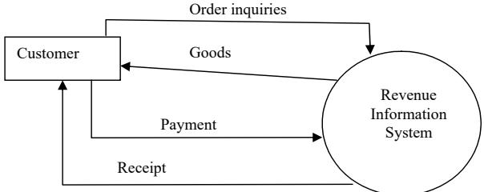
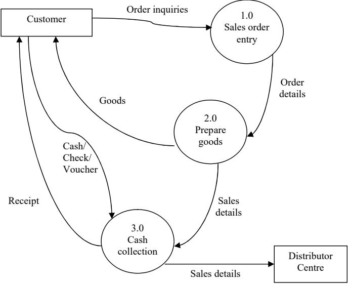
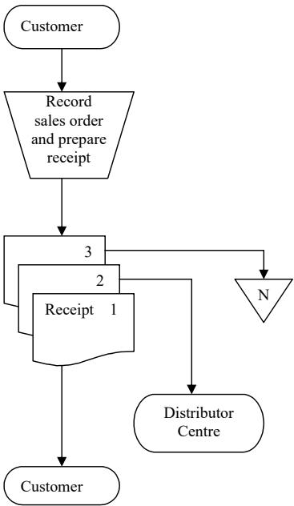
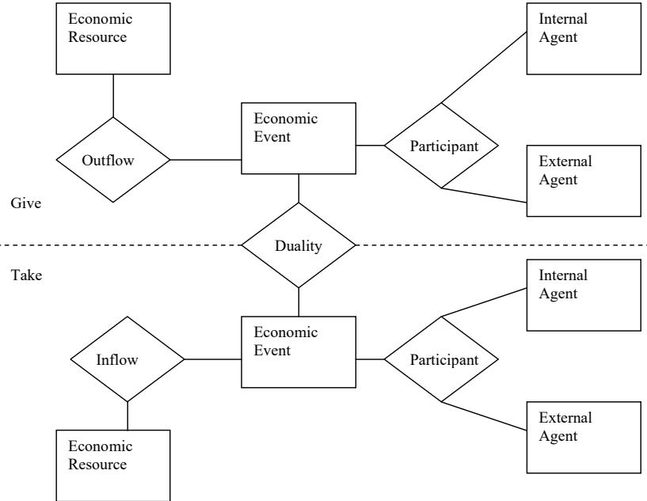
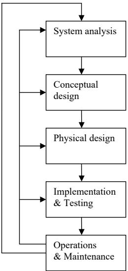
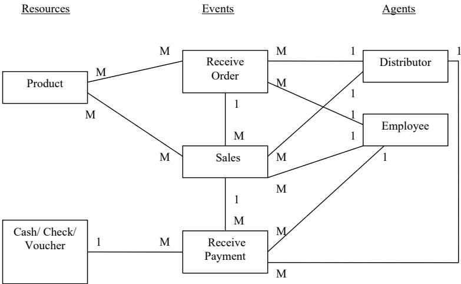

# Resource-Event-Agent (REA) Modelling in Revenue Information System (RiS) Development: Smart Application for Direct-Selling Dealers and SMEs

 $ ^{1} $ Khairina Rosli,  $ ^{2} $ Aidi Ahmi,  $ ^{3} $ Liana Mohamad

 $ ^{1\&2} $ College of Business, Universiti Utara Malaysia, UUM Sintok, Kedah, Malaysia.

Faculty of Management and Information Technology, UCSI University, Kuala Lumpur.

liana@ucsi.edu.my

## Abstract

Revenue Information System (RiS) is the product of a research project based on a case study on direct-selling sales point. This study is to determine the resources, events, and agents for Resource-Event-Agent (REA) data model as a technique of specifying and designing accounting information system and also to develop a system prototype based on the REA model. RiS is built based on the REA data model since it captures only essential aspects of economic phenomena. The idea is to build an information system application that supports business process in real-time and the REA data model is chosen to ease the understanding of the database. In this paper, the researchers described the approach and process in planning and performing the project transformation and conversion from the legacy information systems to the new updated information system. The researchers applied the REA model approach and process into a real case study of sales order and cash receipt systems. The result shows that REA model captures only essential aspects of economic phenomena and thus, (1) models are kept concise and easy to understand, (2) models can be used for many applications, and (3) derived artefacts are always consistent by means of the models. This new developed system has resulted in the improvement in business processes efficiency, the timely collection of cash and the provision of timely account information for decision making. Database design in business information system structured by accountants and those who are involved in the business itself will create a meaningful system as their business needs are fulfilled.

Keywords: Accounting Information System (AIS), Resource-Event-Agent (REA), Direct Selling

### 1. INTRODUCTION

The revenue stream process supports the direct functions for business in supplying and selling products to customers. The key to effectively manage and implement this business process lies in the technology (Cavitt, 1998). Thus, revenue stream systems should be integrated in a single, non-redundant data repository. One of the major benefits is that all data are updated only once, stored in one place, and provide a single source for reports.

With an integrated system, data duplication is eliminated; all reports reflect identical content, data fields are standardized, data integrity problems are eliminated and system maintenance is reduced (Walker and Johnson, 2001).

Companies should give quick response to competitor actions and change their business models to make a good, wise and effective decision towards product placing, fulfilling the orders and other critical elements (Hollander et al. 2000). To compete successfully, companies must improve the quality, speed and responsiveness of their customer service. Attaining these objectives requires information systems that support strategic management of revenue drivers (Walker and Johnson, 2001). The information systems comprising the revenue cycle are the key components to eliminate gaps between ordering, distribution and payment. It also represents a major focus of any information systems project design to improve customer satisfaction, organisational efficiency and profitability. Seeing that these technology solutions are an integral part of an organisation's success, this research develops a revenue information system using REA data modelling that can help business especially accountants and managers of small businesses that possess limited information technology (IT) knowledge to manage accurate, reliable and timely information available to support individual customers and business requirements in revenue cycle. REA model is a means of specifying and designing accounting information systems that serve the needs of all the users within an organization (Hall, 2004).

### 2. PROBLEM STATEMENT

Direct Selling Sales Point is brought into existence mainly to support sales and ease the supply of goods to direct selling customers in an area, besides disseminating information and training to sole distributors. In acknowledging the fact that Sales Points are the root in the distribution of supplies, the nearest reachable stores to customers and furthermore contribute to the successful marketing of direct selling, there is indeed a need to develop a system that could fulfil the Sales Point requirements.

Sales Point is currently being fully operated by a manager and an employee. All of the business activities and related information processing operations such as providing goods to customers and collecting cash in payment for those sales are done manually. Sales Point is a time-consuming process and create problems for those involved in terms of recording their sales transactions with the customers. Pens are used to write tediously the transaction particulars on duplicated receipt, and all calculations are performed manually using calculators. It is possible for undetected errors to be introduced into the current system for quite some time.

Furthermore, all data regarding their customers and products are recorded in separate books. It is hard for the employee to access the data needed quickly as another customer comes to the Sales Point through this traditional method. In addition, in the direct selling business, in order to record a sales transaction for a customer, the employee has to write all of the information needed such as customer's and distributor's name, distributor's code, upline's name and code, product code, product promotional value (PV), product bonus value (BV) and product price. Other problems that arise are in documenting the reports to the Distributor Centre and generating a proper monthly financial statement.

The details of the business process by the Sales Point are shown in the Context Diagram in Figure 1, Data Flow Diagram (Figure 2), and the Flowchart in Figure 3. It is analysed further in the Current System Analysis. Hence, this study develops a new system prototype that enables problem solving solutions to the problems through the case study of Sales Point.

Figure 1: Context Diagram

Figure 2: Data Flow Diagram

Figure 3: Flowchart

### 3. OBJECTIVE

The objectives of this study are as follows:

1. To determine the resources, events, and agents for REA data model as a means of specifying and designing accounting information system.

2. To develop a prototype of computerised database revenue information system that supports business process in real-time for Sales Point. This study focuses mainly on the revenue cycle namely sales and cash collection due to the core business activities carried out by the Sales Point.

### 4. SIGNIFICANCE OF THE STUDY

This study is very significant in its objective to develop a revenue cycle model data by the use of REA modelling, and is meant to help and fulfil the needs of businesses in adopting information technology applications. The REA model is an alternative accounting framework used for modelling an organisation's critical resources, events, and agents and also the relationships between them (Hall, 2004). The development of the revenue information system could contribute to the efficiency in business processes.

The potential for such a system to improve the processing of customer orders, to support timely collection of cash, and to provide timely account information is immense. The implementation of the system could also simplify and reduce cost in the revenue and cash collection cycle. This is beneficial to the accounting cycle process.

Furthermore it could contribute to the application of knowledge of Accounting Information System educators, and introduce lecturers or instructors to the real world environment, specifically on how the REA data modelling method is utilised and how the implementation of IT could be integrated into the accounting cycle. An integrated information system requires a good data modelling technique, thus REA data model is a solution for this situation which uses semantic modelling. The availability of multiple views offered by the REA model allows flexible use of transaction data and enables the development of accounting information systems that are free of the weaknesses in narrowing the role of accounting information.

Moreover, as the role of accountants is crucial in database design, accountants should be involved in all stages of designing the database (Romney and Steinbart, 2002, Hall, 2004). The role of the accountant as a system designer is important in determining the nature of information required, its sources, its destination, and the accounting rules that need to be applied. Therefore, this study would be useful to help accountants and managers to determine the information and business processes that truly provide the value-added element in the representation of the business database model.

### 5. LITERATURE REVIEW

### A. Accounting Information System

An accounting information system (AIS) is the system that collects, records, stores and processes data to keep and maintain its accounting system. This includes the purchase, sales, and other financial processes of the business. The purpose of AIS is to accumulate data and provide decisions makers (investors, creditors, and managers) with information to make decisions (Romney and Steinbart, 2002). The approach or tool used to produce accounting information includes manual systems, complex computer and IT system or a combination of these two extremes. And as for the computer system approach, in order to ensure the consistent application of technology, users must have and use documented processes and procedures that are repeatable, understandable, and feasible (Orshesky, 2003).

Business software solutions based on a Relational Database Management System (RDBMS) has become emerging standard in application software (Cavitt, 1998 and Moncrief and Cravens, 1999). Database implies that an organisation acquires and maintains an extensive file of information on the customers and potential customers. The database will track purchases of customers and even predict when the customer is in need of a reorder. Database marketing is foreseen to be a routine and an absolute necessity (Moncrief and Cravens, 1999). Some other advantages of relational database technology are greater flexibility and access to information, easier reporting of information and more efficient system performance (Hall, 2004 and Cavitt, 1998).

### B. Revenue Information System

The revenue cycle is defined as a recurring set of business activities and related information processing operations associated with providing goods and services to customers and collecting cash in payment for those sales (Romney and Steinbart, 2002). The primary external exchange of information in revenue cycle is with customers. One of the objectives of accounting information system in the revenue cycle is to support the performance of the organisation's business activities by efficiently processing transaction data. Basically, there are four revenue cycle business activities namely; (1) sales order entry, (2) shipping, (3) billing, and (4) cash collections. Meanwhile, Walker and Johnson (2001) defines the revenue stream in detail, which includes sales order receipt and processing, credit verification, pricing, invoicing, revenue recording, return processing, and cash collection.

The second function of accounting information system in revenue cycle is to provide adequate control of the business. The controls ensure that all transactions are properly authorised, valid and recorded accurately. The controls include the safeguard of assets (cash, inventory, and data) from loss or theft and are to ensure that business activities are performed efficiently and effectively (Noor Azizi, et al., 1998 and Romney and Steinbart, 2002).

The third function of the accounting information system in revenue cycle is to provide useful information for decision making. Sales and cash collection involve the decisions and processes necessary for the transfer of the ownership of goods and services to customer, for example, to respond to customer inquiries and determine inventory availability. Walker and Johnson (2001) stated that revenue stream information systems provide the foundation for processing of clerical functions, such as billing and journal entries; linking sales, order processing, order status, customer service and cash receipts; customer relations support; control of uncollectible accounts; and reporting to management and regulatory agencies.

### C. Price Promotions

The revenue stream information system must be able to track promotional programs in a timely and accurate manner. Major system deliverables for promotion monitoring are the remote access for updating or entering price promotion data which include price editing and validation processes. This is very much crucial as prices of goods fluctuate according to market prices and are manipulated by the demand and supply theory. Other than that, flexibility in price reductions is also important, including the ability to run simultaneous price promotions (Walker and Johnson, 2001) and integration of price promotion rules to monitor legal compliance. Price promotion is done as part of marketing strategy to attract customers and gain more revenue however it must be made within a feasible range of price.

### D. Revenue reporting

Accounting information systems are meant to assist users in providing information for decision making tasks. Revenue reports are tools that allow management to monitor company performance. These reports provide information to measure current performance and to analyse performance against goals.

In addition, revenue reports allow management to make decisions regarding pricing strategies and to be proactive in dealing with changing market conditions. Major system deliverables for revenue reporting include (Walker and Johnson, 2001) facilitating the definition and documentation of management information requirements; a standardised reporting system that meets specific periodic reporting requirements; query capabilities for customised reports to authorised users; and accurate, timely and flexible journal updates to the general ledger.

### E. Resource-Event-Agent (REA) Model

The REA model is a technique for capturing information about economic phenomena. It describes a business as a set of economic resources, economic events and economic agents as well as relationships among them. REA was proposed by William E. McCarthy in 1982 as a theoretical model for accounting to support a wide variety of information. Although the REA model was proposed as a result of the study of accounting theories, it can be applied to many other business domains. It can be used for inventory control by assigning goods to resources, transfers to events, and owners to agents. It can also be used for payroll administration and management purposes by assigning lengths of time to resources, time cards to events, and employees to agents. The REA model is a promising modelling technique for developing business applications because it has a solid foundation and it can be applied to nearly all businesses (McCarthy, 1982).

McCarthy demonstrated that by capturing the essential characteristics of an operating event, multiple classification schemes could be supported, including traditional accounting information such as journals, ledgers and financial statements (Hollander et al, 2000). Since 1982, REA theory has expanded considerably in accounting research, practice and education. However, the rate of this progress and the assimilation of REA work into the mainstream ideas of accounting were not sufficiently powerful as most theoretical and practical changes of Entity-Relationship (E-R) modelling.

Thus, McCarthy (1982) extended his E-R approach, exploring the issue of database design in a larger organisational context. He emphasised that a change in perspective is needed if accounting is to become a constituent part of an enterprise database system rather than remaining an independent and non-integrated information system. He explained that the view modelling and view integration phases of database design require accounting phenomena be characterised in terms of compatibility with non-accounting decision use. He proposed the REA accounting model such as characterisation be as presented in Figure 4.

Figure 4: REA Template

Social science models for generating and evaluating research projects create a less-than-hospitable environment for researchers who are trying to create new constructs, methods, and tools for building better information systems and there is no place where this is true than in academic accounting. As the result of this narrow attitude in accounting research, most conceptual or E-R oriented research concentrated either in ‘system accounting’ journals or in journals outside of accounting (McCarthy, 1999).

The use of E-R modelling in particular and semantic modelling in general has had very noticeable effects in accounting over the last 30 years. The most pronounced impact has been on accounting education where REA models of the type first proposed by McCarthy (1979, 1982) have permeated the undergraduate curriculum. However, the effect of REA on accounting practice has been less pronounced, partially because of technological impediments. But due to the evolving era of information technology, major Enterprise Resource Planning (ERP) vendors have made a call to discuss REA. International Business Machines Corporation (IBM Corporations) for instance, has implemented a system following the REA pattern (Cherrington et al., 1996) and a supply chain system is developed based exclusively upon REA (Haugen and McCarthy, 2000). These developments prove that the ideas of REA are contributing to both the literature and the economy (David et al., 2005).

### 6. METHODOLOGY

The development of Revenue Information System is implemented by the use of the System Development Life Cycle (SDLC) method which is similar to the database design methodology for REA. The database design methodology for which REA was proposed by McCarthy (1979, 1982) has four steps: (1) requirements analysis, (2) conceptual design, (3) implementation design, and (4) physical design.

Furthermore, similar to REA methodology, SDLC consists of five phases (Romney and Steinbart, 2002) which are: (1) system analysis, (2) conceptual design, (3) physical design, (4) implementation and testing, and (5) operation and maintenance. Figure 5 illustrates the flow of RIS research methodology that utilised SDLC. SDLC is chosen as a methodology for RIS because it is a continuous process of creation, maintenance, enhancement and replacement of information system (Rob and Coronel, 2007). SDLC is an iterative rather than sequential process, thus the methodology in developing RIS is done frequently and repetitively until users and researchers are agreeable and satisfied with the system. Rob and Coronel (2007) stated that successful information systems are subject to frequent evaluation and revision within this framework of SDLC. The methodology used in each phase of SDLC is explained in depth in the next sections.

Figure 5: System Development Life Cycle

### A. System Analysis

The development of RIS starts with the system analysis phase. During system analysis, the current system is surveyed through face-to-face interviews with the Sales Point manager and through observations to define the nature, scope and to understand the current business activity, its strengths and weaknesses. An adequate understanding of the current system environment is essential to determine the scope of changes and opportunities for improvements in order to the design of the revenue stream. Discussion sessions with user are useful to determine the scope of the project and to prepare a preliminary plan. The primary objective of interviewing key personnel is to identify opportunities for improvement within the scope of the revenue stream project, not only in relations to current business practices, but also in anticipation of future developments (Walker and Johnson, 2001).

The questions used in interviews with the personnel focuses on numerous issues including:

The nature, scope and objectives of the Sales Point

The events/ activities involved in the business process

The roles performed and who/what agents perform the roles in executing each events

The kind of resources involved and how much they were used

The place where the events occur

The interrelationship between resources, events and agents

The problems in executing the events that may cause risks

The user requirements and expectations for the new system

The information and recommendations gathered in this process provide a framework for future changes in the design structure of the revenue stream. An in-depth study of the proposed system is then conducted to determine its feasibility. The information needs of system users are identified and documented. These needs are used to develop and document system requirements for the new system.

### B. Conceptual Design

During the conceptual system design phase, appropriate design alternatives are identified and evaluated by utilising the REA model. Detailed specifications outlining what the system will accomplish and how it is to be controlled are also developed. In analysing the business process and developing the REA model, we adopt the steps developed by Hollander et al. (2000): (1) understand the organisation's environment and objectives, (2) review the business process and identify significant strategic operating events, (3) analyse each event to identify the event resources, agents and locations, (4) identify the relevant behaviours, characteristics and attributes of the events, resources and agents, and (5) identify and document the direct relationships among the resources, events and agents.

### C. Physical Design

In the physical design phase, the broad user oriented requirements of the conceptual design are then translated into detailed specifications that are used to code and test the system. The new proposed system is developed by the use of Windows based environment. Microsoft Access and Visual Basic software programmes are used to develop the new system prototype.

Thus the users can run the system with other applications at the same time on one computer. The input and output documents are designed and procedures are also developed into the new system. The function and features of the system include data entry and updates, queries and forms that provide easy mechanisms for adding, updating and searching information. To make the system more user-friendly, graphic user interface (GUI) are included. In addition, the new system is also able to produce various types of reports and catalogues.

### D. Implementation and Testing

In the implementation and testing phase, all the elements and activities of the system are combined together. Any new hardware, software and processing procedures is installed and tested. Instructions and explanations are required to be given to the users with regards to the functions and features of the system, before post implementation review is conducted. This is to ensure that the system is running according to user specifications.

### 7. CURRENT SYSTEM ANALYSIS AND SPECIFICATION

The revenue activities involved in the Sales Point are ‘taking’ customer orders and receiving payments for those sales. The revenue process starts when the customer walks into the Sales Point and orders the product. To record the proof of purchase by the customer, the Sales Point employee has to issue a receipt. The receipt includes the customer’s (distributor’s) details, order details and payment details. The distributor’s details include the Distributor’s Name and Code, and the Upline’s Name and Code. The Order details which include the code of the product, the quantity, promotional value (PV), bonus value, (BV) and dealer’s price are then recorded manually in the receipt after the sales have transpired and eventually the customer pays for the products. The receipt is prepared in three copies. The first is the Head Quarter’s copy (pink colour), the second is a duplicated receipt for the customer’s copy (blue colour) and the third is a duplicated copy (yellow colour) which is to be filed in the Sales Point.

At the end of the day, a Daily Sales Report is prepared which totals up the sales of the day. Then, at the end of every week, the Sales Point Manager prepares a Sales Summary Report manually before submitting it to the Distributor Centre along with the first copy (Head Quarter's copy) of the receipts to replenish the goods that have been purchased by the customers. The Sales Summary Report details up the receipts marked numbers, date of sales and the distributors' marked numbers.

### A. Current System Problem

As the current system is done manually, we have identified some major problems which are listed below:

### a. Time consuming

The main problem is that the time consumed in preparing the receipt for each customer is quite long. As mentioned in the current system analysis, for each sales event, the Sales Point employee has to write down the distributor's particulars, order details and the payment details. The distributor details are the Distributor's Name and Code, the Upline's Name and Code. The order details include the product's code, quantity, Promotional Value (PV), Bonus value (BV) and dealer's price.

The time taken is much longer if the customer has ordered more than one product as each of the order details have to be multiplied by the quantity ordered. This problem has affected the quality of responsiveness of their customer's services and customer's satisfaction.

### b. Lack of information for decision making

The problem of the inability to combine all of the data in one database has also caused the Sales Point personnel to prepare an incomplete sales summary report for decision making purpose. The information regarding the quantity of each product being sold to customers, the fast moving products or the slow moving products cannot be generated for analysis. Thus, the current system does not provide the timely information and the needed information to aid them in making decisions.

### c. Inefficiency of data storage, data updating and data searching

The details of the products and the distributors' details are written manually in separate books. The Sales Point employee has to refer to the products lists to write the product code, PV, BV and price for the specific product each time the receipts are filled in by a customer. The problem arises in the updating of the data as there are new products introduced in the market and some of the products details (e.g. product's code, PV, BV or price) changes from time to time. It is also possible for errors to occur in the current system with the possibility of being undetected for quite some time. Thus the data storage, data updating and data querying is inefficient.

### 8. SYSTEM DESIGN

The overall current system specification analysis, business processes and rules are evaluated and translated into conceptual design as illustrated in the Figure 6. The main component is the system generator, which is based on the REA model and a code template that generates the files needed to build the new prototype system that utilises the database software.

Figure 6: REA Model

Based on the system analysis, the product has been identified as the main resource for receiving order event and sales event. These two operating events are initiated by the distributor who makes the order and the events are handled by the employee who processes the transactions. After the occurrence of the sales events, it is followed by the 'receive payment' event which also involves the same agents who are the distributor and employee. The cash/check/voucher received from the distributor are then identified as the resources for the 'receive payment' event.

### 9. SYSTEM IMPLEMENTATION AND TESTING

The implementation and testing phase is the phase where all the elements and activities of the system coalesce. The purpose is to ensure that the functional requirements of the developed system are achieved as discussed during the system analysis phase.

The RIS prototype system has four main processes/ functions from the distributor data entry through the cash receipts entry. These four processes include: (1) the distributor data entry, (2) the inventory data entry, (3) the sales order data entry and (4) the cash receipts data entry. The main functions are also supported with additional functions which include: (1) the report preparation, (2) product replenishment, (3) system password, (4) system backup, and (5) the system audit trail.

In the implementation and testing phase that are executed to identify whether the system prototype improves the efficiency of business process, the researchers of this study compared and contrasted the functions of the current manual system with the new system prototype by the use of the real input transactions. Firstly a system demonstration was conducted to the user and explanation was given for each of the functions and features of the system. Then, a task-by-task comparison and contrast analysis between the manual system and the new system prototype were executed by recording the start and stop times of completing the tasks by considering the following functional components: (1) querying product information (e.g. product code, PV, BV, Price), (2) querying distributor information (e.g. distributor code, sponsor code), (3) processing sales order transaction, (4) preparing product replenishment reports, (5) preparing daily sales summary, (6) preparing weekly sales summary and (7) the frequency in replenishing the products.

The system testing is an ongoing process. The various components of the system are integrated and systematically tested. The system is tested for continued performance in accordance with user requirements, and needed system modifications are subsequently incorporated. The operational and functional system is periodically assessed through reviews to determine how the system can be made more efficient and effective. Operations continue as long as the system can be effectively adapted to respond to the needs of the business. When modifications or changes are identified as necessary, the system has to re-enter the planning phase. This phase continues until the system is satisfied in accordance with the defined user requirements.

Then, the prototype modifications are installed and made operational in a real world environment. New hardware, software and processing procedures are installed and tested. The user manual is prepared and users are given explanations with regards to the system functions and features.

Real data are used as the testing input and reports are generated for the user's validation. Lastly, post implementation review is conducted and tested to ensure that the system is running according to user specifications.

### 10. FINDINGS AND DISCUSSIONS

### A. Findings

During the first phase of SDLC which is the system analysis, a survey was conducted to determine the feasibility of the new proposed system. A total of 8 'Sales Point' personnel were interviewed. The finding as depicted in Table 1 shows that there is a positive indication of the feasibility of the proposed system by the 75% positive response from the Sales Point personnel. There is a marked indication of encouragement from the Sales Point personnel for a shift from the current manual operations to a computerised system.

Table 1: The Feasibility of RIS

<table border=1 style='margin: auto; word-wrap: break-word;'><tr><td style='text-align: center; word-wrap: break-word;'></td><td style='text-align: center; word-wrap: break-word;'>Total</td><td style='text-align: center; word-wrap: break-word;'>%</td></tr><tr><td style='text-align: center; word-wrap: break-word;'>Yes</td><td style='text-align: center; word-wrap: break-word;'>6</td><td style='text-align: center; word-wrap: break-word;'>75.0</td></tr><tr><td style='text-align: center; word-wrap: break-word;'>No</td><td style='text-align: center; word-wrap: break-word;'>2</td><td style='text-align: center; word-wrap: break-word;'>25.0</td></tr><tr><td style='text-align: center; word-wrap: break-word;'>Total</td><td style='text-align: center; word-wrap: break-word;'>8</td><td style='text-align: center; word-wrap: break-word;'>100.0</td></tr></table>

The new developed system focuses on improving the efficiency in business processes, processing customer orders, supporting timely collection of cash and providing timely account information for decision making. In the new computerized system, all data regarding the distributors and products are stored in one database. The new system still maintains the same data flow and document flow used before. The operation functions and the elements that are exhibiting significant value-added contributions to the business function are further identified. It is essential that the REA model to be detailed out. Thus, the system flowchart, and data flow diagram of the business functions, together with the business rules and the business data were combined to design the overall picture of the REA model as illustrated in Figure 6. The results of adopting the REA model and the implementation of the new prototype are discussed below:

a. REA Model as a means of specifying and designing accounting information system.

The REA model captures only essential aspects of economic phenomena. Owing to the clear separation of base objects from information derivation processes, we found that:

i) REA models are kept concise and easy to understand. Business information and entities involved in the system are easily identified and categorised based on resources (R), events (E) and agents (A), which formed the basis for REA model. Non value-added activities that will generate excess capacity for the business operations can be eliminated from the conceptual design. Thus, the REA model helps to develop RIS prototype system that will permit better focus on control and efficiency on business operations.

ii) REA models can be used for many applications. All data is integrated in a way that allows the managers and employee to access the information they need to perform the business effectively. Each entity (resources, events and agents) in the REA model links to each other by relationships. With the availability of the full REA model, the mapping of the relationships in the model to the relationships in the Relational DBMS is clear cut.

iii) Derived artefacts are always consistent by means of the models. REA does not include some traditional accounting artefacts associated with journals or ledgers, such as debit, credit, receivables, or accounts. Instead, these elements are derived from REA model objects. For instance, the quantity on hand for an inventory item is obtained from the imbalance between the purchase events and the sales events for that inventory item. Another example is accounts receivables, which is generated from other primary data that are the sales events minus the cash collection events. Thus, the REA model is able to capture the meaning of business events more efficiently and effectively as compared to the double-entry bookkeeping model.

### b. Improve the efficiency in business process

All of the product ordering and cash collection from the customer is done in one computerised system. The Sales Point employee may search for distributors and products information using the search function in the new system. All of the information regarding the specific distributor and product searched will then appear automatically after keying the desired distributor code/name and product code/name. The calculation of total PV, BV and price are also done automatically by the new system. The user has only to select the products and input the quantity ordered by customer. This expedites the processing of customers' orders, reduces the input and calculation errors, provides a quick response to query and eventually increases customer satisfaction. The findings of RIS implementation are shown in Table 2.

Table 2: Implementation of RIS Results

<table border=1 style='margin: auto; word-wrap: break-word;'><tr><td style='text-align: center; word-wrap: break-word;'>Task</td><td style='text-align: center; word-wrap: break-word;'>Before RIS Implementation</td><td style='text-align: center; word-wrap: break-word;'>After RIS Implementation</td></tr><tr><td style='text-align: center; word-wrap: break-word;'>Querying Product\nInformation (e.g. Product code, PV, BV, Price)</td><td style='text-align: center; word-wrap: break-word;'>1 minute 21 seconds</td><td style='text-align: center; word-wrap: break-word;'>42 seconds</td></tr><tr><td style='text-align: center; word-wrap: break-word;'>Querying Distributor\nInformation (e.g. Distributor code, Sponsor code)</td><td style='text-align: center; word-wrap: break-word;'>25 seconds</td><td style='text-align: center; word-wrap: break-word;'>12 seconds</td></tr><tr><td style='text-align: center; word-wrap: break-word;'>Processing Sales Order Transaction</td><td style='text-align: center; word-wrap: break-word;'>5 minutes 48 seconds</td><td style='text-align: center; word-wrap: break-word;'>2 minutes 56 seconds</td></tr><tr><td style='text-align: center; word-wrap: break-word;'>Preparing Product Replenishment Reports</td><td style='text-align: center; word-wrap: break-word;'>Can only be done after closing the sales for each period</td><td style='text-align: center; word-wrap: break-word;'>Product replenishment information are updated automatically at each sales</td></tr><tr><td style='text-align: center; word-wrap: break-word;'>Preparing Daily Sales Summary</td><td style='text-align: center; word-wrap: break-word;'>Can only be done at the end of the day</td><td style='text-align: center; word-wrap: break-word;'>Daily sales are updated automatically for every sales</td></tr><tr><td style='text-align: center; word-wrap: break-word;'>Preparing Weekly Sales Summary</td><td style='text-align: center; word-wrap: break-word;'>Can only be done after completing daily sales</td><td style='text-align: center; word-wrap: break-word;'>Automatically prepared by system</td></tr><tr><td style='text-align: center; word-wrap: break-word;'>The frequency in replenishing the products</td><td style='text-align: center; word-wrap: break-word;'>6 times</td><td style='text-align: center; word-wrap: break-word;'>4 times</td></tr></table>

Table 2 depicts the differences in the results prior to the implementation of RIS and after the implementation of RIS. The results specify the time spent in completing each task such as the querying on product information, the distributor information, the processing of sales order transactions and also in the preparation of reports. It shows that the time spent to process customer's orders has reduced to 2 minutes and 56 seconds after the implementation of RIS.

The RIS has also saved time for preparation of the needed reports as the system automatically updates the information in the reports at each occurrence of an event transaction. The results supported the first objective of an accounting information system in the revenue cycle mentioned earlier, that is to support the performance of the organisation's business activities by an efficient data transaction process.

### c. Provide timely information for decision making

The results are also in line with the third function of the accounting information system in revenue cycle which is to provide useful information for decision making. The new computerised system could generate various reports from the report function. This function provides the management with timely and detailed information regarding sales such as the daily sales report, the weekly and monthly sales summary, the products and quantity of products being sold summary, the products lists, the distributors list and also the product catalogues for customers' reference. By the procurement of the sales summary, the management can decide on the timely replenishment of the products. This helps to reduce the frequency of time and cost spent in replenishing products (refer to Table 2).

It should be noted that the sales and cash collection events involve the decisions necessary for the transfer of ownership of the goods and services to customers. These include the response to customer enquiries and the determination of inventory availability. The focus of having timely information is to support temporal concepts. Meaningful accounting information must be specified with either a point of time or duration of time. For example, a user may ask for a report on the previous month's sales activities. In that case, we need the past states of the object model as well as the past rules to calculate the sales. When adding temporal information to the system, we have to consider how to keep track of the changes in objects, values, associations and queries.

### d. Efficiency of data control, data storage, data updating and searching

The system prototype is enhanced with system audit trail and system backup. These are to ensure that the system provide adequate control to the business including the safeguard of data from loss in order to support the second function of accounting information system in revenue cycle.

The user-friendly functions and Graphical User Interface (GUI) features embedded also contribute to the ease of using the new system. Functions such as updating existing record, adding new record, deleting and searching a particular record solve the problems in the inefficiency of data storage, data updating and data searching problem. All of the said tasks can be done by the use of a single database instead of having separate books of records.

### B. Discussions

Database design in business information system structured by those who are involved in the business itself would create a meaningful system as their needs are fulfilled. The challenge is in the effective use of IT to build information system architectures that improve the ability of accounting to support organisations. To meet this challenge, accounting professionals need to develop a strategic and conceptual understanding of IT resources with the ability to understand and model business activities and processes involved.

Traditionally, accountants have been responsible for assessing the information needs of users, defining the content and format of output reports, selecting accounting rules and determining the controls necessary to preserve the integrity and efficiency of the information system. With the arrival of IT era, the role of accountants became wider, as accountants now act as the system users, system designers and system auditors. Their demands are broadening the traditional transaction documentation and boundaries of the accounting system. However, the part to be played by accountants became the subject of much controversy (Hall, 2004). Lacking computer skills and not being computer savvy, accountants were generally uncertain about their status and unwilling to explore the emerging technology.

In system design, the accounting function is responsible for the conceptual system which is to determine the nature of the information required, its sources, its destination, and the accounting rules that must be applied, while the computer function is responsible for the physical system. Hence, system design should be collaboration between these two fields. Because of the uniqueness of each system and the susceptibility of the systems to serious error and even fraud, the accountant's involvement in systems design should be pervasive. Thus, the active participation of accountants is critical to the system's success.

### C. REA versus ER modelling

REA and ER model are two methods of data modelling that have a lot in common, but there are, of course some differences and advantages. ER-diagramming is more commonly found with traditional event-based systems while REA-modelling is used with event-oriented systems. Event-oriented system which focuses on business events redefines the scope of accounting. Rather than selecting only those traditional accounting events that change the company's assets, liabilities, or owner equity, event-driven system select those business events that management wants to plan, control and evaluate. Of a particular note, while ER models include operating, information, and decision and management events, REA models include only operating events. Nevertheless, REA model can still be used as collection, storage and maintenance of both financial and non-financial data about business events in detail and supports a wider range of management decisions.

In addition, REA model increases productivity via elimination of non-value added activities. It helps managers to identify non-value added activities that will generate excess capacity. Still, REA is simpler and more focused on business needs.

### 11. CONCLUSION, LIMITATIONS AND FUTURE RESEARCH

In this paper, the researchers have described a structured approach and process in the planning and the implementation of a transformation project and in the conversion from the legacy information systems to the new updated information systems. The researchers have applied the REA model approach and process to a real world case study, that is, the transformation project of the RIS in the sales order receipts and cash receipt systems. They have also discussed the step-by-step use of the structured techniques of the REA in the case study.

In conclusion, the REA model is an alternative view of an accounting information system that could support the information needs of all users in the organization. An approach to database design is meant to overcome problems with traditional approaches, and alternate the traditional approach with the use of centralised relational database structure with the aims of collecting detailed financial and non-financial data, supporting accounting and non-accounting analysis, supporting multiple user views and enterprise-wide planning. The REA model is built upon an organisation's resources, events, and agents, and how these elements are interrelated. Application of the REA model yields to a centralised and relational database. Using REA model, the user views which are a set of data that a particular user needs to do his or her job can be created for all users of organisational information.

The prototype of the RIS shows that organisations do need the application of database information system to improve their competitive edge in business. Managing the revenue information system enhances the value of organisations by improving the efficiency of business processes, the quality, speed and responsiveness of their customer services. The functions and features of the system which include the data entry and updates, queries and forms provide easy and efficient mechanisms for adding, updating and searching for information. The new system enables the production of various types of timely reports and catalogues for user's decision making and reference. In addition, user-friendly functions and Graphical User Interface (GUI) features that were embedded in the system contribute to the feasibility of success and adoption of the system.

There are several limitations that need to be considered and addressed in future research. The RIS prototype is limited to revenue cycle scope which comprises of taking sales order and cash collection only. This is because the researchers focus on the main business process of the Sales Point. The RIS is also limited to the specific direct selling Sales Point as each of the direct selling companies has their own business rules, procedures and operations, of which, to develop such a system requires reference to the user specifications and user needs.

This paper is an attempt to use REA for the sole purpose of expressing business process modelling. Future research should study the implementation of online revenue information system and integrated network database. Some other important future research efforts that augment the ideas here are:

i) to develop a system that could link all of the sales points, distributor centres and the head quarters for a better communication and sharing of information, that fulfils one of the accounting information system function (Hall, 2004).

ii) to have an overall system that could incorporate all accounting cycles (revenue cycle, conversion cycle, expenditure cycle) to produce a complete and simultaneous result in the transaction process.

### 12. REFERENCES

[1] Cavitt, J.R. (1998). The Technology of Global Direct Selling, Direct Selling Today.

[2] Cerrington, J.O., Denna, E.L., and Andros, D.P. (1996). Developing an Event-Based Business Solution: The Case of IBM's National Employee Disbursement System. Journal of Information Systems, 10 (1): 51-69

[3] David, J.S., Gerard, G.J. and McCarthy, W.E. (2005). Design Science: Building the Future of AIS. IS Section Research Monograph of the American Accounting Association. On line (23 May 2006) http://www.msu.edu/user/mccarth4/

[4] Hall, J.A. (2004). Accounting Information Systems, 4 $ ^{th} $ Edition. United States; Thompson Learning.

[5] Haugen, R and McCarthy, W.E. (2005). REA: A Semantic Model for Internet Supply Chain Collaboration. On line (23 May 2006) http://www.jeffsutherland.org/oopsla2000/mccarthy/mccarthy.htm

[6] Hollander, A.S., Denna, E.L. and Cherrington, J.O. (2000). Accounting Information Technology and Business Solutions. Singapore; Mc Graw-Hill.

[7] McCarthy, W.E. (1979). An Entity-Relationship View of Accounting Model. The Accounting Review. October: pp 667-686

[8] McCarthy, W.E. (1982). The REA Accounting Model: A Generalized Framework for Accounting Systems in a Shared Data Environment. The Accounting Review. July. Pp 554-578

[9] McCarthy, W.E. (1999). Semantic Modeling in Accounting Education, Practice, and Research: Some Progress and Impediments, Published in: Conceptual Modeling: Current Issues and Future Directions, Berlin and Heidelberg, pp. 144-53

[10] Moncrief, W. C. and Cravens D. W. (1999). Technology and the Changing Marketing World. Marketing Intelligence & Planning, Volume 17, Number 7, pp. 329-332.

[11]Noor Azizi, Iskandar and Mohd Tarmizi. (1998). Sistem Pengurusan Inventori Berkomputer Sekolah Perakaunan.

[12]Orshesky C,M. (2003). Beyond technology - The human factor in business systems. Journal of Business Strategy, Volume 24, Number 4, pp. 43-47.

[13]Rob, P. and Coronel, C. (2007), Database Systems: Design, Implementation and Management. 7th Ed. Course Technology Publishing. Canada.

[14]Romney, M.B, and Steinbart, P.J. (2002). Accounting Information Systems. 8th Ed. PrenticeHall, Malaysia.

[15] Walker, K. B. and Johnson, E. N. (2001). Planning a revenue stream system in an e-business environment. Industrial Management & Data Systems. Volume 101, Number 8, pp. 406-413

Khairina Rosli is currently a lecturer at the College of Business (Accounting), University Utara Malaysia (UUM), Kedah. She completed her Master of Information Technology from Universiti Kebangsaan Malaysia in 2003 (2002-2003) and her Bachelor of Accountancy (Hons.) from Universiti Utara Malaysia in 2000 (1997-2000). Her area of expertise is in Accounting Information System with interest in Database Design, Resource-Event-Agent (REA) Modelling, Entrepreneurship and Accounting Education. The subjects that she has taught included Database Management Systems; Accounting Information Systems; Information Technology in Accounting; Business Accounting; and Financial Accounting. She has previously participated in the Kedah ICT Carnival and was conferred the Private Sector Innovation Award, Kedah ICT in 2007.

Mr. Aidi is currently a lecturer at the College of Business (Accounting), Universiti Utara Malaysia (UUM). He obtained his master degree in MSc. Accounting Information Systems from Leeds Metropolitan University in 2001 and Bachelor Degree of Accounting from UUM in 1997. Prior to joining UUM, he worked as an Internal Auditor with Asia Commercial Finance (M) Bhd. He is also a member of the Malaysian Institute of Accountant (MIA) and an associate member of the Institute of Internal Auditors Malaysia (IIAM). He commenced his duties at UUM as a Tutor in August 1999 and was appointed as a lecturer in December 2001. He gained invaluable experiences whilst he was attached at the Airedale National Health Services (NHS) Trust, United Kingdom in developing the database for their private patients. Since joining UUM as a lecturer in 2001, Mr. Aidi was involved in several accounting and information systems related consultancy projects including systems development in Majlis Agama Islam Kedah (MAIK) and has functioned as a Webmaster for several organisations i.e. Asian Academic Accounting Association (FourA) and Uniutama Management Holdings Sdn. Bhd.(UMHSB). His teaching and research expertise centres on Accounting Information System, Systems Development, Internal Auditing and e-Commerce.

Liana is currently an Accounting Lecturer attached at UCSI University since 2007. Previously, she was a lecturer at Universiti Utara Malaysia (UUM) for about 8 years. She graduated from Universiti Teknologi Malaysia (UTM) in Master of Science in Information Technology and completed her undergraduate degree programme from Universiti Utara Malaysia (UUM) in Bachelor Degree of Accounting. Her teaching experiences are in the areas of Accounting Information System, Financial Accounting, and Audit. She is interested in the research area of Internal

Control of Information System.